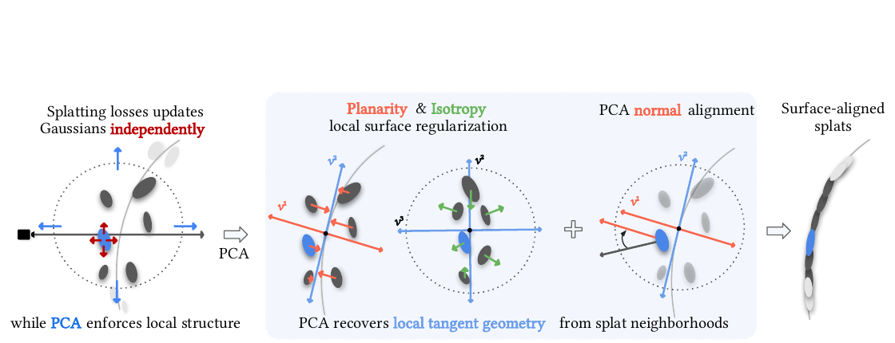
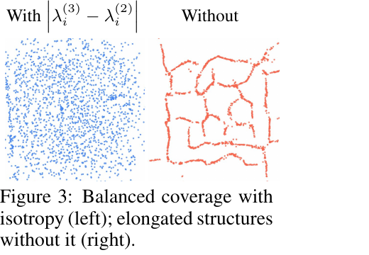
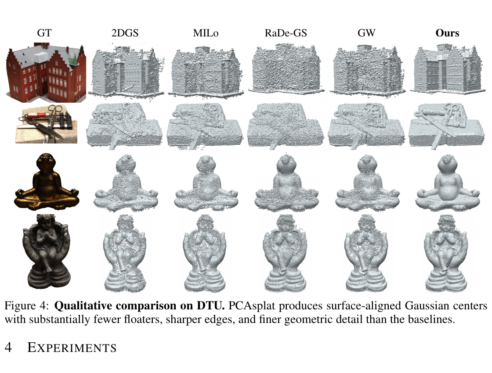

# PCAsplat 论文解读

> Vitor Matias、Filipe Nascimento、Kiyohiro Nakayama、João Paulo Lima、Márcus Lobo、Gordon Wetzstein、Leonidas Guibas、Afonso Paiva、Tiago Novello，*PCAsplat: Gaussian Splatting with Local PCA Regularization*，arXiv:2610.11011v1，2026 年 10 月 7 日。本文依据 [arXiv 论文页面](https://arxiv.org/abs/2610.11011) 和 [v1 论文 PDF](https://arxiv.org/pdf/2610.11011v1)。

3DGS 的高斯是为渲染图像而优化的：只要一组高斯能在训练相机下合成正确颜色，损失就可能很低。但这种要求没有保证每个高斯都贴在物体表面。被遮挡、贡献很小或从未被当前视角采样到的高斯，几何上缺少直接监督，可能漂到表面之外，甚至物体内部。它们在训练图像中未必显眼，却会妨碍点云分割、裁剪和网格重建。

PCAsplat 为这一类几何问题加入局部主成分分析（PCA）正则项。对每个高斯，它查看空间中最近的一组高斯中心，计算这组点的协方差和特征向量，再同时约束邻域厚度、切平面内的覆盖形状，以及高斯自身的法线方向。由于这些损失直接作用在三维邻域，它们能给当前相机没有看到的高斯中心提供几何梯度。

*原论文 Figure 2。光度损失主要按各高斯对当前图像的贡献更新参数；PCAsplat 则从邻域中心估计局部切平面，再压薄法线方向的分布、平衡切平面内的覆盖，并把高斯法线转向 PCA 法线。*

## 先从高斯中心估计局部表面

对一个高斯中心 $\boldsymbol{\mu}_i$，PCAsplat 取它的 $K$ 个最近中心组成邻域 $\mathcal{N}_K(i)$，计算邻域均值和中心协方差：

$$
\bar{\boldsymbol{\mu}}_i=\frac{1}{K}\sum_{j\in\mathcal{N}_K(i)}\boldsymbol{\mu}_j,\qquad
\mathbf{C}_i=\frac{1}{K}\sum_{j\in\mathcal{N}_K(i)}(\boldsymbol{\mu}_j-\bar{\boldsymbol{\mu}}_i)(\boldsymbol{\mu}_j-\bar{\boldsymbol{\mu}}_i)^\top.
\tag{2}
$$

协方差描述这组中心在不同方向上散布得有多开。将其特征值按从小到大记为 $\lambda_i^{(1)}\leq\lambda_i^{(2)}\leq\lambda_i^{(3)}$，对应的单位特征向量记为 $\mathbf{v}_i^{(1)},\mathbf{v}_i^{(2)},\mathbf{v}_i^{(3)}$。对于近似局部平面的邻域，最小特征值对应的方向近似表面法线，另外两个方向张成切平面。最小特征值则反映了高斯中心到这张局部平面的平均平方距离。

因此，降低 $\lambda_i^{(1)}$ 会把邻域中心沿 PCA 法线方向压向同一平面。这个判断依赖局部邻居确实来自同一片表面；如果邻域跨越物体边缘、薄结构两侧，或包含不同深度的多个表面，PCA 得到的平面也可能不是希望的表面。算法没有从图像中另找一个可信表面作为答案，而是用当前高斯分布本身估计局部结构。

特征值也给出了一个直接的梯度。假设邻居索引固定、协方差没有重复特征值，论文给出的导数是

$$
\frac{\partial\lambda_i^{(m)}}{\partial\boldsymbol{\mu}_j}
=\frac{2}{K}\left\langle\mathbf{v}_i^{(m)},\boldsymbol{\mu}_j-\bar{\boldsymbol{\mu}}_i\right\rangle\mathbf{v}_i^{(m)},
\qquad j\in\mathcal{N}_K(i).
$$

当 $m=1$ 时，梯度下降会减少邻域沿最小主轴的方差，因而把散开的中心拉向局部切平面。邻居中心同时会出现在多个高斯各自的 KNN 邻域中，所以它会累积来自多个局部 PCA 项的梯度。论文的推导将邻居集合视为固定；实际训练中，中心移动后 KNN 关系会更新，这使整个目标按分段固定的邻域关系变化。

## 压薄邻域，同时避免它塌成一条线

只压低最小特征值会让中心变得更平面，却没有阻止邻域在切平面内沿一个方向拉成长条。为此，PCAsplat 还惩罚两个切向特征值之间的差距：

$$
\mathcal{L}_{\mathrm{PCA}}=\frac{1}{N}\sum_{i=1}^{N}\left[\lambda_i^{(1)}+\gamma\left|\lambda_i^{(3)}-\lambda_i^{(2)}\right|\right],
\qquad \gamma=0.001.
\tag{3}
$$

第一项减少垂直于局部表面的厚度；第二项让邻域在两个切向方向上更均匀。后者并不要求场景中的真实物体本身各向同性，而是避免同一局部表面样本只沿单个方向稀疏排列，从而形成不稳定或细长的几何覆盖。论文图 3 对照了加入与不加入该项时的点分布。

*原论文 Figure 3。加入切向特征值差惩罚后，局部点集在切平面内更均衡；去掉该项的示例呈现细长的排列。该项约束的是邻域的采样形状，不是物体表面必须具有圆形边界。*

## 让每个高斯的法线跟随局部几何

PCA 估计的是中心邻域的法线，高斯自身也有一个由旋转和尺度决定的薄片方向。设高斯旋转矩阵的三个轴为 $\mathbf{r}_{i,1},\mathbf{r}_{i,2},\mathbf{r}_{i,3}$，对应尺度为 $s_{i,1},s_{i,2},s_{i,3}$。论文将最小尺度所对应的旋转轴作为该高斯法线 $\mathbf{n}_i^g$。随后通过法线夹角损失，使其与局部 PCA 法线 $\mathbf{v}_i^{(1)}$ 对齐：

$$
\mathcal{L}_{\mathrm{normal}}=
\frac{w_{\mathrm{normal}}}{N}\sum_i\left(1-\left|\left\langle\mathbf{v}_i^{(1)},\mathbf{n}_i^g\right\rangle\right|\right)
+\frac{w_{\mathrm{surfel}}}{N}\sum_i\min(s_{i,1},s_{i,2},s_{i,3}).
\tag{4}
$$

内积取绝对值，是因为平面法线 $\mathbf{n}$ 与 $-\mathbf{n}$ 描述同一朝向无关的几何平面。第二项压低每个高斯最小的尺度，让它更接近薄片状 surfel。总目标把这两类几何约束加到图像重建损失上：

$$
\mathcal{L}=\mathcal{L}_{\mathrm{RGB}}+w_{\mathrm{PCA}}\mathcal{L}_{\mathrm{PCA}}+\mathcal{L}_{\mathrm{normal}}.
\tag{5}
$$

这里的各项分工不同：光度项维持新视角外观，PCA 特征值项整理高斯中心的局部空间分布，法线项则协调高斯椭圆的朝向与中心邻域估计出的表面朝向。论文的实际系统建立在 RaDe-GS 上，并保留 PGSR 的多视图几何一致性和 patch 级法线一致性损失。因此，实验提升反映的是这些已有监督与 PCA 正则的组合；论文另做消融，检验了 PCA 项单独带来的几何收益。

## 先拟合外观，再逐步加入几何约束

训练先仅用图像损失优化 7,000 次迭代，然后启用 PCA 与法线相关损失。有限边界场景训练 20,000 次，无界场景训练 30,000 次；$w_{\mathrm{PCA}}$ 从 1 调度到 10。批量 $3\times3$ 特征分解使用专门的 CUDA kernel，实验在 NVIDIA RTX A5500（24 GB 显存）上运行。

这种训练顺序先让颜色与场景结构形成较稳定的初始解，再让局部 PCA 利用当前高斯中心建立几何邻域。如果一开始就让几何项主导，中心点云尚未贴近正确物体表面时，局部估计可能把邻域拉向错误的平面。论文采用延迟启用策略，但并未将它与所有其他启动时刻做系统比较，所以这组安排应理解为论文的训练设置，而不是跨场景都已验证的通用最优日程。

## 几何收益集中在高斯点云本身

PCAsplat 在 DTU 上将高斯中心与参考点云的 Chamfer Distance 平均值做到 0.519 mm，低于论文比较的其他 Gaussian-based 方法；其中 RaDe-GS 为 0.662 mm。论文报告，PCAsplat 的该项误差约低 22%，训练耗时为 22.3 分钟，RaDe-GS 为 14.5 分钟。它的几何提升伴随着训练开销，而不是免费获得。

*原论文 Figure 4。每行展示 DTU 的一个物体，列中依次给出参考图像与 2DGS、MILo、RaDe-GS、GaussianWrapping 和 PCAsplat 的重建点云。PCAsplat 的表面轮廓更清楚、外围散点更少；图中效果对应的是高斯中心几何质量。*

消融结果有助于区分几个损失的贡献：在该 DTU 设置下，基础模型的 Chamfer Distance 为 0.655；单独加 PCA 特征值项后降至 0.520，单独加法线正则为 0.654，两者一起为 0.519。该结果说明主要的数值改善来自对中心邻域平面性和切向覆盖的约束，而法线对齐在这个表格中带来的额外收益较小。

作者也把 PCA 正则以插件方式加到 2DGS、PGSR 和 MILo 上，三个方法的 DTU 误差都下降。对下游点云分割，ScanNet++ 上使用同一 Mask3D 流程时，PCAsplat 的 Top-1 mIoU 为 24.35%，Top-3 为 24.84%；较强的对照 VGGT-Ω 分别为 10.54% 和 10.58%。不过，纹理稀少的白墙仍然难以分割，且这里衡量的是在重建点云上运行的分割结果，不代表所有任务或数据上都能得到相同增益。

新视角合成不是论文的主要优化目标。Mip-NeRF 360 表格中，PCAsplat 室内 PSNR/SSIM/LPIPS 为 30.46/0.930/0.170，室外为 24.70/0.730/0.250；RaDe-GS 的室内结果是 30.74/0.928/0.165，室外为 25.17/0.764/0.199。由此看，PCAsplat 的中心点云几何明显更规整，但在这组外观指标上并没有全面领先。几何更适合下游处理与新视角图像指标更高，是两个相关但不相同的目标。

## 从渲染监督走向邻域监督

2DGS、GOF 等方法根据渲染深度或沿光线的高斯贡献建立几何损失。这些项与实际图像采样相连：某个高斯被遮挡或贡献很低时，传回它的梯度也会较弱。PCAsplat 在此之外添加三维邻域监督，让邻居中心之间的关系本身成为优化信号。它能改善没有被当前视角有效监督的高斯，但也使几何目标依赖 KNN 邻域质量、局部平面假设与正则权重。

论文报告了两个实现和几何边界：PCA 特征值反向传播假设邻居索引固定且没有重复特征值；此外，作者指出远处浮点的处理仍需深度相关步骤，法线还需做符号消歧。局部邻域若跨越几何边缘，这种正则项也不能单凭 PCA 判断两侧属于不同表面。因此，PCAsplat 更适合被理解为补足光度与多视图监督的局部几何项，而非独立的表面真值估计器。

从质量效果看，这篇工作的主要价值并非让每个新视角指标都变高，而是把 3DGS 中原本偏向图像贡献的学习信号，延伸到高斯中心构成的三维局部结构。实验显示，这种约束能让高斯中心更贴近表面，并让点云裁剪、分割与表面重建更直接；代价是额外的训练计算，以及对邻域和局部表面结构的依赖。
