# π³ 论文解读

> π³ 通过对称的多视图网络、局部点图和相对位姿监督，消除前馈几何重建对固定参考视图的依赖。论文为 Yifan Wang、Jianjun Zhou 等人的 *π³: Permutation-Equivariant Visual Geometry Learning*，这里采用 arXiv v3（2026 年 3 月 7 日，ICLR 2026 版本）。[论文页面](https://arxiv.org/abs/2507.13347) · [PDF](https://arxiv.org/pdf/2507.13347v3)。

π³ 延续了多视图联合推理的路线，将输入对称性与几何监督联系起来。交替注意力的背景可见站内 [VGGT 文章](../vggt/index.md)；这里进一步讨论取消固定参考视图后，点图、相机和训练目标怎样协调。

[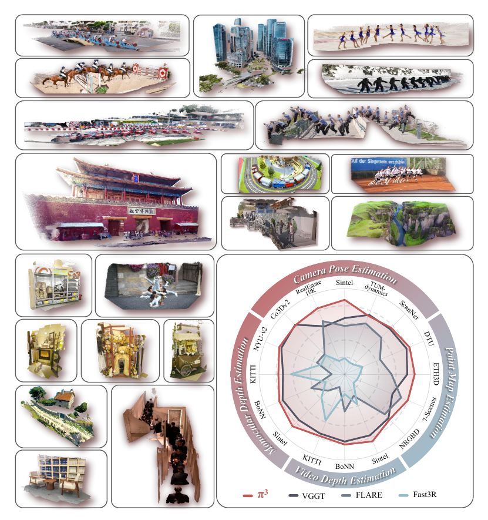](figures/figure-01.png)

*图 1　π³ 能够以前馈方式有效重建多种开放域图像，覆盖室内、室外、航拍及卡通等场景，同时包含动态和静态内容。*

## 摘要

π³ 是论文提出的一种前馈神经网络，为视觉几何重建提供了一种新方法，摆脱了对传统固定参考视图的依赖。以往方法通常将重建结果锚定到某个指定视点；当参考视图选择不佳时，这种归纳偏置可能引起不稳定甚至失败。相比之下，π³ 采用完全置换等变的架构，无需参考帧即可预测仿射不变的相机位姿和尺度不变的局部点图。这一设计不仅使模型天然能够适应输入顺序的变化，也提高了准确性和性能。这些优势使这一简单、无参考视图偏置的方法，在相机位姿估计、单目与视频深度估计以及稠密点图重建等多项任务上达到当前最优水平。代码和模型已在 [Pi3 仓库](https://github.com/yyfz/Pi3)公开。

> “仿射不变”沿用原文 affine-invariant 的命名。第 3.3 节将这里的变换明确限定为刚体变换加统一尺度，即相似变换，不包括任意剪切和各轴独立缩放。“无偏置”也对应作者所讨论的参考视图偏置，不表示网络不存在任何归纳偏置。

## 1 引言

视觉几何重建是计算机视觉中一项历史悠久的基础问题，在增强现实（Engel et al., 2023）、机器人（Zhu et al., 2024）和自主导航（Mur-Artal et al., 2015）等应用中具有重要潜力。传统方法通过光束法平差（Bundle Adjustment，BA）等迭代优化技术处理这一问题（Hartley & Zisserman, 2003）。近年来，前馈神经网络推动了这一领域的显著进展。DUSt3R（Wang et al., 2024）及其后续端到端模型，已经展示了深度学习从图像对（Leroy et al., 2024；Zhang et al., 2024）、视频或多视图图像集合（Yang et al., 2025；Zhang et al., 2025；Wang et al., 2025a）中重建几何的能力。

尽管取得了这些进展，经典方法和现代方法仍存在一个关键限制：依赖选择单个固定参考视图。所选视图的相机坐标系被当作全局参考系，这一做法继承自传统运动恢复结构（Structure-from-Motion，SfM；Hartley & Zisserman, 2003；Cui et al., 2017；Schonberger & Frahm, 2016；Pan et al., 2024）和多视图立体重建（Multi-view Stereo，MVS；Furukawa et al., 2015；Schönberger et al., 2016）方法。作者认为，这种设计引入了不必要的归纳偏置，从根本上限制了前馈神经网络的性能和鲁棒性。实验表明，对任意参考视图的依赖，使包括当前先进方法 VGGT（Wang et al., 2025a）在内的已有方法，对初始视图的选择高度敏感。选择不佳时，重建质量可能显著下降，阻碍鲁棒系统的发展，见图 2。

[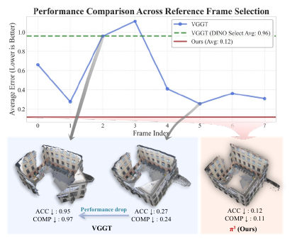](figures/figure-02.png)

*图 2　不同参考帧下的性能比较。已有方法即使采用基于 DINO 的参考视图选择，结果仍可能不一致；π³ 持续取得更好且更稳定的性能，展示了其鲁棒性。*

> 在几何优化中，固定一台相机可以消除全局坐标的规范自由度；仅改变已恢复几何的坐标表达，不应改变形状。学习网络中的参考视图还可能带有特殊 token 或嵌入，参与特征融合和回归。作者在这里提出的主要问题，是更换参考视图后，预测质量也随之变化。这个实验现象与单纯改变坐标原点需要区分。

为克服这一限制，论文提出 π³（图 1），这是一种鲁棒、准确且完全置换等变的方法，用于消除视觉几何学习中基于参考视图的偏置。π³ 接受多种输入，包括单幅图像、视频序列，以及静态或动态场景的无序图像集合，均无需指定参考视图。模型预测仿射不变的相机位姿和尺度不变的局部点图，其中点图定义在对应帧自身的相机坐标系中。通过避开帧索引位置嵌入等与顺序有关的组件，并采用与 VGGT 类似、交替执行逐视图和全局自注意力的 Transformer 架构，π³ 实现了置换等变性。这保证视觉输入与重建几何之间始终具有一致的一一对应，使模型天然适应输入顺序变化，并免受参考视图选择问题的影响，见表 7。

这一设计带来显著优势。首先，鲁棒性明显提高。与已有方法相比，改变参考帧时，π³ 的性能几乎不下降，结果的标准差也很低，见图 2 和第 4.4 节的表格。此外，与依赖参考视图的先前方法相比，它也提高了重建准确性。

大量实验表明，π³ 在多个基准和任务中达到新的最优水平。例如，在单目深度估计中，它达到与 MoGe（Wang et al., 2025c）等已有方法相当的性能；在视频深度和相机位姿估计中，它优于 VGGT。在 Sintel 基准上，π³ 将相机位姿估计的 ATE 从 VGGT 的 0.167 降至 0.074，并将尺度对齐后的视频深度绝对相对误差从 0.299 降至 0.233。此外，π³ 兼具较小规模与较高速度，推理速度为 57.4 FPS，而 DUSt3R 和 VGGT 分别为 1.25 FPS 和 43.2 FPS。它能够重建静态和动态场景，为实际应用提供鲁棒而优良的方案。

> 上述概括保留作者的表述。速度来自表 4 的 KITTI、单张 A800 评估；具体优势和未胜出的项目仍需结合第 4 节理解。原文此处的“Table 4.4”是交叉引用异常，对应第 4.4 节的表 6。

论文将主要贡献概括如下：

- 作者首次系统地识别并质疑视觉几何重建对固定参考视图的依赖，展示这一常见设计如何引入有害的归纳偏置，限制模型鲁棒性和性能。
- 提出 π³，通过新型完全置换等变架构消除该偏置。模型以逐视图、纯相对的方式预测仿射不变相机位姿和尺度不变点图，完全移除了对全局坐标系的需求。
- 大量实验表明，π³ 在相机位姿估计、单目与视频深度估计、点图重建等广泛基准上达到新的最优水平，优于此前的先进方法。

> 这里移除的是对**预先指定的全局参考系**的需求。模型仍输出可用于组织点云的一组位姿；结果也可以表达在某个公共坐标系中。第 3.3 节说明训练如何允许该坐标系保持自由。

## 2 相关工作

### 2.1 传统三维重建

从图像重建三维场景是计算机视觉的基础问题。SfM（Hartley & Zisserman, 2003；Cui et al., 2017；Schonberger & Frahm, 2016；Pan et al., 2024）和 MVS（Furukawa et al., 2015；Schönberger et al., 2016）等经典方法取得了显著成功。这些技术利用多视图几何原理，在图像之间建立特征对应，再估计相机位姿并生成稠密三维点云。它们在受控环境中尤其鲁棒，但通常需要复杂的多阶段处理流程。此外，它们往往依赖 BA 等耗时的迭代优化，联合细化三维结构和相机位姿。

### 2.2 前馈三维重建

近年来，前馈模型成为一种有力的替代方案，可以在单次前向计算中从一组图像直接回归场景的三维结构。DUSt3R（Wang et al., 2024）等开创性工作主要处理图像对，在第一台相机坐标系中预测点云。这对双视图有效，但扩展到更大场景时，需要额外的全局对齐步骤，可能耗时且不稳定。

后续研究着力克服这一限制。Fast3R（Yang et al., 2025）能够同时推理数千张图像，消除了代价高、容易不稳定的全局对齐阶段，是一项重要进展。另一些方法探索简化学习问题本身。例如，FLARE（Zhang et al., 2025）先预测相机位姿，再估计场景几何，将任务分解开来。VGGT（Wang et al., 2025a）则利用多任务学习和大规模数据集取得更好的准确性与性能。

这些方法具有一个共同特征：依赖指定参考帧，将预测的三维结构锚定到该参考帧；这一范式很大程度上继承自经典 SfM。π³ 采用不同的建模方式，脱离这一范式。

## 3 方法

[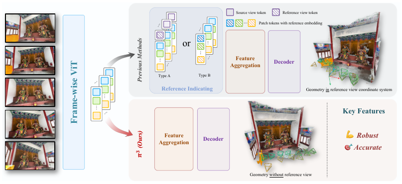](figures/architecture.png)

*图 3　先前方法通过拼接特殊 token（Type A）或加入可学习嵌入（Type B）指定参考视图；π³ 完全取消这一要求，并采用相对监督实现置换等变性，使方法天然适应输入视图顺序的变化。*

### 3.1 置换等变架构

为使模型输出不受输入视图任意排列的影响，π³ 将网络 $\phi$ 设计为置换等变网络。

设输入序列包含 $N$ 幅图像，$S=(\mathbf I_1,\ldots,\mathbf I_N)$，其中每幅图像 $\mathbf I_i\in\mathbb R^{H\times W\times3}$。网络将其映射为一组对应的输出序列：

$$
\phi(S)=\left((\mathbf T_1,\ldots,\mathbf T_N),
(\mathbf X_1,\ldots,\mathbf X_N),
(\mathbf C_1,\ldots,\mathbf C_N)\right).
\tag{1}
$$

其中 $\mathbf T_i\in SE(3)\subset\mathbb R^{4\times4}$ 是相机位姿；$\mathbf X_i\in\mathbb R^{H\times W\times3}$ 是与像素对齐的三维点图，表达在该图像自身的相机坐标系中；$\mathbf C_i\in\mathbb R^{H\times W}$ 是点图的置信度。三者都与输入图像 $\mathbf I_i$ 对应。

对任意置换 $\pi$，令 $P_\pi$ 表示重排序列的算子。网络满足

$$
\phi(P_\pi(S))=P_\pi(\phi(S)).
\tag{2}
$$

这表示输入重排为 $P_\pi(S)=(\mathbf I_{\pi(1)},\ldots,\mathbf I_{\pi(N)})$ 后，输出各序列也进行完全相同的重排：

$$
\begin{aligned}
P_\pi(\phi(S))=\bigl(&
(\mathbf T_{\pi(1)},\ldots,\mathbf T_{\pi(N)}),\\
& (\mathbf X_{\pi(1)},\ldots,\mathbf X_{\pi(N)}),\\
& (\mathbf C_{\pi(1)},\ldots,\mathbf C_{\pi(N)})\bigr).
\end{aligned}
\tag{3}
$$

这一性质保证每幅图像与对应输出（例如几何或位姿）之间始终保持一致的一一对应。该设计具有几个重要优势。首先，重建质量不再依赖参考视图选择，而先前方法在更换参考视图时可能性能下降。其次，模型能够更稳健地处理不确定或带噪观测。这些主张将在第 4 节通过实验验证。

为在实践中实现等变性，模型实现（图 3）省略了所有依赖顺序的组件，例如用于区分不同帧的位置嵌入，以及 VGGT 中用于指定参考视图的专用可学习相机 token。处理流程首先利用 DINOv2（Oquab et al., 2023）骨干，将每幅图像嵌入为 patch token 序列。随后，与 VGGT 类似，这些 token 经过交替的逐视图与全局自注意力层，最终由解码器产生输出。详细架构见附录 A.1。

> 若输入由 $(I_1,I_2,I_3)$ 改为 $(I_3,I_1,I_2)$，对应位姿和点图也按 3、1、2 排列。局部点的数值应保持与所属图像的对应关系；直接比较两次输出数组的相同行号，会把不同图像的结果混在一起。等变性约束同一组图的重排，增加或删去图像则改变了观测信息。

> 把 token 按行排成 $F$，用 $W_Q,W_K,W_V$ 将特征分别投影为 Query、Key、Value，令 $d$ 为 Query 与 Key 的维数。一层自注意力的核心运算为
>
> $$
> \operatorname{Attn}(F)=\operatorname{softmax}_{\rm row}
> \left(\frac{FW_Q(FW_K)^\mathsf T}{\sqrt d}\right)FW_V.
> $$
>
> 整幅图的 token 块按矩阵 $P$ 重排后，注意力得分 $A$ 变为 $PAP^\mathsf T$。逐行 softmax 仅重排相应的行列，再乘上 $PFW_V$，得到 $P\operatorname{Attn}(F)$。逐视图层使用共享参数，也只会重排各个计算分组。这里要求图像内部的二维位置信息随 token 一起移动，而没有额外的帧身份差别。

> 原文开头使用 invariant 形容“不受顺序影响”，正式定义 (2) 是 equivariant，即输出随输入一起重排。官方实现保留图像内部的二维位置编码，还给每幅图追加同样初始化、共享的五个 register token；取消的是指定参考视图的特殊身份，并非全部辅助 token 或全部位置编码。实现来源为 [固定提交中的 `Pi3` 类](https://github.com/yyfz/Pi3/blob/9fa3ddb3f8d53041f8b2738df404f62223bbaa7b/pi3/models/pi3.py)。

### 3.2 尺度不变的局部几何

对于每幅输入图像 $\mathbf I_i$，网络以像素对齐的三维点图 $\hat{\mathbf X}_i$ 预测几何。每份点云最初定义在自身的局部相机坐标系中。单目重建的一个已知困难是固有的尺度歧义。为处理它，预测点云允许带有一个未知尺度因子，但该尺度在同一场景的全部 $N$ 幅图像之间保持一致。

因此，训练时需要将预测点图 $(\hat{\mathbf X}_1,\ldots,\hat{\mathbf X}_N)$ 与对应真值 $(\mathbf X_1,\ldots,\mathbf X_N)$ 对齐。训练在整段图像序列上求一个最优尺度 $s^*$，使深度加权 L1 距离最小：

$$
s^*=\underset{s}{\arg\min}
\sum_{i=1}^{N}\sum_{j=1}^{H\times W}
\frac{1}{z_{i,j}}\|s\hat{\mathbf x}_{i,j}-\mathbf x_{i,j}\|_1.
\tag{4}
$$

$\hat{\mathbf x}_{i,j}\in\mathbb R^3$ 是预测点图中索引为 $j$ 的三维点，$\mathbf x_{i,j}$ 为真值中的对应点。$z_{i,j}$ 是真值深度，即 $\mathbf x_{i,j}$ 的第三分量。该问题使用 Wang et al.（2025c）提出的 ROE 求解器求解。

最后，利用最优尺度定义点云重建损失：

$$
\mathcal L_{\rm points}=\frac{1}{3NHW}
\sum_{i=1}^{N}\sum_{j=1}^{H\times W}
\frac{1}{z_{i,j}}\|s^*\hat{\mathbf x}_{i,j}-\mathbf x_{i,j}\|_1.
\tag{5}
$$

> 公式比较的是每幅图自身相机系内的预测与真值，所有视图共享 $s^*$。用一维深度说明：若两幅图的真值深度分别为 10 和 12，预测为 5 和 6，同一个 $s=2$ 能同时对齐；若预测为 5 和 4，就无法同时对齐。因而该目标允许整组重建统一缩放，同时约束各图长度单位一致。权重 $1/z_{i,j}$ 则降低远处大坐标对损失量级的支配作用；它要求所用真值深度有效且为正。$s^*$ 由训练真值求得，推理时不能凭它直接恢复米制尺度。

为鼓励重建出局部平滑的表面，方法还遵循 Wang et al.（2025c）加入法向损失 $\mathcal L_{\rm normal}$。对预测点图中的每个点，取它指向图像网格相邻点的向量，通过叉积计算法向 $\hat{\mathbf n}_{i,j}$，再最小化它与真值法向 $\mathbf n_{i,j}$ 的夹角：

$$
\mathcal L_{\rm normal}=\frac{1}{NHW}
\sum_{i=1}^{N}\sum_{j=1}^{H\times W}
\arccos\left(\hat{\mathbf n}_{i,j}\cdot\mathbf n_{i,j}\right).
\tag{6}
$$

置信度分支采用二元交叉熵（BCE）损失 $\mathcal L_{\rm conf}$ 监督预测置信度图 $\mathbf C_i$。如果某点的 L1 重建误差 $\frac{1}{z_{i,j}}\|s^*\hat{\mathbf x}_{i,j}-\mathbf x_{i,j}\|_1$ 低于阈值 $\epsilon$，其真值标签为 1，否则为 0。

> 位置项直接约束三维坐标，法向项补充邻域表面的方向；式 (6) 中的法向需要单位化，才能将点积解释为夹角余弦。置信度标签由几何预测误差生成，表达“这个点是否足够准确”，并不是直接监督静态或动态物体的类别。原文没有在此给出 $\epsilon$ 的数值。

### 3.3 仿射不变的相机位姿

模型的置换等变性，加上多视图重建固有的尺度歧义，意味着输出位姿 $(\hat{\mathbf T}_1,\ldots,\hat{\mathbf T}_N)$ 只能确定到一个任意相似变换。这种特定的仿射变换由刚体变换与一个未知全局尺度组成。

为处理全局参考系的歧义，网络通过视图间的相对位姿接受监督。由视图 $j$ 到视图 $i$ 的预测相对位姿为

$$
\hat{\mathbf T}_{i\leftarrow j}=\hat{\mathbf T}_i^{-1}\hat{\mathbf T}_j.
\tag{7}
$$

每个相对位姿由旋转 $\hat{\mathbf R}_{i\leftarrow j}\in SO(3)$ 和平移 $\hat{\mathbf t}_{i\leftarrow j}\in\mathbb R^3$ 组成。相对旋转不受上述全局变换影响，但相对平移的大小存在歧义。这一问题通过前一节中点图与真值对齐得到的最优尺度 $s^*$ 处理。同一个一致尺度用于校正全部预测相机平移，从而能够直接监督旋转以及尺度校正后的平移。

> 与式 (7) 一致，令 $\hat T_i$ 将相机 $i$ 的局部坐标变到公共坐标，写成 $\hat T_i=[\hat R_i,\hat{\mathbf t}_i;0,1]$。于是先由相机 $j$ 到公共系，再回到相机 $i$，得到
>
> $$
> \hat R_{i\leftarrow j}=\hat R_i^\mathsf T\hat R_j,
> \qquad
> \hat{\mathbf t}_{i\leftarrow j}
> =\hat R_i^\mathsf T(\hat{\mathbf t}_j-\hat{\mathbf t}_i).
> $$
>
> 所有位姿左乘同一刚体变换 $G$ 时，$(G\hat T_i)^{-1}(G\hat T_j)=\hat T_i^{-1}\hat T_j$，相对关系不变。进一步取全局旋转 $Q$、平移 $\mathbf b$ 和正尺度 $a$，同时令
>
> $$
> \hat R_i'=Q\hat R_i,\quad
> \hat{\mathbf t}_i'=aQ\hat{\mathbf t}_i+\mathbf b,\quad
> \hat{\mathbf x}_{i,j}'=a\hat{\mathbf x}_{i,j}.
> $$
>
> 相对旋转保持不变，相对平移和局部点都乘 $a$，而尺度对齐量变成 $s^*/a$。因此后续损失仍保持一致。这解释了允许的相似变换自由度；单个输出位姿本身仍属于 $SE(3)$。

相机损失 $\mathcal L_{\rm cam}$ 是旋转损失与平移损失的加权和，对所有 $i\ne j$ 的有序视图对取平均：

$$
\mathcal L_{\rm cam}=\frac{1}{N(N-1)}\sum_{i\ne j}
\left(\mathcal L_{\rm rot}(i,j)+\lambda_{trans}\mathcal L_{\rm trans}(i,j)\right).
\tag{8}
$$

其中 $\lambda$ 是平衡两项的超参数。

> 原文此句写作 $\lambda$，式 (8) 使用的完整符号为 $\lambda_{trans}$，二者在此指同一平移权重。

遵循 Dong et al.（2025），旋转使用角度损失，平移使用 Huber 损失。旋转损失最小化预测相对旋转与真值 $\mathbf R_{i\leftarrow j}$ 之间的测地距离，即夹角：

$$
\mathcal L_{\rm rot}(i,j)=\arccos\left(
\frac{\operatorname{Tr}\left((\mathbf R_{i\leftarrow j})^\top
\hat{\mathbf R}_{i\leftarrow j}\right)-1}{2}\right).
\tag{9}
$$

平移损失将尺度校正后的预测与真值相对平移 $\mathbf t_{i\leftarrow j}$ 比较。这里使用 Huber 损失 $\mathcal H_\delta$，以增强对离群值的鲁棒性：

$$
\mathcal L_{\rm trans}(i,j)=\mathcal H_\delta
\left(s^*\hat{\mathbf t}_{i\leftarrow j}-\mathbf t_{i\leftarrow j}\right).
\tag{10}
$$

> 令 $E=\mathbf R_{i\leftarrow j}^{\mathsf T}\hat{\mathbf R}_{i\leftarrow j}$，它表示预测相对旋转与真值之间的旋转误差。三维旋转满足 $\operatorname{Tr}(E)=1+2\cos\theta$，代入即可得到式 (9) 的角度 $\theta$，单位为弧度。式 (10) 则在同一相机坐标系内比较尺度校正后的平移向量；Huber 损失在小残差处采用二次惩罚，大残差处采用线性惩罚，$\delta$ 控制两者的转折，$\lambda_{trans}$ 平衡其与角度损失的数值贡献。

> 如果点图预测把建筑缩小一半，式 (4) 就会以约为 2 的尺度纠正它。同一尺度用于相对平移后，预测相机基线也需要缩小一半，才能同时减小两种损失。网络因此学习相互协调的表面尺度与相机间距。对三幅图，共比较六个有向视图对；相对位姿都由三份单相机位姿组合得到，代数上自然满足环组合关系，但这不等于所有像素都已满足精确的重投影一致性。式 (8) 用于 $N\ge2$，单图推理不需要计算这一训练损失。

此外，π³ 不依赖参考视图的表述特别适合捕捉相机轨迹的内在结构。仿射不变相机模型建立在一个重要认识之上：真实相机路径具有很强的结构性，并非随机分布。它们通常位于低维流形上，例如，绕物体拍摄的相机沿球面运动，车载相机则沿曲线运动。

图 4 定量分析了预测位姿分布的结构。特征值分析表明，相比 VGGT，π³ 预测位姿的方差集中在明显更少的主成分中，验证了输出的低维结构。附录 A.3 对此进一步讨论。

[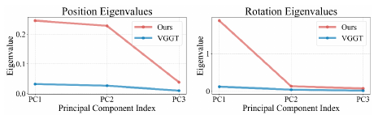](figures/figure-04.png)

*图 4　预测位姿分布的比较。π³ 预测的位姿分布表现出清晰的低维结构。*

> 图 4 是作者关于预测表征的实验分析。网络没有显式低秩约束；置换等变性本身也不足以数学保证几何更准确。

### 3.4 模型训练

模型通过最小化复合损失 $\mathcal L$ 进行端到端训练。该目标是点重建、置信度和相机位姿等损失的加权和：

$$
\mathcal L=\mathcal L_{\rm points}
+\lambda_{\rm normal}\mathcal L_{\rm normal}
+\lambda_{\rm conf}\mathcal L_{\rm conf}
+\lambda_{\rm cam}\mathcal L_{\rm cam}.
\tag{11}
$$

为提高鲁棒性和适用范围，模型在 15 个多样化数据集组成的大规模集合上训练。数据广泛覆盖室内外环境，包括合成渲染与真实采集的多种场景。具体包括 GTA-SfM（Wang & Shen, 2020）、CO3D（Reizenstein et al., 2021）、WildRGB-D（Xia et al., 2024）、Habitat（Savva et al., 2019）、ARKitScenes（Baruch et al., 2021）、TartanAir（Wang et al., 2020）、ScanNet（Dai et al., 2017）、ScanNet++（Yeshwanth et al., 2023）、BlendedMVG（Yao et al., 2020）、MatrixCity（Li et al., 2023）、MegaDepth（Li & Snavely, 2018）、Hypersim（Roberts et al., 2021）、Taskonomy（Zamir et al., 2018）、Mid-Air（Fonder & Van Droogenbroeck, 2019），以及一个内部动态场景数据集。训练详情见附录 A.2。

> 监督需要每个有效像素的局部三维点，以及相机间的真值位姿关系。对于已知轴向深度 $D_i$ 和内参 $K_i$ 的针孔相机，局部三维标签可按 $\mathbf x_i=D_iK_i^{-1}\tilde{\mathbf u}$ 理解，其中 $\tilde{\mathbf u}$ 是齐次像素。这个式子说明标签的几何关系，网络推理本身并不需要输入这些内参。预测点和标签用于求 $s^*$，接着监督点位置、法向和相对平移；置信度再学习预测误差是否足够小。原文未逐数据集说明标签生成流程，内部动态数据也没有在文中公开，因而公开权重不能还原全部训练数据条件。

> 式 (11) 汇总各监督项，但附录 A.2 明确说明：几何模型完成两阶段训练后，冻结其余参数，单独训练置信度头。主模型还使用 VGGT 预训练初始化并冻结编码器。因此“端到端训练”不能理解为所有模块从随机初始化开始同时更新。数据集名称 BlendedMVG 沿用原文，其引用条目题为 *Blendedmvs*。

## 4 实验

论文报告四项任务的定量结果：相机位姿估计（4.1 节）、点图估计（4.2 节）、视频深度估计及单目深度估计（4.3 节）。在这些任务中，相对于已有前馈三维重建方法，π³ 达到当前最优或相当的性能。图 5 和附录图 7 展示点图的定性结果。

为验证设计有效性，论文还进行了两项分析：输入图像序列排列变化下的鲁棒性评价（4.4 节），以及尺度不变点图和仿射不变相机位姿的消融研究（4.5 节）。

### 4.1 相机位姿估计

实验通过两类不同指标评价预测位姿。一类遵循 Wang et al.（2023；2024；2025a），在 RealEstate10K（Zhou et al., 2018）与 Co3Dv2（Reizenstein et al., 2021）上评价角度准确率；另一类遵循 Zhao et al.（2022）、Zhang et al.（2024）及 Wang et al.（2025b），在 Sintel（Bozic et al., 2021）、TUM-dynamics（Sturm et al., 2012）和 ScanNet（Dai et al., 2017）上评价距离误差。指标详情见附录 A.5。

如表 1 所示，π³ 在 Sintel 和 RealEstate10K 的零样本泛化中建立新的最优结果；在 TUM-dynamics，以及分布内的 Co3Dv2 和 ScanNet 上，取得与 VGGT 同样具有竞争力的先进结果。这表明模型在维持熟悉数据分布上良好性能的同时，也具有很强的泛化能力。

[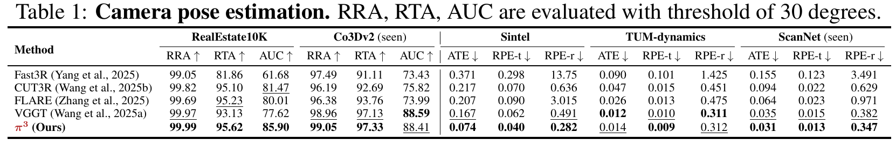](figures/table-01.png)

*表 1　相机位姿估计。RRA、RTA、AUC 使用 $30^\circ$ 阈值，越高越好；ATE、RPE-t、RPE-r 越低越好。seen 表示训练见过的数据分布。各数据集、方法与全部指标保持原表。*

> RRA 和 RTA 分别统计相对旋转与平移方向角误差低于阈值的比例，AUC 汇总阈值变化下的准确率，均无距离单位。ATE 衡量整条轨迹的位置误差，RPE 衡量相对位姿误差，距离项需按相应数据集的坐标单位和评价协议比较，原表没有另外标注距离单位。Sintel 的 ATE 从 0.167 降至 0.074；但 Co3Dv2 的 AUC 是 VGGT 88.59、π³ 88.41，TUM-dynamics 的 ATE 是 0.012、0.014。表格支持的是整体竞争力与部分场景的显著收益，不能理解成每一项都胜出。对齐协议和训练分布例外在 A.5 中给出。

### 4.2 点图估计

遵循 CUT3R（Wang et al., 2025b），实验在场景级 7-Scenes（Shotton et al., 2013）和 NRGBD（Azinović et al., 2022）上，通过不同采样步长构造稀疏与稠密视图条件，评价多视图点图重建质量。评价还扩展到以物体为中心的 DTU（Jensen et al., 2014）和场景级 ETH3D（Schops et al., 2017）。预测点图首先使用 Umeyama 算法做粗略的 $Sim(3)$ 对齐，再通过迭代最近点（ICP）算法细化。

与先前工作（Azinović et al., 2022；Wang et al., 2024；Wang & Agapito, 2024；Wang et al., 2025b）一致，表 2 和表 3 报告了准确度（Acc.）、完整度（Comp.）和法向一致性（N.C.）。结果表明，方法在广泛的三维重建任务中具有很强的泛化能力，能够适应合成与真实场景、稀疏与稠密视图设置（表 2），以及物体级与场景级尺度（表 3）。

[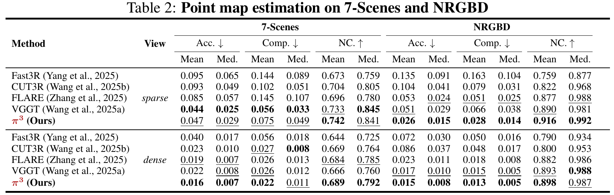](figures/table-02.png)

*表 2　在 7-Scenes 和 NRGBD 上的点图估计。sparse、dense 对应稀疏和稠密视图；Mean、Med. 对应均值与中位数。Acc.、Comp. 越低越好，N.C. 越高越好。*

[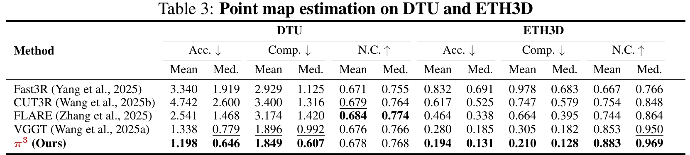](figures/table-03.png)

*表 3　在 DTU 和 ETH3D 上的点图估计。列定义与表 2 一致。*

> Acc. 描述预测点到真值表面的距离，Comp. 描述真值表面到预测点集的距离；缺少一片表面会影响完整度，大量离群点会影响准确度。这些距离在真值对齐后计算，不等同于未经对齐的绝对定位误差。DTU 与其他数据集的距离尺度也不应横向混用。

> 稠密 7-Scenes 上，π³ 的 mean Acc./Comp. 为 0.016/0.022，优于 VGGT 的 0.022/0.026；稀疏设置中，π³ 的 0.047/0.075 则弱于 VGGT 的 0.044/0.056。增加或减少视图改变了可用信息，置换等变性并不保证在每种采样条件下都取得最高精度。

### 4.3 深度估计

遵循 CUT3R 的评价方法，实验在 Sintel、Bonn（Palazzolo et al., 2019）和 KITTI（Geiger et al., 2013）上，报告视频深度与单目深度估计的绝对相对误差（Abs Rel）以及 $\delta<1.25$ 阈值下的预测准确率。单目深度还在 NYU-v2（Silberman et al., 2012）上评价。

**视频深度估计。**　在这一设置中，每段视频深度序列使用一个尺度与真值对齐。如表 4 所示，在前馈三维重建方法中，π³ 在三个数据集上均取得新的最优性能。同时，它具有很高效率：在 KITTI 上达到 57.4 FPS，明显快于 VGGT 的 43.2 FPS 和 Aether 的 6.14 FPS，并具有更小的模型规模。

[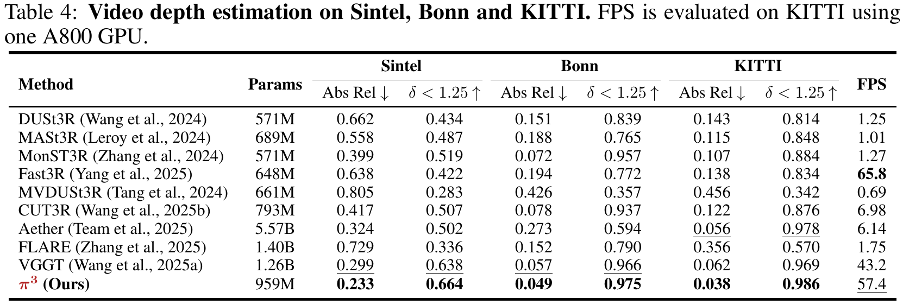](figures/table-04.png)

*表 4　在 Sintel、Bonn、KITTI 上的视频深度估计。Params 为参数量；Abs Rel 越低越好，$\delta<1.25$ 准确率越高越好。FPS 在 KITTI 上用一张 A800 测量。*

[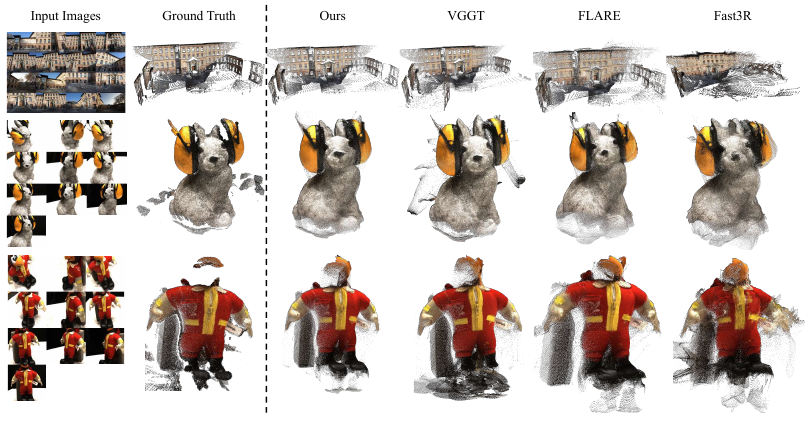](figures/reconstruction.png)

*图 5　多视图三维重建的定性比较。相比其他多帧前馈重建方法，π³ 的结果更干净、准确、完整，伪影更少。每行由左到右为输入、真值、π³、VGGT、FLARE、Fast3R。*

**单目深度估计。**　在这一设置中，每张深度图独立使用一个尺度与其真值对齐。如表 5 所示，尽管没有专门针对单帧深度估计优化，π³ 仍在多帧前馈重建方法中取得当前最优结果。同时，它与表现优良的专用单目深度模型 MoGe（Wang et al., 2025c；2025d）相比也具有竞争力。

[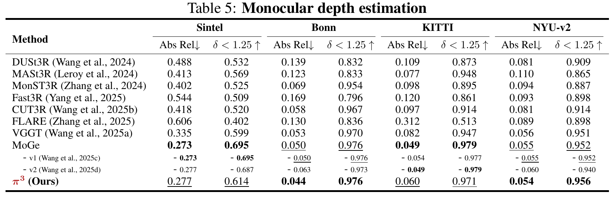](figures/table-05.png)

*表 5　单目深度估计。保留 MoGe v1、v2 各版本及其汇总行，指标方向与表 4 一致。*

> Abs Rel 是 $|\hat z-z|/z$ 的均值；$\delta<1.25$ 统计 $\max(\hat z/z,z/\hat z)<1.25$ 的像素比例。视频只允许整段共用一个尺度，因而还反映帧间比例的协调程度；单图逐张对齐则不能证明跨帧尺度一致性。两种协议都消除了尺度自由度，不能据此宣称恢复米制尺度。

> π³ 在单目 Bonn 上的 Abs Rel 为 0.044，优于 MoGe 汇总行的 0.050；KITTI 为 0.060，弱于 MoGe 的 0.049。表 4 中 Fast3R 达到 65.8 FPS，速度高于 π³。文中的高效结论有指定测量范围，也不表示该批量多视图网络具有任意长度序列的流式实时能力。

### 4.4 鲁棒性评价

π³ 架构具有置换等变性这一关键性质，能够适应输入图像序列顺序的变化。为在实验中验证它，实验在 DTU 和 ETH3D 上进行评价。对长度为 $N$ 的每段序列，实验构造 $N$ 种排列，轮流让每一帧成为第一帧，然后计算这 $N$ 次输出之间重建指标的标准差。标准差越低，表示对输入顺序变化越稳健。

[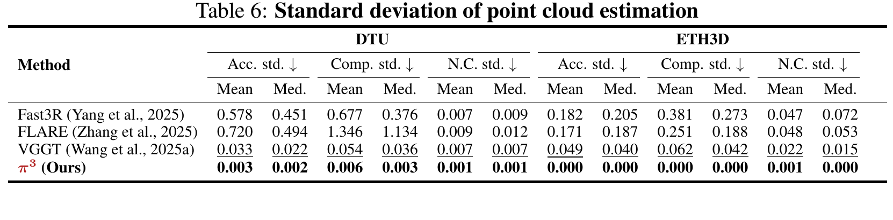](figures/table-06.png)

*表 6　点云估计指标的标准差。这里衡量波动，所有列均越低越好，包括 N.C. 的标准差。*

如表 6 所示，π³ 在 DTU 和 ETH3D 的全部指标上均达到接近零的标准差，比已有方法低多个数量级。例如，DTU 上 mean Acc. 的标准差为 0.003，VGGT 为 0.033；在 ETH3D 上，模型的方差实际上接近零。这一鲜明对比揭示了依赖参考帧的方法的局限：它们对输入顺序十分敏感。结果有力支持所提出架构的置换等变性，使其能够生成一致、不依赖顺序的三维重建结果。

> 原文“低多个数量级”是对整组比较的概括；DTU 的 0.003 与 0.033 相差约一个数量级。表中 0.000 是三位小数下的显示值，不能当作逐位相等的证明。实验检验的是轮流更换首帧的 $N$ 种排列，任意置换性质还依赖第 3.1 节的结构条件。

### 4.5 消融研究

为验证各组件的有效性，消融实验从完整模型中系统地去掉相应特性。定义两个消融版本：Model 2 不包含仿射不变相机位姿建模；Model 1 同时不包含仿射不变位姿和尺度不变点图。更多细节见附录 A.6。

[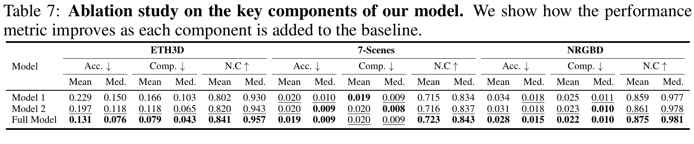](figures/table-07.png)

*表 7　关键组件的消融研究。展示向基线逐步加入组件后的性能变化，指标和均值、中位数定义同表 2。*

表 7 给出三个数据集上的点图估计结果。结果显示，在 7-Scenes 和 NRGBD 等室内数据上，尺度不变点图建模没有带来明显性能增益；对于室外数据，改善则显著得多。这与先前尺度不变深度研究的观察一致：室外场景受到尺度歧义的影响更明显。

此外，作者观察到，仿射不变相机位姿建模能够持续改善最终性能。更重要的是，与 Model 1 和 Model 2 不同，加入这一建模后，模型具有置换等变性，从而能够适应输入帧顺序和参考视图选择的变化。

> ETH3D 的 mean Acc. 依次为 0.229、0.197、0.131，mean Comp. 为 0.166、0.118、0.079；7-Scenes 的 mean Acc. 仅从 0.020、0.020 变为 0.019，Comp. 则从 0.019 变为 0.020、0.020。这里“持续改善”是作者对整体结果的概括，并非每个指标都单调改善。A.6 还说明相机监督改变时参考 token 也改变，尺度比较包含归一化差异，因此这些数字不能视为只改某一个 token 的单因素实验。

## 5 结论

论文提出前馈神经网络 π³，通过消除对固定参考视图的依赖，为视觉几何重建提供了一种新范式。完全置换等变的架构使模型天然适应输入顺序变化，并提高准确性。

这一设计消除了先前方法中的关键归纳偏置，使简单而有效的 π³ 在相机位姿估计、深度估计和稠密重建等广泛任务中达到当前最优性能。π³ 表明，无参考视图的系统不仅可行，还能够带来更稳定、更通用的三维视觉模型。

## 致谢

本研究得到上海人工智能实验室支持。

## 参考文献（保留原文）

- Azinović et al. (2022) Dejan Azinović, Ricardo Martin-Brualla, Dan B Goldman, Matthias Nießner, and Justus Thies. Neural rgb-d surface reconstruction. In Proceedings of the IEEE/CVF Conference on Computer Vision and Pattern Recognition, pp. 6290–6301, 2022.

- Baruch et al. (2021) Gilad Baruch, Zhuoyuan Chen, Afshin Dehghan, Tal Dimry, Yuri Feigin, Peter Fu, Thomas Gebauer, Brandon Joffe, Daniel Kurz, Arik Schwartz, et al. Arkitscenes: A diverse real-world dataset for 3d indoor scene understanding using mobile rgb-d data. arXiv preprint arXiv:2111.08897, 2021.

- Bozic et al. (2021) Aljaz Bozic, Pablo Palafox, Justus Thies, Angela Dai, and Matthias Nießner. Transformerfusion: Monocular rgb scene reconstruction using transformers. Advances in Neural Information Processing Systems, 34:1403–1414, 2021.

- Cui et al. (2017) Hainan Cui, Xiang Gao, Shuhan Shen, and Zhanyi Hu. Hsfm: Hybrid structure-from-motion. In Proceedings of the IEEE conference on computer vision and pattern recognition, pp. 1212–1221, 2017.

- Dai et al. (2017) Angela Dai, Angel X Chang, Manolis Savva, Maciej Halber, Thomas Funkhouser, and Matthias Nießner. Scannet: Richly-annotated 3d reconstructions of indoor scenes. In Proceedings of the IEEE conference on computer vision and pattern recognition, pp. 5828–5839, 2017.

- Dong et al. (2025) Siyan Dong, Shuzhe Wang, Shaohui Liu, Lulu Cai, Qingnan Fan, Juho Kannala, and Yanchao Yang. Reloc3r: Large-scale training of relative camera pose regression for generalizable, fast, and accurate visual localization. In Proceedings of the Computer Vision and Pattern Recognition Conference, pp. 16739–16752, 2025.

- Engel et al. (2023) Jakob Engel, Kiran Somasundaram, Michael Goesele, Albert Sun, Alexander Gamino, Andrew Turner, Arjang Talattof, Arnie Yuan, Bilal Souti, Brighid Meredith, et al. Project aria: A new tool for egocentric multi-modal ai research. arXiv preprint arXiv:2308.13561, 2023.

- Fonder & Van Droogenbroeck (2019) Michael Fonder and Marc Van Droogenbroeck. Mid-air: A multi-modal dataset for extremely low altitude drone flights. In Proceedings of the IEEE/CVF conference on computer vision and pattern recognition workshops, pp. 0–0, 2019.

- Furukawa et al. (2015) Yasutaka Furukawa, Carlos Hernández, et al. Multi-view stereo: A tutorial. Foundations and trends® in Computer Graphics and Vision, 9(1-2):1–148, 2015.

- Geiger et al. (2013) Andreas Geiger, Philip Lenz, Christoph Stiller, and Raquel Urtasun. Vision meets robotics: The kitti dataset. The international journal of robotics research, 32(11):1231–1237, 2013.

- Hartley & Zisserman (2003) Richard Hartley and Andrew Zisserman. Multiple view geometry in computer vision. Cambridge university press, 2003.

- Jensen et al. (2014) Rasmus Jensen, Anders Dahl, George Vogiatzis, Engin Tola, and Henrik Aanæs. Large scale multi-view stereopsis evaluation. In Proceedings of the IEEE conference on computer vision and pattern recognition, pp. 406–413, 2014.

- Leroy et al. (2024) Vincent Leroy, Yohann Cabon, and Jérôme Revaud. Grounding image matching in 3d with mast3r. In European Conference on Computer Vision, pp. 71–91. Springer, 2024.

- Levinson et al. (2020) Jake Levinson, Carlos Esteves, Kefan Chen, Noah Snavely, Angjoo Kanazawa, Afshin Rostamizadeh, and Ameesh Makadia. An analysis of svd for deep rotation estimation. Advances in Neural Information Processing Systems, 33:22554–22565, 2020.

- Li et al. (2023) Yixuan Li, Lihan Jiang, Linning Xu, Yuanbo Xiangli, Zhenzhi Wang, Dahua Lin, and Bo Dai. Matrixcity: A large-scale city dataset for city-scale neural rendering and beyond. In Proceedings of the IEEE/CVF International Conference on Computer Vision, pp. 3205–3215, 2023.

- Li & Snavely (2018) Zhengqi Li and Noah Snavely. Megadepth: Learning single-view depth prediction from internet photos. In Proceedings of the IEEE conference on computer vision and pattern recognition, pp. 2041–2050, 2018.

- Mur-Artal et al. (2015) Raul Mur-Artal, Jose Maria Martinez Montiel, and Juan D Tardos. Orb-slam: A versatile and accurate monocular slam system. IEEE transactions on robotics, 31(5):1147–1163, 2015.

- Oquab et al. (2023) Maxime Oquab, Timothée Darcet, Théo Moutakanni, Huy Vo, Marc Szafraniec, Vasil Khalidov, Pierre Fernandez, Daniel Haziza, Francisco Massa, Alaaeldin El-Nouby, et al. Dinov2: Learning robust visual features without supervision. arXiv preprint arXiv:2304.07193, 2023.

- Palazzolo et al. (2019) Emanuele Palazzolo, Jens Behley, Philipp Lottes, Philippe Giguere, and Cyrill Stachniss. Refusion: 3d reconstruction in dynamic environments for rgb-d cameras exploiting residuals. In 2019 IEEE/RSJ International Conference on Intelligent Robots and Systems (IROS), pp. 7855–7862. IEEE, 2019.

- Pan et al. (2024) Linfei Pan, Dániel Baráth, Marc Pollefeys, and Johannes L Schönberger. Global structure-from-motion revisited. In European Conference on Computer Vision, pp. 58–77. Springer, 2024.

- Reizenstein et al. (2021) Jeremy Reizenstein, Roman Shapovalov, Philipp Henzler, Luca Sbordone, Patrick Labatut, and David Novotny. Common objects in 3d: Large-scale learning and evaluation of real-life 3d category reconstruction. In Proceedings of the IEEE/CVF international conference on computer vision, pp. 10901–10911, 2021.

- Roberts et al. (2021) Mike Roberts, Jason Ramapuram, Anurag Ranjan, Atulit Kumar, Miguel Angel Bautista, Nathan Paczan, Russ Webb, and Joshua M Susskind. Hypersim: A photorealistic synthetic dataset for holistic indoor scene understanding. In Proceedings of the IEEE/CVF international conference on computer vision, pp. 10912–10922, 2021.

- Savva et al. (2019) Manolis Savva, Abhishek Kadian, Oleksandr Maksymets, Yili Zhao, Erik Wijmans, Bhavana Jain, Julian Straub, Jia Liu, Vladlen Koltun, Jitendra Malik, et al. Habitat: A platform for embodied ai research. In Proceedings of the IEEE/CVF international conference on computer vision, pp. 9339–9347, 2019.

- Schonberger & Frahm (2016) Johannes L Schonberger and Jan-Michael Frahm. Structure-from-motion revisited. In Proceedings of the IEEE conference on computer vision and pattern recognition, pp. 4104–4113, 2016.

- Schönberger et al. (2016) Johannes L Schönberger, Enliang Zheng, Jan-Michael Frahm, and Marc Pollefeys. Pixelwise view selection for unstructured multi-view stereo. In Computer Vision–ECCV 2016: 14th European Conference, Amsterdam, The Netherlands, October 11-14, 2016, Proceedings, Part III 14, pp. 501–518. Springer, 2016.

- Schops et al. (2017) Thomas Schops, Johannes L Schonberger, Silvano Galliani, Torsten Sattler, Konrad Schindler, Marc Pollefeys, and Andreas Geiger. A multi-view stereo benchmark with high-resolution images and multi-camera videos. In Proceedings of the IEEE conference on computer vision and pattern recognition, pp. 3260–3269, 2017.

- Shotton et al. (2013) Jamie Shotton, Ben Glocker, Christopher Zach, Shahram Izadi, Antonio Criminisi, and Andrew Fitzgibbon. Scene coordinate regression forests for camera relocalization in rgb-d images. In Proceedings of the IEEE conference on computer vision and pattern recognition, pp. 2930–2937, 2013.

- Silberman et al. (2012) Nathan Silberman, Derek Hoiem, Pushmeet Kohli, and Rob Fergus. Indoor segmentation and support inference from rgbd images. In European conference on computer vision, pp. 746–760. Springer, 2012.

- Sturm et al. (2012) Jürgen Sturm, Nikolas Engelhard, Felix Endres, Wolfram Burgard, and Daniel Cremers. A benchmark for the evaluation of rgb-d slam systems. In 2012 IEEE/RSJ international conference on intelligent robots and systems, pp. 573–580. IEEE, 2012.

- Tang et al. (2024) Zhenggang Tang, Yuchen Fan, Dilin Wang, Hongyu Xu, Rakesh Ranjan, Alexander Schwing, and Zhicheng Yan. Mv-dust3r+: Single-stage scene reconstruction from sparse views in 2 seconds. arXiv preprint arXiv:2412.06974, 2024.

- Team et al. (2025) Aether Team, Haoyi Zhu, Yifan Wang, Jianjun Zhou, Wenzheng Chang, Yang Zhou, Zizun Li, Junyi Chen, Chunhua Shen, Jiangmiao Pang, and Tong He. Aether: Geometric-aware unified world modeling. arXiv preprint arXiv:2503.18945, 2025.

- Wang & Agapito (2024) Hengyi Wang and Lourdes Agapito. 3d reconstruction with spatial memory. arXiv preprint arXiv:2408.16061, 2024.

- Wang et al. (2023) Jianyuan Wang, Christian Rupprecht, and David Novotny. Posediffusion: Solving pose estimation via diffusion-aided bundle adjustment. In Proceedings of the IEEE/CVF International Conference on Computer Vision, pp. 9773–9783, 2023.

- Wang et al. (2025a) Jianyuan Wang, Minghao Chen, Nikita Karaev, Andrea Vedaldi, Christian Rupprecht, and David Novotny. Vggt: Visual geometry grounded transformer. arXiv preprint arXiv:2503.11651, 2025a.

- Wang & Shen (2020) Kaixuan Wang and Shaojie Shen. Flow-motion and depth network for monocular stereo and beyond. IEEE Robotics and Automation Letters, 5(2):3307–3314, 2020.

- Wang et al. (2025b) Qianqian Wang, Yifei Zhang, Aleksander Holynski, Alexei A Efros, and Angjoo Kanazawa. Continuous 3d perception model with persistent state. In Proceedings of the Computer Vision and Pattern Recognition Conference, pp. 10510–10522, 2025b.

- Wang et al. (2025c) Ruicheng Wang, Sicheng Xu, Cassie Dai, Jianfeng Xiang, Yu Deng, Xin Tong, and Jiaolong Yang. Moge: Unlocking accurate monocular geometry estimation for open-domain images with optimal training supervision. In Proceedings of the Computer Vision and Pattern Recognition Conference, pp. 5261–5271, 2025c.

- Wang et al. (2025d) Ruicheng Wang, Sicheng Xu, Yue Dong, Yu Deng, Jianfeng Xiang, Zelong Lv, Guangzhong Sun, Xin Tong, and Jiaolong Yang. Moge-2: Accurate monocular geometry with metric scale and sharp details. arXiv preprint arXiv:2507.02546, 2025d.

- Wang et al. (2024) Shuzhe Wang, Vincent Leroy, Yohann Cabon, Boris Chidlovskii, and Jerome Revaud. Dust3r: Geometric 3d vision made easy. In Proceedings of the IEEE/CVF Conference on Computer Vision and Pattern Recognition, pp. 20697–20709, 2024.

- Wang et al. (2020) Wenshan Wang, Delong Zhu, Xiangwei Wang, Yaoyu Hu, Yuheng Qiu, Chen Wang, Yafei Hu, Ashish Kapoor, and Sebastian Scherer. Tartanair: A dataset to push the limits of visual slam. In 2020 IEEE/RSJ International Conference on Intelligent Robots and Systems (IROS), pp. 4909–4916. IEEE, 2020.

- Xia et al. (2024) Hongchi Xia, Yang Fu, Sifei Liu, and Xiaolong Wang. Rgbd objects in the wild: scaling real-world 3d object learning from rgb-d videos. In Proceedings of the IEEE/CVF Conference on Computer Vision and Pattern Recognition, pp. 22378–22389, 2024.

- Yang et al. (2025) Jianing Yang, Alexander Sax, Kevin J Liang, Mikael Henaff, Hao Tang, Ang Cao, Joyce Chai, Franziska Meier, and Matt Feiszli. Fast3r: Towards 3d reconstruction of 1000+ images in one forward pass. arXiv preprint arXiv:2501.13928, 2025.

- Yang et al. (2024) Lihe Yang, Bingyi Kang, Zilong Huang, Zhen Zhao, Xiaogang Xu, Jiashi Feng, and Hengshuang Zhao. Depth anything v2. In A. Globerson, L. Mackey, D. Belgrave, A. Fan, U. Paquet, J. Tomczak, and C. Zhang (eds.), Advances in Neural Information Processing Systems, volume 37, pp. 21875–21911. Curran Associates, Inc., 2024. doi: 10.52202/079017-0688. URL https://proceedings.neurips.cc/paper_files/paper/2024/file/26cfdcd8fe6fd75cc53e92963a656c58-Paper-Conference.pdf.

- Yao et al. (2020) Yao Yao, Zixin Luo, Shiwei Li, Jingyang Zhang, Yufan Ren, Lei Zhou, Tian Fang, and Long Quan. Blendedmvs: A large-scale dataset for generalized multi-view stereo networks. In Proceedings of the IEEE/CVF conference on computer vision and pattern recognition, pp. 1790–1799, 2020.

- Yeshwanth et al. (2023) Chandan Yeshwanth, Yueh-Cheng Liu, Matthias Nießner, and Angela Dai. Scannet++: A high-fidelity dataset of 3d indoor scenes. In Proceedings of the IEEE/CVF International Conference on Computer Vision, pp. 12–22, 2023.

- Zamir et al. (2018) Amir R Zamir, Alexander Sax, William Shen, Leonidas J Guibas, Jitendra Malik, and Silvio Savarese. Taskonomy: Disentangling task transfer learning. In Proceedings of the IEEE conference on computer vision and pattern recognition, pp. 3712–3722, 2018.

- Zhang et al. (2024) Junyi Zhang, Charles Herrmann, Junhwa Hur, Varun Jampani, Trevor Darrell, Forrester Cole, Deqing Sun, and Ming-Hsuan Yang. Monst3r: A simple approach for estimating geometry in the presence of motion. arXiv preprint arXiv:2410.03825, 2024.

- Zhang et al. (2025) Shangzhan Zhang, Jianyuan Wang, Yinghao Xu, Nan Xue, Christian Rupprecht, Xiaowei Zhou, Yujun Shen, and Gordon Wetzstein. Flare: Feed-forward geometry, appearance and camera estimation from uncalibrated sparse views. arXiv preprint arXiv:2502.12138, 2025.

- Zhao et al. (2022) Wang Zhao, Shaohui Liu, Hengkai Guo, Wenping Wang, and Yong-Jin Liu. Particlesfm: Exploiting dense point trajectories for localizing moving cameras in the wild. In European Conference on Computer Vision, pp. 523–542. Springer, 2022.

- Zhou et al. (2018) Tinghui Zhou, Richard Tucker, John Flynn, Graham Fyffe, and Noah Snavely. Stereo magnification: Learning view synthesis using multiplane images. arXiv preprint arXiv:1805.09817, 2018.

- Zhu et al. (2024) Haoyi Zhu, Yating Wang, Di Huang, Weicai Ye, Wanli Ouyang, and Tong He. Point cloud matters: Rethinking the impact of different observation spaces on robot learning. Advances in Neural Information Processing Systems, 37:77799–77830, 2024.

## A 附录

### A.1 架构细节

编码器和交替注意力模块与 VGGT（Wang et al., 2025a）相同，区别是 π³ 的交替注意力模块只用 36 层，而 VGGT 使用 48 层。相机位姿、局部点图和置信度解码器采用相同架构，但不共享权重。该架构是一个轻量的五层 Transformer，只对每幅图像自身的特征应用自注意力。

解码器之后，各任务采用不同输出头。局部点图与置信度头由一个简单的 MLP 加 pixel shuffle 操作构成。相机位姿头改编自 Reloc3r（Dong et al., 2025），依次使用 MLP、平均池化和另一个 MLP。旋转首先以九维表示预测（Levinson et al., 2020），再通过 SVD 正交化转换为 $3\times3$ 旋转矩阵。

> 共享编码器输出逐图 patch 特征，交替注意力让这些特征获得其他视图的信息。三个解码器随后分别读取这份融合结果，在单图内细化为各自任务的特征。pixel shuffle 把通道中的预测排列回像素网格；相机头则把一张图的空间特征汇聚成一份位姿。末端解码器只在单图内做注意力，并不意味着它的输入没有跨视图信息。

> 固定提交中的 `Pi3.forward` 将每个像素的三个原始点图输出记为 $(a,b,c)$，随后构造
>
> $$
> \hat z=\exp(c),\qquad
> \hat{\mathbf x}=(a\hat z,b\hat z,\hat z).
> $$
>
> 这样深度为正，$a,b$ 对应横纵坐标与深度的比值，它们也由网络预测。代码随后以相机位姿把局部点变到公共系：$\hat{\mathbf p}_w=\hat R_i\hat{\mathbf x}_i+\hat{\mathbf t}_i$，并返回 `local_points`、`camera_poses`、`points` 和 `conf`。其中 `conf` 是未经 sigmoid 的原始输出，解释成概率时还需转换。这段参数化来自[官方实现](https://github.com/yyfz/Pi3/blob/9fa3ddb3f8d53041f8b2738df404f62223bbaa7b/pi3/models/pi3.py)，将网络的原始输出转换为局部三维点。

### A.2 训练细节

与 DUSt3R 类似，π³ 分两阶段训练。首先以 $224\times224$ 的低分辨率训练；然后在随机分辨率图像上微调，每幅图总像素数介于 100,000 与 255,000 之间，宽高比从 $[0.5,2.0]$ 范围采样。这与 MoGe（Wang et al., 2025c）的策略类似。

训练使用与 VGGT 类似的动态批大小策略。第一阶段每张 GPU 采样 64 张图像，第二阶段每张 GPU 48 张图像。每个批次由包含 2 至 24 张图像的序列组成。每个训练阶段运行 80 个 epoch，每个 epoch 包含 800 次迭代。最终模型并非从头训练：编码器和交替注意力模块使用预训练 VGGT 模型初始化，并在训练中冻结编码器。第一阶段使用 16 张 A100，第二阶段使用 64 张 A100。

各损失权重设置为 $\lambda_{normal}=1.0$、$\lambda_{conf}=0.05$、$\lambda_{cam}=0.1$、$\lambda_{trans}=100.0$。法向损失实现沿用 MoGe，局部点图损失对齐的分辨率设置为 4096。

优化方面，所有模型组件的初始学习率为 $5\times10^{-5}$。使用 OneCycleLR 调度器，学习率在整个训练过程中沿余弦曲线，从最大值退火到最小值。两个阶段使用相同的学习率和调度设置。

置信度头不与其他模块联合训练。在完成两个主要训练阶段后，冻结网络其他部分，单独更新置信度头。这一最终阶段通常在几轮内快速收敛，不影响模型的整体性能。训练使用范数阈值为 1.0 的梯度裁剪。

> 每张 GPU 的 64 或 48 指图像数，不是固定长度序列的组数。原文“每批次包含 2 至 24 张图像”的表述需结合动态组批理解为序列长度范围，否则与前句的图像总数不一致。原文也没有在此解释对齐分辨率 4096 的网格形状，因此保留该参数，不推断为固定的 $64\times64$ 采样步骤。

### A.3 预测位姿分布讨论

图 6 通过预测相机位姿分布的可视化，分析学习表征的几何性质。图中的空间坐标 $(x,y,z)$ 对应平移分量，旋转则编码到 RGB 色彩空间。具体地，先将每个预测旋转矩阵转换为轴角向量，再将其分量归一化至 $[0,1]$，映射到红、绿、蓝三个通道。

[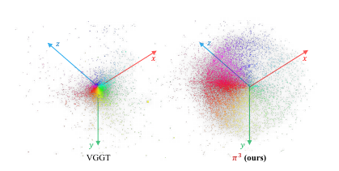](figures/figure-06.png)

*图 6　预测位姿分布的比较。在三维空间中可视化预测位姿分布，π³ 展现出清晰的低维结构，而 VGGT 的分布较为分散。*

可视化呈现出鲜明差别：VGGT 的分布分散而近似随机，π³ 的预测则形成明显的低维结构。这表明模型有效捕捉了内在的几何流形，而这很可能是其性能优越的一个关键原因。

> “很可能”对应作者对性能机制的推测。图 6 直接展示的是位姿分布形态，不能仅凭可视化建立低维结构与精度提升之间的因果关系。

### A.4 与 VGGT 的比较

本节详细介绍一项专门为公平比较 VGGT 而设计的实验。直接比较具有挑战性：仅采用核心目标，即相机位姿和局部点图，从头训练 π³，收敛效果不佳；VGGT 则采用多任务学习设计。

作者将这种困难归因于相对位姿监督固有的“冷启动”问题。与锚定参考视图的方法不同，π³ 产生高度耦合的 $N\times N$ 相对约束，从完全随机初始化开始优化时明显更不稳定。

为解决这一问题，作者加入一个辅助头，预测相对于参考帧的全局点图，使用与原文“Eq. 3.2”类似的损失。关键在于，虽然这一头通过交叉注意力使用参考视图，但它仅作为代理任务，用于解耦几何学习、稳定优化过程。最终模型仍然完全置换等变。

实验在相同的多任务条件下训练改进后的 π³ 和 VGGT：除 DINOv2 编码器使用预训练权重外，其他部分均从头训练；使用相同数据和 $224\times224$ 分辨率，训练 80 个 epoch，每个 epoch 800 步。训练数据与第 3.4 节相同。

[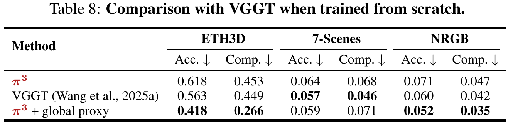](figures/table-08.png)

*表 8　从头训练时与 VGGT 的比较。global proxy 表示增加全局点图代理任务；Acc. 和 Comp. 越低越好。原表第三个数据集列写作 NRGB，正文沿用相应原文名称。*

如表 8 所示，一旦全局代理任务保证了优化稳定性，π³ 在 ETH3D 和 NRGB 基准上就明显优于 VGGT。虽然该代理任务可以有效支持从头训练，主实验仍使用 VGGT 初始化，以提高计算效率，并利用预训练权重中包含的大规模数据先验。

> 原文“Eq. 3.2”并非实际存在的公式编号。第 3.2 节介绍的是点图损失，其中尺度求解与重建损失分别为式 (4)、(5)；这里保留原引用信息，按该节理解。全局代理头属于本节的受控实验，主结果采用的是 VGGT 初始化。辅助训练头使用参考视图，与最终推理模型的对称结构需要分开理解。

> ETH3D 上，纯 π³ 的 Acc./Comp. 为 0.618/0.453，弱于 VGGT 的 0.563/0.449；加入代理任务后为 0.418/0.266。7-Scenes 上代理版本为 0.059/0.071，仍弱于 VGGT 的 0.057/0.046。因此这一实验支持优化辅助的作用，并不支持在任何条件下从头训练都更容易或每项结果都更好。

### A.5 相机位姿评价指标

[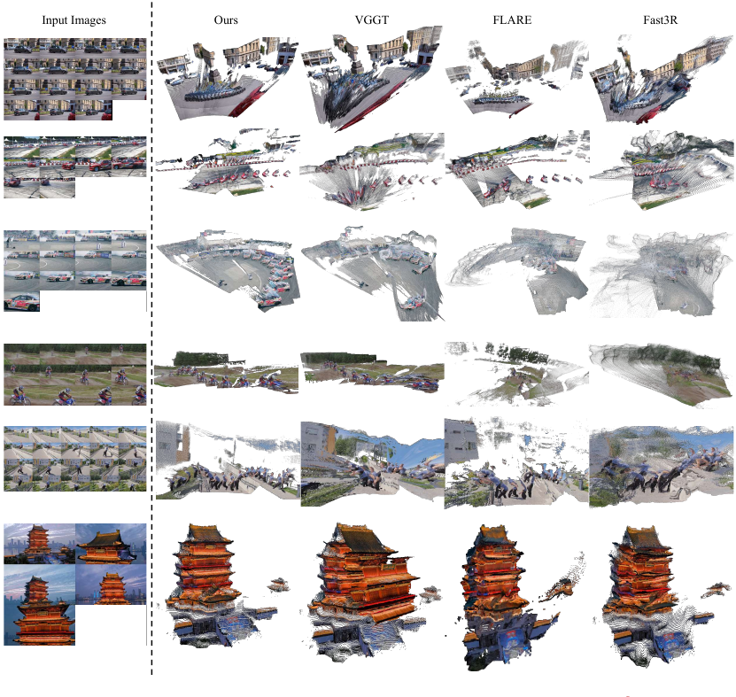](figures/figure-07.png)

*图 7　真实复杂场景多视图三维重建的定性比较。面对具有挑战性的真实序列，π³ 表现出更好的鲁棒性；无论动态内容还是复杂静态场景，其三维结构都比其他前馈方法更连贯、完整。从左至右为输入、π³、VGGT、FLARE、Fast3R。*

**角度准确率指标。**　遵循先前工作（Wang et al., 2024；2025a），实验在场景级 RealEstate10K 和以物体为中心的 Co3Dv2 上评价预测位姿，两者均有超过 1000 个测试序列。对每段序列随机采样 10 张图，组成所有可能的图像对，计算相对旋转和平移向量的角度误差。这给出指定角度阈值（例如 $30^\circ$）下的相对旋转准确率 RRA 和相对平移准确率 RTA。以 $\min(\mathrm{RRA},\mathrm{RTA})$ 随阈值变化的曲线下面积 AUC 作为统一指标。表 1 的全部方法都在 Co3Dv2 上训练过；除 CUT3R 外，其他方法的训练集均不含 RealEstate10K。

**距离误差指标。**　遵循 Wang et al.（2025b），实验在合成室外数据 Sintel、真实室内数据 TUM-dynamics 和 ScanNet 上，报告绝对轨迹误差 ATE、相对位姿平移误差 RPE-t 和相对位姿旋转误差 RPE-r。计算误差前，使用 $Sim(3)$ 变换将预测轨迹与真值对齐。表 1 的全部方法在训练时均见过 ScanNet 或 ScanNet++ 样本；所有方法在 Sintel 和 TUM-dynamics 上评价零样本位姿估计准确性。

> 角度指标只衡量相对旋转及平移方向，不评价基线的绝对长度。轨迹指标先通过一个整体相似变换消除全局方向、原点和尺度歧义，再比较位置与相邻运动。这些约定使不同模型能够在共同规范下比较，同时也限定了结论所涵盖的定位能力。

### A.6 消融细节

完整模型与消融版本 Model 1、Model 2 的主要区别，是后两者加入了 camera token。去掉仿射不变相机位姿建模后，模型不再置换等变，需要通过该 token 区分参考视图。与 VGGT 类似，每次迭代都随机选择参考视图，在进入交替注意力模块前为它拼接 camera token。对 Model 1 和 Model 2，训练在参考视图坐标系中，针对预测位姿与真值位姿计算旋转角度损失和平移 Huber 损失。

Model 1 和 Model 2 的架构及参数量完全相同，关键区别在于损失计算和归一化。Model 1 在预测点图损失计算时不做对齐，也不对点图本身归一化。作者发现，在这种特定情形下使用归一化会导致异常，性能明显变差；先前工作（Wang et al., 2025a）也观察到了这一现象。相比之下，Model 2 和完整模型都会对预测局部点图归一化。

为公平比较，所有模型均以 $224\times224$ 分辨率训练 80 个 epoch，每个 epoch 800 次迭代。它们与最终模型采用相同初始化：加载 VGGT 预训练编码器和交替注意力权重，训练中始终冻结编码器。7-Scenes 和 NRGBD 采用前述相同的稠密视图设置。

> 随机选择参考视图让模型在训练时见到不同角色分配，但每次前向计算仍有一幅图带特殊标记。完整模型则让每幅图以相同身份进入计算，并用相对位姿监督；二者在结构上有明确区别。消融只训练低分辨率阶段，因此其数值不能与完整高分辨率主结果直接混用。

### A.7 补充评价

**更严格角度阈值下的相机位姿估计。**　遵循 VGGT 的协议，表 1 主要在较宽松的 $30^\circ$ 阈值下报告 RRA、RTA 和 AUC。为更好评价精度，实验进一步检查更严格阈值，例如 Fast3R 和 FLARE 使用的 $5^\circ$ 与 $15^\circ$。表 9 因此给出在 RealEstate10K 上，$1^\circ$、$3^\circ$、$5^\circ$、$10^\circ$、$15^\circ$ 各阈值的完整 RRA、RTA 和 AUC。π³ 在这些更苛刻的约束下依然表现稳健、一致。

[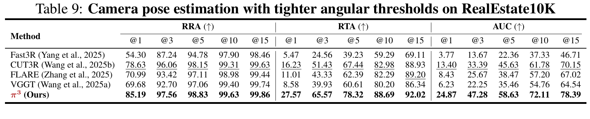](figures/table-09.png)

*表 9　RealEstate10K 上采用更严格角度阈值的相机位姿估计。@1、@3 等表示角度阈值，全部指标越高越好。*

**使用 Chamfer Distance 的点图估计。**　为进一步评价点图质量，实验还计算了 Chamfer Distance（CD），将其定义为准确度 Acc. 与完整度 Comp. 的均值。所有评价数据集的结果见表 10。

[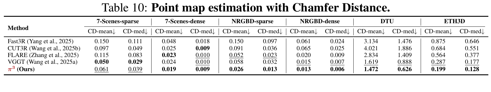](figures/table-10.png)

*表 10　使用 Chamfer Distance 的点图估计。CD-mean 和 CD-med 分别对应均值与中位数项，越低越好；保留不同数据集及稀疏、稠密设置。*

> 此处使用双向距离项的平均，即 $\mathrm{CD}=(\mathrm{Acc.}+\mathrm{Comp.})/2$。不同工作可能使用距离平方或不除以 2，跨论文比较时需要保持定义一致。表 10 延续了主实验的整体趋势，同时也保留 π³ 在稀疏 7-Scenes 上弱于 VGGT 的结果。

**与 Depth Anything V2 的单目深度比较。**　实验还比较了 π³ 与单目深度模型 Depth Anything V2（Yang et al., 2024）的性能。在标准基准上，遵循 CUT3R 协议，以 518 的输入分辨率评价。表 11 表明，尽管 π³ 面向通用多视图重建设计，其性能仍可与专用 DAv2 相比。

[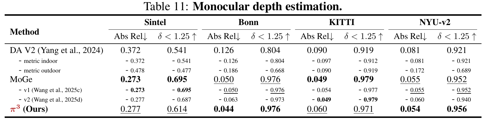](figures/table-11.png)

*表 11　单目深度估计。metric indoor、metric outdoor 为 DAv2 的室内、室外米制版本；保留各版本及汇总行。表中结果使用本节的尺度对齐评价协议。*

### A.8 局限

尽管模型性能较强，仍有几项关键局限。首先，模型不能处理透明物体，因为没有显式考虑复杂的光传输现象。其次，相比同期基于扩散的方法，π³ 重建几何的精细程度不足。最后，点云生成依赖 MLP 与 pixel shuffle 组成的简单上采样机制。该设计虽然高效，却可能引入明显的网格状伪影，尤其是在重建不确定性较高的区域。

> 局部点图提供每幅图像可见表面的预测，相机位姿把这些表面组织到公共系。动态内容的定性结果说明模型能处理含运动的输入，但这里没有进一步定义对象身份、持续运动轨迹或完整四维场景。全局注意力也仍需联合处理输入图像；标准注意力的交互规模随 token 总量呈二次增长，取消参考视图没有取消这一计算约束。

### A.9 大语言模型使用声明

作者声明，在论文准备过程中使用了大语言模型（LLM）作为写作助手。其作用严格限于提高清晰度、纠正语法，以及润色表达，使语言符合专业学术标准。包括核心思想、方法、实验设计与结果解释在内的全部科学贡献，均由作者原创完成。

## 来源

原论文作者为 Yifan Wang、Jianjun Zhou、Haoyi Zhu、Wenzheng Chang、Yang Zhou、Zizun Li、Junyi Chen、Jiangmiao Pang、Chunhua Shen、Tong He。本文依据 [arXiv v3](https://arxiv.org/abs/2507.13347v3) 作中文转述、图表裁切及补充解释；原论文与图表采用 [CC BY 4.0](https://creativecommons.org/licenses/by/4.0/) 许可。实现说明依据 [Pi3 官方仓库固定提交](https://github.com/yyfz/Pi3/tree/9fa3ddb3f8d53041f8b2738df404f62223bbaa7b)。
