# Point3R 论文解读

> Yuqi Wu、Wenzhao Zheng、Jie Zhou、Jiwen Lu，*Point3R: Streaming 3D Reconstruction with Explicit Spatial Pointer Memory*，发表于 NeurIPS 2025。本文依据 NeurIPS 正式版论文，共 25 页，包含附录 A–D；官方补充包为代码归档。[NeurIPS 论文页](https://proceedings.neurips.cc/paper_files/paper/2025/hash/650db8e1b0b016dc270d51c1476e91cf-Abstract-Conference.html) · [正式版 PDF](https://proceedings.neurips.cc/paper_files/paper/2025/file/650db8e1b0b016dc270d51c1476e91cf-Paper-Conference.pdf) · [补充代码归档](https://proceedings.neurips.cc/paper_files/paper/2025/file/650db8e1b0b016dc270d51c1476e91cf-Supplemental-Conference.zip) · [项目页](https://ykiwu.github.io/Point3R/) · [代码](https://github.com/YkiWu/Point3R)

DUSt3R 将两张图像映射为同一坐标系中的稠密点图。处理更多图像时，常见方案要么把整组图像一次性送入网络，要么逐对重建后再做全局对齐；前者不适合输入持续到来的场景，后者需要在推理时反复处理图像对与对齐关系。Spann3R 和 CUT3R 已将问题转为逐帧预测并维护历史信息，但前者保存的图像特征可能存在冗余，后者的固定长度状态则可能逐渐遗忘早期观测。

Point3R 的核心选择是把历史状态显式放到三维空间里：每个空间指针包含一个全局坐标位置和一条可更新的空间特征。当前图像通过这些指针查询场景，再把新的几何信息写回对应位置。它让记忆容量随已探索空间增长，并用邻近指针融合控制冗余。论文将该方法定位为在线稠密重建模型；模型也预测相机位姿，但没有传统 SLAM 的回环检测和全局位姿图优化。

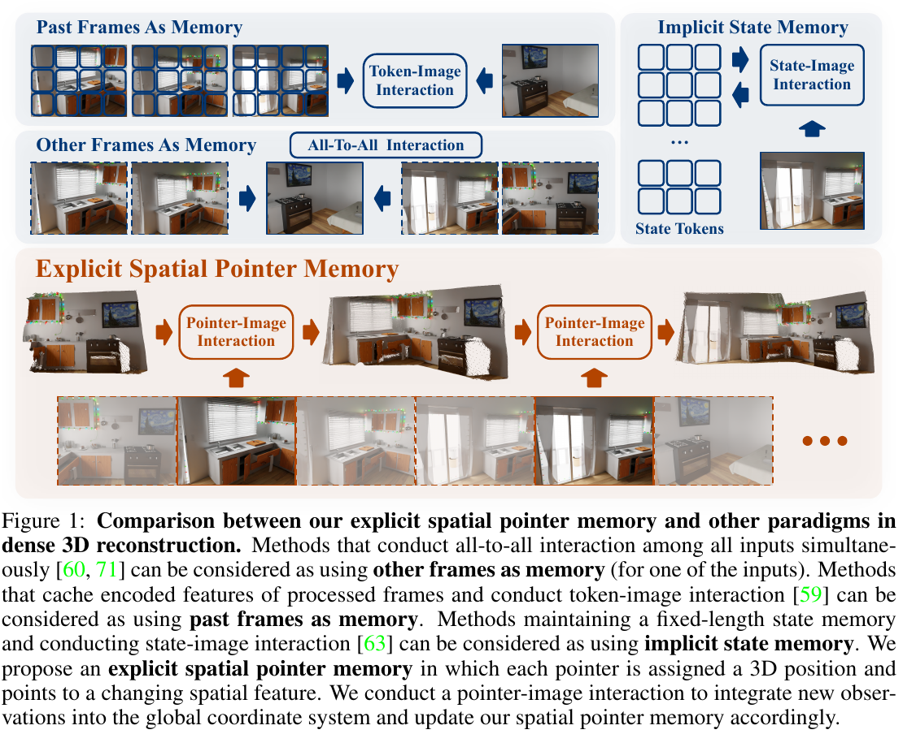

*原论文图 1。图中将全局注意力、缓存历史帧特征、固定长度隐状态和 Point3R 的空间指针记忆并列；Point3R 的每个记忆单元绑定一个三维位置。*

## 一帧如何读写空间记忆

令 $I_t$ 表示当前图像，$M_{t-1}$ 表示此前积累的记忆，$X_t$ 表示当前输出的点图。在线重建可以概括为：

$$
X_t=\mathcal{F}(M_{t-1},I_t).
\tag{1}
$$

与 Spann3R 的键值特征集合或 CUT3R 的固定长度状态不同，Point3R 的空间记忆由指针位置 $P$ 和对应特征 $M$ 组成。指针位置位于首帧相机坐标系，也就是论文定义的全局坐标系；每个指针对应场景中的一块局部几何区域。

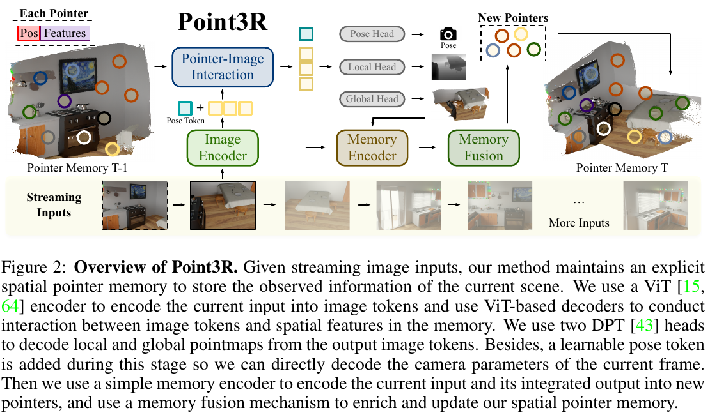

*原论文图 2。每帧经 ViT 编码后与空间指针交互，网络分别输出当前相机位姿、本地坐标点图和全局点图；预测几何随后被编码为新指针，再与旧记忆融合。*

当前图像先由 ViT 编码成图像 token。Point3R 使用两组交织的解码器，让图像 token 与已有空间特征交互；可学习的 pose token 同时参与交互。解码后，两个 DPT 头分别预测当前帧坐标系下的点图 $\hat X_t^{\mathrm{self}}$ 和首帧坐标系下的点图 $\hat X_t^{\mathrm{global}}$，并输出各自的置信度图。pose token 经 MLP 回归当前帧与全局坐标系之间的相机变换。

这里有两种不同的历史状态。空间指针记忆负责保存与场景位置对应的稠密几何特征；附录还描述了一组紧凑的 pose token 记忆，用当前图像特征检索相关位姿上下文，初始化当前帧 pose token。后者帮助相机姿态预测，不能与显式三维空间记忆混为一谈。第一帧尚无已知全局空间位置，因此先用它初始化记忆特征，再由后续帧逐步为指针赋予三维坐标。

## 从点图生成指针并融合重复位置

新指针以图像 patch 为单位生成。设 $R_{u,v}$ 是图像上对应一个 patch 的像素集合，点图头输出全局坐标点 $\hat X_t^{\mathrm{global}}(i,j)$，则该 patch 的指针位置是其中点坐标的平均值：

$$
P_{\mathrm{new}}(u,v)=\frac{1}{|R_{u,v}|}\sum_{(i,j)\in R_{u,v}}\hat X_t^{\mathrm{global}}(i,j).
\tag{8}
$$

新指针的特征同时汇总当前图像编码特征、与记忆交互后的特征以及预测几何编码：

$$
M_{\mathrm{new}}=\operatorname{Encoder}_{f}(F_t,F'_t)+\operatorname{Encoder}_{geo}(\hat X_t^{\mathrm{global}}).
\tag{9}
$$

因此位置决定指针对应场景中的哪里，特征则概括该区域在当前观察下的外观和几何信息。新指针写入时，模型计算它到已有指针的欧氏距离。最近邻距离低于阈值 $\delta$ 时，多个新指针会合并到对应旧指针；否则创建新指针。若一个旧指针接收了 $K$ 个新邻居，论文将它们的位置与特征分别取平均：

$$
p'=\frac{1}{K}\sum_{i=1}^{K}p_i^{\mathrm{new}},\qquad
m'=\frac{1}{K}\sum_{i=1}^{K}m_i^{\mathrm{new}}.
\tag{10}
$$

阈值随当前记忆覆盖范围变化。附录把三个坐标轴上的记忆范围分别除以常数 $l_x,l_y,l_z$，再求平方和开方：

$$
\delta=\sqrt{\left(\frac{\max P_{t-1}^{x}-\min P_{t-1}^{x}}{l_x}\right)^2+
\left(\frac{\max P_{t-1}^{y}-\min P_{t-1}^{y}}{l_y}\right)^2+
\left(\frac{\max P_{t-1}^{z}-\min P_{t-1}^{z}}{l_z}\right)^2}.
\tag{19}
$$

实验中三个常数都设为 20。阈值由记忆指针覆盖范围决定，作者用它控制空间指针的分布密度。融合会让记忆空间分布更均匀、减缓冗余增长，但它也会平均不同观测的几何和特征，因而存在精度与计算成本的权衡。

## 三维分层位置编码如何帮助匹配

图像 token 与空间指针之间需要比较相关性。常规 RoPE 将 token 序号编码为查询和键的相对位置；Point3R 将一维序号扩展为三维坐标，并为不同空间尺度使用多组频率基。若第 $n$ 个 token 的位置为 $p_n=(p_n^x,p_n^y,p_n^z)$，每一轴分别进入复数旋转相位，点积便同时包含查询与键之间的三维相对位置信息。

模型将四种频率基 $b\in\{10,100,1000,10000\}$ 得到的旋转结果取平均，形成 3D hierarchical position embedding（3DHPE）。记忆 token 使用自身指针位置；当前图像 patch 的位置则由前一帧全局点图中对应 patch 的三维坐标平均得到。将查询和键按各自位置旋转后，四组频率的结果再平均：

$$
\bar q'_n=\frac14\sum_b(\bar q_n\circ R_b(p_n)),\qquad
\bar k'_m=\frac14\sum_b(\bar k_m\circ R_b(p_m)),\qquad
A'_{nm}=\operatorname{Re}[\bar q'_n\bar k_m'^{*}].
\tag{15}
$$

$R_b(p)$ 将三维坐标沿 $x,y,z$ 轴分别转成复数相位，$\circ$ 表示逐元素相乘。注意力点积因而包含查询与键之间的三维相对位置线索。当前帧位置来自上一帧点图，是对当前 patch 位置的先验估计；论文认为即使相机位移较大，所有图像 token 仍会与全部记忆特征交互，因此编码只提供偏置，不会硬性排除远处位置。

这个设计把“空间上可能相关”直接加进注意力计算：位于相近三维区域的图像 patch 和记忆 token 更容易形成相似关系，而跨尺度频率减少单一坐标尺度对相位变化的限制。3DHPE 消融在 7-Scenes 上带来更好的法线一致性和更低的完整度误差；在 NRGBD 上，准确度和完整度也有改善。论文没有给出该位置编码的理论保证，效果来自实验比较。

## 训练目标与数据

位姿监督使用四元数 $\hat q_t$ 和平移 $\hat\tau_t$ 的 L2 距离，并以归一化平移减少尺度差异：

$$
\mathcal L_{\mathrm{pose}}=\sum_t\left(\|\hat q_t-q_t\|_2+
\left\|\frac{\hat\tau_t}{\hat s}-\frac{\tau_t}{s}\right\|_2\right).
\tag{17}
$$

点图采用置信度加权的回归误差。将预测与真值的点图写作 $\hat x,x$，置信度为 $c$，尺度归一化因子为 $\hat s,s$，点图损失的形式为：

$$
\mathcal L_{\mathrm{conf}}=
\sum_{(\hat x,c)} c\left\|\frac{\hat x}{\hat s}-\frac{x}{s}\right\|_2-\alpha\log c.
\tag{18}
$$

第一项让高置信像素对几何误差贡献更大，第二项则防止网络把所有置信度都压到接近零。训练数据具有度量尺度标注时，论文令 $\hat s=s$，让模型直接学习米制输出。位姿损失也包含四元数差异和归一化平移差异；模型同时监督本地与全局点图。

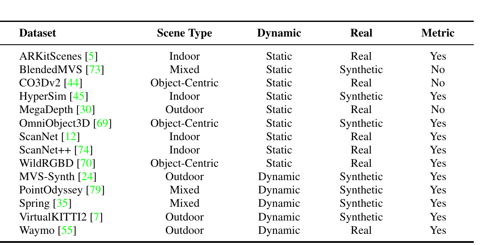

*原论文表 9。14 个训练集覆盖室内、室外、物体中心场景，包含静态与动态、真实与合成、度量与非度量样本。*

训练分三阶段：先用每段 5 帧、$224\times224$ 输入学习基础几何；第二阶段把图像长边最大尺寸提高到 512，并使用不同宽高比；第三阶段冻结图像编码器，在 8 帧序列上微调其余模块。作者从 DUSt3R 初始化 ViT-Large 图像编码器、ViT-Base 交互解码器和 DPT 头；记忆编码器由 6 层轻量 ViT 与两层 MLP 组成，每个记忆特征维数为 768。优化器为 AdamW，学习率峰值为 $5\times10^{-5}$，先 warmup 再按余弦策略衰减。训练使用 8 张 NVIDIA A800，耗时 15 天。附录还说明第一阶段暂时关闭记忆融合，以免位姿和特征尚未稳定时发生不可靠写入；后续阶段再引入融合。

## 重建和深度结果

7-Scenes 与 NRGBD 的稀疏输入重建实验每个场景只抽 3–5 帧和 2–4 帧，帧间重叠较少。Point3R 在 7-Scenes 上的平均准确度、完整度和法线一致性分别为 0.085、0.087、0.739；在 NRGBD 上分别为 0.077、0.069、0.835。准确度与完整度越低越好，法线一致性越高越好。该表明它在这组稀疏输入的几何重建中优于 Spann3R 和 CUT3R 多数指标，也优于部分需要全局对齐的基线；表中各方法的处理协议不同，不能把它解读为所有场景和流程下都优于优化式方法。

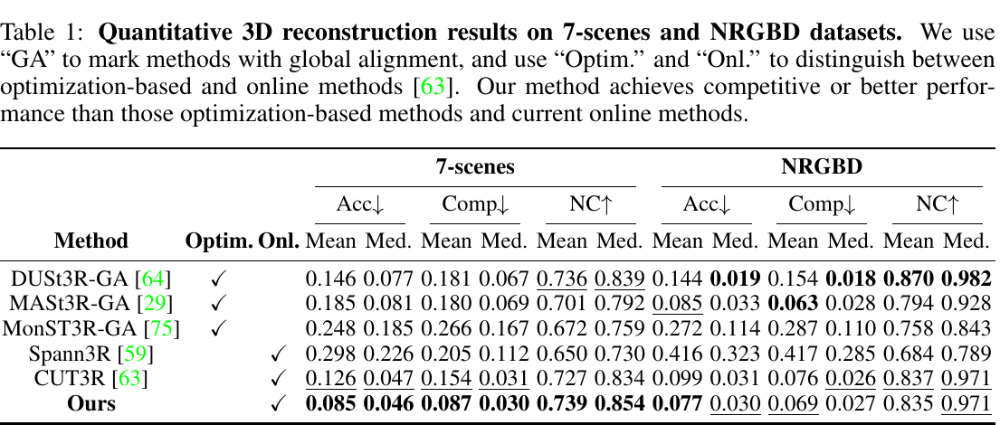

*原论文表 1。Acc 与 Comp 为重建误差，NC 为法线一致性；GA 表示对图像对方法额外执行全局对齐。*

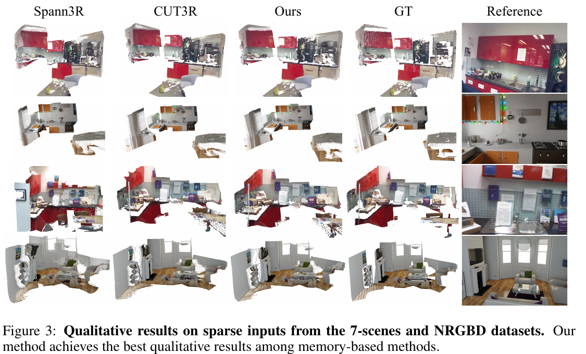

*原论文图 3。比较 Spann3R、CUT3R、Point3R 和真值在 7-Scenes、NRGBD 场景中的重建；定性外观与表 1 的几何指标互为补充。*

单目深度实验对每帧做中位数尺度对齐，因此主要衡量深度形状。Point3R 在 NYU-v2 上达到 Abs Rel 0.078、$\delta<1.25$ 为 92.3；在 Bonn 上 Abs Rel 0.061，但阈值准确率 94.5 略低于 CUT3R 的 96.2。Sintel 与 KITTI 上也没有两项指标都领先，结果显示不同域下存在取舍。

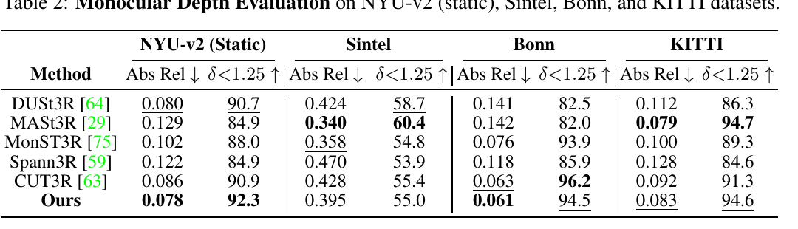

*原论文表 2。各帧单独按中位数尺度对齐；它不检验绝对度量尺度。*

视频深度实验区分两种评价。按序列对齐时，整体尺度差异被移除；不对齐的度量尺度结果则直接检验模型能否输出正确绝对尺度。Point3R 在 KITTI 的序列对齐误差为 0.093、阈值准确率为 93.5；Bonn 上度量尺度误差为 0.081、阈值准确率为 95.8。相对地，Sintel 上它的序列对齐表现不及 MonST3R-GA 与 CUT3R；KITTI 的度量尺度误差也高于 CUT3R 的 0.122。因此论文的动态场景主张应结合数据集和对齐协议来读，不能把动态数据上的结果概括成普遍领先。

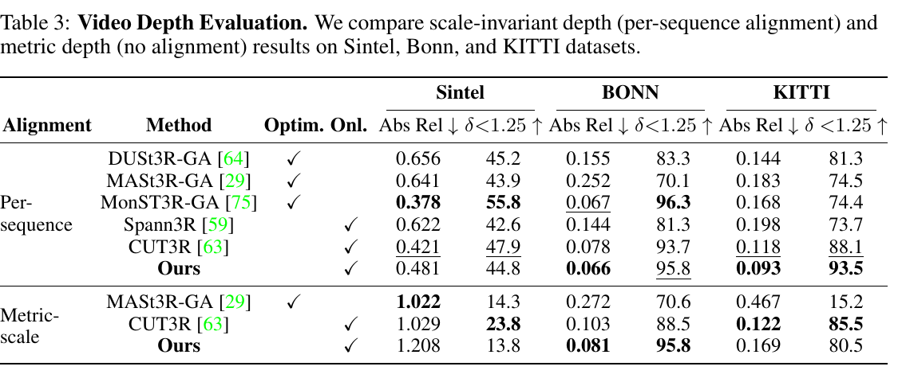

*原论文表 3。上半部按序列尺度对齐，下半部保留度量尺度；两种协议回答的问题不同。*

## 位姿估计、长序列与记忆代价

相机位姿在 ScanNet、Sintel 和 TUM-dynamics 上评测。作者先用 Umeyama 的 Sim(3) 将轨迹与真值对齐，再报告 ATE、相对平移误差和相对旋转误差。Point3R 无需额外测试时优化，结果与在线基线有竞争力，但与优化式方法仍有差距；例如 Sintel 上 ATE 为 0.442，明显高于表中 MonST3R-GA 的 0.111 和 CUT3R 的 0.213。ScanNet 的相对旋转误差为 2.791，也高于多项基线。坐标轨迹经过 Sim(3) 对齐这一点意味着表中的 ATE 不代表未经尺度调整的绝对定位误差。

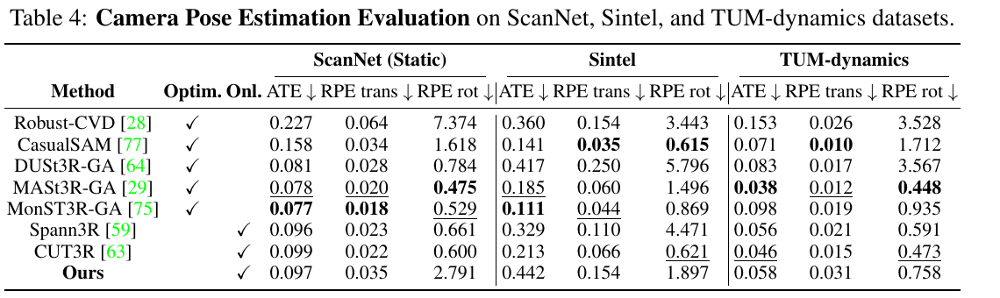

*原论文表 4。位姿评价使用 Sim(3) 对齐后的 ATE、相对平移与相对旋转误差。*

长序列实验将 7-Scenes 序列重采样为 500–1000 帧，将 NRGBD 序列重采样为 400–900 帧。与 CUT3R 相比，Point3R 在表中所有重建指标上都更好。例如 7-Scenes 平均准确度从 0.238 降至 0.071，平均完整度从 0.105 降至 0.031；NRGBD 的平均准确度从 0.372 降至 0.110，完整度从 0.211 降至 0.025。这支持显式空间位置有助于保存长程几何信息，但该实验比较对象主要是 CUT3R，并不等于已经证明任意长度的序列都不会漂移。

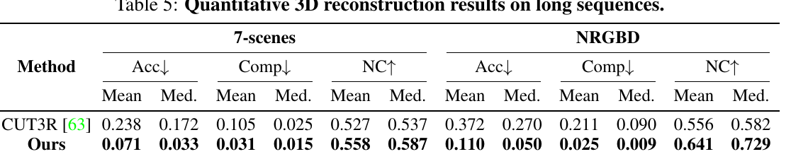

*原论文表 5。测试序列包含数百至约千帧；Point3R 在 Acc、Comp 和 NC 上优于该表中的 CUT3R。*

在 NRGBD 的 WhiteRoom 场景，指针数量从处理第 1 帧时的 768 增至第 26 帧的 1485，单帧运行时间由 0.11 秒升至约 0.20 秒后保持相近。这个实验说明融合能把增长速度压低，但记忆不是固定容量，仍随探索空间和观测增加。输入顺序实验将抽帧序列打乱后，7-Scenes 与 NRGBD 指标变化很小；这表明该记忆对重排输入较稳健，但“重排后稳定”并不自动意味着它具有回环检测或图优化能力。

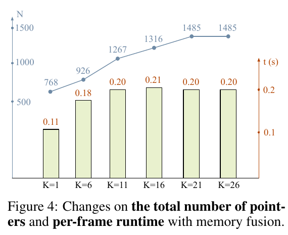

*原论文图 4。横轴是 WhiteRoom 序列已处理帧数；折线表示指针数，柱形表示单帧运行时间。帧数增加后指针仍继续增长。*

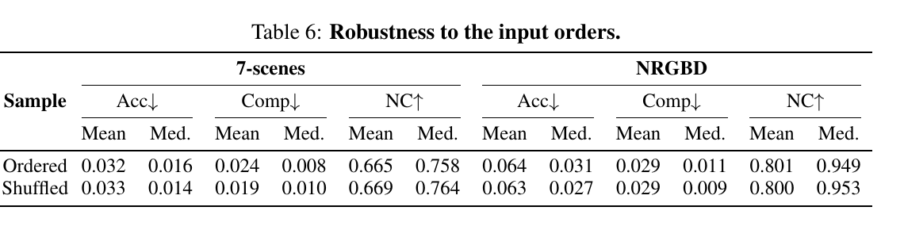

*原论文表 6。打乱采样顺序后，两组数据的重建指标保持接近。*

消融表中，去掉 3DHPE 后 7-Scenes 的 NC 从 0.725 降到 0.698，NRGBD 的 Acc/Comp 也从 0.079/0.073 变为 0.083/0.079。关闭记忆融合时，部分指标略好、部分略差，说明融合的主要作用是控制空间重复和运行成本，几何精度变化并非所有指标都同方向。

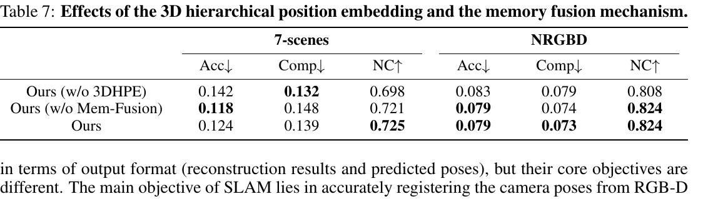

*原论文表 7。去除 3DHPE 或记忆融合后的指标变化并不完全一致；完整模型在部分指标上领先。*

## 它与完整 SLAM 的边界

Point3R 和 SLAM 都会输出相机位姿与场景几何，但系统目标和数据流不同。Point3R 重点是由前馈网络增量预测首帧参考系中的稠密点图；传统 SLAM 则通过跟踪、地图维护和优化持续估计相机状态。论文将它与 MASt3R-SLAM 在 7-Scenes seq-01 上比较：Point3R 的 Acc/Comp 为 0.061/0.022，优于 MASt3R-SLAM 的 0.068/0.045；峰值显存为 5.46 GB，低于 7.18 GB。相机轨迹误差则是 MASt3R-SLAM 的 0.066 m 更低于 Point3R 的 0.084 m；Point3R 单帧运行时间为 0.20 秒，慢于 MASt3R-SLAM 的 0.11 秒。这个同基准比较呈现的是几何、跟踪和资源指标之间的具体取舍。

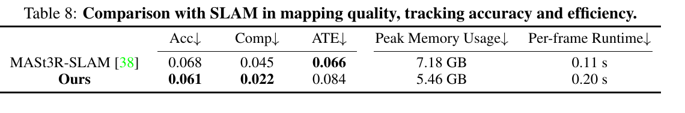

*原论文表 8。Point3R 的稠密地图误差和峰值显存更低，MASt3R-SLAM 的 ATE 与单帧运行时间更低。*

论文明确指出，随着探索区域变大，指针的位置范围也扩大，可能给后续相机位姿估计带来干扰；作者将改进指针—图像交互列为后续方向。附录还测试了低纹理墙面作为首帧的困难初始化：Point3R 的重建质量有所下降，但劣化小于 CUT3R。该结果支持其对初始化的相对鲁棒性，同时也说明参考帧质量仍会影响重建。静态和动态场景的附录可视化展示了稠密输入下的点云效果；它们是定性例子，不替代前面的误差表。

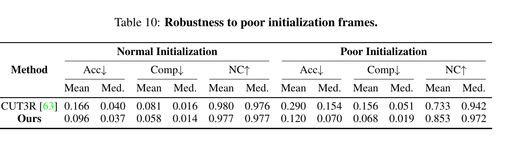

*原论文表 10。低质量初始化会使两种方法的结果都变差；Point3R 的误差上升较小。*

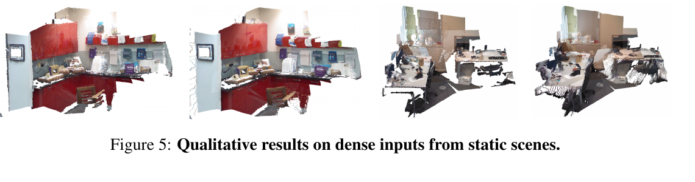

*原论文图 5。补充材料展示静态场景中稠密输入的点云结果。*

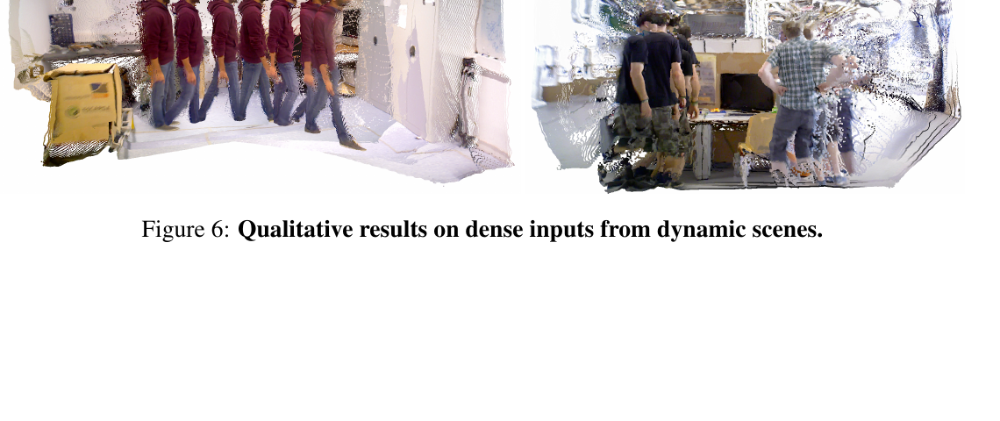

*原论文图 6。动态人物在连续观测中多次出现；点云可视化显示模型对动态内容的处理结果，但无法单独证明运动区域的度量几何或轨迹精度。*

## 方法关系

Point3R 把在线重建的历史记忆从“无坐标的 token 状态”改为“有位置的空间单元”。当前图像先用全局点图把 patch 关联到三维位置，再通过最近邻融合让同一区域的记忆更新；3DHPE 为查询提供空间相对位置线索。长序列重建和输入顺序实验说明这一表示能在若干百帧的基准中保留更多空间信息，深度实验也表明它可处理静态与动态数据。

Point3R 是一个以显式空间记忆为核心的流式前馈重建模型，尚未包含显式回环约束和全局束调整。空间指针容量仍会扩张，位姿精度和逐帧运行时间也未在所有比较中占优。它的稠密几何可为 SLAM 提供地图先验，位姿后端也可能反过来约束它的长期漂移。
