# Point4Cast 论文解读

> Xinhang Liu、Pedro Miraldo、Suhas Lohit、Huaizu Jiang、Naoko Sawada、Yu-Wing Tai、Chi-Keung Tang、Moitreya Chatterjee，*Point4Cast: Streaming Dynamic Scene Reconstruction and Forecasting*，CVPR 2026 正式版，论文页码 14600–14607。本文依据 CVF Open Access 的 8 页论文和 6 页补充材料。[论文页面](https://openaccess.thecvf.com/content/CVPR2026/html/Liu_Point4Cast_Streaming_Dynamic_Scene_Reconstruction_and_Forecasting_CVPR_2026_paper.html) · [论文 PDF](https://openaccess.thecvf.com/content/CVPR2026/papers/Liu_Point4Cast_Streaming_Dynamic_Scene_Reconstruction_and_Forecasting_CVPR_2026_paper.pdf) · [补充材料 ZIP](https://openaccess.thecvf.com/content/CVPR2026/supplemental/Liu_Point4Cast_Streaming_Dynamic_CVPR_2026_supplemental.zip) · [项目介绍](https://merl.com/research/highlights/point4cast)

Point4Cast 针对的是动态视频中的一个具体缺口：现有流式三维重建方法通常在新帧到达时更新当前场景几何，却不预测未来时刻的三维结构。Point4Cast 将过去观测压入持续更新的潜在时空状态；给定已经看过的一帧作为查询视图，再指定过去、当前或未来的目标时刻，模型会解码该视图下的三维点图和相机参数。同一查询视图在不同时间的点图位于共同坐标系，因此相邻时刻点图之差还可直接给出稠密场景流。论文的主要证据来自 PointOdyssey 与 TAPVid-3D 上的重建、未来点图预测和场景流实验。

## 1 引言

机器人、自动驾驶和增强现实系统需要理解场景随时间如何变化。传统 SfM 和 SLAM 通过几何优化恢复相机和结构，但相机与物体同时运动时会遇到动态场景带来的对应关系问题。NeRF、3D Gaussian Splatting 等场景表示可以产生高保真重建，通常需要相机参数，并在整段视频上离线处理。前馈三维模型则直接从图像预测点图与相机；后续流式模型把它们扩展到逐帧输入，但输出仍主要描述最后观测时刻。

Point4Cast 把问题进一步扩展为三维点图预测：收到一段图像流后，既要重建已经观测到的动态场景，也要预测场景在未来时刻的点图。图 1 展示了这项任务的输入输出关系：上方是逐步到达的图像，下方按过去、当前和未来时刻展示与查询视图对应的三维点图。颜色区分不同查询时刻，说明时间是解码条件的一部分，而不是只在新图像进入时更新一次当前点图。

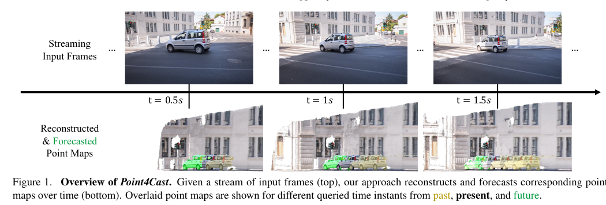

论文将核心表示称为持续演化的潜在时空表示。每帧到达时，更新模块把新证据融合进这一表示；查询时，读出模块同时接收一个已观测的图像视图和目标时间，预测该视图在该时刻对应的场景几何。点图预测跨时间共享坐标系，使得点的运动轨迹和场景流可以从多个时间点的几何输出中得到。论文的三项具体贡献是提出流式三维点图预测任务、以统一结构联合重建和预测，以及由时间条件点图直接产生场景流而无需额外训练或推理模块。

## 2 相关工作

### 视觉预测

视频预测通常从输入帧生成未来二维图像。一类方法用 RNN 或 Transformer 建模时间依赖，另一类方法预测运动以避免生成静态背景。Point4Cast 的输入同样是二维视频帧，但预测目标是三维点图属性，而不是未来 RGB 图像。

与之相邻的场景流预测往往接收稀疏三维点云或关键点，再外推这些点的轨迹。Point4Cast 从图像出发，输出与图像像素对应的稠密三维点图，因此可在稠密场景结构上计算点的时间位移。

### 按场景优化的三维重建

SfM、SLAM、NeRF 和 3D Gaussian Splatting 通常为每个场景单独建立或优化表示。动态扩展会使用时间条件、形变场或时空网格等结构；动态 SLAM、NeRF 和 Gaussian 方法也各有针对动态区域的处理方式。Point4Cast 走的是数据驱动前馈路线：从未标定的单目图像流直接预测几何，不先对每段视频独立拟合一个显式场景表示。

### 前馈三维重建

DUSt3R、MASt3R 等方法从图像对预测点图，后续的 Fast3R、[VGGT](/blog/articles/vggt/) 等扩展到多视图输入。针对动态视频的 MonST3R、SpatialTracker、DeMo 等方法引入运动相关线索或稠密视频对应，提升动态场景重建能力。论文指出，这些模型虽能重建动态场景，却没有显式预测场景将如何演化。

### 流式前馈三维重建

[CUT3R](/blog/articles/cut3r/)、[Point3R](/blog/articles/point3r/)、Spann3R、[StreamVGGT](/blog/articles/streamvggt/) 等方法面向图像流维护状态或使用因果 Transformer，目标是在新帧到来时连续更新三维理解。论文将 Point4Cast 与这些工作的区别界定为预测能力：它希望查询到任意过去、已观测或未来时刻的三维点图，而不只输出最新帧时刻的几何。

## 3 方法

输入是单目透视视频帧 $I_k\in\mathbb{R}^{H\times W\times3}$。观测到第 $k$ 帧后，模型可选择任意已观测图像 $I_q$（$q\leq k$）和目标时刻 $t$，预测与 $I_q$ 像素对应的三维点图 $\hat{\mathbf X}_q^{(t)}$，并估计该查询帧的相机内外参数 $\hat{\mathbf g}_q\in\mathbb{R}^9$。$q$ 决定从哪张图像的像素组织点图，$t$ 决定这些点所描述的场景时刻；两者承担不同作用。目标时刻可以早于、等于或晚于查询图像及最新观测时刻。

### 3.1 Point4Cast 总览

模型维护一个固定大小的潜在状态 $\mathbf w_k\in\mathbb{R}^{N\times C}$，由 $N$ 个可学习 token 组成，每个 token 有 $C$ 维特征。初始状态 $\mathbf w_0$ 随机初始化；第 $k$ 帧到达后，更新模块将新图像写入前一状态：

$$
\mathbf w_k=\operatorname{Update}(\mathbf w_{k-1},I_k).\tag{1}
$$

这里状态不按视频长度追加历史图像 token，而是始终保留固定数量的潜在 token。实验配置中 $N=4096$、$C=1024$。固定的是状态 token 数量，并不意味着整体推理开销与输入帧数无关：图像编码和每帧更新仍要随到达帧数执行。

完成第 $k$ 次更新后，可以选择已观测帧 $I_q$ 以及任意时刻 $t$ 查询点图：

$$
\hat{\mathbf X}_q^{(t)}=\operatorname{Readout}(\mathbf w_k,I_q,t).\tag{2}
$$

查询图像为模型提供像素网格与视角条件，时间 $t$ 让输出表达该视角下场景在指定时刻的几何。比如选一张已经观测到的行人图像作为 $I_q$，模型可以在其像素位置上输出过去或未来时刻的三维点。它不是用未来 RGB 帧作为输入；未来信息来自训练得到的运动先验和当前潜在状态。

### 3.2 时空表示更新与读出

更新和读出都由 Transformer 实现，内部交替使用自注意力与交叉注意力。更新时，新图像特征和旧状态交换信息；读出时，带时间条件的状态与查询图像特征融合。

#### 更新：把新观测融入固定状态

先用图像编码器处理当前输入帧：

$$
\mathbf f_k=\operatorname{Encoder}(I_k)\in\mathbb{R}^{M\times C}.\tag{3}
$$

其中 $M$ 是该输入帧的图像 token 数。随后更新 Transformer 以旧状态 $\mathbf w_{k-1}$ 为记忆、以当前特征 $\mathbf f_k$ 为新证据，产生与旧状态同形状的新状态：

$$
\mathbf w_k=\operatorname{UpdateTransformer}(\mathbf w_{k-1},\mathbf f_k)\in\mathbb{R}^{N\times C}.\tag{4}
$$

交替的自注意力与交叉注意力允许当前图像 token 和历史状态反复交换信息。一次更新完成后，后续帧只需读取这个新的固定规模状态；这使历史信息以潜在特征的形式延续，而非显式保留所有图像特征。

#### 时间调制与点图读出

查询时，模型先用目标时刻 $t$ 调制状态：

$$
\mathbf s^{(t)}=\operatorname{TimeCondition}(\mathbf w_k,t)\in\mathbb{R}^{N\times C}.\tag{5}
$$

论文把时间标量映射到学习到的嵌入 $\mathbf e_t=\operatorname{Embed}(t)$，再通过两个线性映射得到缩放向量 $\boldsymbol\gamma=W_\gamma\mathbf e_t$ 和偏置向量 $\boldsymbol\beta=W_\beta\mathbf e_t$。对第 $i$ 个状态 token，FiLM 式调制为

$$
\mathbf s^{(t)}[i,:]=\boldsymbol\gamma\odot\frac{\mathbf w_k[i,:]-\boldsymbol\mu_i}{\boldsymbol\sigma_i}+\boldsymbol\beta,\quad i=1,\ldots,N.\tag{6}
$$

$\odot$ 表示逐通道相乘，$\boldsymbol\mu_i$ 和 $\boldsymbol\sigma_i$ 是论文所述的 batch 均值和标准差。归一化先把 token 特征调整到可调制的尺度，时间相关的 $\gamma$ 和 $\beta$ 再改变每个通道的幅度与偏移。于是同一份历史状态可随 $t$ 转换为不同的时间条件表示，供后续 Transformer 解码已观测时刻或未来时刻的几何。

接着，编码查询图像：

$$
\mathbf f_q=\operatorname{Encoder}(I_q).\tag{7}
$$

论文在式（3）将当前帧特征写为 $M\times C$，但在式（7）把查询帧特征写为 $N\times C$，且没有解释两处 token 数为何不同。这是原文的形状记号不一致；按方法图和计算关系，读出阶段需要查询图像 token 与状态 token 一同进入 Transformer，本文保留这一处疑点，不据此推断额外的重采样操作。

读出 Transformer 还接收一个可学习的 pose token $\mathbf z\in\mathbb{R}^C$：

$$
\mathbf Y_q^{(t)},\mathbf z'_q=\operatorname{ReadoutTransformer}(\mathbf f_q,\mathbf z,\mathbf s^{(t)}).\tag{8}
$$

输出 token $\mathbf Y_q^{(t)}$ 聚合了时间调制状态和查询图像特征，后续逐像素点图头据此预测三维坐标：

$$
\hat{\mathbf X}_q^{(t)}=\operatorname{Head}_{\mathrm{map}}(\mathbf Y_q^{(t)}).\tag{9}
$$

pose token $\mathbf z'_q$ 汇总查询图像的全局信息，再送入相机头：

$$
\hat{\mathbf g}_q=\operatorname{Head}_{\mathrm{cam}}(\mathbf z'_q).\tag{10}
$$

论文将 $\mathbf g_q$ 定义为包含相机内参与外参的九维向量，但没有在正文进一步说明九个分量的具体编码。相机估计与查询时间无关，因此同一查询帧的相机参数由其图像级 pose token 预测；时间条件主要影响点图几何。

图 2 总结了两条计算路径：左侧逐帧编码并更新 $\mathbf w_k$，右侧对状态施加时间条件，再与查询帧 token 和 pose token 融合，分别解码点图和相机参数。图中火焰标记表示论文训练时更新的模块；冻结或预训练的编码器与初始化来源见补充材料 B。

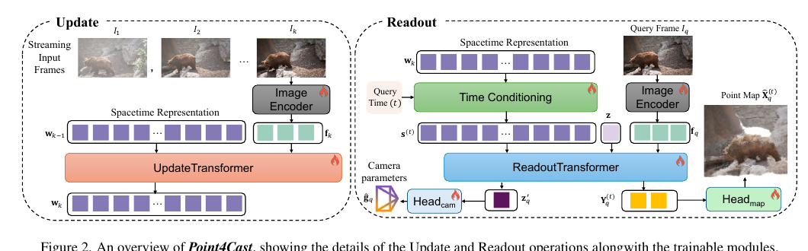

#### 从点图差得到场景流

对同一查询帧 $I_q$，若分别在相邻时刻 $t$ 与 $t+1$ 预测点图，论文将逐像素三维位移定义为

$$
\mathbf F_q^{(t\rightarrow t+1)}=\hat{\mathbf X}_q^{(t+1)}-\hat{\mathbf X}_q^{(t)}.\tag{11}
$$

逐像素相减成立的关键是两个点图都由相同查询帧 $I_q$ 索引，并在一致的坐标系中表达。因而同一像素所代表的查询点在两时刻的三维坐标可直接相减，得到稠密位移向量。该计算没有额外的场景流预测头，也不需要场景流专门监督；其质量依赖模型在多个时刻输出坐标一致的点图。这个定义给出的是点图对应位置的三维位移，不等同于二维光流。

### 3.3 在线训练范式

训练按推理时的流式顺序处理一段长度为 $T$ 的视频。收到第 $k$ 帧后，先更新状态，再对所有已经观测过的查询帧 $q\leq k$ 和所有训练目标时刻 $t\in[1,T]$ 执行读出。因此模型既要利用越来越多的过去观测，又要在每次状态更新后重建已见帧以及预测未来标签。

每个查询的损失是点图与相机参数的 $L_1$ 误差之和：

$$
\mathcal L_q^{(t)}=\left\|\hat{\mathbf X}_q^{(t)}-\mathbf X_q^{(t)}\right\|_1+\lambda_{\mathrm{cam}}\left\|\hat{\mathbf g}_q-\mathbf g_q\right\|_1,\quad\lambda_{\mathrm{cam}}>0.
$$

同一查询帧的相机参数会在时间循环中重复监督；点图真值则随查询时间变化。算法对每次更新、每个已观测查询帧和每个训练时刻累积损失，再对这些项取平均。梯度通过连续的状态更新反向传播，即 BPTT；作者指出每次状态更新后都施加监督，能缩短梯度路径并避免只在整段末尾监督带来的长时域误差累积。训练使用未来时刻的真值作为监督标签，但在线推理只逐帧接收图像，不会读取未来图像。

#### 训练数据与实现

模型以 VGGT 预训练组件初始化，而不是从头训练。图像编码器采用 VGGT 的 ViT/DINOv2 主干，输入被划分为 $14\times14$ patch，每个 token 为 1024 维；更新 Transformer 和读出 Transformer 从 VGGT 的 DPT 模块初始化，各含 12 层、每层 16 个多头注意力头。点图头和相机头沿用 VGGT 相机头结构，以轻量 $1\times1$ 卷积把最终特征映射到点图或相机参数。论文也验证了以 CUT3R 编码器和 Transformer 解码器初始化的替代方案。所有可训练模块联合微调，使用 AdamW 和固定学习率计划，在 8 张 NVIDIA A100 80GB GPU 上训练约 107 小时。

论文将训练数据构成与训练过程曲线放在补充材料 A，具体数据规模、伪深度监督来源和损失曲线见文末补充材料部分。
## 4 实验

主文在 PointOdyssey 合成动态场景和 TAPVid-3D 真实长时点跟踪数据集上评估。TAPVid-3D 未用于训练，论文将其作为零样本测试。重建任务逐帧预测点图和相机；预测任务评估下一帧和未来第 10 帧，指标对未来多个时间步求平均。

主文图 3 在方法总览之后先展示了三类场景的定性结果：室内行人、道路车辆和滑板运动。图中黄色与蓝色表示重建点图，绿色表示预测点图；作者报告 Point4Cast 的点图更完整、时间上更一致。定性结果用于展示任务和输出形态，定量比较仍看后续实验表。

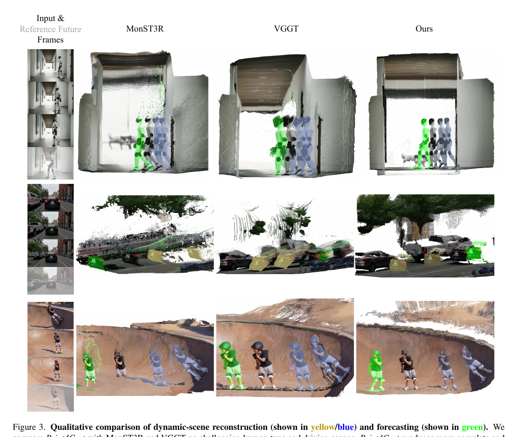

### 4.1 实验设置

#### 数据集与预测协议

PointOdyssey 提供长视频和逐帧度量深度；TAPVid-3D 面向真实场景中的长时点跟踪。作者遵循两个基准各自的官方数据划分与评测工具。未来点图预测的两个时域分别是下一帧和未来 10 帧。论文也报告 3D 场景流：既评估相邻点图间的场景流估计，也评估场景流预测。

#### 指标

Acc. 和 Comp. 是对称 Chamfer 距离的两个组成误差：Acc. 衡量预测点到最近真值点的距离，Comp. 衡量真值点到预测点的距离，均越低越好。相机相对平移误差 RTE 和相对旋转误差 RRE 在对真值执行 Sim(3) 对齐后计算，越低越好。场景流以 End-Point Error（EPE，越低越好）和 Acc.（越高越好）评价。

主文表 1、2 还列出 `Acc-d` 和 `Comp-d` 两列，但正文指标定义没有解释后缀 `-d` 的含义。以下按论文原标签转录数值，不为其补造“动态区域”或其他具体解释。预测图的纵轴把误差曲线标为 Accuracy 和 Completeness，图注同时说明越低越好；结合正文的 Chamfer 定义，这里的 Accuracy 实际按误差方向解读。原文未解释图中纵轴标注与“误差”的关系，故阅读曲线时以指标数值上升表示误差增大。

#### 比较方法

重建基线包括离线方法 MonST3R、VGGT，以及在线方法 CUT3R、StreamVGGT。为了比较未来预测，作者为每个基线构造两种外接流程：其一先用开源视频生成模型预测未来 RGB 帧，再运行原重建模型（Frame generation）；其二先重建第一个预测帧，再根据最近两张点图估计场景流并向前传播（Scene-flow continuation）。Point4Cast 则通过时间条件读出直接预测未来点图。由于基线并非为三维点图预测设计，这些结果比较的是论文所构造的预测流程，而非各基线原生的未来预测能力。

### 4.2 结果

#### 动态场景重建

表 1 和表 2 比较 PointOdyssey 与 TAPVid-3D 上的点图和相机误差。PointOdyssey 上，VGGT 主干版本的 Acc./Comp. 为 0.428/0.472，CUT3R 主干版本为 0.410/0.484；后者 Acc. 更低，前者 Comp. 更低。与表中其他在线基线相比，两种 Point4Cast 变体的 Acc.、Comp. 和相机误差整体较有竞争力。TAPVid-3D 上，VGGT 主干版本达到 Acc./Comp. 0.711/0.476，低于其他表列方法的对应误差；这是未见数据集上的零样本结果。对于 `Acc-d/Comp-d`，因论文没有给出定义，不将其作为可解释的具体对象来推断。

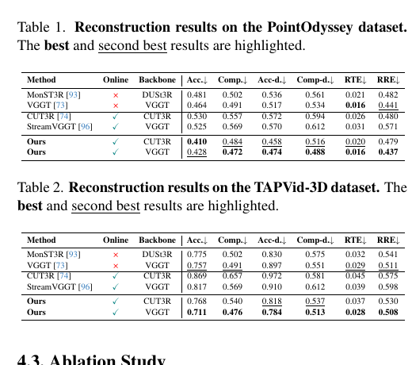

#### 未来点图预测

表 3、4 显示，在 PointOdyssey 和 TAPVid-3D 上，Point4Cast 的下一帧预测和 10 帧预测误差均低于表中各基线预测流程。以 VGGT 主干为例，PointOdyssey 的下一帧 Acc./Comp. 为 0.481/0.506，未来 10 帧为 0.533/0.571；TAPVid-3D 对应为 0.810/0.878 和 1.259/1.456。随预测时域增加，误差增大，但图 4 显示增长较平缓。定性对比见主文图 3：作者展示了行人、车辆等刚体与非刚体运动场景，报告预测点图更完整、运动更连贯。图像中的遮挡、几何缺失和未来外观变化也意味着定性图不能证明所有动态变化都能被准确预测。

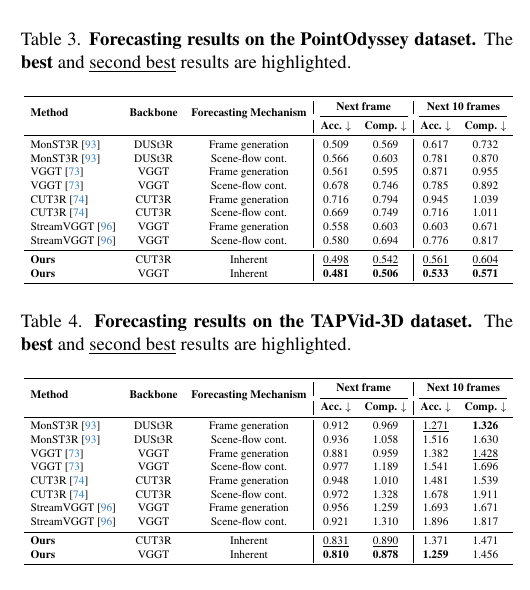

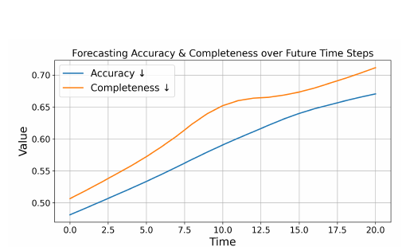

#### 场景流与点轨迹

表 5 仅在 PointOdyssey 上报告场景流结果。VGGT 主干 Point4Cast 的场景流估计 EPE/Acc. 为 1.355/0.848，场景流预测为 1.619/0.766；分别优于表中比较方法。这里的场景流由式（11）相邻时间点图差分得到，因此实验支持的是时间条件点图内部具有较好的几何一致性，而不是存在独立训练的光流或场景流网络。

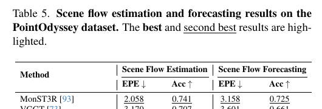

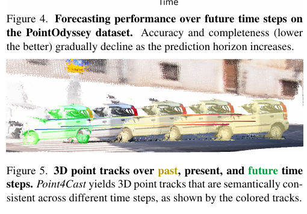

### 4.3 消融研究

主文比较正弦时间位置编码与学习式时间嵌入，并进一步比较交叉注意力和 FiLM 式条件化。正弦位置编码给出固定的周期特征；学习式嵌入则直接把标量时刻映射到可学习向量。FiLM 将这个时间向量转为状态的逐通道缩放与偏置。表 6 中三种设置的 Acc./Comp. 依次为 0.470/0.502、0.437/0.492 和 0.428/0.472，学习式嵌入加 FiLM 的误差最低。消融支持作者的经验判断：时间编码和状态调制都会影响重建质量。主文表 6 的原图如下。

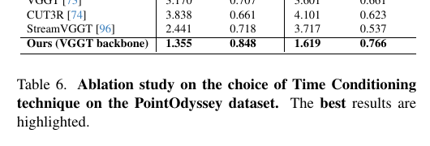

作者还指出方法能够更换 VGGT 或 CUT3R 主干，表 3、4 的结果显示两种选择在两个数据集上均可工作，但具体优劣会随指标和数据集变化。

## 5 结论与未来工作

Point4Cast 提出从图像流预测未来三维点图，并用固定规模、持续更新的时空状态统一历史重建和未来解码。时间条件作用于状态，查询帧提供几何输出的图像视角；同一查询下跨时刻对齐的点图进一步支持场景流与点轨迹。作者报告了 PointOdyssey、TAPVid-3D 上的重建、预测和场景流结果，并指出计划在未来加入不确定性建模。

从论文证据看，最直接的贡献是把预测目标从未来二维图像转为带三维结构的点图，并将时间条件读出嵌入流式重建管线。未来预测仍是数据驱动的几何外推：训练时有未来点图监督，推理时依靠已观测视频形成的状态。因此结果依赖训练数据对动态类型和运动范围的覆盖；论文没有给出不确定性估计，也未证明对长时域任意运动都能保持可靠。另有两个原文未澄清处——`Acc-d/Comp-d` 的含义和式（7）token 数的记号——在阅读实验表及结构时应保留为来源歧义。

## 补充材料

### A 训练数据细节

补充表 A 汇总了四组训练视频及其帧数和分辨率：Kubric 约 1,000 段、24,000 帧，分辨率 $512\times512$；PointOdyssey 约 100 段、150,000 帧，分辨率 $960\times540$；Stereo4D 2,000 段、约 160 万帧，分辨率 $512\times512$；作者用 Blender、Mixamo 动作资产和 BlenderKit 场景元素合成 2,000 段视频、约 240,000 帧，分辨率 $960\times540$。Kubric、PointOdyssey 和作者的合成数据提供度量深度；对于缺少真值三维点云的训练片段，论文使用现成单目视频深度估计器产生伪深度监督。训练先使用运动受控的合成数据，再加入更复杂的真实 Stereo4D 场景。

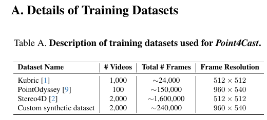

补充图 A 展示 PointOdyssey 训练损失随迭代步数总体下降，期间有若干尖峰；论文称训练过程平稳收敛。这条曲线描述训练过程，不代表跨数据集的泛化表现。

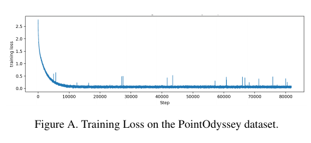

### B 网络结构细节

更新和读出 Transformer 都从 VGGT 的 DPT 模块初始化，每个包含 12 个注意力层、16 个注意力头。VGGT 主干使用其 DINO 图像编码器；CUT3R 主干则使用 CUT3R 的预训练 ViT 编码器及 Transformer 解码器。点图头和相机头按 VGGT 相机头结构初始化。作者强调模块化设计允许替换主干，但这并不代表任意骨干都无需调整即可获得相同性能。

### C 运行速度比较

补充表 B 给出五种方法在 PointOdyssey 上的 FPS。MonST3R 为 4.29，VGGT 为 1.13，CUT3R 为 23.74，StreamVGGT 为 17.18，Point4Cast 的 VGGT 主干版本为 20.83。主文将其概括为两个数据集上约 20 FPS、与 CUT3R 相近。表中最高值是 CUT3R；结果反映论文评测实现与硬件设置。

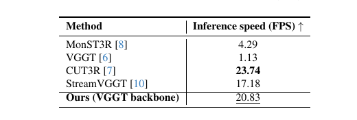

### D 额外消融

#### D.1 时间条件策略

补充表 C 汇总了主文的时间条件消融。论文测试的正弦时间嵌入将标量时刻按一组频率展开为交替的正弦、余弦通道，学习式方案则直接把时刻映射到 $C$ 维向量。FiLM 的式（1）与主文式（6）相同。交叉注意力先令状态 token 作为 query、时间嵌入作为 key 和 value：

$$
\hat{\mathbf s}=\operatorname{MHA}(Q=\mathbf w_k,K=\mathbf e_t,V=\mathbf e_t),\qquad \mathbf s^{(t)}=\operatorname{FFN}(\operatorname{LN}(\hat{\mathbf s}))+\hat{\mathbf s}.
$$

也就是说，所有状态 token 从时间嵌入读取时间条件，再经过带残差的归一化前馈层。表 C 中学习式嵌入加 FiLM 的 Acc./Comp. 最低。

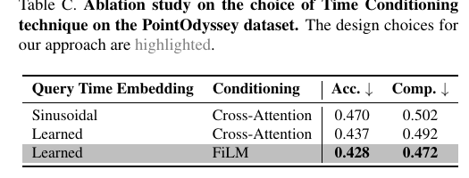

#### D.2 帧率与时空状态

表 D 表明降低帧率会增加误差，不均匀采样的误差介于 30 FPS 与 10 FPS 结果之间。表 E 比较不同主干在流式状态更新和逐帧推理设置下的效果；作者报告持久时空状态提升重建质量和 FPS，VGGT 加流式更新取得表中最好的重建误差与较高吞吐。表 D 的不均匀采样 Acc./Comp. 为 0.433/0.473，优于 10 FPS 的 0.474/0.493；表 E 中无状态设置的 CUT3R 和 VGGT 分别为 0.539/0.662、0.671/0.838，启用流式状态后分别为 0.484/0.516、0.438/0.465。

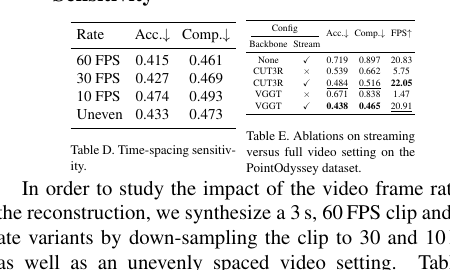

### E 定性三维重建和预测

补充图 B、C 是未见真实室外视频的定性比较，图 E 是 PointOdyssey 上的人体动态场景对比；图 D 单独展示两段真实视频的相机轨迹。对于基线未来预测，作者先用光流预测二维帧，再调用 MonST3R 或 VGGT 生成对应点图。示例中 Point4Cast 的点图更完整、连贯，但定性图不能替代主文表 3、4 的预测误差比较。

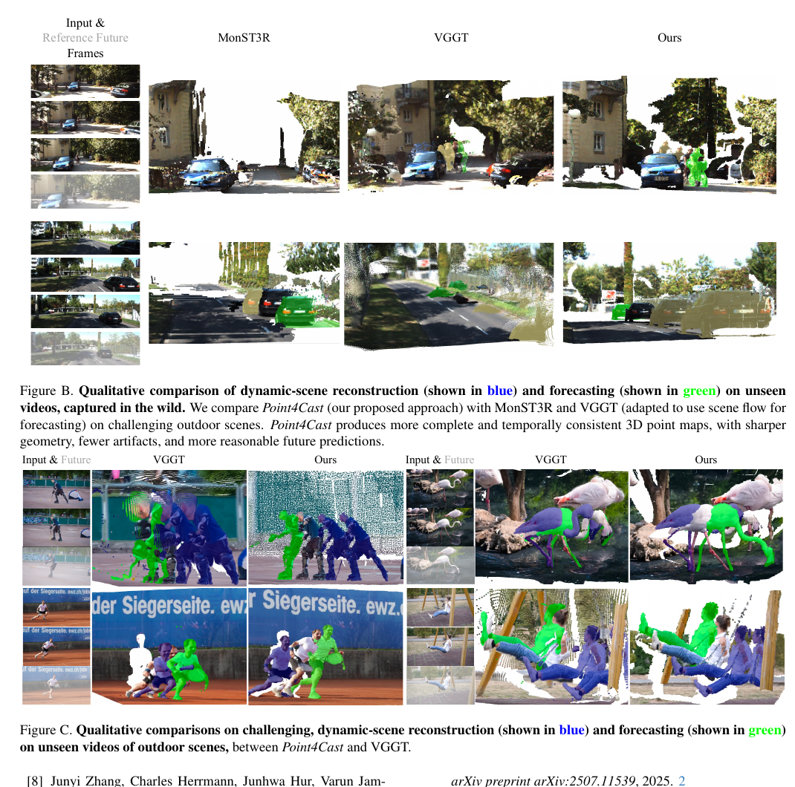

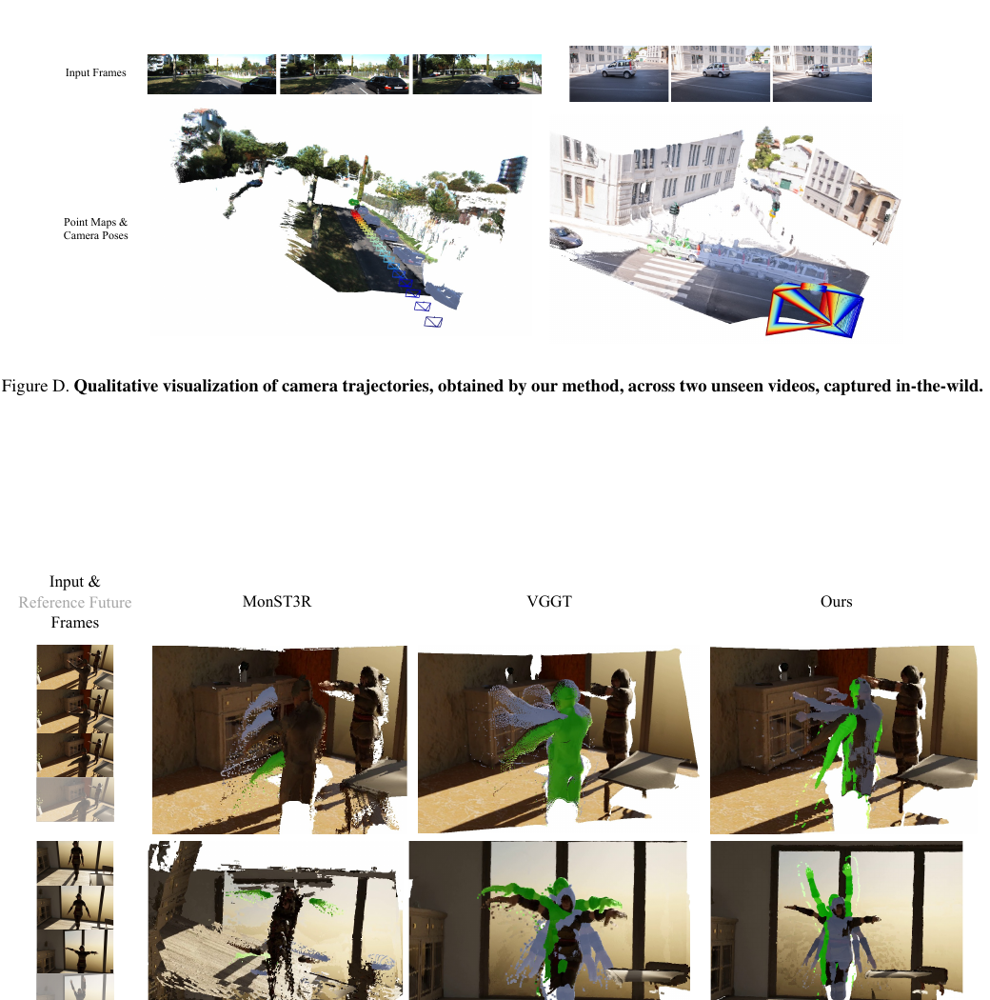

### F 定性三维点轨迹

补充图 F 展示两段未见真实视频中的车辆点轨迹。轨迹随时间叠加在三维点图上，作者观察到其与汽车和公交车的运动相符。它是式（11）场景流计算的直观例子：每个时刻解码点图，再连接相同查询位置的三维坐标。

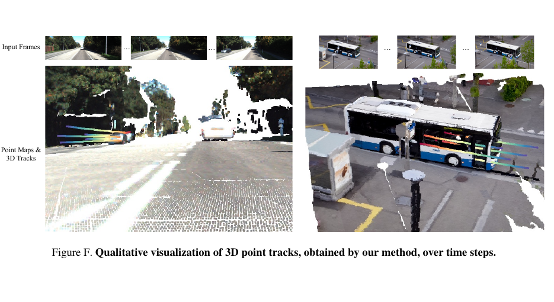
