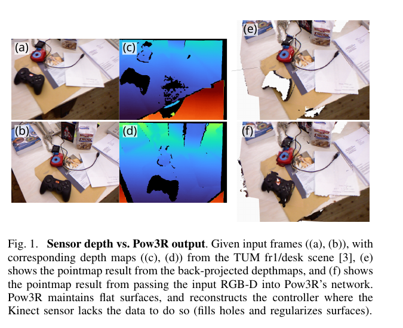
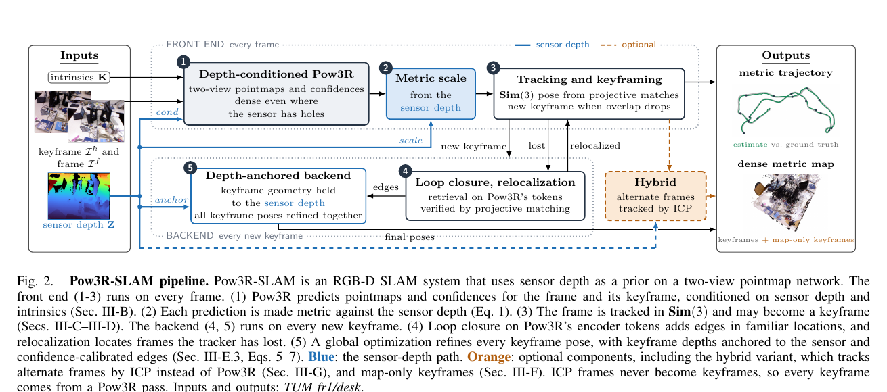
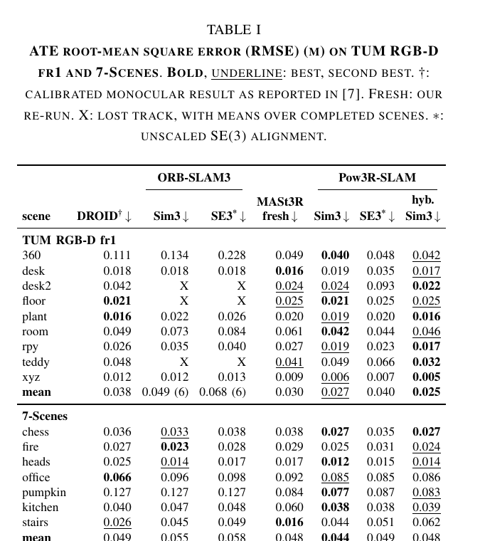
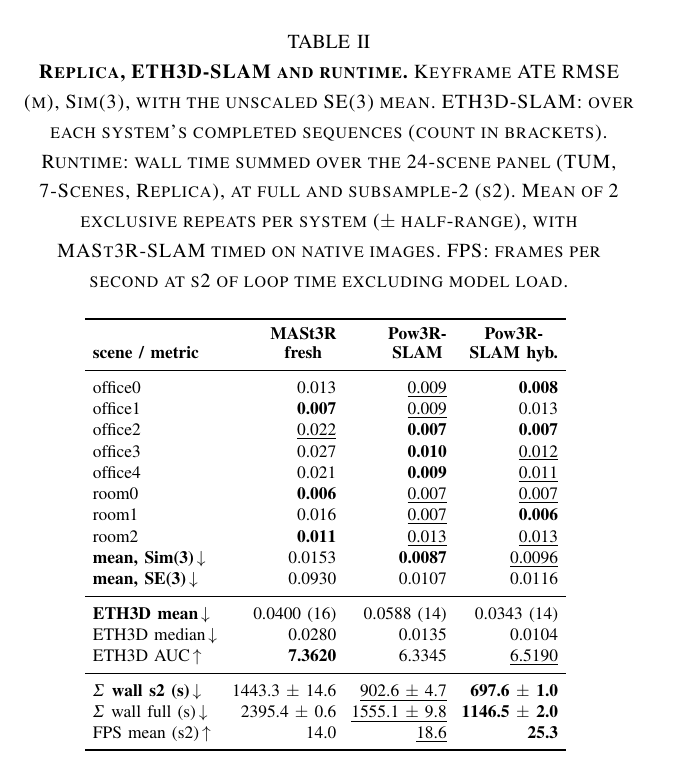
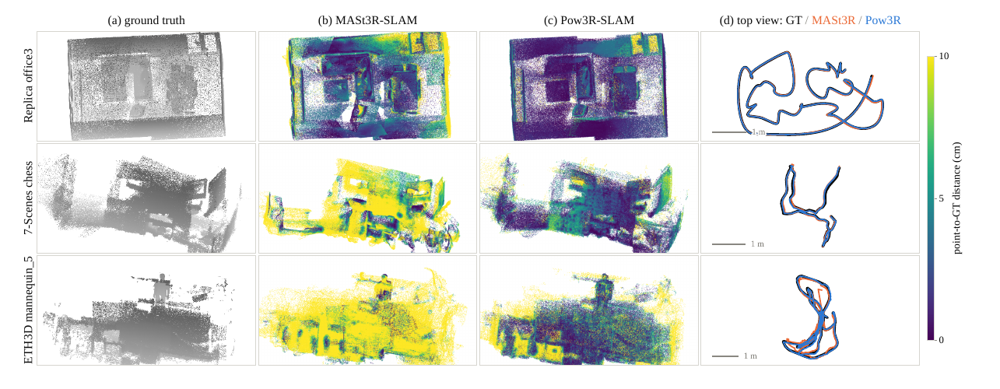
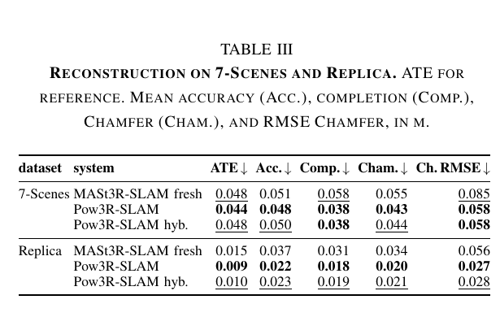
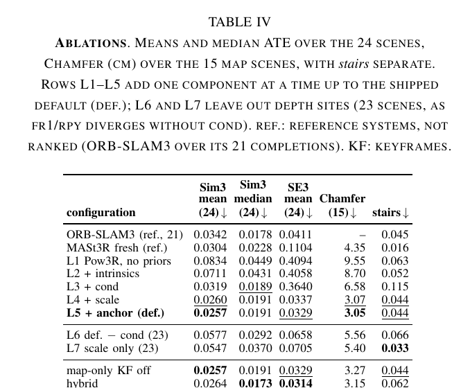
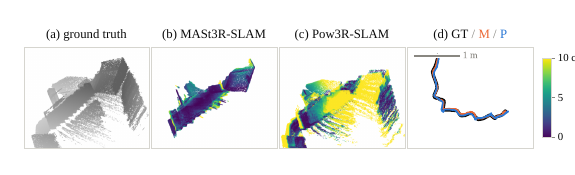

# Pow3R-SLAM 论文解读

> **论文**：*Pow3R-SLAM: Real-Time RGB-D SLAM with 3D Reconstruction Priors*
>
> **作者**：Christopher Kolios、Ishaan Mehta、Sasa Janjic、Yeganeh Bahoo、Sajad Saeedi
>
> **版本**：arXiv:2609.38054v1，2026-09-29
>
> [论文页面](https://arxiv.org/abs/2609.38054) · [PDF](https://arxiv.org/pdf/2609.38054) · [项目页与演示视频](https://chriskolios.github.io/Pow3R-SLAM/)

Pow3R-SLAM 将 RGB-D SLAM 建立在两视图三维重建先验上。系统每次把当前帧、关键帧、相机内参和测得的深度送入 Pow3R，得到两帧在共同坐标系中的稠密点图，再用点图匹配估计相对位姿。传感器深度在三个位置发挥不同作用：它先条件化点图预测，再把每次网络输出恢复到公制尺度，最后在全局后端优化时锚定关键帧点图的有效深度。导出的地图仍来自网络点图，因此传感器深度的空洞可以由两视图预测补全。

这一设计同时回应了两种常见取舍：只用图像的几何先验通常缺少公制尺度，直接融合 RGB-D 深度则会把传感器空洞和噪声写入地图。Pow3R-SLAM保留稀疏或不完整深度的度量信息，让网络补足缺失区域。论文沿用 MASt3R-SLAM 的投影匹配和图优化框架，并为 Pow3R 重建回环检索与对应置信度；另用仅建图关键帧增加地图密度，用混合 ICP 模式降低网络调用频率。

## 一、引言

SLAM 要在构建环境地图的同时估计传感器相对地图的运动。单目视觉可以从图像中的对应关系恢复相对几何，但整体尺度存在自由度；若场景重复或外观相似，视觉对应也可能把几何不同的位置混淆。RGB-D 系统增加了测距信息，理论上可以约束公制深度与位姿。

实际深度图并非完整表面。暗色、反光或吸光区域会产生空洞，物体边界也容易出现不一致。KinectFusion 等方法把测得的深度直接融合成表面，空洞和边缘误差可能随之进入地图；若系统不使用深度，则又放弃了传感器的公制测量。

DUSt3R、MASt3R 和 Pow3R 等两视图重建网络为深度提供了另一种用途。网络接收一对图像，输出相对于共同参考坐标系的稠密点图，从中可恢复相机间的相对姿态。Pow3R 还允许把深度、相机内参和相对位姿的任意子集作为条件输入；实验表明，这些条件能让点图更准确、表面更一致，并在深度未提供处推断几何。图 1 对比了传感器深度反投影与 Pow3R 输出：桌面上的控制器缺失于 Kinect 深度，但条件化预测能补出它，同时保持较平坦的表面。

*原论文图 1。面板 (e) 是深度图反投影得到的点图，(f) 是 RGB-D 输入 Pow3R 后的点图；后者补足控制器处的空洞并规整平面。*

Pow3R-SLAM 建立在 MASt3R-SLAM 上，把单目点图 SLAM 扩展到 RGB-D。三个深度入口并不等价：**cond** 改变网络预测，**scale** 为本次点图输出估计统一尺度，**anchor** 只在全局后端临时约束关键帧几何。地图始终来自网络预测，而非对原始深度进行表面融合。

论文还保留了 MASt3R-SLAM 的投影匹配与二阶后端形式。Pow3R 没有 MASt3R 的像素匹配特征头，作者因此从 Pow3R 编码器 token 重建场景检索，并从其置信度头构造匹配权重。仅建图关键帧提高地图密度，但不进入位姿估计；混合变体让隔帧使用传感器深度上的点到平面 ICP 代替网络跟踪。论文在 TUM RGB-D、7-Scenes、Replica 和 ETH3D-SLAM 上评估轨迹，在有参考几何的 7-Scenes 与 Replica 上评估重建。

## 二、相关工作

### 单目 SLAM

单目 SLAM 只使用单个成像源。ORB-SLAM 等特征式方法通过稀疏特征对应估计位姿；DTAM 等稠密方法利用整幅图像构建场景模型。由于没有外部距离标尺，这类方法的几何通常只确定到相似变换，公制尺度不可观测。

### RGB-D SLAM

RGB-D 系统加入深度传感器，也有只使用深度的方案。KinectFusion 把深度融合到截断符号距离场并在融合表面上跟踪；ElasticFusion 联合使用颜色和深度误差。ORB-SLAM2 扩展了 ORB-SLAM 的深度支持，ORB-SLAM3 进一步支持惯性测量单元和多地图。[DROID-SLAM](/blog/articles/droid-slam/) 则通过光流估计与束调整联合优化位姿和逐像素深度。

神经地图也用于 SLAM：iMAP 和 NICE-SLAM 优化隐式场，GS-SLAM 优化三维高斯场景。上述方法要么把深度当作融合几何，要么将其用于监督目标。Pow3R-SLAM 的关注点是把测量深度作为两视图重建网络的输入条件，使网络生成的稠密点图兼顾深度测量和跨视图预测。

### 两视图三维重建先验与 SLAM

两视图重建先验接收成对图像并输出对齐的稠密三维点云。DUSt3R 可由共同坐标系的点云恢复相机位姿；MASt3R 增加逐像素特征改善匹配；Pow3R 允许深度、相机内参和相对位姿作为可选条件。VGGT 等前馈场景模型则一次处理多帧，预测整组图像的姿态与深度。

[MASt3R-SLAM](/blog/articles/mast3r-slam/) 将 MASt3R 接入实时跟踪和建图，通过投影匹配、Sim(3) 位姿图及 ASMK 检索工作，是 Pow3R-SLAM 的直接基线。[VGGT-SLAM](/blog/articles/vggt-slam/) 增量对齐 VGGT 子图，[SLAM3R](/blog/articles/slam3r/) 将局部重建融合成全局场景。作者指出，已有重建先验 SLAM 尚未系统研究如何把传感器深度作为网络输入条件；Pow3R-SLAM 正是沿这条路径构造 RGB-D 系统。

## 三、方法

图 2 概括了系统的数据流。前端每帧运行 Pow3R、尺度恢复与跟踪；关键帧到来时，后端再做回环检索和全局优化。图中的蓝线是深度入口，橙色模块表示可选的混合跟踪和仅建图关键帧。

*原论文图 2。深度分别进入网络条件、度量尺度恢复和后端关键帧锚定；回环边由点图匹配验证，ICP 帧不会进入关键帧图。*

### A. 预备定义

给定两帧图像 \(I^i,I^j\)，Pow3R 输出三张点图 \(X_{ii},X_{ij},X_{jj}\) 及其置信度 \(C_{ii},C_{ij},C_{jj}\)。例如 \(X_{ij}\) 表示图像 \(I^j\) 中像素对应的三维点，但这些点在相机 \(i\) 的坐标系中。网络可选接收深度图 \(Z_i,Z_j\) 和有效性掩码 \(M_i,M_j\)、相机内参 \(K_i,K_j\)、相对位姿 \(P_{ij}\)。Pow3R-SLAM 总是有传感器深度，并求解而非输入相对位姿，因此使用 \(\Omega=(Z_i,Z_j,K)\)。标定实验假设各帧共享固定针孔相机内参；使用前需对镜头畸变图像去畸变。

位姿属于相似变换群 \(\mathrm{Sim}(3)\)，同时包含旋转、平移和尺度。优化增量左乘到当前位姿：
\[
T \leftarrow \tau \oplus T \triangleq \operatorname{Exp}(\tau)\circ T.
\]
这里 \(\tau\) 是李代数中的小增量。相机图像先缩放到长边 512 像素，内参也同步调整。定义
\[
\mathcal R_K(X)[p] \triangleq z(X[p])K^{-1}[u,v,1]^\top,\quad p=(u,v).
\]
这个操作保留点图在像素 \(p\) 的预测深度 \(z(X[p])\)，再把点放回标定相机对应的射线上。两个自视角点图都经过 \(\mathcal R_K\)，所以进入估计器的是网络预测的深度，横向坐标则由已知内参决定。

### B. 已知深度与相机标定

作者把传感器深度接入系统的三个位置称为 **cond、scale、anchor**。先看条件化的网络输入，再看尺度估计，最后说明后端锚定。

#### cond：将深度和内参编码进 Pow3R

每张深度图按有效像素的平均值归一化为 \(Z/\bar z\)，并附带有效性掩码 \(M=[Z>0]\)。内参不以 \(3\times3\) 矩阵直接输入网络，而是展开为逐像素射线图 \(K^{-1}[u,v,1]^\top\)。深度、掩码和射线图均切分到与图像一致的 \(16\times16\) patch 网格，再把每个 patch 编成 token。一个学习到的投影将这些条件 token 加到第一编码器块中对应的图像 patch token 上。

因此，传感器深度只在有效区域提供度量提示，网络仍根据成对图像和相机射线预测完整点图。图 1 中的桌面控制器展示了空洞补全的作用；反过来，若提供的稠密深度错误，网络条件也会被错误测量影响，后文的噪声实验会显示这种风险。

#### scale：为每次点图预测恢复公制尺度

两视图网络内部有尺度自由度。对一次前向计算，作者将自视角点图 \(X\) 与对应传感器深度 \(Z\) 比较。只在深度有效且预测深度为正的位置定义比例
\[
r_p=\frac{Z[p]}{z(X[p])}.
\]
先取比例的中位数 \(\bar r\)，把极端比例限制在中位数的 \(0.1\) 到 \(10\) 倍，再对截断比例的对数求平均并指数还原：
\[
s(X,Z)\triangleq \exp\!\left(\operatorname{avg}_p\left[\log\left(\operatorname{clip}(r_p,0.1\bar r,10\bar r)\right)\right]\right). \tag{1}
\]
至少有 50 个有效像素时才应用这个尺度，否则本次前向结果保持原尺度。几何平均是使对数深度残差平方和最小的统一尺度；相对中位数截断则限制异常像素的影响。得到的一个标量同时乘到 \(X_{ii}\) 和 \(X_{ij}\)，因为同一次网络前向中的两张点图共享坐标系和尺度自由度。只缩放其中一张会破坏两视图之间的一致性。

#### anchor：在全局优化中临时约束关键帧深度

每次全局后端求解前，系统复制关键帧点图，并在传感器有有效测量的像素射线上，以传感器深度替换复制点图的深度。该替换只供后端本次求解使用，不覆盖长期保存的网络点图，也不直接改变导出地图。作者将其描述为后端中的软约束：对应的对数深度残差使用较小的标准差，使可靠测量在优化中权重较高。尺度估计关闭时，锚定也随之关闭。

这三个入口形成清晰分工：cond 让网络更好地预测稠密结构；scale 统一每次预测的度量尺度；anchor 则在多关键帧整体优化时把有效传感器深度带入约束。地图仍保留网络填补的区域。

### C. 点图匹配与融合

系统沿用 MASt3R-SLAM 的投影匹配。令 \(\psi(x)\) 把三维点归一化为单位射线。对于 \(X_{ij}\) 中的一个点 \(x\)，算法在另一张点图的像素中寻找射线距离最小的位置：
\[
p^*=\arg\min_p\left\|\psi([X_{ii}]_p)-\psi(x)\right\|^2.
\]
每个点的匹配通过 10 次迭代的 Levenberg–Marquardt 求解。新关键帧从恒等映射初始化，连续帧跟踪则用前一帧位置初始化。只有射线残差收敛到 \(10^{-6}\) 以下的匹配被接受；三维误差大于 \(0.1\) 米的对应再被剔除。Pow3R 没有 MASt3R 的逐像素匹配特征，因此这里不再用特征对匹配做二次细化。

关键帧插入由重叠率控制。令 \(\omega_k\) 是两个比例中的较小值：关键帧像素被匹配的比例，以及匹配落到的不同关键帧像素比例。当 \(\omega_k<0.333\) 时，当前帧成为新关键帧。解出相对位姿后，系统把当前帧点图变换到关键帧坐标系，并更新关键帧几何。它没有采用逐次加权平均，而是逐像素保留历史与新预测中置信度更高的一项：
\[
(\tilde X_{kk}[p],\tilde C_{kk}[p])\leftarrow(X_{kk}[p],C_{kf}[p])
\quad\text{if }C_{kf}[p]>\tilde C_{kk}[p]. \tag{2}
\]
由于每次前向计算有独立的尺度估计，直接平均不同尺度的几何会把尺度误差混合进关键帧；保留置信度最高的预测可避免这种平均。

### D. 跟踪

当前帧 \(f\) 与当前关键帧 \(k\) 每帧进行一次 Pow3R 前向计算。对匹配 \((m,n)\)，将当前帧点图中的点变换到关键帧坐标系，记为 \(x_m=T_{kf}\mathcal R_K(X_{ff})_m\)；关键帧中的规范点为 \(y_n=\mathcal R_K(\tilde X_{kk})_n\)。两者的残差同时包含重投影差和对数深度差：
\[
r_{mn}=
\begin{bmatrix}
\Pi_K(y_n)-\Pi_K(x_m)\\
\log z(y_n)-\log z(x_m)
\end{bmatrix}. \tag{3}
\]
其中 \(\Pi_K\) 是相机投影。重投影项约束像素位置；对数深度项约束沿射线的距离比例。跟踪实际最小化重投影分量：
\[
E_\Pi=\sum_{(m,n)\in m_{f,k}}
\left\|\Pi_K(y_n)-\Pi_K(x_m)\right\|_{\rho,w(1,\sigma_{px}^2)}. \tag{4}
\]
这里 \(m_{f,k}\) 是当前帧与关键帧的匹配集合，\(\rho\) 是 Huber 核；匹配没有单独的 Pow3R 置信度，因此权重参数 \(q=1\)，\(\sigma_{px}=1\) 像素。异常对应由前述射线收敛和 0.1 米三维误差门槛剔除，而非置信度门控。

跟踪使用最多 50 次 Gauss–Newton 迭代。对数深度项也参与同一优化，但其标准差取较宽松的 \(\sigma_z^t=10\)。这项在近似纯旋转时很重要：纯旋转下投影位置对整体尺度不敏感，而对数深度会随尺度乘数 \(s\) 平移 \(\log s\)，因此能观测 \(\mathrm{Sim}(3)\) 中的尺度自由度。若保留下来的匹配少于像素的 5%，或正规方程无法分解，系统判定跟踪丢失并启动重定位。每增加一个关键帧，系统还在新旧关键帧间建立双向边。

### E. 回环、重定位与后端

#### 回环检测

回环用于识别重访区域并纠正相对关键帧位姿。Pow3R-SLAM 沿用 MASt3R-SLAM 的 ASMK 检索，但每个关键帧额外运行一次不带条件的 Pow3R 编码器，使用所得 token 构建描述。作者对无需训练的 ASMK 头重新拟合 PCA 白化，并把 k-means 码本从 65,536 个中心缩小到 16,384 个。查询保留分数超过 0.005 的前三个候选。

对候选关键帧，系统分别做两个方向的 Pow3R 前向计算，再用前述投影匹配验证。只有较小方向的匹配比例至少为 \(\omega_l=0.25\) 才建立回环边；与紧邻前一关键帧的边则无条件加入。

#### 重定位

跟踪丢失后，系统使用同一检索分数阈值寻找候选，但采用更严格的验证：每个检索候选的匹配比例都必须达到 0.3。通过后，以第一个候选初始化位姿并运行一次后端求解。这一逐候选门槛减少了由单个偶然高分候选直接触发重定位的可能。

#### 全局后端

后端沿用 MASt3R-SLAM 的二阶优化框架：对位姿图中所有边的残差双向计算，用 Gauss–Newton 和稀疏 Cholesky 求解；固定首个关键帧位姿作为全局参考，每增加一个关键帧最多迭代 10 次。

每次求解前，后端先按 B 节的 anchor 规则构造临时深度锚定点图。对位姿图中的边 \((i,j)\)，令相对变换 \(T_{ij}=T_{WC_i}^{-1}T_{WC_j}\)；从视图 \(j\) 变换来的匹配点为 \(\hat x_m=T_{ij}\mathcal R_K(\hat X_{jj})_m\)，视图 \(i\) 上的规范点为 \(\hat y_n=\mathcal R_K(\hat X_{ii})_n\)。边集合双向遍历，所以两种变换方向都会提供约束。残差按置信度白化：当 \(q>q_{min}\) 时，方差为 \(\sigma^2/q\)；低于门槛的匹配直接丢弃。符号 \(\|r\|_{\rho,w}\) 表示对除以标准差后的残差施加阈值为 1.345 的 Huber 范数。目标为：
\[
E_\Pi^g=\sum_{(i,j)\in\mathcal E^\pm}\sum_{(m,n)\in m_{ij}}
\left\|\Pi_K(\hat y_n)-\Pi_K(\hat x_m)\right\|_{\rho,w(w_{mn},\sigma_{px}^2)}, \tag{5}
\]
\[
E_z^g=\sum_{(i,j)\in\mathcal E^\pm}\sum_{(m,n)\in m_{ij}}
\left\|\log z(\hat y_n)-\log z(\hat x_m)\right\|_{\rho,w(w_{mn},(\sigma_z^g)^2)}. \tag{6}
\]
带帽符号表示使用临时锚定后的点图，\(\sigma_{px}=1\) 像素，\(\sigma_z^g=0.1\)。后者比跟踪阶段的 \(\sigma_z^t=10\) 小得多，体现后端对传感器有效深度更强的信任。每条边的对应权重由两帧置信度和一个标定后的门控项组成：
\[
w_{mn}=Q_{mn}\sqrt{\tilde C_{ii,m}\tilde C_{jj,n}},\qquad
Q_{mn}=\phi\!\left(\sqrt{C_{ii,m}C_{jj,n}}\right). \tag{7}
\]
\(\phi\) 是 1024 个节点的分段线性分位数映射。作者用 8 个开发序列上的 109,630 个对应拟合它，使输出分布对齐 MASt3R-SLAM 的匹配置信度分布，从而保留原有 \(Q_{mn}>1.5\) 门槛的含义，无需重新训练网络或重新调阈值。两个 \(\tilde C\) 因子降低低置信度几何的影响；论文指出实践中门控项 \(Q_{mn}>1.5\) 起主要作用。临时锚定点图不会离开后端，也不会被当作永久地图替代品。

### F. 仅建图关键帧

若把估计器的关键帧插入阈值调高，地图会变稠密，但位姿估计图也会随之改变。作者因此将地图密度与估计器状态分离：当网络跟踪帧的重叠率满足 \(0.333\leq\omega_k<0.45\)，且距离上次添加至少 5 帧时，保存为仅建图关键帧；每条序列最多保存 200 个。

每个仅建图关键帧保存缩放后的点图、置信度、图像和相对其所属估计关键帧的位姿 \(T_{kf}\)，但不新增后端状态。导出时，用所属关键帧经过全局优化后的最终位姿重新组合世界位姿 \(T_{Wf}=T_{Wk}T_{kf}\)。因此回环或后端修正会传递到这些地图点。最终地图合并估计关键帧和仅建图关键帧的点图，并使用统一置信度阈值；轨迹保持不变。

### G. 混合 ICP 变体

神经网络前向是跟踪耗时的主要部分。混合模式让每隔一帧使用传感器深度做点到平面 ICP，替代那一帧的 Pow3R 调用。传感器深度像素 \(p=(u,v)\) 反投影为当前帧三维点
\[
x_p=Z_f[p]K^{-1}[u,v,1]^\top,
\]
再通过当前相对位姿投影到关键帧，得到关联像素 \(q_p=\Pi_K(T_{kf}x_p)\)。每次 ICP 迭代都会重新计算 \(q_p\)。只有当前传感器点和关键帧点图都能用中心差分估计有效法线时才保留该对应；图像边缘、深度孔洞邻域以及深度跳变超过 5% 的位置被排除。目标是关键帧法线方向上的点到平面误差：
\[
E_{\mathrm{icp}}=\sum_{p\in\mathcal P}
\left\|\mathbf n_{q_p}^{\top}\left(T_{kf}x_p-\tilde X_k[q_p]\right)\right\|_{\rho'}, \tag{8}
\]
其中 \(\rho'\) 是阈值为 2 厘米的 Huber 核，这里使用的是公制距离。求解在三个尺度层级上进行，迭代次数为 \(6,4,3\)，优化变量是 \(\mathrm{SE}(3)\)，因为帧继承关键帧尺度。对应还受 10 厘米距离和 30 度法线旋转门槛约束。

若位姿非有限、最细层级代价增加超过 5%，或可关联像素中内点少于 30%，系统回退到网络跟踪。ICP 帧不会成为关键帧、不进入后端，也不向地图添加点。因此混合变体用传感器深度为中间帧补充运动估计，但保持所有关键帧及地图更新来自 Pow3R。

## 四、实验结果

实验使用 TUM RGB-D、7-Scenes、Replica 和 ETH3D-SLAM 评估定位，7-Scenes 与 Replica 还有参考几何用于地图评测。全部系统运行在 Ryzen 5900X 3.7 GHz CPU 和 NVIDIA RTX 4090 上；Pow3R 输入最长边缩放到 512 像素。主要比较对象为复跑的 MASt3R-SLAM 和 RGB-D 模式 ORB-SLAM3。位姿准确度是确定性的；运行时间取两次独立运行的均值并报告半极差，采用单线程模式，前端等待后端处理完毕，切换非阻塞模式对墙钟时间的影响低于 5%。表 II 的 S2 运行时间按 MASt3R-SLAM 协议隔帧处理，另列全帧率结果。表 I–IV 给出论文报告的逐序列、重建、运行时间和消融结果。

### A. 位姿估计

7-Scenes 的彩色和深度相机图像没有配准，边缘会错开约 20–40 像素。作者先把彩色图像按深度图映射到深度相机视角。彩色相机焦距和径向畸变由 COLMAP 自标定，2.7 厘米基线和主点由深度—彩色边缘对齐估计；所有场景共享一套标定，未使用轨迹真值。用于匹配权重映射 \(\phi\) 的开发语料与评测面板在 4 条序列上重合；作者报告，去掉这 4 条重新拟合后，ATE 最多变化 18 毫米，且 stairs 上是改善。ASMK 检索码本则用另外 5 条 TUM fr2/fr3 和 8 条 ETH3D-SLAM 训练序列拟合，这些序列不在评测中。MASt3R-SLAM 也使用配准后的图像，尽管它本身不使用深度。所有结果报告 Sim(3) 对齐关键帧轨迹的 ATE RMSE；另对每帧做不估计尺度的 SE(3) 对齐，以检验公制尺度效果。

*原论文表 I。ATE RMSE 以米计；Sim(3) 与不缩放的 SE(3) 结果分别反映允许尺度对齐和直接检验公制尺度的误差。*

在 TUM 的 9 个序列中，Pow3R-SLAM 和 MASt3R-SLAM 都能完成全部序列；ORB-SLAM3 在 desk2、floor、teddy 上丢失跟踪。Pow3R-SLAM 在 6/9 序列优于复跑的 MASt3R-SLAM，平均 Sim(3) ATE 为 0.027 米，对比 0.030 米；混合模式平均为 0.025 米。

在配准后的 7-Scenes 上，Pow3R-SLAM 平均 ATE 为 0.044 米，低于 MASt3R-SLAM 的 0.048 米和 ORB-SLAM3 的 0.055 米，并在 7 个序列中的 6 个优于 MASt3R-SLAM。例外是 stairs：Pow3R-SLAM 为 0.044 米，MASt3R-SLAM 为 0.016 米，作者在失败案例和局限性中讨论重复台阶的影响。配准使 Pow3R-SLAM 的均值从未配准图像上的 0.065 米降到 0.044 米，ORB-SLAM3 从 0.059 米降到 0.055 米；MASt3R-SLAM 的结果则由 0.047 米变成 0.048 米。

*原论文表 II。ETH3D-SLAM 的均值在各系统成功完成的序列上统计，完成数量见括号；运行时间对 TUM、7-Scenes、Replica 的 24 个序列求和。*

Replica 的合成深度完整且无噪声，Pow3R-SLAM 平均 ATE 为 0.0087 米，MASt3R-SLAM 为 0.0153 米；Pow3R-SLAM 在 8 个序列中的 5 个误差更低。ORB-SLAM3 在该数据集平均为 0.005 米，是最准确者，作者将其归因于经典跟踪可以利用精确、无孔洞的深度和纹理丰富的渲染。

ETH3D-SLAM 的运动较快，因此系统使用全部帧。作者从 61 条训练序列中预先固定了 16 条评测序列。MASt3R-SLAM 完成 16 条，Pow3R-SLAM 完成 14 条；在双方均完成的 14 条中，Pow3R-SLAM 有 12 条误差更低，中位数为 0.0135 米，对比 0.0280 米。Pow3R-SLAM 的 14 条均值 0.0588 米被 sofa2 的 0.66 米拉高。序列被视为完成的条件是所有关键帧位姿有限，且估计轨迹跨度在真值跨度的两倍以内。由于各方法完成数量不同，均值不能脱离完成率单独比较；论文也明确说明其最多 0.5 米阈值的 AUC 只对应这 16 条面板，不能与 MASt3R-SLAM 在完整 61 条上的 AUC 直接比较。

不缩放的逐帧 SE(3) 评分更直接检查公制尺度。在 TUM、7-Scenes、Replica 的 24 场景面板上，Pow3R-SLAM 平均 ATE 为 0.037 米，MASt3R-SLAM 为 0.116 米，前者低约 3.1 倍。两者关键帧数量接近（525 对 537），因此作者把这项差异归因于 scale 入口提供的公制尺度，而不是点图先验本身。该解释由表 IV 中 L3（加条件化）与 L4（再加尺度）的对照支持。

### B. 几何重建评估

地图质量在每 20 帧采样的真值深度反投影点云上评估，距离范围截断为 4 米，Replica 为 8 米。先对齐关键帧轨迹的 Sim(3)，再仅保留置信度 \(C>1.5\) 的估计点；两侧点云各下采样到 20 万点。准确度是估计到参考点云的平均距离，完整度是反向平均距离，Chamfer 是两者均值，另报告 Chamfer RMSE。由于 Pow3R-SLAM 的仅建图关键帧令地图更稠密（15 个场景下下采样前约 1190 万点，对比 MASt3R-SLAM 的 270 万点），作者认为 RMSE Chamfer 比均值 Chamfer 更能反映错误点的惩罚。

*原论文图 3。三行依次为 Replica office3、7-Scenes chess 和 ETH3D-SLAM mannequin_5；中间两列按点到真值距离着色，右列比较逐帧轨迹。*

*原论文表 III。准确度、完整度、Chamfer 与 Chamfer RMSE 均以米计；重建指标分别计算 7-Scenes 和 Replica。*

Pow3R-SLAM 在两个数据集上都改善了准确度和完整度。7-Scenes 的 Chamfer RMSE 从 0.085 米降到 0.058 米，Replica 从 0.056 米降到 0.027 米。15 个场景合计，平均 Chamfer 从 4.3 厘米降至 3.1 厘米，约降低 30%；RMSE Chamfer 从 6.9 厘米降到 4.1 厘米，约降低 40%。这些结果支持网络点图在深度空洞处生成更完整表面的设计；但 stairs 表明，地图更完整并不自动意味着更准确。

### C. 运行时间

24 个 TUM、7-Scenes 和 Replica 序列中，MASt3R-SLAM 子采样 2 帧运行总时间为 1443 秒、平均 14.0 FPS；Pow3R-SLAM 为 903 秒、18.6 FPS，墙钟时间约快 1.6 倍。混合模式为 698 秒、25.3 FPS，约快 2.1 倍。全帧率下对应加速比为 1.5 倍和 2.1 倍。作为参照，CPU 运行的 ORB-SLAM3 用时 371 秒、51 FPS，但其跟踪器不包含神经网络前向。7-Scenes 的 Pow3R-SLAM 时间包含彩色图像配准开销。

Pow3R-SLAM 少了 MASt3R 的匹配头，也不需要每帧特征细化；混合模式再以 ICP 替代隔帧网络调用，该前向在跟踪耗时中约占三分之二。Pow3R 参数量为 556M，少于 MASt3R 的 695M，但两者单次网络前向时间相近，分别约 41 毫秒和 44 毫秒。论文的速度结论因此来自整个系统流程与网络调用策略，而不是单纯参数量更小。

### D. 消融

表 IV 从无先验配置逐步加入内参、深度条件、尺度恢复和后端锚定。L1 无先验平均 Sim(3) ATE 为 0.0834 米；加内参后 L2 为 0.0711 米；再加入深度条件的 L3 降至 0.0319 米。对准确度提升贡献最大的是深度条件，而非只输入内参。移除条件化的 L6 在仍完成的 23 个场景中回退到 0.0577 米，且 fr1/rpy 发散。L3 再加入尺度估计后，L4 的 Sim(3) ATE 降到 0.0260 米，不缩放的 SE(3) 均值从 0.3640 米降至 0.0337 米，地图 Chamfer 从 6.58 厘米降至 3.07 厘米。再加 anchor 后，默认 L5 的 Sim(3) ATE 为 0.0257 米；该面板上锚定对单场景 ATE 的影响最多 4.9 毫米，整体近于中性。

*原论文表 IV。L1–L5 逐项增加模块至默认配置；L6、L7 为深度入口消融，深度条件移除时 fr1/rpy 发散，故统计 23 个场景。*

仅建图关键帧关闭时，轨迹结果与默认配置相同，Chamfer 从 3.05 厘米变成 3.27 厘米，说明它提升地图密度但不更改估计轨迹。混合模式的 Sim(3) 均值为 0.0264 米，中位数 0.0173 米，表现接近默认模式。

作者还测试深度质量。把三个深度入口的有效深度都乘以 \(\max(1+\sigma\epsilon,0.05)\)，其中 \(\epsilon\sim\mathcal N(0,1)\)，24 场景平均 ATE 从无噪声的 0.026 米，随 \(\sigma=0.05,0.1,0.2,0.4\) 上升至 0.034、0.056、0.197（有一序列发散）和 0.609 米。噪声 \(\sigma=0.1\) 时仍优于不使用深度的 L2，\(\sigma=0.2\) 则不再优于。只在条件化入口随机保留 50%、10%、3% 深度像素时，ATE 分别为 0.026、0.028、0.026 米，最大差异仅 2.2 毫米。这说明网络条件对稀疏测量有适应能力，但稠密且错误的深度会产生明显负面影响。

作者也用 Any2Full 补全深度空洞。补全使 Replica 平均 ATE 恶化 9.6%，TUM 变化为 −1.8%（处于噪声范围），7-Scenes 改善 13.8%。由于补全增加计算且补出的像素跨视图一致性较差，论文没有将其纳入默认方案；Pow3R 本身已经能填补一部分空洞。

## 五、局限性

深度先验能在传感器空洞处改善点图、提供公制尺度并提升总体表现，但没有消除估计器的脆弱情况。Pow3R-SLAM 在 7-Scenes stairs，以及 ETH3D-SLAM 的 planar_3、sofa_2、repetitive 等场景表现较差。图 4 展示了 stairs：Pow3R-SLAM 地图点数约 4.3M，MASt3R-SLAM 约 1.5M；前者关键帧 ATE 为 0.044 米，后者为 0.016 米。Pow3R-SLAM 的地图完整度更高，但准确度较低。

*原论文图 4。重复台阶导致错误对应可能彼此一致；Pow3R-SLAM 点更多、完整度更好，但地图精度和轨迹误差都较差。*

作者推测，自相似结构会让网络预测出完整且置信度较高、但位置错误的几何；投影匹配继而找到内部相互一致的错误对应，把后端拉向错误解。这是论文对失败原因的解释，而非单独验证过的因果机制。作者将一致性感知置信度门控、真实传感器噪声训练和多视图重建先验列为未来方向。

## 六、结论

Pow3R-SLAM 将传感器深度同时用于网络条件化、每次点图的公制尺度恢复和后端关键帧几何锚定，并保留网络预测作为地图来源。24 个 TUM、7-Scenes 和 Replica 序列上，系统相较复跑的 MASt3R-SLAM 平均关键帧轨迹误差低 15%、运行快 1.6 倍；逐帧且不做尺度拟合时，ATE 低约 3.1 倍。重建 Chamfer 距离约低 30%。混合 ICP 变体达到 25.3 FPS 和 2.1 倍加速，同时保持相近的关键帧指标。

消融进一步区分了这些收益来源：深度条件是主要精度来源，尺度入口对公制轨迹尤其关键，仅建图关键帧改善地图密度，后端锚定在报告面板上的总体影响较小。稀疏深度仍能提供有效提示；错误的稠密深度和自相似场景则是明显边界。因此，这项工作展示了 RGB-D SLAM 中一种具体的融合方式：把测量值作为学习式几何先验的条件与约束，同时由网络为缺失区域提供稠密重建。
