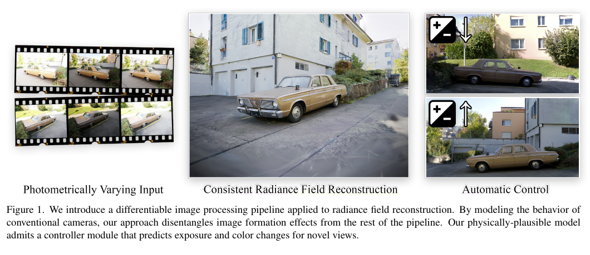
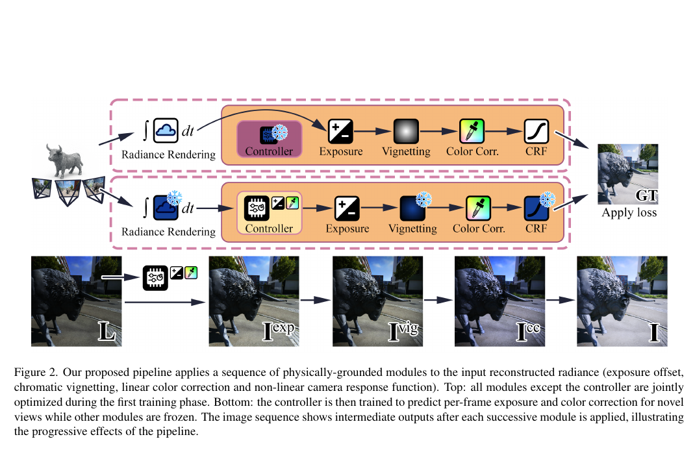
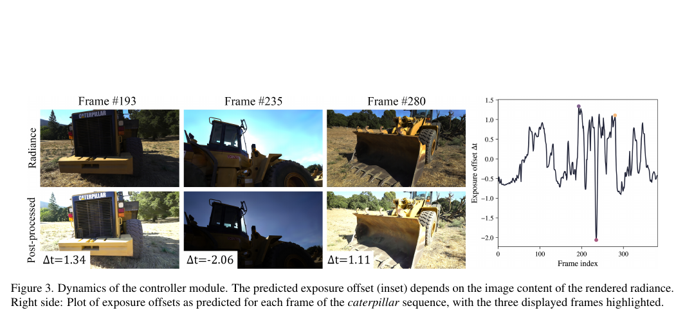
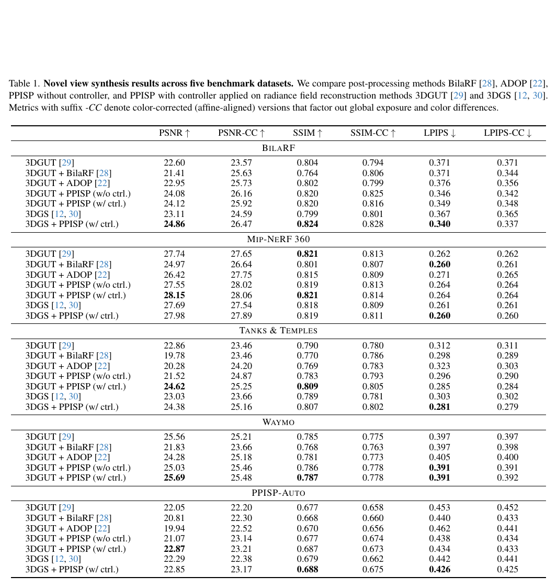
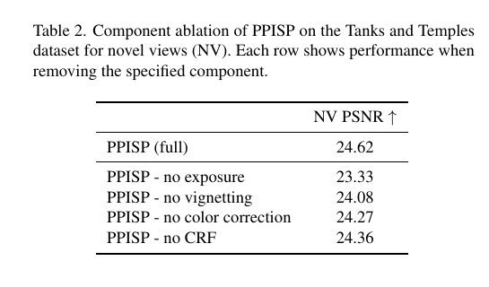
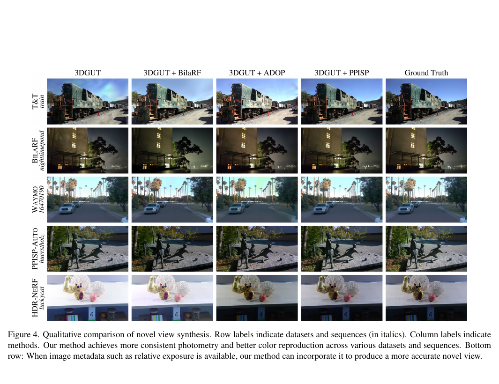
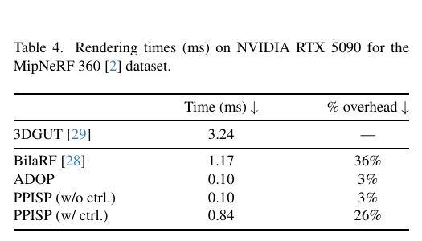
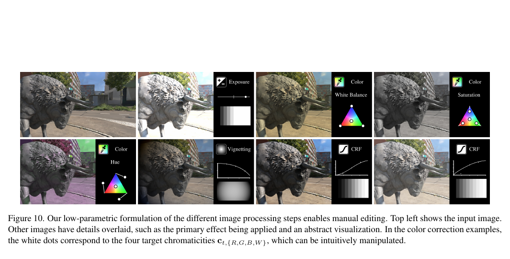
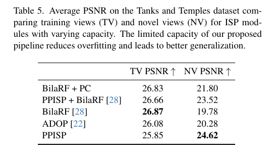
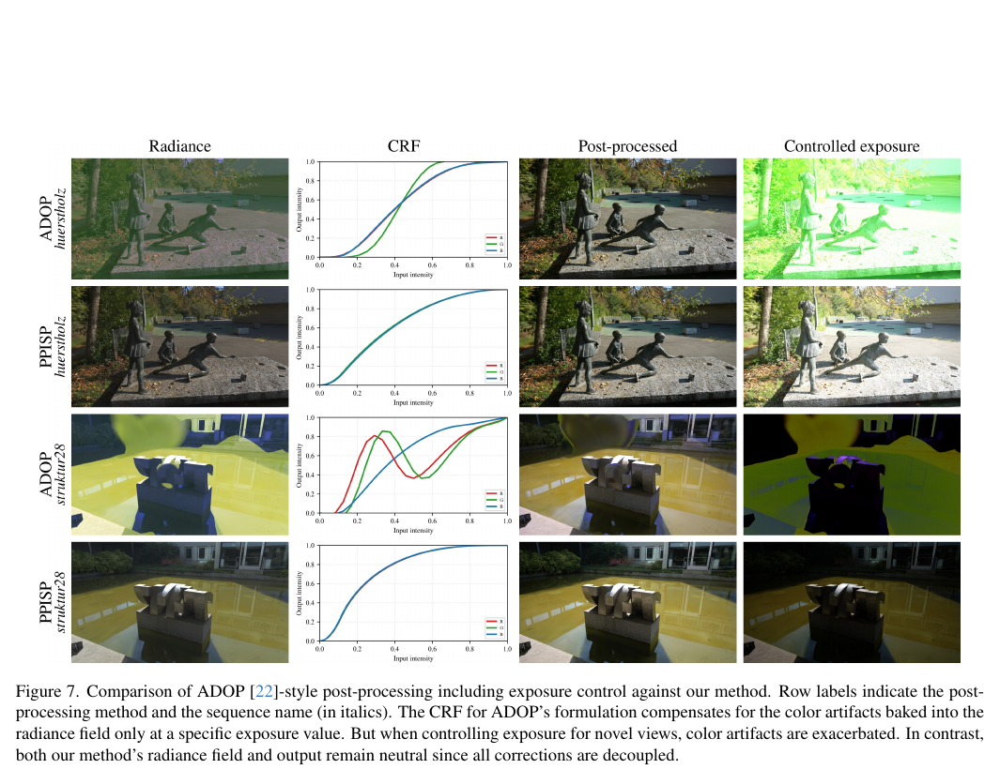

# PPISP 论文解读

> Isaac Deutsch、Nicolas Moënne-Loccoz、Gavriel State、Zan Gojcic，*PPISP: Physically-Plausible Compensation and Control of Photometric Variations in Radiance Field Reconstruction*，arXiv:2601.18336v1，2026 年 1 月 26 日。本文依据 arXiv v1 正文及补充材料。[论文页面](https://arxiv.org/abs/2601.18336) · [NVIDIA 论文 PDF](https://research.nvidia.com/labs/sil/projects/ppisp/assets/ppisp_arxiv_v1.pdf) · [项目页与代码](https://research.nvidia.com/labs/sil/projects/ppisp/)

同一场景的照片可能来自不同相机、不同曝光和白平衡，甚至同一台相机也会因自动曝光而逐帧改变亮度。若直接让辐射场拟合这些图像，优化器会尝试把外观差异解释成场景颜色、几何或反射变化。结果可能是训练视角拟合得更好，换到新视角却出现颜色漂移或曝光不自然。

PPISP 把问题拆成两部分：先在辐射场输出之后加上一条可微、低维的相机图像处理链，解释曝光、镜头暗角、颜色校正和相机响应曲线；再训练一个控制器，根据新视角渲染出的辐射图像，预测该视角应采用的曝光与白平衡参数。前一部分解释相机与图像处理如何改变像素，后一部分解决训练图像中逐帧参数无法直接搬到未见视角的问题。

*原论文 Figure 1。左侧是曝光和颜色变化明显的输入图像，中间展示统一辐射场重建，右侧展示控制器对新视角调整曝光。图中强调 PPISP 将图像外观差异放在辐射场之外建模。*

## 逐帧补偿为何难以泛化

一种常见做法是在每张训练图像旁边增加可学习的潜变量或颜色变换。它们能吸收输入图像之间的差异，但若每帧都有独立参数，训练中学到的参数只对应已观测相机位姿。新视角没有对应的训练帧，也就没有可直接查询的曝光、白平衡或色调映射参数。

评价时常见的另一个办法，是先把合成图像与真实测试图之间做仿射颜色对齐，再计算 PSNR 等指标。这样可以衡量结构或纹理是否匹配，却借用了测试图像的像素来决定校正量。真实应用里通常没有新视角的真值图像可供对齐，而且这种校正还可能掩盖方法本身在曝光和颜色上的差别。

PPISP 将输出图像写为辐射场渲染结果经过相机成像函数：

$$
I=F(L;\Theta),
\tag{2}
$$

$L$ 是辐射场输出的线性辐射图像，$\Theta$ 是成像流程参数。论文用可解释模块近似这个函数，并把固定于相机的参数与逐帧变化的参数区分开：暗角和相机响应曲线描述镜头、传感器及 ISP 的相机特性；曝光和颜色校正参数则允许随每次拍摄变化。

*原论文 Figure 2。上方流程表示联合训练辐射场与 ISP 模块；下方流程表示冻结场景与相机模块后训练控制器。图像序列依次展示曝光、暗角、颜色校正和相机响应曲线的作用。*

## 四个模块逐步改写图像外观

PPISP 按照线性辐射先经过线性光学和颜色变换、最后经过非线性相机响应的顺序处理图像。曝光、暗角和颜色校正先作用在线性辐射上，相机响应曲线最后把传感器响应映射到图像像素。

### 曝光是全图亮度尺度

每帧的曝光偏移 $\Delta t$ 使用以 2 为底的指数表示：

$$
I_{exp}=L\,2^{\Delta t}.
\tag{3}
$$

因此，$\Delta t$ 增加 1，相当于整体辐射亮度乘 2；减小 1 则减半。这一参数可以表示曝光时间、光圈和增益变化共同造成的全局亮度差异。论文将它定义为逐帧参数，控制器也会在新视角为它预测值。

### 暗角是以光学中心为基准的径向衰减

镜头暗角通常随离光学中心的距离增加而变强。设图像坐标为 $u$，光学中心为 $\mu$，半径 $r=\lVert u-\mu\rVert_2$。PPISP 用关于 $r$ 的多项式估计每个颜色通道的衰减：

$$
I_{vig}=I_{exp}\,v(r;\alpha),\qquad
v(r)=\operatorname{clip}_{[0,1]}\left(1+\alpha_1r^2+\alpha_2r^4+\alpha_3r^6\right).
\tag{4–5}
$$

每个相机的光学中心和每通道多项式系数在多个图像间共享，因此学到的是相机层面的暗角特性。系数限制与正则项鼓励衰减而非向画面边缘增亮。由于衰减是空间变化的，单纯对整帧乘一个曝光值无法替代它。

### 颜色校正要与曝光分开

白平衡和相机色彩响应会改变通道之间的比例。PPISP 将 RGB 转换到 RGI 表示：前两个分量表示归一化的红、绿色度，第三个分量是总强度 $I=R+G+B$。颜色校正通过一个 $3\times3$ 单应矩阵 $H$ 变换 RGI 坐标，再重新归一化强度：

$$
n(x;H)=\frac{x_R+x_G+x_B}{[H\,C x]_3+\varepsilon},\qquad
h(x;H)=C^{-1}\big(n(x;H)\,(H\,C x)\big).
\tag{7–8}
$$

这里 $C$ 是 RGB 到 RGI 的转换矩阵，$[\cdot]_3$ 表示向量的第三个分量，$\varepsilon$ 用于数值稳定。直观地看，$H$ 先改变颜色色度和强度，$n$ 随后把总强度恢复到校正前的水平；这样曝光尺度主要由单独的 $\Delta t$ 控制，白平衡的调整就不必兼任亮度校正。

矩阵 $H$ 由红、绿、蓝三个基色和一个中性白点的四对源—目标色度确定。目标色度是相应源色度加上可学习偏移 $\Delta c_k$。四个二维色度偏移构成八个参数；通过齐次坐标与四点单应约束求出 $H$，而不是直接自由学习矩阵的九个元素。这个参数化让控制量更接近红、绿、蓝、白各自的颜色偏移，也使白平衡能够单独调节。

### 相机响应曲线负责非线性映射

前面三个模块在传感器线性辐射空间工作，最终像素还要经过相机响应函数（CRF）。PPISP 使用一条由两个幂函数拼接的 S 形曲线：在拐点 $\xi$ 之前由指数 $\tau$ 控制暗部，在拐点之后由 $\eta$ 控制亮部，再叠加 gamma 参数 $\gamma$。曲线系数 $a,b$ 由 $\tau,\eta,\xi$ 决定，使拐点处的一阶斜率连续：

$$
f_0(x)=\begin{cases}
a(x/\xi)^\tau,&0\leq x\leq\xi,\\
1-b((1-x)/(1-\xi))^\eta,&\xi<x\leq1,
\end{cases}
\quad
 a=\frac{\eta\xi}{\tau(1-\xi)+\eta\xi},\quad b=1-a,
$$

$$
G(x;\tau,\eta,\xi,\gamma)=\left[f_0(x;\tau,\eta,\xi)\right]^\gamma.
\tag{14–16}
$$

与任意逐像素变换相比，这条曲线只能改变每个颜色通道的输入—输出响应，表达能力更受限。这种限制降低了它把场景局部纹理当作相机曲线来记忆的空间，也保留了曝光与颜色控制的直观含义。

## 控制器为未见视角预测参数

相机响应曲线和暗角在同一相机拍摄的帧之间共享；曝光与颜色校正却依赖具体拍摄时刻。训练图像上可以直接优化逐帧参数，但新视角没有现成的逐帧参数。PPISP 为此学习函数 $\mathcal{T}$，从辐射场渲染的线性图像 $L$ 预测曝光偏移与四组色度偏移：

$$
(\Delta t,\{\Delta c_k\}_{k\in\{R,G,B,W\}})=\mathcal{T}(L).
\tag{17}
$$

控制器先用逐点 $1\times1$ 卷积抽取 64 通道特征，再做空间池化得到 $5\times5$ 网格。这个网格保留画面不同区域的粗略亮度和颜色统计，类似相机测光区；MLP 将它映射到一个曝光值和八个颜色校正参数。补充材料给出了完整结构：三层、每层 128 个 ReLU 单元，曝光与颜色参数使用独立输出头。可用的图像元数据也能拼接到回归器输入。

训练分成两段。第一段把辐射场与四个 ISP 模块联合优化 30k 次迭代；第二段冻结场景与相机模块，用训练图像监督控制器再训练 5k 次。论文的 3DGUT/3DGS 训练配置使用默认 MCMC 策略；这是宿主辐射场的密度控制设置，不属于 PPISP 的图像处理贡献。推理新视角时，先由辐射场得到 $L$，控制器从中预测逐帧曝光与颜色参数，然后再通过已学好的暗角、颜色校正和相机响应处理。整个过程不需要新视角真值图像。

*原论文 Figure 3。左侧展示 Caterpillar 序列三帧的原始辐射图像与控制器处理后的亮度；右侧给出该序列逐帧预测的曝光偏移，示例帧以标记点标出。曝光变化随图像内容变化，说明控制器学习的是内容相关的自动曝光行为。*

## 新视角结果与评价方式

论文把 PPISP 作为可放在辐射场之后的后处理模块，分别集成到 3DGUT 和 gsplat。实验覆盖 BilaRF、Mip-NeRF 360、Tanks and Temples、Waymo、HDR-NeRF，以及作者采集的 PPISP 多相机数据和自动曝光版本。输入图像最长边缩放到 2000 像素以内；两阶段训练合计 35k 次迭代。论文报告 PSNR、SSIM、LPIPS，也报告使用测试图像仿射对齐后的 `-CC` 指标。`-CC` 可帮助分析曝光和颜色误差之外的重建差异，但它依赖测试真值，不能代表部署时可用的指标。

*原论文 Table 1。表中比较 BilaRF、ADOP、无控制器的 PPISP、带控制器的 PPISP，以及将 PPISP 接入 3DGS 的结果；每个数据集均报告未校正和仿射颜色对齐指标。*

在 Mip-NeRF 360 上，3DGUT 的 PSNR 从 27.74 提高到带控制器 PPISP 的 28.15，3DGS 从 27.69 提高到 27.98。Tanks and Temples 上，3DGUT 从 22.86 提高到 24.62，3DGS 从 23.03 提高到 24.38。Waymo 上提升较小：3DGUT 从 25.56 到 25.69。不同场景对光度变化的程度不同，因此收益并不均匀；PPISP 也没有在每个指标上都领先所有基线。

论文正文称，PPISP 的 PSNR 有时高于获得测试图像颜色对齐特权的 BilaRF。不过，Table 1 中 BilaRF 数据集的 `BilaRF + PSNR-CC` 为 25.63 dB，而 3DGUT + PPISP（带控制器）的普通 PSNR 为 24.12 dB，3DGS + PPISP 为 24.86 dB。表中这两项都低于 BilaRF 的对齐结果。该表不能支持这一说法对该数据集成立；原文没有进一步解释这处文字与表格之间的差异，因此本文不把“超过对齐后 BilaRF”当作普遍结论。

消融结果显示，曝光和暗角在 Tanks and Temples 的效果最明显。完整 PPISP 的新视角 PSNR 为 24.62；移除曝光模块降到 23.33，移除暗角模块降到 24.08，移除颜色校正为 24.27，移除 CRF 为 24.36。这个比较说明，空间亮度衰减和整体曝光偏移对该实验尤其重要，但它只代表论文采用的一个数据集和训练设置。

*原论文 Table 2。完整方法及逐项移除模块后的新视角 PSNR；曝光与暗角的消融带来较大的下降。*

*原论文 Figure 4。比较 3DGUT、BilaRF、ADOP、PPISP 与真值在多个数据集中的外观。底行使用带相对曝光元数据的 PPISP-auto 示例。*

图像元数据进一步影响控制器的预测。对于 HDR-NeRF 和 PPISP 的曝光包围数据，已知的相对曝光值可输入控制器。在 HDR-NeRF 上，加入元数据后 PPISP 的 PSNR 从 17.86 提高到 34.30；表中仿射对齐 PSNR 从 27.78 到 37.10。PPISP 数据上的 PSNR 从 14.69 提高到 21.69。这里的输入元数据给了模型直接的曝光线索，和只凭渲染图像内容推断曝光是不同条件。

计算开销主要来自控制器。RTX 5090 上、Mip-NeRF 360 的测量中，3DGUT 渲染为 3.24 ms；PPISP 模块本身为 0.10 ms（约 3% 渲染开销），增加控制器后为 0.84 ms（约 26%）。BilaRF 在同一表中为 1.17 ms、约 36% 开销。该计时对应论文中的 3DGUT/PPISP 实现，并不代表其他 3DGS 软件集成的耗时。

*原论文 Table 4。计时设备为 NVIDIA RTX 5090；PPISP 控制器增加了图像特征提取和参数回归，因此比不带控制器的校正模块耗时更多。*

## 低维度带来控制力，也限制表达力

PPISP 的优势是参数含义清楚：曝光控制整体亮度，颜色偏移控制白平衡与色度，暗角控制径向衰减，CRF 控制全局非线性响应。论文附录展示了人工调节曝光、白平衡、饱和度、色调、暗角和 CRF 的结果；在需要统一一段相机运动的色调、或制作可控风格变化时，这种显式参数能够提供稳定入口。

*原论文 Figure 10。画面分别展示曝光、白平衡、饱和度、色调、暗角和 CRF 调节；颜色校正中的控制点是四个目标色度。*

相同约束也带来能力边界。BilaRF 一类双边网格可以表示更复杂的空间—强度联合变化，因此训练视图拟合能力更强，但也更容易过拟合到训练帧。PPISP 的有限容量通常牺牲一些训练视图 PSNR，换取更好的新视角泛化；它无法表达手机 ISP 常见的局部色调映射、镜头眩光等空间自适应处理。作者也指出，控制器能否从辐射内容预测合适曝光，取决于输入画面内容与拍摄曝光之间是否存在可学习的关联。若相机控制被手动覆盖，或这种关联很弱，曝光元数据等额外输入会更可靠。

这一取舍在 Tanks and Temples 的容量对比中很清楚：BilaRF 的训练视图 PSNR 为 26.87，PPISP 为 25.85；但新视角 PSNR 分别为 19.78 和 24.62。加入逐帧 BilaRF 后，训练视图达到 26.66，新视角则为 23.52，仍低于单独使用 PPISP。结果支持“受限容量降低过拟合”的解释，但仅限论文这组评测，并不意味着任意数据上的训练误差越高、泛化就越好。

*原论文 Table 5。BilaRF 在训练视图上拟合更好，PPISP 在新视角上取得更高 PSNR；组合两者后介于两种容量之间。*

补充材料中的 ADOP 对比还展示了颜色校正与曝光纠缠的风险：一个 CRF 可能在训练曝光下抵消辐射场里已经学到的颜色偏差，但当用户再手动调整新视角的曝光时，原本互相抵消的错误会显露出来。PPISP 通过把曝光与色度变换分开建模，降低了这种耦合；这并不意味着成像的所有复杂因素都已被完整建模。

*原论文 Figure 7。上方的 ADOP 结果在学习曝光控制时暴露出 CRF 颜色通道不单调所带来的色彩伪影；PPISP 的曲线保持一致，手动改变曝光后外观更稳定。*

## 论文方法与 3DGS 集成的边界

PPISP 定义的是一套作用在辐射场输出之后的相机图像处理模型与控制器，本身不规定场景必须由哪种辐射场表示。论文将同一套校正接入 3DGUT 和 gsplat，并按指定的图像分辨率、训练步数、优化器与两阶段流程报告结果。3DGS 软件中名为 PPISP 的功能属于这套方法在具体训练器中的集成；它的可用模块、颜色空间、默认权重、相机参数共享方式和控制器训练协议，都应以对应软件实现为准。论文中的 PSNR、速度或显存结论不能直接外推到其他实现。

从画质角度看，PPISP 尤其适合输入照片存在曝光、白平衡、暗角或不同相机响应差异，而应用又希望新视角维持合理相机外观的场景。若主要问题是复杂局部色调映射、眩光、动态照明变化，或输入图像与曝光参数之间没有稳定相关性，它的低维模型就可能无法覆盖所需变化。它补上的是成像过程的显式建模与跨视角参数预测，不会自动修复辐射场本身的几何、遮挡或材质表达错误。
