# Rethinking the State Update Gate 论文解读

> Kejun Ren、Lei Jin、Tianxin Huang、Lianming Xu、Li Wang，*Rethinking the State Update Gate for Long-Sequence Recurrent 3D Reconstruction*，arXiv:2605.16981v3（2026 年 9 月 29 日修订），NeurIPS 2026。[arXiv 论文页](https://arxiv.org/abs/2605.16981) · [v3 PDF](https://arxiv.org/pdf/2605.16981v3)

长视频的循环式三维重建把历史压进固定大小的状态，再让新帧读取并更新它。状态容量有限时，每次写入都会改变已有表示；如果重复帧与带来新信息的帧以近似相同的强度写入，早期几何线索会被不断覆盖。本文分析 TTT3R 的逐 token 更新门控，指出它虽能决定哪些状态 token 接收当前帧残差，却几乎不随帧内容改变整体写入强度。作者据此提出 Adaptive Frame Gating（AFG）：用相邻帧内部特征的变化量计算一个标量帧门控，再与逐 token 门控相乘。

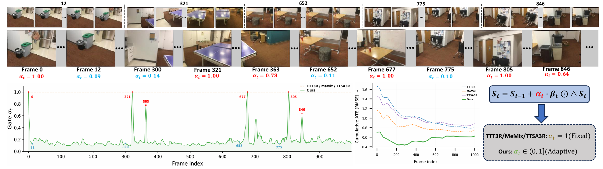

*原论文 Figure 1。上方序列中，视角或场景变化较大的帧获得较高的帧门控，近重复帧获得较低权重但仍参与状态更新；下方展示门控值与累计轨迹误差的变化。公式给出 AFG 在 TTT3R 状态更新中的位置。*

## 1 引言

离线多视图模型可以让所有帧彼此交互，但要在长视频上在线运行，显存和计算会随序列增长。流式模型把输入逐帧处理，常见做法包括保留不断增长的 KV 缓存、使用固定窗口，或把历史压缩进一个循环状态。前两类要么占用随时间增长的内存，要么丢弃较早的信息。CUT3R 使用固定数量的状态 token 汇总此前观测，在固定内存下持续接收任意长度的视频；这里的“保留历史”指历史信息被压缩到状态里，并非逐帧存档。

CUT3R 的基础更新会把当前帧产生的残差直接加到状态。TTT3R 将更新解释为测试时学习，并为每个状态 token 计算一个学习率门控。TTSA3R 在此基础上调整门控，MeMix 则增加 token 级硬掩码。它们都主要回答“当前帧应写入哪些状态 token”，没有独立决定“当前整帧应该写入多大幅度”。作者的观察是，即使有 token 选择，所有帧的平均门控仍近似恒定；长序列中的重复观测也就持续以相似强度改写状态。

传统 SLAM 用关键帧选择控制哪些帧进入地图，但循环重建的状态大小固定，并不需要把帧二元地接纳或丢弃。作者提出的 AFG 借用了“帧间新颖度”这个信号，却将它用作连续的写入权重：每帧仍处理并更新，只是状态变化量随内容而减弱或增强。整篇论文先刻画原有逐 token 门控，再推导其记忆跨度，随后定义 AFG，并依次评估相机位姿、视频深度、三维重建和消融实验。

## 2 相关工作

### 前馈三维重建与流式状态

DUSt3R、MASt3R 将两视图几何写成点图回归；VGGT、Fast3R 扩展到多视图 Transformer。它们能联合利用视图，但全局注意力要求同时处理多帧，不适合无界长视频的严格在线推理。流式方法则逐步处理输入：Spann3R 用显式空间记忆，CUT3R 用固定大小循环状态；StreamVGGT 等保留历史 KV，Point3R 使用带空间指针的记忆，WinT3R 则采用窗口和相机 token 池。状态式方法的内存可保持恒定，但状态写入是否会破坏既有信息成为长期稳定性的关键。

### 长序列适应方法

论文把已有方案归为三类。第一类通过重新训练或重新设计架构处理长序列，例如 LongStream 重新设计相机位姿参数化并训练 KV 缓存；这类方法通常需要训练，也不一定保持固定状态内存。第二类训练外部帧选择策略，例如 Keyframe-VO 用强化学习决定接纳或跳过当前帧。第三类在推理阶段调节循环状态更新，包括 TTT3R、TTSA3R 和 MeMix；它们无需为门控重新训练，且能保留 CUT3R 的恒定内存特性，但控制维度主要是状态 token。

AFG 属于第三类，在冻结的 CUT3R/TTT3R 推理路径上加一项帧级调节。与离散关键帧策略相比，它不需要接受/丢弃决策，也不额外运行一次前向网络；与原有 token 门控相比，它提供独立的帧轴。下文的关键问题是，这两个轴如何组合，以及这种额外调节是否确实减少漂移，而不是仅仅少写了状态。

## 3 逐 token 门控的结构性诊断

### 3.1 连续三维重建中的循环状态更新

给定图像序列 $\{I_t\}_{t=1}^{T}$，模型逐帧预测相机位姿 $T_t$、相机内参 $K_t$ 和像素对齐点图 $P_t$。CUT3R 将历史压缩为 $N$ 个 $d$ 维状态 token，组成 $S\in\mathbb R^{N\times d}$。每帧先被编码为图像 token $X_t$；双流解码器通过交叉注意力让状态流读取图像 token，也让图像流读取状态流。第 $l$ 层的状态更新可写成：

$$
S^{(l)}=S^{(l-1)}+\operatorname{softmax}\!\left(Q_S^{(l)}{K_X^{(l)}}^\top\right)V_X^{(l)}.
\tag{1}
$$

$Q_S^{(l)}$ 是状态查询，$K_X^{(l)}$ 和 $V_X^{(l)}$ 是当前图像 token 的 Key、Value；论文这个式子的写法未在 softmax 内显式列出缩放因子。堆叠多层后，当前帧给状态带来残差 $\Delta S_t$，基础循环更新为 $S_t=S_{t-1}+\Delta S_t$。如果新帧信息重复，仍将完整残差写进去，状态会连续吸收相似观测并改变已形成的几何表示。

TTT3R 将 $\Delta S_t$ 视为测试时自监督重建损失的一步下降方向，并从交叉注意力 logits 计算每个状态 token 的学习率：

$$
\beta_t=\sigma\!\left(\frac{1}{LHK}\sum_{l,h,k}Q_{S_{t-1}}^{(l,h)}{K_{X_t}^{(l,h,k)}}^\top\right)\in[0,1]^N,
\qquad S_t=S_{t-1}+\beta_t\odot\Delta S_t.
\tag{2}
$$

这里 $L$ 是解码层数，$H$ 是每层注意力头数，$K$ 是当前帧图像 token 数；它与相机内参 $K_t$ 的符号相同但含义不同，按上下文区分。$n$ 个状态 token 各自得到 $\beta_t^{(n)}$。logits 在层、注意力头和图像 token 三个轴上取平均，再通过 sigmoid 映射为门控。因而一个 token 是否接收更多当前残差，取决于它与当前图像特征的平均注意力关联。它给状态内部不同 token 提供了空间选择，但是否也能让一整帧的新信息量改变总体更新力度，需要看门控随帧的统计变化。

### 3.2 $\beta$ 的幅值范围与帧间变化

作者在 TUM-RGBD、ScanNet、Bonn、NRGBD 和 7-Scenes 五个基准上统计了 39 段序列，共 1815 万个“帧—状态 token”门控值。合并分布的中位数为 0.31，99% 小于 0.44，最大值为 0.558；各数据集的序列均值都落在 0.27–0.34。也就是说，$\beta$ 会在同一帧的不同状态 token 之间变化，但跨数据集平均强度集中在相近范围。

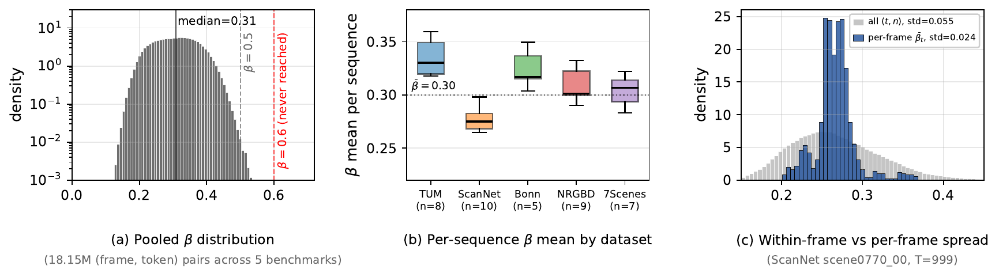

*原论文 Figure 2。左图统计全部门控值，中图比较五个数据集的逐序列均值，右图比较单帧内 token 门控分布与跨帧门控均值的分布宽度。右图的帧间标准差为 0.024，小于帧内总体标准差 0.055。*

更直接地看帧级变化：在 ScanNet 的 `scene0770_00`（999 帧）上，所有帧和状态 token 的门控标准差为 0.055，而先对每帧的 $N$ 个 token 求均值之后，跨帧标准差只有 0.024。作者在其他数据集也观察到相似现象。于是原来的门控确实具备 token 选择性，但几乎不随一帧是否带来新场景内容而整体改变。

论文把这一现象与式（2）的多轴平均联系起来。CUT3R-512 中参与平均的交互数量约为 $LHK\approx110{,}000$；极端 logits 被平均稀释，图像 token 维度的聚合也会削弱帧特有的空间变化。作者测得 sigmoid 前的平均 logit 约为 $-0.83$，对应 $\sigma(-0.83)\approx0.30$。这是他们对统计分布来源的实证解释，不是由网络结构推出的普遍定理。

### 3.3 由 $\beta$ 推得的有效记忆跨度

为了分析旧状态内容如何衰减，作者把残差写为 $\Delta S_t=\widetilde S_t-S_{t-1}$，其中 $\widetilde S_t$ 表示当前帧单独写入时得到的候选状态。代入式（2）可得：

$$
S_t=(1-\beta_t)\odot S_{t-1}+\beta_t\odot\widetilde S_t.
$$

对每个状态 token 来说，这就是指数移动平均：上一步状态保留 $1-\beta_t$，当前候选状态占 $\beta_t$。若近似认为 $\beta_t$ 随时间不变，$k$ 帧前内容的系数会按 $(1-\beta)^k$ 衰减。以贡献下降至 $1/e$ 定义有效跨度时，严格解为 $k=-1/\log(1-\beta)$；论文对较小 $\beta$ 采用近似 $1/\beta$。把跨帧均值约 0.30 代入，得到：

$$
\operatorname{horizon}\approx\frac{1}{\bar\beta}\approx3\text{ 帧}.
\tag{3}
$$

按数据集统计范围约为 2.9–3.7 帧。

这个跨度是更新规则在门控近似恒定时的推论；从“记忆短”到“位姿漂移”并非仅靠公式证明。作者用长序列基准和附录中的重复帧控制实验验证它与漂移的联系。关键问题在于，状态的短记忆本身并非全部症结：如果新帧信息丰富，覆盖旧状态可能合理；如果只是重复观测仍以相同力度覆盖，重要场景信息就会被无差别地挤出。

## 4 自适应帧门控

### 4.1 分解状态更新

AFG 在 TTT3R 的逐 token 门控前再乘一个逐帧标量：

$$
S_t=S_{t-1}+\alpha_t\,\beta_t\odot\Delta S_t,
\qquad \alpha_t\in(0,1],\quad\beta_t\in[0,1]^N.
\tag{4}
$$

$\beta_t$ 对状态 token 分别设定写入比例，$\alpha_t$ 则让当前帧所有 token 的更新整体缩放。二者乘积将“在哪里写”与“这一帧写多强”分开。$\alpha_t$ 只削弱或保留 TTT3R 原有的状态更新，不会把任意帧写得比 TTT3R 更强；这也是模型冻结时限制额外更新风险的设计边界。

### 4.2 由 CUT3R 内部特征计算帧门控

两个变体都从骨干已经计算的相邻帧特征差得到新颖度，再用 sigmoid 把特征距离映射到写入比例。一般形式为

$$
\alpha_t=\sigma\!\left(\kappa\left(\|f_t-f_{t-1}\|_2-\tau\right)\right),
$$

其中 $\tau$ 是 sigmoid 的中心阈值，$\kappa$ 控制转折陡峭程度。两种变体选择的特征和特征尺度不同，因此参数也不同。

**AFG-Img** 用图像编码器 patch token 的空间均值作为全局特征：

$$
g_t=\frac{1}{K}\sum_{k=1}^{K}X_t^{(k)},\qquad
\alpha_t^{\mathrm{img}}=\sigma\!\left(\kappa_{\mathrm{img}}(\|g_t-g_{t-1}\|_2-\tau_{\mathrm{img}})\right).
\tag{5}
$$

$g_t$ 已被 CUT3R 用作 LocalMemory 查询。编码器特征反映输入图像整体外观变化，因此 AFG-Img 用较低层的视觉变化近似当前帧与上一帧的新颖程度。

**AFG-Pose** 用最终解码层状态的第一行 $p_t=S_{t,1}^{(L)}$，即进入相机位姿预测头的 pose token：

$$
\alpha_t^{\mathrm{pose}}=\sigma\!\left(\kappa_{\mathrm{pose}}(\|p_t-p_{t-1}\|_2-\tau_{\mathrm{pose}})\right).
\tag{6}
$$

这一路径从模型解码后的位姿表征变化估计新颖度。两个特征都来自骨干网络本来就会计算的中间结果；AFG 不增加可训练参数，也不需要额外前向计算或随序列增长的缓存。论文对所有基准固定使用 AFG-Img 的 $(\kappa,\tau)=(1,1.5)$ 和 AFG-Pose 的 $(3,1.0)$，没有按场景调参。若两帧特征完全相同，门控也不会变成零：下界分别是 $\sigma(-1.5)\approx0.18$ 与 $\sigma(-3)\approx0.047$。每帧因此保留非零写入机会；第一帧在论文示意图中以 $\alpha=1$ 初始化。

当接连到来的帧都近似重复时，旧关键帧的保留因子从 $1-\beta$ 变成 $1-\alpha_t\beta$。若冗余帧上的 $\alpha$ 近似固定为 $\alpha_{\min}$，记忆跨度相应近似为 $1/(\alpha_{\min}\bar\beta)$。用 $\alpha_{\min}\approx0.048$、$\bar\beta\approx0.30$ 估算，跨度约 70 帧；附录在控制实验中用实测 $\bar\beta=0.352$ 得到理论值约 60 帧。这个估算建立在连续重复输入和门控稳定的条件上，不能理解为任意场景都保留 60 帧的保证。

### 4.3 与关键帧选择的关系

经典关键帧策略面对的是不断扩大的地图或优化问题，因此通过跳过帧控制计算；被跳过的帧不会进入地图。AFG 面对的是固定大小状态，重点是避免新观测覆盖得过快，所以每帧仍会更新，低新颖度时只是延后写入。由于 sigmoid 产生正的下界，被低估的新帧还有机会由后续观测补入；这也是作者使用相邻帧差而非“当前帧对最后接受关键帧”的累积差异的理由。

附录比较了连续门控与二元门控：把非关键帧权重设为 0 会提高 TUM-RGBD 的旋转误差，按最后接受帧计算新颖度也不如按前一帧计算。连续权重能减少误判帧被永久丢弃的影响，但这不意味着相邻帧特征差等同于几何位姿差；AFG 使用的是骨干特征的变化信号。

## 5 实验

### 实验设置与比较条件

实验覆盖六个数据集和三类任务：TUM-RGBD、ScanNet、KITTI 的相机位姿；Bonn 的视频深度；7-Scenes 和 NRGBD 的多视图重建。序列长度从 50 帧到 4661 帧。位姿使用 Sim(3) Umeyama 对齐后评估，深度主结果采用 metric alignment，附录还给出 scale-and-shift alignment。所有 AFG 变体在同一个冻结的 CUT3R 检查点上应用，不做微调；实验运行于单张 NVIDIA A100 80GB。

基线包括推理时门控方法 TTT3R、TTSA3R、MeMix，前馈模型 CUT3R、StreamVGGT、FastVGGT、InfiniteVGGT，以及长序列专门方案 LongStream 和 Keyframe-VO。不同任务的可比基线并不完全相同：例如 TTSA3R 和 MeMix 没有报告 KITTI 结果；KITTI 表中 LongStream、Keyframe-VO 数值取自各自原论文。解读结果时应保留这一比较范围。

### 5.1 相机位姿估计

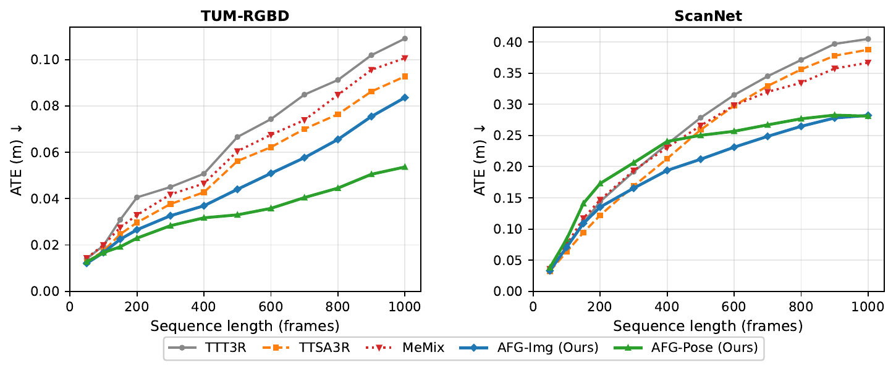

*原论文 Figure 3。纵轴为 Sim(3) 对齐后的绝对轨迹误差 ATE（米）。TUM-RGBD 上 AFG-Pose 优势随序列增长扩大；ScanNet 上 AFG-Img 在较长序列更强，短序列则由 TTSA3R 领先。*

TUM-RGBD 上，当序列长度达到 600 帧及以上时，AFG-Pose 将平均 ATE 相对 TTT3R 降低 51%。在 1000 帧时，ATE 从 0.109 m 降至 0.054 m。ScanNet 上，AFG-Img 从 300 帧起通常优于其他基线，1000 帧时 AFG-Pose 略好（0.281 m 对 0.282 m）；相对 TTT3R 的 0.405 m，误差约降低 31%。短序列尚未累积太多漂移，ScanNet 在 200 帧以内由 TTSA3R 表现最好。这些曲线说明门控收益与漂移累积相关，并非每种序列长度上都统一领先。

### 5.2 长序列位姿估计（KITTI）

KITTI Odometry 提供 11 段 271–4661 帧的室外轨迹，表中指标为对齐后 ATE，单位米。作者把论文原始的 LongStream 和 Keyframe-VO 结果一并列出：AFG-Pose 的平均 ATE 为 43.96 m，相比 TTT3R 的 68.54 m 降低 35.9%，也低于 LongStream 的 51.90 m 和 Keyframe-VO 的 87.00 m。AFG-Img 平均值为 56.60 m。

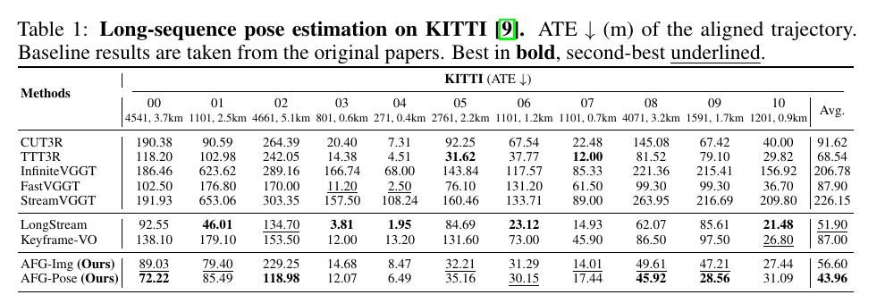

*原论文 Table 1。ATE 为 Sim(3) 对齐轨迹误差，越低越好；长序列专用基线的结果由各自原论文报告。*

结果不是逐序列一致改善。AFG-Pose 在 4000 帧以上的 00、02、08 序列分别降低约 39%–51%，但序列 05、07、10 和最短的 04 上反而变差，尤其 04 从 4.51 m 增至 6.49 m。序列长度提供的是趋势而非充分条件；论文也发现回环结构不能单独解释收益差异，且 AFG 本身不包含回环闭合。

### 5.3 视频深度估计

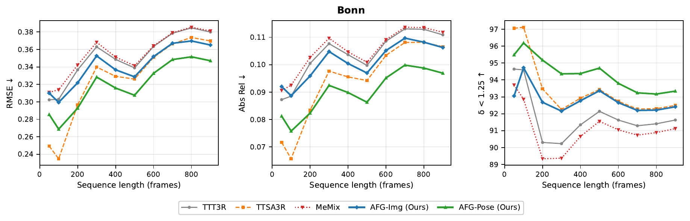

*原论文 Figure 4。三幅图依次给出 RMSE、Abs Rel 和 $\delta<1.25$；前两项越低越好，比例指标越高越好。结果采用 metric alignment。*

Bonn 包含动态室内视频，指标为绝对相对误差（Abs Rel）、均方根误差（RMSE）和预测深度落在真值 1.25 倍以内的比例（$\delta<1.25$）。在 200 帧及以上，AFG-Pose 在三个指标上均优于 TTT3R、TTSA3R 和 MeMix；跨所有序列长度平均，Abs Rel 相对 TTT3R 下降 13.0%。短序列（不超过 100 帧）上 TTSA3R 最好，说明漂移尚未形成时，其他更新特性仍可能更合适。

附录同时使用逐帧尺度和平移拟合评估深度，AFG-Pose 在 200 帧及以上仍是较强变体，趋势与不作尺度/平移补偿的 metric alignment 一致。这里的指标结论依赖论文指定数据集和对齐协议；不能直接外推到不同深度评价标准。

### 5.4 三维重建

在 7-Scenes 和 NRGBD 上，论文评估 300、400、500 帧，按每隔一帧取样（-S）。比较 Accuracy、Completeness 和 Normal Consistency 的均值、中位数；前两项越低越好，法线一致性越高越好。所有循环方法使用相同冻结 CUT3R 检查点；MeMix 应用在 TTT3R 上，TTSA3R 为作者运行的结果。全局注意力 VGGT 在这些长度上均 OOM，完整逐长度数字列于原论文附录；本文在后文呈现重建任务的汇总表。

7-Scenes 上，TTT3R 的平均 Accuracy 从 300 帧的 0.039 增至 500 帧的 0.065；AFG-Img 在三个长度上维持 0.023、0.023、0.024。NRGBD 上，500 帧时 AFG-Img 的平均 Accuracy 为 0.092，相比 TTSA3R 的 0.121 降低约 24%；平均 Completeness 为 0.027，相比 0.049 降低约 45%。这是表中按数据集和长度报告的点云误差结果，与 AFG-Pose 在位姿任务中优势更明显的趋势互为补充。

### 5.5 消融研究与分析

固定标量 $\alpha$ 的实验表明，单纯减少所有帧的写入强度能够改善部分轨迹误差，但位姿 ATE 和相对旋转误差 $\mathrm{RPE}_r$（越低越好）偏好不同的强度。论文没有注明 $\mathrm{RPE}_r$ 的单位。TUM-RGBD 上固定 $\alpha=0.3$ 的 ATE 为 0.066 m，而 $\alpha=0.7$ 的旋转误差更低。AFG 的自适应性可以在重复帧上少写、在变化帧上多写，因而避免一个全局常数同时承担两种需求。

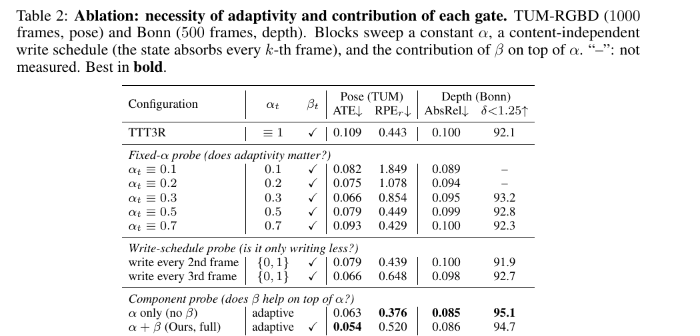

*原论文 Table 2。上半比较常数门控和固定写入间隔，下半比较只用帧门控与帧门控加 TTT3R token 门控；TUM-RGBD 为 1000 帧位姿任务，Bonn 为 500 帧深度任务。*

在写入间隔实验中，模型仍编码、解码和评估每帧，只是状态每两帧或三帧才吸收一次残差。TUM-RGBD 的 ATE 从 0.109 m 降到每三帧写入时的 0.066 m，但旋转误差变差，Bonn 深度也几乎没有随之改善；KITTI 每三帧写入的平均 ATE 为 53.12 m，高于 AFG-Pose 的 43.96 m。这说明性能增益不仅来自“总写得少”，也与写入强度是否随帧内容改变有关。

组件实验中，单独用 $\alpha$（不乘 $\beta$）时，TUM-RGBD ATE 已达到 0.063 m、Bonn Abs Rel 达到 0.085；在此基础上增加 $\beta$ 后，ATE 进一步降至 0.054 m，深度 Abs Rel 为 0.086。两者互补：$\alpha$ 调节帧级写入强度，$\beta$ 保留 token 级选择性。默认 AFG-Pose 的旋转误差则由 TTT3R 的 0.443 升到 0.520；把阈值调到 $\tau=0.5$ 可同时得到 ATE 0.064 m 与旋转误差 0.376，但默认设定更偏向降低全局轨迹漂移。

## 6 结论与适用边界

论文指出，TTT3R 的逐 token 门控主要区分状态内部的更新位置，其帧均值跨时间变化很小。将平均更新读成指数移动平均后，约 0.30 的门控对应约 3 帧的 e 折叠记忆跨度。AFG 从编码器全局图像特征或解码器 pose token 的相邻帧变化计算标量门控，再乘到原有 token 级更新上。作者在位姿、深度和点云重建任务中报告了长序列收益，并用消融说明帧级和 token 级控制具有互补性。

AFG 的收益主要出现在已有状态漂移逐渐累积的长序列；短序列上可能无益或更差，KITTI 多段序列有退化，默认设置还存在全局 ATE 与局部旋转误差的权衡。固定状态在持续高新颖度输入下仍可能饱和，AFG 并未解决这一失效模式。它只削弱写入，不能在重要帧上超过冻结模型原本的更新强度；附录显示把门控上限提高到 5 后，KITTI 平均 ATE 反升至 97.71 m。因而它更适合作为固定内存循环模型的轻量状态更新调节，而不能代替回环、全局优化或长序列状态容量设计。

## 附录中的机制验证与补充结果

### A1 重复帧注入实验

作者从 TUM-RGBD `walking_xyz` 的前 500 帧开始，在末尾追加 100 张完全相同的第 499 帧，并把这段的真值相机固定不动。由于输入没有新增信息，后续位移可以直接视为状态更新引入的漂移。重复帧期间，TTT3R 的平均 $\beta$ 仍约为 0.352；AFG-Pose 的 $\alpha$ 降至约 0.048。单步状态变化从 TTT3R 的约 0.31 降到 AFG-Pose 的 0.043；累计位置漂移由约 9 cm 降到 0.5 cm 以下。

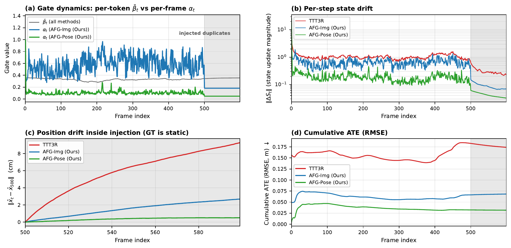

*原论文 Appendix Figure 5。灰色区间是 100 张相同输入、真值相机静止的片段；图中对比 token 门控、帧门控、单步状态更新幅度、位置漂移和累计 ATE。*

按 $1/(\alpha_{\min}\bar\beta)$ 估得约 60 帧的跨度，与在漂移曲线上直接测得的约 64 帧相符；TTT3R 对应约 2.8 帧。这组控制实验加强了“重复帧会在近似恒定门控下继续改变状态”的解释，但它只覆盖特定序列与人工重复输入，不能独立证明所有真实场景都由同一机制主导。

### A2 门控常数与敏感性

附录先列出两种门控固定使用的特征、阈值和斜率：AFG-Img 使用编码器全局特征，$(\kappa,\tau)=(1,1.5)$，特征无变化时的门控下限为 0.18；AFG-Pose 使用解码器 pose token，$(3,1.0)$，下限为 0.047。

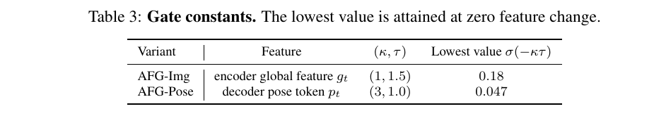

*原论文 Appendix Table 3。最低门控值是在特征距离为零时由 sigmoid 得到。*

阈值扫描固定 $\kappa=3$，测试 $\tau=0.5,0.75,1.0,1.25,1.5$；斜率扫描固定 $\tau=1.0$，测试 $\kappa=1,2,3,5$。所有阈值设置的 TUM-RGBD ATE 都低于 TTT3R 的 0.109 m，范围为 0.051–0.064 m；阈值升至 1.25 时 ATE 和深度 Abs Rel 下降，继续升至 1.5 时 ATE 回升而 Abs Rel 仍下降，RPE$_r$ 则随阈值增大而变差。斜率取 1、2、3、5 时 ATE 分别为 0.066、0.059、0.054、0.052 m。作者据此将默认值视为一个操作点，并指出不同指标之间存在取舍。

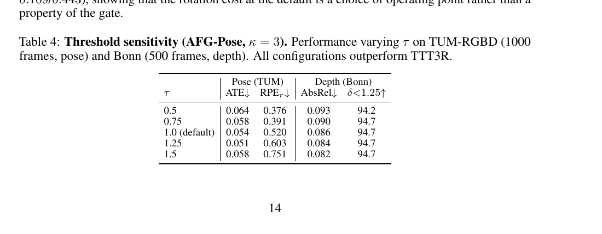

*原论文 Appendix Table 4。列出 TUM-RGBD 位姿和 Bonn 深度指标。*

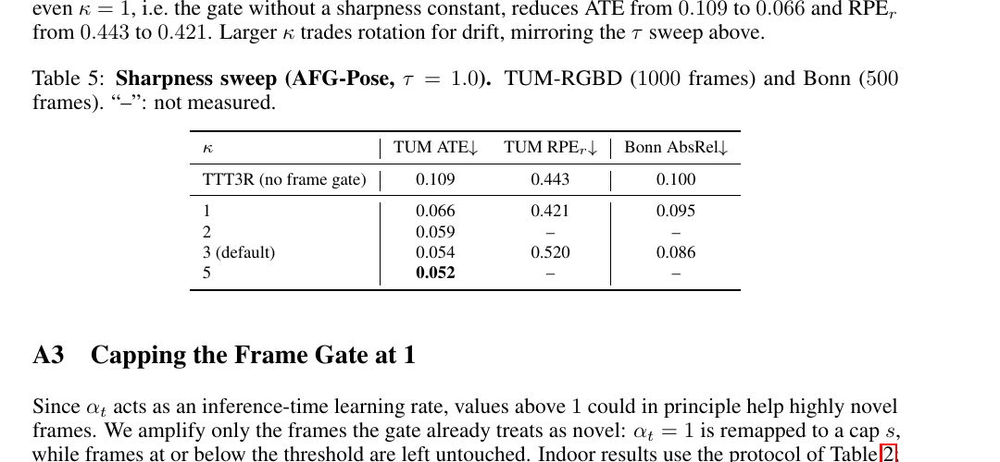

*原论文 Appendix Table 5。斜率扫描中未测量的指标以短横线标出。*

### A3 将帧门控上限限制为 1

作者进一步把门控上限提高到 2 和 5，测试给高新颖度帧增加写入是否有帮助。室内 ATE 变化不大，但 KITTI 平均 ATE 从上限为 1 时的 43.96 m 上升到 55.88 m 和 97.71 m；上限为 5 时甚至比没有帧门控的 TTT3R（68.54 m）更差。因而保留 $\alpha\le1$，使 AFG 在冻结检查点上只降低或保持原有更新幅度。

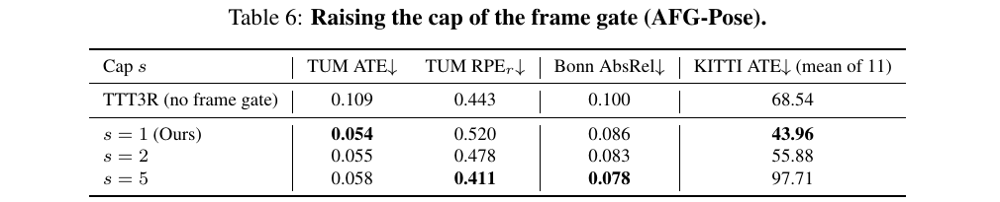

*原论文 Appendix Table 6。包含 TUM-RGBD、Bonn 和 KITTI 的门控上限消融。*

### A4 与关键帧式门控比较

作者分别改变门控是否二值化、非关键帧是否完全跳过，以及新颖度参考帧。把非关键帧写入设为零会提高 TUM-RGBD 旋转误差；保留小的正权重更稳。以最后接受的关键帧而不是紧邻前一帧计算特征变化，在位姿和深度上都更差。结果支持连续门控：低估新帧时仍有少量写入，后续帧也能补充信息。

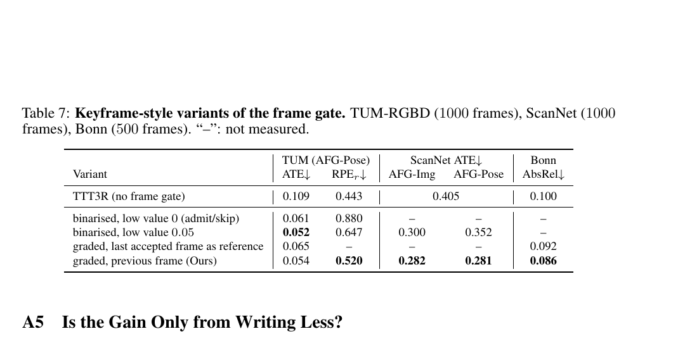

*原论文 Appendix Table 7。比较二值门控、非关键帧写入下限及用于特征差分的参考帧。*

### A5 收益是否只是因为少写状态

在全帧率输入下，若模型仍逐帧编码、解码和评估，只是每两帧或三帧才把残差写入状态，KITTI 平均 ATE 从逐帧写入的 68.54 m 降至每三帧写入的 53.12 m；AFG-Pose 则为 43.96 m。论文还单独测试输入抽帧：TTT3R 与 AFG-Pose 都只接收每三帧中的一帧，确保两者看到相同输入。在这种设置下，AFG-Pose 的 Bonn 深度、KITTI 和 ScanNet 指标较好，但 TUM-RGBD 的 ATE 和旋转误差更差（分别增加约 8% 和 22%）。因此，减少输入帧数和降低每帧写入权重是不同操作，收益不会在所有基准上叠加。

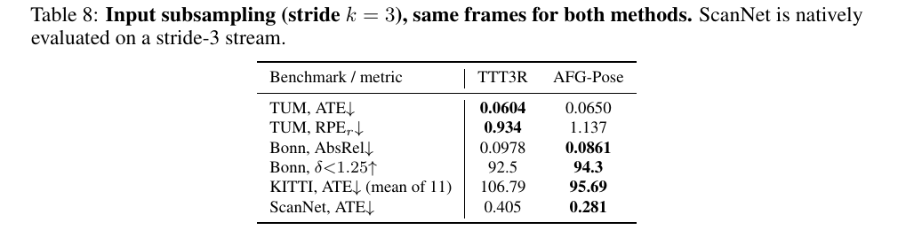

*原论文 Appendix Table 8。两种方法使用完全相同的抽帧输入；ScanNet 原本就是 stride-3 序列。*

### A6 Pose 门控与循环状态的耦合

pose token $p_t$ 由当前图像和上一状态共同解码，因此作者检查它是否只是跟随位姿误差。TUM `walking_xyz` 上，$\alpha$ 与相机逐帧旋转量的 Spearman 相关为 +0.50，与位姿误差的相关为 −0.12；高门控帧的运动幅度更大，但位姿误差没有随之变大。作者谨慎指出，pose token 在结构上仍读取循环状态，这些相关性不能证明完全没有耦合；AFG-Img 只读编码器特征，不存在这条状态依赖路径。

### A7 融合两种帧门控

作者试过取最大值（OR）、两门控相乘（AND）以及按信号强度加权平均。没有一种融合稳定超过表现最好的单一变体：OR 放过更多重复帧，AND 会同时压低信息帧的残差，加权平均则大致复现 AFG-Pose。作者因此保留 AFG-Img 和 AFG-Pose，作为适用于不同数据分布的互补变体。

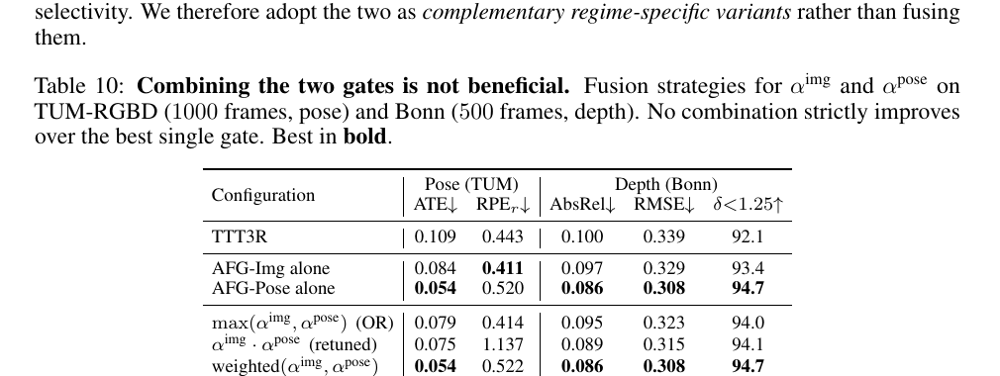

*原论文 Appendix Table 10。比较单一门控与 OR、AND、加权平均融合。*

### A8 TUM-RGBD 与 ScanNet 的逐长度位姿结果

附录把 50 到 1000 帧的平均 ATE 分别列出。TUM-RGBD 上，AFG-Pose 在 200 帧及以上持续优于其他方法，且随序列长度增加与 TTT3R 的差距扩大；ScanNet 上 AFG-Img 在 300–900 帧最低，1000 帧时 AFG-Pose 以 0.281 m 略优于 AFG-Img 的 0.282 m。该表也说明两种门控变体没有固定的全长度排序。

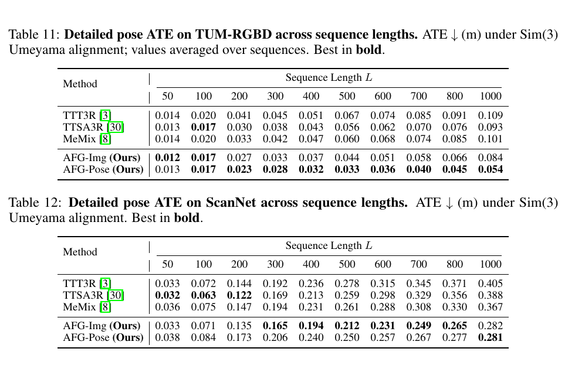

*原论文 Appendix Tables 11–12。ATE 以米计，轨迹采用 Sim(3) Umeyama 对齐。*

### A9 KITTI 各序列变化

按序列长度排列后，最长的 00、02、08 序列中 AFG-Pose 的 ATE 降低约 39%–51%；但序列 05、07、10 和最短的 04 变差。收益与长序列漂移有关联，却不是“序列越长必然越好”的规则；作者也报告回环结构无法解释逐序列的差异。

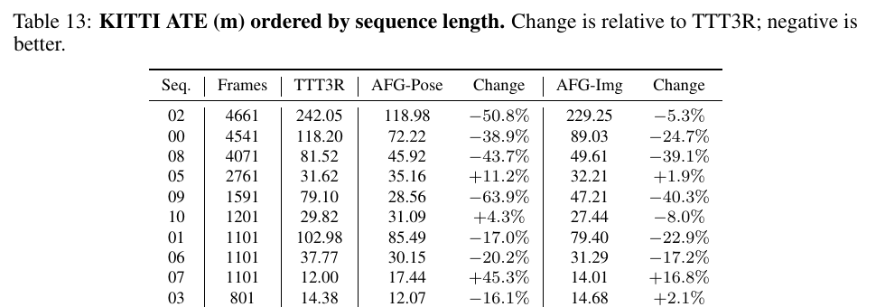

*原论文 Appendix Table 13。变化百分比以 TTT3R 为基线，负值表示误差下降。*

### A10 KITTI 轨迹可视化

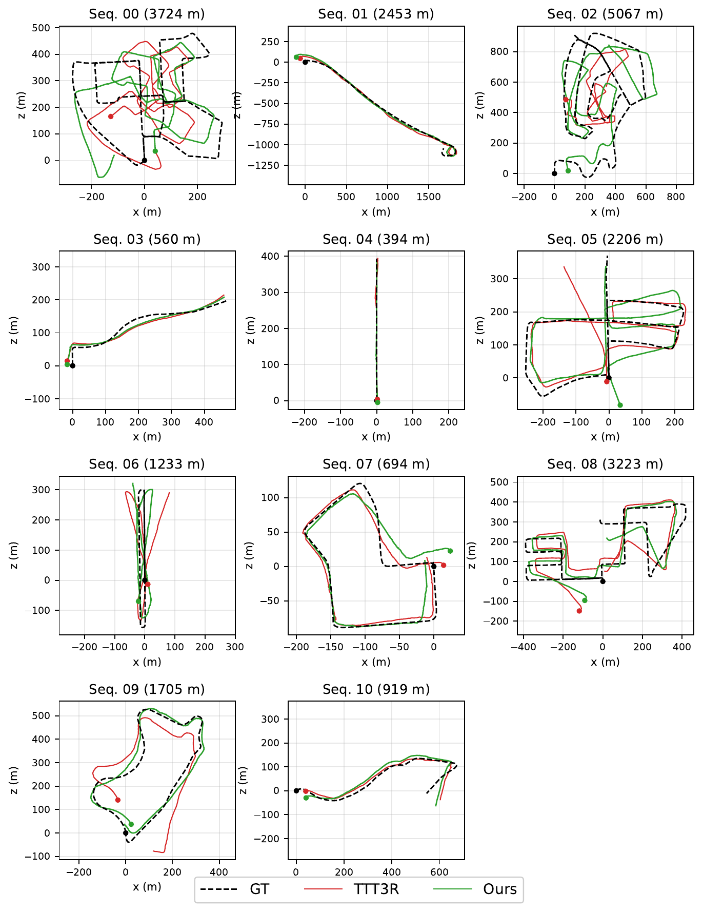

*原论文 Appendix Figure 6。所有轨迹均经 Sim(3) Umeyama 对齐；长轨迹上 TTT3R 常出现较明显偏移，短轨迹中两种方法都可能贴近真值。*

### A11 Bonn 深度逐长度结果

Bonn 的附录结果按长度列出 Abs Rel、RMSE 和 $\delta<1.25$。metric alignment 不对预测深度作尺度和平移拟合；在 $L\ge200$ 时，AFG-Pose 在三个指标上整体最强，而很短序列（$L\le100$）由 TTSA3R 领先。另一个 scale-and-shift 对齐实验会逐帧拟合尺度和平移，AFG-Pose 在 200 帧以上仍保持较好表现，因此主结果不只依赖一种深度对齐协议。

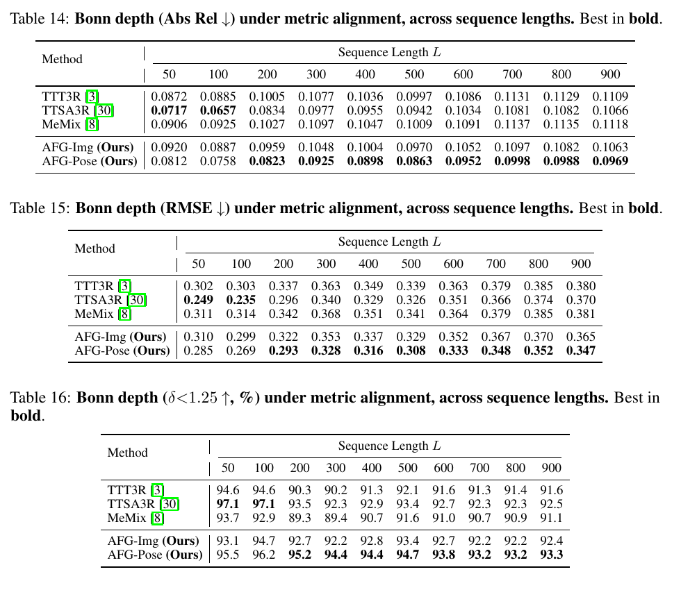

*原论文 Appendix Tables 14–16。依次为 Abs Rel、RMSE 与 $\delta<1.25$，覆盖 50–900 帧。*

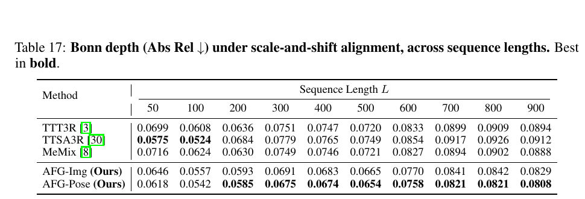

*原论文 Appendix Table 17。逐帧为预测深度拟合尺度和平移后计算 Abs Rel。*

### A12 7-Scenes 与 NRGBD 重建指标

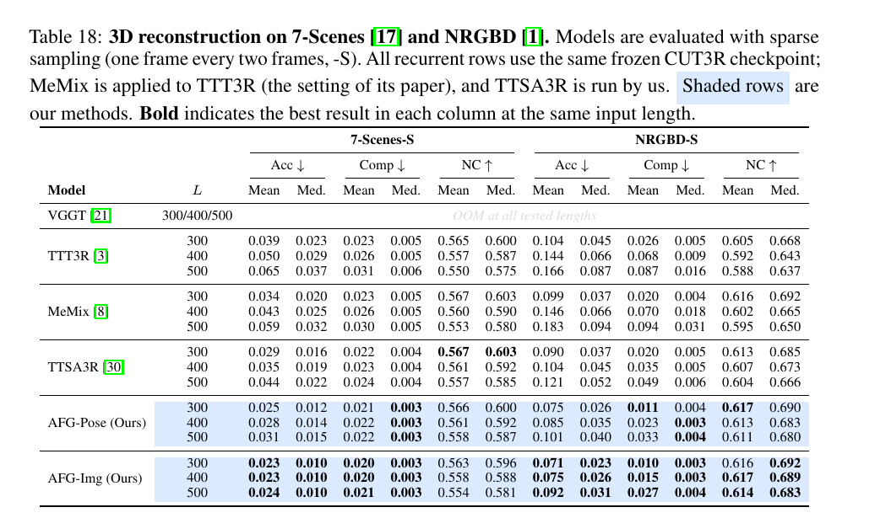

*原论文 Appendix Table 18。序列每隔一帧采样；循环方法使用相同冻结的 CUT3R 检查点，MeMix 与 TTSA3R 的运行设置如原文说明。*

表中 Accuracy 和 Completeness 越低越好，Normal Consistency 越高越好，并同时报告均值与中位数。7-Scenes 的 TTT3R 平均 Accuracy 随输入长度由 300 帧的 0.039 增至 500 帧的 0.065，而 AFG-Img 为 0.023、0.023、0.024。NRGBD 的 500 帧结果中，AFG-Img 的平均 Accuracy 为 0.092，低于 TTSA3R 的 0.121；平均 Completeness 为 0.027，低于 0.049。全注意力 VGGT 在测试长度上都因显存不足无法运行。

### A13 定性点云对比

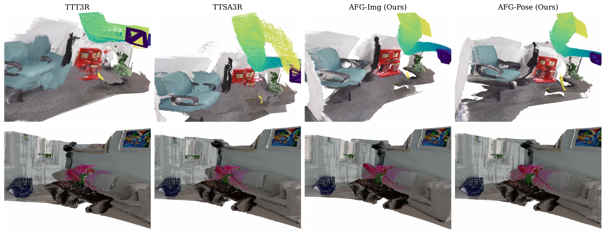

*原论文 Appendix Figure 7。上排来自 7-Scenes，下排来自 NRGBD；图中比较 TTT3R、TTSA3R、AFG-Img 和 AFG-Pose 的点云完整性与局部重影。作者观察到 AFG 重建的场景表面更连贯，但这类视觉对比应与前面的量化指标一并理解。*

与 [TTT3R](../ttt3r/index.md) 和 [CUT3R](../cut3r/index.md) 的状态更新机制对照，AFG 增加的是逐帧调节维度；与 [LongStream](../longstream/index.md) 的长序列训练和 [Stream4D](../stream4d/index.md) 的动态缓存抑制相比，它解决的问题分别是循环状态反复写入造成的漂移，以及动态内容污染历史几何。三者针对不同误差来源，不能互相替代。
