# RetrieveVGGT 论文解读

> Zichen Zou、Xiaosong Jia、Zuxuan Wu、Yu-Gang Jiang，*Attention Itself Could Retrieve. RetrieveVGGT: Training-Free Long Context Streaming 3D Reconstruction via Query-Key Similarity Retrieval*，arXiv:2605.09644v1（2026 年 5 月 10 日）。项目仓库于 2026 年 10 月公布论文被 NeurIPS 2026 接收。本文依据 arXiv v1 全文与附录（21 页）。[arXiv 论文页](https://arxiv.org/abs/2605.09644) · [v1 PDF](https://arxiv.org/pdf/2605.09644v1) · [项目与代码](https://github.com/zzctmd/RetrieveVGGT)

VGGT 依靠全局注意力让多张图像共同参与三维重建，但整段视频越长，注意力与显存开销越大。StreamVGGT 把推理改成因果逐帧处理，并缓存每层的 Key、Value（KV），使新帧能够复用历史计算；缓存却随视频增长。RetrieveVGGT 沿用 StreamVGGT 的因果推理框架，把“当前帧该读取哪些历史帧”改写成检索问题：当前帧的查询向量与各历史帧的键向量相似度，直接作为相关性分数。

论文将已有流式方法概括为几类：显式空间记忆把历史锚定在三维位置，但地图会随场景范围增长；循环状态把过去压入固定状态，长序列下可能遗忘；因果注意力保留 KV 以复用历史计算，但缓存随帧数累积。与此同时，成对前馈模型在多视图下还需额外全局对齐，VGGT 一类全局模型则受二次注意力成本限制。RetrieveVGGT 试图保留因果注意力读取历史的优势，同时让读取上下文与每个新查询相关。

这一选择仍可能把预算集中在一段连续的高相似帧上。论文因此用 Segment Sampling 将预算分配到不同的高相关时间段，并按估计相机位姿把缓存帧组织到空间区域，周期性压缩重复视角。前者决定当前帧读什么，后者管理历史 KV 如何长期保存；二者作用于不同阶段。

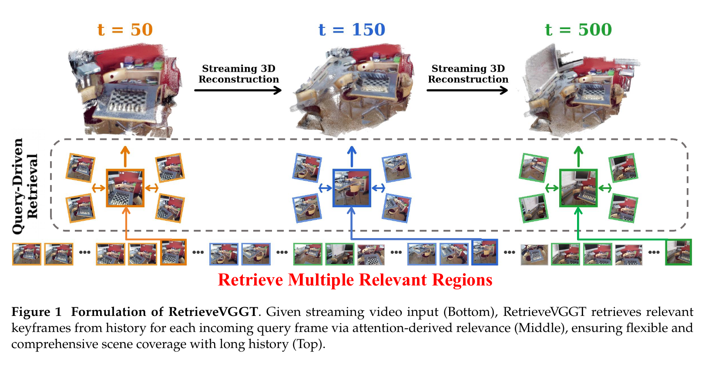

*原论文图 1。下方是持续输入的帧序列，中间为不同时间点查询到的历史帧，上方展示随输入延长而逐渐形成的场景重建。查询帧不同，检索到的相关区域也会改变。*

## 从因果缓存到按需检索

VGGT 使用图像编码器、Transformer 聚合器和多任务预测头联合估计相机、深度和点图。StreamVGGT 将聚合器中的跨帧注意力改为因果注意力：时刻 $t$ 的帧只能读取自己和过去帧的状态。每一层都缓存此前帧的 Key、Value，新帧到来后只需计算其当前状态并查询缓存，不必重复编码过去的图像。

全量缓存保留了所有过去 KV，但存储量与序列长度成正比。滑动窗口只保留最近帧，旧场景线索会被直接丢弃；统一剪枝则为后续帧保留同一份压缩缓存，无法针对当前视角恢复已删掉、但此刻可能有用的历史信息。RetrieveVGGT 的区别在于：KV 历史仍供检索，每一个新查询都可以从历史中挑选自己的上下文。

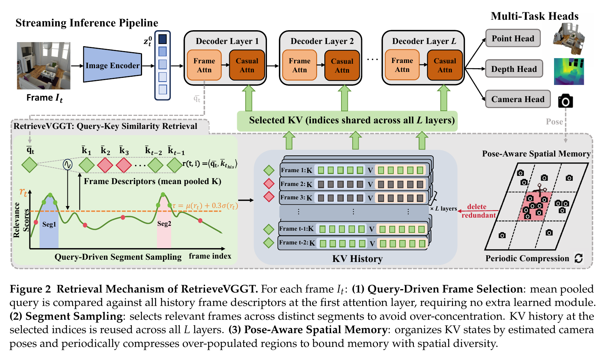

*原论文图 2。第一层注意力中的 Q-K 相似度产生帧级相关性；Segment Sampling 在历史中挑选分散的高相关帧；同一批帧索引被各层复用。相机头给出的位姿则用于空间分区与周期压缩。*

### 用首层注意力特征构造相关性

在第 $t$ 帧进入模型后，图像编码器与第一层帧内注意力先生成当前帧 token $\hat z_t^0$。VGGT 的第一层全局注意力此前还没有融合其他帧的信息，因此其 Query、Key、Value 对应当前图像本身的视觉内容：

$$
Q_t^0,K_t^0,V_t^0=\operatorname{Proj}_{qkv}^0\!\left(\operatorname{LN}^0(\hat z_t^0)\right)\in\mathbb{R}^{H\times P\times d_h},\qquad d_h=d/H.
\tag{1}
$$

$H$ 是注意力头数，$P$ 是该帧的 token 数，$d_h$ 是每个头的维度。每帧 token 序列先放置 $s$ 个相机或 register 特殊 token，随后是 $P_p=P-s$ 个 patch token。作者只对 patch token 求均值，得到每个注意力头的帧级 Query 与 Key 描述符：

$$
\bar q_t=\frac{1}{P_p}\sum_{j=s+1}^{P}Q_t^0[:,j,:],\qquad
\bar k_t=\frac{1}{P_p}\sum_{j=s+1}^{P}K_t^0[:,j,:].
\tag{2}
$$

排除特殊 token 的原因是，这一步希望描述图像中的帧级视觉内容，而不是公共相机或寄存器 token。对当前查询帧与历史第 $i$ 帧，论文使用各头内积的平均值作为相关性：

$$
r(t,i)=\frac{1}{H}\sum_{h=1}^{H}\left\langle\bar q_t[h,:],\bar k_i[h,:]\right\rangle,\qquad i=1,\ldots,t-1.
\tag{3}
$$

这个分数直接复用了 VGGT 学出的 Q、K 表征，不另加训练出来的检索网络。值得留意的是，它是未经归一化的点积，不等同于余弦相似度：向量模长也会影响排序。附录的消融实验显示，保留幅度信息的原始点积在 7-Scenes 上优于余弦相似度与负 L2 距离。

选帧在第 0 个全局注意力层完成。每帧预算记为 $N$，首帧始终保留，因为 VGGT 将它定义为坐标参考帧；剩下的名额由相关性检索提供。各层随后使用同一组索引对应的 KV：

$$
z_t^l=\operatorname{Attn}\!\left(Q_t^l,K_{\mathcal S_t}^l,V_{\mathcal S_t}^l\right),
\tag{4}
$$

其中 $\mathcal S_t$ 是为当前帧选择的历史集合，$l$ 表示层。共享索引避免为每层重复执行检索；论文的消融也没有发现逐层重新选帧能提升结果。要区分两个量：$N$ 限制的是**当前帧注意力所读取的帧数**，并不意味着历史中只保留 $N$ 帧。后者由单独的空间压缩步骤管理。

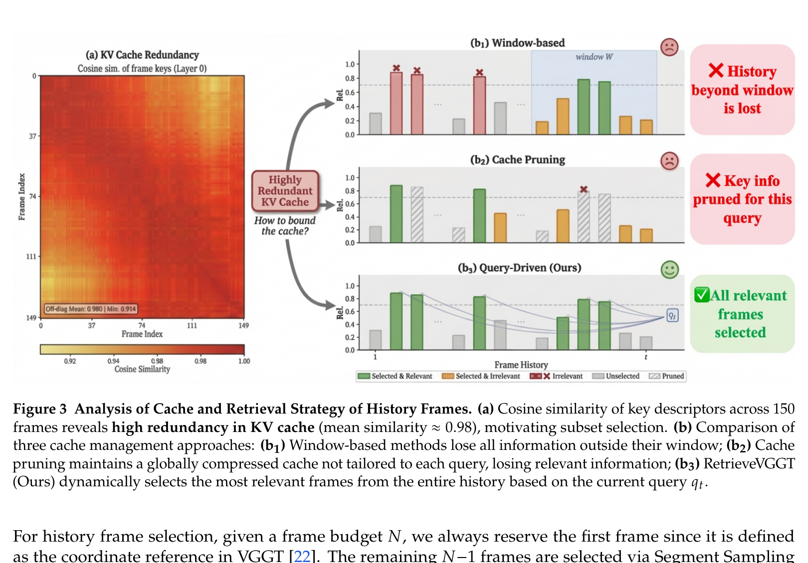

*原论文图 3。左侧展示 150 帧首层键描述符之间很高的余弦相似度（平均约 0.98）；右侧比较窗口、与查询无关的统一剪枝，以及按当前查询动态选帧。图中冗余证据来自描述符相似度分布。*

## Segment Sampling 如何分散检索预算

直接取相关性最高的 $N-1$ 帧，容易把名额集中到一处高峰。假设相机在同一场景区域连续移动，许多相邻帧都会得到高分；只按 Top-$K$ 排序就可能选中一串近似视角，而漏掉历史中另一个相关但时间上分离的区域。论文把相关性曲线拆成多个片段，让预算能跨片段分配。

首先对所有历史分数计算自适应阈值：

$$
\tau=\mu(r_t)+w_{\mathrm{thre}}\sigma(r_t),
\tag{5}
$$

其中 $\mu$ 和 $\sigma$ 是历史相关分数的均值与标准差，默认 $w_{\mathrm{thre}}=0.3$。连续高于阈值的帧构成一个极大连续片段；若两个片段之间间隔小于 $\delta$ 帧，则合并，默认 $\delta=3$。这会把曲线上紧邻的小波谷视为同一相关区域，避免片段过度碎裂。

对第 $k$ 个片段 $S_k$，先找其中最高相关性 $r_k^{\max}$。采样名额按各片段峰值占总峰值的比例分配，再将名额限制在至少一帧、最多不超过该段长度的范围内：

$$
\hat n_k=\left\lfloor N_{\mathrm{sel}}\frac{r_k^{\max}}{\sum_{j=1}^{M}r_j^{\max}}\right\rfloor.
\tag{6}
$$

$$
n_k=\operatorname{clamp}(\hat n_k,1,|S_k|).
\tag{7}
$$

$M$ 是检测到的片段数，$N_{\mathrm{sel}}$ 是可分配给历史帧的总名额。每段先保留峰值帧，再沿该段时间跨度均匀抽取其余帧：

$$
\mathcal F_k=\{i_k^*\}\cup\operatorname{Uniform}(S_k\setminus\{i_k^*\},n_k-1),\qquad
i_k^*=\arg\max_{i\in S_k}r(t,i).
\tag{8}
$$

由于片段数量、向下取整和段长度上限，分配后帧数未必正好等于预算。若片段保证的最低名额让总数超出预算，算法保留所有候选中分数最高的 $N_{\mathrm{sel}}$ 帧；若总数不足，则从未选历史帧中按分数补齐：

$$
\mathcal F_{\mathrm{final}}=\operatorname{Top}_{N_{\mathrm{sel}}}(\mathcal F_{\mathrm{seg}}),
\tag{9}
$$

$$
\mathcal F_{\mathrm{final}}=\mathcal F_{\mathrm{seg}}\cup
\operatorname{Top}_{N_{\mathrm{sel}}-|\mathcal F_{\mathrm{seg}}|}(\mathcal H_t\setminus\mathcal F_{\mathrm{seg}}).
\tag{10}
$$

因此，“每个高相关片段至少有一帧”是预算允许时的目标；当片段多于名额，式（9）仍必须舍弃一部分片段候选。Segment Sampling 提供的是覆盖多处相关峰的倾向，不可能在有限预算下保证覆盖任意多的片段。

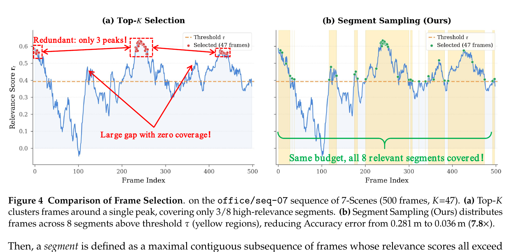

*原论文图 4。7-Scenes 的 office/seq-07、500 帧示例中，Top-$K$ 只覆盖 8 个高相关区间中的 3 个，Segment Sampling 则都覆盖到；该单序列示例报告的 Accuracy 从 0.281 m 降到 0.036 m。它不是表 3 的全数据集平均值。*

附录图 7、图 8 将这一现象呈现到图像上：对于第 300 帧与第 500 帧，检索结果随查询改变，同时来自不同时间段。相似度检索因此确实找到了视觉上接近的区域，也避免把候选挤在唯一的一段时间邻域中。

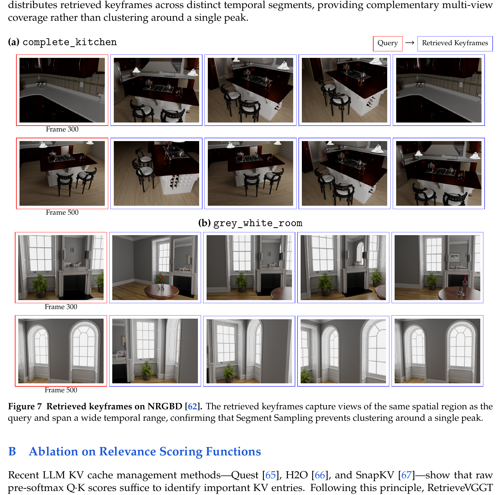

*原论文图 7。红框是查询帧，蓝框是从整个历史中检索的帧。不同查询对应不同检索集合，且集合跨越多个时间片段。*

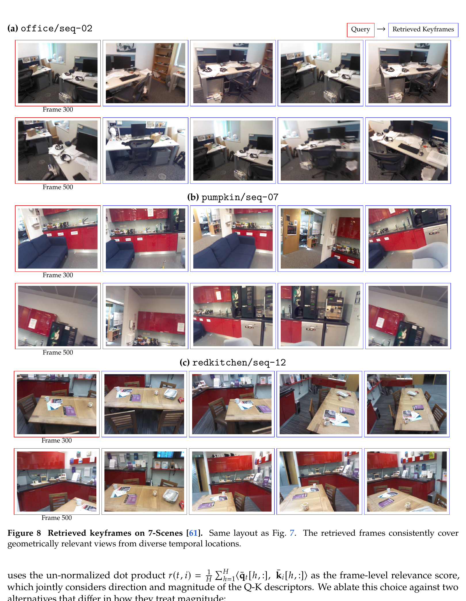

*原论文图 8。与图 7 相同的展示方式，例子显示检索帧在时间上分散，同时仍能观察到与查询相同或邻近的室内区域。*

## 用相机位姿管理长期 KV

按查询检索只限制一帧推理时读取多少历史 KV；若每帧仍将新 KV 永久加入缓存，历史存储还是会不断增加。论文在每帧相机头输出后，记录相机位置 $p_t\in\mathbb R^3$ 和光轴方向 $d_t\in\mathbb R^3$，再把历史空间划分为位置网格与朝向分箱的组合区域。

令 $b_{\min}$、$b_{\max}$ 为历史相机位置包围盒的极值，$K$ 为每条空间轴的分区数。网格单元边长取场景直径除以 $K$，相机位置对应的格索引为：

$$
g=\frac{\|b_{\max}-b_{\min}\|}{K},\qquad
(i_x,i_y,i_z)=\left\lfloor\frac{p_t-b_{\min}}{g}\right\rfloor.
\tag{11}
$$

光轴的方位角 $\operatorname{atan2}(d_z,d_x)$ 再量化为 $D$ 个方向箱：

$$
d_{\mathrm{bin}}=\left\lfloor\frac{\operatorname{atan2}(d_z,d_x)+\pi}{2\pi/D}\right\rfloor.
\tag{12}
$$

这样的位置与方向组合形成最多 $K^3D$ 个区域；论文默认 $K=3,D=4$。包围盒只增长、不因删除而缩小，目标是让历史帧的空间标签在压缩后不因范围收缩而改变。该离散网格提供了粗粒度覆盖描述，位置和方向分箱都不等同于精确几何重访判断。

每处理 $\Delta$ 帧，算法统计当前占用区域内可压缩帧数 $|R_p|$ 的平均值：

$$
\bar c=\frac{1}{P}\sum_{p=1}^{P}|R_p|,
\tag{13}
$$

其中 $P$ 是有帧的区域数，首帧锚点受保护，不进入可压缩集合。对于高于平均占用的区域，保留沿时间跨度均匀分布的一部分帧：

$$
|R'_p|=\left\lfloor(1-\beta)|R_p|\right\rfloor.
\tag{14}
$$

默认每 200 帧触发一次，删除比例 $\beta=0.5$。低于或等于平均占用的区域不动；删除帧的 KV 张量释放，位姿、相关性描述符等轻量元信息保留，称作 tombstoning。空间分组让高密度重访区优先变稀，低密度的独特视角则得以留下。

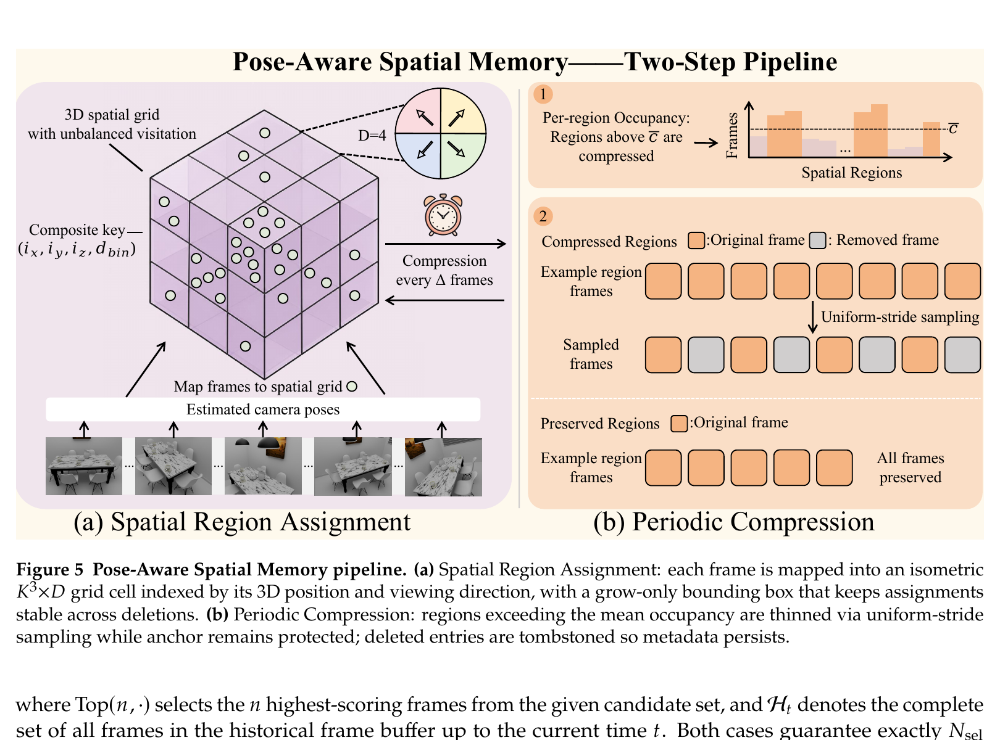

*原论文图 5。左侧将估计位姿映射到三维网格和朝向区间；右侧对高于平均占用的区域做均匀步长采样，并保护锚点。*

论文将这套方法描述为能把 KV 显存控制在与序列长度无关的范围。不过，按正文式（13）—（14）的条件直读，它是一种周期性、按相对占用压缩的策略，并未给出每个区域的绝对帧数上限：如果只有一个区域被访问，该区域占用就等于平均值，不满足“高于平均”的压缩条件；多个区域长期均匀增长时也可能都不触发。因此，公式本身没有推出严格的最坏情况常数上界。论文报告的是实验中的有界 GPU KV 开销，不能据此把所有元数据或检索成本也视为常数：当前查询还需与历史描述符比较，且被删帧的元信息会保留。这个实现边界是理解“固定预算检索”和“固定总存储”之间差别的关键。

## 长序列重建与深度结果

RetrieveVGGT 使用开源 StreamVGGT 检查点，不做微调；默认检索帧预算 $N=48$。论文在单张 NVIDIA RTX 5880 Ada 上评估三类任务：7-Scenes 与 NRGBD 的三维重建、Bonn 的视频深度估计、TUM-dynamics 的相机轨迹估计。长序列重建和深度实验使用 200、300、400、500 帧；位姿实验从 50 帧扩展到 1000 帧。

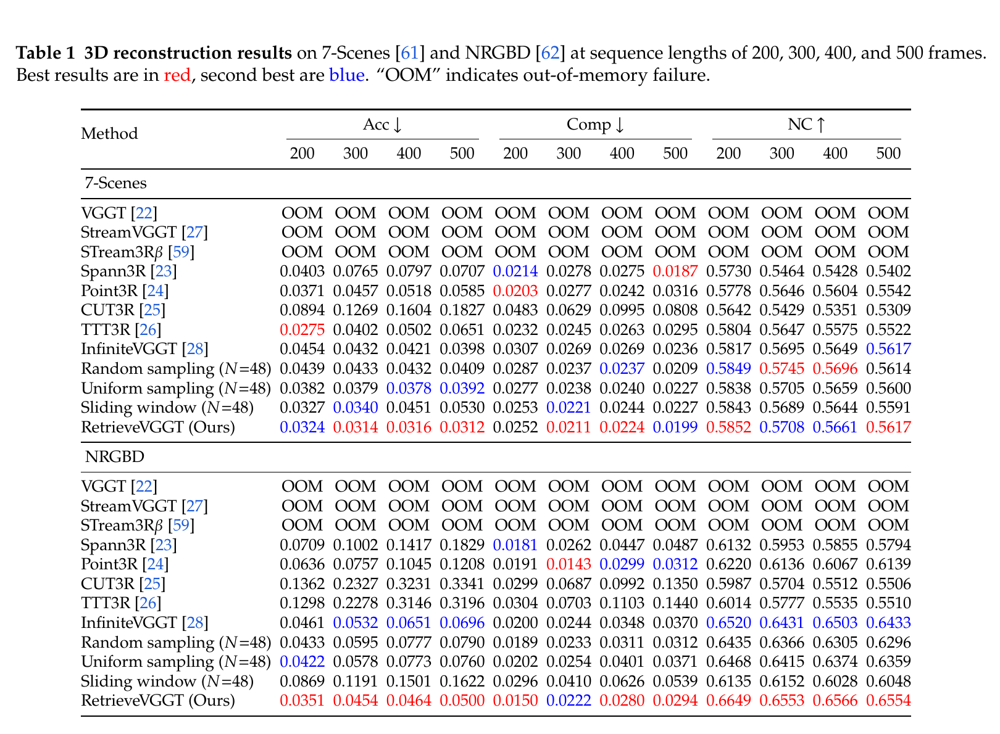

*原论文表 1。Acc 与 Comp 越低越好，NC 越高越好；OOM 表示显存不足。相同 $N=48$ 的随机抽帧、均匀抽帧与滑窗构成预算对照。*

在 7-Scenes 上，RetrieveVGGT 的 Acc 在 300、400、500 帧设置为表中最好，但在 200 帧时 TTT3R 更低（0.0275 对 0.0324）。NRGBD 上它在四种长度的 Acc 都最好，NC 也领先；Completeness 与其他方法的相对次序则随长度变化。VGGT、StreamVGGT 和 STream3R$^\beta$ 在这些 200—500 帧设置中均出现 OOM。相同预算的随机与均匀采样缺少内容相关性，滑窗则完全丢弃窗口外历史；NRGBD 的滑窗 Acc 随长度恶化到 0.1622。结果支持“历史相关性选择有用”，但并不意味着所有任务指标都由同一方法全面领先。

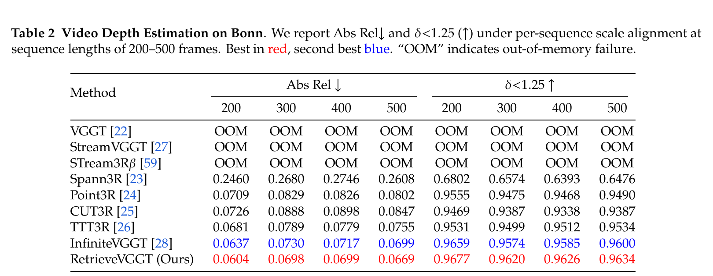

*原论文表 2。Bonn 的 200—500 帧序列采用逐序列尺度对齐，报告 Abs Rel 与 $\delta<1.25$。RetrieveVGGT 在表中所有长度和两项指标均优于第二名 InfiniteVGGT。*

作者选用 Bonn，是因为它在相应室内 RGB-D 数据中提供较长的连续序列。评估从五个场景中截取 200—500 帧片段，跳过每段初始 30 帧，并按序列尺度对齐深度。这样报告的是经过尺度对齐后的深度质量，不能直接当作绝对尺度估计结果。

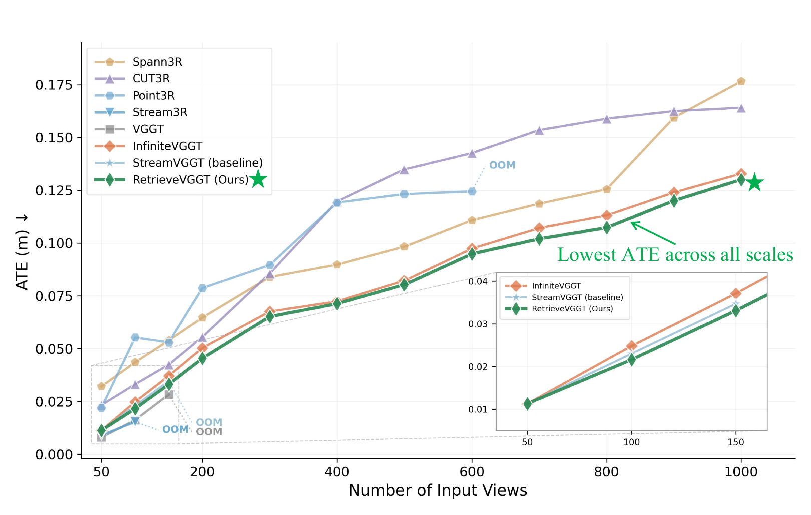

*原论文图 6。序列长度为 50—1000 帧，轨迹以 Sim(3) Umeyama 对齐。RetrieveVGGT 在多数长度下的 ATE 最低；OOM 的曲线在最后一次成功长度处截断。*

TUM-dynamics 评估从步长为 1 的连续帧构造 50—1000 帧序列，使用 Sim(3) Umeyama 对齐预测轨迹与真值，再绘制 ATE。论文称 RetrieveVGGT 在几乎所有长度上误差最低，短输入时也能和 StreamVGGT 比较，因为较短序列尚未触发缓存压缩。此处报告的是对齐后的轨迹误差，不应与包含回环和全局位姿图优化的 SLAM 系统结果混为一谈。

## 消融解释了哪些设计真正起作用

表 3 汇总了描述符、采样策略、预算、缓存压缩及空间网格的消融。首层 VGGT Q-K 描述符的重建 Acc 为 0.0312，明显优于不同层的冻结 DINOv2 特征；逐层各自选择反而略差。这说明选帧信号与 VGGT 几何任务的特征空间相适配，而不是任意视觉相似度都能获得同样效果。

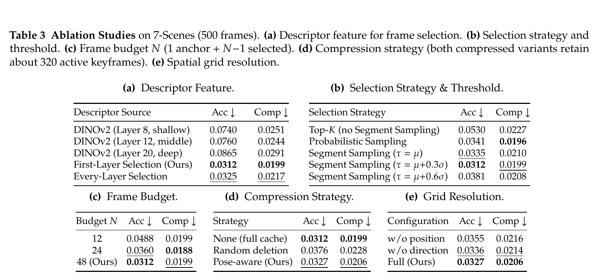

*原论文表 3。默认在 7-Scenes、500 帧上评估；(d) 中不压缩和两种压缩版本的活动 KV 数量约为 500 与 320。*

Segment Sampling 的 Acc 为 0.0312，优于 Top-$K$ 的 0.0530 与概率采样的 0.0341；阈值设为 $\mu+0.3\sigma$ 的配置优于表中 $\mu$ 和 $\mu+0.6\sigma$。帧预算从 12 增至 24、48 后，Acc 从 0.0488 降至 0.0360、0.0312，Completeness 则保持相近。N=24 已优于 InfiniteVGGT 在同设置报告的 Acc 0.0398。

无压缩的 Acc 是 0.0312，位姿感知压缩为 0.0327，随机删除为 0.0376；两种压缩配置平均保留约 320 个活动关键帧。这表明在该 500 帧评测中，空间压缩以很小的 Acc 变化换来更少活动 KV，且比相同预算的随机删除更稳。去掉位置网格或朝向分箱都会降低效果，默认 $(K,D)=(3,4)$。这项消融给出了实验规模下的质量—存储折中，没有证明任意长序列都保持相同上界。

附录进一步比较了相关性打分：

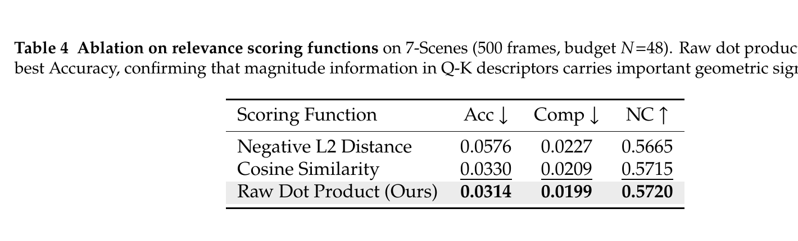

*原论文表 4。7-Scenes、500 帧、$N=48$ 时，原始 Q-K 点积在 Acc、Comp、NC 三项均为表中最佳。*

原始点积的 Acc 是 0.0314，余弦相似度是 0.0330，负 L2 是 0.0576。余弦归一化会去掉模长，而论文指出不同帧描述符的余弦相似度本已集中在约 0.98；负 L2 则会惩罚模长更大的键。按照作者的解释，Q-K 向量幅度携带与几何信息量相关的信号，因此直接点积能保留方向与幅度。注意力中的常规 $1/\sqrt{d_h}$ 缩放对同一个查询下所有候选帧相同，不改变排序。

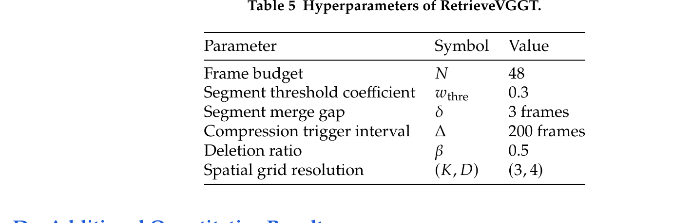

*原论文表 5。帧预算 $N=48$、阈值系数 0.3、片段合并间隔 3 帧、压缩间隔 200 帧、删除比例 0.5、空间网格 $(3,4)$。*

## 附录结果与适用边界

附录 D 用较短片段补充了主文长序列评估。在 50 帧 Sintel、90 帧 TUM-dynamics 上，RetrieveVGGT 的多数位姿指标与 StreamVGGT 基础模型相同；一些指标上则落后于 STream3R$^\beta$、CUT3R 或 TTT3R。表中 RetrieveVGGT 的带 † 基础模型就是 StreamVGGT。短序列未超过可保留帧预算时，检索机制没有足够的历史需要淘汰，结果接近基础模型，说明此方法的主要收益集中在长历史管理。

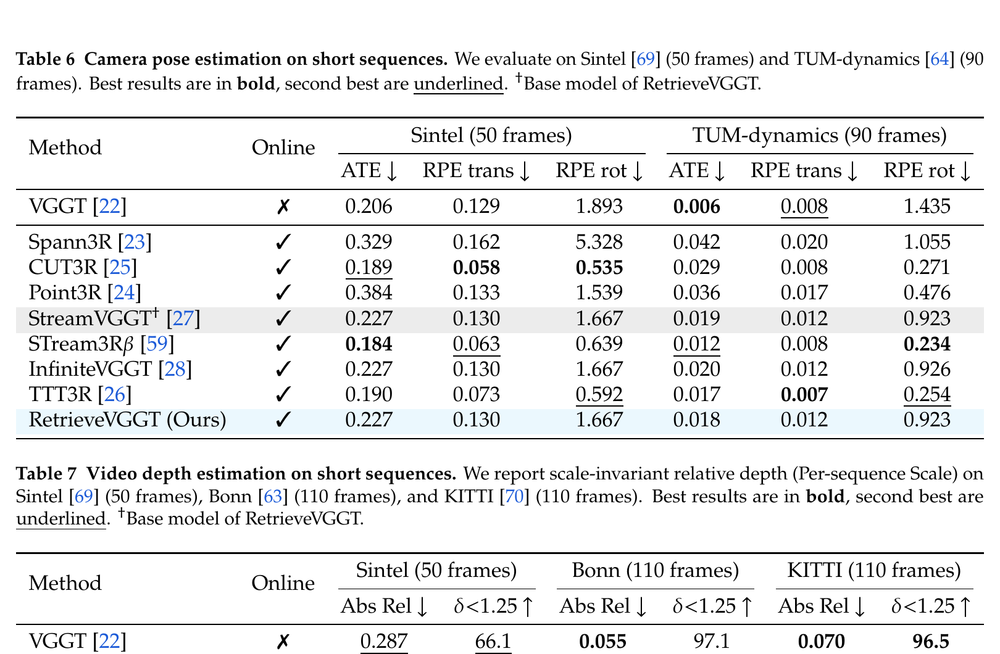

*原论文表 6、表 7。表 6 的位姿比较使用 Sintel 50 帧与 TUM-dynamics 90 帧；表 7 使用 Sintel 50 帧、Bonn 110 帧和 KITTI 110 帧。表 7 的深度按每条序列尺度对齐。*

附录 E 的定性比较展示了重建形状：NRGBD 上与 TTT3R 比较，7-Scenes 上与 TTT3R 和 InfiniteVGGT 比较。作者报告 RetrieveVGGT 在这些样例中有更完整、几何一致性更好的点云；这属于定性图示，不能替代表格中的定量比较。附录 G 认为训练免除微调降低了在普通 GPU 上进行长序列重建的门槛，可用于机器人、AR/VR 和文化遗产记录等场景，同时提醒空间重建需要考虑未经授权测绘的隐私影响。

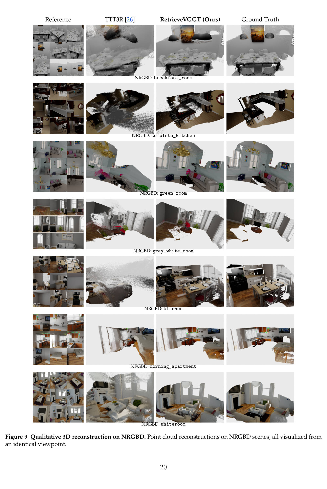

*原论文图 9。各列从相同视角展示参考图、TTT3R、RetrieveVGGT 和真值点云，包含早餐间、厨房及多个室内场景。*

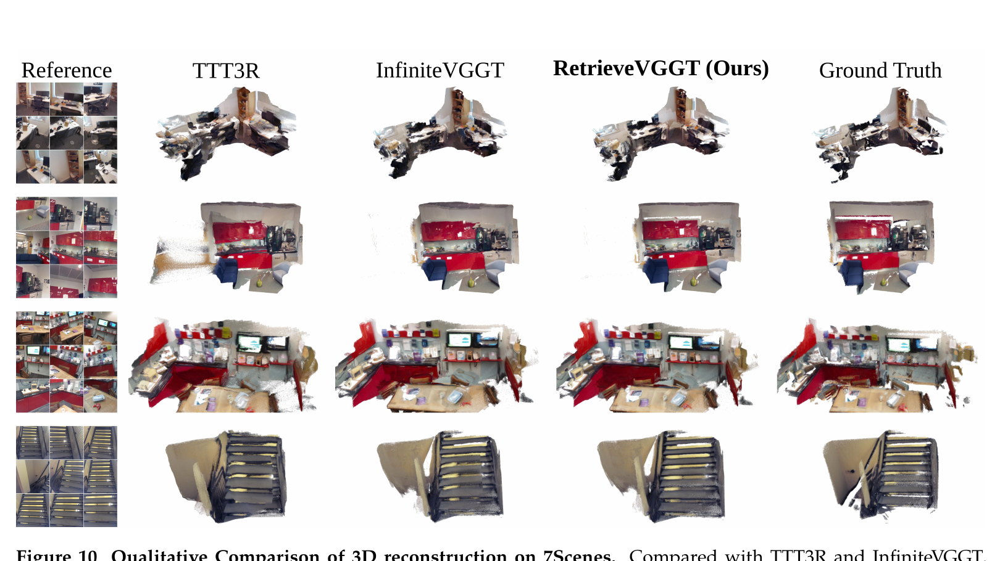

*原论文图 10。对比列显示 RetrieveVGGT 在若干 7-Scenes 示例中得到更完整的重建；这是作者给出的定性结果。*

论文明确列出的限制是：方法不训练新模型，因而继承 StreamVGGT 基础模型在动态物体、弱纹理区域等情况下的能力边界；固定 $N$ 不会按场景复杂度自适应；评测主要在室内数据上进行，高动态场景尚未验证。附录还强调了未授权空间测绘带来的隐私问题。

## 方法关系与对 SLAM 的边界

RetrieveVGGT 的新意并非替换几何主干，而是让因果 Transformer 的历史上下文随查询变化。首层 Q-K 点积充当无需额外训练的帧级检索分数，Segment Sampling 将有限上下文覆盖到多个相关时间段，位姿分区则在高密度重访区域中删减重复 KV。它把全量因果缓存、固定窗口、与查询无关的全局剪枝区分开来，并给出三任务长序列评测。

论文预测相机、深度和点图，持续输出流式几何；它没有在方法中加入显式回环检测、位姿图或束调整来回溯修正历史相机轨迹。因此更适合归为**流式前馈三维重建**，而不是已经包含全局一致性后端的完整 SLAM 系统。与 [StreamVGGT](../streamvggt/index.md) 相比，它聚焦在因果 KV 的选择与压缩；与 [VGGT-SLAM](../vggt-slam/index.md) 相比，它没有把前馈重建组织成含子图对齐和回环约束的 SLAM 后端。

需要把“检索上下文有界”与“系统总资源严格常数”分开看。固定 $N$ 约束一次注意力读取的历史帧数；周期压缩在实验中降低活动 KV 数量，但论文给出的相对占用规则没有建立每区域的硬上限，相关性检索仍需面对历史描述符。论文展示了按查询选择历史几何线索的有效性，也留下了如何在严格内存上限下同时维护检索索引、位姿修正与全局一致性的系统问题。
