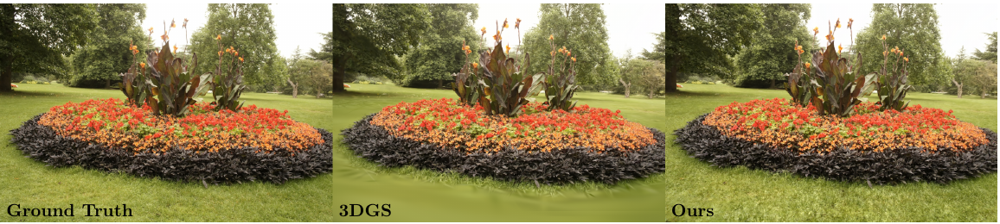
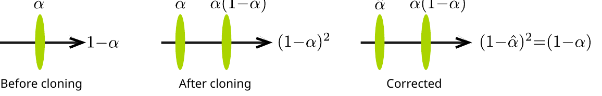
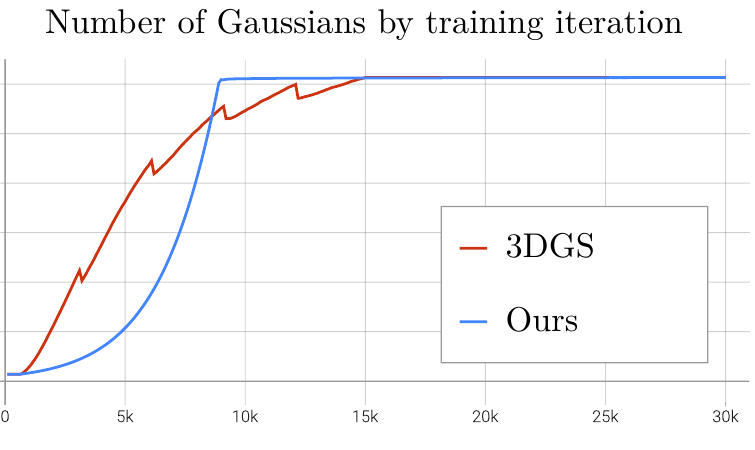
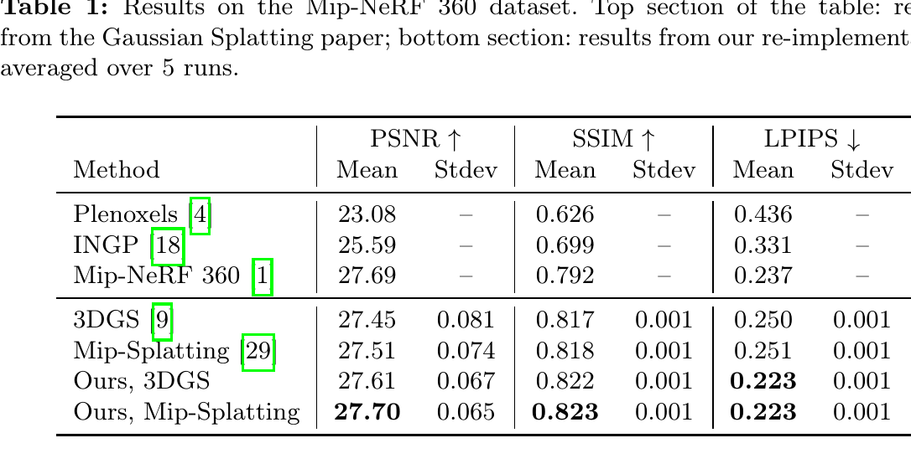
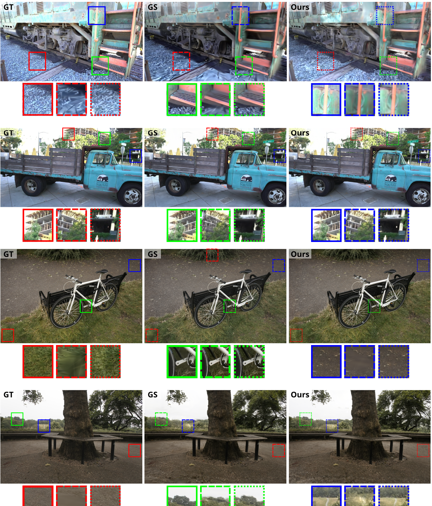
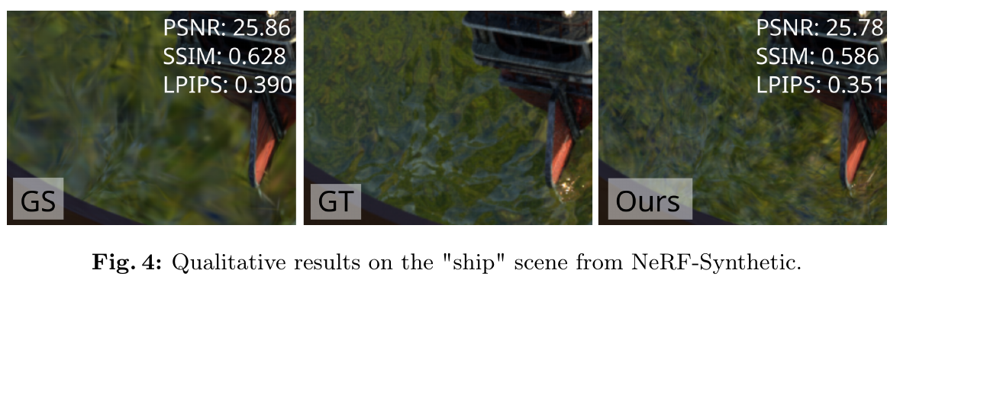
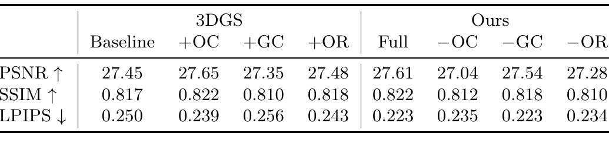

# Revising Densification in Gaussian Splatting 论文解读

> Samuel Rota Bulò、Lorenzo Porzi、Peter Kontschieder，*Revising Densification in Gaussian Splatting*，ECCV 2024，页码 347–362。本文依据会议正式版及补充材料。[Springer 论文页](https://link.springer.com/chapter/10.1007/978-3-031-73036-8_20) · [论文 PDF](https://www.ecva.net/papers/eccv_2024/papers_ECCV/papers/08041.pdf) · [补充材料 PDF](https://www.ecva.net/papers/eccv_2024/papers_ECCV/papers/08041-supp.pdf)

3D Gaussian Splatting（3DGS）的重建质量不只取决于单个高斯如何渲染，也取决于训练时把有限的高斯放到哪里。原始 3DGS 依据位置梯度触发 densification：若像素损失对某个高斯中心位置足够敏感，就克隆或拆分它。这个指标描述的是“移动它会不会改变损失”，却不直接描述“它负责的区域现在还错得多不多”。当一个大高斯把草地、细枝等高频纹理模糊地铺开时，微小移动未必显著改变图像，梯度分数可能很低；模型因此可能在明显欠拟合的区域迟迟不增加表示能力。

*原论文 Figure 1。左侧为参考图，中间为标准 3DGS，右侧为改进方法。草地细节在标准结果里较模糊，说明仅靠位置梯度阈值可能漏掉高误差区域。*

论文从密度控制准则、克隆不透明度和高斯数量管理三方面修改 Adaptive Density Control（ADC）。核心变化是把每个像素的重建误差按高斯对像素的贡献分配，再用跨视角的高误差分数决定优先细化谁。其他修改分别减少克隆后对后方颜色的遮挡偏置，以及为训练设置可控的高斯预算。

## 从位置梯度转向像素误差

在原始 ADC 中，模型在一段训练区间里累计每个高斯中心 $\boldsymbol\mu_k$ 的位置梯度，并求其平均幅值，记作 $\tau_k$。当 $\tau_k$ 超过阈值时，该高斯参与 densification；高斯较大时拆分，较小时克隆。位置梯度适合找到会显著改变当前损失的基元，但它是局部敏感度：在当前解附近微调高斯位置，损失变化有多大。它不等于像素误差本身，也不一定能衡量某个区域还需要多少表示能力。

这一区别在高频纹理上尤其明显。若一块草地被少数宽大的高斯覆盖，局部像素颜色已经偏离参考图很多，但轻微挪动这些高斯仍可能几乎不改变误差。梯度累计因而很小，ADC 不会细化它们。论文改为使用一个辅助像素误差图 $\mathcal E_\pi(\mathbf u)$。这里 $\pi$ 表示训练视角，$\mathbf u$ 是像素位置；误差可来自 SSIM 等逐像素损失。每个像素误差再依据参与该像素合成的高斯权重，分配给相关高斯：

$$
E_k^\pi=\sum_{\mathbf u\in\mathrm{Pix}}\mathcal E_\pi(\mathbf u)\,\omega_k^\pi(\mathbf u).
\tag{4}
$$

$\omega_k^\pi(\mathbf u)$ 是高斯 $k$ 在视角 $\pi$、像素 $\mathbf u$ 上的 alpha 混合权重。按贡献加权有一个直接效果：高斯只有在真实参与了该像素的合成时才分到相应误差；同一像素由多个高斯共同解释时，误差也依各自贡献分摊。该量随后在两次 ADC 运行之间对见过的视角取最大值：

$$
E_k=\max_{\pi\in\Pi} E_k^\pi.
\tag{5}
$$

取最大值让一次高误差视角不会被大量容易拟合的视角平均掉。它仍是针对训练相机观测到的误差统计，不是对所有可能新视角的误差上界。

论文还解释了如何在可微渲染器中计算 $E_k^\pi$，而不让辅助损失改动场景模型。每个高斯额外携带一个标量 $e_k$，初始化为零且训练期间保持不变；渲染器把它像普通颜色通道一样合成，形成 $\sum_k e_k\omega_k^\pi(\mathbf u)$。辅助项写为

$$
\mathcal L_\pi^{\mathrm{aux}}=
\sum_{\mathbf u\in\mathrm{Pix}}
\operatorname{stopgrad}\!\left[\mathcal E_\pi(\mathbf u)\right]
\mathcal R[\pi,\Phi_{\mathrm{ERR}}](\mathbf u).
\tag{6}
$$

其中 stopgrad 表示误差图只作为固定权重，不把这项损失的梯度传回高斯位置、颜色或不透明度。对辅助通道 $e_k$ 求导后，得到

$$
\frac{\partial\mathcal L_\pi^{\mathrm{aux}}}{\partial e_k}
=\sum_{\mathbf u\in\mathrm{Pix}}\mathcal E_\pi(\mathbf u)\omega_k^\pi(\mathbf u)
=E_k^\pi.
\tag{7}
$$

因此辅助通道的梯度恰好是想累计的误差贡献。实现可以读取这项梯度并更新最大视角分数，而场景本身不会被辅助项推动。它把不好直观设定的位置梯度阈值，换成了按所选误差函数构造的分数；分数仍受误差图和像素汇总方式影响，论文实验使用 $E_k>0.1$ 作为生长候选条件。

## 克隆时保持合成透射率

标准 ADC 克隆高斯时会保留原高斯的不透明度。如果两个克隆在同一位置且各自覆盖中心像素，前景基元之后的颜色在克隆前乘以 $1-\alpha$，克隆后则乘以 $(1-\alpha)^2$。因为 $0<\alpha<1$ 时平方会更小，后方高斯贡献被压得更多，克隆区域也就比原来更不透明。这个变化可能妨碍后续高斯共同解释像素，并影响后续密度调整。

*原论文 Figure 2。中心像素中，两个相同不透明度的克隆会把后续颜色的权重从 $1-\alpha$ 降为 $(1-\alpha)^2$；论文通过降低每个克隆的不透明度来恢复该位置的透射率。*

论文令克隆后两个相同基元在原高斯中心像素上共同保留原来的透射率。设修正后的单个不透明度为 $\hat\alpha$，则

$$
(1-\hat\alpha)^2=1-\alpha
\quad\Longrightarrow\quad
\hat\alpha=1-\sqrt{1-\alpha}.
$$

这在高斯中心上给出精确的透射率匹配。对其他像素，高斯核值 $\mathcal G_k^\pi(\mathbf u)$ 通常小于 1，修正不能让克隆前后处处完全相等，但论文证明对任意 $\alpha_k\in(0,1)$：

$$
1-\alpha_k\mathcal G_k^\pi(\mathbf u)
\geq
\bigl(1-\hat\alpha_k\mathcal G_k^\pi(\mathbf u)\bigr)^2
>
\bigl(1-\alpha_k\mathcal G_k^\pi(\mathbf u)\bigr)^2.
\tag{8}
$$

因此修正后的克隆比沿用原不透明度更接近克隆前的透射率。这个推导针对克隆：拆分操作会移动子高斯并缩小协方差，论文仍沿用拆分时保留不透明度的标准规则。

## 给高斯数量设上限

仅靠逐个候选是否超过阈值，不能预先保证最终模型大小。论文增加两种容量约束：场景级高斯总数上限，以及每次 ADC 最多新建多少高斯。若候选数超过可用预算，就按 densification 分数保留优先级较高的候选。实验中，每轮最多新增当前高斯数的 5%，并把总预算设为对应基线最终高斯数量的中位数，以比较相近的模型规模。

*原论文 Figure 3。花园场景中，改进方法在 27k 次迭代内继续运行密度控制，并以高斯上限约束总量；标准 3DGS 在 15k 次迭代后停止 ADC。达到上限后，剪枝与新生高斯可以交替发生，数量曲线因此保持稳定。*

数量限制也可以独立用于原始的梯度打分 ADC。需要区分的是，预算控制本身负责约束容量，候选排序依赖所选分数；若仍用梯度分数排序，限额并不会自动修复该分数的缺陷。

## 平滑剪枝并抑制透射空洞

原始 3DGS 会周期性把所有高斯的不透明度硬重置到较低值，之后低不透明度基元再被剪枝。对于误差打分方案，硬重置会突然改变渲染结果和误差统计，可能让紧接其后的 ADC 运行得到失真的候选分数。论文改为在每轮 densification 后，把不透明度逐步减小固定量（实验设为 0.001），使不需要的高斯逐渐进入剪枝范围。

持续压低不透明度也可能让模型转而依赖背景，造成新视角中的空洞。为减少这种倾向，作者增加残余透射率正则：对像素合成结束后仍未被高斯遮挡的透射概率取平均并惩罚，实验权重为 0.1。它与不透明度衰减相配合，分别负责温和淘汰冗余高斯，以及避免把可解释内容留给背景。

## 等高斯预算下的画质比较

作者将方法接入标准 3DGS 和 [Mip-Splatting](/blog/articles/mip-splatting/)，在 Mip-NeRF 360、Tanks and Temples、Deep Blending 上评估。每个数据集每隔 8 张图像留出一张用于验证；主结果统计 5 次训练的均值和标准差。与基线比较时，改进版本高斯数上限设为基线模型的高斯数（多次运行时取中位数），因此这些结果反映的是相近模型容量下的分配效果。

*原论文 Table 1。下半部分是作者重实现的基线与 5 次运行统计。改进 ADC 的 3DGS 与 Mip-Splatting 变体都降低了 LPIPS，且高斯数预算与对应基线匹配。*

Mip-NeRF 360 上，改进 ADC 的 3DGS 从基线的 PSNR 27.45 dB、SSIM 0.817、LPIPS 0.250 变为 27.61 dB、0.822、0.223。套用在 Mip-Splatting 上，三项指标从 27.51 dB、0.818、0.251 变为 27.70 dB、0.823、0.223。LPIPS 下降幅度比 PSNR、SSIM 的增幅更明显，符合论文对局部欠拟合的观察。Tanks and Temples 上也有类似趋势：3DGS 的 LPIPS 从 0.212 降至 0.187，Mip-Splatting 从 0.211 降至 0.183；两者 PSNR 与 SSIM 均提高。

Deep Blending 的结果更克制：3DGS 的 PSNR 从 29.54 dB 变为 29.50 dB，SSIM 从 0.902 升至 0.904，LPIPS 从 0.311 降至 0.305；Mip-Splatting 的 PSNR 从 29.68 dB 变为 29.64 dB，SSIM 从 0.903 升至 0.905，LPIPS 从 0.309 降至 0.303。作者指出差距较小且置信度有限，并推测该数据集较多平坦、缺少纹理的表面本来就难以由 3DGS 类方法准确重建。这些数据支持“改善并非所有指标、所有场景都一致大幅提升”，但不同场景的 LPIPS 和局部视觉细节总体更有利于改进方法。

*原论文 Figure 4。火车、卡车、自行车和树桩场景中，标准 3DGS 的局部欠拟合区域与改进结果并列展示；两种模型使用相同数量的高斯。*

补充材料进一步提供了 Mip-NeRF 360 按场景统计、NeRF Synthetic 结果和误差图消融。NeRF Synthetic 上，以 $\ell_1$ 为引导误差的改进版本平均 PSNR 从 33.047 dB 升至 33.416 dB，SSIM 从 0.968 升至 0.969，LPIPS 从 0.039 降至 0.036。逐场景结果有例外，例如 ship 的 PSNR 与 SSIM 下降，但 LPIPS 仍略有改善。

*补充材料 Figure 4。ship 的局部水面上，基线图像 PSNR/SSIM 较高，改进结果 LPIPS 较低；作者用它说明像素级指标会惩罚细纹理的小幅错位，而感知指标对视觉结构的判断可能不同。图中分数对应论文展示的裁剪图。*

这个例子也说明了引导误差和评价指标并非同一个东西。像素误差负责给训练期间的高斯候选排序；PSNR、SSIM、LPIPS 则从各自角度评价留出图像。作者在正文中指出，标准 PSNR 和 SSIM 可能偏好纹理被抹平的预测，因为细纹理存在轻微错位时会产生较大逐像素误差；LPIPS 在这个例子中更符合作者对感知相似度的判断。它不能据此被视为适用于所有场景的绝对质量标准。

消融结果显示，克隆不透明度修正对 Mip-NeRF 360 的完整方法表现影响较大。基线 3DGS 加上该修正后，平均 PSNR/SSIM/LPIPS 从 27.45/0.817/0.250 变为 27.65/0.822/0.239。完整方法为 27.61/0.822/0.223；移除修正后为 27.04/0.812/0.235。增长控制单独加到 3DGS 时，指标反而变差（27.35/0.810/0.256），但在完整系统中它的作用还包括限定模型容量。这个消融提醒我们，预算管理是工程控制手段，排序分数决定预算投给哪些高斯；只加预算控制并不保证画质提升。

*原论文 Table 4。OC 为克隆不透明度修正，GC 为增长控制，OR 为平滑不透明度正则。加入组件后画质变化依赖它与其他组件的组合；增长控制在单独搭配原始梯度 ADC 时会拉低该组指标。*

## 方法能解决什么，仍受什么限制

这项工作的重点是改进训练时的高斯分配：像素误差可以发现位置梯度阈值遗漏的欠拟合区域；克隆不透明度修正减少新增基元对后方颜色造成的额外遮挡；数量上限和逐步剪枝让高斯规模及训练过程更可控。论文在多个基准上的结果表明，在相近高斯预算下，这些改动通常能改善局部观感和 LPIPS，尤其是在高纹理区域。

密度控制不能补足表示本身的所有不足。作者仍观察到 Mip-NeRF 360 的 treehill、Deep Blending 等困难场景存在欠拟合；即使视觉上比基线自然，花朵细节也未必与参考图像精确对齐。论文将剩余误差与强视角相关外观、图像间外观变化，以及高斯投影的一阶线性近似联系起来。若问题来自外观模型或投影误差，继续增加或重新分配高斯未必足够。

从方法关系上看，Revising Densification 保留了 3DGS 的高斯表示、光栅化和摄影测量目标，改的是 ADC 中“哪些高斯应当继续生长”的信号和新生高斯如何影响合成。它补上了位置梯度不等同于局部重建误差这一缺口，同时也把感知指标与高斯预算管理带进密度控制讨论。对质量提升的理解应落在这个范围内：更合理地把既有表示容量用到欠拟合区域，并不等于恢复真实几何，也不保证每个场景的每项图像指标都优于基线。
