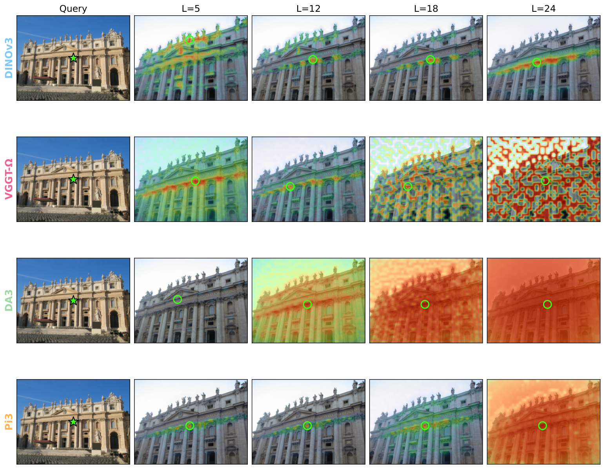
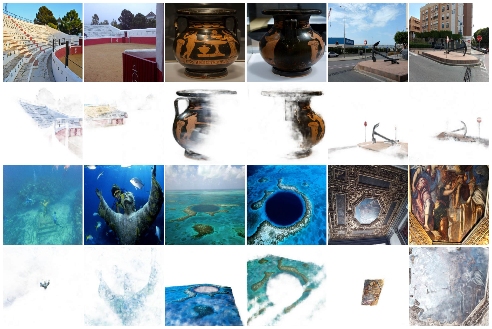

# RoMa-Ω 论文解读

> David Nordström、Xinyue Zhang、Thibaut Loiseau、Vincent Lepetit 与 Fredrik Kahl，*RoMa-Ω: What Feed-Forward 3D Models Know About Image Matching*，arXiv:2609.09507v1（2026 年 9 月 8 日）。论文研究前馈重建模型是否隐含图像对应能力，并将 VGGT-Ω 表征接入 RoMa v2。 [论文页面](https://arxiv.org/abs/2609.09507) · [论文 PDF](https://arxiv.org/pdf/2609.09507v1) · [官方代码](https://github.com/davnords/RoMa-Omega)

图像匹配器要从两幅图像中找出属于同一场景点的像素对应。传统流水线通常检测关键点、计算局部描述子，再在描述子空间中分配匹配；稠密匹配器则直接预测像素到像素的对应场，并给出匹配置信度。与此同时，DUSt3R、VGGT 一类前馈三维模型已经能从多张图像中联合预测点图、深度和相机。它们为了重建几何而学习的特征，是否也适合匹配？

这篇论文把问题拆成三层来检验：直接用中间特征做最近邻匹配；只训练轻量映射，测试特征里是否含有可读出的对应信息；最后把这些特征接入成熟的稠密匹配系统。结果呈现出一个关键区别：前馈重建特征的原始余弦相似度在深层会变得弥散，但轻量探测器仍能从中恢复很强的匹配能力。基于这一观察，作者将 VGGT-Ω 特征替换进 RoMa v2，得到 RoMa-Ω。

## 1 引言：重建表征能否服务于匹配

[RoMa](../roma/index.md) 和 [RoMa v2](../roma-v2/index.md) 是稠密匹配方法，核心之一是使用冻结的 DINO 特征来建立跨图像的粗对应，再由专门训练的模块完成匹配推理和坐标细化。另一方面，前馈重建模型在大规模多视图数据上训练，编码器通过跨视图推理支持三维点、深度与相机预测。[VGGT-Ω](../vggt-omega/index.md) 中的视觉骨干还针对 SfM 任务进行了适配，因此它的中间特征可能已经携带相机和场景几何所需的跨图像信息。

但“能用于重建”并不等于“特征相似度能直接当匹配分数”。重建网络的训练目标约束最终几何预测，不一定约束两个对应图像块的特征在向量空间中靠近。于是本文不仅比较谁的特征更好，还区分了特征信息本身与信息在特征空间中的组织方式。

## 2 图像匹配与前馈重建

传统稀疏匹配将问题拆成关键点检测、局部描述和对应分配；LoFTR 等无检测器方法把检测与描述流程合并，DKM、RoMa 及 RoMa v2 则推动了稠密对应估计。另一条路线从 DUSt3R、MASt3R 延伸到 VGGT 和 VGGT-Ω，让网络直接从图像对或多视图集合预测三维点图、深度与相机。近期重建模型也引入对应监督，使匹配与重建的边界更模糊。本文的切入点是考察这些三维模型已学得的表征，能否在不改骨干的情况下作为匹配特征使用。

## 3 前馈重建模型的特征

给定一组图像，前馈重建模型先由视觉编码器得到每幅图的 patch 特征，再经由交替的帧内注意力和全局跨视图注意力层形成中间表示。记第 $i$ 幅图在第 $\ell$ 层的特征为 $F_i^\ell$。通常，网络最后的特征送入重建头以预测三维量；论文则丢弃这些头，直接把不同层的 $F_i^\ell$ 当作稠密视觉描述子来检验。实验涉及 VGGT-Ω、π³、DA3，并以 DINOv3 为主要比较对象。

对图像 A 中查询位置 $u$，以及图像 B 的候选位置 $v$，作者计算两处特征的余弦相似度：

$$
C(u,v)=\frac{f_u^\top f_v}{\lVert f_u\rVert_2\,\lVert f_v\rVert_2}.
$$

若这个相似度图在真实对应处形成清晰峰值，就可以直接取最大值作为匹配。DINOv3 的深层特征通常会产生较局部的峰值；几种前馈重建模型则呈现不同趋势：层数增加后，相似度图更弥散，有时正确位置仍是全局最大值，但周围和其他位置的响应也变高，候选之间更难区分。

*原论文图 3。给定一处查询 patch，图中展示它与另一幅图各位置的特征相关性。DINOv3 深层响应较集中；前馈重建模型的后层响应逐渐扩散，说明原始相似度不一定能直接解码成可靠匹配。*

作者把这一现象与 DINOv3 中已讨论过的特征退化联系起来：深层特征可能更有利于整体任务表示，却不再保留适合直接比较的 patch 级几何。DINOv3 的训练含有 Gram anchoring 来维持 patch 相似关系；前馈重建模型则以重建效果为目标，没有同样的约束。论文将这种关系作为解释假设，而不是对特征退化成因的完整理论证明。

### 3.1 零样本匹配与线性探测

零样本匹配把上面的余弦相似度直接用于最近邻检索，即对每个查询位置选择 $\arg\max_v C(u,v)$。在 MegaDepth-1500 上以 PCK@32px 衡量对应是否落在 32 像素容差内，DINOv3 的直接匹配表现良好，而几种重建模型的深层特征表现明显下降，与相关图变弥散的现象一致。

随后，作者冻结骨干特征，只训练一个轻量探测器：先学习线性投影，将特征映射到匹配空间，再由小型解码器预测稠密对应场。这个设置仍然只训练很少的匹配参数，却允许模型重新组织特征维度和跨图像关系。结果趋势反转：重建模型后层表示在线性探测后大幅改善，并持续超过 DINOv3；其中 VGGT-Ω 最强，因而被选作后续实验的表征骨干。

这个对比区分了“特征向量原本就适合直接做余弦近邻”与“特征中存在可被小型读出器利用的信息”。结论支持后一种说法：深层特征的裸相似度不好用，但它们仍包含丰富的对应信息，匹配友好性需要由后续映射和解码器建立。文中所谓 linear probing 也包含小型稠密对应解码器，所以它测试的是冻结表示经轻量可训练读出后的可用性，而非单独一层线性分类器的能力。

### 3.2 放进完整稠密匹配器

线性探测器很小，现代匹配器则能进行更充分的跨图像推理。作者进一步取 RoMa v2 的粗匹配阶段，保持结构不变并冻结骨干，只替换 DINOv3 与 VGGT-Ω 特征；可训练部分是 Transformer 匹配解码器和 DPT 稠密预测头。这样可以比较两种骨干在同一匹配架构中的效果。

VGGT-Ω 特征在不同 Transformer 解码器深度下都优于 DINOv3。解码器越强，两者差距逐渐缩小，说明强解码器可以弥补部分骨干表征的不足；同时，解码器还没有抹平 VGGT-Ω 表征带来的优势。论文据此认为，前馈重建特征不仅能被轻量探测器读出，也能成为现代稠密匹配系统的更强底座。

## 4 RoMa-Ω：以 VGGT-Ω 替换匹配骨干

RoMa-Ω 的设计刻意保持简单：冻结 RoMa v2 的 DINOv3 骨干换成冻结的 VGGT-Ω 编码器，其余匹配流程沿用 RoMa v2。粗匹配器先提取两图特征，Transformer 解码器在两图之间交换信息，DPT 头预测粗 warp 与置信图；后续卷积细化器逐级提高空间分辨率并修正坐标。warp $W^{A\to B}(u)$ 表示图 A 中像素 $u$ 在图 B 中的预测对应位置，$P^{A\to B}(u)$ 表示该对应有效的置信度。

VGGT-Ω 是 24 层 Transformer，层内交替处理单帧信息与跨视图信息。模型从第 5、12、18、24 层抽取特征，并拼接相应的帧内 token 与跨视图 token 流，构成多层级表示。最深层特征再经过 RoMa v2 式的跨图像 Transformer 解码器更新：

$$
\widetilde F_i^{24}=F_i^{24}+D_\theta(F_A^{24},F_B^{24})_i.
$$

这里 $D_\theta$ 同时读取两幅图的第 24 层特征，输出属于图像 $i$ 的更新量，再以残差方式加回原表示。较浅的特征层不经过这一步更新。随后，更新后的深层特征被投影到匹配空间并计算相关性；DPT 头结合第 18、24 层特征和匹配嵌入，估计粗 warp 与置信度。预测再交给逐级细化器。这一流程让预训练几何骨干提供表征，匹配器承担明确的对应关系推理与像素级定位。

消融结果说明两部分都不可省略。只在 VGGT-Ω 特征上接 DPT 头时，匹配性能很弱；加回 Transformer 解码器后性能大幅恢复。经过层选择后，只用第 18、24 层优于使用更多层；让 DPT 直接处理 2048 维全宽特征反而略差。因此最终模型不是把整个大骨干不加调整地塞给预测头，而是选择匹配表现较好的层，并保留跨图像解码能力。

*原论文图 2。HardMatch 图像对包含显著视点和光照变化；图中对应结果展示 RoMa-Ω 在这类外观差异下估计稠密对应的能力。*

## 5 直接使用三维预测能匹配到什么程度

在训练专用匹配器之前，论文先检验 VGGT-Ω 的原始几何输出。实验比较两种从图像 A 到图像 B 提取对应的方式：用预测深度和相机把像素投影到另一视图；或在两幅图的预测三维点之间搜索互为最近邻。得到对应后，使用本质矩阵求解器和 RANSAC 恢复相对位姿；作为参照，也直接比较 VGGT-Ω 预测的两台相机。

在 ScanNet-1500 上，深度 warp 的相对位姿 AUC@5°、AUC@10°、AUC@20° 分别为 34.2、57.6、74.8，与直接读取预测相机的 34.2、57.6、74.9 几乎相同。三维点互为最近邻则只有 22.7、43.0、59.5。前两项也略高于论文报告的 VGGT 原始跟踪流程和 RoMa v2。这里的证据表明，预测深度与相机能建立有用的跨视图几何对应；简单地在预测点图里做最近邻，效果则明显弱一些。

这种直接匹配能力有明确边界。VGGT-Ω 在几何变化较强的 RUBIK 上仍取得 84.3 AUC@20°，但在包含极端光照、视点或模态变化的 WxBS 和 HardMatch 上分别只有 29.0、20.2 mAA@10px。作者将差异归因于重建模型训练时常从视频采样相邻帧，因而经常看到时间上接近、相对容易匹配的视图。面对大分布偏移，裸几何预测不足以取代专门匹配训练，这也解释了 RoMa-Ω 为什么需要完整的匹配解码和细化模块。

## 6 实验结果

在极端匹配基准 WxBS 上，RoMa-Ω 的 mAA@10px 为 72.9，高于 RoMa v2 的 64.8，也略高于 RoMa 的 72.6。HardMatch 上三者分别为 50.0、46.5、48.1；RUBIK 的 AUC@20° 分别为 88.0、85.6、75.4。因而与 RoMa v2 相比，RoMa-Ω 在 WxBS、HardMatch、RUBIK 上的提升分别是 8.1 mAA、3.5 mAA 和 2.4 AUC。

视觉定位 Map-free 测试集上，VCRE 小于 45px 时的 AUC 从 RoMa v2 的 79.4 提升到 81.7。稠密匹配实验中，RoMa-Ω 在六个数据集中的五个优于 RoMa v2；例外是含有动态场景的 FlyingThings3D，RoMa-Ω 的 EPE 为 1.07，略高于 RoMa v2 的 0.93。整体结果支持它在多种匹配场景中的提升，但动态场景仍是一个具体弱点。

性能提升需要付出显著计算代价。以 A100、输入 $560\times560$、batch size 8 测量，RoMa-Ω 吞吐为每秒 12.1 对，RoMa v2 为 21.6 对；峰值显存分别为 29.9 GB 和 4.0 GB。RoMa-Ω 的总参数约 1.033B，其中可训练参数 125M；RoMa v2 总参数约 425M，可训练参数 122M。也就是说，额外成本主要来自冻结的 VGGT-Ω 骨干，训练参数规模只略有增加。论文报告粗匹配器训练 500K 步、16 张 A100 约两天，细化器训练 300K 步、8 张 A100 约两天。补充材料还记录了约 150K 步后训练可能出现梯度范数暴涨和损失上升；作者以梯度均值跟踪并跳过大于均值三倍的异常更新，同时轻微衰减学习率来稳定训练。

## 7 方法边界与核心认识

论文的主要实验集中在 VGGT-Ω，尽管研究问题指向更广泛的前馈三维模型；而且 RoMa-Ω 的高精度伴随很高的显存和计算开销。直接把几何输出转成对应，在中等视点和相近模态变化下已经有竞争力，但遇到极端外观域偏移会明显退化。作者也指出，反向问题——图像匹配器本身学到了什么重建能力——仍未在本文展开。

这项工作的中心结论，是“有对应信息”与“直接用相似度能找出对应”是两件事。重建模型要让多视图的几何预测一致，因而中间表示可以含有匹配线索；但优化目标没有要求相邻图像块必须在余弦空间中形成尖锐、可检索的峰值。轻量探测器或完整匹配器可以把这类信息转成合适的对应表示。RoMa-Ω 的实验进一步显示，VGGT-Ω 特征在专用解码器和匹配训练下不只是可用，在多个困难基准上还优于 DINOv3 骨干。代价则提醒我们，这种优势来自更大的、面向三维推理的编码器，是否适合部署还要由速度、显存预算和目标数据分布共同决定。

对三维视觉而言，图像匹配与前馈重建并非割裂任务：重建模型的跨视图表征可以为匹配提供更好的起点，匹配器则把隐式几何线索转化为显式稠密对应。论文将这两条路线接在同一个系统里，并通过从裸特征、线性探测到完整匹配器的逐层实验，展示了每一级训练和解码究竟带来了什么。
