# RoMa-Ω 论文解读

> David Nordström、Xinyue Zhang、Thibaut Loiseau、Vincent Lepetit 与 Fredrik Kahl，*RoMa-Ω: What Feed-Forward 3D Models Know About Image Matching*，arXiv:2609.09507v1（2026 年 9 月 8 日）。论文研究前馈三维重建模型的表征与几何预测能否用于图像匹配，并将 VGGT-Ω 特征接入 RoMa v2。 [论文页面](https://arxiv.org/abs/2609.09507) · [论文 PDF（v1）](https://arxiv.org/pdf/2609.09507v1) · [官方代码](https://github.com/davnords/RoMa-Omega)

稠密图像匹配要为图像 A 中的像素预测图像 B 中的对应位置，并估计该对应是否可信。[RoMa](../roma/index.md) 使用冻结的 DINOv2 特征，[RoMa v2](../roma-v2/index.md) 使用冻结的 DINOv3 特征，再由训练得到的匹配模块完成跨图像推理和坐标细化。与此同时，[VGGT-Ω](../vggt-omega/index.md) 等前馈重建模型会联合处理多视图图像，预测深度、三维点图与相机。Nordström 等人关心的是：这些为重建学习的中间特征和几何输出，已经包含多少可用的图像对应信息？论文有时用 DINO 泛指 DINOv2 与 DINOv3，但所报告的特征比较实验均以 DINOv3 为基线。

论文沿三个层次回答这个问题：直接用特征余弦相似度做最近邻匹配；冻结特征、训练轻量读出模块，检查表示中是否含有可读出的匹配信息；最后将 VGGT-Ω 特征接入 RoMa v2 的稠密匹配架构。实验呈现出一个重要区别：重建模型的深层特征不适合直接用余弦相似度检索，但经过轻量探测器后能支持准确匹配；若直接使用 VGGT-Ω 的深度和相机，也能得到有竞争力的几何对应，不过在极端视点、光照或模态变化下会退化。作者据此以 VGGT-Ω 替换 RoMa v2 的 DINOv3 骨干，构成 RoMa-Ω。

## 重建特征中有匹配信息，但相似度不够集中

传统稀疏匹配依次检测关键点、描述局部外观并分配对应。LoFTR 等无检测器方法合并了检测与描述流程；DKM、RoMa 和 RoMa v2 则直接估计稠密对应。另一条路线由 DUSt3R、MASt3R 延伸到 VGGT 与 VGGT-Ω：模型从一组图像联合推理场景几何。近期重建模型也引入对应监督，使匹配与重建之间的边界逐渐变模糊。这篇论文检验的正是这类重建模型已经学到的视觉表征，能否在冻结骨干后用于图像匹配。

给定图像集合，每幅图先由视觉编码器转换为 patch 特征，再经交替的帧内注意力与跨视图注意力层处理。记第 $i$ 幅图在第 $\ell$ 层的特征为 $F_i^\ell\in\mathbb R^{P\times C}$，其中 $P$ 是 patch 数量，$C$ 是特征维数。通常，最后一层特征会送入重建头预测几何；这篇论文丢弃重建头，直接评估 VGGT-Ω、π³、DA3 不同层的特征，并以 DINOv3 为主要比较对象。

对图像 A 的查询位置 $u$，作者计算它与图像 B 中所有候选位置 $v$ 的余弦相关性：

$$
C(u,v)=\frac{f_u^\top f_v}{\lVert f_u\rVert_2\,\lVert f_v\rVert_2}. \tag{1}
$$

若特征适合直接匹配，真实对应附近应形成清晰峰值，其他候选的响应相对较低。论文图 3 显示，DINOv3 的相关峰随网络加深而更具区分性；几种重建模型的深层相关图则更弥散。真实对应有时仍是全局最大值，但许多其他位置也得到较高响应，单靠最大相似度较难可靠地定位对应。

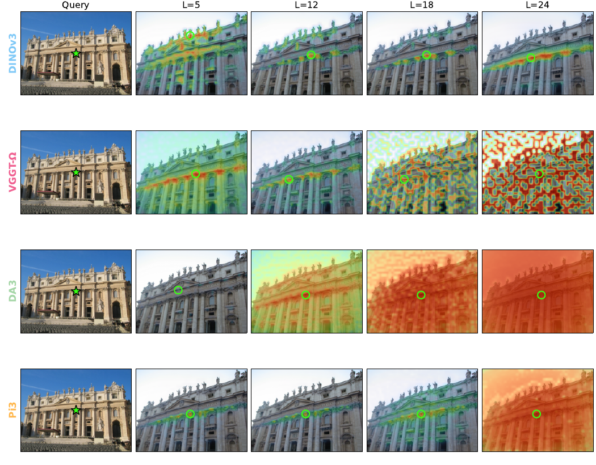

*原论文图 3。绿色星号是查询 patch，绿色圆圈标记相关图中的最大值。DINOv3 深层响应较集中；VGGT-Ω、DA3 和 π³ 的后层响应逐渐扩散。*

作者还观察 VGGT-Ω 的全局注意力图。注意力峰在中间层较容易对应到另一幅图中的相关区域，最深层的分布则更难解释。这与特征相关图的观察相近，但注意力图和特征余弦相似度是两种不同量，不能把前者直接当作匹配结果。

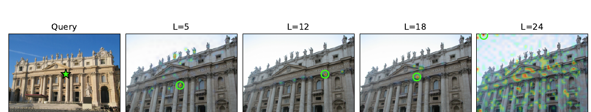

*原论文图 4。注意力图也含有一定匹配线索，其中间层的峰比最后一层更容易解释。*

论文将这种后层弥散与 DINOv3 文献中讨论的稠密特征退化联系起来，并提出一种解释：DINOv3 使用 Gram anchoring 维持 patch 间的相似关系，而重建模型主要优化跨视图几何一致性，没有同样的约束。作者把这作为解释特征相似度变化的假设，并未将其证明为退化的唯一原因。

### 轻量探测器检验信息是否可读出

零样本设置直接从特征空间取最近邻：

$$
\hat v(u)=\arg\max_v C(u,v). \tag{2}
$$

作者在 MegaDepth-1500 上用 PCK@32px 评价预测对应。该指标衡量预测点是否落在真值对应周围 32 像素的容差范围内。DINOv3 的原始特征在最近邻设置下表现较好；重建模型的后层则显著下降，与前述相关图变弥散相符。

接着，作者冻结所有骨干特征，只训练一个线性投影和小型稠密对应解码器。投影把原始特征映射到匹配空间，解码器再根据两幅图的表示预测稠密对应场。论文称这项设置为 linear probing；它测量的是冻结表示经轻量可训练读出后的匹配能力。

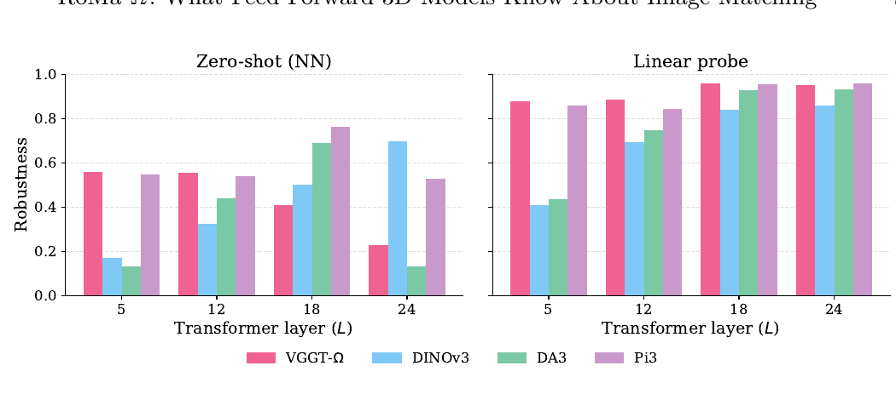

*原论文图 5。MegaDepth-1500 上的 PCK@32px。左图为直接最近邻，右图为线性探测；重建特征的后层在左图退化，在右图中则恢复出较强的匹配表现。*

线性探测后，几种重建模型的后层特征均明显改善并超过 DINOv3；其中 VGGT-Ω 表现最好，因而被选作后续完整匹配器的骨干。这个结果支持一个范围明确的结论：对应信息存在于这些表示中，但没有自然组织成可由原始余弦相似度直接检索的形式。

### 加入跨图像解码器

轻量探测器只能有限地重组特征。为了评估这些表示在成熟匹配架构中的作用，作者采用 RoMa v2 的粗匹配阶段：冻结视觉骨干提取两幅图的特征，训练 Transformer 解码器在两图之间传递信息，再由 DPT 预测头输出稠密对应场。比较 DINOv3 和 VGGT-Ω 时，除骨干外保持其余架构一致，只训练解码器和预测头。

在 Hypersim 与 ETH3D 上，作者改变 Transformer 解码器的层数。VGGT-Ω 特征在所有测试深度下都优于 DINOv3；解码器加深后差距缩小，说明更强的跨图像推理可以弥补部分骨干差异，但尚未完全消除 VGGT-Ω 的优势。

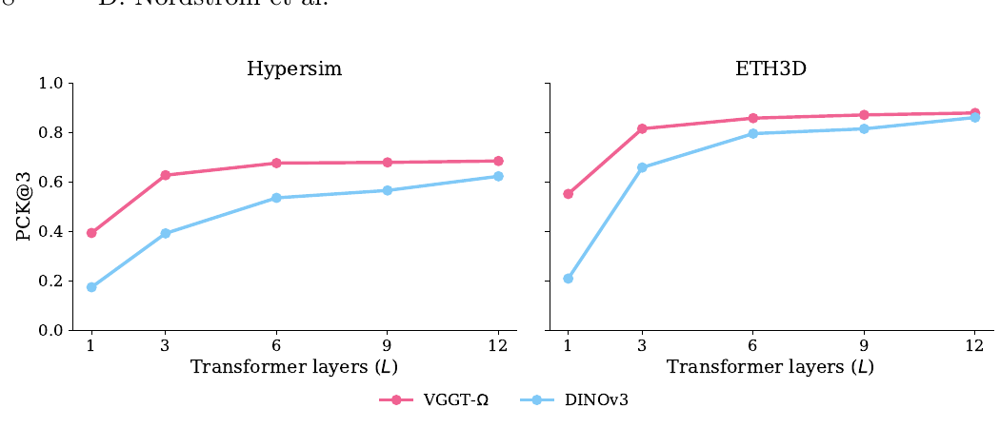

*原论文图 6。两组数据集均显示 VGGT-Ω 骨干在不同解码器深度下优于 DINOv3。*

## RoMa-Ω 用冻结的 VGGT-Ω 替换 DINOv3

稠密匹配器输出从 A 到 B 的 warp $W^{A\to B}$，以及匹配置信度图 $P^{A\to B}$。对图像 A 中的像素 $u$，$W^{A\to B}(u)$ 给出它在图像 B 中的预测对应位置；$P^{A\to B}(u)$ 估计这个对应是否有效，训练监督来自两图间的共同可见区域。

RoMa 将匹配分为粗匹配和逐级细化：冻结视觉特征经 Transformer 匹配解码器完成跨图推理，粗预测头给出初始 warp 与置信度；卷积细化器再逐步提高空间分辨率、调整对应坐标。RoMa v2 将粗匹配器和细化器分开训练。RoMa-Ω 沿用 RoMa v2 的其余架构、预测头、损失和训练方式，只将冻结的 DINOv3 骨干替换为冻结的 VGGT-Ω，从而比较骨干表示带来的影响。

VGGT-Ω 包含 24 层 Transformer，交替处理单帧特征和跨视图特征。作者从第 5、12、18、24 层抽取 patch 表示，并拼接对应的帧内与跨视图 token 流，构成多层特征。最深层特征先经过 RoMa v2 式的可训练跨图像解码器：

$$
\widetilde F_i^{24}=F_i^{24}+D_\theta(F_A^{24},F_B^{24})_i. \tag{3}
$$

$D_\theta$ 同时读取 A、B 两幅图的第 24 层特征，并为图像 $i$ 输出更新量；更新量以残差方式加回原特征。第 5、12、18 层不经过这一步解码。随后，最深层特征被投影到匹配空间并计算相关嵌入；DPT 预测头使用第 18、24 层特征和匹配嵌入，预测粗 warp 与置信度，再由细化器逐级调整。

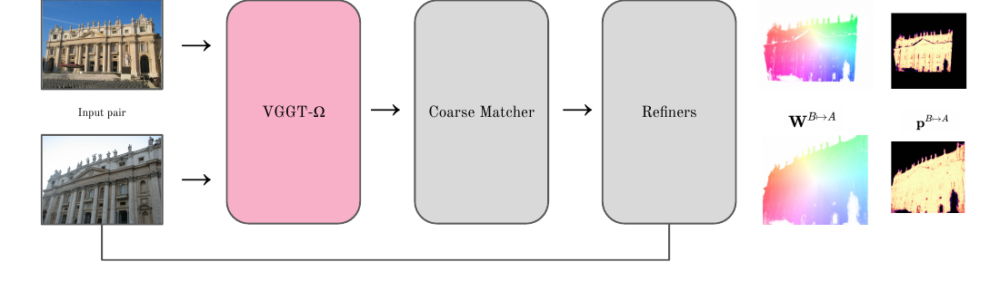

*原论文图 7。VGGT-Ω 提取的特征进入粗匹配器，预测结果经细化器输出双向 warp 与置信度图。*

架构消融说明，冻结的 VGGT-Ω 表征需要匹配推理才能发挥作用。只把特征交给 DPT 头时，性能很低；加入 Transformer 解码器后，结果明显恢复。再只保留第 18、24 层，粗匹配表现进一步提高；直接把 2048 维全宽特征交给 DPT 则略差。最终配置保留跨图像解码，并选择匹配效果较好的特征层。

训练时，粗匹配器使用多种分辨率和宽高比，细化器统一使用 $640\times640$ 图像；两者学习率均为 $4\times10^{-4}$。粗匹配器训练 500K 步、批量大小 128，在 16 张 A100 上约需两天；细化器训练 300K 步、批量大小 64，在 8 张 A100 上也约需两天。训练样本来自多种三维视觉数据集，具体采样权重见补充材料中的表 7。

## 原始几何预测能提供什么对应

完整匹配器训练之前，作者先直接使用 VGGT-Ω 预测的几何量。深度 warp 先按预测深度把图像 A 的像素反投影到相机坐标系，再利用两幅图的相机位姿变换到图像 B 的坐标系并投影回像面，由此得到对应位置。另一种方法则在两幅图的预测三维点之间寻找互为最近邻。随后以本质矩阵求解器和 RANSAC 从这些对应恢复相对位姿。作为参照，实验还直接读取 VGGT-Ω 预测的相机位姿。

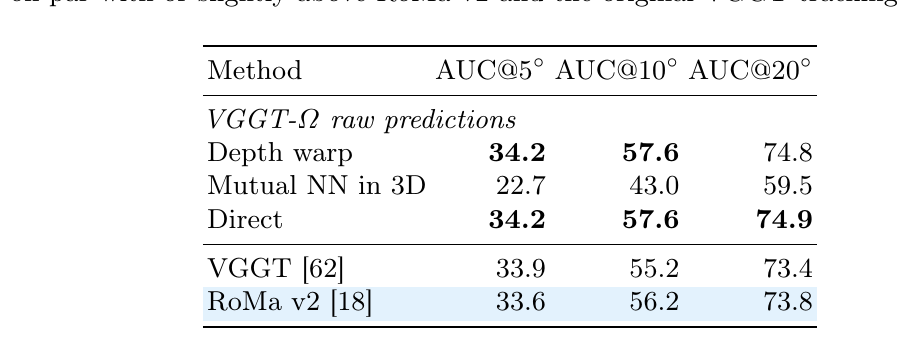

*原论文表 1。数值为 ScanNet-1500 上的相对位姿 AUC。表中三种 VGGT-Ω 原始预测方法分别是深度 warp、三维互近邻和直接读取相机位姿。*

在 ScanNet-1500 上，深度 warp 的 AUC@5°、AUC@10°、AUC@20° 为 34.2、57.6、74.8；直接读取相机为 34.2、57.6、74.9，两者几乎相同。三维互近邻明显较低，为 22.7、43.0、59.5。深度 warp 和相机直接预测也略高于原始 VGGT 跟踪流程与 RoMa v2。由此可见，原始深度与相机已经可以建立有用的跨视图几何对应，而在点图上做简单互近邻并不够稳健。

这种能力受视点与外观变化限制。表 2 中，VGGT-Ω 原始预测在几何挑战较强的 RUBIK 上达到 AUC@20° 84.3；在 WxBS 和 HardMatch 上，mAA@10px 则分别为 29.0 和 20.2。作者推测，前馈重建模型的训练数据常由视频相邻帧构成，因此容易匹配相近视图；这或许解释了面对极端照明和模态变化时的退化。实验结果显示，极端变化场景仍需要专用匹配训练来提升鲁棒性。

## 多种匹配与定位基准

RoMa-Ω 在 WxBS 上达到 72.9 mAA@10px，高于 RoMa v2 的 64.8，也略高于 RoMa 的 72.6。在包含 1000 对、100 个类别的 HardMatch 上，RoMa-Ω 得到 50.0，高于 RoMa v2 的 46.5 和 RoMa 的 48.1。在 RUBIK 上，RoMa-Ω 的 AUC@20° 为 88.0，比 RoMa v2 的 85.6 高 2.4。表 2 也列出 VGGT-Ω 原始几何预测作为对照；其在三个基准上的数值不能与训练后的 RoMa-Ω 混为一谈。

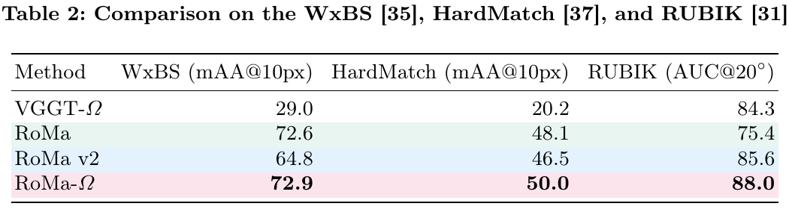

*原论文表 2。WxBS 和 HardMatch 使用 mAA@10px，RUBIK 使用位姿 AUC@20°。*

论文图 2 展示来自 HardMatch 的多组定性结果，图像对覆盖不同视点和光照变化。模型在这些场景中的总体表现由表 2 的定量指标补充。

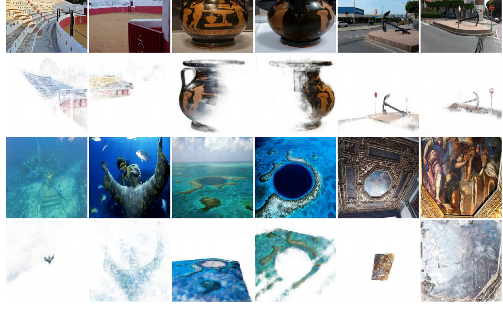

*原论文图 2。图中示例来自 HardMatch，展示 RoMa-Ω 在不同视点和光照条件下处理图像对的定性结果。*

Map-free 视觉定位基准要求模型在只有一张参考图、没有地图的条件下估计相机的米制位置。论文使用 DA3 提供单目米制深度，并在官方测试集报告 VCRE 阈值下的精确率和 AUC。阈值小于 45px 时，RoMa-Ω 的 AUC 为 81.7，RoMa v2 为 79.4；阈值小于 90px 时，两者分别为 94.5 与 93.3。这里的数值属于基于匹配结果和 DA3 深度的定位流程，不是仅由 RoMa-Ω 单独输出的相机位姿。

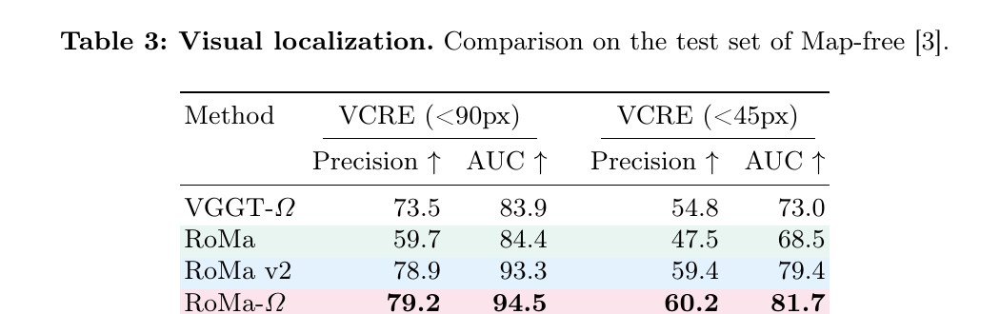

*原论文表 3。VCRE 分别按小于 90px 和小于 45px 的阈值报告精确率与 AUC。*

稠密匹配实验将图像缩放至 $640\times640$，报告端点误差 EPE（越低越好）和 1、3、5 像素阈值下的正确匹配比例（越高越好）。RoMa-Ω 在六个数据集中的五个优于 RoMa v2。以 MegaDepth 为例，EPE 从 1.47 降至 0.97，PCK@1px 从 79.6 提至 81.7；在 AerialMegaDepth 上，EPE 从 4.12 降至 2.61，PCK@5px 从 87.9 提至 91.8。例外是动态场景较多的 FlyingThings3D：RoMa-Ω 的 EPE 为 1.07，高于 RoMa v2 的 0.93，三个 PCK 阈值下也略低。结果显示改进覆盖多个场景，但动态数据仍是具体弱点。

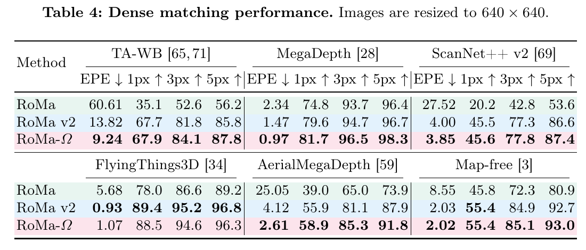

*原论文表 4。表中按数据集报告 EPE 与不同像素容差下的正确匹配比例。*

## 计算成本与结构消融

在 A100、输入 $560\times560$、批量大小 8 的测量条件下，RoMa-Ω 吞吐为每秒 12.1 对，RoMa v2 为 21.6 对，约慢 44%；峰值显存分别为 29.9 GB 与 4.0 GB。RoMa-Ω 总参数约 1.033B，其中可训练参数 125M；RoMa v2 总参数约 425M，其中可训练参数 122M。可训练参数规模相近，额外计算与显存主要来自冻结的 VGGT-Ω 骨干。论文还报告 RoMa 的吞吐为每秒 12.7 对，因此 RoMa-Ω 的吞吐与 RoMa 接近，但显存需求显著更高。以上是指定硬件、尺寸和批量下的测量，不应直接视作其他设备的延迟。

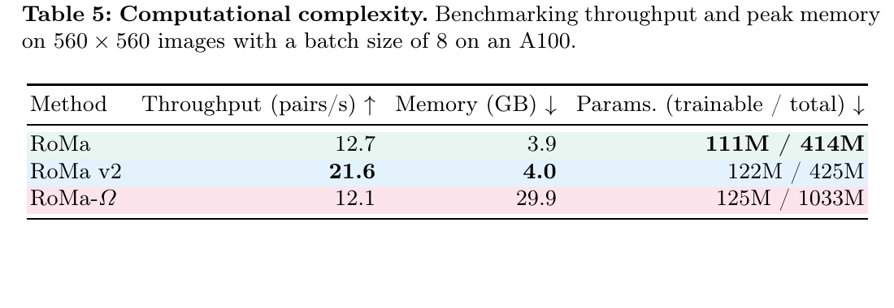

*原论文表 5。硬件为 A100，输入分辨率 $560\times560$，批量大小为 8。*

表 6 在 Hypersim 与 ETH3D 上比较粗匹配器训练 100K 步后的 PCK。仅用 VGGT-Ω 骨干和 DPT 预测头时，结果显著低于重训后的 RoMa v2 基线；加回 Transformer 解码器后，性能大幅恢复。选择第 18、24 层后，RoMa-Ω 配置在两组数据及三个像素阈值上都优于表中其他变体。将全宽 2048 维特征直接交给 DPT 又使结果回落。这组消融表明，收益来自骨干表征与匹配解码、层选择的配合，而不是单独换一个特征提取器。

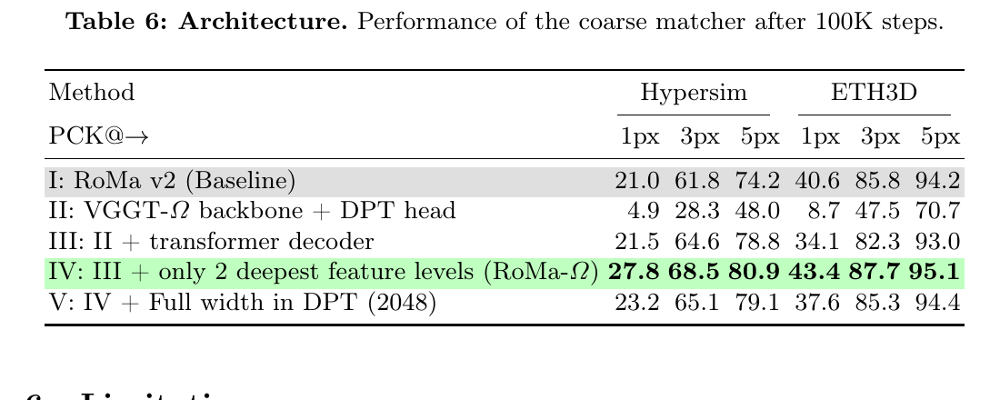

*原论文表 6。表中报告 Hypersim 和 ETH3D 上的 PCK；所有变体均比较粗匹配器训练 100K 步后的表现。*

## 补充材料中的训练稳定性与数据

补充材料记录了训练不稳定现象：使用 VGGT-Ω 骨干重训 RoMa v2 时，约 150K 步后梯度范数可能暴涨、损失开始上升。作者跟踪梯度的指数滑动平均（EMA），跳过范数超过该 EMA 三倍的异常梯度更新，并逐步轻微衰减学习率。图 8 显示，不跳过异常更新时曲线随后塌陷；采用这两项措施后，训练保持稳定，整段训练共跳过 40 次更新。

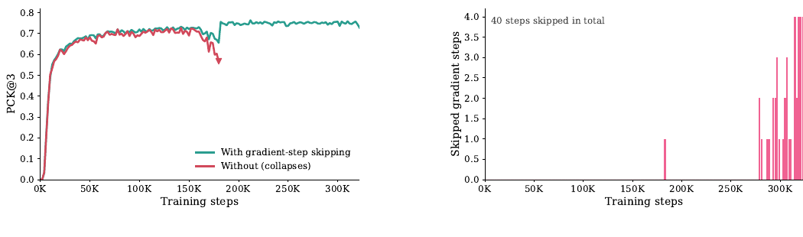

*原论文补充材料图 8。左图比较启用与关闭梯度跳过时的训练曲线，右图标出被跳过的更新。*

为公平比较，作者还用相同训练数据重训 RoMa v2，并在 Hypersim、ETH3D 上对照两种骨干随训练步数变化的评估结果。图 9 显示，VGGT-Ω 骨干对应的 RoMa-Ω 曲线在这两个数据集上均高于重训的 RoMa v2 曲线。补充材料表 7 则列出训练数据及采样权重：主要数据集权重为 1，涵盖室内、航拍、户外、物体中心场景和合成图形；部分数据权重设为 0.1、0.5 或 0.01。

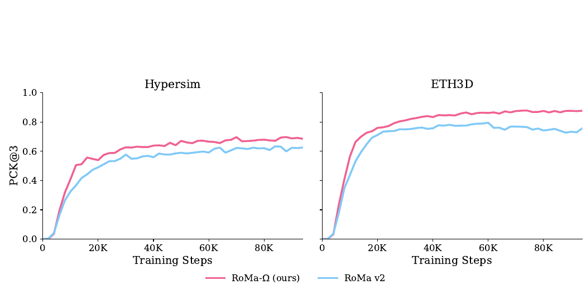

*原论文补充材料图 9。作者在相同训练数据上重训 RoMa v2，并比较 Hypersim 与 ETH3D 上的评估曲线。*

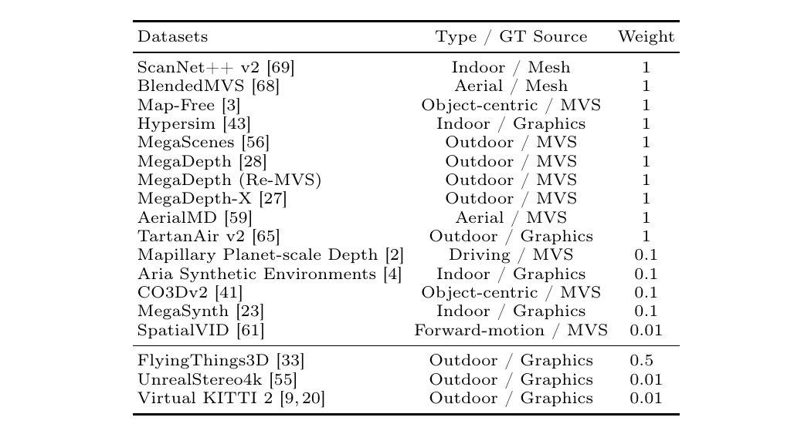

*原论文补充材料表 7。数据覆盖网格、多视图立体、图形学等真值来源，权重体现各数据集在训练混合中的相对采样比例。*

## 方法边界与核心认识

论文把研究范围扩展到前馈三维模型，但大规模下游实验主要集中在 VGGT-Ω；图像匹配器自身能学到何种重建能力这一反向问题，作者留待后续研究。RoMa-Ω 在多项基准上提高了匹配和定位结果，但推理吞吐与显存成本也明显增加。原始几何预测在中等视点变化下已能提供可用对应，面对极端外观域偏移时则明显退化。

贯穿论文的区分是：表示里含有对应线索，不代表原始相似度就能直接把它找出来。重建模型训练目标要求跨视图几何预测一致，却没有要求每对对应 patch 在余弦空间里形成尖锐峰值；轻量投影与解码器可以重新组织这些线索，完整匹配器则进一步利用跨图像推理和像素级细化。RoMa-Ω 的结果表明，VGGT-Ω 特征在匹配专用训练下能成为强骨干，在多个困难基准上超过 RoMa v2，同时带来较高计算成本。对三维视觉而言，前馈重建与稠密匹配可以共享跨视图表征，匹配器把其中的几何线索转成显式对应；部署时是否值得采用，则取决于精度需求与算力、显存预算。
