# RoMa v2 论文解读

> Johan Edstedt、David Nordström、Yushan Zhang 等，*RoMa v2: Harder Better Faster Denser Feature Matching*，arXiv:2511.15706v2（2025 年 11 月 20 日）。[论文页面](https://arxiv.org/abs/2511.15706v2) · [论文 PDF](https://arxiv.org/pdf/2511.15706v2) · [官方代码](https://github.com/Parskatt/romav2)。RoMa v2 延续了 [RoMa 论文](../roma/index.md) 的稠密匹配路线，重点改进粗匹配器、训练数据、精化效率，并增加像素级误差协方差预测。

给定同一场景的两张图像，稠密匹配器为源图像中的像素预测目标图像中的对应位置，同时估计该点是否在两张图里都可见。RoMa 已经能借助冻结的 DINOv2 特征应对外观变化，但其粗匹配器缺少两张图之间的显式交互，细化阶段又耗时、占用较多显存。RoMa v2 的核心改动是把粗匹配改成带多视角上下文的 Transformer，并把粗尺度预测提高到四分之一分辨率；随后用 stride 4、2、1 的精化器修正坐标。训练上，它先单独训练匹配器，再冻结匹配器训练精化器，并用跨场景、跨基线的数据混合兼顾大视角稳健性与小视差精度。

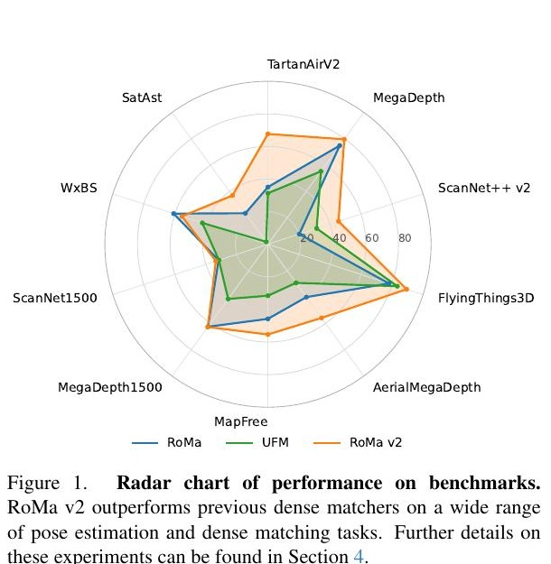

*原论文图 1 汇总了 RoMa、UFM 和 RoMa v2 在位姿估计与稠密匹配基准上的表现。不同任务的量纲和难度并不相同，雷达图主要用于概览各基准上的相对趋势。*

## 1 引言

图像匹配是相对位姿估计、视觉定位和三维重建的基础。稀疏匹配器先找关键点，再匹配局部描述子；无检测器方法在较密的网格上直接找对应；稠密匹配则对图像里的每个位置预测 warp 和可匹配性。稠密输出便于下游按置信度抽样，也能给后续几何估计留下更多候选。

RoMa v2 的出发点是把 RoMa 与 UFM 的长处放在同一模型里。RoMa 的冻结基础模型特征在极端外观变化下较稳健，且能达到亚像素精度；但原文指出，它在 RUBIK 等极端视角变化场景中仍有困难，运行速度也有限。UFM 推理较快，但需要微调特征骨干，在 WxBS 这类外观变化很大的场景上弱于 RoMa；它在 MegaDepth-1500 上的亚像素表现也较差。RoMa v2 想同时保留宽基线鲁棒性、细粒度精度和可用的速度与显存占用。

下方原论文图 2 集中展示了多个基准的匹配样例。每对输入图像下方的彩色图是 dense warp：源图像中的像素按预测对应点从另一幅图像取色，越亮的位置代表模型给出的 warp 置信度越低。整幅图覆盖室内外场景、宽基线视角变化和不同外观。

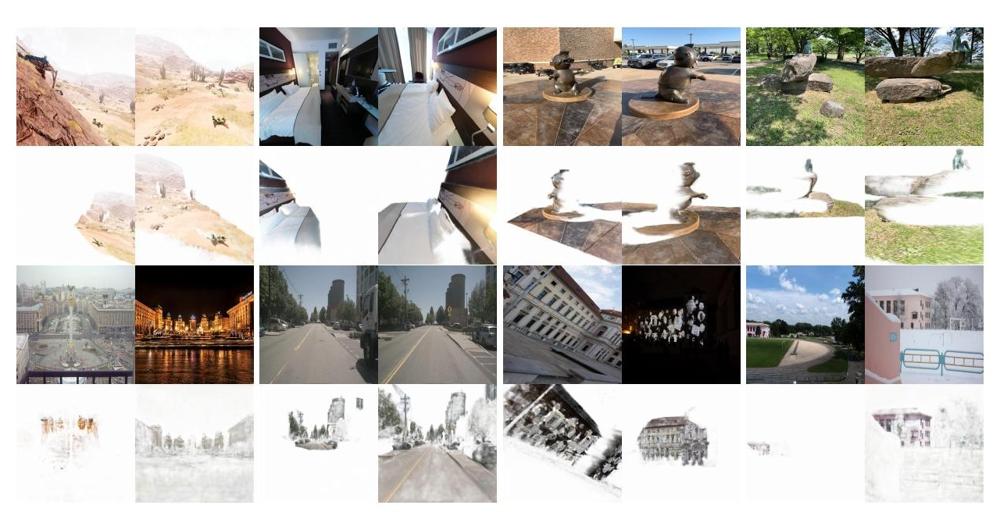

## 2 相关工作

RoMa v2 仍属于 detector-free 的稠密匹配器。DKM 通过多尺度特征匹配和局部细化生成密集对应；RoMa 将冻结的基础模型特征用于粗匹配，以提高面对季节、光照和模态变化时的泛化；UFM 将宽基线匹配与光流训练结合，得到更轻快的推理流程。RoMa v2 保留“先粗匹配，再细化”的问题分解，但修改粗阶段的匹配表示和监督，并在细阶段削减不必要的尺度计算。

前馈三维重建模型（如 DUSt3R、MASt3R、VGGT）也能从图像对估计空间关系，提供一定程度的对应信息。论文的侧重点不同：RoMa v2 仍直接输出显式的稠密二维 warp，并通过精化器提高到亚像素精度，而不是以点图或相机作为主要预测对象。

## 3 方法

### 3.1 两阶段架构与训练

模型输出两个方向的稠密 warp：$W^{A\mapsto B}$ 把图像 A 中的位置映射到 B，$W^{B\mapsto A}$ 则反向映射；每个方向还输出可匹配性 $p\in[0,1]$。预测分为粗匹配和精化两部分。粗匹配为每个位置提出一个大致对应；精化器在已有 warp 的基础上逐级修正偏移，使最终对应落到像素级乃至亚像素级。

训练也按这条数据流拆成两个独立阶段。先训练粗匹配器 300k 步，batch size 为 128、学习率为 $4\times10^{-4}$，约看过 3800 万个图像对；再冻结匹配器，以推理模式产生粗 warp，训练精化器 300k 步，batch size 为 64、学习率同为 $4\times10^{-4}$，约看过 1900 万个图像对。相较于联合训练，这种拆分使精化器看到的粗预测分布固定，也让作者可以分别调试两部分。

### 3.2 多视角粗匹配器

#### DINOv3 特征与跨图像上下文

粗编码器从 DINOv2 升级到冻结的 DINOv3 ViT-L。论文比较了两种冻结特征：在特征上训练单个线性层，再用核最近邻匹配。MegaDepth 上，DINOv3 的端点误差从 27.1 降到 19.0，误差小于 32 像素的匹配比例从 77.0% 升到 86.4%，尽管它的 patch 边长从 14 增至 16。

| 冻结特征 | EPE ↓ | 误差低于 32 像素的比例 ↑ |
| --- | ---: | ---: |
| DINOv2 | 27.1 | 77.0% |
| DINOv3 | **19.0** | **86.4%** |

主模型在 DINOv3 的第 11 和第 17 层取特征，每层 1024 维；两层拼接后经线性投影进入 768 维的 ViT-B 多视角 Transformer。

RoMa 的粗匹配使用高斯过程回归与单视图 Transformer 解码器。它能根据单张图像上下文解释局部特征，但两张图的特征没有经过显式联合交互。把多视角 Transformer 简单接在高斯过程之前并没有奏效：作者报告高斯过程的反向梯度不足以提供有效的训练信号，还会导致训练不稳定。因此 RoMa v2 以单头注意力机制替换粗阶段的高斯过程，并在两张图的特征间交替执行两种注意力：逐帧注意力只处理各自图像，并使用归一化轴向 RoPE；全局注意力把两帧 token 放在一起交互，不使用位置编码。

#### 相关性监督和坐标回归

经过多视角 Transformer 的两组特征形成相似度矩阵 $S\in\mathbb{R}^{M\times N}$，其中 $M,N$ 是图像 A、B 的 patch 数。对 A 中每个 patch，作者在 B 的所有 patch 上做 softmax，并把离真值 warp 最近的 patch 作为目标 $n^*$：

$$
\mathcal{L}_{\mathrm{NLL}}=\sum_{m=1}^{M}-\log\left(\operatorname{Softmax}(S_m)_{n^*}\right).
$$

这项损失直接要求特征相似度把正确目标 patch 排到前面，可看作方向化的稠密匹配分类目标。仅有相关性仍不能提供最终精确坐标，因此 DPT 解码头还根据匹配嵌入、DINO 特征和位置编码回归 warp，并预测重叠置信度。作者在 HyperSim 留出场景上比较了 RoMa v2 与 UFM 的粗匹配器：

| 方法 | PCK@1px ↑ | PCK@3px ↑ | PCK@5px ↑ |
| --- | ---: | ---: | ---: |
| UFM | 11.2 | 48.3 | 67.4 |
| RoMa v2 | **30.5** | **76.7** | **86.7** |

粗匹配总损失为

$$
\mathcal{L}_{\mathrm{matcher}}=
\mathcal{L}_{\mathrm{NLL}}+
\mathcal{L}_{\mathrm{warp}}(r_{\theta},p_{\mathrm{GT}})+
10^{-2}\mathcal{L}_{\mathrm{overlap}}(p_{\theta},p_{\mathrm{GT}}).
$$

其中 warp 项是精化阶段也会使用的稳健回归损失，重叠项监督像素是否在两视图中共可见。相较于 RoMa 的锚点分类式回归目标，这里显式加入了跨图像相关性目标，再把坐标回归作为并行监督。

#### stride 4 的粗 warp

DPT 头将输出预测到 stride 4，也就是输入宽高的四分之一；RoMa 原先的粗尺度为 stride 14。更密的粗 warp 缩短了后续需要修正的距离，也让精化可以从 stride 4 起步，而不必再在 stride 16 附近处理粗略预测。多尺度头融合冻结 DINO 特征、跨视图注意力输出和 match embedding，以同时利用语义特征与对应位置分布。

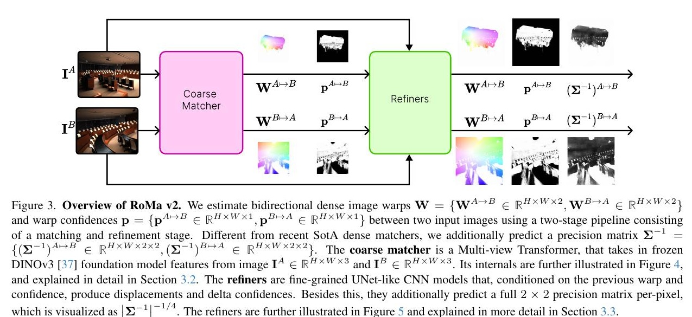

*原论文图 3 展示完整的双向匹配流程：粗匹配器输出双向 warp 和置信度，精化器再逐级更新 warp、置信度和像素级精度矩阵。*

论文附录给出具体维度：DINO 两层特征拼接成 2048 维并投影到 768 维；ViT-B 多视角 Transformer 深度 12、12 个注意力头、FFN ratio 为 4，最后映射回 1024 维以接入 DPT。两图输出特征的余弦相似度以温度 $\tau=0.1$ 缩放并指数化，乘以目标图像的随机傅里叶位置编码，得到 match embedding。位置编码使用固定频率 $\omega=1$。DPT 的 scratch 通道数为 256，各级输出通道为 256、512、1024、1024；最终 warp 仍在 stride 4 输出。

### 3.3 逐级精化与协方差

#### 三个尺度逐像素修正

匹配器输出 stride 4 的粗 warp 后，三个精化器分别在 stride 4、2、1 上工作，最终到达原图分辨率。各级读取对应的 VGG19 局部特征、另一图像在当前 warp 位置采样的特征、当前位移，以及局部相关性。stride 4 和 2 的相关窗口分别为 $7\times7$ 与 $3\times3$；stride 1 不再计算局部相关。网络用深度卷积和逐点卷积处理拼接特征，输出位移增量、可匹配性增量和误差精度矩阵。

精化器只提取 VGG19 到 stride 4 的特征，局部特征维度分别是 stride 4 的 192、stride 2 的 48、stride 1 的 12。三个精化块的输入通道数分别为 512、128、32，都采用 8 层深度卷积网络。原 RoMa/DKM 从更粗的 stride 16 开始提取特征和精化；RoMa v2 因粗匹配器已经给出 stride 4 warp，可以缩短这段计算。作者还将通道数调整为 2 的幂，并以自定义 CUDA 扩展实现局部相关性计算，以减少显存开销。

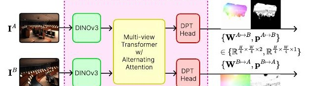

*原论文图 4 展示冻结的 DINOv3 双图特征、交替注意力 Transformer 和 DPT 头如何产生四倍下采样的粗 warp。*

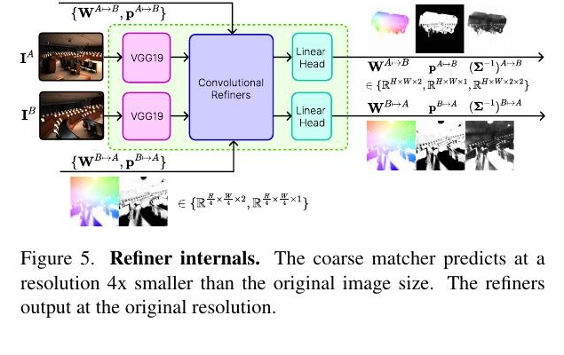

*原论文图 5 展示三个精化尺度如何把 stride 4 的初值更新到原图分辨率。*

#### 方向相关的不确定性

仅给一个 warp 和置信度无法说明坐标误差的形状。比如运动模糊沿水平方向时，横向误差可能比纵向更大；用一个标量方差会丢掉这个方向信息。RoMa v2 为每个像素预测二维残差的完整 $2\times2$ 精度矩阵 $\Sigma^{-1}$，它是协方差矩阵的逆。网络预测三个数并构造下三角 Cholesky 因子 $L$：对角元经 Softplus 保证为正，非对角元不受限，然后令 $\Sigma^{-1}=LL^\top$。这种参数化保证矩阵正定。

对残差 $r=W_\theta-W_{\mathrm{GT}}$，精度头通过高斯负对数似然训练：

$$
\mathcal{L}_{\mathrm{prec}}(r)=
\tfrac12 r^\top\Sigma^{-1}r-\tfrac12\log\det(\Sigma^{-1})+\log(2\pi).
$$

高精度会惩罚偏离预测的残差，行列式项则阻止模型无条件地把精度压低。为保持监督稳定，论文只在可见且 $\|r\|<8$ 像素的像素上训练该分支，并在计算精度损失时 detach 残差，避免精度头通过改变 warp 来操纵自身目标。精度由 stride 4 逐级累加至 stride 1，利用精度参数化中的可加性组合各尺度的增量。

#### EMA 消除亚像素偏置

作者观察到，在 $640\times640$ 分辨率时，精化预测会带有约 $\pm0.1$ 像素的小偏差；随着训练进行，这个偏差看起来近似随机波动，而不是始终朝同一方向。作者对参数使用衰减率 $0.999$ 的指数移动平均，以平滑这些训练波动。图 6 显示 EMA 后两个方向的偏差都明显减小；论文未在该图中报告下游评测数值。

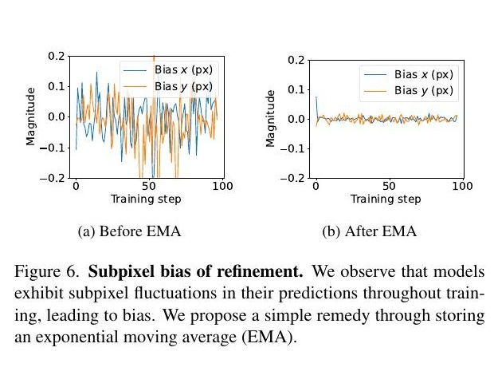

*左侧曲线展示未使用 EMA 时训练过程中的 x、y 偏差，右侧展示 EMA 后的偏差幅度明显减小。*

### 3.4 细化损失

各级精化器使用广义 Charbonnier 稳健 warp 损失。记 stride 为 $i\in\{4,2,1\}$，残差为 $r$，该损失采用 $\alpha=0.5$、$c=10^{-3}$ 的配置：

$$
\mathcal{L}_{\mathrm{warp}}=(ic)^\alpha
\left(\frac{\|r\|^2}{(ic)^2}+1\right)^{\alpha/2}.
$$

它让较大残差的梯度增长慢于平方误差，因此前级 warp 尚有误差时，不会被少量极端错误支配；在局部精化收敛时，仍保留对坐标偏差的连续惩罚。重叠概率使用逐像素二元交叉熵，真值来自深度一致性或光流 warp 的循环一致性。总损失把 stride 4、2、1 上的 warp、重叠和精度损失求和，两个权重分别为 $\lambda_{ov}=10^{-2}$、$\lambda_{prec}=10^{-3}$。

### 3.5 训练数据

单一训练分布很难同时教会模型处理极端基线和细小局部运动。RoMa 原先只用 MegaDepth 训练；RoMa v2 的混合数据由宽基线和小基线两部分组成。宽基线一侧包括 MegaDepth、AerialMegaDepth、BlendedMVS、Hypersim、TartanAir v2、Map-Free、ScanNet++ v2；小基线一侧包括 UnrealStereo4K、Virtual KITTI 2 和 FlyingThings3D。下表保留原文数据组成和采样权重（权重与从该数据集抽取图像对的概率成比例）：

| 数据集 | 类型 / 真值来源 | 权重 | 场景数 |
| --- | --- | ---: | ---: |
| MegaDepth | 室外 / MVS | 1 | 169 |
| AerialMegaDepth | 航拍 / MVS | 1 | 124 |
| BlendedMVS | 航拍 / 网格 | 1 | 493 |
| Hypersim | 室内 / 图形渲染 | 1 | 393 |
| TartanAir v2 | 室外 / 图形渲染 | 1 | 46 |
| Map-Free | 物体中心 / MVS | 1 | 397 |
| ScanNet++ v2 | 室内 / 网格 | 1 | 856 |
| UnrealStereo4K | 室外 / 图形渲染 | 0.01 | 8 |
| Virtual KITTI 2 | 室外 / 图形渲染 | 0.01 | 5 |
| FlyingThings3D | 室外 / 图形渲染 | 0.5 | 2239 |
| 合计 |  |  | 5069 |

原表各数据集的场景数相加为 4730，与原表所列合计 5069 不一致；论文没有解释这处差额。这里保留原表逐项数字及其合计。

作者的解释是，AerialMegaDepth 和 BlendedMVS 帮助模型应对大旋转、空地视角；FlyingThings3D 这类小基线光流数据改善细粒度运动；极小权重加入的 UnrealStereo4K、Virtual KITTI 2 仍能提供驾驶场景的低纹理区域监督。原论文图 7、图 8 分别比较了 FlyingThings3D 上的小物体和 NuScenes 道路上的低纹理区域。

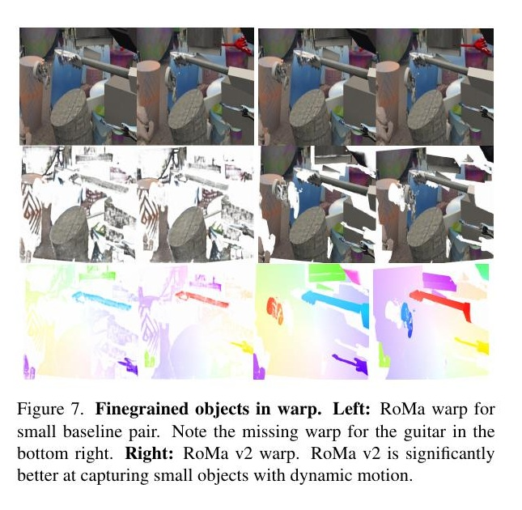

*左侧为 RoMa，右侧为 RoMa v2；RoMa v2 更完整地预测了有动态运动的小吉他。*

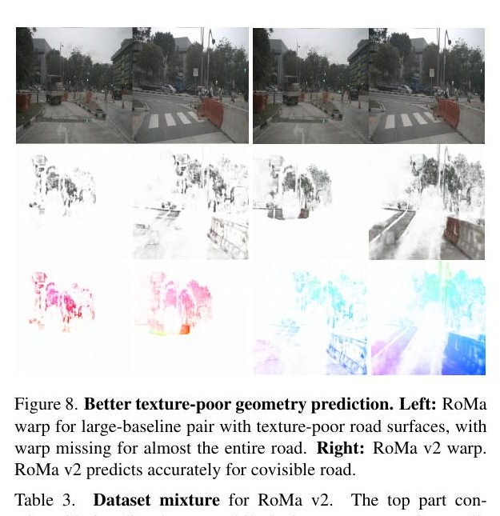

*左侧为 RoMa，右侧为 RoMa v2；RoMa 对道路区域的匹配覆盖有限，RoMa v2 对共可见路面给出更连续的 warp。*

补充材料还交代了数据构造细节。MegaDepth/AerialMegaDepth 先按共享三维轨迹数计算方向重叠率，每个场景最多抽取重叠率大于 0.01 和大于 0.35 的各 10 万对；跨场景采样概率按每个场景的图像对数的 0.75 次方下调。Map-Free 用 COLMAP MVS 生成深度，每场景只用 seq0 并均匀采样场景。ScanNet++ v2 用 nvs_sem_train 的 856 个室内场景，将网格渲染成深度图，以双向深度重叠几何均值筛选图像对，阈值为 0.2，每场景最多取 1 万对。TartanAir v2 沿用 UFM 的 TA-WB 配对和测试场景排除设置；BlendedMVS 排除 MapAnything 列出的九个场景后，以方向重叠率 0.05 过滤。Hypersim 用编号小于 50 的场景训练，编号不小于 50 的场景验证，重叠阈值 0.2。FlyingThings3D 使用官方 TRAIN/TEST 划分和 clean/final 图像，将给定光流转为 warp；UnrealStereo4K 用左右图像视差构造 warp；Virtual KITTI 2 使用同条件、同相机的连续帧及官方光流。

深度监督数据的可见性通过投影后的深度一致性判断，相对深度差阈值为 0.05。光流数据则检查正反向 warp 的循环误差，$640\times640$ 下阈值为约 1.6 像素。训练增强包含水平翻转、10% 概率灰度化、亮度倍数 $[1/1.5,1.5]$ 和 HSV 色相抖动 $[-15^\circ,15^\circ]$；MegaDepth 与 AerialMegaDepth 另外加入 $[-32,32]$ 像素的平移增强。附录图 10 展示了一个训练 batch，目的是直观看到训练样本覆盖的场景类型和难度。

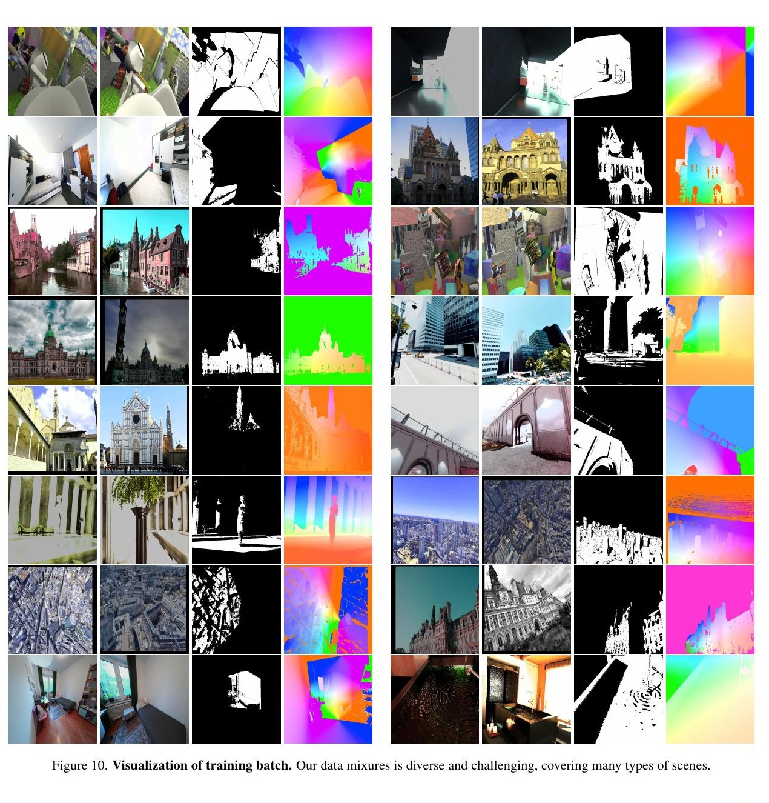

*原论文附录图 10 把随机 batch 中的图像对、可见性掩码和光流或深度监督并排展示，直观呈现训练数据的场景多样性。*

### 3.6 分辨率变化

分辨率变化时，粗阶段在归一化坐标网格上使用 RoPE，使位置距离不因输入宽高改变而偏离训练分布；match embedding 的绝对位置频率固定为 $\omega=1$，避免高频编码在分辨率插值时失真。精化阶段把位移按规范分辨率缩放。粗匹配训练混合七种宽高组合：$512\times512$、$592\times448$、$624\times416$、$688\times384$ 及其转置比例组合；精化器则统一在 $640\times640$ 上训练。

## 4 实验

### 4.1 相对位姿估计

在 MegaDepth-1500 和 ScanNet-1500 上，论文将匹配点送入相对位姿估计流程，并报告旋转/平移角误差阈值下的 AUC。匹配点从双向 warp 中采样，置信度低于 0.05 的点通过阈值化分布处理；使用 $800\times800$ 的粗分辨率、$1024\times1024$ 的细分辨率，并用核密度估计平衡采样的空间分布。补充材料说明，VGGT 在 MegaDepth-1500 上用 ALIKED 取 1024 个点作为跟踪查询，并将置信度和可见性阈值设为 0.1；UFM 使用双向 warp 与空间均衡采样，但固定在 $420\times560$ 分辨率，不做上采样。下表合并原论文表 4、表 5；每行名称按“MegaDepth / ScanNet”顺序保留原表的复现标记，†表示作者复现的结果。

| 方法 | MegaDepth AUC@5° | @10° | @20° | ScanNet AUC@5° | @10° | @20° |
| --- | ---: | ---: | ---: | ---: | ---: | ---: |
| MASt3R / MASt3R† | 42.4 | 61.5 | 76.9 | 33.6 | 56.8 | 74.1 |
| VGGT† / VGGT | 33.5 | 52.9 | 70.0 | 33.9 | 55.2 | 73.4 |
| Reloc3r | 49.6 | 67.9 | 81.2 | 34.8 | 58.4 | 75.6 |
| LoFTR | 52.8 | 69.2 | 81.2 | 22.1 | 40.8 | 57.6 |
| DKM | 60.4 | 74.9 | 85.1 | 29.4 | 50.7 | 68.3 |
| LightGlue | 51.0 | 68.1 | 80.7 | 17.8 | 34.0 | 52.0 |
| RoMa | 62.6 | 76.7 | 86.3 | 31.8 | 53.4 | 70.9 |
| UFM |  |  |  | 31.6 | 54.1 | — |
| UFM† / UFM† | 41.5 | 57.9 | 72.4 | 31.3 | 54.1 | 72.0 |
| RoMa v2 | **62.8** | **77.0** | **86.6** | 33.6 | 56.2 | 73.8 |

RoMa v2 在 MegaDepth 的三个阈值上略高于 RoMa，并在 ScanNet 上达到与 VGGT、MASt3R 相近的水平；这组结果支持它在宽泛几何变化下生成较有用的对应，但不表示每个数据集上都有同幅度提升。

### 4.2 稠密匹配

所有输入调整至 $640\times640$。对 RoMa 与 RoMa v2 直接使用该分辨率；UFM 按其建议先缩放到 $560\times420$，再双线性上采样回 $640\times640$，因为作者观察到它在更高分辨率下精度会明显下降。EPE 越低越好，1/3/5 像素列表示误差在该阈值内的匹配比例，越高越好。

| 方法 | TA-WB EPE | 1px | 3px | 5px | MegaDepth EPE | 1px | 3px | 5px | ScanNet++ EPE | 1px | 3px | 5px |
| --- | ---: | ---: | ---: | ---: | ---: | ---: | ---: | ---: | ---: | ---: | ---: | ---: |
| RoMa | 60.61 | 35.1 | 52.6 | 56.2 | 2.34 | 74.8 | 93.7 | 96.4 | 27.52 | 20.2 | 42.8 | 53.6 |
| UFM | 15.85 | 31.3 | 65.5 | 75.1 | 3.15 | 55.3 | 88.0 | 93.7 | 6.93 | 31.4 | 67.7 | 80.0 |
| RoMa v2 | **13.82** | **67.7** | **81.8** | **85.8** | **1.47** | **79.6** | **94.7** | **96.7** | **4.00** | **45.5** | **77.3** | **86.6** |

| 方法 | FlyingThings3D EPE | 1px | 3px | 5px | AerialMegaDepth EPE | 1px | 3px | 5px | Map-Free EPE | 1px | 3px | 5px |
| --- | ---: | ---: | ---: | ---: | ---: | ---: | ---: | ---: | ---: | ---: | ---: | ---: |
| RoMa | 5.68 | 78.0 | 86.6 | 89.2 | 25.05 | 39.0 | 65.0 | 73.9 | 8.55 | 45.8 | 72.3 | 80.9 |
| UFM | 1.33 | 83.4 | 93.9 | 96.1 | 17.44 | 29.3 | 61.6 | 73.8 | 3.59 | 31.6 | 66.7 | 81.7 |
| RoMa v2 | **0.93** | **89.4** | **95.2** | **96.8** | **4.12** | **55.9** | **81.1** | **87.9** | **2.03** | **55.4** | **84.9** | **92.7** |

RoMa v2 在表列六套数据上都有最好的整体结果。相对 RoMa，它在 AerialMegaDepth 的 EPE 从 25.05 降至 4.12，降低约 84%；在 MegaDepth 上也优于只用 MegaDepth 训练的 RoMa。TA-WB 是 UFM 的主要评测基准，RoMa v2 同样得到更低的 EPE 和更高的阈值内比例。这些结果与训练数据变得多样、粗尺度变密、细化计算更集中等改动一致，但各因素的因果贡献还需要结合消融理解。

### 4.3 运行速度与显存

作者在 H200 上以 batch size 8 测试吞吐和显存。RoMa v2 使用自定义 CUDA 局部相关 kernel 后，每秒处理 30.9 对，显存 4.8 GB；不使用该 kernel 时为 30.3 对、5.6 GB。RoMa 为 18.5 对、4.7 GB，UFM 为 43.0 对、16.2 GB。RoMa v2 相比 RoMa 吞吐约快 1.7 倍、显存相近；它仍比 UFM 慢，但显存占用明显更低。RoMa 和 UFM 的 patch size 是 14，因此该对比中它们采用 $644\times644$ 输入。

| 方法 | 吞吐（对/秒）↑ | 显存（GB）↓ |
| --- | ---: | ---: |
| UFM | 43.0 | 16.2 |
| RoMa | 18.5 | 4.7 |
| RoMa v2，不使用 CUDA kernel | 30.3 | 5.6 |
| RoMa v2，使用 CUDA kernel | 30.9 | 4.8 |

### 4.4 极端外观变化与航天员—卫星匹配

WxBS 收录视点、光照、模态等极端变化下的人工对应。RoMa v2 的 mAA@10px 为 55.4，低于 RoMa 的 60.8，但高于 UFM 的 42.3。论文指出两种较新模型都在红外到 RGB 的子集上较弱。这个结果也被作者列为限制：RoMa v2 的极端模态鲁棒性略逊于 RoMa。

SatAst 是本文构建的卫星—国际空间站航天员图像匹配基准。作者从 EarthMatch 选 39 对图像，排除严重云遮挡和难以一致标注的图像对；每对标注 10 个精确对应，并为卫星图像加入 90° 旋转版本，总计 156 对。模型对应经 RANSAC 拟合单应矩阵，再在人工真值上计算 AUC@10px。论文附录图 11 记录逐步标注流程，图 12 汇总 390 个点的重投影误差。SatAst 同时包含大尺度变化、大平面旋转和训练分布之外的卫星视角。RoMa v2 的 AUC@10 为 37.0，RoMa 为 23.5，UFM 为 1.8。

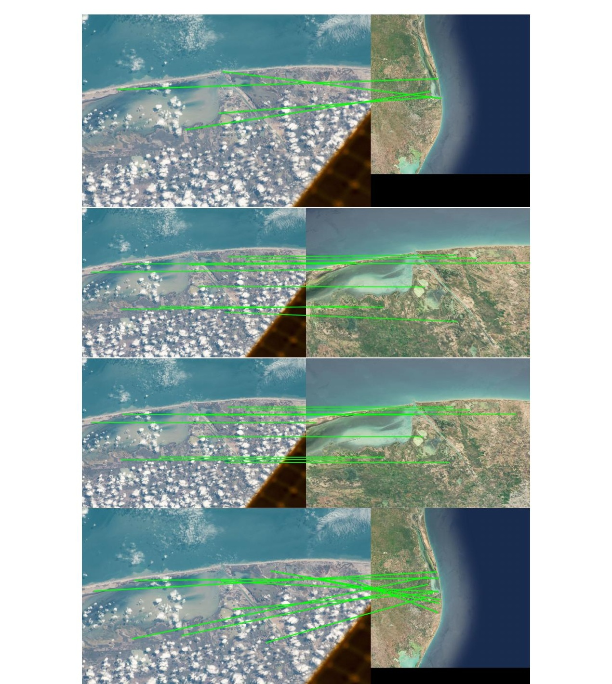

*原论文附录图 11 展示了标注流程中的原始视图。作者先标四组粗略对应，再以当前单应变换卫星图像并逐轮标注精确对应，最后检查十个点拟合单应后的重投影质量。*

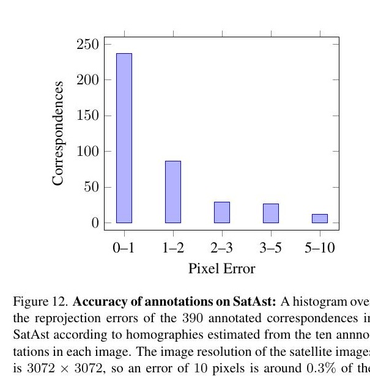

*直方图统计 390 个标注点基于每对图像十个精确标注拟合单应后的重投影误差；卫星图像分辨率为 $3072\times3072$，10 像素约占图像宽度的 0.3%。*

| 方法 | WxBS mAA@10px ↑ | SatAst AUC@10px ↑ |
| --- | ---: | ---: |
| RoMa | **60.8** | 23.5 |
| UFM | 42.3 | 1.8 |
| RoMa v2 | 55.4 | **37.0** |

### 4.5 协方差对几何估计的作用

RoMa v2 的精度矩阵不只用于可视化。作者在 HyperSim 验证场景中构造 1500 个重叠率至少 0.2 的图像对，并用预测协方差重新加权几何残差。比较三种方案：不使用协方差；在普通点式 RANSAC 后用协方差加权残差精化；在 LO-RANSAC 的 MSAC 打分和后续精化中都使用加权残差。

由于模型输出的是单方向协方差、而对应误差来自两端，附录把匹配点的联合协方差近似为 $4\times4$ 分块对角矩阵，并从反向 warp 的精度图中采样源点协方差。拟合中使用协方差加权 Sampson 误差。该近似是实验协议的一部分，解读数值时不应误认为模型直接预测了任意两端联合协方差。

| 方法 | AUC@1° ↑ | AUC@3° ↑ | AUC@5° ↑ |
| --- | ---: | ---: | ---: |
| 不用协方差 | 54.9 | 79.5 | 85.9 |
| RANSAC 后协方差精化 | 75.8 | 89.0 | 92.6 |
| RANSAC 打分和精化均用协方差 | **76.4** | **89.3** | **92.8** |

右侧图像施加线性核模拟运动模糊后，模型预测的协方差会沿模糊方向增大。结合表格，这表明预测误差的方向信息能帮助后续几何优化，不只是输出一个“信心分数”。

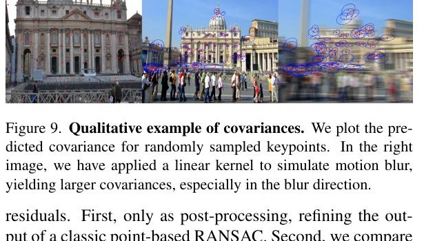

*右侧图像经过线性核模拟运动模糊后，预测协方差沿模糊方向变大。*

## 5 限制与结论

RoMa v2 的主要贡献不是单独换成 DINOv3，而是将多视角相关性学习、stride 4 粗 warp、专门设计的亚像素细化器、多域训练数据和像素级协方差放进一个训练与推理流程。实验覆盖相对位姿估计、六种稠密匹配数据、WxBS 与 SatAst，并报告相对 RoMa 更高的推理吞吐。

代价和边界也清楚：吞吐仍低于 UFM；WxBS 上 RoMa v2 低于 RoMa，特别是红外到 RGB 的匹配仍难；AerialMegaDepth 的训练深度有时会把场景深度错误延展到天空，导致模型给无纹理天空区域不恰当地分配匹配置信度。附录图 13、14 展示了这种偏差，以及训练数据里网格深度向天空泄漏的可能原因。作者将泄漏原因表述为推测，而不是已验证的唯一解释。

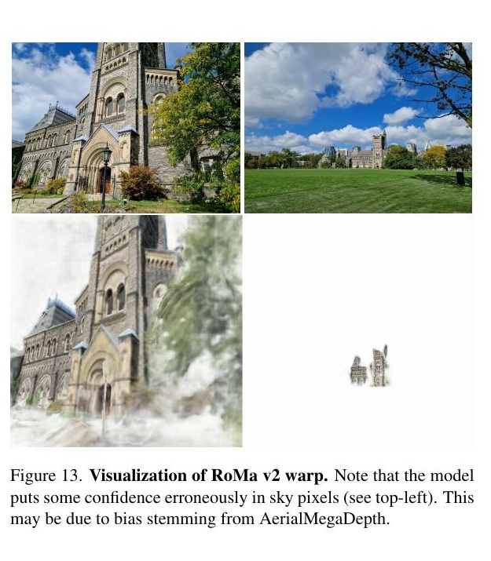

*原论文附录图 13 展示了天空区域被赋予了不恰当的重叠置信度。作者认为原因可能是 AerialMegaDepth 的网格深度在天空区域出现了泄漏。*

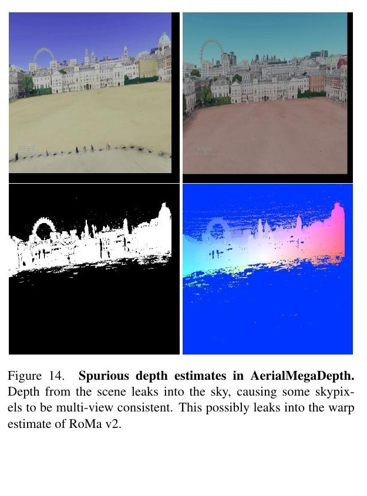

*补充材料显示，场景网格产生的深度可能延伸到天空像素，使其被误判为多视图一致；作者认为这种监督偏差可能传递到 RoMa v2 的 warp 预测中。*

从 RoMa 到 RoMa v2，变化沿着稠密匹配本身的误差链条展开：先用更强且冻结的特征初始化候选，再让两幅图的特征直接交互以建立匹配关系；把较精确的粗 warp 交给更短的细化金字塔；最后把像素误差结构显式传给几何估计器。多样训练集改善了模型接触到的视角和运动范围，而亚像素精化与协方差分别服务于坐标质量和下游估计。几项改动共同解释了它在精度、鲁棒性和效率上的折中，也解释了为何极端模态变化仍然是薄弱点。
