# RoMa 论文解读

> Johan Edstedt、Qiyu Sun、Georg Bökman、Mårten Wadenbäck 与 Michael Felsberg 的 *RoMa: Robust Dense Feature Matching*（arXiv v2，2023 年 12 月 11 日；发表于 CVPR 2024）提出一种面向大视角、光照和尺度变化的稠密图像匹配方法。[论文页面](https://arxiv.org/abs/2305.15404v2) · [论文 PDF](https://arxiv.org/pdf/2305.15404v2) · [官方实现](https://github.com/Parskatt/RoMa)

两张照片若来自同一场景，匹配器要回答的是：第一张图里的每个像素，在第二张图的什么位置对应同一个三维点？难点在于，视角、尺度、光照或季节变化会显著改变局部外观；重复纹理又可能让一个位置同时有多个合理候选。RoMa 的思路是把“找对大致位置”和“把位置修准”交给不同机制：冻结的 DINOv2 特征提供具有泛化性的粗匹配，专门训练的卷积特征逐级细化坐标；全局阶段预测目标位置的离散概率，局部阶段再做稳健回归。这样，粗阶段可以保留多个可能对应，细阶段则能把已有候选准确落到像素附近。

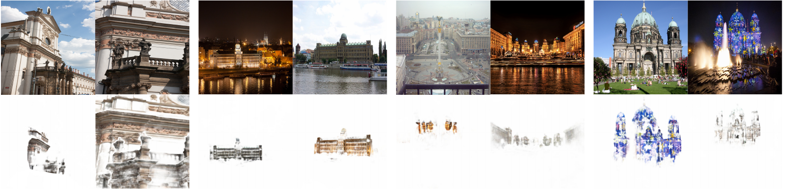

*原论文图 1。四组图像对分别展示尺度、光照、视点和纹理变化；每组下方是 RoMa 预测的对应关系，颜色表示匹配置信度。论文报告该基准上的 mAA@10 提升 36%。*

## 1 引言

特征匹配通常有三种组织方式。稀疏方法先检测关键点并计算描述子，再对描述子进行匹配；无检测器方法直接在较粗网格上寻找对应，之后提炼为更精细的匹配；稠密匹配则为图像中的每个可匹配像素预测另一幅图中的坐标，并同时预测匹配可信度。RoMa 属于第三类，它输出从图像 A 到图像 B 的稠密 warp，以及每个源像素的 matchability（可匹配性）分数。下游两视图几何或定位系统可以从中抽取稀疏对应，再估计相机关系。

已有稠密匹配器常从 MegaDepth 等带三维监督的数据学习粗特征。这些数据为匹配任务提供了直接监督，但真实场景和视角变化的覆盖有限，专门训练的特征容易适应训练分布。冻结的大规模预训练特征有望缓解过拟合；然而 DINOv2 等 ViT 特征以较粗的 patch 网格输出，语义上稳健，却不够精细，难以直接定位精确对应。RoMa 将其用于全局定位，再用专门训练的卷积网络负责细节。

这一拆分还影响解码器和损失。粗尺度上，同一源像素在第二幅图里可能有多个候选，例如物体边界两侧的像素在降采样后混入同一格；直接回归一个坐标会把多个峰值压成一个平均位置。进入局部细化后，前一阶段已经选定一个邻域，合理匹配通常集中在单一候选附近，但初始位置也可能很差。因此 RoMa 在全局阶段用分类式分布表示多个候选，在细化阶段用尾部较平的稳健回归抵抗大残差。

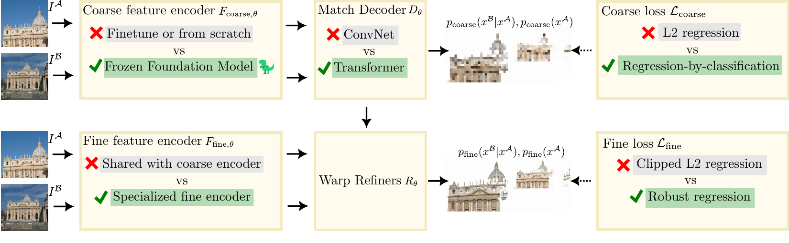

*原论文图 2。冻结的 DINOv2 提供粗特征，专用卷积网络提供细特征；Transformer 匹配解码器预测锚点概率，后续卷积细化器逐层修正 warp 和置信度。这是方法流程与贡献的概览，不是逐层网络结构图。*

RoMa 以 DKM 为基线，沿用其高斯过程匹配编码器和由粗到细的 warp 细化框架；论文提出的关键改动包括冻结的基础模型粗特征、专用细特征、Transformer 匹配解码器，以及分阶段的损失设计。因此，文中会引用 DKM 来交代继承关系，但这里解读的模型仍是 RoMa。RoMa 正文第 3.3 节和补充材料 B 给出了具体架构细节，图 2 本身只展示数据流和方法改动。

## 2 相关工作

稀疏匹配把检测与描述分开，适合只在少量稳定局部区域上求对应；无检测器匹配在低分辨率网格上做全局搜索，再用互为最近邻等规则筛选和细化；稠密方法则直接预测每个源像素到目标图像的 warp。RoMa 延续了 DKM 的全局匹配加多尺度细化框架，因此两者的主要差异落在特征、全局解码器和训练目标上。

自监督视觉预训练让特征在较广图像分布上保留可迁移的局部信息。RoMa 的实验显示，冻结的 DINOv2 对粗匹配更稳健，但缺少高分辨率定位所需的细节。作者据此把粗、细特征编码器解耦，让它们分别针对跨视图稳健性和亚像素邻域内的定位能力优化。

损失设计也与匹配阶段有关。普通平方误差在大残差下仍产生随误差增大的梯度，错误初值可能主导更新；稳健损失会减弱远离目标的样本影响。RoMa 更进一步区分全局与局部：全局目标要表达可能多峰的对应分布，细化目标则可以在当前 warp 条件下回归局部峰值。

## 3 方法

### 3.1 稠密匹配的表示

设两幅图像为 $I^{\mathcal A}$ 和 $I^{\mathcal B}$。对 A 中坐标 $x^{\mathcal A}$，稠密 warp $W^{\mathcal A\to\mathcal B}$ 给出 B 中的对应坐标，$p^{\mathcal A}(x^{\mathcal A})$ 表示该源像素存在可靠匹配的置信度。以概率形式看，匹配器预测条件分布 $p_\theta(x^{\mathcal B}\mid x^{\mathcal A})$ 和源位置的可匹配性 $p_\theta(x^{\mathcal A})$，二者相乘得到联合分布：

> RoMa 要解决的是两张不同视角的照片之间“同一个场景点在哪里”的问题。比如，给定 A 图中的一个像素，它可能因为视角、光照或尺度变化而换了外观；匹配器仍要找出 B 图中表示同一场景位置的像素。RoMa 把这个查找结果写成稠密 warp：对 A 中每个位置，记录它在 B 中对应的坐标，并给出这项对应有多可靠。这里的 warp 是一张坐标映射场；它描述对应关系，本身不要求把图像变形后再比较。
>
> 采用这种表示，是因为后续两视图几何需要一组跨图像的坐标对应，才能估计相机之间的关系。RoMa 先为大量像素预测对应和置信度，下游再按需要筛出可靠匹配用于几何估计或定位。因此，warp 是把图像匹配结果交给几何任务使用的直接表示。

$$
p_\theta(x^{\mathcal A},x^{\mathcal B}) = p_\theta(x^{\mathcal B}\mid x^{\mathcal A})\,p_\theta(x^{\mathcal A}).
$$

这个区分很有用：条件分布回答“若 A 中这个点能匹配，它在 B 中可能落在哪里”；可匹配性则回答“这个点是否适合参与匹配”。高分辨率下，局部峰值可以解码成一个确定坐标；低分辨率全局阶段保留完整分布更自然，因为多个目标位置可能同时合理。

整体由全局匹配器和一串细化器组成。特征编码器分别输出粗特征与多尺度细特征。粗特征进入全局匹配器，得到初始 warp 与可匹配性；细化器在各尺度接收前一尺度 warp、两幅图的细特征和局部相关性，输出 warp 残差及置信度 logit 残差。warp 上采样到下一尺度后继续修正。论文沿用 DKM 的做法，在细化级之间停止 warp 的梯度传播。

具体实现包含五级细化器，步长为 1、2、4、8、14；每级由 8 个卷积块构成，内部通道数依次为 24、144、569、1137、1377。它们把两幅图堆叠后的特征、围绕前一 warp 取出的局部相关性以及前一 warp 的线性编码作为输入，输出两个坐标方向的 warp 更新和一个可匹配性 logit 更新。附录列出的局部相关配置为 0、0、5、7、15；VGG 特征覆盖 stride 1、2、4、8，最粗一级 stride 14 与 DINOv2 patch 网格对齐。

### 3.2 稳健且可定位的特征

作者先在 MegaDepth 上比较冻结特征，并在骨干网络之上训练一个线性层，后接核最近邻匹配器，以尽量隔离骨干特征本身的差异。输入统一到 $448\times448$，指标一是端点误差（EPE），越低越好；指标二是误差低于 32 像素的匹配比例，作者称为 Robustness，越高说明越多对应足以供后续细化使用。

| 冻结特征 | EPE ↓ | Robustness ↑ |
| --- | ---: | ---: |
| VGG19 | 87.6 | 43.2% |
| ResNet-50 | 60.2 | 57.5% |
| DINOv2 | 27.1 | 85.6% |

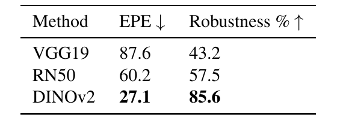

*原论文表 1。冻结特征在 MegaDepth 上的端点误差与 Robustness 比较。*

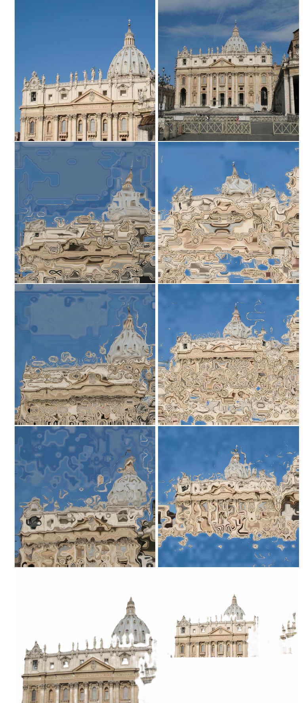

*原论文补充材料图 5。图中依次展示输入图像、VGG19、ResNet-50、DINOv2 与 RoMa 的匹配结果；DINOv2 比 VGG19 和 ResNet-50 更稳健，RoMa 则进一步改善定位。*

DINOv2 在粗匹配上明显更稳健，但其 ViT-L/14 特征以步长 14 的 patch 网格输出，细节不足以直接做精确局部定位。RoMa 因而冻结 DINOv2 作为粗编码器，并引入 VGG19 卷积网络生成步长 1、2、4、8 的细特征。冻结骨干还能减少针对有限训练集的过拟合，并降低计算量与显存需求。特征不共享参数后，两个编码器可以分别适应各自任务。消融结果也显示，细特征采用 VGG19 优于 ResNet-50，尽管 VGG19 在粗匹配比较中表现较差。这说明粗尺度的跨视图稳健性与细尺度的高分辨率定位能力并不由同一特征偏好决定。

补充材料给出了实现中的通道配置。VGG19 在四个最大池化层之前输出步长为 1、2、4、8 的特征，原始维度分别为 64、128、256、512，再投影并经批归一化变为 9、64、256、512 维。DINOv2 使用 ViT-L/14，不使用 CLS token；其 1024 维 patch 特征投影为 512 维。这样的分工保留 DINOv2 的粗层表征，同时让 VGG19 提供像素级细节。

### 3.3 Transformer 匹配解码器

#### 从特征相似性到全局匹配

RoMa 沿用 DKM 的高斯过程匹配编码器。它把两幅图的粗特征按相似性聚合，形成源位置对目标图坐标的嵌入后验，作为解码器的输入之一。附录给出的实现使用 512 维嵌入和逆温度为 10 的指数余弦核。另一路输入是线性投影后的 DINOv2 特征；二者拼接后交给 Transformer 匹配解码器。

作者观察到卷积解码器容易依赖训练分辨率下的局部性，对粗 warp 产生过度平滑。为降低这种位置偏置，RoMa 使用不带位置编码的 Transformer 解码器，让信息传播主要由特征相似性决定。解码器包含 5 个 ViT block、8 个注意力头，隐藏维度为 1024，MLP 维度为 4096。每个源位置最终输出目标位置分布和一个可匹配性分数。

> 可以把前面的特征编码器看作“描述两张图各处长什么样”，而匹配解码器负责把这些描述变成“A 图这个位置，在 B 图哪些位置可能找到对应”。它接收 DINOv2 的粗特征，以及高斯过程匹配编码器根据跨图特征相似性形成的嵌入；Transformer 再利用注意力整合这些粗尺度特征之间的上下文信息。对每个源位置，它输出一组目标锚点的概率和一个可匹配性分数：前者表示候选位置及其相对可信度，后者表示这个源点是否有可靠对应。随后细化器才利用更高分辨率的卷积特征，把粗坐标逐级修准。

#### 用锚点概率保留多个候选

粗阶段把目标图坐标空间划分为 $64\times64$ 个均匀锚点，每个锚点对应一个不重叠的小区域。对源像素 $x^{\mathcal A}$，解码器给出各锚点的概率 $\pi_k(x^{\mathcal A})$。条件匹配分布写成

$$
p_{\mathrm{coarse},\theta}(x^{\mathcal B}\mid x^{\mathcal A})
=\sum_{k=1}^{K}\pi_k(x^{\mathcal A})\,\mathcal B_{m_k}(x^{\mathcal B}),
\qquad K=64\times64,
$$

其中 $m_k$ 是第 $k$ 个锚点的位置，$\mathcal B_{m_k}$ 是以它为支撑区域的均匀分布。锚点区域彼此不重叠并覆盖网格，因此该分布既可以表达相距较远的多个峰，也不会把这些峰提前平均成单个坐标。

细化需要一个确定的初始 warp。RoMa 先取概率最大的锚点 $k^*$，再对它及上下左右四个最近邻锚点做局部加权平均：

$$
\hat W_{\mathrm{coarse}}^{\mathcal A\to\mathcal B}(x^{\mathcal A})
=\frac{\sum_{i\in N_4(k^*)}\pi_i(x^{\mathcal A})m_i}
{\sum_{i\in N_4(k^*)}\pi_i(x^{\mathcal A})}.
$$

这相当于先用离散概率选定一个全局候选，再在邻近锚点内做 soft-argmax 式的亚格点调整。它保留了多峰预测的表达能力，同时提供细化器可以接续的坐标。

### 3.4 稳健损失

粗匹配和细化面对的误差分布不同。论文用尺度空间解释这一点：理想的精确匹配关系在图像降采样时会被模糊；特别是物体运动边界处，两个表面可能投影到相邻像素，粗网格就会把不同深度的对应混到一起，形成多个可能位置。论文将尺度 $s$ 下的对应分布写成对精确分布的高斯卷积：

$$
q(x^{\mathcal A},x^{\mathcal B};s)
=\mathcal N(0,s^2\mathbf I)*p(x^{\mathcal A},x^{\mathcal B};0).
$$

卷积让匹配分布随尺度增大而扩散。在物体边界附近，源位置的条件分布因此可能是多峰的；全局匹配器需要保留这种歧义。进入细化阶段后，warp 已限定了局部搜索范围，分布在局部更接近单峰，但若初始 warp 离正确位置很远，普通平方误差又会让大残差产生过强梯度。

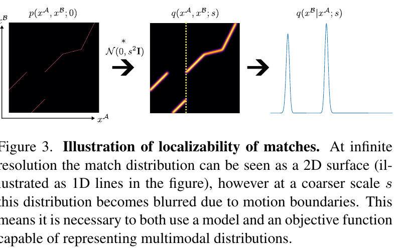

*原论文图 3。作者将尺度增大的匹配分布解释为对精确对应分布施加高斯扩散；在运动边界附近，扩散后的条件分布呈现多个峰值。*

粗阶段因此采用“回归即分类”（regression by classification）：先把目标坐标量化到最近锚点，再对该锚点概率计算负对数似然；同时对源像素的可匹配性使用二元交叉熵。把两个监督项写在一起，可记为

$$
k^\dagger(x^{\mathcal B})=\arg\min_k\|m_k-x^{\mathcal B}\|,\qquad
\mathcal L_{\mathrm{coarse}}=-\mathbb E_{(x^{\mathcal A},x^{\mathcal B})\sim q}\left[\log\pi_{k^\dagger(x^{\mathcal B})}(x^{\mathcal A})+\lambda\log p_{\mathrm{coarse},\theta}(x^{\mathcal A})\right].
$$

其中 $\pi_{k^\dagger(x^{\mathcal B})}(x^{\mathcal A})$ 是解码器对真值目标锚点的预测概率，$p_{\mathrm{coarse},\theta}(x^{\mathcal A})$ 是源点可匹配性的预测，$\lambda$ 调整边缘可匹配性项相对条件匹配项的权重。原文式（13）—（14）把锚点索引写成 $k^\dagger(x^{\mathcal A})$，并定义 $k^\dagger(x)$ 为离坐标 $x$ 最近的锚点；但条件分布 $p(x^{\mathcal B}\mid x^{\mathcal A})$ 的分类目标应由目标真值坐标 $x^{\mathcal B}$ 决定。这里按条件分布的定义，将其理解为目标坐标对应的真值锚点；原文这处索引记法存在歧义。

细化阶段把预测 warp 视为分布均值 $\mu_\theta$，采用 $\alpha=0.5$ 的广义 Charbonnier 分布。其对数概率中与参数有关的部分为

$$
\log p_\theta(x_i^{\mathcal B}\mid x_i^{\mathcal A},\hat W_{i+1})
=-\left(\left\|\mu_\theta(x_i^{\mathcal A},\hat W_{i+1})-x_i^{\mathcal B}\right\|^2+s\right)^{1/4},
\qquad s=2^i c,\quad c=0.03.
$$

在小残差处，它的梯度行为接近平方误差，便于精确收敛；残差增大时，梯度逐渐变平，降低错误初始 warp 对训练的支配。每个细尺度还对可匹配性使用二元交叉熵，各级损失相加。最终目标为 $\mathcal L=\mathcal L_{\mathrm{coarse}}+\mathcal L_{\mathrm{fine}}$。由于匹配阶段之间切断 warp 梯度、粗细编码器也不共享参数，论文指出两部分无需额外调节相对损失权重。

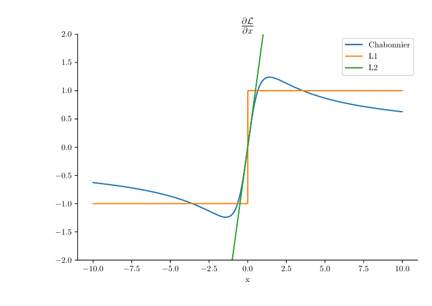

*原论文图 4。广义 Charbonnier 在零附近保留接近 L2 的梯度，远离目标时梯度按残差约 $|x|^{-1/2}$ 衰减；这让细化既能精确收敛，也不至于被少数大误差牵着走。*

## 4 实验

### 4.1 消融实验

消融在 MegaDepth 场景 0015、0022 随机采样、重叠度大于零的图像对上进行。指标为 $100-\mathrm{PCK}$：统计真值对应中估计误差超过给定像素阈值的比例，因此表中数值越低越好。

| 设置 | 1 px | 3 px | 5 px |
| --- | ---: | ---: | ---: |
| DKM 基线 | 17.0 | 7.3 | 5.8 |
| 粗细编码器分离，均用 ResNet-50 | 16.0 | 6.1 | 4.5 |
| 细特征改用 VGG19 | 14.5 | 5.4 | 4.5 |
| 加入 Transformer 匹配解码器 | 14.4 | 5.4 | 4.1 |
| 粗特征改用 DINOv2 | 14.3 | 4.6 | 3.2 |
| 粗阶段改为锚点分类 | 13.6 | 4.1 | 2.8 |
| 加入稳健细化损失（RoMa） | **13.1** | **4.0** | **2.7** |
| 最终设置改回卷积匹配解码器 | 14.0 | 4.9 | 3.5 |

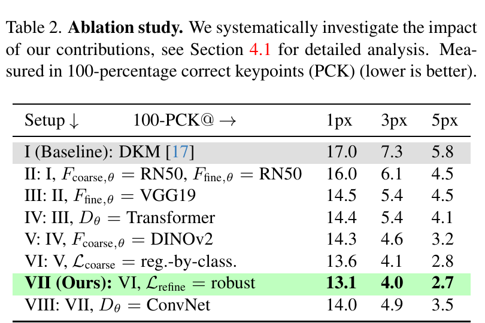

*原论文表 2。各项模块改动对 100-PCK 的影响，数值越低越好。*

逐项结果支持了组合设计：专用化的粗细特征、DINOv2、锚点分类和稳健细化都带来改善。把最终解码器换回卷积网络后，1/3/5 像素误差比例升至 14.0/4.9/3.5，表明 Transformer 解码器与其余设计结合时仍有贡献。消融使用 $448\times448$ 分辨率，最终模型则以 $560\times560$ 训练。

### 4.2 训练设置

训练数据沿用 DKM 的 MegaDepth 与 ScanNet 划分，排除对应测试场景。MegaDepth 监督 warp 来自多视图立体重建的稠密深度图，ScanNet 则使用 RGB-D 深度。评测 ScanNet-1500 时采用 ScanNet 训练集训练的模型，其余实验使用只在 MegaDepth 上训练的模型。粗匹配与细化网络联合训练，但由于级间梯度截断，也可以分阶段训练。

训练设置沿用 DKM：batch size 为 8 时，解码器学习率为 $10^{-4}$，编码器学习率为 $5\times10^{-6}$。消融模型以 $448\times448$ 分辨率训练，最终模型以 $560\times560$ 训练。特征对照实验则冻结各骨干，只训练一个线性层，并使用与主实验相同的数据划分和学习率，以减少匹配器差异对骨干比较的干扰。

### 4.3 两视图几何

两视图几何实验先从稠密 warp 中平衡采样 10,000 组匹配，再交给相对位姿估计器，避免直接使用全部像素对应带来的计算负担。具体做法沿用 DKM：先用核密度估计（KDE）估计联合匹配分布，再按密度倒数重新加权采样，以增加较不确定区域的样本。IMC2022 在隐藏街景测试集上评估基础矩阵估计；WxBS 使用更新过真值和协议的 1.1 版本，所有方法均使用 OpenCV 的 MAGSAC++，内点阈值为 10 像素。下表列出论文中的完整主要比较结果，数值越高越好。

| 方法 | IMC2022 mAA@10 | WxBS mAA@10px |
| --- | ---: | ---: |
| SiLK | 68.6 | — |
| SuperPoint + SuperGlue | 72.4 | 31.4 |
| DISK | — | 35.5 |
| DISK + LightGlue | — | 41.7 |
| LoFTR | 78.3 | 55.4 |
| MatchFormer | 78.3 | — |
| QuadTree | 81.7 | — |
| ASpanFormer | 83.8 | — |
| DKM | 83.1 | 58.9 |
| **RoMa** | **88.0** | **80.1** |

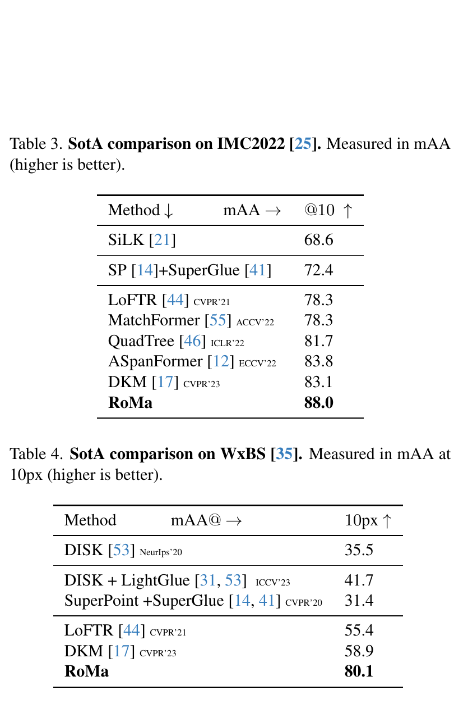

*原论文表 3、表 4。RoMa 在 IMC2022 与 WxBS 上的两视图几何结果。*

IMC2022 上，RoMa 相对先前最佳结果将误差降低 26%；WxBS 上 mAA 从 DKM 的 58.9 提升到 80.1，对应约 36% 的相对提升。

补充材料对 mAA 的计算作了说明：对每个图像对，在一组均匀间隔的位姿误差阈值上判断旋转与平移误差是否同时达标，再对阈值和图像取平均，场景间做平衡。WxBS 的对应正确性则按与估计基础矩阵一致的真值匹配比例计算。RoMa 在 WxBS 上提升尤其大，定性比较也显示它更能应对季节、强光照和视角变化：

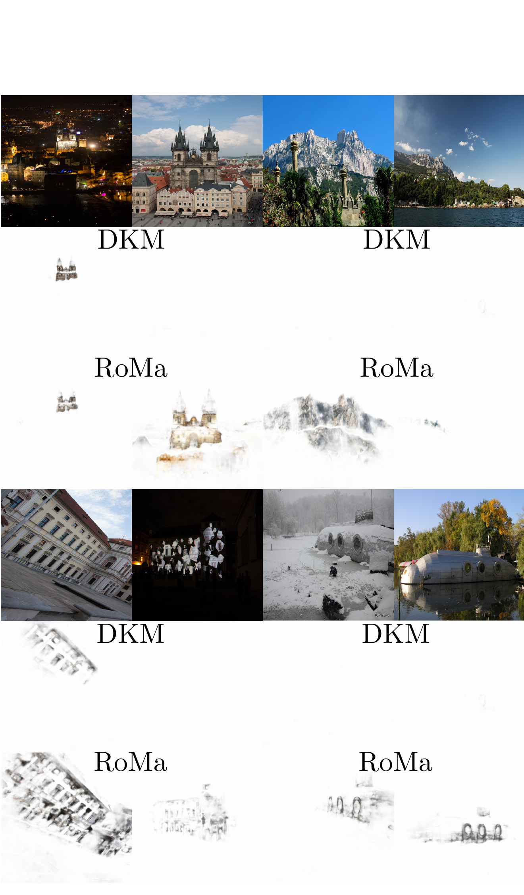

*原论文补充材料图 6。RoMa 在多组极端变化图像对上保留了更多正确对应；DKM 在部分场景中匹配失败。*

MegaDepth-1500 和 ScanNet-1500 的位姿估计结果如下。误差以旋转和平移方向误差的较大者衡量，数据没有绝对尺度，因此平移误差使用方向夹角；AUC 是召回率曲线在给定角度阈值内的积分，论文以梯形法近似。它衡量估计本质矩阵所对应的相对位姿是否准确，不是三维重建精度或绝对位姿误差。

| 方法 | MegaDepth-1500 AUC@5° | @10° | @20° | ScanNet-1500 AUC@5° | @10° | @20° |
| --- | ---: | ---: | ---: | ---: | ---: | ---: |
| SuperGlue | — | — | — | 16.2 | 33.8 | 51.8 |
| LightGlue | 51.0 | 68.1 | 80.7 | — | — | — |
| LoFTR | 52.8 | 69.2 | 81.2 | 22.1 | 40.8 | 57.6 |
| PDC-Net+ | 51.5 | 67.2 | 78.5 | 20.3 | 39.4 | 57.1 |
| ASpanFormer | 55.3 | 71.5 | 83.1 | 25.6 | 46.0 | 63.3 |
| ASTR | 58.4 | 73.1 | 83.8 | — | — | — |
| PATS | — | — | — | 26.0 | 46.9 | 64.3 |
| DKM | 60.4 | 74.9 | 85.1 | 29.4 | 50.7 | 68.3 |
| PMatch | 61.4 | 75.7 | 85.7 | 29.4 | 50.1 | 67.4 |
| CasMTR | 59.1 | 74.3 | 84.8 | 27.1 | 47.0 | 64.4 |
| **RoMa** | **62.6** | **76.7** | **86.3** | **31.8** | **53.4** | **70.9** |

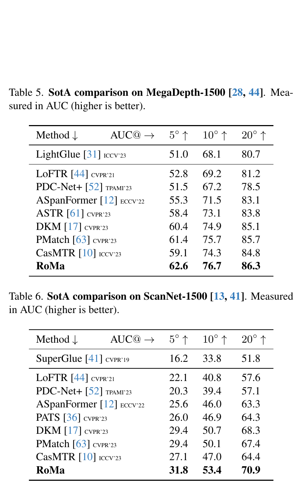

*原论文表 5、表 6。RoMa 在 MegaDepth-1500 与 ScanNet-1500 上的相对位姿估计结果。*

在 MegaDepth-8-Scenes 上，RoMa 同样超过表中基线：

| 方法 | AUC@5° | @10° | @20° |
| --- | ---: | ---: | ---: |
| PDC-Net+ | 51.8 | 66.6 | 77.2 |
| ASpanFormer | 57.2 | 72.1 | 82.9 |
| DKM | 60.5 | 74.5 | 84.2 |
| **RoMa** | **62.2** | **75.9** | **85.3** |

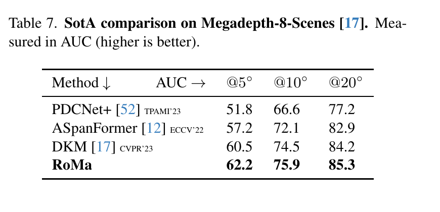

*原论文表 7。RoMa 在 MegaDepth-8-Scenes 上的相对位姿估计结果。*

### 4.4 视觉定位

InLoc 实验通过 HLoc 定位流程评估查询图像，沿用 DKM 的稠密匹配采样方式。表中每格依次为在 $(0.25\text{m},2^\circ)/(0.5\text{m},5^\circ)/(1.0\text{m},10^\circ)$ 定位阈值内的查询图像比例，数值越高越好。

| 方法 | DUC1 | DUC2 |
| --- | --- | --- |
| PATS | 55.6 / 71.2 / 81.0 | 58.8 / 80.9 / 85.5 |
| DKM | 51.5 / 75.3 / 86.9 | 63.4 / 82.4 / **87.8** |
| CasMTR | 53.5 / 76.8 / 85.4 | 51.9 / 70.2 / 83.2 |
| **RoMa** | **60.6 / 79.3 / 89.9** | **66.4 / 83.2 / 87.8** |

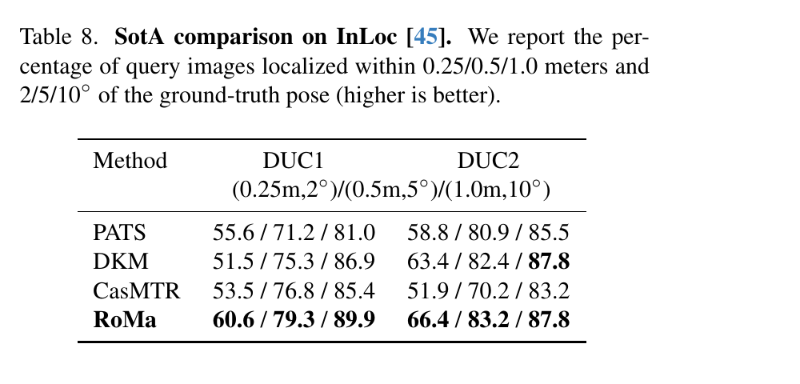

*原论文表 8。RoMa 在 InLoc 的两个测试区域 DUC1、DUC2 上的定位结果。*

RoMa 在五个场景—阈值组合中取得最高值，在 DUC2 最宽松阈值下与 DKM 并列；这比只看单一阈值更完整地呈现定位收益。

### 4.5 运行时间

在 RTX 6000、$560\times560$ 分辨率、batch size 为 8 的设置下，RoMa 每对图像耗时 198.8 ms，DKM 为 186.3 ms，增加约 7%。这项比较说明论文报告的准确率提升伴随约 7% 的推理时间增长；该时间取决于论文所用硬件、分辨率和批量，不能直接当作其他设备上的延迟。

## 5 结论

RoMa 的方法可以概括为三组配合：冻结 DINOv2 让粗匹配继承大规模自监督预训练特征的泛化能力，VGG19 细特征弥补 patch 特征的定位精度；不含位置编码的 Transformer 解码器利用特征相似性传播信息，并以锚点概率表达全局多峰对应；损失函数则按阶段分工，粗阶段分类预测离散候选，细阶段以 Charbonnier 回归处理局部误差和离群初值。

论文的主要实验证据来自下游两视图几何、视觉定位和稠密匹配消融。它显示 RoMa 在所评估基准上普遍改善，尤其在 WxBS 极端变化图像对上增益显著，同时在指定 RTX 6000 设置下比 DKM 慢约 7%。论文也指出两项限制：训练依赖监督对应，限制了可用数据；优化目标是稠密匹配本身，对两视图几何、定位或重建属于间接优化，直接面向下游任务训练可能继续改善结果。整体来看，RoMa 将鲁棒全局候选、可定位的细特征和适配不同误差分布的训练目标组合进同一条粗到细流程。
