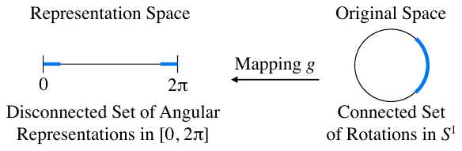
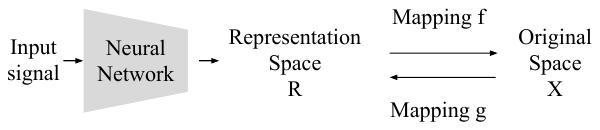
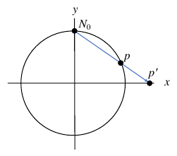
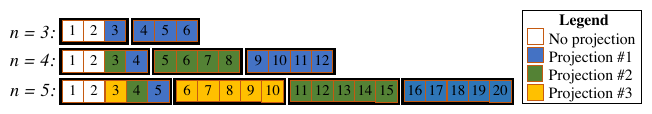
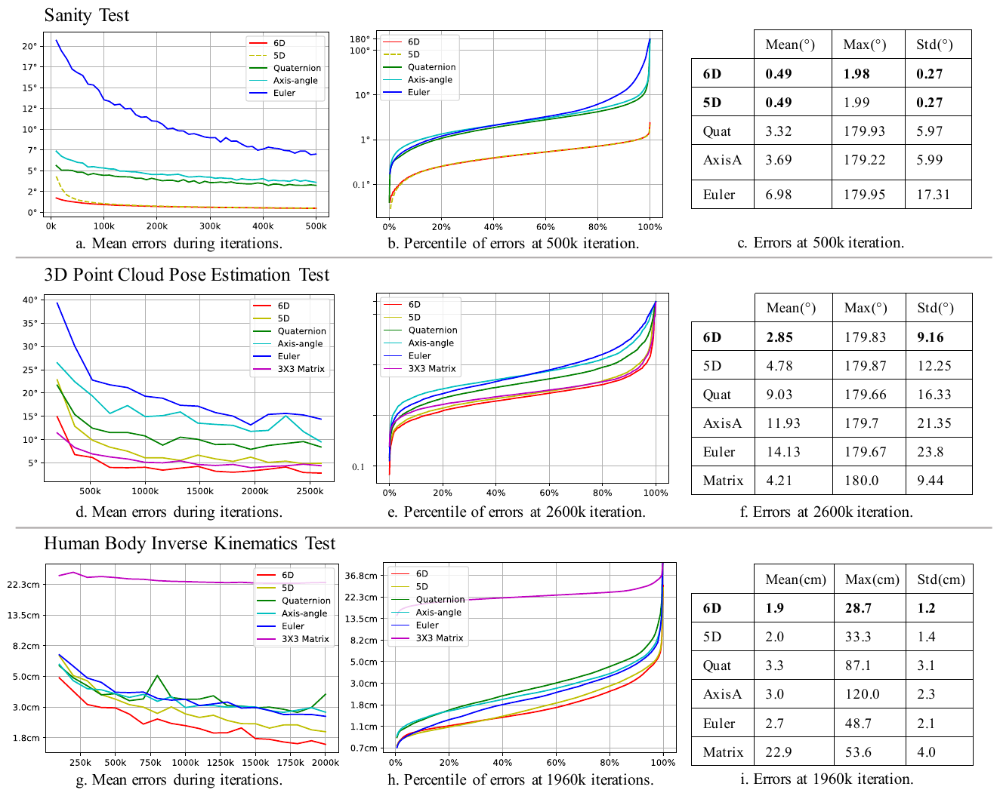
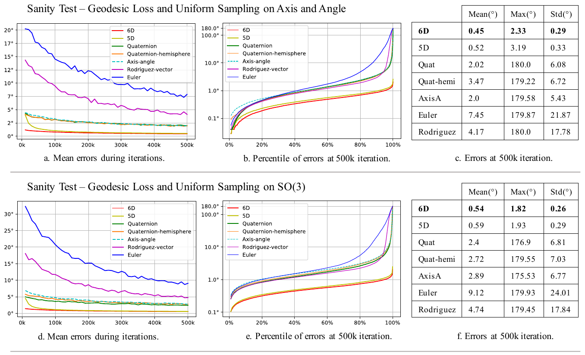
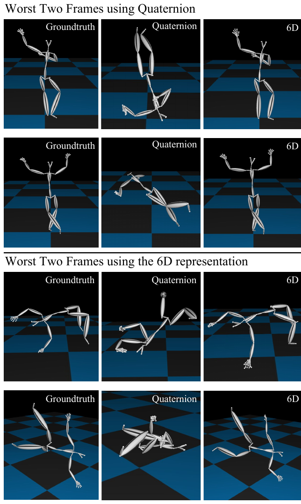
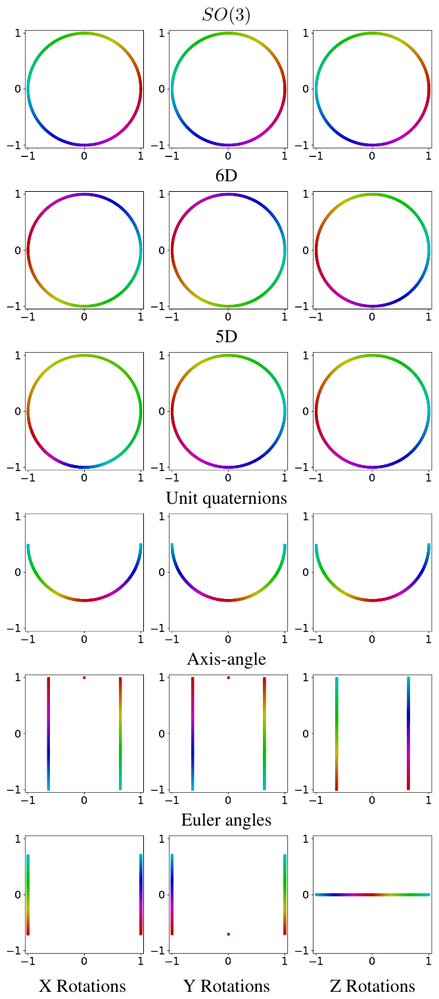

# On the Continuity of Rotation Representations in Neural Networks 论文解读

> *On the Continuity of Rotation Representations in Neural Networks*（Yi Zhou、Connelly Barnes 等，arXiv:1812.07035v4，2020-06-08）讨论神经网络回归旋转时，表示映射本身是否连续。文章给出适用于网络的连续性定义，证明 $SO(3)$ 在四维及以下欧氏空间中没有连续表示，并构造 $SO(n)$ 的连续表示；对三维旋转，它们分别是 6 维和 5 维。[论文页面](https://arxiv.org/abs/1812.07035) · [PDF](https://arxiv.org/pdf/1812.07035v4)

## 摘要

神经网络经常要在同一空间的不同表示之间工作。三维旋转可以用四元数或欧拉角表示。论文给出一种面向训练的连续表示定义，并把它同胚、嵌入这些拓扑概念联系起来，再分别检查二维、三维和 $n$ 维旋转的连续与不连续表示。

对三维旋转，四维及以下的实欧氏空间里，任何表示都不连续。因此四元数和欧拉角都是不连续的，网络难以学习。三维旋转在 5 维和 6 维有连续表示，更适合学习。构造可以推广到旋转群 $SO(n)$。论文主要讨论旋转，同时说明同一做法也适用于正交群和相似变换。

实验比较了若干图形学和视觉任务：旋转自编码器健全性测试、三维点云旋转估计，以及三维人体姿态的逆运动学。连续表示优于不连续表示。

## 1. 引言

图形学和视觉里，越来越多的网络直接回归旋转，例如由图像或点云估计姿态、由运动恢复结构，以及生成骨架关节旋转的运动合成。这些工作常用三维或四维表示：四元数、轴角或欧拉角。

论文的观察是：当任务需要覆盖整个旋转空间时，三维和四维表示并不适合网络回归。收敛之后，网络仍会在某些转角上产生很大误差。作者认为这背后是表示的连续性。在其他条件相近时，不连续表示往往比连续表示更难被网络逼近。逼近理论也提示，更光滑、连续性更强的函数，在同样的神经元数量下逼近误差更低。

第 3 节先定义网络语境下的连续表示，并用二维旋转作例子，再联系同胚和嵌入。第 4 节分析具体表示。4.1 节说明欧拉角、四元数等不连续，并证明三维旋转在四维及以下欧氏空间中不存在连续表示。4.2 节给出 $SO(n)$ 的连续表示：维数是 $n^2-n$，还可以再连续地降低 $1$ 到 $n-2$ 维。三维旋转因此得到 6 维和 5 维连续表示。同一构造也用于正交群 $O(n)$ 和相似变换。

第 5 节在三维旋转上做实验。6 维和 5 维连续表示在自编码器健全性测试、点云旋转估计和人体逆运动学上都优于不连续表示。健全性测试里，不连续表示的平均误差最高可达到连续表示的 6 到 14 倍，收敛更慢，收敛后某些转角上的误差仍超过 $170^\circ$。作者认为这是因为不连续处更难拟合。同类现象也出现在 Falorsi 等人的同胚变分自编码器，以及 Xiang 等人 PoseCNN 的 6D 物体姿态估计中。

直接回归 $3\times 3$ 旋转矩阵也是一种做法。5.2 节的实验里，它的误差大于 6 维表示。逆运动学和正运动学还要求网络内部就给出正交矩阵，因此网络里需要正交化。若使用 Gram–Schmidt 正交化，结果实际上就是这里的 6 维表示。

论文列出四项贡献：适合神经网络的旋转表示连续性定义；二维、三维和 $n$ 维旋转的不连续与连续表示分析；$SO(3)$ 与 $SO(n)$ 连续表示的公式；以及支持上述观点、并说明连续表示更适合学习的实验。

## 2. 相关工作

### 神经网络逼近

Hornik 证明，在 $L^p$ 范数下，神经网络可以把 $L^p$ 函数逼近到任意精度。Barron 等人证明，若函数的 Fourier 变换满足一定条件，达到量级为 $\epsilon$ 的逼近最多需要 $O(\epsilon^{-2})$ 个神经元。LeCun 等人的综述对这类结果有更完整的概述。对连续函数，光滑性更好的函数在给定神经元数量下可以有更低的逼近误差。对不连续函数，Llanas 等人证明实的分段连续函数几乎可以一致逼近；他们同时指出，用梯度下降训练分段连续函数时，需要很多神经元和迭代，结果仍然不好。这些结果只是提示连续旋转表示在实践中可能更好，并没有直接给出某种旋转表示的逼近率。

### 旋转表示的连续性

Grassia 指出，欧拉角和四元数不适合做姿态的微分与积分，并建议用指数映射作为更稳健的旋转参数化。Saxena 等人观察到，欧拉角和四元数的不连续会给学习带来问题。他们采用的做法是直接回归 $3\times 3$ 矩阵，而且关注的是具有特定对称性的物体，并没有给出覆盖一般旋转的连续表示。

### 三维姿态估计中的旋转输出

深度网络被用来从 RGB、深度或点云估计物体实例的 6D 姿态。直接预测的 $3\times 3$ 矩阵不一定是合法旋转，所以这些方法通常改用更紧凑的四元数或轴角。PoseCNN 报告了很高比例的 $90^\circ$ 到 $180^\circ$ 误差，并认为测试集中部分对称物体的旋转歧义是主要原因。论文指出，即使对非对称物体，这一区间的误差比例仍然很高，表示的不连续可能是原因之一。这里的“可能”是作者的判断，PoseCNN 原文把误差主要归因于对称性。

### 逆运动学网络

逆运动学网络比传统求解更快，而且可微，因此能放进动作重定向、基于视频的人体姿态估计等更大的学习任务。已有工作多用四元数或轴角，也有工作使用欧拉角或李代数，并惩罚关节位置误差。Csiszar 等人让网络输出欧拉角的正弦和余弦，用于机器人控制中的逆运动学。欧拉角对 $SO(3)$ 不连续，第 5 节的实验会看到很大的回归误差。Csiszar 等人把转角限制在某一范围内，从而避开不连续点，测试中的关节对齐误差很低。许多实际任务要求网络输出整个旋转范围，这时连续表示更合适。

## 3. 连续表示的定义

这一节先固定术语，再用二维旋转说明定义要排除的现象，然后给出连续表示，并说明它和网络、拓扑的关系。

矩阵记为 $M$，$M_{ij}$ 是第 $i$ 行第 $j$ 列。$SO(n)$ 是特殊正交群，即满足

$$
MM^\top=M^\top M=I,\qquad \det(M)=1
$$

的 $n\times n$ 实矩阵，群运算是矩阵乘法，对应旋转的复合。$n$ 维单位球面写作

$$
S^n=\{x\in\mathbb R^{n+1}:\|x\|=1\}.
$$

### 二维旋转上的不连续

任意 $M\in SO(2)$ 都可以写成

$$
M=\begin{bmatrix}\cos\theta&-\sin\theta\\ \sin\theta&\cos\theta\end{bmatrix}.
\tag{1}
$$

取角集合 $R=[0,2\pi]$，每个 $M$ 都有一个角 $\theta\in R$。若映射 $g$ 把 $SO(2)$ 送到这个角，$g$ 在单位旋转处没有极限：一个方向的极限是 $0$，另一个方向的极限是 $2\pi$。

图 1 把这件事画出来。右边是 $SO(2)$ 中一个连通的旋转集合 $C$，用每个矩阵的第一列 $[\cos\theta,\sin\theta]^\top$ 画在 $S^1$ 上，它是一段连通的圆弧。经过 $g$ 之后，这些角落在 $[0,2\pi]$ 的线段上，并在两端断开。表示不连续，指的就是从原空间到表示空间的映射 $g$ 不连续。这种断开会让网络更难拟合。反过来，若直接用第一列 $[\cos\theta,\sin\theta]^\top$ 表示这个二维旋转，表示是连续的。后文的 $n^2-n$ 维构造，在 $n=2$ 时正好就是保留这一列。

*图 1（原论文图 1）　二维例子。右边的连通旋转集被映射 $g$ 送到左边的角度表示后不再连通。*

### 表示与连续性

设 $R$ 是实向量空间的子集，带欧氏拓扑，称为表示空间。网络在中间层输出 $R$ 中的向量。设 $X$ 是紧的拓扑空间，称为原空间。映射 $f:R\to X$ 把表示送回原空间，映射 $g:X\to R$ 把原空间送进表示空间。若对每个 $x\in X$ 都有

$$
f(g(x))=x,
$$

则 $f$ 是 $g$ 的左逆，$(f,g)$ 称为一个表示。论文规定：只要 $g$ 连续，这个表示就称为连续表示。

后文的四元数公式里，从四元数回到旋转矩阵的 $f$ 在非零四元数上连续，间断出现在 $g$ 上。网络产出的是表示空间中的向量，定义因此检查 $g$。

*图 2（原论文图 2）　连续表示的定义，以及它在网络中的位置。推理从左向右：网络输出表示空间 $R$ 中的向量，数学映射 $f$ 再把它送回原空间 $X$。$g$ 是从 $X$ 到 $R$ 的映射。*

### 连通的训练信号

网络单元通常是欧氏拓扑下的连续函数，所以表示空间也取欧氏拓扑，才能和这些单元的连续性一致。

设原空间里有一个连通集合 $C$，例如图 1 右侧的圆弧。若 $g$ 连续，则 $g(C)$ 仍然连通。连续的训练数据因此在表示空间里仍给出连续的训练信号。若 $g$ 不连续，原空间中的连通集可能在表示空间里断开，训练信号也随之断开。

$f$ 最好在网络输出预期落在的区域内几乎处处有定义。这样，网络产出的表示，即使不落在 $g(X)$ 上，也能被送回 $X$。训练和推理的前向计算都把 $f$ 当作数学函数来用。损失通常加在原空间 $X$ 上，因此不同表示可以共用同一个旋转矩阵损失。

### 同胚与嵌入

若 $(f,g)$ 是连续表示，则 $g$ 是从紧空间到 Hausdorff 空间的连续单射。拓扑中的一个定理说，把 $g$ 的值域限制到 $g(X)$，并在 $g(X)$ 上使用子空间拓扑，得到的映射是同胚：它是连续双射，逆映射也连续。几何上，同胚常被描述成对空间作连续、可逆的拉伸和弯曲；允许有限次切割，只要随后把原来的同一点重新粘上。两个空间之间存在同胚时，它们拓扑等价。此时 $g$ 是原空间 $X$ 到表示空间 $R$ 的拓扑嵌入。把 $f$ 的定义域限制到 $g(X)$，得到的 $f|_{g(X)}$ 就是 $g$ 的逆。

反方向同样有用。若 $X$ 不同胚于 $R$ 的任何子集，则这对空间上不可能存在连续表示 $(f,g)$。下一节用这个方向证明：三维旋转在四维及以下没有连续表示。

## 4. 旋转表示分析

下面的例子都是可以放进网络的旋转表示。4.1 节看三维旋转的不连续表示，4.2 节给出 $n$ 维连续表示，并说明它们在三维时成为 6 维和 5 维。

### 4.1 不连续表示

#### 欧拉角

原空间 $X=SO(3)$。只看欧拉角里的方位角 $\theta$，就可以回到第 3 节的二维例子。单位旋转 $I$ 处不连续：一个方向的极限是 $\theta=0$，另一个方向的极限是 $\theta=2\pi$。附录 F 用曲线把这种断开和其他表示放在一起比较，见后文图 6。

#### 四元数

原空间仍是 $SO(3)$，表示空间 $Y=\mathbb R^4$。论文使用的 $g_q$ 不要求输出已经是单位四元数。记 $t=\mathrm{Tr}(M)+1$，

$$
g_q(M)=
\begin{cases}
\begin{bmatrix}M_{32}-M_{23},& M_{13}-M_{31},& M_{21}-M_{12},& t\end{bmatrix}^\top & t\neq 0,\\[4pt]
\begin{bmatrix}c_1\sqrt{M_{11}+1},& c_2\sqrt{M_{22}+1},& c_3\sqrt{M_{33}+1},& 0\end{bmatrix}^\top & t=0.
\end{cases}
\tag{2}
$$

符号由对角元两侧的元素决定：

$$
c_i=
\begin{cases}
1 & M_{i1}+M_{1i}>0,\\
-1 & M_{i1}+M_{1i}<0,\\
\bigl(\mathrm{sgn}(M_{32})\bigr)^i & \text{其他}.
\end{cases}
\tag{3}
$$

回到旋转矩阵时，先做归一化 $N(q)=q/\|q\|$，再使用常见的四元数到矩阵公式。记 $(x,y,z,w)=N([x_0,y_0,z_0,w_0])$，

$$
f_q([x_0,y_0,z_0,w_0])=
\begin{bmatrix}
1-2y^2-2z^2 & 2xy-2zw & 2xz+2yw\\
2xy+2zw & 1-2x^2-2z^2 & 2yz-2xw\\
2xz-2yw & 2yz+2xw & 1-2x^2-2y^2
\end{bmatrix}.
\tag{4}
$$

把 $M$ 按轴角展开可以验证：对每个 $M\in SO(3)$，$f(g(M))=M$。因此 $(f_q,g_q)$ 确实是表示。它不连续。$180^\circ$ 旋转的集合是

$$
R_\pi=\{M\in SO(3):\mathrm{Tr}(M)=-1\}.
$$

在式 (2) 的 $t\neq 0$ 分支里，从各个方向逼近 $180^\circ$ 旋转时，$g_q$ 的极限是 $[0,0,0,0]^\top$。而 $r\in R_\pi$ 时，$g_q(r)$ 的前三个坐标并不为零。极限值和该点上的函数值对不上，$g_q$ 在这些旋转处不连续。

第 3 节要求表示空间使用欧氏拓扑。四元数还有另一套常见拓扑：把 $q$ 和 $-q$ 看成同一个旋转，得到实射影空间 $\mathbb{RP}^3$。网络输出的是 $\mathbb R^4$ 里的一个具体坐标，使用的是欧氏拓扑；对径点要在商空间里才会被粘成一点。

轴角也有同类问题。轴角里的轴在 $180^\circ$ 旋转处不连续。

#### 四维及以下不存在连续表示

$SO(3)$ 同胚于实射影空间 $\mathbb{RP}^3$。$\mathbb{RP}^n$ 是 $\mathbb R^{n+1}\setminus\{0\}$ 对等价关系 $x\sim\lambda x$（$\lambda\neq 0$）作的商空间。在图形学里，可以把 $\mathbb{RP}^3$ 理解成 $\mathbb R^4$ 的齐次坐标，拓扑由这个商空间给出。

Davis 的嵌入结果指出：$\mathbb{RP}^3$ 因而 $SO(3)$ 可以嵌入带欧氏拓扑的 $\mathbb R^5$，但不能嵌入任何 $d<5$ 的 $\mathbb R^d$。嵌入的定义意味着，不存在从 $SO(3)$ 到 $\mathbb R^d$（$d<5$）任一子集的同胚。连续表示又恰好要求这样的同胚。所以四维及以下不存在 $SO(3)$ 的连续表示。

这个结论不依赖于某一种公式写得不好。欧拉角、轴角、四元数，以及任何把整个 $SO(3)$ 单值地送进 $\mathbb R^3$ 或 $\mathbb R^4$ 的映射，都不能让 $g$ 在欧氏拓扑下连续，同时还对每个旋转满足 $f(g(M))=M$。

> 单位四元数去掉不了这个间断。附录 D 改用落到单位长度的映射 $g_u:SO(3)\to\mathbb R^4$，$\mathrm{copysign}(a,b)=\mathrm{sgn}(b)|a|$：
>
> $$
> g_u(M)=\begin{bmatrix}
> \mathrm{copysign}\!\left(\tfrac12\sqrt{1+M_{11}-M_{22}-M_{33}},\, M_{32}-M_{23}\right)\\
> \mathrm{copysign}\!\left(\tfrac12\sqrt{1-M_{11}+M_{22}-M_{33}},\, M_{13}-M_{31}\right)\\
> \mathrm{copysign}\!\left(\tfrac12\sqrt{1-M_{11}-M_{22}+M_{33}},\, M_{21}-M_{12}\right)\\
> \tfrac12\sqrt{1+M_{11}+M_{22}+M_{33}}
> \end{bmatrix}.
> \tag{21}
> $$
>
> 取绕 $z$ 轴的旋转
>
> $$
> B(\theta)=\begin{bmatrix}\cos\theta&-\sin\theta&0\\ \sin\theta&\cos\theta&0\\ 0&0&1\end{bmatrix}.
> \tag{22}
> $$
>
> $\theta\to\pi^-$ 时，第三个分量是 $\sqrt{(1-\cos\theta)/2}$，极限为 $1$；$\theta\to\pi^+$ 时，同一分量的极限为 $-1$。$B(\pi)$ 两侧的表示跳到 $\mathbb R^4$ 中相反的点，所以单位四元数仍然不是连续表示。
>
> Cayley 变换是另一种缩放：标量部分取 $1$，向量部分是单位转轴乘 $\tan(\theta/2)$。逼近 $180^\circ$ 时它趋向无穷，因此它在 $\mathbb R^3$ 里根本盖不住整个 $SO(3)$，不是 $SO(3)$ 的表示。这和后文实验里的 Rodriguez 向量 $R=\omega\theta$ 不是同一个对象。

### 4.2 连续表示

#### 用 Gram–Schmidt 得到 $n^2-n$ 维

前面的表示都不连续。恒等映射是连续的，但表示就是整张 $n\times n$ 矩阵，维数偏高；若还要求网络输出落回 $SO(n)$，仍要在 $f$ 里做 Gram–Schmidt 一类的正交化。论文把正交化放进表示本身。

原空间 $X=SO(n)$。表示空间是 $R=\mathbb R^{n\times(n-1)}\setminus D$，$D$ 稍后定义。$g_{GS}$ 丢掉最后一列：

$$
g_{GS}\!\left(\begin{bmatrix}a_1&\cdots&a_n\end{bmatrix}\right)
=\begin{bmatrix}a_1&\cdots&a_{n-1}\end{bmatrix}.
\tag{5}
$$

$a_i$ 是列向量。$g_{GS}(X)$ 是一个 Stiefel 流形。回到原空间的 $f_{GS}$ 是 Gram–Schmidt 过程，只是最后一列改用 $n$ 维叉积：

$$
f_{GS}\!\left(\begin{bmatrix}a_1&\cdots&a_{n-1}\end{bmatrix}\right)
=\begin{bmatrix}b_1&\cdots&b_n\end{bmatrix},
\tag{6}
$$

$$
b_i=
\begin{cases}
N(a_1) & i=1,\\[4pt]
N\!\left(a_i-\sum_{j=1}^{i-1}(b_j\cdot a_i)\,b_j\right) & 2\le i<n,\\[6pt]
\text{前 }n-1\text{ 列的广义叉积} & i=n.
\end{cases}
\tag{7}
$$

$N$ 仍是除以范数。最后一列是前 $n-1$ 个向量的广义叉积。论文把它写成一个行列式：列是 $b_1,\ldots,b_{n-1}$，最后一列放标准基 $e_1,\ldots,e_n$，再按这一列展开。$g_{GS}$ 只是丢掉一列，显然连续。

对每个 $M\in SO(n)$，$f_{GS}(g_{GS}(M))=M$。前 $n-1$ 列用归纳：正交矩阵的列已经是标准正交基，Gram–Schmidt 不改动它们。最后一列使用广义叉积的性质，论文引用 Bloom《Linear Algebra and Geometry》定理 5.14.7，说明它与 $M$ 的最后一列一致。$D$ 是这个过程映不回 $SO(n)$ 的输入，也就是送进 $f_{GS}$ 的 $n-1$ 个向量张成的维数小于 $n-1$。列相关时，归一化或叉积没有定义。论文同时要求 $f$ 在网络输出预期出现的区域上几乎处处有定义，退化输入就是例外集。

三维时，式 (5) 给出 6 个数。式 (7) 的最后一列退化为普通叉积。附录 B 写成：

$$
g_{GS}\!\left(\begin{bmatrix}a_1&a_2&a_3\end{bmatrix}\right)
=\begin{bmatrix}a_1&a_2\end{bmatrix},
\tag{14}
$$

$$
\begin{aligned}
b_1&=N(a_1),\\
b_2&=N\bigl(a_2-(b_1\cdot a_2)\,b_1\bigr),\\
b_3&=b_1\times b_2.
\end{aligned}
\tag{16}
$$

网络输出 6 个数，前三个和后三个分别当作 $a_1,a_2$，式 (16) 得到合法旋转矩阵。

> 用两个不必正交的向量看 $f_{GS}$ 在做什么。取 $a_1=(2,0,0)^\top$，$a_2=(1,3,0)^\top$。则 $b_1=(1,0,0)^\top$，减去投影后 $a_2-(b_1\cdot a_2)b_1=(0,3,0)^\top$，归一化得 $b_2=(0,1,0)^\top$，叉积 $b_3=(0,0,1)^\top$。输出是单位矩阵，虽然输入的两列既未归一，也不正交。网络不必自己输出 Stiefel 流形上的点；$f_{GS}$ 会把不共线的两列送回 $SO(3)$。

6 维表示的一个直接好处是，式 (7) 保证输出的 $3\times 3$ 矩阵正交。若网络直接预测 $3\times 3$ 矩阵，正交化可以放在网络内部，也可以只做后处理。放在网络内部时，Gram–Schmidt 会丢掉最后一列，那三个数不参与结果，等价于 6 维表示再加 3 个无用参数。只在测试时后处理，则正运动学这类需要网络内部就给出正交矩阵的计算无法使用这个输出；5.2 节还会看到后处理带来更高的误差。

群运算也可以留在这个表示里。一般地，两个表示相乘先回到原空间：

$$
r_1 r_2=g\bigl(f(r_1)f(r_2)\bigr).
$$

这里 $g$ 丢掉最后一列，所以计算 $f(r_2)$ 时可以不形成最后一列，直接用一张 $n\times n$ 矩阵乘一张 $n\times(n-1)$ 矩阵。

#### 再降维：球极投影

$n\ge 3$ 时，还可以在保持连续和单射的前提下，把上一节的维数再降低。更低维、更少冗余的表示直观上可能更好学。实验里，降维后的表示并没有超过 Gram–Schmidt 表示。论文仍然给出它，因为它说明连续表示可以优于不连续表示，而且维数可以低于 6。

降维用一次或多次“归一化之后的球极投影”，做法与 Hopf 的构造类似。图 3 是二维情形：点 $p$ 已在单位圆 $S^1$ 上，从固定投影点 $N_0=(0,1)$ 作射线，与 $y=0$ 的交点 $p'$ 就是 $p$ 的球极投影。高维是同一几何。

*图 3（原论文图 3）　二维球极投影。$p$ 在单位圆上，射线从 $N_0=(0,1)$ 经过 $p$，与 $y=0$ 交于 $p'$。*

实现时先把输入归一化到球面，再用投影点 $(1,0,\ldots,0)$ 作球极投影。这个合成称为归一化投影 $P:\mathbb R^m\to\mathbb R^{m-1}$：

$$
P(u)=\left[\frac{v_2}{1-v_1},\frac{v_3}{1-v_1},\ldots,\frac{v_m}{1-v_1}\right]^\top,
\quad v=\frac{u}{\|u\|}.
\tag{8}
$$

逆映射 $Q:\mathbb R^{m-1}\to\mathbb R^m$ 让第 $2$ 到第 $m$ 个坐标成为单位向量，因此结果一般不落回球面上：

$$
Q(u)=\frac{1}{\|u\|}
\left[\frac12\bigl(\|u\|^2-1\bigr),\; u_1,\;\ldots,\; u_{m-1}\right]^\top.
\tag{9}
$$

在上一节 $n^2-n$ 维表示上，可以使用 $1$ 到 $n-2$ 次这样的投影。先看一次投影。把丢掉最后一列之后的矩阵拉成向量

$$
\gamma(M)=\bigl[M_{(1)}^\top,\ldots,M_{(n-1)}^\top\bigr],
$$

长度是 $n(n-1)$。只投影末尾尽可能少的坐标，因为式 (9) 的平方和除法会引入非线性，实验中这种非线性让学习更难。若 $u$ 的长度为 $m$，记 $u_{i:j}=(u_i,\ldots,u_j)$，$u_{i:}=u_{i:m}$。映射是

$$
g_P(M)=\bigl[\gamma_{1:n^2-2n-1},\; P(\gamma_{n^2-2n:})\bigr].
\tag{10}
$$

回到矩阵时先作逆投影，再还原成 $n\times(n-1)$ 矩阵，最后走 $f_{GS}$：

$$
f_P(u)=f_{GS}\!\left(
\bigl[u_{1:n^2-2n-1},\; Q(u_{n^2-2n:})\bigr]^{(n\times(n-1))}
\right).
\tag{11}
$$

上标表示先把向量排回指定形状。式 (9) 的缩放是为了让投影再逆投影之后，仍保持旋转矩阵某一列的单位长度，并恢复 $Q$ 的第一个分量，从而使每个 $M\in SO(n)$ 满足 $f_P(g_P(M))=M$。

三维时，$n(n-1)=6$，$n^2-2n-1=2$，$n^2-2n=3$。$g_P$ 保留 6 维向量的前两个分量，对后四个分量作 $P:\mathbb R^4\to\mathbb R^3$，得到 5 个数。这就是实验中的 5 维表示。

$g_P$ 在整个 $SO(n)$ 上有定义，并且连续。被投影的是长度为 $n+1$ 的一段。附录 C 指出，$P$ 没有定义只可能发生在归一化之后的第一个坐标等于 $1$。单位向量的第一个坐标为 $1$ 时，其余 $n$ 个坐标长度为零。这 $n$ 个坐标正是旋转矩阵的一列，长度必须为 $1$，矛盾。所以投影点取不到，$P$ 处处有定义。$g_P$ 由定义域上的连续函数合成，因此连续。

附录 C 的引理说明逆投影能够还原。设 $u\in\mathbb R^m$ 且 $\|u_{2:}\|=1$，则 $Q(P(u))=u$。记 $s=\|u\|=\sqrt{1+u_1^2}$，$v=u/s$。$P$ 的第 $i$ 个分量是

$$
\frac{v_{i+1}}{1-v_1}=\frac{u_{i+1}/s}{(s-u_1)/s}=\frac{u_{i+1}}{s-u_1}.
$$

于是 $\|P(u)\|=\|u_{2:}\|/(s-u_1)=1/(s-u_1)$，并且 $P(u)/\|P(u)\|=u_{2:}$。再有理化：

$$
\frac{1}{s-u_1}=\frac{s+u_1}{s^2-u_1^2}=s+u_1,
$$

其中 $s^2-u_1^2=1$。记 $b=Q(P(u))$。式 (9) 把输入向量除以它的范数放到第 $2$ 到第 $m$ 个坐标，所以这几个坐标等于 $P(u)/\|P(u)\|=u_{2:}$。第一个坐标是

$$
b_1=\frac12\left(\|P(u)\|-\frac{1}{\|P(u)\|}\right)
=\frac12\bigl((s+u_1)-(s-u_1)\bigr)=u_1.
$$

因此 $b=u$。旋转矩阵被投影的那一段，后 $n$ 个分量是一整列，范数为 $1$，引理的条件成立。所以

$$
f_P(g_P(M))=f_{GS}(g_{GS}(M))=M.
$$

最多可以做 $n-2$ 次投影。$\gamma$ 含有 $n-1$ 个 $n$ 维基向量。第 $i$ 次投影取出第 $i+1$ 个基向量，并在前面接上第一个基向量中适当的一个分量，例如 $\gamma_{n+1-i}$，再对这 $n+1$ 个数作归一化投影。投影结果与两个未投影的分量拼成最终表示。做完 $n-2$ 次之后，维数是 $n^2-2n+2$。图 4 按列画出哪些分量被第几次投影使用，白色是不投影的分量。$n=3$ 时只有一次投影，和上面的 5 维表示一致。

*图 4（原论文图 4）　用最多 $n-2$ 次归一化投影，把 Case 3 的维数再降 $n-2$。每一行是一个 $n$。$\gamma(M)$ 由 $M\in SO(n)$ 的前 $n-1$ 列拉直得到，黑色矩形每组 $n$ 个数。颜色对应式 (8) 的一组输入，白色不投影。*

#### 正交群、相似变换，以及和旧表示的衔接

论文主要处理旋转，同一表示可以推广到正交群 $O(n)$，也就是满足 $MM^\top=M^\top M=I$ 的 $n\times n$ 矩阵，行列式可以是 $-1$。在 Case 3 或 Case 4 的表示上增加一个分量，记录行列式是 $+1$ 还是 $-1$。式 (7) 要改一处：行列式为 $-1$ 时，把最后一列 $b_n$ 取反。

相似变换写成 $\rho(x)=\alpha Rx+u$，其中 $\alpha>0$，$R$ 是 $n\times n$ 正交矩阵，$u\in\mathbb R^n$。平移 $u$ 照原样保存。矩阵部分 $\alpha R$ 仍用 Case 3 或 Case 4，只是 Gram–Schmidt 结束时把得到的矩阵乘上 $\alpha$。$\alpha$ 就是送进 Gram–Schmidt 的任一基向量的范数，例如 $\|a_1\|$。若使用了 Case 4 的投影，至少要留下一个基向量不投影，否则范数无法恢复。

已有网络可能仍要读四元数或欧拉角，例如旋转插值，或者下游模块的输入已经固定。附录 E 的接法是：网络内部继续使用 5 维或 6 维表示，只在需要的位置单向转换成四元数。从四元数回到 5 维或 6 维的复合映射是连续的，因为四元数到矩阵的 $f$ 在非零处连续，再到 6 维的 $g_{GS}$ 连续。损失只放在连续表示上，学习就不会碰到四元数那一侧的间断。由 5 维或 6 维得到四元数时，先用式 (5) 或式 (10) 得到旋转矩阵，再用式 (4)。欧拉角也可以按同一方向衔接。

## 5. 实验结果

连续性质更好的表示，学起来也更好。实验先做一个健全性测试，再做两个实际任务。误差都在旋转或关节位置上计算，因此可以比较不同维数的表示。

### 5.1 健全性测试

编码器是多层感知机，把 $SO(3)$ 映到所选表示。解码器是第 4 节里固定的 $f:R\to SO(3)$，不学习。被比较的表示有论文的 6 维、5 维，以及四元数、轴角和欧拉角。编码器有四层全连接，每个隐藏层 128 个神经元，隐藏层使用 Leaky ReLU。论文没有给出负半轴斜率。

损失是输入矩阵 $M$ 和输出矩阵 $M'$ 的 L2 距离。它定义在 $SO(3)$ 上，不随四元数、轴角或其他坐标的选取而改变。优化器是 Adam，批大小 64。学习率在前 $10^4$ 次迭代为 $10^{-5}$，之后为 $10^{-6}$。训练时对转轴和转角分别均匀采样。测试使用按同样方式生成的 $10^5$ 个旋转，报告测地误差，也就是两个旋转之间的最小夹角：

$$
L_{\mathrm{angle}}=\cos^{-1}\bigl((M''_{00}+M''_{11}+M''_{22}-1)/2\bigr),
\tag{12}
$$

$$
M''=M{M'}^{-1}.
\tag{13}
$$

这是 $\mathrm{tr}(M'')=1+2\cos\theta$ 的反解。主实验在 $5\times 10^5$ 次迭代时取值。

*图 5（原论文图 5）　三项实验。左列为平均误差随迭代的变化，中列为指定迭代次数上的误差分位数，右列为均值、最大值和标准差。(b)(e)(h) 的横轴是分位数 $p$，纵轴是该分位数处的误差。*

图 5(a)(b)(c) 是健全性测试。6 维和 5 维几乎一样，收敛更快，均值、最大值和标准差都最小。$5\times 10^5$ 次迭代时：

| 表示 | 均值（°） | 最大（°） | 标准差（°） |
| --- | ---: | ---: | ---: |
| 6D | 0.49 | 1.98 | 0.27 |
| 5D | 0.49 | 1.99 | 0.27 |
| 四元数 | 3.32 | 179.93 | 5.97 |
| 轴角 | 3.69 | 179.22 | 5.99 |
| 欧拉角 | 6.98 | 179.95 | 17.31 |

欧拉角最差。四元数、轴角和欧拉角的大多数误差低于 $25^\circ$，但测试集里仍有样本达到约 $180^\circ$。6 维和 5 维的误差都不超过 $2^\circ$。引言里的 6 到 14 倍，对应的就是这张表：四元数均值约为 6 维的 6.8 倍，欧拉角约为 14.2 倍。

> 损失加在旋转矩阵上，解码器 $f$ 固定。网络只要输出某个表示 $r$，使 $f(r)$ 接近输入矩阵即可，坐标不必正好等于论文写出的那一个 $g(M)$。6 维的 $g_{GS}$ 是丢掉最后一列，存在连续的选择。5 维还要经过球极投影，输出也不是矩阵元素的直接抄写，误差却与 6 维相同。不连续表示的大多数误差低于 $25^\circ$，少数样本仍达到约 $180^\circ$。论文把收敛后某些转角上超过 $170^\circ$ 的误差归因于间断更难拟合；主实验没有进一步公布这些大误差样本对应的输入转角。

附录 G.2 换成测地损失，并分别使用“轴与角均匀采样”和 $SO(3)$ 上的均匀采样。轴与角分别均匀，并不是 $SO(3)$ 上的均匀分布。两种设置的结论与主实验相同，连续表示仍然更好。另外比较了 3 维 Rodriguez 向量 $R=\omega\theta$（$\omega$ 为单位轴，$\theta$ 为转角），以及 Kendall 等人限制在一个半球上的四元数。附录没有给这两种表示单独写不连续证明；4.1 节的嵌入结论已经排除任何落在 $\mathbb R^3$ 或 $\mathbb R^4$ 中的连续全空间表示。$5\times 10^5$ 次迭代、测地损失下的结果见图 8。

轴与角均匀采样时，6 维均值 $0.45^\circ$、最大 $2.33^\circ$，5 维均值 $0.52^\circ$、最大 $3.19^\circ$。四元数最大仍为 $180.0^\circ$，半球四元数为 $179.22^\circ$，轴角 $179.58^\circ$，欧拉角 $179.87^\circ$，Rodriguez 向量 $180.0^\circ$。欧拉角均值 $7.45^\circ$，Rodriguez 向量均值 $4.17^\circ$。

改成 $SO(3)$ 均匀采样后，6 维均值 $0.54^\circ$、最大 $1.82^\circ$，5 维均值 $0.59^\circ$、最大 $1.93^\circ$。四元数、半球四元数、轴角、欧拉角和 Rodriguez 向量的均值分别是 $2.4^\circ$、$2.72^\circ$、$2.89^\circ$、$9.12^\circ$ 和 $4.74^\circ$，最大值仍在 $175^\circ$ 到 $180^\circ$。半球约束没有去掉长尾。

*图 8（原论文图 8）　附录中的健全性测试。Quat 是四元数，Quat-hemi 是限制在一个半球上的四元数，AxisA 是轴角，Rodriguez 是三维 Rodriguez 向量。上排对轴和角分别均匀采样，下排在 $SO(3)$ 上均匀采样。损失都是测地误差。*

### 5.2 三维点云姿态

这一任务估计目标点云相对参考点云的旋转。输入是 $P_r,P_t\in\mathbb R^{N\times 3}$，输出是所选表示下的 $D$ 维旋转。

网络是共享权重的孪生网络。每一支是简化的 PointNet $\Phi:\mathbb R^{N\times 3}\to\mathbb R^{1024}$：逐点使用 $3\times 64\times 128\times 1024$ 的四层感知机，再对所有点做最大池化，得到一个向量。参考点云得到 $z_r=\Phi(P_r)$，目标点云得到 $z_t=\Phi(P_t)$。拼接后经过 $2048\times 512\times 512\times D$ 的感知机，再用第 4 节的 $f$ 变成 $SO(3)$。

训练使用 ShapeNet 的 2290 个飞机点云，测试使用留出的 400 个点云，每个再配 100 个随机旋转。每次迭代抽一个参考点云，用 10 个随机旋转生成目标点云。损失是预测旋转矩阵和真值旋转矩阵的 L2。训练 $2.6\times 10^6$ 次迭代。

图 5(d)(e)(f) 的汇总是：

| 表示 | 均值（°） | 最大（°） | 标准差（°） |
| --- | ---: | ---: | ---: |
| 6D | 2.85 | 179.83 | 9.16 |
| 5D | 4.78 | 179.87 | 12.25 |
| 四元数 | 9.03 | 179.66 | 16.33 |
| 轴角 | 11.93 | 179.7 | 21.35 |
| 欧拉角 | 14.13 | 179.67 | 23.8 |
| $3\times 3$ 矩阵 | 4.21 | 180.0 | 9.44 |

6 维的均值和标准差最低，大约 95% 的误差低于 $5^\circ$。欧拉角最差，大约 10% 的误差高于 $25^\circ$。点云任务里，5 维的均值 $4.78^\circ$，高于 6 维的 $2.85^\circ$，仍低于四元数、轴角和欧拉角。作者猜测球极投影扭曲了梯度，使回归更难。6 维的最大误差仍是 $179.83^\circ$。连续表示降低的是均值、标准差，以及大幅误差所占的比例。

$3\times 3$ 矩阵一行的训练方式是：训练时直接对矩阵做 L2，测试时再用 Gram–Schmidt 变到 $SO(3)$，然后计算测地误差。它的均值 $4.21^\circ$，高于 6 维的 $2.85^\circ$。作者认为差距来自测试阶段的正交化后处理。引言里“直接回归矩阵的误差大于 6 维表示”指的就是这一节。

### 5.3 人体姿态逆运动学

网络学习人体逆运动学。输入是当前姿态的关节位置，输出是从 T 姿态到当前姿态的各关节旋转。正向运动学是固定函数，把预测旋转变回关节位置，损失是位置的 L2。先前工作使用四元数；这里换成不同的旋转表示。

关节位置写成 $P=(p_1,\ldots,p_N)$，$p_i=(x,y,z)^\top$。输出是 $R=(r_1,\ldots,r_N)$，$r_i\in\mathbb R^D$。网络是四层感知机，每个隐藏层 1024 个神经元。损失

$$
L=\|P-P'\|_2^2,\qquad P'=\Pi(T,R).
$$

$\Pi$ 吃进骨架的 T 姿态和预测的关节旋转，输出关节的三维位置。正向运动学是递归的，髋部朝向的误差会传到全身，因此与髋部相邻的关节在损失里权重为其他关节的 10 倍。

数据来自 CMU Motion Capture Database，因为其中的舞蹈、武术等动作覆盖很宽的关节旋转。从 37 类动作中选取 865 段，随机留出 73 段测试，其余训练。髋部的全局位置固定，网络不预测全局平移。训练集有 $1.14\times 10^6$ 帧，测试集有 $1.07\times 10^5$ 帧。训练 $1.96\times 10^6$ 次迭代，批大小 64。训练和测试都绕 $y$ 轴作随机旋转增强；测试集的每个样本增强三次。

图 5(g)(h)(i) 的关节位置误差是：

| 表示 | 均值（cm） | 最大（cm） | 标准差（cm） |
| --- | ---: | ---: | ---: |
| 6D | 1.9 | 28.7 | 1.2 |
| 5D | 2.0 | 33.3 | 1.4 |
| 四元数 | 3.3 | 87.1 | 3.1 |
| 轴角 | 3.0 | 120.0 | 2.3 |
| 欧拉角 | 2.7 | 48.7 | 2.1 |
| $3\times 3$ 矩阵 | 22.9 | 53.6 | 4.0 |

6 维的误差最低，收敛最快。5 维与 6 维接近。四维和三维表示的平均误差更高，超过 10 cm 的误差比例也更高。欧拉角的均值 $2.7$ cm，低于四元数和轴角，但最大值和标准差仍高于 6 维。

矩阵一行在训练时不做正交化，测试时才用 Gram–Schmidt 投回 $SO(3)$。平均误差达到 22.9 cm。一个可能的原因是，不正交的 $3\times 3$ 矩阵会在正向运动学里改变骨长。这是作者给出的一种解释，实验本身测量的是最终关节位置误差。

附录 G.1 把四元数网络在测试集上误差最大的两帧，和同一帧上 6 维网络的结果放在一起；下面两行则是 6 维网络误差最大的两帧，以及四元数网络在这两帧上的结果。论文的观察是：四元数网络误差最大的帧上，姿态明显散开，同一帧的 6 维结果仍是可以辨认的人体。图中也给出 6 维网络自己的两帧最大误差，供同一帧对比。这些帧没有单独的厘米数。

*图 7（原论文图 7）　上半部分是四元数网络测试误差最大的两帧，以及 6 维网络在同一帧上的结果。下半部分是 6 维网络误差最大的两帧，以及四元数网络在这两帧上的结果。每组三列依次是真值、四元数网络和 6 维网络。*

### 间断的可视化

附录 F 在 $SO(3)$ 里取三条曲线，分别是绕 $X$、$Y$、$Z$ 轴转过全部角度，再映射到各种表示，最后用主成分分析保留两个分量画到平面上。颜色表示绕对应轴的转角。若表示连续，平面曲线应同胚于圆，相近的颜色在图上也邻近。

*图 6（原论文图 6）　三列分别是绕 $X$、$Y$、$Z$ 轴的全部旋转。每一行是一种表示，最上行留在 $SO(3)$。曲线先映到该表示，再用 PCA 投到二维。颜色是绕对应轴的转角。连续表示的曲线应同胚于圆，并且相近颜色在空间上邻近。单位四元数、轴角和欧拉角的拓扑是断开的。*

$SO(3)$、6 维和 5 维的三条曲线都保持成圆。单位四元数变成开口的弧，轴角变成两段分开的线段。欧拉角的曲线也不再是圆：绕 $X$ 轴和绕 $Z$ 轴时裂成线段，绕 $Y$ 轴时除线段外还有一个孤立点。PCA 会改变几何形状，这张图是间断的可视化。四维及以下不存在连续表示，依据的是 4.1 节的嵌入结论。

## 6. 结论

论文考察神经网络如何逼近不同旋转表示之间的映射。实验中，网络能更好地拟合连续表示。对三维旋转，常用的四元数和欧拉角有间断，学习时会出现问题。文中给出的 5 维和 6 维表示是连续的。自编码器健全性测试、三维姿态估计和人体逆运动学上都观察到它们的优势。

三组实验里，连续表示降低的是平均误差和大误差的比例，幅度随任务变化。健全性测试中，6 维和 5 维的最大误差约为 $2^\circ$，不连续表示的最大误差停在 $180^\circ$ 附近。点云任务中，6 维均值是 $2.85^\circ$，大约 95% 的误差低于 $5^\circ$，最大误差仍是 $179.83^\circ$。逆运动学中，6 维的平均关节误差是 1.9 cm，四元数和轴角的最大误差分别是 87.1 cm 和 120.0 cm。5 维在健全性测试中与 6 维相同；点云任务中均值升到 $4.78^\circ$，作者将其与球极投影的非线性联系起来，这个均值仍低于四元数、轴角和欧拉角。直接回归 $3\times 3$ 矩阵、到测试时才做 Gram–Schmidt 时，点云均值是 $4.21^\circ$，高于 6 维；逆运动学的平均关节误差是 22.9 cm。论文对后一个结果给出的可能原因是，不正交的矩阵在正向运动学中改变了骨长。

## 参考文献

论文编号保留原文。

[2] Rotation matrix. https://en.wikipedia.org/wiki/Rotation_matrix#Quaternion

[5] M. J. Baker. Maths: Conversion matrix to quaternion. http://www.euclideanspace.com/maths/geometry/rotations/conversions/matrixToQuaternion/

[8] D. M. Bloom. *Linear Algebra and Geometry*. CUP Archive, 1979.

[11] A. Csiszar, J. Eilers, and A. Verl. On solving the inverse kinematics problem using neural networks. In *M2VIP*, 2017.

[12] D. M. Davis. Embeddings of real projective spaces. *Bol. Soc. Mat. Mexicana*, 4:115–122, 1998.

[14] L. Falorsi et al. Explorations in homeomorphic variational auto-encoding. arXiv:1807.04689, 2018.

[16] F. S. Grassia. Practical parameterization of rotations using the exponential map. *Journal of Graphics Tools*, 3(3):29–48, 1998.

[17] H. Hopf. Systeme symmetrischer Bilinearformen und euklidische Modelle der projektiven Räume. Springer, 1940.

[18] K. Hornik. Approximation capabilities of multilayer feedforward networks. *Neural Networks*, 4(2):251–257, 1991.

[21] A. Kendall and R. Cipolla. Geometric loss functions for camera pose regression with deep learning. In *CVPR*, 2017.

[25] B. Llanas, S. Lantarón, and F. J. Sáinz. Constructive approximation of discontinuous functions by neural networks. *Neural Processing Letters*, 27(3):209–226, 2008.

[27] X. Perez-Sala et al. Uniform sampling of rotations for discrete and continuous learning of 2D shape models. In *Robotic Vision*, IGI Global, 2013.

[28] C. R. Qi, H. Su, K. Mo, and L. J. Guibas. PointNet: Deep learning on point sets for 3D classification and segmentation. In *CVPR*, 2017.

[29] A. Saxena, J. Driemeyer, and A. Y. Ng. Learning 3-D object orientation from images. In *ICRA*, 2009.

[31] R. Villegas, J. Yang, D. Ceylan, and H. Lee. Neural kinematic networks for unsupervised motion retargetting. In *CVPR*, 2018.

[32] Y. Xiang, T. Schmidt, V. Narayanan, and D. Fox. PoseCNN: A convolutional neural network for 6D object pose estimation in cluttered scenes. In *RSS*, 2018.
