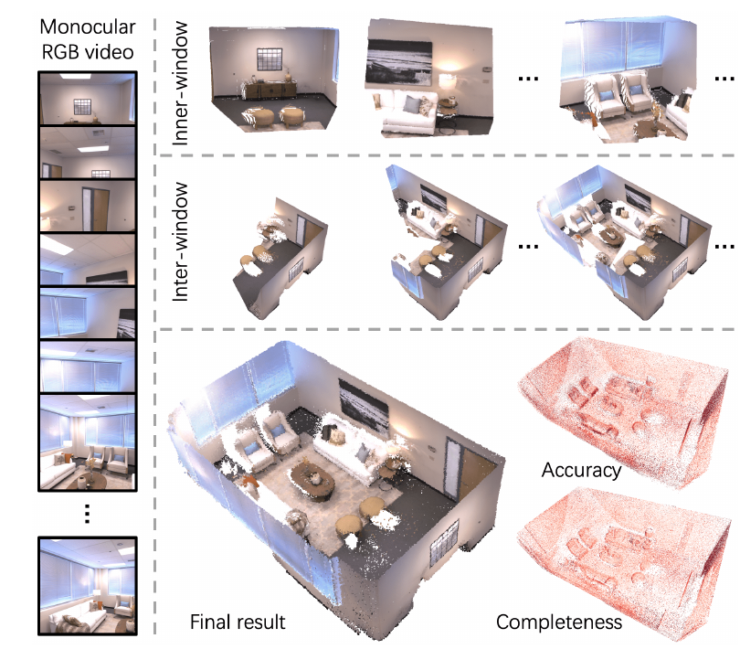
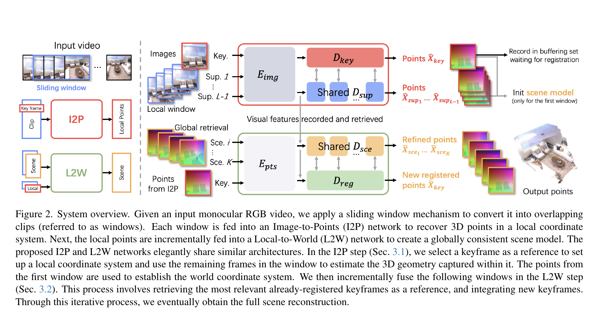
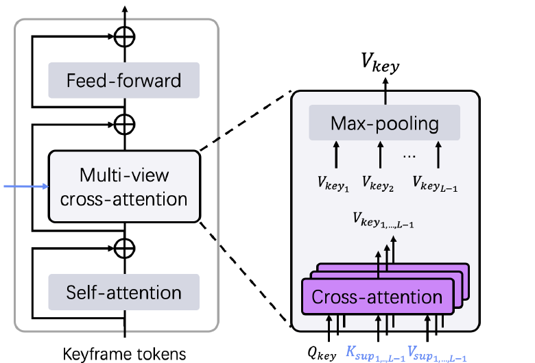
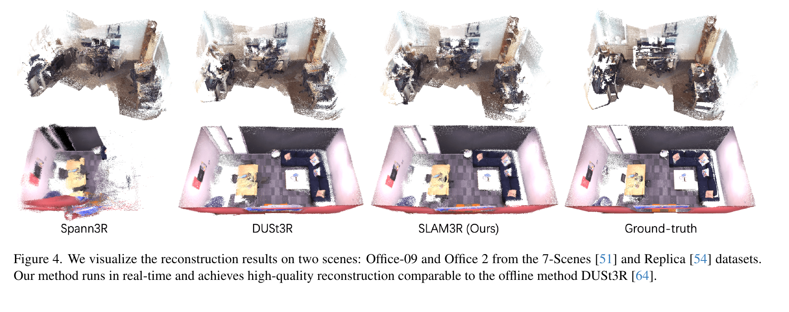
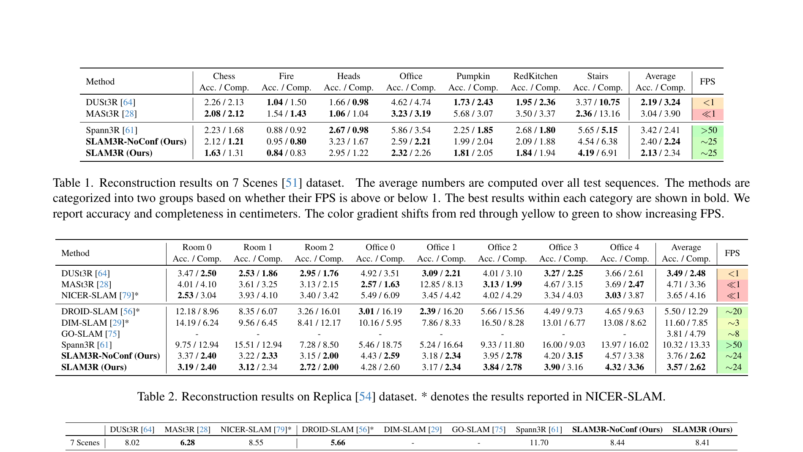
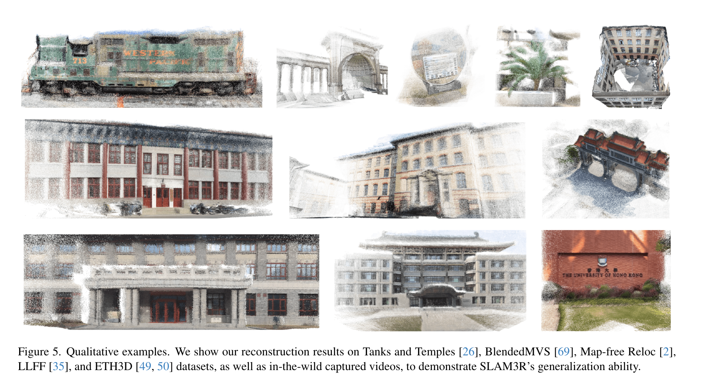
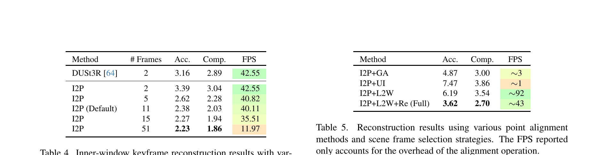
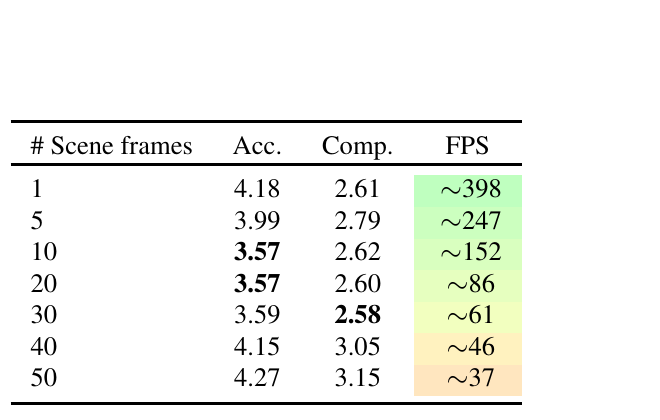
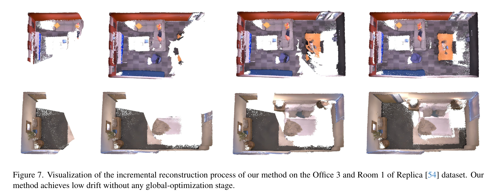

# SLAM3R 论文解读

> Yuzheng Liu、Siyan Dong、Shuzhe Wang、Yingda Yin、Yanchao Yang、Qingnan Fan、Baoquan Chen，*SLAM3R: Real-Time Dense Scene Reconstruction from Monocular RGB Videos*，CVPR 2025 正式版，论文第 16651–16662 页。[CVPR 论文页](https://openaccess.thecvf.com/content/CVPR2025/html/Liu_SLAM3R_Real-Time_Dense_Scene_Reconstruction_from_Monocular_RGB_Videos_CVPR_2025_paper.html) · [论文 PDF](https://openaccess.thecvf.com/content/CVPR2025/papers/Liu_SLAM3R_Real-Time_Dense_Scene_Reconstruction_from_Monocular_RGB_Videos_CVPR_2025_paper.pdf) · [补充材料](https://openaccess.thecvf.com/content/CVPR2025/supplemental/Liu_SLAM3R_Real-Time_Dense_CVPR_2025_supplemental.pdf) · [官方代码](https://github.com/PKU-VCL-3DV/SLAM3R)

SLAM3R 从单目 RGB 视频逐步恢复稠密场景点云。系统把输入视频切成重叠窗口，在窗口内部预测局部坐标系下的稠密点图，再将新窗口的关键帧配准到已经建立的全局场景。前一阶段称为 Image-to-Points（I2P），后一阶段称为 Local-to-World（L2W）。两者都由前馈网络完成，推理时不显式求解相机内参、相机位姿或 bundle adjustment。

这里的“SLAM”指系统在线增量构造全局场景模型。论文的核心输出是点云；相机位姿不是主干网络的显式预测量。作者另外从点图估计位姿并报告 ATE-RMSE，但该评测使用数据集给定的相机内参。因此，SLAM3R 的主要证据是稠密重建的准确度、完整度与运行速度，不能把它的位姿结果直接等同于专门的视觉定位系统。

*原论文图 1。输入帧先组成局部窗口，各窗口分别重建，再逐步配准成全局点云；图中同时展示了最终场景和准确度、完整度的误差可视化。*

## 两级坐标关系

设视频帧为 $I_1,\ldots,I_N$。系统以滑动窗口截取连续片段 $W_i$，默认窗口长 11 帧、步长为 1。窗口中的一帧作为关键帧，其余帧是支持帧。I2P 以关键帧定义局部坐标系，预测关键帧及支持帧的点图；L2W 再把新关键帧点图映射到场景坐标系。窗口之间的重叠让每个输入帧都能在某个窗口中担当关键帧，同时为相邻局部重建提供视觉连续性。

*原论文图 2。I2P 从窗口图像产生关键帧与支持帧的局部点图；L2W 接收关键帧点图和检索到的场景帧，把它注册进场景坐标系并更新全局几何。*

这套分层设计把两个问题分开处理：I2P 负责“这一小段视频里有哪些三维点”，L2W 负责“这张局部点图应落在已有场景的什么位置”。论文称其为端到端稠密重建系统，是指局部几何预测和全局坐标注册都由训练好的前馈网络完成；它并不意味着系统内部没有阶段划分，也不意味着位姿图或 BA 在后台迭代求解。

## I2P 如何融合窗口中的多帧

I2P 采用 DUSt3R 风格的共享图像编码器和点图回归头。默认选取窗口中间帧作为关键帧，因为作者认为它通常与窗口其他帧有较大的共同视野。各图像先独立编码为 token。关键帧解码器 $D_{key}$ 处理关键帧 token；支持帧解码器 $D_{sup}$ 则分别以关键帧特征为条件处理每个支持帧。

关键帧解码器中的多视图交叉注意力，是 I2P 针对多张支持图像所作的改动。关键帧 token 作为查询，依次读取每张支持帧的键和值；每张支持帧单独产生的注意力结果再经过 max-pooling 汇总。这样，关键帧能够从不同视角吸收信息，而注意力计算不需要把所有支持帧简单拼成一组共享键值。支持帧解码器则用关键帧 token 作为条件，为每张支持图像生成自己的特征。解码特征经过点图头，输出每帧的稠密三维点及逐点置信度。

*原论文图 3。关键帧 token 分别与支持帧 token 交互，再将各支持视图的结果做 max-pooling；支持视图信息由此汇入关键帧表示。*

训练时，I2P 的点图监督要消除每个窗口独立尺度的任意性。令 $X_i$ 与 $\hat X_i$ 为真值和预测点图，$z$ 与 $\hat z$ 分别表示把对应点图缩放到规范尺度所用的平均有效点距；$M_i$ 是有效真值点掩码，$\hat C_i$ 是预测置信度。论文采用置信度加权的点误差，并用对数项约束置信度：

$$
\mathcal L_{I2P}=\sum_i M_i\cdot\left(\hat C_i\,\mathcal L_1\!\left(\frac{1}{\hat z}\hat X_i,\frac{1}{z}X_i\right)-\alpha\log\hat C_i\right).
$$

$\mathcal L_1$ 是逐点欧氏距离，掩码排除无效深度；归一化后，监督关注窗口内的相对几何，不要求每个局部窗口先恢复一致的绝对尺度。置信度乘在点误差前，使模型可表达不同点的可靠程度；$-\alpha\log\hat C_i$ 则避免所有置信度都被压到零。预测置信度后续也参与场景帧选择和几何可靠性判断。

## L2W 如何把点图放入场景

第一段窗口用于初始化场景坐标系。系统对窗口中的各帧轮流尝试作为关键帧，重复运行 I2P 共 $L=5$ 次，再选总置信度最高的一次结果作为初始场景；窗口内得到的帧都可作为初始场景帧。之后每次新窗口到来，系统取它的关键帧点图，并从有限的场景帧缓冲区检索可作参照的历史帧。

缓冲区采用 reservoir sampling，最多保存 $B$ 张已注册场景帧。开始时先填满缓冲区；第 $i$ 张后续场景帧以 $B/i$ 的概率进入缓冲区，并随机替换一张现有帧。这个规则使缓冲区成为已处理场景帧的无偏有界样本，而不是只保留最近的连续片段。这样，长视频中的新窗口仍有机会从更早的场景区域找到参照。

检索模块根据图像特征相似度和视角基线，为待注册关键帧挑选 top-$K$ 张场景帧。相似视图提供外观对应线索，合适的基线则提供互补几何；单纯选图像最相似的近邻，可能得到几张几乎重复的视角。默认 $K$ 随数据集配置为 5 或 10。检索网络复用 I2P 的部分解码器结构，输出与 I2P 置信度相关的匹配分数。

L2W 将检索到的场景帧图像特征、对应的全局点图以及新关键帧局部点图编码进同一组几何 token。图像特征包含外观信息，点图嵌入则把三维结构显式带入网络。注册解码器 $D_{reg}$ 预测新关键帧点图在世界坐标中的位置；场景解码器 $D_{sce}$ 对检索到的场景帧作联合细化，但保持已有世界坐标系不变。后者让新的观测能够修正相关区域的几何，而无需重置整张地图。

*原论文图 4。图中给出 7-Scenes 的 Office-09 与 Replica 的 Office 2 重建对比；SLAM3R 的场景完整度接近离线 DUSt3R，同时保持在线处理速度。*

在 I2P 中，预测点图先按窗口规范尺度比较；到了 L2W，场景坐标的尺度已经由已注册的点云确定，不能再独立归一化新窗口。L2W 因而使用不做尺度归一化的置信度加权点损失：

$$
\mathcal L_{L2W}=\sum_i M_i\cdot\left(\hat C_i\,\mathcal L_1(\hat X_i,X_i)-\alpha\log\hat C_i\right).
$$

这里 $X_i$ 和 $\hat X_i$ 都在全局坐标系中。尺度差异会直接反映为点误差，模型须学习把新窗口放到已有世界坐标下。与经典几何配准相比，这一步将对齐函数本身也纳入训练，但系统没有显式的位姿变量供后端做全局 BA。

## 训练和在线推理

I2P 与 L2W 使用相似的 ViT 编码器和 Transformer 解码器架构；检索模块还复用 I2P 解码器的前几层。I2P 从多视图监督数据学习局部点图，L2W 则学习新关键帧与已注册场景帧之间的全局坐标注册。两阶段训练目标都使用逐点置信度，但监督坐标系及尺度处理不同。论文报告模型在 8 张 NVIDIA 4090D 上训练，测试时在单张 RTX 4090D 上运行；每个新窗口默认以 11 次 I2P 推理尝试各帧作为关键帧，滑动步长为 1，图像中心裁剪并缩放至 $224\times224$。

需要区分论文表格中的速度口径。主实验报告完整系统约 24–25 FPS；L2W 消融表和补充材料的场景帧数表则只统计点云对齐部分的开销，不能直接当作端到端帧率。补充材料显示，一次配准更多关键帧可以摊薄部分开销，但扩大检索场景帧数量会增加 L2W 计算量。

## 重建结果与消融

主实验在 7-Scenes 和 Replica 上比较准确度（Acc.）与完整度（Comp.），两项单位均为厘米，数值越小越好。作者用 Umeyama 对齐和 ICP 将预测点云对到真值后评估重建误差；系统 FPS 按论文报告。表 1–2 的完整对比包含不同速度类别的方法，因此精度数字要结合速度一起看。

*原论文表 1–3。表 1 为 7-Scenes、表 2 为 Replica 的 Acc./Comp.（厘米）和 FPS；表 3 为使用 ATE-RMSE（厘米）评估的相机位姿。*

在 7-Scenes 上，SLAM3R 平均 Acc./Comp. 为 2.13/2.34 cm，约 25 FPS；在 Replica 上为 3.57/2.62 cm，约 24 FPS。对照中，DUSt3R 在 7-Scenes 的平均值为 2.19/3.24 cm，但低于 1 FPS；Spann3R 的完整度略优于 SLAM3R（2.41 对 2.34 cm），速度超过 50 FPS，而准确度为 3.42 cm。换言之，SLAM3R 在这组重建表格中表现为较好的精度与速度折中，论文并未在所有指标上都优于所有对照。

*原论文图 5。示例包含 Tanks and Temples、BlendedMVS、Map-free Reloc、LLFF、ETH3D 和作者采集的真实视频，展示模型跨场景外观的定性结果；图像样例本身不能替代定量泛化评测。*

位姿表格的解读需更谨慎。论文从预测点图恢复相机位姿，并使用数据集的真实相机内参运行 PnP-RANSAC，再以 ATE-RMSE 评估。7-Scenes 上 SLAM3R 的位姿误差为 8.41 cm，Replica 上为 6.61 cm；DROID-SLAM 在 Replica 上为 0.33 cm。作者明确指出，缺少显式相机参数预测使系统无法执行标准全局 BA，位姿估计不及专门的 SLAM 系统。该表不能被解读为未知内参条件下的相机定位成绩，因为它使用了真值内参。

I2P 的窗口长度消融表明，多视图上下文在小范围内带来收益：Replica 上窗口由 2 帧增至默认 11 帧时，Acc./Comp. 从 3.39/3.04 降至 2.38/2.03 cm；扩到 51 帧只小幅改善至 2.23/1.86 cm，但速度从约 40 FPS 降至约 12 FPS。更长窗口增加可见信息，也让注意力计算更重，边际精度收益逐渐变小。

L2W 消融比较几何对齐与学习式注册。使用几何对齐（I2P+GA）得到 4.87/3.00 cm，结合 Umeyama 与 ICP（I2P+UI）为 7.47/3.86 cm；仅用学习式 L2W 为 6.19/3.54 cm；加入场景帧检索后完整方案为 3.62/2.70 cm。表中约 43 FPS 是对齐操作的计时，不是完整 SLAM3R 的帧率。结果支持的结论是：L2W 的作用依赖合适的历史参照，检索与学习式更新共同构成主要配准方案。

*原论文表 4–5。表 4 比较 I2P 窗口帧数；表 5 比较全局配准方法，FPS 仅统计对齐操作开销。*

补充材料中的场景帧数量消融也呈现相似取舍：L2W 参照帧从 1 增至 10 时，Replica 的 Acc. 从 4.18 降到 3.57 cm；从 10 增至 20 或 30 帧，准确度基本持平，而对齐速度继续下降。增至 40–50 帧后，精度反而变差。作者将这一现象归因于无关场景帧增多：可用上下文不等于有效上下文，检索质量和预算同样重要。

*补充材料表 9。场景帧数量增加到约 10–30 张时误差较低，继续增加则精度和速度都可能下降。*

补充材料还展示了 Replica 场景的增量重建过程。作者报告该过程没有额外的全局优化阶段，仍能得到低漂移结果。这是定性可视化证据，说明网络配准在所展示轨迹上能够稳定累计；它不构成对任意长轨迹都无漂移的保证。

*补充材料图 7。Office 3 与 Room 1 的重建逐步扩展到更多可见区域；论文将示例描述为没有全局优化的低漂移增量重建。*

## 方法关系与适用边界

SLAM3R 与 [Spann3R](../spann3r/index.md)、[CUT3R](../cut3r/index.md) 一样，尝试以学习式前馈模型维护在线稠密几何，但它采用窗口层次：I2P 在一个局部窗口内联合处理多帧，L2W 再用检索出的场景帧把局部关键帧写入全局点云。Spann3R 逐帧把几何特征传播到世界坐标；CUT3R 维护循环式持久状态。SLAM3R 则显式保留一组图像及其已注册点图，作为学习式注册的参照。

与 [MASt3R-SLAM](../mast3r-slam/index.md) 这类带几何优化后端的系统相比，SLAM3R 将更多坐标对齐能力交给网络，换得简化的在线前向流程，也放弃了相机参数和全局位姿图优化带来的可解释约束。它适合用来研究“局部稠密预测如何变成可增量累积的场景模型”；若任务要求可靠相机定位、闭环后的轨迹一致性或全局几何可控优化，论文自身报告的位姿结果和无 BA 设计都构成明确边界。

从流式三维重建角度看，SLAM3R 的核心问题不在点图能否预测，而在局部坐标能否稳定注册到一个不断增长的场景。它用有限场景帧缓冲和图像检索构造长期参照，再以训练好的 L2W 网络完成新旧几何融合。这条路线减少了显式优化步骤，但也使长期一致性更依赖检索到的上下文是否相关，以及模型能否泛化到训练分布之外的视角与场景。
