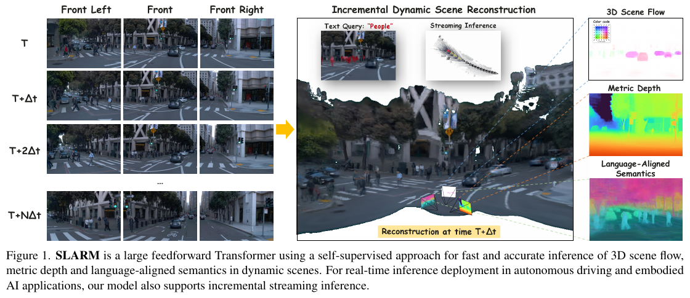
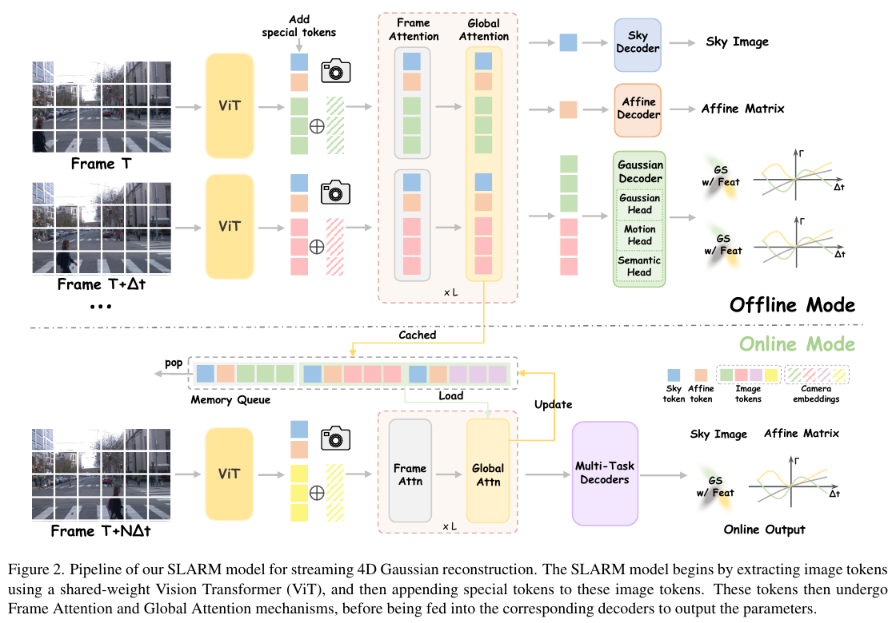
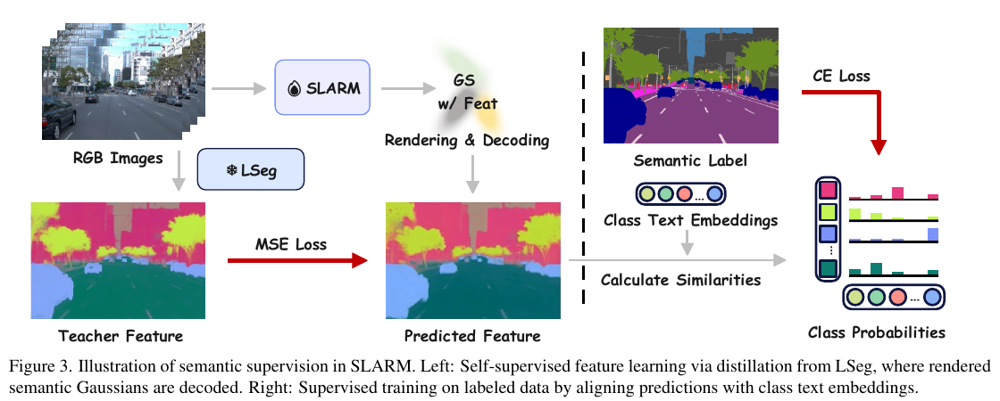
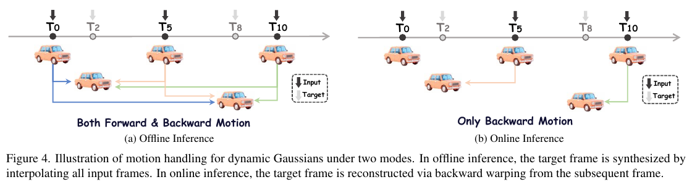
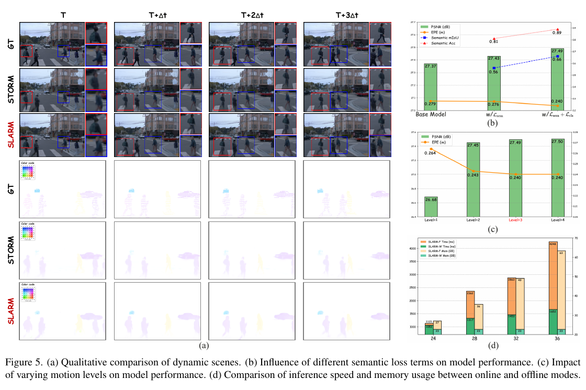
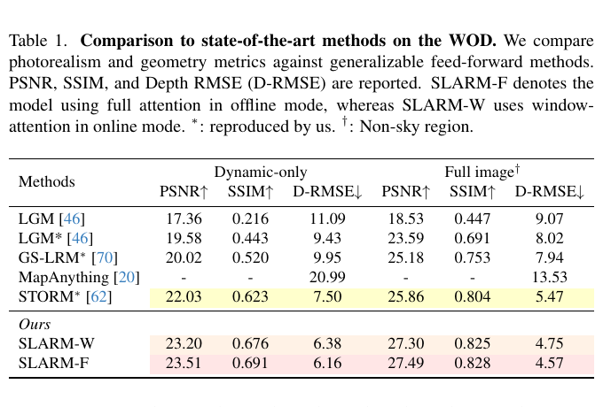
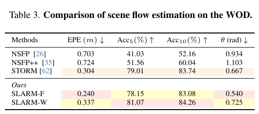
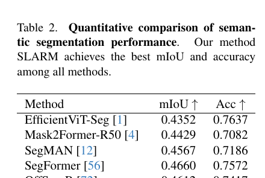
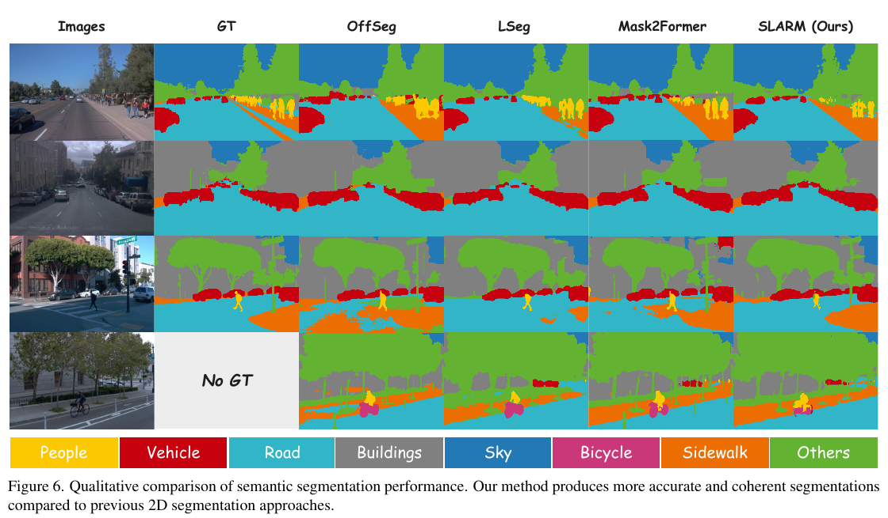

# SLARM 论文解读

> **论文**：SLARM: Streaming and Language-Aligned Reconstruction Model for Dynamic Scenes  
> **作者**：Zhicheng Qiu、Jiarui Meng、Tong-an Luo、Yican Huang、Xuan Feng、Xuanfu Li、Zhan Xu  
> **版本**：CVPR 2026 正式论文（arXiv:2603.22893v3）  
> **论文页面**：[CVPR Open Access](https://openaccess.thecvf.com/content/CVPR2026/html/Qiu_SLARM_Streaming_and_Language-Aligned_Reconstruction_Model_for_Dynamic_Scenes_CVPR_2026_paper.html) · **PDF**：[CVPR 论文 PDF](https://openaccess.thecvf.com/content/CVPR2026/papers/Qiu_SLARM_Streaming_and_Language-Aligned_Reconstruction_Model_for_Dynamic_Scenes_CVPR_2026_paper.pdf) · [arXiv 版本](https://arxiv.org/abs/2603.22893) · [作者代码](https://github.com/kevinchiu19/SLARM)

SLARM 面向已知相机内外参的动态视频，单次前向计算同时预测逐像素的 3D Gaussian、Gaussian 的时间位移以及语言对齐语义特征。论文试图把三种能力放进同一套可微渲染表示：重建当前画面、描述场景如何运动、并让三维内容可以用类别文本查询。它与流式重建和 SLAM 主题相邻，但输入已经包含相机位姿，论文并未解决相机定位、回环或全局地图优化，因此应理解为带动态与语义输出的流式 4D 重建模型，而不是完整 SLAM 系统。

*图 1：模型从不同时刻的多相机图像构建动态场景，并展示重建、场景流、深度与语义查询等输出。图中的流式能力依赖输入相机信息，模型本身不估计相机轨迹。*

## 问题背景与论文贡献

NeRF 和 3D Gaussian Splatting 推动了场景重建效率的发展，动态场景方法也能建模随时间变化的内容，但不少系统需要对每个场景单独优化，运行时间从数分钟到数小时。VGGT 等前馈模型提高了重建的通用性和推理速度，不过主要面向静态几何。动态视频还要求模型区分相机运动与物体运动，并把每一时刻的几何关联起来。

论文特别比较了 STORM 所采用的速度式运动表示。STORM 预测瞬时速度，并假定短时间内速度保持不变；当运动速度或方向明显变化时，这个假设难以描述行走时四肢的非匀速动作。STORM 还以离线批处理为主，只关注几何重建，缺少语言语义输出。SLARM 将问题组织成一个带时间形变的 4D Gaussian 表示，增加高阶运动系数、语言特征蒸馏和在线因果推理。

论文的贡献可归纳为四点：用高阶位移函数表达非均匀运动，并依靠渲染监督学习场景流；把 LSeg 的语言对齐特征蒸馏到运动 Gaussian 上；通过因果窗口和紧凑记忆队列增量处理视频；在同一模型中联合学习几何、运动和语义。论文报告的总体结果是场景流精度、重建 PSNR 和语义分割 mIoU 分别有提升，但各实验变体和指标的差别需要结合表格解释。

## 相关工作中的位置

动态场景重建从动态 NeRF 发展到 4D Gaussian 等更高效的表示。论文认为，已有方法分别受到训练监督、运动先验或输入类型限制：4DGT 需要稠密三维监督，MoVieS 依赖预计算轨迹或多视图立体信息，而 STORM 的线性运动假设无法覆盖复杂非刚体运动。SLARM 的目标是从带位姿的二维图像中隐式学习逐 Gaussian 运动，并通过时间一致的可微渲染监督它。

在语义三维理解方面，LERF 将视觉语言特征蒸馏进辐射场，后续 Gaussian 方法提升了三维语义表达，但通常依赖逐场景优化或额外计算。Uni3R 将静态重建与语言语义统一起来，尚未描述时间变化。SLARM 将每个 Gaussian 的语义特征随几何一同变形，使语言查询关联到动态场景。这里的“语言对齐”指向 LSeg/CLIP 特征空间中的类别判别与文本查询能力，不意味着模型直接生成自然语言描述。

流式感知工作还包括 SLAM、显式记忆池和序列模型。SLARM 的选择是当前帧单独编码，并让当前 token 与有限历史状态交互，以限制每帧计算和缓存规模。与 StreamVGGT、STream3R 这类逐帧三维重建相比，SLARM 还显式输出动态 Gaussian、场景流和语义；但它需要已知相机位姿，且没有 SLAM 后端的位姿优化、回环和地图一致性模块。

## 方法

### 输入、网络与输出

给定视频帧序列 \(\{I_t\}_{t=1}^{T}\)，以及已知的相机内参 \(K_t\) 和外参 \(P_t\in SE(3)\)，模型需要逐时刻重建几何与外观、预测场景流，并为 Gaussian 附加可查询的语义。内参和外参提供了从图像像素到相机射线的几何约束；缺少它们时，论文定义的输入条件就不成立。

每帧先由共享权重的 ViT 切成非重叠 patch 并提取图像 token。模型把各像素视线表示成 6D Plücker 坐标，线性投影后加到视觉 token 上；这样特征同时带有该像素来自哪条空间射线的信息。可学习的绝对时间嵌入为 token 标记时间位置。随后加入两个专用 token：Sky token 用来表示天空背景，Affine token 用于吸收不同相机间的曝光和白平衡差异。经过这些输入增强后，Alternating-Attention Transformer 交替执行帧内注意力和跨帧全局注意力，分别建模每帧内部结构和时空关系。

解码器按像素预测 Gaussian 的中心 \(\mu\)、旋转四元数 \(q\)、尺度 \(s\)、不透明度 \(\alpha\) 和颜色 \(c\)。中心由相机射线上的深度得到：\(\mu=o+d\cdot r\)，其中 \(o\) 与 \(r\) 分别是相机坐标系下射线原点和方向，\(d\) 是预测深度。另两个输出头预测动态属性和语言对齐语义向量。因为输出与输入像素对齐，像素可以直接产生一个三维 Gaussian，再由可微渲染器汇总成图像、深度、流或语义图。

*图 2：离线模式对输入帧进行全局交互；在线模式从记忆队列读取有限历史 token，处理新帧后更新队列，并输出 Gaussian、运动与语义结果。*

主文引用了补充材料以说明网络架构细节，但公开 CVF 补充 PDF 地址无法取得（返回 404），arXiv 页面及作者代码仓库也未列出单独的补充文件。所以下文只陈述正式论文主文能确认的网络结构，不补写层数、窗口大小等未在主文给出的数值。

### 高阶动态表示与渲染监督

普通位移场需要在各个时间点分别给出物体位置。STORM 改为预测瞬时速度，但恒定速度难以拟合非均匀运动。SLARM 对每个 Gaussian 预测一组时间系数，用有限阶 Taylor 展开表示位移随时间的变化。对第 \(l\) 阶，网络预测标量速度大小 \(s_l\) 和三维方向向量 \(v_l\)，再将方向归一化并得到三维运动系数：

$$
m_l=s_l\cdot\frac{v_l}{\|v_l\|_2}. \tag{1}
$$

因此，\(s_l\) 控制该阶运动的幅度，而 \(v_l/\|v_l\|_2\) 控制方向。对时间偏移 \(\Delta t\)，各阶系数按 Taylor 项相加：

$$
\Gamma(\Delta t)=\sum_{l=0}^{L-1}\frac{m_l\cdot(\Delta t)^{l+1}}{(l+1)!}. \tag{2}
$$

式中阶数从 0 开始：\(m_0\) 乘 \(\Delta t\)，表示速度项；\(m_1\) 乘 \((\Delta t)^2/2\)，表示加速度项；\(m_2\) 乘 \((\Delta t)^3/6\)，表示 jerk 项。论文取 \(L=3\)，因此称为三阶展开。高阶项让位移不再被固定方向、固定速度限制，但系数仍由网络从训练数据中学习，并不等于独立测量了物理速度或加速度。

运动学习不使用三维场景流标签。设时刻 \(t\) 的 Gaussian 集合为 \(\mathcal{G}_t=\{\mu_i,\alpha_i,q_i,s_i,c_i\}_{i=1}^N\)。预测时只移动中心，其他 Gaussian 属性暂时保持不变：

$$
\mathcal{G}_{t\to t+\Delta t}=\{\mu_i+\Gamma_i(\Delta t),\alpha_i,q_i,s_i,c_i\}_{i=1}^N. \tag{3}
$$

对这个变形后的 Gaussian 集合进行可微渲染，得到合成图像 \(\hat I_{t+\Delta t}\)。网络通过合成图像与监督帧 \(I_{t+\Delta t}\) 之间的像素差和感知差来约束位移：

$$
\mathcal{L}_{rgb}=\|\hat I_{t+\Delta t}-I_{t+\Delta t}\|_2^2+
\lambda_{lpips}\operatorname{LPIPS}(\hat I_{t+\Delta t},I_{t+\Delta t}),\quad \lambda_{lpips}=0.05. \tag{4}
$$

像素项要求投影外观接近目标帧，LPIPS 项则比较感知特征，降低逐像素误差对轻微纹理差异过于敏感的问题。两项都通过渲染结果把误差信号传回位移参数。论文所说的“无流监督”指训练目标中没有场景流真值；它仍使用目标图像、深度等其他监督。

*图 3：左侧用冻结的 LSeg 产生教师特征，与渲染得到的语义特征做 MSE；右侧在有标签数据上，以类别文本嵌入计算相似度并训练分类概率。*

### 语言对齐的动态语义

每个 Gaussian 另带语义向量 \(f_j^{sem}\)。它和 Gaussian 一起按式 (2) 的运动函数移动，因此在目标时间渲染时，语义属性也随 Gaussian 的位置参与 alpha blending。这样输出的语义图和 RGB 图来自同一套动态三维原语，而不是先做二维分割再单独拼接到场景上。

第一阶段以冻结的 LSeg 提取监督帧特征 \(\tilde F_{t+\Delta t}\)，将渲染出的 Gaussian 语义图经过轻量 MLP 降维后得到 \(\hat F'_{t+\Delta t}\)，用均方误差对齐：

$$
\mathcal{L}_{sem}=\|\tilde F_{t+\Delta t}-\hat F'_{t+\Delta t}\|_2^2. \tag{5}
$$

这是特征蒸馏：模型拟合的是 LSeg 的稠密语言视觉特征，而不只是一个固定类别标签。对具有语义标注的数据，论文还增加分类监督。每个位置的预测特征 \(f_{ij}\) 与类别文本嵌入 \(t_k\) 做内积，再按温度 \(\tau=0.07\) 缩放并经 softmax 得到类别概率；对标注类别 \(k_{ij}\) 计算交叉熵：

$$
\mathcal{L}_{cls}=\frac{1}{hw}\sum_{i,j}-\log\frac{\exp(f_{ij}\cdot t_{k_{ij}}/\tau)}{\sum_{k=1}^{K}\exp(f_{ij}\cdot t_k/\tau)}. \tag{6}
$$

式 (5) 让三维特征继承开放词汇的视觉语义空间，式 (6) 则用 WOD 类别标签把特征进一步拉向数据集类别。文中描述的最终训练先用 \(\mathcal{L}_{sem}\) 训练 200k 次，再用 \(\mathcal{L}_{cls}\) 替换该项额外训练 3k 次；两种语义损失是分阶段使用，不是同时相加。

### 因果流式重建

离线重建能够同时读取过去和未来帧，适合用双向运动补足时间上的遮挡与空洞。在线系统只能使用当前及历史观测，不能依赖尚未到达的未来帧。SLARM 因此区分离线与在线两种工作方式：离线可以从多帧向目标时刻插值；在线则用新观测到的内容向历史时刻回溯动态 Gaussian，同时保留静态几何。

令 \(\phi\) 为因果重建器，在时刻 \(t\) 输出 Gaussian 集合和相应运动场：

$$
(\mathcal{G}_t,\Gamma_t)=\phi(I_t\mid I_{t-\Delta t},I_{t-2\Delta t},\ldots). \tag{7}
$$

这里的条件帧只来自当前时刻之前，论文通常取时间跨度 \(\Delta t=5\)。新帧产生的动态 Gaussian 会向最近历史时刻回溯，而静态 Gaussian 继续表示稳定背景。于是区间 \([t-\Delta t,t]\) 的表示由上一个时刻保留的静态部分、当前时刻的静态部分，以及当前动态部分回溯得到的内容合并：

$$
\mathcal{S}_{[t-\Delta t,t]}=
\underbrace{\mathcal{G}^{static}_{t-\Delta t}\cup\mathcal{G}^{static}_{t}}_{\text{静态几何}}
\cup\underbrace{\mathcal{G}^{dynamic}_{t\to t-\Delta t'}}_{\text{回溯的动态内容}}. \tag{8}
$$

这一步的作用是让当前输出同时补充新观测到的物体和维持历史背景，减少切换时间点时动态区域留下的渲染空洞。原文中的 \(\Delta t'\) 没有在式 (8) 旁重新定义，正文按图 4 和前后文将它理解为回溯的目标时间偏移；这处符号没有在论文中进一步澄清。

每个 Gaussian 根据位移幅度划分为静态或动态集合：

$$
\mathcal{G}^{static}=\{g\in\mathcal{G}\mid\|\Gamma_g(\Delta t)\|\leq\tau_m\},\qquad
\mathcal{G}^{dynamic}=\{g\in\mathcal{G}\mid\|\Gamma_g(\Delta t)\|>\tau_m\}. \tag{9}
$$

\(\tau_m>0\) 是运动阈值。位移不超过阈值的 Gaussian 被视为静态，保留其空间位置来维持几何连续性；其余 Gaussian 作为动态内容按运动场回溯。阈值的具体数值没有在主文给出。

*图 4：离线模式使用多个已知时刻的输入，对目标时刻做插值；在线模式使用到达的当前观测，只把动态 Gaussian 回溯至最近历史时刻。*

### 训练损失与实现

论文在每个训练窗口中聚合观测帧，随机抽取若干插值时间并渲染监督。总目标由 RGB、深度、天空透明度、运动正则和语义特征项组成：

$$
\mathcal{L}_{total}=\mathcal{L}_{rgb}+\mathcal{L}_{depth}+\lambda_{sky}\mathcal{L}_{sky}+
\lambda_{reg}\mathcal{L}_{reg}+\lambda_{feat}\mathcal{L}_{feat}. \tag{10}
$$

RGB 项就是式 (4) 的像素与感知损失。深度一致性项只在具有有效深度标签的像素集合 \(M_{valid}\) 上计算 L1 误差：

$$
\mathcal{L}_{depth}=\frac{1}{|M_{valid}|}\sum_{p\in M_{valid}}\|\hat D_p-D_{gt,p}\|_1. \tag{11}
$$

\(D_{gt,p}\) 是真值深度，\(\hat D_p\) 是预测深度。这个约束使颜色相似但几何错误的 Gaussian 也受到惩罚。天空区域由 DepthAnythingV2 的零深度像素产生掩码，天空损失压低这些位置的渲染不透明度：

$$
\mathcal{L}_{sky}=\frac{1}{|M_{sky}|}\sum_{p\in M_{sky}}\hat A_p. \tag{12}
$$

其中 \(\hat A_p\) 是像素的 alpha 值。它鼓励天空保持透明，避免天空背景被错误解释成前景三维结构。运动正则项抑制各阶系数的幅度：

$$
\mathcal{L}_{reg}=\sum_{l=0}^{3}\|m_l\|_2^2. \tag{13}
$$

正文在式 (2) 中采用 \(L=3\)，这对应 \(l=0,1,2\) 三个系数；但式 (13) 的求和上限写为 3，包含 \(m_3\)。这与前文定义的三阶展开不一致。此处保留原文公式，不擅自把上限改成 2；按前文符号定义理解时，作者可能意在对实际使用的三个系数正则化，但论文主文没有说明这一点。

特征项在语义蒸馏和带标注分类两种损失中选择：

$$
\mathcal{L}_{feat}=\mathcal{L}_{sem}\vee\mathcal{L}_{cls}. \tag{14}
$$

这里 \(\vee\) 表示“或”：先用式 (5) 的蒸馏损失训练 200k 次，再改用式 (6) 的分类损失训练 3k 次。损失权重为 \(\lambda_{sky}=0.1\)、\(\lambda_{reg}=0.005\)、\(\lambda_{feat}=1.0\)。训练使用 AdamW、batch size 64，在 64 张 Huawei Ascend 910B NPU 上训练 200k 次，作者报告训练历时 4 天。

*图 5： (a) 比较真值、STORM 和 SLARM 的行人姿态及场景流；(b) 展示不同语义监督下的指标变化；(c) 比较不同运动阶数；(d) 对照离线与在线模式的时间和内存趋势。*

## 实验

### 数据集与动态重建

主要实验在 Waymo Open Dataset（WOD）上进行，作者使用 1,000 段约 20 秒、10 fps 的驾驶视频，其中 798 段训练、202 段验证。每段约 200 帧。输入图像下采样到 \(160\times240\)，用于提取 LSeg 特征的图像分辨率为 \(320\times480\)。这套设置提供同步多相机图像和已知相机位姿，评价的是该输入条件下的重建与理解能力。

重建质量用 PSNR、SSIM 和深度 RMSE 衡量，并分别统计动态区域和整幅非天空图像。表 1 中，离线全注意力模型 SLARM-F 在动态区域达到 23.51 dB PSNR、0.691 SSIM、6.16 深度 RMSE；在线窗口模型 SLARM-W 对应为 23.20、0.676、6.38。非天空全图的 PSNR 分别为 27.49 和 27.30 dB。相较 STORM，SLARM-F 的整图 PSNR 从 25.86 提高到 27.49 dB，动态区域 PSNR 从 22.03 提高到 23.51 dB，SSIM 从 0.623 提高到 0.691。离线模型效果略好，在线模型以有限历史换取逐帧因果处理。

*表 1：对比可泛化前馈重建方法，分别报告动态区域与非天空整图的 PSNR、SSIM 和深度 RMSE。SLARM-F 使用离线全注意力，SLARM-W 使用在线窗口注意力；星号标记作者复现的基线。*

### 场景流估计

场景流在 WOD 验证集上与三维真值比较，指标包括三维端点误差 EPE3D、Acc5、Acc10 和角度误差 \(\theta_{err}\)。Acc5 与 Acc10 衡量落在相应误差阈值内的预测比例，EPE 与角度误差越低越好。作者指出，STORM 原协议只评估输入上下文帧；SLARM 的比较覆盖整段视频，包括输入帧和模型插值输出帧，因此评估范围更完整。

表 3 显示不同在线状态的指标并非全面一致。SLARM-F 的 EPE 为 0.240 m、角误差为 0.540 rad，优于 STORM 的 0.304 m 与 0.667 rad；SLARM-W 的 Acc5/Acc10 为 81.07%/84.26%，高于 STORM 的 79.01%/83.74%，但其 EPE 和角误差分别为 0.337 m、0.725 rad，反而较差。因此，摘要中约 21% 的运动精度提升对应离线 SLARM-F 相对 STORM 的 EPE 改善；不能据此认为窗口在线变体在所有场景流指标上都超过 STORM。

*表 3：SLARM-F 的 EPE 与角误差最低，SLARM-W 的 Acc5 和 Acc10 最高；在线与离线版本在不同指标上各有优势。*

### 三维语义分割

语义分割使用 WOD 验证集中的有标签图像，与预训练于 Cityscapes 的 2D 分割方法比较，并把评估分辨率统一为 \(160\times240\)。SLARM 的 mIoU 为 0.6663、准确率为 0.8923；表 2 中较强的 Mask2Former-Swin 对应 0.5505、0.8192，LSeg 对应 0.4876、0.7976。论文将提升归因于 LSeg 语义先验、类别标注监督和三维几何共同提供的约束。推理时把预测特征与 CLIP 类别文本嵌入比较，得到每个 Gaussian 的文本类别，再投影到图像上。图 6 显示 SLARM 在行人、车辆、道路和人行道等类别上得到较连贯的区域结果。

*表 2：以 mIoU 和像素准确率比较 2D 分割基线与 SLARM。*

*图 6：列为输入图像、真值和各模型的分割结果；SLARM 的输出来自重建后的语言对齐特征。第四行没有真值。*

### 定性结果与消融

图 5(a) 中，STORM 依据恒速假设产生姿态变化较小的行人重建；SLARM 的行人姿态和流向随时刻变化，更接近真值。场景流彩色可视化也显示 SLARM 能表达速度与方向变化。图 5(b) 显示先加入 LSeg 蒸馏，再加入类别损失时，场景流 EPE 下降；PSNR 与语义指标同步改善。作者据此认为语义一致性可以充当时间正则，帮助物体维持稳定的类别身份与运动轨迹。

图 5(c) 比较一阶到四阶的运动表示。第三阶模型在作者实验中综合表现最佳；继续增加阶数带来的收益有限。图 5(d) 比较在线与离线计算：窗口注意力的在线模式随着序列增长保持较稳定的计算与内存开销，离线全注意力的耗时和内存增长更快。需要注意，主文图中给出的是特定测试设置下的趋势，正文没有提供可直接推广到手机或实时系统的硬件帧率；论文报告的训练硬件为 Ascend NPU，也不等于验证了移动端部署。

## 结论与方法边界

SLARM 用三阶时间位移函数描述动态 Gaussian，以渲染损失学习场景流；再把 LSeg 特征和类别文本监督加入同一表示，最后通过因果窗口把计算限制在当前帧与有限历史状态中。这个组合使模型能在已知相机位姿的驾驶视频上，联合输出动态重建、深度、流和语义。论文报告的主要优势是离线变体的重建与流精度、语义预测质量，以及在线变体较稳定的资源增长。

其任务边界同样重要：SLARM 接收已知相机内外参，不估计位姿，也不通过回环或全局优化修正长序列漂移。它的在线机制是一种带有限历史窗口的 4D 重建过程，不能直接等同于 SLAM 系统。作者也指出，模型目前依赖准确相机位姿，并受玻璃、镜面等复杂材质影响，因为训练依赖光度一致性；自标定和更真实的场景表达留作后续工作。

主文存在两处需要保留的疑问：式 (8) 中 \(\Delta t'\) 未充分定义，式 (13) 的求和上限与 \(L=3\) 的三系数定义不一致。另有实验结论和表格之间的细节差异：SLARM-F 与 SLARM-W 在场景流指标上各有胜项。由于独立补充材料不可取得，网络结构细节、窗口具体配置等无法据论文主文进一步核实。
