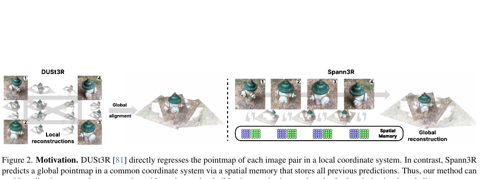
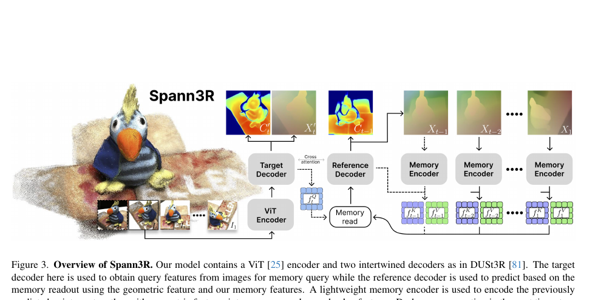
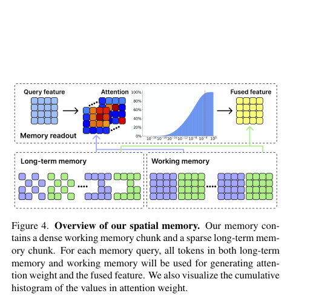
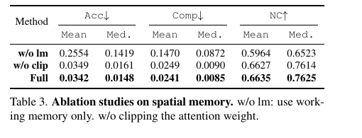
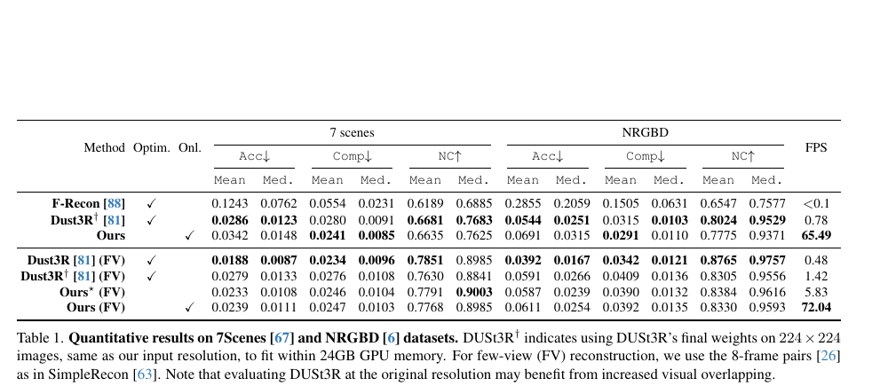
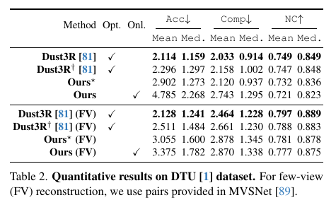
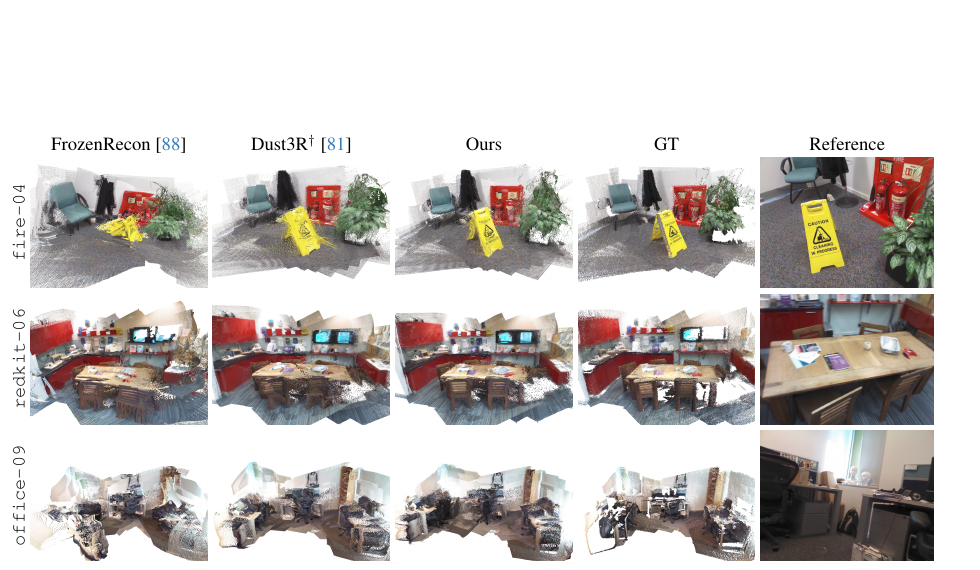
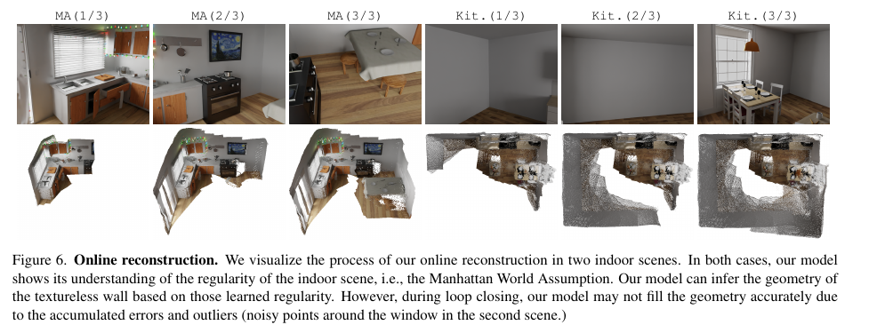
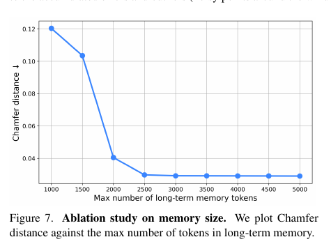
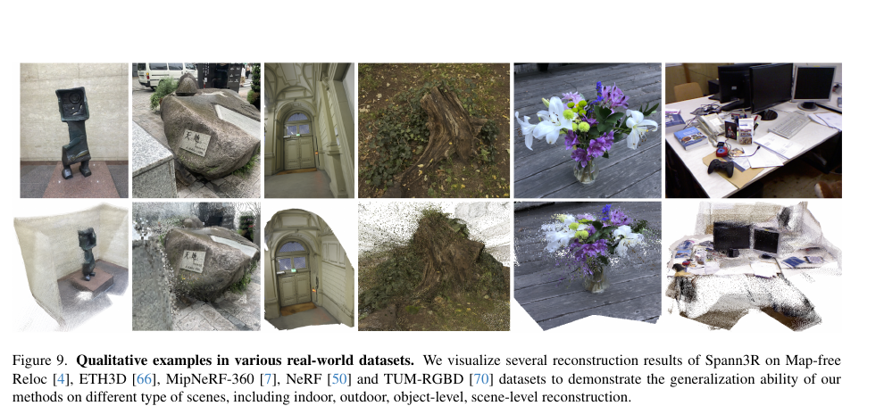

# Spann3R 论文解读

> Hengyi Wang、Lourdes Agapito，*3D Reconstruction with Spatial Memory*，发表于 3DV 2025，页码 78–89。下文依据作者在 UCL Discovery 存档的正式录用稿，共 14 页，包含补充材料。[论文项目页](https://hengyiwang.github.io/projects/spanner) · [正式录用稿 PDF](https://discovery.ucl.ac.uk/id/eprint/10215490/1/2408.16061v1.pdf) · [UCL 论文记录](https://discovery.ucl.ac.uk/id/eprint/10215490/) · [官方代码](https://github.com/HengyiWang/spann3r)

DUSt3R 从两张图像直接回归点图，避免了传统重建管线中匹配、三角化和深度估计等步骤。但每对图像的点图属于各自局部坐标系；要合并多对图像，仍要构建图关系，再通过逐场景优化把结果对齐。Spann3R 改变了跨帧几何的表达方式：每次预测都把点图放在以首帧为参考的共同坐标系中，并把此前的几何与特征写进空间记忆，供后续帧查询。

这让它能沿视频逐步输出稠密几何，不需要推理时执行全局对齐优化。模型也没有显式估计传统意义上的相机位姿轨迹；它学习在共同坐标系中回归点图。由此，Spann3R 是带长期记忆的流式重建模型，可以借鉴 SLAM 中的持续状态问题来理解，但它没有位姿图、回环优化或束调整来显式纠正累计误差。

*原论文图 2。DUSt3R 先为图像对生成局部点图，再进行全局对齐；Spann3R 则用空间记忆连接历史预测，直接在共同坐标系中递增重建。*

## 两个解码器怎样接上空间记忆

模型以 ViT 编码当前图像 $I_t$，得到视觉特征 $f_t^I$。上一时刻保留的查询特征 $f_{t-1}^Q$ 从记忆键和值中读取历史信息。读出的融合特征与当前视觉特征一起送入两个交织的解码器。它们沿用 DUSt3R 的 reference/target 双解码结构，但在 Spann3R 中分工不同：target 解码器提供后续记忆查询所需的特征；reference 解码器结合记忆读出预测点图与置信度。

*原论文图 3。当前帧经过 ViT 后进入 target decoder 和 reference decoder；target 分支形成下一步的 query，reference 分支预测点图并形成写入记忆的 key/value。图中虚线表示后续时间步的运算。*

记忆查询使用缩放点积注意力。令 $f^K$、$f^V$ 分别为记忆键和值，模型先计算 query 对所有记忆键的注意力，再用权重汇总记忆值并与 query 残差相加：

$$
A_{t-1}=\operatorname{Softmax}\!\left(\frac{f_{t-1}^{Q}(f^K)^\top}{\sqrt C}\right),\qquad
f_{t-1}^{G}=A_{t-1}f^V+f_{t-1}^{Q}.
\tag{8–9}
$$

$C$ 是特征维数，$A$ 中每一行表示一个 query token 对历史 token 的读取分布。这个读写关系有两条来源：key 由 reference 解码特征和图像视觉特征共同生成，value 则把预测点图编码后与 key 相加。因此记忆检索同时受外观线索和几何信息影响。训练时，注意力还使用 0.15 的 dropout，让网络学会从部分记忆值中推断几何。

这套结构不等于把历史图像的全部视觉特征永久拼接起来。模型把历史拆成一段密集的近期工作记忆，以及一段经筛选的稀疏长期记忆；每次新预测只通过注意力读取它们。相较于显式位姿图，这里保存的是供网络查询的视觉—几何 token，不是可独立优化的相机状态。

## 工作记忆与长期记忆

工作记忆保留最近 5 帧的稠密记忆特征。新特征进入工作记忆前，会与已有 key 做相似度比较；当它与任何已有 key 的最大相似度低于 0.95 时才写入，避免近重复内容占据短期空间。工作记忆满后，最旧的一批特征转入长期记忆。

长期记忆若持续累加会增加显存并降低速度，因此 Spann3R 借鉴 XMem 的记忆整合方法。模型累计记录各 key token 被注意到的权重；当长期记忆达到预设阈值时，只保留累计注意力较高的 top-$k$ token。这样，长时历史会优先留下曾被查询过的内容。作者在消融曲线中发现，4000 个长期记忆 token 对多数场景已足够。

注意力权重还经过硬阈值裁剪：低于 $5\times10^{-4}$ 的值被截去，剩余权重重新归一化。作者观察到极小权重也可能乘上几何异常的 value，最终对融合特征造成不可忽略的影响，因此裁剪目的是压低这类离群记忆的干扰。

*原论文图 4。query 同时读取两类记忆；长期记忆以稀疏 token 保存较久远的信息，工作记忆保留近期帧的密集特征。图中直方图显示注意力权重分布及其裁剪范围。*

记忆消融支持这两项设计，但作用大小并不相同。去掉长期记忆后，7Scenes 的平均准确度从 0.0342 增至 0.2554，完整度从 0.0241 增至 0.1470，说明只靠最近 5 帧很快会漂移。去掉注意力裁剪则把准确度改为 0.0349、完整度改为 0.0249，与完整模型 0.0342/0.0241 接近；在这组整体均值上，裁剪的提升较小。论文强调它对特定困难场景的鲁棒性，而不是声称每项平均指标都有明显改善。

*原论文表 3。w/o lm 只保留工作记忆；w/o clip 取消注意力权重裁剪。表中各项较低更好，NC 法线一致性则越高越好。*

## 训练与无序图像集合推理

训练目标沿用 DUSt3R 的置信度加权回归损失，并加入尺度损失：

$$
\mathcal L=\mathcal L_{\mathrm{conf}}+\mathcal L_{\mathrm{scale}},\qquad
\mathcal L_{\mathrm{conf}}=\sum_t\sum_{i\in\mathcal V}
\left(C_t^i\mathcal L_{\mathrm{reg}}(i)-\alpha\log C_t^i\right).
\tag{10–11}
$$

$\mathcal V$ 是有效像素集合。预测和真值点图先各自按到原点的平均距离归一化；置信度由网络原始输出 $\hat C_t^i$ 经 $C_t^i=1+\exp(\hat C_t^i)$ 得到。回归误差较大的像素可以获得较低权重，但 $-\alpha\log C$ 会约束置信度不能无条件变小。尺度项为：

$$
\mathcal L_{\mathrm{scale}}=\max(0,\bar X-\bar X_{\mathrm{gt}}),
\tag{13}
$$

其中 $\bar X$ 与 $\bar X_{\mathrm{gt}}$ 是预测点云和真值点云到原点的平均距离。它惩罚预测尺度大于真值的情况，避免模型通过把几何整体放大来走向置信度损失的平凡解。作者报告 $\alpha\geq0.4$ 时训练表现较好。

由于显存限制，训练样本每次从视频中随机取 5 帧，因而训练时记忆最多含 4 帧。课程策略逐渐增大相邻采样帧的时间间隔，以学习更长跨度的依赖；最后 25% 训练轮次再逐渐缩小采样间隔，使训练帧距接近推理时的帧距。模型以 DUSt3R 预训练权重初始化，包括 ViT-Large 编码器、ViT-Base 解码器和 DPT 头；记忆编码器是 6 层、维数 1024 的轻量 ViT。训练输入为 $224\times224$，AdamW 学习率 $5\times10^{-5}$、120 个 epoch，报告耗时约为 8 张 V100、每张 32 GB 上 10 天。

论文 4.1 节将训练集列为 Habitat、ScanNet、ScanNet++、ARKitScenes、BlendedMVS 和 Co3D-v2 共六个数据集；讨论部分后文又称训练使用四个数据集，数量表述不一致。这里按实验设置部分给出的六项数据集列举，避免把这处差异隐藏起来。官方代码仓库后来发布的 v1.01 又改用 15 个数据集、移除 Habitat，并加入静态/动态重建支持；这些属于后续模型版本，不能与本文的 3DV 2025 表格混为一组结果。

模型最适合按顺序输入视频。对无序图像集合，论文提供两种方式：先像 DUSt3R 一样建立稠密图像对置信度图，以置信度最高的图像对初始化；随后可按置信度构建最小生成树来确定输入顺序，或每一步在剩余图像中选取预测置信度最高的一张。作者还把 DUSt3R 的指数置信度反映射成 sigmoid 形式用于视图选择，以避免过度偏向少数高置信 patch。

## 重建质量、速度与序列长度

评测包括 7Scenes、NRGBD 和 DTU；三者都不提供给模型相机内参或测试时优化。场景级结果的准确度和完整度越低越好，法线一致性越高越好。由于点图尺度未知，评测会按 DUSt3R 的协议对齐重建尺度。主表的在线 Spann3R 在单张 RTX 4090 上达到约 65.5 FPS，显存约 11 GB；对照中的 DUSt3R 单次重建速度为 0.78 FPS，且它需要对全局点图执行对齐优化。

*原论文表 1。在线 Spann3R 与离线方法比较准确度、完整度、法线一致性和帧率。DUSt3R† 使用与 Spann3R 相同的 $224\times224$ 输入，以适应 24 GB 显存。*

结果不是每项都领先。在 7Scenes 上，Spann3R 平均准确度为 0.0342，DUSt3R† 为 0.0286；完整度为 0.0241 对 0.0280，Spann3R 较好，法线一致性则略低。在 NRGBD 上，Spann3R 的准确度为 0.0691，DUSt3R† 为 0.0544；完整度为 0.0291 对 0.0315，Spann3R 较好，法线一致性仍较低。结果体现了在线速度与重建质量之间的取舍，不能概括成它在所有几何指标上都优于离线模型。

DTU 的物体级测试还包含更具挑战性的俯视起始轨迹、黑色背景和细薄结构。在线 Spann3R 的均值准确度/完整度为 4.785/2.743，低于 DUSt3R† 的 2.296/2.158；预测点云边缘也会出现 floaters。论文指出，当不采用在线逐帧模式、以离线几何比较时，其中位数指标与 DUSt3R† 接近，但表格里的在线结果显示了增量处理在困难视角下的代价。

*原论文表 2。DTU 对比中同时列出整体重建与少视图（FV）设置。在线行的均值误差高于 DUSt3R†，反映该轨迹对逐帧重建较困难。*

定性例子显示，模型可从室内无纹理墙面推断出符合室内结构规律的几何，也能在多个真实数据集上产生可用重建；但没有 BA 会让误差逐步累积。7Scenes 的 Office-09 中，墙角强镜面反射导致一次不准确预测，随后产生明显漂移。回到已访问场景时，累积误差和离群点还会使模型不能正确补全几何。

*原论文图 5。Fire-04、Redkit-06 与 Office-09 对比 FrozenRecon、DUSt3R†、Spann3R 和真值；Office-09 展示了在线方法在镜面反射下的漂移现象。*

*原论文图 6。两段室内序列随输入图像逐步扩展点云。模型能利用学习到的室内结构补出无纹理墙面；第二段在回访区域出现由累计误差和离群点造成的缺口。*

*原论文图 7。长期记忆 token 数由 1000 增至约 2000 时 Chamfer 距离明显下降，继续增加到 4000–5000 改善趋缓；作者据此认为 4000 个 token 对多数场景足够。*

论文还展示了 Map-free Reloc、ETH3D、MipNeRF-360、NeRF 与 TUM-RGBD 等未见数据集的定性重建，说明其 learned prior 可跨室内、室外、物体级和场景级图像迁移。这些图像是泛化示例，不等同于这些数据集上的统一量化比较。

*原论文图 9。展示不同类型真实数据上的点云重建，作为跨数据分布泛化能力的定性证据。*

## 方法边界与流式 SLAM 的关系

Spann3R 的设计把跨帧配准吸收到模型的状态更新中：空间记忆为每帧点图提供一个共同参考系，网络通过查询历史来预测新几何。它移除了测试时显式全局对齐，因此可以实时运行；相应地，历史预测本身也成为后续输入的几何依据。若某一帧预测错了，错误可写入记忆并影响以后的帧。

论文列出的限制正来自这种递归依赖。长期向前移动、穿越多个房间的大场景可能失败，因为训练时仅用 5 帧且首帧位姿设为单位阵，训练覆盖的空间范围有限。作者提出的方向包括周期性重启后用 PnP-RANSAC 对齐分段地图，或设计更可扩展的训练采样与记忆系统。镜面、离群点和累积误差会导致回访几何不完整；没有 BA 或显式回环后端，就缺少传统 SLAM 中全局重评估这些历史状态的机制。模型还依赖大量带位姿的 RGB-D 数据，论文将从普通视频进行自监督学习列为未来方向。

Spann3R 的贡献在于展示了一条纯前馈的在线稠密重建路径：用共享坐标系点图预测取代逐对局部重建后的整场景优化，并用外部空间记忆把局部时序上下文延长到长序列。它的长短期记忆与传统地图状态有相似的“保存与重用历史”功能，表示和修正机制却不同。读作流式端到端 SLAM 的早期工作时，最重要的边界是：它解决了在线几何整合，却没有给出位姿图优化、回环闭合或累计漂移校正。
