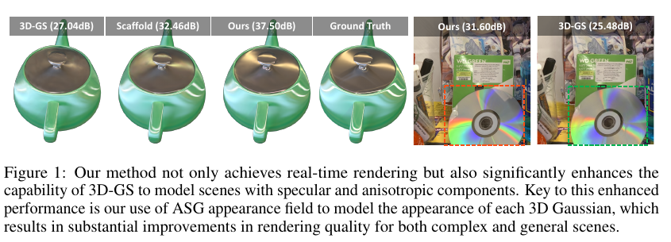
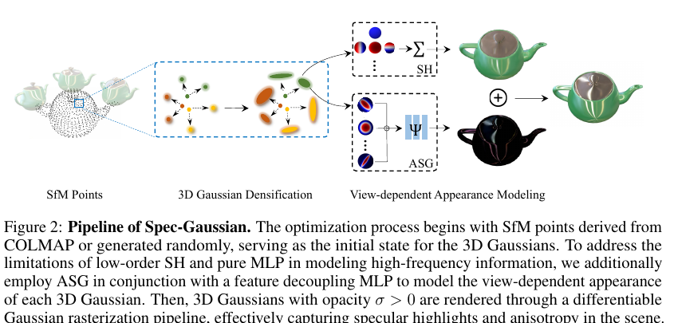
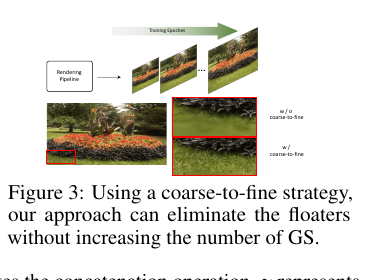
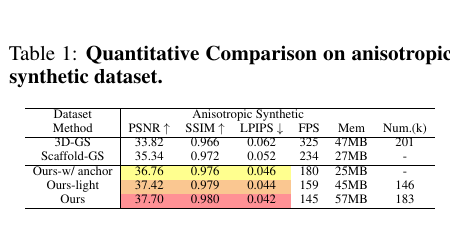
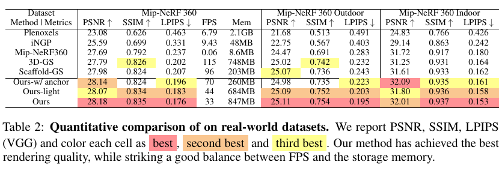
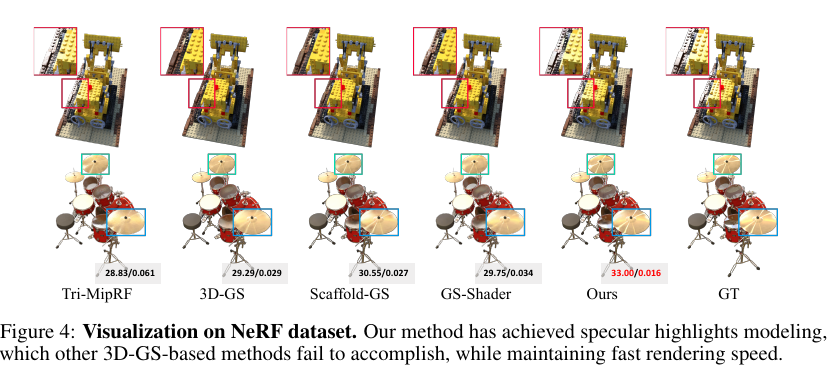
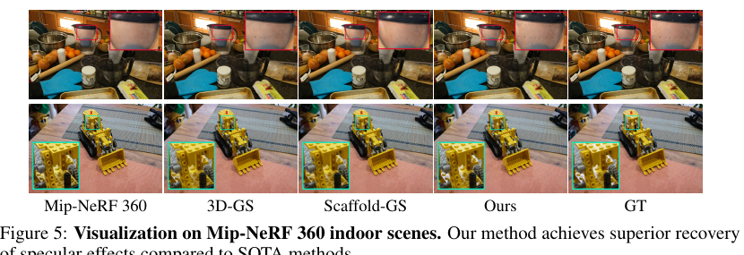
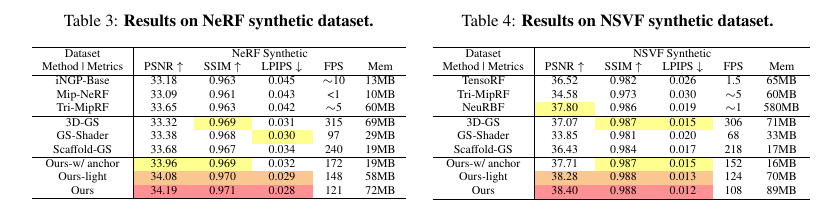
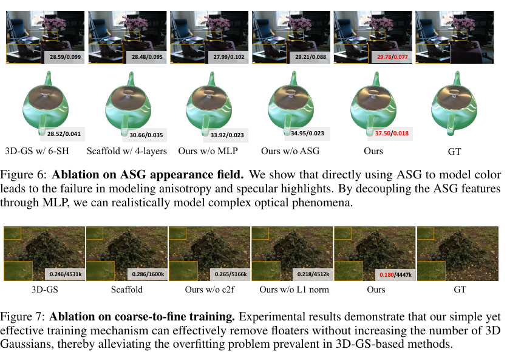

# Spec-Gaussian 论文解读

> Ziyi Yang、Xinyu Gao、Yang-Tian Sun、Yi-Hua Huang、Xiaoyang Lyu、Wen Zhou、Shaohui Jiao、Xiaojuan Qi、Xiaogang Jin，*Spec-Gaussian: Anisotropic View-Dependent Appearance for 3D Gaussian Splatting*，NeurIPS 2024 正式版。本文依据会议论文及补充材料。[NeurIPS 论文页](https://papers.nips.cc/paper/2024/hash/708e0d691a22212e1e373dc8779cbe53-Abstract-Conference.html) · [论文 PDF](https://papers.nips.cc/paper_files/paper/2024/file/708e0d691a22212e1e373dc8779cbe53-Paper-Conference.pdf) · [补充材料](https://papers.nips.cc/paper_files/paper/2024/file/708e0d691a22212e1e373dc8779cbe53-Supplemental-Conference.zip) · [项目页与代码](https://ingra14m.github.io/Spec-Gaussian-website/)

3D Gaussian Splatting（3DGS）能用较低的渲染成本重建出清晰场景，但它给每个高斯绑定的视角相关颜色通常由低阶球谐函数（SH）表示。低阶 SH 擅长平滑的方向变化，却难以表达随视角快速变化的高光，也难以准确描述拉长、方向性明显的反射亮带。Spec-Gaussian 针对的正是这种外观表达能力：它用各向异性球面高斯（anisotropic spherical Gaussian，ASG）替换高斯原有的 SH 颜色表示，并把漫反射与镜面分量分开处理。论文还针对真实场景中的浮点伪影设计了由粗到细训练策略。

*原论文 Figure 1。左侧为合成场景中的高光外观，右侧为真实场景里的材质细节；各方法结果显示，Spec-Gaussian 更接近参考图中的高光形状与强度。*

## 从方向颜色到方向性高光

在 3DGS 中，每个三维高斯投影到图像上后参与 alpha 混合；它的颜色会随观察方向变化。标准实现用 SH 系数编码这种变化，低阶基函数让每个高斯只需存储有限系数，计算也较轻。不过，一个窄而亮的镜面高光只会在少数观察方向上出现，方向响应具有较高频率；若用低阶 SH 拟合，模型容易把亮点摊宽、压暗，或把本应沿某一方向延伸的高光渲染成较均匀的颜色。

Spec-Gaussian 用 ASG 表示一个有方向的瓣形响应。给定单位方向 $\nu$，其形式为

$$
\operatorname{ASG}(\nu\mid[\mathbf{x},\mathbf{y},\mathbf{z}],[\lambda,\mu],\boldsymbol{\xi})=
\boldsymbol{\xi}\,S(\nu;\mathbf{z})\exp\left[-\lambda(\nu\cdot\mathbf{x})^2-\mu(\nu\cdot\mathbf{y})^2\right],
\qquad S(\nu;\mathbf{z})=\max(\nu\cdot\mathbf{z},0).
\tag{4}
$$

这里 $\mathbf{x}$、$\mathbf{y}$ 和 $\mathbf{z}$ 是互相垂直的方向轴；$\mathbf{z}$ 指向瓣的正面，$\mathbf{x}$ 与 $\mathbf{y}$ 定义瓣在两个切向方向上的衰减。$\lambda$ 和 $\mu$ 分别控制沿这两个方向的锐利程度，因此两者不同就能形成各向异性的瓣。$\boldsymbol{\xi}$ 是 RGB 幅值，$S$ 将背向半球的响应截为零。与 SH 的全局低阶基函数相比，ASG 可以把容量集中到某个方向附近，并独立调节两个切向方向的宽度。

论文为每个三维高斯预置 $N=32$ 个 ASG 方向轴，初始时均匀覆盖半球；训练时学习各瓣的锐利程度和幅值。把这些瓣的响应合成为特征后，模型仍然没有直接把 ASG 数值当作最终 RGB。消融实验显示，直接输出颜色不能稳定拟合高光和各向异性。因此方法先让 ASG 编码方向相关的潜在特征，再通过小型 MLP 解码成镜面颜色。

*原论文 Figure 2。SfM 点初始化并经高斯细化后，外观分为 SH 表示的漫反射分支与 ASG 特征、MLP 解码的视角相关分支，随后共同进入高斯光栅化。*

## 漫反射与镜面分支如何合成

Spec-Gaussian 将颜色写成漫反射与镜面分量之和：

$$
\mathbf{c}=\mathbf{c}_d+\mathbf{c}_s.
\tag{9}
$$

漫反射颜色 $\mathbf{c}_d$ 仍由前三阶 SH 表示；镜面颜色 $\mathbf{c}_s$ 则由 ASG 特征解码得到。每个高斯携带一个 24 维局部特征 $\mathbf{f}$，一个小型网络 $\Theta$ 根据它预测 $N$ 个 ASG 的 $\lambda$、$\mu$ 和 $\boldsymbol{\xi}$。对给定视线，ASG 提供潜在方向特征 $\boldsymbol{\kappa}$，解码网络再综合 $\boldsymbol{\kappa}$、观察方向的位置编码 $\gamma(\mathbf{d})$，以及法线与视线的夹角余弦，得到镜面颜色：

$$
\Psi\big(\boldsymbol{\kappa},\gamma(\mathbf{d}),\langle\mathbf{n},-\mathbf{d}\rangle\big)\to\mathbf{c}_s,
\qquad
\boldsymbol{\kappa}=\sum_{i=1}^{N}\operatorname{ASG}(\boldsymbol{\omega}_r\mid[\mathbf{x},\mathbf{y},\mathbf{z}],[\lambda_i,\mu_i],\boldsymbol{\xi}_i).
\tag{10}
$$

这个拆分把两类变化交给不同表示：SH 保留平缓的底色变化，ASG 提供窄而有方向性的特征，MLP 再依据视线和局部几何线索把特征映射到 RGB。论文实现中的解码 MLP 有三层、每层 64 个隐藏单元，视线位置编码阶数为 2。

计算反射方向需要法线。论文没有另行重建精确表面，而是取每个扁平高斯最短轴作为法线近似。设 $\mathbf{d}$ 是从相机指向高斯的单位方向，则从高斯指向相机的方向为 $\boldsymbol{\omega}_o=-\mathbf{d}$，镜面反射方向写为

$$
\boldsymbol{\omega}_r=2(\boldsymbol{\omega}_o\cdot\mathbf{n})\mathbf{n}-\boldsymbol{\omega}_o.
\tag{11}
$$

这一步把局部法线和观察方向变成 ASG 的查询方向。作者指出，这种由高斯形状推得的法线并不保证与真实物体表面法线一致；实验中它仍足以帮助模型学习方向性高光。因而这里的“反射方向”是外观建模的条件，不表示系统已经恢复了物理准确的表面和材质。

论文也区分了高光和环境反射：高光是亮度集中在有限方向范围内的外观变化；完整反射还依赖周围环境以及可见几何。Spec-Gaussian 没有显式分离几何、材质和照明，因此对复杂环境反射的建模仍有限。这个边界很重要：ASG 强化的是高斯外观随视角变化的表达，不是完整的物理渲染管线。

## 由粗到细训练减少真实场景浮点

外观表达解决高光拟合，但真实场景的训练还会遇到另一类画质问题：新视角里出现零散的漂浮高斯，也称 floaters。论文将其与 COLMAP 点云初始化稀疏、早期优化过拟合联系起来。稀疏区域需要靠 densification 补足，如果训练初期就按完整分辨率拟合，模型容易快速增加高斯并记住训练图像的局部误差。

标准 3DGS 会汇总各像素对高斯位置的梯度，再根据累计梯度是否超过阈值决定是否细化。来自不同像素的梯度方向可能相反，向量求和时会彼此抵消。Spec-Gaussian 改为累计每个像素梯度贡献的绝对值，即先取幅值再汇总，让不同方向的有效信号不因符号抵消而消失。随后它从四分之一分辨率开始训练，再逐步提高分辨率，直到完整分辨率；这个过程持续约 5,000 次迭代。低分辨率阶段先约束大尺度结构和颜色，减少模型过早追逐高频图像误差的机会。

*原论文 Figure 3。训练分辨率逐渐提高后，新视角中的漂浮伪影减少；图中对比说明了该策略试图约束早期过度细化。*

论文只在真实场景使用这套由粗到细策略；合成场景不需要它。作者还报告初期低分辨率训练使训练时间缩短约 10%。因此该策略主要针对初始化质量和真实场景过拟合，并非 ASG 外观场的必需组成。

## 画质提升伴随速度和存储开销

在专门构造的各向异性合成数据集上，Spec-Gaussian 的完整版本 PSNR 为 37.70 dB，3DGS 为 33.82 dB；LPIPS 分别为 0.042 和 0.062。这个数据集针对不同方向的高光和各向异性外观，较直接地检验 ASG 的目标能力。表中也能看到成本：完整版本报告 145 FPS、57 MB；3DGS 为 325 FPS、47 MB。Ours-light 与基于 Scaffold-GS 的 Ours-w/anchor 则提供不同的质量、速度和存储折中。

*原论文 Table 1。完整 Spec-Gaussian 的 PSNR、SSIM 和 LPIPS 优于原始 3DGS，但帧率较低；anchor 变体以较低存储开销换取不同的速度与画质。*

在 Mip-NeRF 360 真实场景上，完整版本的 PSNR 为 28.18 dB，LPIPS 为 0.176；3DGS 分别为 27.79 dB 和 0.202。对应帧率从 115 FPS 降至 33 FPS，存储从 748 MB 增至 847 MB。Ours-light 为 44 FPS、684 MB，LPIPS 为 0.183；基于 Scaffold-GS 的 anchor 版本为 70 FPS、260 MB，PSNR 为 28.14 dB。这里的结果体现了论文的取舍：画质指标改善，但完整模型的速度和存储成本确实增加，轻量和 anchor 变体提供可选折中。

*原论文 Table 2。总体 Mip-NeRF 360 指标与室内、室外子集并列；完整版本在总体 PSNR、SSIM、LPIPS 上领先，速度则低于 3DGS。*

*原论文 Figure 4。NeRF 合成场景包含鼓面和玩具车等高光区域；Spec-Gaussian 在这些区域呈现了更集中的亮斑。*

*原论文 Figure 5。室内物体上的高光区域显示了不同方法对亮斑与反射外观的拟合差异。*

论文在 NeRF Synthetic 与 NSVF 合成数据集上也报告了提升：NeRF Synthetic 的 PSNR 从 33.32 提升到 34.19 dB，NSVF 从 37.07 提升到 38.40 dB。两组结果中，LPIPS 也有所下降；同时帧率分别从 315 降至 121 FPS、从 306 降至 108 FPS。完整数据见原论文 Tables 3 和 4：

*原论文 Tables 3、4。Spec-Gaussian 在两组标准合成场景指标上优于 3DGS，渲染速度也低于基线。*

消融实验帮助区分性能来自哪个部分。直接用 ASG 输出颜色表现不佳；引入特征解码 MLP 后，高光和各向异性更接近参考图。作者还测试了更高阶 SH 和更深的直接颜色 MLP，结果没有达到 ASG 特征加解码的效果。由粗到细训练的消融则显示，真实场景中新视角浮点减少，且无需单纯增加高斯数量来消除伪影。

*原论文 Figures 6、7。上半部分显示 ASG 特征经 MLP 解码后对镜面外观的改善；下半部分比较不同训练策略下的浮点伪影与高斯数量。*

## 方法关系与适用边界

Spec-Gaussian 的质量改进有两条相互补充的路径。ASG 外观场提高单个高斯对窄方向响应和各向异性亮带的表达能力；由粗到细训练则调整真实场景的优化顺序，减少训练图像过拟合引起的漂浮伪影。前者针对外观表示，后者针对训练过程，不能把所有画质提升都归因于 ASG。

论文的合成与真实场景结果都显示出较好的渲染质量，但完整模型的帧率会下降，额外外观参数也带来存储开销。Anchor 版本通过 Scaffold-GS 的锚点结构压缩存储并改善速度，质量则与完整版本略有不同。另一个边界是几何和环境光没有被显式恢复：法线只是高斯短轴的近似，ASG 学到的是视角相关外观，所以对复杂反射的物理一致性仍有限。

从画质角度看，Spec-Gaussian 的关键贡献是为 3DGS 补上一种更适合高频方向外观的表示，并让实验中的质量收益与成本变化一并可见。它适用于高光、金属和各向异性材质明显影响新视角观感的场景；若应用更看重吞吐、显存或精确的环境反射，还需要结合相应的轻量变体或更明确的几何与光照建模。
