# St4RTrack 论文解读

> Haiwen Feng、Junyi Zhang、Qianqian Wang、Yufei Ye、Pengcheng Yu、Michael J. Black、Trevor Darrell、Angjoo Kanazawa，*St4RTrack: Simultaneous 4D Reconstruction and Tracking in the World*，ICCV 2025，页码 8503–8513。[CVF 论文页](https://openaccess.thecvf.com/content/ICCV2025/html/Feng_St4RTrack_Simultaneous_4D_Reconstruction_and_Tracking_in_the_World_ICCV_2025_paper.html) · [论文 PDF](https://openaccess.thecvf.com/content/ICCV2025/papers/Feng_St4RTrack_Simultaneous_4D_Reconstruction_and_Tracking_in_the_World_ICCV_2025_paper.pdf) · [官方补充材料 PDF](https://openaccess.thecvf.com/content/ICCV2025/supplemental/Feng_St4RTrack_Simultaneous_4D_ICCV_2025_supplemental.pdf)

St4RTrack 要同时回答两个问题：视频中某一时刻的三维场景长什么样，以及第一帧里看到的点后来移动到了哪里。它将两种结果都表示为同一世界坐标系里的时间相关点图。给定第一帧和当前帧，模型一支恢复当前帧时刻的场景几何，另一支预测第一帧内容在当前时刻的位置。模型以两帧为输入，因此可以逐一将锚帧与后续帧配对，处理任意长度的视频。对缺少 4D 真值的真实视频，论文再从点图估计相机，并把 CoTracker3 的二维轨迹和 MoGe 的单目深度投影回模型输出，用于测试时适配。

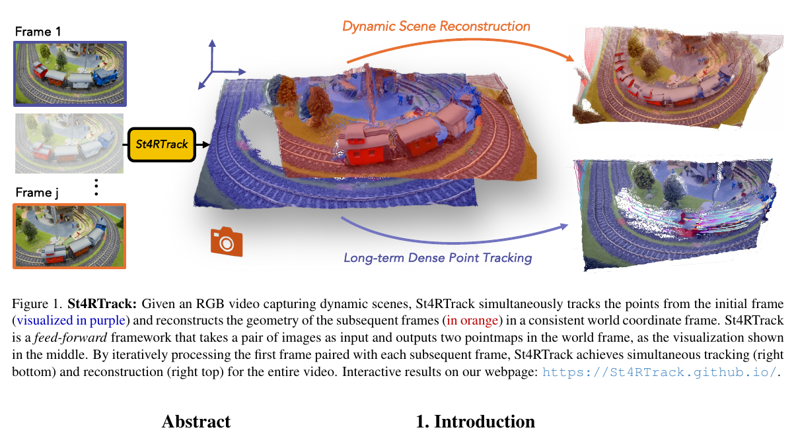

*原论文 Figure 1。上方橙色结果是逐时刻重建的几何，下方紫色结果展示初始帧点在后续时刻的三维位置；两者使用一致的世界坐标。*

## 摘要与问题设定

以往动态重建和点跟踪通常各有一套表示。重建方法为每帧估计场景几何，但不一定保存跨时刻的点对应；点跟踪方法延续像素轨迹，却可能只在相机坐标下表达运动。相机也在移动时，仅看像素轨迹会把相机运动和场景运动混在一起。St4RTrack 的核心是把时间和坐标系都写入点图定义，让动态几何和点运动在同一表示中预测。论文进一步提出 WorldTrack 基准，并报告在合成和真实数据上获得有竞争力的世界坐标点跟踪、动态重建结果。其评估对齐方式包含首帧坐标和全局尺度对齐等不同设置，后文分别说明。

## 1 引言

引言从 DUSt3R 一类两视图前馈模型的能力出发：模型可以从图像对预测点图，并在静态场景中通过共享三维坐标自然建立对应关系。但场景一旦运动，“两个时刻的几何”与“同一批内容在不同时刻的位置”就不再是同一个对象。MonST3R 能重建动态场景，却让每帧点图描述各自时刻的场景，因而并不直接给出第一帧点在之后的位置。另一方面，传统视频跟踪提供二维轨迹，但遇到遮挡或相机运动时，难以独立恢复世界坐标中的三维运动。

作者的关键改动落在输出定义上：模型仍以两张图像为输入，仍使用 DUSt3R 式的双分支 Transformer 结构，但将一张输出定义为“第一帧内容在第二帧时刻的位置”，另一张定义为“第二帧在自身时刻的几何”。把首帧固定为锚点后，每个后续时刻都落在同一参考坐标系。这样，场景重建回答“此刻有哪些三维点”，跟踪回答“首帧的这些点此刻在哪里”，两者可以并行预测。

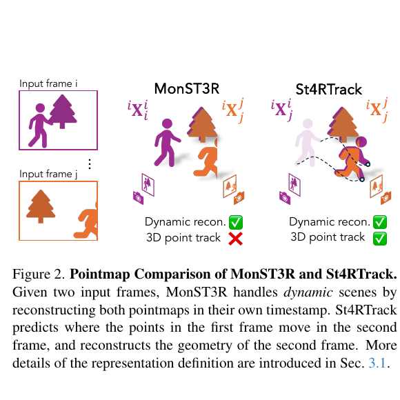

*原论文 Figure 2。MonST3R 的两张点图分别表示两帧各自时刻的场景，St4RTrack 则以淡紫色点图追踪第一帧内容到第二帧时刻，同时重建第二帧场景。*

## 2 相关工作

论文将相关方法分为静态多视图重建、动态重建与三维跟踪。DUSt3R 以两帧共享坐标系的点图建立几何与对应；这在静态场景中足够，因为物体在两帧之间不变。MonST3R 面向动态场景，将每帧几何放在各自的时间点，能表示场景变化，但不显式追踪一帧中的内容到另一帧。St4RTrack 统一两者：既保留帧间重建，也补上显式的跨时间点图。

论文接着回顾二维与三维点跟踪。光流和场景流能估计稠密运动，但在大位移和遮挡下容易失效；学习式长时二维跟踪提升了跨帧跟踪能力，输出仍是图像像素轨迹。把单目深度用于二维轨迹提升的三维方法已经能恢复三维点运动，但通常仍在相机坐标系中工作，未同时估计相机运动并分离相机与场景运动，因此不能直接提供世界坐标轨迹。

联合重建与跟踪的传统非刚性 SfM 往往需要同步多视图输入，并通过优化联合恢复结构和运动。单目动态神经渲染扩大了可处理场景，但一些方法主要服务于视图合成，运动估计只是相邻帧融合的辅助量；另一些方法可联合恢复相机、持续场景几何和长时三维轨迹，却依赖现成先验并针对每段视频从头优化。与这些逐场景优化路线并行，Stereo4D 提出利用互联网立体视频构建真实 4D 跟踪数据。St4RTrack 则采用前馈点图预测，并利用投影监督对无标注目标视频做测试时适配。

## 3 同时重建与跟踪

### 3.1 St4RTrack 的统一 4D 表示

先定义符号。记 $^{a}X_b^t$ 为来自图像帧 $b$ 的像素内容在时刻 $t$ 的三维点图，并以帧 $a$ 的坐标系表达。上标 $t$ 表示场景时间，下标 $b$ 标记点的图像来源，左上标 $a$ 表示参考坐标系。对第一帧 $I_i$ 和时刻 $j$ 的图像 $I_j$，论文定义：

$$
f_\theta(I_i,I_j) = {}^{i}X_i^j,\; {}^{i}X_j^j. \tag{1}
$$

第一项 $^{i}X_i^j$ 追踪第一帧的内容到时刻 $j$，并以第一帧坐标系表示；第二项 $^{i}X_j^j$ 重建第 $j$ 帧当下的场景，也落在同一参考系。这里“第一帧内容”指从第一帧观测到的像素点集合，后续有遮挡或离开视野的点会受到可见性限制。对静态场景，作者给出的 DUSt3R 对应形式为：

$$
f_\theta(I_i,I_j) = {}^{i}X_i^i,\; {}^{i}X_j^i. \tag{2}
$$

两帧都描述同一时刻 $i$ 的场景，故几何对应也建立在同一静态表面上。MonST3R 的动态重建形式则是：

$$
f_\theta(I_i,I_j) = {}^{i}X_i^i,\; {}^{i}X_j^j. \tag{3}
$$

每帧几何属于各自时刻，适合表达场景变化，但没有给出第一帧点在时刻 $j$ 的坐标。St4RTrack 将第二项与追踪分支合并到共同坐标系中，并把时间变化直接编入点图语义，而不额外输入时间编码。

处理完整视频时，模型固定第一帧为锚点，依次计算 $f(I_1,I_1), f(I_1,I_2), \ldots, f(I_1,I_T)$。因此，$^{1}X_1^j$ 组成从首帧出发的长时三维轨迹，$^{1}X_j^j$ 则组成逐帧动态重建。两组点图共享第一帧定义的世界坐标。补充材料也展示了用中间帧作为跟踪参考的例子；实验主设定通常使用第一帧。

### 3.2 联合学习跟踪与重建

模型采用孪生结构：两帧分别经 ViT 编码器编码，再由 Transformer 解码器交替进行帧内自注意力、帧间交叉注意力和 MLP 更新。交叉注意力使两支特征能够交换信息，有助于输出共坐标系的点图。网络结构沿用 DUSt3R/MonST3R 的设计，主要变化是两支输出所代表的时间关系；初始化权重来自经过二维匹配训练的 MASt3R。

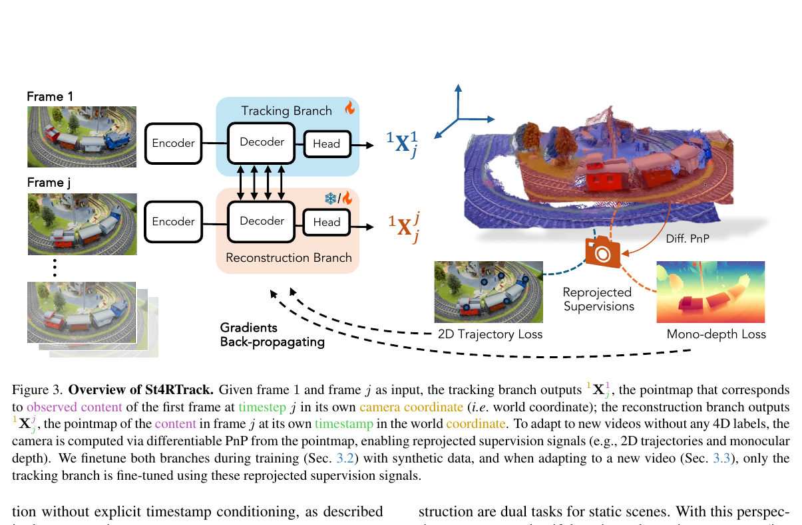

*原论文 Figure 3。追踪分支输出首帧内容在当前时刻的点图，重建分支输出当前帧几何；从重建点图估计相机后，可将追踪和深度先验变成投影损失。*

监督训练使用 Point Odyssey、Dynamic Replica 与 Kubric 的合成动态场景。每个训练样本抽取 24 帧，帧间隔为 1 至 6。带世界坐标的场景网格顶点为追踪分支提供稀疏、带掩码的轨迹真值；逐帧深度图和真值相机参数监督重建分支，训练目标采用 DUSt3R 的目标。训练数据提供完整 4D 几何与运动，这是追踪分支学会将首帧点放在后续世界坐标中的必要监督。

### 3.3 无 4D 标签视频的适配

合成数据规模和真实感有限，且新表示要求点图能在世界坐标中跨时刻移动，因此作者进一步设计无需 4D 真值的测试时适配。主要步骤是从重建点图恢复相机，再用二维跟踪、单目深度和两分支之间的三维一致性形成损失。

**由点图估计相机。** 相机内参 $K$ 从追踪分支首帧点图估计，假设主点在图像中心、像素为正方形，且整段视频焦距固定；焦距用 Weiszfeld 迭代快速求解。对第 $j$ 帧，重建点图 $^{1}X_j^j$ 与图像像素形成 2D–3D 对应，PnP-RANSAC 求相机旋转 $R_j$ 和平移 $T_j$：

$$
R_j,T_j = \arg\min_{R,T}\sum_{n\in I_j}\left\|x_{j,n}-\pi_K(R X_j^{j,n}+T)\right\|^2. \tag{4}
$$

$x_{j,n}$ 是第 $j$ 帧像素，$X_j^{j,n}$ 是该像素对应的世界坐标三维点，$\pi_K$ 表示含内参的透视投影。RANSAC 用于剔除错误对应。标准 RANSAC 解不可微。补充材料 B 节为此在停止梯度的 RANSAC 位姿上执行一次 Gauss–Newton 更新，使重投影残差能够通过位姿修正回传到点图；对应公式及变量含义放在补充材料部分。

**二维轨迹损失。** 将追踪点图变换到第 $j$ 帧相机坐标，再投影回图像：

$$
\hat x_{j,n}=\pi_K(R_j X_{1,n}^j+T_j). \tag{5}
$$

这里得到的 $\hat x_{j,n}$ 是模型预测的二维轨迹位置，与 CoTracker3 的伪轨迹 $x^{trk}_{j,n}$ 比较。为降低焦距误差带来的整体尺度影响，令 $p_n=\hat x_{j,n}$、$g_n=x^{trk}_{j,n}$，$c$ 为图像中心，并按两组点到中心的平均半径之比缩放预测：

$$
\hat p_n=(p_n-c)s+c,\quad s=\frac1N\sum_{n=1}^N\frac{\|g_n-c\|_2}{\|p_n-c\|_2}. \tag{6}
$$

这个 $s$ 是从 $p_n$ 到 $g_n$ 的中心化平均半径比例。将归一化后的预测与 CoTracker3 轨迹作平方误差：

$$
L_{traj}=\frac1N\sum_{n\in I_j}\|\hat p_n-g_n\|_2^2. \tag{7}
$$

因此，二维轨迹监督通过相机投影约束三维追踪点的位置；尺度不确定性则由中心化的比例因子吸收。

**单目深度损失。** 重建点图经相机变换后的深度分量是：

$$
z^{j,n}_{proj}=(R_jX_j^{j,n}+T_j)_z. \tag{8}
$$

将它与 MoGe 产生的单目深度伪标签 $z^{j,n}_{mono}$ 对齐。单目深度只确定相对尺度，故先用最小二乘求比例因子，再比较缩放后的深度：

$$
\alpha=\frac{\sum_n z^{j,n}_{proj}z^{j,n}_{mono}}{\sum_n(z^{j,n}_{proj})^2},\quad
L_{depth}=\frac1N\sum_n(\alpha z^{j,n}_{proj}-z^{j,n}_{mono})^2. \tag{9}
$$

分子是预测深度与伪标签的内积，分母是预测深度平方和，这是使平方残差对 α 最小的闭式解。此损失只对齐尺度，不要求网络从单目伪标签中恢复绝对度量深度。

**三维自一致性与联合损失。** 对第一帧中在第 $j$ 帧仍可见的点，CoTracker3 提供对应像素索引 $n′$。追踪分支和重建分支都给出该时刻点的位置，论文直接约束两者相等：

$$
L_{align}=\sum_{n\in I'_1}\|X_{1,n}^j-X_{j,n'}^j\|_2^2. \tag{10}
$$

这里比较的是同一时刻、同一世界坐标系下对应的三维位置，建立两种输出之间的联系。测试时适配的总损失为：

$$
L_{reproj}=L_{traj}+\lambda_1L_{depth}+\lambda_2L_{align}. \tag{11}
$$

补充材料给出的权重为 $\lambda_{traj}=1$、$\lambda_{depth}=10$、$\lambda_{align}=5$，对应式 (11) 的轨迹项系数为 1、$\lambda_1=10$、$\lambda_2=5$。无 4D 标签视频中，CoTracker3 提供二维点对应，MoGe 提供单目深度；可微 PnP 将重建点图转成相机，投影后的轨迹与深度再监督网络。实例级适配对单条序列优化；数据集级适配则从目标域抽取稀疏样本微调一个模型。两种设置都冻结重建分支，只更新追踪分支，因为单目轨迹与深度没有提供跨视图对齐的直接监督，冻结重建支路可以保留预训练得到的视图对齐能力。

### 3.4 评价指标

WorldTrack 使用 Average Percent of Points within Distance（APD\(_{3D}\)）度量世界坐标轨迹误差。先以全局中位数对齐预测与真值，再统计误差低于 0.1、0.3、0.5、1.0 米阈值的点时比例：

$$
APD_{3D}=\sum_{i,t}\mathbf{1}(\|\hat P_{it}-P_{it}\|_2<\delta_{3D}),\quad
\delta_{3D}\in\{0.1,0.3,0.5,1.0\}\text{m}. \tag{12}
$$

其中 $i,t$ 遍历参与评估的点和时刻，$\delta_{3D}$ 为距离阈值；论文按多个阈值统计 APD 百分比，数值越高表示更多轨迹点落在容许误差内。补充材料还报告 EPE（端点误差），并以全局 SIM(3) 对齐作为另一种评价协议。两种对齐方式下的结果不能直接混为一谈。

## 4 实验

### 4.1 实验细节

训练使用 Point Odyssey、Dynamic Replica 和 Kubric，每个样本取 24 帧、间隔 1–6 帧；使用 AdamW，学习率 $5\times10^{-5}$，4 张 A100 训练 50 个 epoch，约需一天。模型虽按 24 帧样本训练，但推理逐对处理锚帧与当前帧，可用于更长视频。论文报告 RTX 4090 上约 30 FPS；对一条序列进行 500 步测试时适配约需 5 分钟（使用 4 张 A100）。逐对推理支持超过训练片段长度的视频，但作者仍指出长序列无重叠帧和大幅相机运动会造成困难。

WorldTrack 包含 Point Odyssey、Dynamic Replica、Aerial Digital Twin（ADT）和 Panoptic Studio，每个数据集评估 50 段、每段 64 帧。ADT 与 Panoptic Studio 原本有相机坐标轨迹标注，作者用配对外参转换到世界坐标；前者场景运动较少，后者固定相机，因此论文也加入具有相机和场景运动的合成测试集。具体数据筛选见补充材料的 C.1。

### 4.2 世界坐标中的三维点跟踪

主文在首帧世界坐标中评估，并采用全局中位数尺度对齐。基线除 SpaTracker、MonST3R 外，也包括两种组合：先以 RANSAC-Procrustes 补偿 SpaTracker 轨迹中的相机运动，或使用 MonST3R 估计的相机位姿进行补偿。St4RTrack 的 APD\(_{3D}\) 在四个测试集的全部点上分别为 67.95、73.74、76.01、69.67；只看动态点时为 68.72、68.13、75.34、69.67。WorldTrack 同时包含相机运动和场景运动的合成数据；真实数据 ADT 的场景运动较少，Panoptic Studio 使用固定相机，因此这两套真实数据单独不足以覆盖两类运动同时存在的情况。

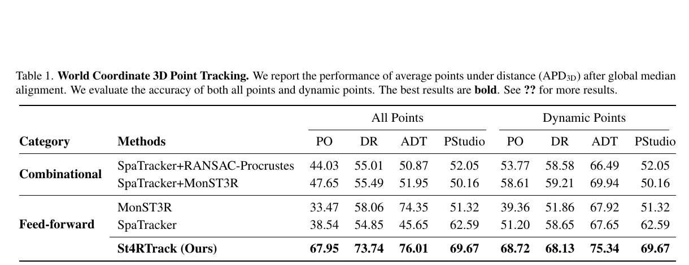

*原论文 Table 1。左侧报告全部点，右侧报告动态点；四个数据集上分别列出 APD\(_{3D}\)。*

### 4.3 动态三维重建

重建实验使用 Point Odyssey 合成数据与 TUM-Dynamics 真实数据。作者以每段序列的中位数尺度对齐点云，比较 APD 与 EPE，并过滤真值中的含混浮点。基线包括 DUSt3R、MASt3R、MonST3R 的前馈预测，以及对它们进行全局对齐后的结果；前馈基线将每帧与共同锚帧配对。Table 2 中，St4RTrack 在 Point Odyssey 上的 EPE/APD 为 0.2406/78.73，在 TUM-Dynamics 上为 0.1854/83.42，在这两套数据的前馈比较中表现最佳。

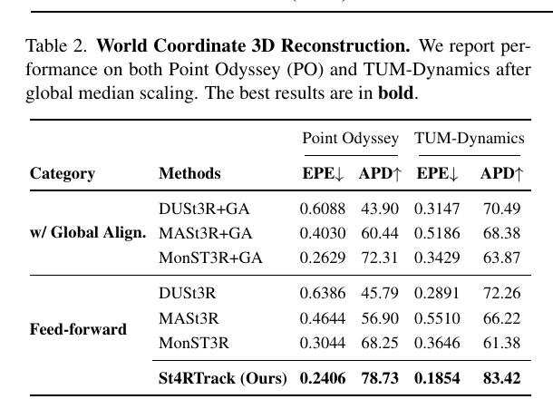

*原论文 Table 2。误差越低越好，APD 越高越好；两套数据都采用全局中位数尺度对齐。*

### 4.4 世界坐标中的联合跟踪与重建

主文 Figure 4 把同一时刻的两支输出叠在一起，并展示逐帧累计结果：重建分支在静态区域形成较稳定几何，追踪分支则把首帧点延伸成时间轨迹。逐对推理支持超过训练片段长度的视频；作者仍指出长序列无重叠帧和大幅相机运动会造成困难。

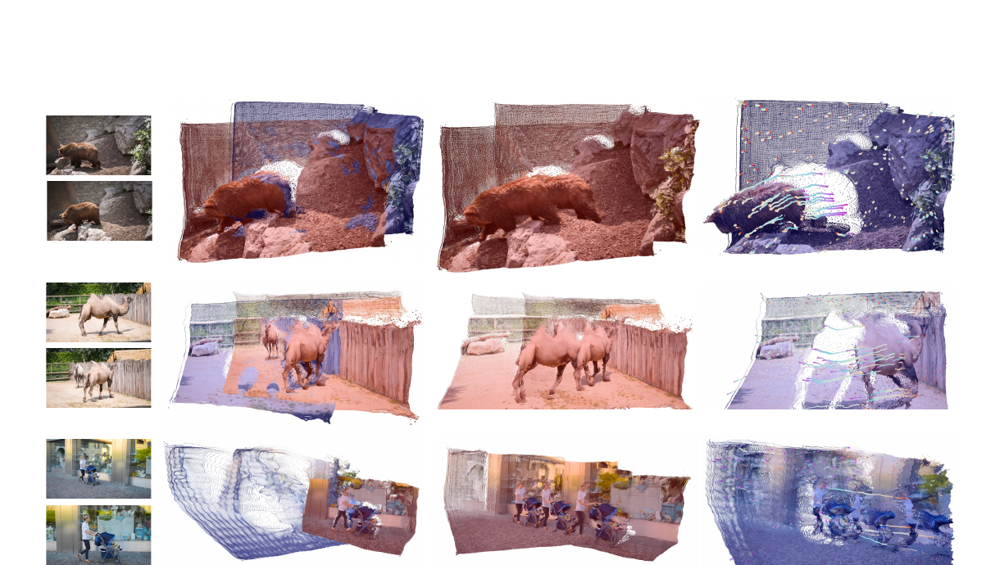

*原论文 Figure 4。左起为输入视频、当前帧的双分支点图、累计重建和累计追踪。*

## 5 结论

St4RTrack 的主要贡献是通过重新定义两张点图的时间语义，把动态场景重建与世界坐标三维跟踪放进同一前馈框架。核心在于两种输出的时间语义不同：追踪输出表示“首帧内容在当前时刻的位置”，重建输出表示“当前时刻场景的几何”；两支共享首帧坐标系。合成 4D 监督教会模型这种表示；可微 PnP、二维轨迹、单目深度与三维自一致性则帮助模型适应无 4D 标注视频。

论文也给出了清楚的边界：补充材料指出尺度错位、大幅相机移动、遮挡和长序列无重叠仍具挑战；逐对输入没有显式的长时序建模，合成训练数据的多样性与真实感有限，真实域适配仍然重要。因而 St4RTrack 展示了几何表示如何统一跟踪和重建，但其世界坐标长期稳定性仍受逐对估计与训练域差异影响。

## 官方补充材料

### A. 讨论

作者在补充材料中指出，逐帧配对仍会遇到尺度错位、大幅相机运动和遮挡。表示虽然可逐对扩展到长视频，但长序列中的非重叠区域仍难保持稳定对应；扩大训练数据、加入显式时序上下文是作者提出的后续方向。

### B. 可微相机位姿估计

补充材料在 RANSAC 求得的相机位姿 $P^*$ 上执行一步 Gauss–Newton 修正。令 $F(P^*)$ 为所有 2D–3D 对应的重投影残差展平后的向量，$J$ 为残差对相机位姿的雅可比，则增量为：

$$
\Delta P=-(J^\top J)^{-1}J^\top F(P^*). \tag{13}
$$

随后将增量加到已停止梯度的 RANSAC 解：

$$
P=P^*+\Delta P. \tag{14}
$$

$J^\top J$ 近似残差 Hessian，$J^\top F(P^*)$ 给出残差下降方向。由于 $P^*$ 不参与反向传播，梯度通过 $\Delta P$ 回传到点图，不需要对 RANSAC 的离散内点选择求导。

### C. WorldTrack 基准细节

#### C.1 数据集与筛选

WorldTrack 的真实数据部分将 ADT、Panoptic Studio 的 TAPVid-3D 轨迹通过配对外参转换到世界坐标；合成部分使用 Point Odyssey 与 Dynamic Replica。补充材料还报告了数据清理条件：TUM 只保留 0.1–5 米深度；Point Odyssey 去除 Kubric 风格片段、深度含混场景和相机内参动态的帧。作者对 Point Odyssey 与 Dynamic Replica 分别保留 160、140 条候选序列，再各随机抽取 50 条，每段评估前 64 帧。

### C.2 世界坐标跟踪与重建的附加定量结果

补充材料先以 EPE 补充主文的 APD 跟踪评估。按全局中位数对齐后，St4RTrack 在 Point Odyssey、Dynamic Replica、ADT 和 Panoptic Studio 的全部点及动态点 EPE 均最低。作者还用全局 SIM(3) 允许旋转、平移和统一尺度变化，再报告 APD/EPE；在多数测试项上 St4RTrack 领先，但 ADT 动态点 APD 不是最高。这一协议与首帧世界坐标评估不同，不能把两张表的数字直接混比。

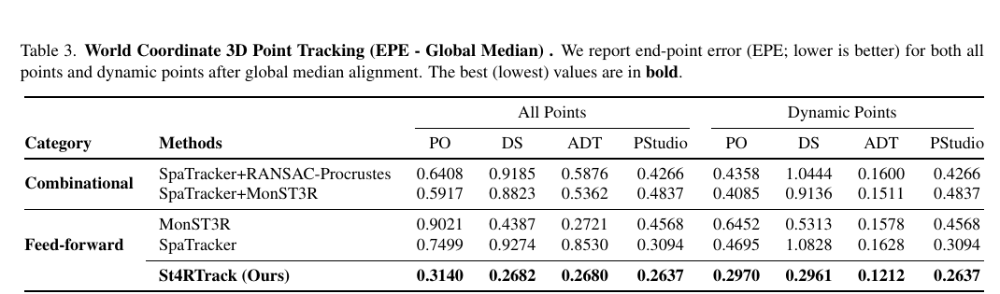

*补充材料 Table 3。按全局中位数对齐后，四个测试集的全部点及动态点 EPE 均列出。*

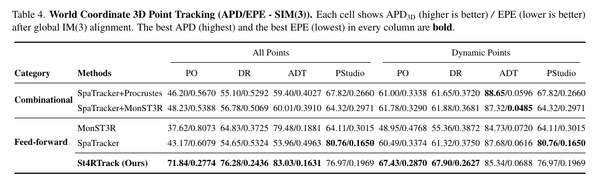

*补充材料 Table 4。每格为 APD\(_{3D}\)/EPE。原表注的提取文本写作“IM(3)”，本文依表题及对齐定义按 SIM(3) 理解。*

重建任务的全局 SIM(3) 结果显示，Point Odyssey 上 MonST3R+GA 的 EPE（0.2601）低于 St4RTrack（0.2741），而 St4RTrack 的 APD 最高；TUM-Dynamics 上 St4RTrack 的 EPE/APD 均最好。不同指标排序不完全相同，结论应保留这一差别。

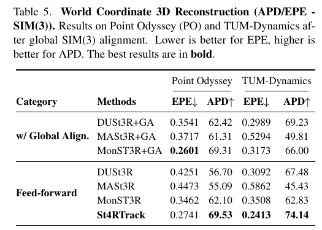

*补充材料 Table 5。列出 Point Odyssey 与 TUM-Dynamics 的 EPE 和 APD。*

补充材料还检查了深度与相机位姿。Sintel 上 St4RTrack 的 AbsRel 为 0.318、$\delta<1.25$ 比例为 62.2，优于 MonST3R 前馈版本；Bonn 深度结果与前馈基线接近。相机 ATE 在 Sintel 上不及全局对齐版本，在 TUM 上则最好。原 Table 6 注释称在两套数据上比较，但表内列出 Sintel、Bonn 的深度指标，以及 Sintel、TUM 的 ATE；表注与指标覆盖范围并不完全一致。

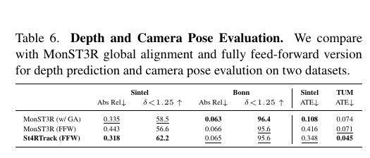

*补充材料 Table 6。深度 AbsRel 越低越好、δ 比例越高越好，ATE 越低越好。*

### C.3 定性结果

相机位姿评估的定性结果补充展示了 Sintel、Bonn 与 TUM 场景中的点云和相机估计。

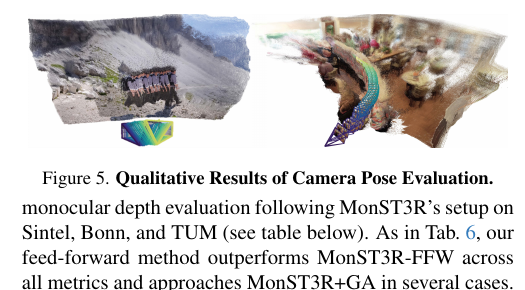

*补充材料 Figure 5。展示相机位姿评估中的场景重建和相机轨迹。*

Figure 7 和 Figure 8 分别展示 TUM-Dynamics 与 Point Odyssey 的输入帧、真值点图、预测点图和尺度对齐结果。它们补充了定量表中误差与 APD 数字对应的几何形态。

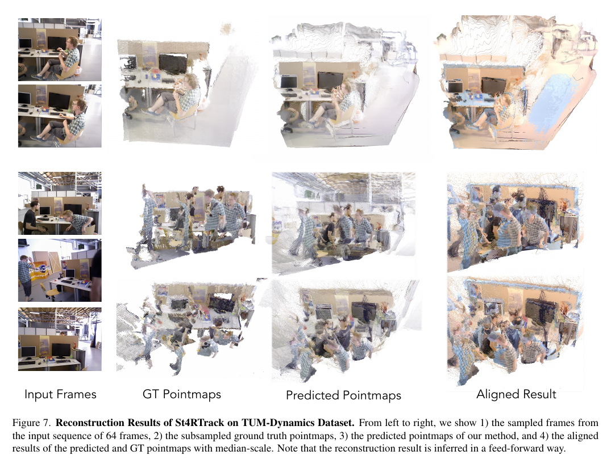

*补充材料 Figure 7。逐对前馈预测的点图与真值经中位数尺度对齐。*

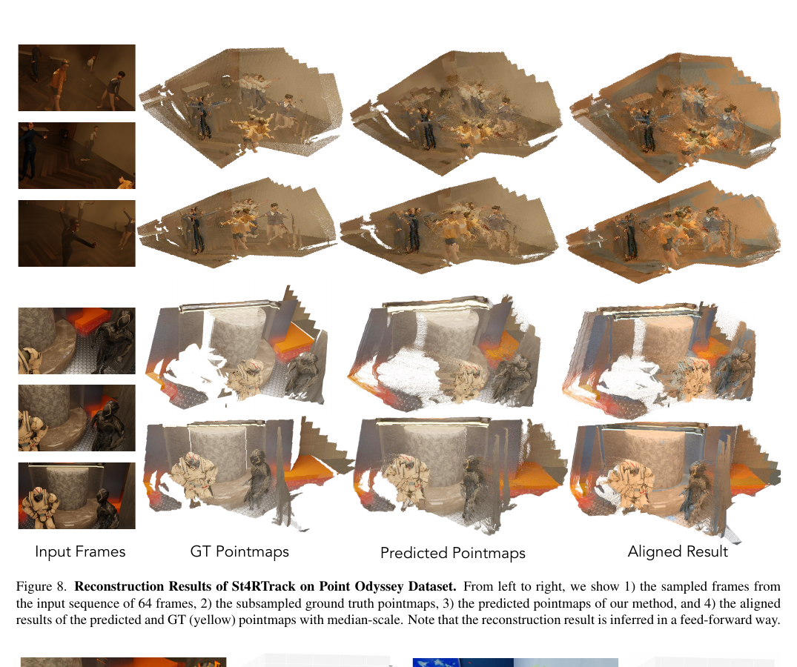

*补充材料 Figure 8。并列展示输入帧、真值点图、前馈预测和尺度对齐结果。*

WorldTrack 的四个数据集跟踪可视化中，彩色“+”为预测轨迹，圆点为真值轨迹。

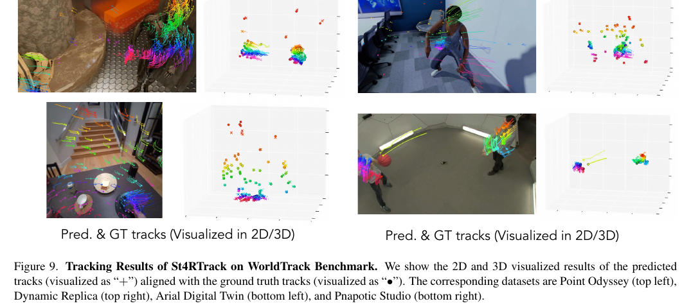

*补充材料 Figure 9。依次展示 Point Odyssey、Dynamic Replica、ADT 和 Panoptic Studio。*

### D. 测试时适配细节

#### D.1 实现设置

实例级适配为 50 条测试序列分别微调模型，每个 epoch 抽取 300 帧、训练 3 个 epoch、batch size 为 4。数据集级适配对整个数据集微调一个模型，每个 epoch 抽取 100 帧、训练 15 个 epoch、batch size 为 4。两种方式均冻结重建分支，只更新追踪分支，以保留预训练得到的视图对齐能力。

#### D.2 消融结果

实例级测试时适配优于数据集级适配，在 Dynamic Replica 与 Panoptic Studio 的 EPE/APD 分别达到 0.2472/76.07 和 0.2243/73.71。去除轨迹损失、深度损失、对齐损失或合成预训练，结果都会下降，其中去掉深度损失的退化尤其明显。

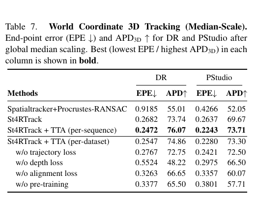

*补充材料 Table 7。移除任一损失或预训练都会降低表现。*

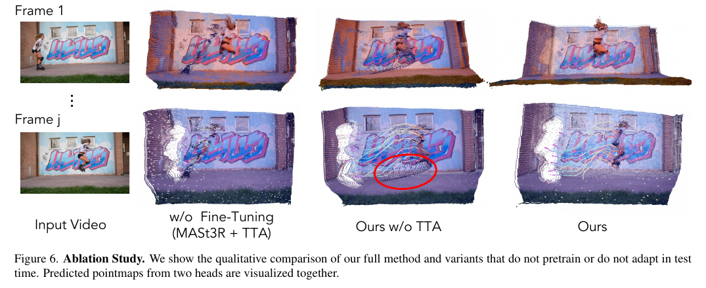

*补充材料 Figure 6。双分支预测点图叠加后可观察几何对齐和漂移差异。*

### E. 附加推理结果

完全前馈结果以中间帧作为轨迹参考；测试时适配结果则以第一帧为参考。两幅图都从成对预测展示到累计重建和累计跟踪。

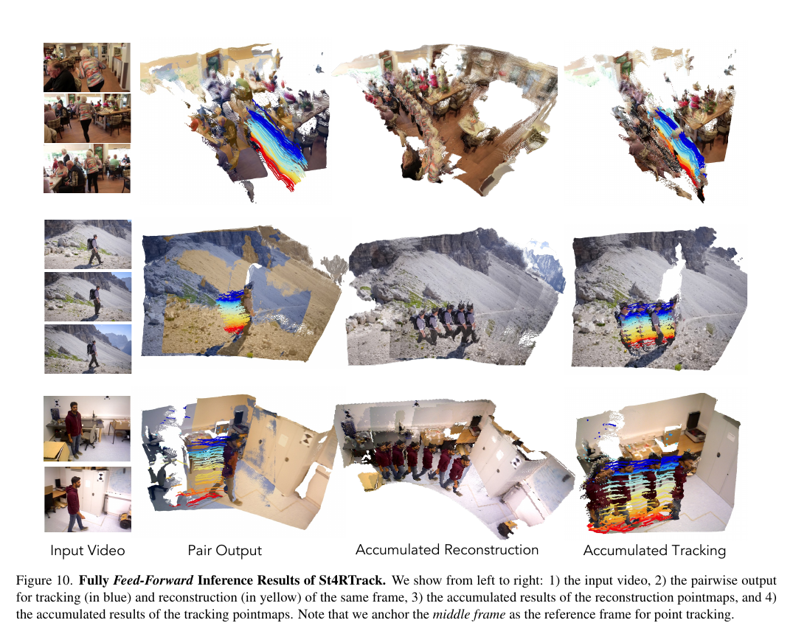

*补充材料 Figure 10。该可视化以中间帧作为轨迹参考。*

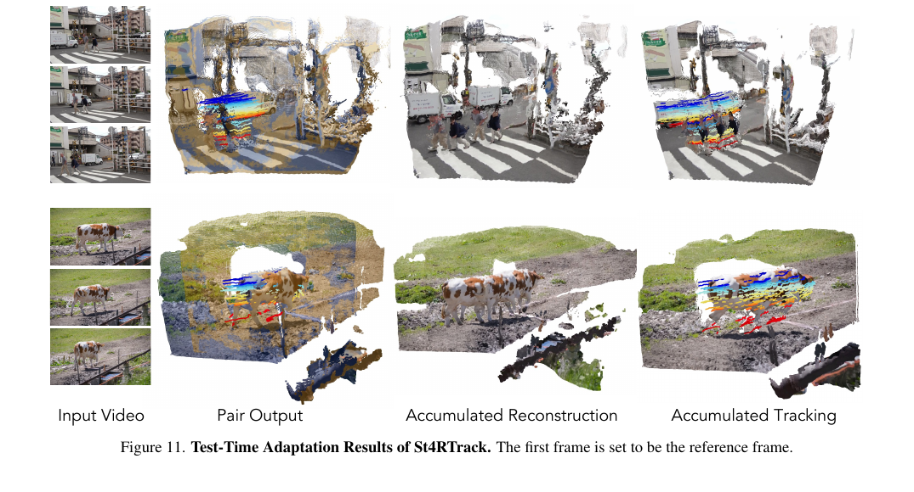

*补充材料 Figure 11。该可视化以第一帧作为轨迹参考。*

### F. 讨论与未来方向

补充材料指出，逐帧配对仍难处理尺度错位、大幅相机移动、遮挡和长序列中缺少重叠的情形。模型没有显式的长时序建模；合成预训练数据在几何与运动多样性、真实感方面也有限，因此跨域视频仍依赖测试时适配。作者提出，可通过扩大预训练数据并加入跨帧时序上下文来改善这些问题。
