# STAC 论文解读

> Runze Wang、Yuxuan Song、Youcheng Cai、Ligang Liu，*STAC: Plug-and-Play Spatio-Temporal Aware Cache Compression for Streaming 3D Reconstruction*，CVPR 2026。正文依据 [CVPR 正式版 PDF](https://openaccess.thecvf.com/content/CVPR2026/papers/Wang_STAC_Plug-and-Play_Spatio-Temporal_Aware_Cache_Compression_for_Streaming_3D_Reconstruction_CVPR_2026_paper.pdf)；补充实验依据 [arXiv v2](https://arxiv.org/pdf/2603.20284v2) 与其官方源码包。论文页面：[arXiv](https://arxiv.org/abs/2603.20284) · [项目页](https://stac-3r.github.io/) · [代码](https://github.com/Rainzor/STAC)。

StreamVGGT 和 STream3R 把多视图重建改成因果的逐帧处理：新帧到达后，模型读取历史帧的 Key、Value（KV）缓存，再更新当前帧的几何预测。这样无需等整段视频结束，却会让缓存随帧数不断增长。STAC 的核心问题是：怎样压缩这份历史，同时保留之后仍有用的时间线索与场景几何？

STAC 不改主干网络，也不重新训练模型。它把历史信息分成短期时间工作集和长期空间记忆，再用分块计算处理刚到达的连续帧。论文在 NRGBD 和 7-Scenes 上报告，STAC 将 StreamVGGT、STream3R 的缓存占用从约 19.75 GB 降到约 2.2–2.57 GB，并把端到端速度从约 2.5 FPS 提升到约 10.5 FPS。重建质量整体接近原模型，但不同数据集和指标有涨有跌；空间缓存占用也会随场景覆盖范围增加，因此不能把它理解为对任意室外场景都严格恒定的内存上界。

## 问题背景与观察

StreamVGGT 以因果注意力缓存历史帧的 KV，STream3R 则用因果 Transformer 顺序处理图像。二者都保留完整历史以维持长程上下文。若每帧有 $M$ 个 token、网络有 $L$ 层，处理 $T$ 帧后缓存量大致随 $LMT$ 增长。简单滑动窗口能限制缓存，却会永久丢掉窗口外的内容；只留最近帧，对于再次出现的房间、走廊或地标也不够。

作者先检查不同注意力头的空间与时间分布：有些头随相机运动关注局部区域，有些头长期关联首帧、地标帧或相机 token。图 2 展示了这些稀疏注意力现象；补充材料图 5 还给出空间注意力例子。它说明缓存不必把所有历史 token 一视同仁：一部分信息应在短期窗口里保留，一部分重要 token 应跨时间留下，重复出现的空间证据则可以合并。

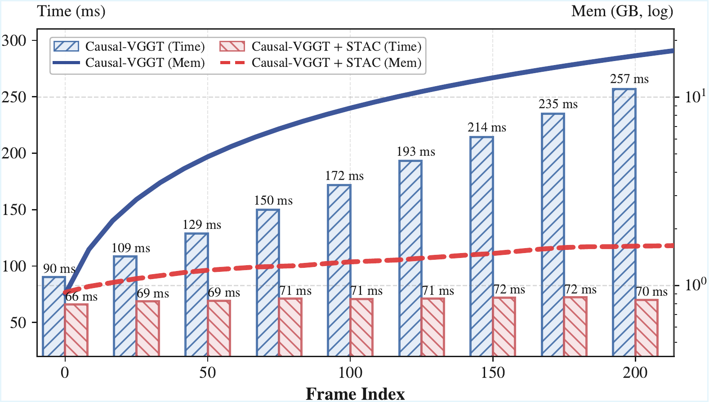

*原论文图 1。随着视频帧数增长，未压缩缓存的内存增加、速度下降；STAC 在论文测试序列上显著降低内存并提升吞吐。该图对应作者所测硬件和序列，不代表任意分辨率或场景规模下的固定上限。*

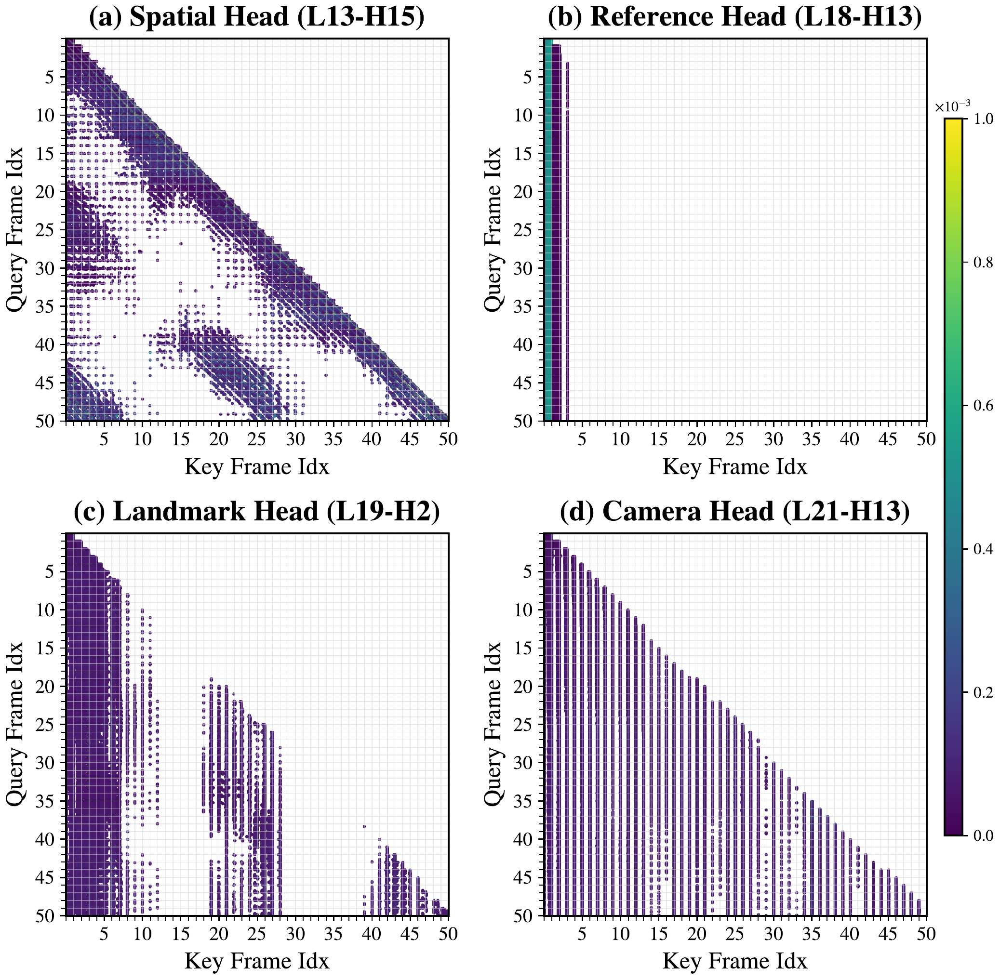

*原论文图 2。作者将注意力模式归纳为局部空间关注、首帧与地标帧关联，以及相机 token 的长程上下文等类型。这些模式为缓存保留策略提供观察依据。*

## 三部分缓存设计

STAC 的流程见图 3。每层的缓存分成工作时间缓存和长期空间缓存；当连续帧组成一个小块时，再对块内帧进行联合处理。

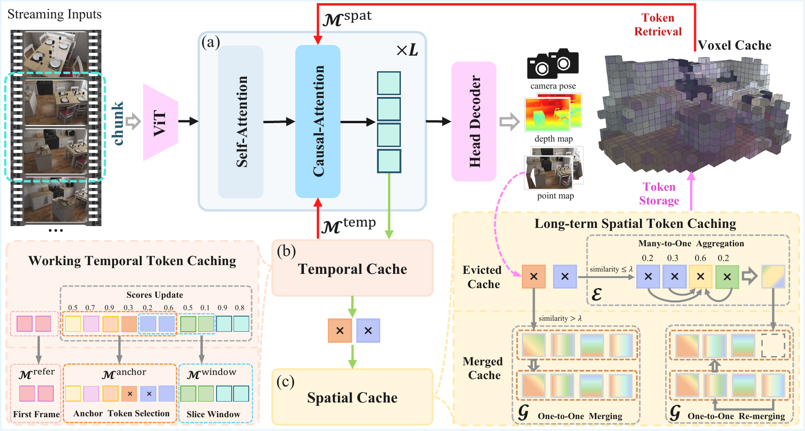

*原论文图 3。工作缓存保留首帧、近期帧和动态锚点；被移出的 token 根据其三维坐标进入体素空间缓存；当前预测再从邻近体素取回代表 token。分块优化在当前已到达的帧块内联合计算。*

### 工作时间缓存：留住近期与重要历史

工作缓存有三部分：完整保留的首帧参考 token、最近 $s$ 帧的滑动窗口，以及动态锚点。论文默认 $s=4$。近期窗口提供连续运动与局部外观上下文；首帧为长期场景提供固定参考；锚点则从即将移出窗口的 token 与已有锚点中重新挑选。

锚点重要性由跨帧注意力累积得到。若 $\alpha_{j,i}^{t}$ 表示时刻 $t$ 的第 $j$ 个 Query 对历史第 $i$ 个 Key 的注意力权重，论文用指数衰减累计分数：

$$
s_i^t=\gamma s_i^{t-1}+\sum_j\alpha_{j,i}^{t},\qquad \gamma=0.9.
$$

高分 token 更可能长期保留。衰减项让近期证据权重更高，累加项则能让多帧反复使用的历史信息成为稳定锚点。它是模型注意力驱动的保留指标，不是对几何正确性的直接置信度。

### 长期空间缓存：按三维位置压缩和检索

当 token 离开时间窗口后，解码器给出的三维坐标把它分到固定大小的体素中。每个体素维护一个代表集合 $G_u$ 和待合并缓冲区 $E_u$。若新 token 的 Key 与体素里某代表的余弦相似度超过阈值 $\lambda$，它就按相似度权重更新代表的 Key、Value 均值及累计权重；若没有足够相似的代表，则先放进缓冲区。缓冲区达到上限时，算法围绕重要 token 聚合出新代表；代表集合满了以后，再把权重较低的代表并入邻近代表。

这一步使用 Key 相似度判定信息是否可合并，Value 则随代表一起加权更新。检索时，系统把当前帧预测出的三维点量化到体素，并查询邻近体素（默认范围为两倍体素边长），把代表和尚未合并的缓冲 token 加入当前注意力上下文。被合并 token 的计数通过注意力 logit 的 $\log n$ 偏置补偿，避免一个代表只因条目数变少就失去原先累积的影响力。

补充材料图 6–8 从不同角度检查了这一设计的依据：同体素 token 的 KV 相似度较高，且随体素距离增大而下降；相似性在网络不同层也总体存在。聚类数实验中，每个体素保留约 4 个代表在压缩率和多样性间较均衡。这些分析支持局部合并的合理性，但不意味着同一体素中的特征在所有动态场景里都可互换。

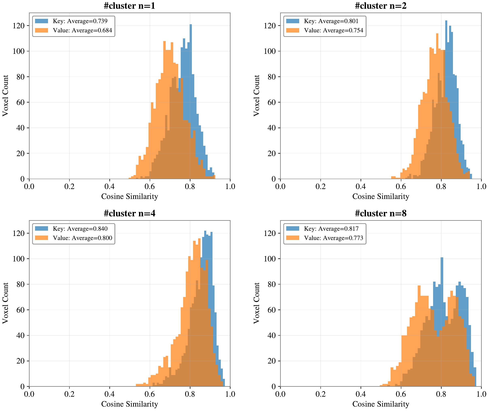

*原论文图 6。作者对体素内 token 聚类并比较 Key、Value 余弦相似度；每个体素保留 4 个代表时，平均相似度较高且仍保留一定多样性。*

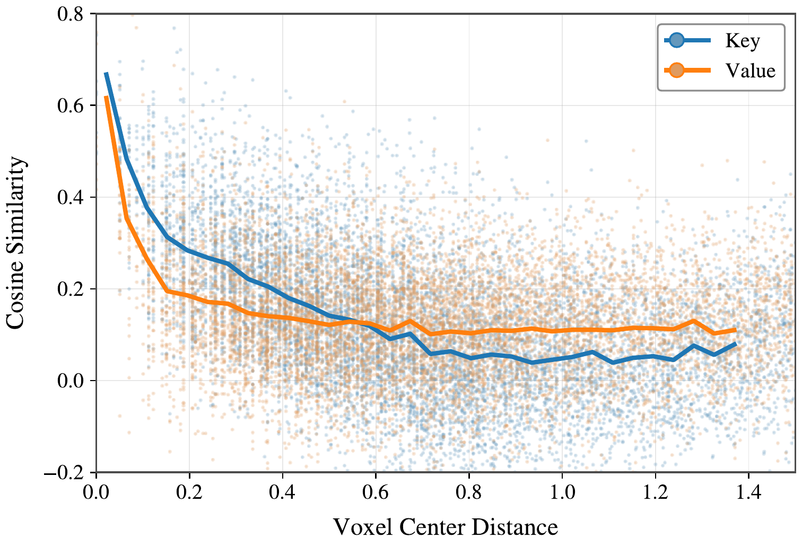

*原论文图 7。体素间距增大时，Key 与 Value 相似度整体下降，支持按局部空间邻域组织长期记忆。*

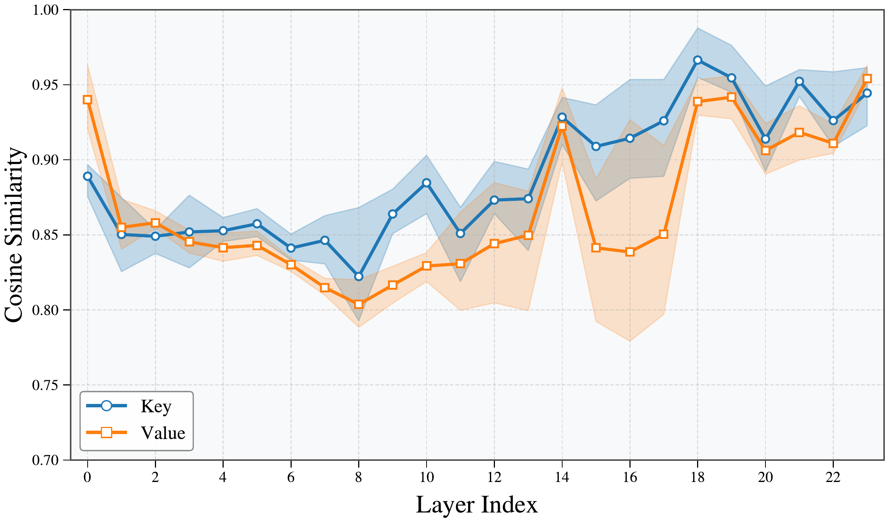

*原论文图 8。各层体素内 KV 相似度的分布总体保持较高，表明空间冗余并非只出现在某一层。*

### 分块优化：用短暂等待换并行效率

作者把连续到达的帧按块处理，实验默认块大小为 4。在当前块中，帧之间可以联合使用双向注意力，块与尚未到达的未来帧仍保持因果边界。分块让 GPU 有更大的并行计算单元，也让局部几何预测更连贯；代价是系统需要等当前块收齐，增加最多一个块的输入等待时间。因此，STAC 仍是在线流式推理，但其输出节奏不是严格的逐帧零等待。

## 实验结果与权衡

主要重建实验使用 NRGBD 与 7-Scenes，输入分辨率为 $518\times392$，每隔 5 帧采样关键帧，每段约 200–300 帧。Accuracy（Acc）和 Completion（Comp）越低越好，Normal Consistency（NC）越高越好。表 1 的内存列有特别说明：STAC 的主数值包括长期空间缓存，括号内是运行时 KV 用量；FPS 则是从图像输入到最终三维输出的全流程速度。

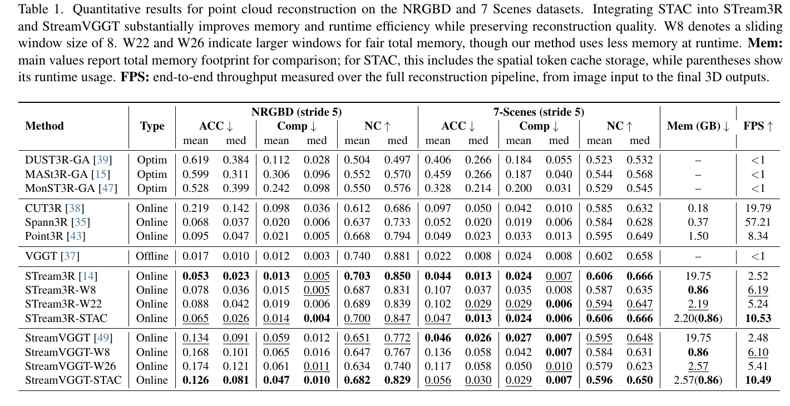

*原论文表 1。STAC 相对完整缓存大幅降低内存并提高 FPS；重建指标则随骨干和数据集变化，不能概括成每项都改善。*

例如，STream3R 在 NRGBD 上的完整缓存为 19.75 GB、2.52 FPS；STream3R-STAC 报告总计 2.20 GB（运行时 0.86 GB）和 10.53 FPS。StreamVGGT-STAC 为 2.57 GB（运行时 0.86 GB）和 10.49 FPS。总存储约缩小 8–9 倍，速度约为完整缓存的 4.2 倍。质量并非完全不变：STream3R 的 NRGBD Acc 均值从 0.053 变为 0.065，变差；StreamVGGT 则从 0.134 变为 0.126，改善。7-Scenes 上也有指标升降并存。

与滑动窗口对照时，作者扩大窗口大小以匹配内存预算。表 1 中 STAC 通常比 W8 窗口的重建质量更好，也比更大窗口的完整历史近似方法有竞争力，但比较会受到缓存构成和所选数据集的影响。图 4 与补充图 9 提供定性例子，可看到窗口基线的一些局部缺失与错位得到缓解；这些样例不能代替全数据集定量结果。

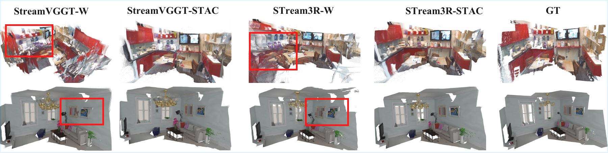

*原论文图 4。红框标出部分局部重建差异；STAC 的结果在这些例子里更接近真值，但定性展示不能说明所有场景都如此。*

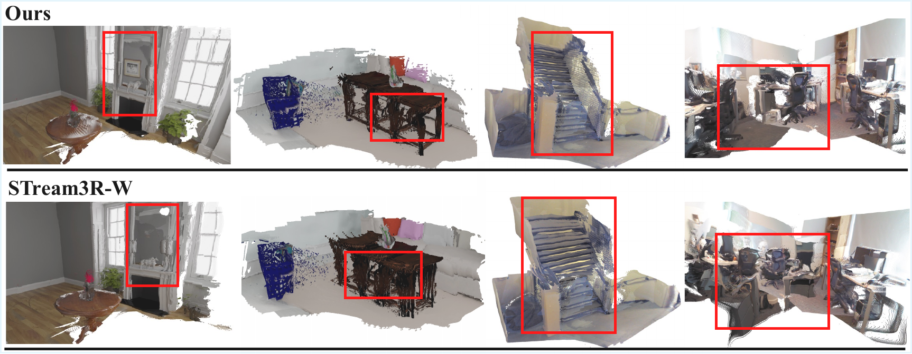

*原论文图 9。补充材料展示不同场景中的额外比较，帮助观察局部几何细节与长期场景覆盖。*

在深度估计表 4 中，STream3R-STAC 在 Sintel 的 Abs Rel 从 0.264 降到 0.259，在 KITTI 从 0.080 降到 0.075；Bonn 则从 0.070 升到 0.071。StreamVGGT-STAC 在 KITTI 的 Abs Rel 为 0.192，原模型为 0.173，明显变差。这个结果提醒我们，点云重建、深度与位姿是不同任务，缓存压缩对一种指标的收益不能自动外推到另一种。

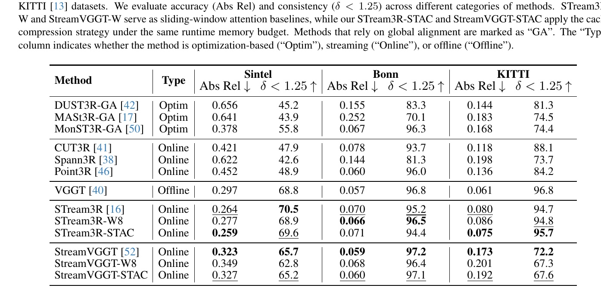

*原论文表 4。表中报告按序列对齐后的深度误差与 $\delta<1.25$ 比例；STAC 相对窗口基线通常有优势，但相对原模型并非所有数据集和指标都提升。*

相机位姿实验在 Sintel、TUM Dynamics 和 ScanNet 上评估 ATE 与平移、旋转 RPE，轨迹采用 Sim(3) Umeyama 对齐。表 2 显示 STAC 多数结果仍有竞争力，但不总能超过完整缓存。例如 STream3R-STAC 的 ScanNet 平移 RPE 为 0.025，高于原模型的 0.021；StreamVGGT-STAC 的 Sintel 平移 RPE 为 0.102，高于原模型的 0.092。因而更准确的结论是：大幅压缩后，位姿精度总体仍可用，但仍有具体场景的退化。

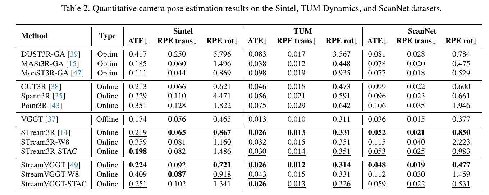

*原论文表 2。不同数据集对缓存压缩的敏感程度不同；ATE、平移 RPE 和旋转 RPE 应分别查看。*

### 消融与长序列行为

表 3 在 STream3R-W8 上逐一移除锚点缓存、空间缓存、计数偏置和分块优化。完整模型的 Acc、Comp、NC 分别为 0.0648、0.0142、0.6995，主干运行时间为 71.18 ms（不含图像编码器和输出头）。移除空间缓存会降低内存与运行时间，但几何指标变差；移除锚点后 Acc、Comp 也变差；移除计数偏置或分块优化同样影响质量，且无分块时运行时间升到 138.12 ms。这里消融支持各模块的作用，但表中逐项独立删除不能说明模块交互在其他骨干上的大小。

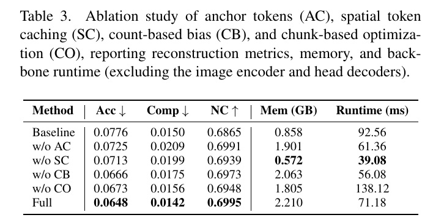

*原论文表 3。运行时间只包含骨干，不含图像编码器与输出解码头；因此不能直接与表 1 的端到端 FPS 换算比较。*

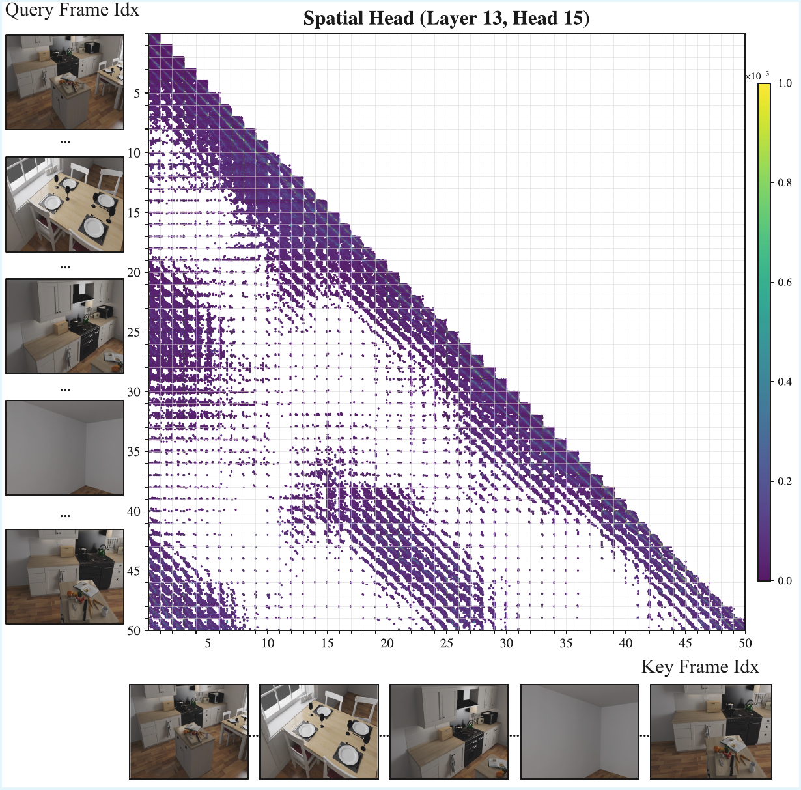

*原论文图 5。补充材料显示不同注意力头在空间位置上的关注差异，是空间缓存按局部几何归组的另一项观察依据。*

在 NRGBD 的 whiteroom 长序列上，图 10 展示约 1,400 帧的运行情况。作者报告注意力、检索和合并的平均耗时约 53.6、2.7、6.1 ms，总计约 62.4 ms；缓存增长主要来自长期空间 token，最终图示约 2,053 MB、约 2,924 个活跃体素。耗时曲线相对稳定，内存前期增长后趋于平缓。这支持其在该室内序列上的长期效率，但体素数量会随场景覆盖范围增加；论文也明确指出，大型或无界室外场景可能增加活跃体素数，快速运动还会造成 token 表征不一致。

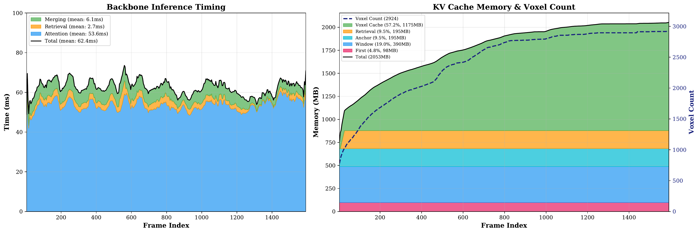

*原论文图 10。左侧为每帧骨干推理及缓存操作耗时，右侧为 KV 缓存与活跃体素数。曲线说明该室内序列中耗时和存储趋稳，不证明任意场景大小下都恒定。*

超参数表 5 显示，体素边长 $r=0.05$、合并阈值 $\lambda=0.8$ 是作者采用的折中点。体素更细时活跃单元和内存增加；体素过粗可能把几何差异较大的 token 合并。阈值较低会加大直接合并，阈值较高则可能延后合并、增加缓存压力。策略消融表 6 中，注意力引导的选择和加权合并对随机选择有帮助；与统一合并相比，指标差距较小，说明空间分组本身已经提供了一定筛选作用。

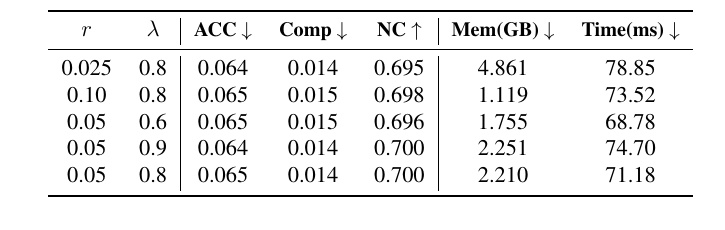

*原论文表 5。体素大小和相似度阈值共同决定空间分组、缓存规模与检索代价。*

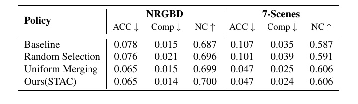

*原论文表 6。STAC 在两组数据上的数值略优于随机选择和统一合并；四舍五入后，部分指标与统一合并相同。*

## 方法关系与适用边界

STAC 把流式重建缓存看成两种互补记忆：时间缓存保留容易随局部窗口消失的连续上下文和显著锚点；空间缓存把重复访问的几何证据按位置压缩，待场景再次出现时再检索。分块优化则改变计算组织方式，提高 GPU 并行度，但带来块级等待。三者分别针对遗忘、重复和算力利用，不能互相替代。

它的实用价值在于可插入现有 StreamVGGT 或 STream3R 推理流程，不额外训练主干，并在论文实验中明显降低 KV 运行负担。适用边界也很具体：长期空间缓存依赖解码坐标和固定体素网格，场景越广，活跃体素可能越多；快速动态物体可能让同一位置的 token 不再代表稳定内容；分块大小影响延迟；压缩预算改变后，几何质量也会变化。把 STAC 用作在线重建系统的一环时，仍需依据场景尺度、运动类型、帧率和可接受延迟评估缓存策略，而不能只引用单一的速度倍数。

**版本说明：**CVPR 正式版用于正文与主实验。arXiv v2 用于补充材料；其 PDF 末尾的 C.5 正文在分页处截断，本文通过 arXiv 官方源码包核对该节完整文字，并在临时目录重新编译确认。表 6 本身完整呈现在 arXiv v2 PDF 中，配图直接从该表提取；未修改论文内容。
