# STream3R 论文解读

> Yushi Lan、Yihang Luo、Fangzhou Hong 等，*STream3R: Scalable Sequential 3D Reconstruction with Causal Transformer*，ICLR 2026 正式版。本文依据正式版论文及其附录。[论文页面](https://proceedings.iclr.cc/paper_files/paper/2026/hash/46989f00f32abadeca82205366463b97-Abstract-Conference.html) · [PDF](https://proceedings.iclr.cc/paper_files/paper/2026/file/46989f00f32abadeca82205366463b97-Paper-Conference.pdf) · [项目页](https://nirvanalan.github.io/projects/stream3r/) · [代码](https://github.com/NIRVANALAN/STream3R)

## 摘要

STream3R 把稠密三维重建表示为点图回归，并进一步把多帧处理改写成 decoder-only Transformer 的顺序预测问题。以往方法要么依赖全局优化，要么采用容量有限的状态记忆；输入序列变长时，前者计算昂贵，后者可能难以保留长程几何上下文。STream3R 对到达的图像逐帧运行因果注意力，并缓存已经处理过的特征，作为后续帧的上下文。作者报告，该方法从多样的三维数据学习几何先验，在静态和动态场景基准上达到有竞争力或更好的结果，并可使用语言模型常见的 KV cache 等训练和推理机制。摘要的核心主张是可扩展的在线几何预测；具体优势仍需结合不同任务的评价协议和模型版本理解。

## 1 引言

从图像恢复稠密几何是自动驾驶、虚拟现实和机器人等任务的基础。经典 SfM 和多视图立体视觉将问题拆成特征匹配、相机估计和三角化等步骤；DUSt3R 则展示了另一种路线：用 Transformer 直接回归点图。MASt3R、Fast3R 和 VGG-T 等工作扩展了这种数据驱动的几何预测范式，输入可以从单张图像扩展到许多视图，但通常把输入当作一个固定集合来联合处理。

实际视频是不断到达的。若每来一帧就把从开头到现在的全部图像重新送入 Fast3R 或 VGG-T，历史计算会重复发生，长序列的全局注意力也会变得昂贵。Spann3R 以记忆机制扩展 DUSt3R，但作者指出它仍有误差累积，并难以处理动态场景。同期的 CUT3R 使用循环神经网络式状态处理连续或无序输入；论文认为这种设计与现代网络架构和硬件加速不够适配，且固定状态容量限制长程依赖。

STream3R 因而借鉴语言模型中的单向因果注意力：新 token 可以读取之前 token 的计算结果，推理时通过 KV cache 复用历史 Key、Value。作者把图像到点图的预测改写为逐帧的顺序配准，让每一帧借助过去特征预测自身局部坐标和世界坐标下的点图。论文列出的贡献包括：以 decoder-only Transformer 和因果注意力处理非结构化或流式图像；兼容 KV cache 与窗口注意力；支持局部、世界双坐标点图，并可用点图与相机位姿初始化基于 splatting 的新视角合成。

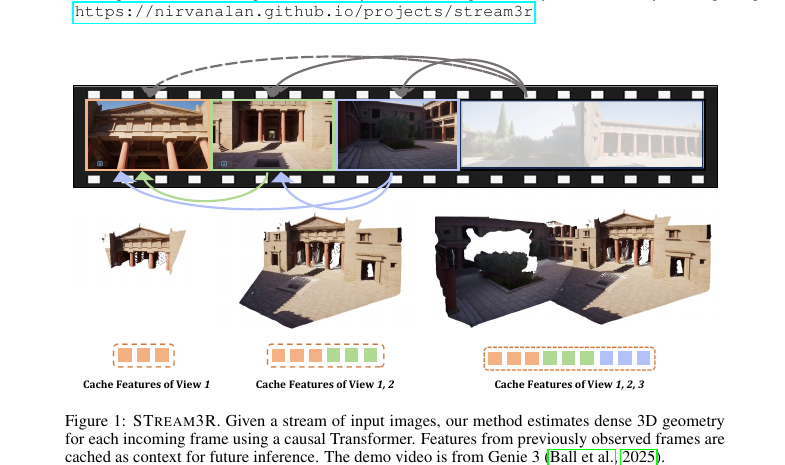

*原论文图 1 展示输入帧持续到达时，模型缓存已处理视图的特征，并将其用作后续帧的上下文。图中的 Genie 3 演示用于说明流式场景。*

## 2 相关工作

### 经典三维重建

SfM 和 SLAM 通过几何推理，从图像中估计稀疏结构和相机位姿。NeRF 与 3D Gaussian Splatting 等工作把重点转向高保真新视角合成，但通常针对每个场景单独优化，收敛较慢，也缺少对稀疏或遮挡输入的通用先验。STream3R 所在的数据驱动路线利用大规模三维数据学习几何先验，目标是在较少输入下直接预测重建。

### 从数据学习三维先验

深度估计、位姿与深度联合估计、可微分 BA 和学习式多视图立体视觉都在把学习模型引入几何问题。不过，单目或双视图设置往往不足以恢复完整几何；BA 仍依赖迭代优化，多视图立体视觉通常需要已知相机位姿或手工设计的几何模块。点图回归则把每个像素映射到三维坐标，可用前馈网络直接产生稠密几何。

### 点图表示

点图相比体素、网格或隐式场，更贴合神经网络的稠密输出形式，可用于快速前馈预测、光栅化渲染、SLAM 和少视图合成。DUSt3R 与 MASt3R 从图像对联合估计深度、位姿和内参，但扩展到多视图时需要额外的全局对齐，融合成本也随视图数增加。STream3R保留点图作为预测目标，主要改变跨帧信息如何传递。

### 单目视频的四维重建

动态场景使传统几何方法更难成立。Robust-CVD、MegaSAM 等依赖逐视频优化；MonST3R 微调 DUSt3R 处理动态点图，但仍需滑窗式全局对齐后处理。STream3R追求直接、在线地产生动态场景几何，避免逐视频优化与后处理对齐。

### 流式输入重建

单目 SLAM、Spann3R、Fast3R、VGG-T、CUT3R 等分别探索流式或多视图重建。Fast3R 和 VGG-T 以全局注意力联合处理多视图，长视频成本较高；CUT3R 逐步更新循环状态，但状态容量有限。STream3R主张将点图预测改造成 decoder-only 因果 Transformer，使历史上下文可通过 KV cache 或窗口注意力读取。这里的“可扩展”指其计算和缓存机制更适合顺序推理，不意味着完整历史缓存本身是常数内存。

## 3 预备知识：DUSt3R

STream3R沿用 DUSt3R 的图像编码和点图预测基础。对第 $t$ 张图像 $I_t$，共享权重的 ViT 编码器将其切分为 $K$ 个 patch token：$F_t=\operatorname{Encoder}(I_t)\in\mathbb{R}^{K\times C}$。DUSt3R一次处理两张图像 $I_1,I_2$，初始化两支解码特征 $G_t^0=F_t$，再让两个对称解码分支通过交叉注意力交换信息：第 $i$ 层的特征由当前视图上一层特征和另一视图的上一层特征共同计算。最后每支输出该图像的点图和置信度。

这个双视图设计能从图像对估计几何，却没有直接规定如何接入任意长的连续输入；增加视图后还需全局对齐。STream3R保留编码器和点图头的基本思路，把解码器改为新帧顺序读取过去帧特征。

## 4 方法

STream3R输入可以是视频，也可以是无序图像集合。与对整段输入做双向注意力或读取固定大小可学习状态的方案不同，它缓存过去帧的特征，并让新帧通过因果注意力逐步融合历史。论文将问题定义、网络结构和训练目标依次放在 4.1、4.2 和 4.3 节。

### 4.1 问题定义与符号

给定同一三维场景中的 $N$ 张 RGB 图像，模型依次输出每帧的局部点图、全局点图和相机参数：

$$
f_\theta((I_t)_{t=1}^{N})=(\hat X_t^{\mathrm{local}},\hat X_t^{\mathrm{global}},\hat P_t)_{t=1}^{N}.
\tag{1}
$$

每张点图属于 $\mathbb{R}^{3\times H\times W}$，对图像每个像素给出三维坐标。局部点图以当前观测相机为坐标系；全局点图以首帧相机坐标系为参考。$\hat P_t\in\mathbb{R}^9$ 同时包含内参与外参。双坐标输出让模型既可直接回归首帧参考系下的场景点，也可先恢复当前相机坐标中的几何，再通过位姿将其变换到全局坐标。

### 4.2 用于三维回归的因果 Transformer

#### 长上下文因果注意力

当前图像先编码为 $F_t$。解码器每层先在本帧 token 内做 self-attention，再让当前帧特征读取此前各帧同一层的特征。设 $G_t^{i-1}$ 是当前帧第 $i$ 层的输入，$G_0^{i-1},\ldots,G_{t-1}^{i-1}$ 是此前帧对应层的特征，则：

$$
G_t^i=\operatorname{DecoderBlock}^i\!\left(G_t^{i-1},\;G_0^{i-1}\oplus G_1^{i-1}\oplus\cdots\oplus G_{t-1}^{i-1}\right).
\tag{2}
$$

$\oplus$ 表示沿 token 序列维拼接历史特征，第二个输入提供因果注意力的上下文。推理时，历史 Key 和 Value 可缓存起来；新帧只需计算自己的特征与投影，避免重新处理旧帧。缓存保留的是各层历史 token 的信息，若每帧含 $K$ 个 token，完整历史的缓存仍随帧数增长。

#### 简化的解码器设计

DUSt3R用两支对称解码器分别处理两张视图。STream3R只保留一个共享解码器，使任意帧都经过同一套层。每个解码块包含帧内 SelfAttn 与读取历史的 CrossAttn。前两帧遵循 DUSt3R 的两视图约定，因为此时历史上下文不足；从之后的帧开始按式（2）因果读取历史。

首帧还定义规范世界坐标。模型将可学习的 `[reg]` token 逐元素加到首帧特征 $F_1$ 上，让网络识别该帧承担全局锚点角色。论文没有给其他帧添加位置嵌入。附录进一步说明，编码器注意力的 Query 和 Key 使用 RoPE，解码器则不使用 RoPE，以适应输入视图数变化。

#### 预测头

解码后，模型使用两个 DPT 头分别输出局部和全局点图以及各自置信度：

$$
\hat X_t^{\mathrm{local}},\hat C_t^{\mathrm{local}}=\operatorname{Head}_{\mathrm{local}}(G_t^0,\ldots,G_t^B),
\tag{3}
$$

$$
\hat X_t^{\mathrm{global}},\hat C_t^{\mathrm{global}}=\operatorname{Head}_{\mathrm{global}}(G_t^0,\ldots,G_t^B),
\tag{4}
$$

相机头则从相同的解码层特征预测相机参数：

$$
\hat P_t=\operatorname{Head}_{\mathrm{pose}}(G_t^0,\ldots,G_t^B).
\tag{5}
$$

式（3）的坐标以当前相机为基准，式（4）以首帧相机为基准；式（5）提供相机内外参。这样局部几何可用于深度与逐相机重建，全局几何可直接拼成首帧参考系中的场景点云。作者沿用先前工作中的双坐标预测，称它有助于简化训练，也可适配只有局部或部分三维标注的数据集。

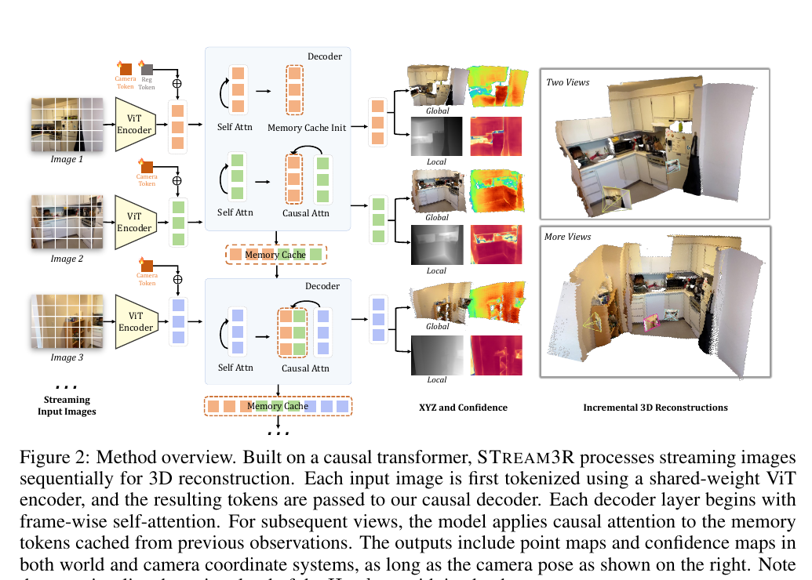

*原论文图 2 展示共享 ViT 编码器、帧内注意力、历史缓存、因果注意力及局部/全局点图和相机输出之间的关系。图中右侧点云由局部点图分支示意。*

### 4.3 训练目标

训练时从视频或图像集合中随机采样 $N$ 张图像，对每帧的局部与全局点图进行监督，并预测对应置信度。点图损失是 DUSt3R 置信度加权回归损失的推广。对预测点 $\hat x$、真值点 $x$ 和预测置信度 $\hat c$，损失将尺度归一化后的坐标误差按置信度加权，同时用对数置信度项约束模型：

$$
\mathcal L_{\mathrm{conf}}=\sum_{(\hat x,\hat c)\in(\hat X,\hat C)}\left[\hat c\left\|\frac{\hat x}{\hat s}-\frac{x}{s}\right\|_2-\alpha\log\hat c\right].
$$

$s$ 和 $\hat s$ 分别是目标和预测点图的尺度归一化因子。尺度不确定的数据采用各自尺度归一化，模型因而主要学习几何形状；度量尺度数据令 $\hat s=s$，保留真实尺度监督。置信度使可靠像素对回归贡献更大，而 $-\alpha\log\hat c$ 防止网络通过把置信度压至零来逃避误差。

相机参数写作四元数 $\hat q_t$、平移 $\hat\tau_t$ 和焦距 $\hat f_t$。相机损失将旋转差、尺度归一化平移差和焦距差的二范数相加，并对序列各帧求和：

$$
\mathcal L_{\mathrm{pose}}=\sum_{t=1}^{N}\left(\|\hat q_t-q_t\|_2+\left\|\frac{\hat\tau_t}{\hat s}-\frac{\tau_t}{s}\right\|_2+\|\hat f_t-f_t\|_2\right).
$$

因此，局部/全局点图分支通过稠密点坐标和置信度获得监督，相机头则直接学习位姿与焦距；相机参数也使局部点图可以变换到首帧参考坐标系。论文此处未给上述损失编号。

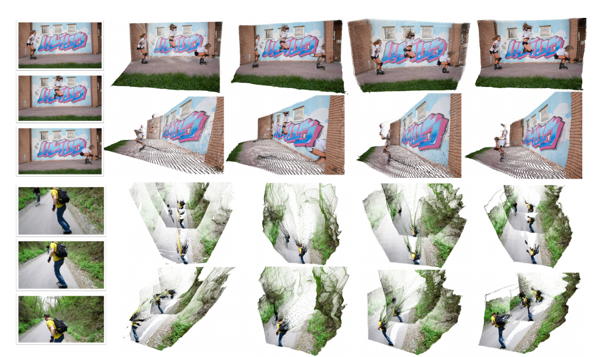

*原论文图 3 对比 STream3Rα、MonST3R、Fast3R 与 CUT3R 的点云可视化。它展示定性预测形态，不能替代统一协议下的定量评价。*

## 5 实验

### 数据集与实现细节

模型在多样的三维数据上端到端训练，包括 Co3Dv2、ScanNet++、ScanNet、Hypersim、Dynamic Replica、DL3DV、BlendedMVS、Aria Synthetic Environments、TartanAir、MapFree、MegaDepth 和 ARKitScenes；29 个训练集的完整细节见附录。比较基线包括双视图方法 DUSt3R、MASt3R、MonST3R，支持变视图数量的方法 Spann3R、CUT3R、SLAM3R、Fast3R，以及 VGG-T。论文把 Fast3R、VGG-T归入全注意力方法，把其余相关在线方法归入流式方法。除 VGG-T 和 STream3Rβ 外，大多数方法输入最长边设为 512；基于 VGG-T 的模型因 DINOv2 tokenizer 要求使用 518。FPS 在 A100、FP32 下测量，因此分辨率、精度与硬件条件是速度比较的组成部分。

STream3Rα 从 DUSt3R 预训练权重初始化，使用 24 层 CroCo ViT 编码器和 12 层解码器中的第一支；STream3Rβ 从 VGG-T 初始化，把全局注意力中的 self-attention 改为因果注意力并微调全部参数。两者使用 DPT-L 预测头，并在 Transformer 层中采用 QK-Norm、FlashAttention 和 BF16 混合精度。训练使用 AdamW、批量 64、学习率 $10^{-4}$、400K 次迭代，每个场景随机取 4–10 帧，输入裁剪分辨率从 $224\times224$ 到 $512\times384$。训练在 8 张 A100 上运行七天，并使用梯度检查点节省显存。

### 5.1 单目与视频深度估计

单帧深度测试使用未参与训练的 Sintel、Bonn、KITTI 和 NYU-v2，覆盖动态/静态、室内/室外及真实/合成数据。指标为绝对相对误差 Abs Rel（越低越好）和深度误差落在 1.25 倍以内的比例 $\delta<1.25$（越高越好）；依照 DUSt3R 的设置，逐帧使用中位数尺度对齐，因此该结果衡量尺度对齐后的深度形状，不代表绝对尺度精度。

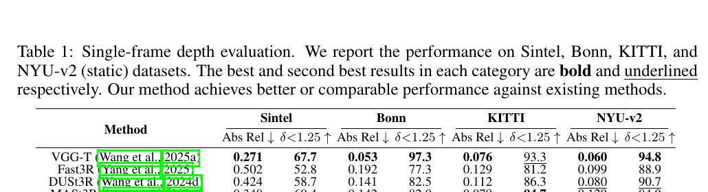

*原论文表 1 列出四个数据集的 Abs Rel 与 $\delta<1.25$。STream3Rβ 在 Sintel、KITTI、NYU-v2 的 Abs Rel 分别为 0.228、0.063、0.057，优于表中 VGG-T 的 0.271、0.076、0.060；Bonn 上 β 为 0.061，略高于 VGG-T 的 0.053。*

视频深度任务还评价跨帧尺度一致性：输出按每段视频的尺度与真值对齐。表 2 同时报告每序列尺度对齐和度量尺度结果。按序列尺度评估，β 在 Sintel、Bonn、KITTI 的 Abs Rel 为 0.264、0.069、0.080；β-W[5] 为 0.279、0.064、0.083。滑窗版本使用首帧及最近五帧的上下文，速度为 32.93 FPS；β 为 12.95 FPS，α 为 23.48 FPS，CUT3R 为 16.58 FPS。因而速度结论取决于版本：β-W[5]最快，β本体并不比 CUT3R 快。度量尺度部分表 2 只列 α 与 CUT3R，α 在 KITTI 上 Abs Rel 为 0.234，明显高于 CUT3R 的 0.122；不能把按尺度对齐的优势直接延伸到度量深度。

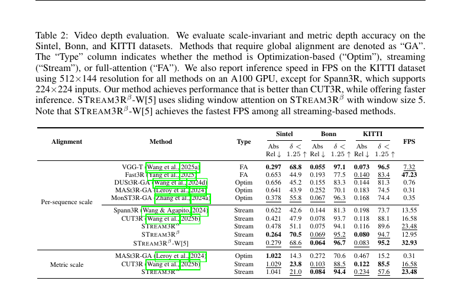

*原论文表 2 分开列出每序列尺度对齐与度量尺度结果，并给出 KITTI 上的 FPS。论文正文概括 β-W[5]在 Bonn、KITTI 上超过 β，表格显示它在有限历史下也达到最高流式速度。*

### 5.2 三维重建

7-Scenes 重建使用 Acc、Comp 和法线一致性 NC。Acc 与 Comp 是点云和真值表面间的距离类误差，越低越好；NC 越高越好。作者按 CUT3R 的设置，每个场景仅稀疏采样 3–5 帧，模拟重叠很少甚至无重叠的图像集合。

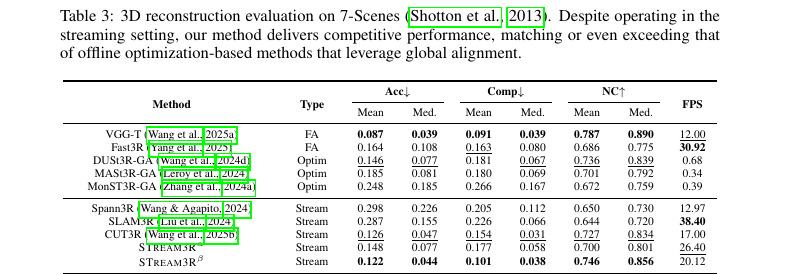

*原论文表 3 显示 STream3Rβ 的 Acc 均值/中位数为 0.122/0.044，Comp 为 0.101/0.038，NC 为 0.746/0.856。相对 CUT3R，β 的几何指标更好；FPS 为 20.12 对 17.00，约快 18%，而非正文概括的超过 50%。SLAM3R 报告 FPS 更高，但其输入分辨率为 $224\times224$，与其他方法并不相同。*

### 5.3 所提架构的有效性消融

消融实验在 $224\times224$ 分辨率下进行。作者用相同 MASt3R 初始化、数据、超参数和计算资源重训 CUT3R 与 STream3R，以比较循环状态和因果特征缓存。相同训练时间内，STream3R完成的训练步数多约 60%；局部点图分支的收敛曲线相似，全局点图分支的损失下降更快。作者将差异归因于 CUT3R 每次读取状态后还要执行状态更新，而 STream3R直接读取已缓存的历史特征。训练步数与预测精度是不同指标，这一结果说明训练吞吐和收敛差异，不直接等于所有推理设置都快 60%。

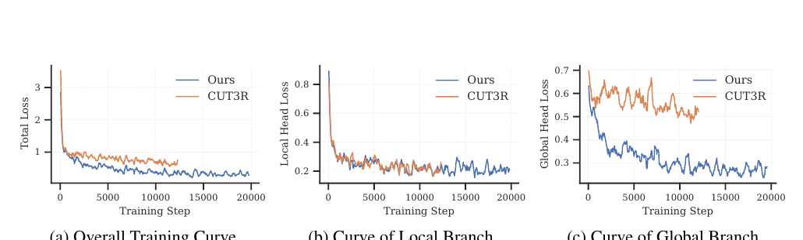

*原论文图 4 分别展示总损失、局部分支和全局分支。STream3R的优势主要体现在全局分支的收敛速度。*

表 4 比较相同迭代数检查点的深度与 7-Scenes 重建。STream3Rα 的视频深度误差和 7-Scenes Acc/Comp 均低于重新训练的 CUT3R，NC 更高。结果支持该设置下因果解码架构的有效性；由于两种模型的内部结构差异不止一处，消融不应被解读成单一算子对所有任务的因果证明。

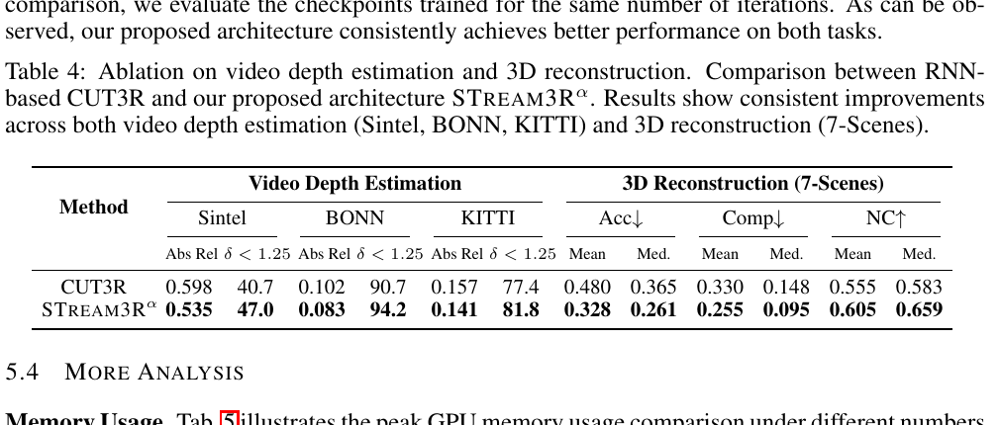

*原论文表 4 使用 $224\times224$ 输入、共同初始化和相同训练迭代数，报告视频深度和 7-Scenes 重建指标。*

### 5.4 更多分析

#### 显存使用

全量因果缓存会随输入帧数增长。论文在单张 A100、$448\times448$ 输入和 FlashAttention 下测量峰值显存。STream3Rα 在 100 帧时为 16.32 GB，β 为 18.08 GB；CUT3R 为 5.25 GB，VGG-T 为 63.63 GB。STream3R-W[5]始终保留首帧和最近五帧，α、β变体显存分别约为 3.72 GB 与 5.18 GB，表中随帧数保持不变。窗口化能让缓存大小固定，但代价是舍弃较远的非首帧上下文。

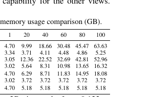

*原论文表 5 在 1、20、40、60、80、100 帧下比较峰值显存。滑窗版本将历史长度限制为固定窗口；完整缓存则随帧数上升。*

#### 首帧锚点鲁棒性

首帧定义全局坐标系，因此若其质量差，其他视图的共同坐标可能受到影响。作者先展示无序输入和首帧与其他帧几乎不重叠时的重建，再用 Real-ESRGAN 的退化流程破坏首帧，并在 7-Scenes 上测量结果。退化后 STream3Rβ 的 Acc 均值从 0.122 上升至 0.223，CUT3R 从 0.126 上升至 0.335；两者都变差，但 β 的 Acc 增幅较小。其它指标也有退化，因而实验支持相对鲁棒，并不表示首帧质量不重要。

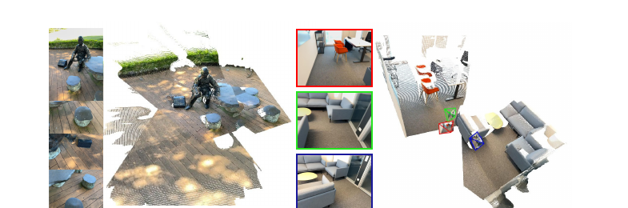

*原论文图 7 展示无序视图输入，以及锚点视图与其余图像无重叠时的点云重建。*

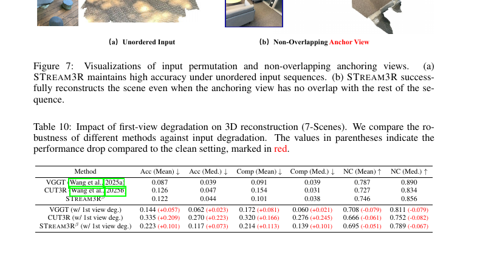

*原论文表 10 比较退化前后的 Acc、Comp 和 NC；括号表示相对干净输入的指标变化。STream3Rβ 的多个指标也下降，只是 Acc 均值的退化小于 CUT3R。*

### 5.5 更多应用

#### 与新视角合成结合

作者把模型预测的稠密点图和相机位姿导出为 COLMAP 兼容格式，用作 3D Gaussian Splatting 的几何初始化。这样复杂视频可在不依赖外部 SfM 工具的情况下进入高斯优化。高斯参数仍由下游优化产生，STream3R在这里提供的是初始化几何与相机。

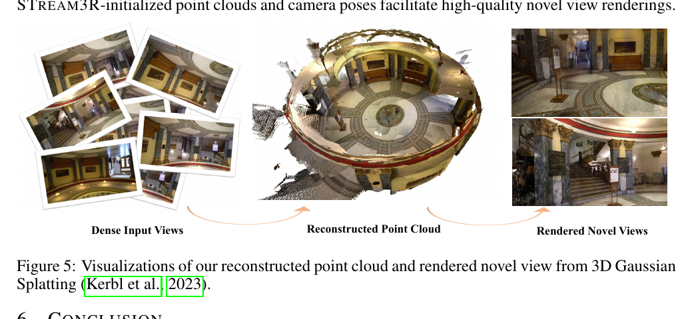

*原论文图 5 展示输入视图、STream3R点云和优化后渲染的新视角。*

## 6 结论

论文提出 STream3R，以 decoder-only Transformer 将稠密重建组织成因果注意力下的顺序配准。缓存历史特征使模型可以逐帧读取此前上下文；局部与全局双坐标预测兼顾当前相机几何和首帧参考系点云。作者报告其在单目/视频深度、三维重建与下游新视角合成上具有竞争力，并认为该设计适配大规模序列模型训练和推理。具体比较仍受 α/β 初始化、数据集、分辨率、尺度对齐和评测任务影响。

## 7 可复现性声明

论文称训练只使用公开数据集，具体数据处理信息见正文和附录；作者发布了代码与模型检查点。训练细节包括优化器、批量大小、学习率、迭代次数、输入帧数、分辨率和硬件，已在第 5 节记录。

## A 附录

### A.1 大语言模型的使用

作者声明，大语言模型仅用于少量语法修正和文风润色，没有用于方法设计、实验执行、结果分析或其他科学贡献。

### A.2 数据集细节

训练集合共含 29 个数据集，场景既包括静态也包括动态。按采样比例列出的前 15 个为 Co3Dv2、ScanNet++、ScanNet、Hypersim、Dynamic Replica、DL3DV、BlendedMVS、Aria Synthetic Environments、TartanAir、MapFree、MegaDepth、WildRGBD、Waymo、BEDLAM 与 ARKitScenes。作者未纳入 3D Ken Burns、IRS 和 SmartPortraits，原因是这些数据集为单视图，或下载未能成功；数据处理脚本改编自 CUT3R、DUSt3R 和 Spann3R。训练 β 时移除单视图数据集，保留 19 个集合；作者称没有观察到移除后性能下降，并指向 CUT3R 的数据集说明了解更多细节。

### A.3 更多实现细节

训练实际混合 12 种分辨率，范围为 $224\times224$ 至 $512\times384$；颜色抖动在整段序列内共享同一组参数，以免同一视频不同帧产生独立色彩扰动。网络沿用 CroCoNet 预训练 ViT 和 DPT 头。编码器每次注意力操作前对 Query、Key 加 RoPE，解码器不加，以便处理任意数量的视图。消融实验统一使用 $224\times224$。

STream3Rβ-W[5]固定读取首帧以保持规范坐标系，再加最近五帧；作者选择窗口 5 是其性能与速度折中，也称其他窗口长度可稳定工作。STream3Rβ-FA则在因果训练模型上移除 SelfAttn 的因果掩码，作为全注意力对照；作者将其与 CUT3R 的 revisit 操作类比。

### A.4 更多比较与分析

#### 视频深度估计

附录表 6 扩充了正文的深度基线，包括 Marigold、Depth Anything V2、NVDS、ChronoDepth、DepthCrafter、Robust-CVD、CasualSAM 及 DUSt3R-GA、MASt3R-GA、MonST3R-GA、Spann3R 等。使用每序列尺度与平移对齐时，STream3Rβ 的 Sintel、Bonn、KITTI Abs Rel 为 0.205、0.062、0.071；α 分别为 0.356、0.068、0.099。表中的 β 在该对齐设置下取得最好的整体精度，速度为 12.95 FPS；α 在 KITTI 上为 23.48 FPS。该表还分列纯尺度对齐和度量尺度结果，三种对齐协议不可混为一谈。

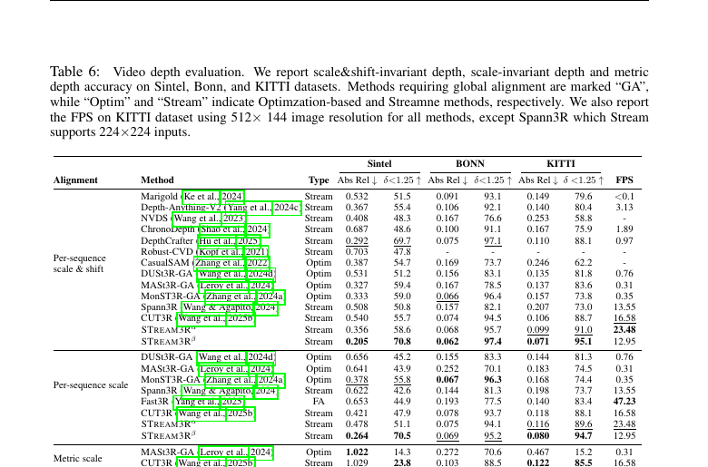

*原论文表 6 扩充了深度估计基线，并分开报告尺度与平移对齐、尺度对齐和度量尺度结果。*

#### NRGBD 三维重建

表 7 比较 NRGBD 上优化式、流式和全注意力模型。STream3Rβ 的 Acc 均值/中位数 0.065/0.017、Comp 0.034/0.014、NC 0.900/0.991；StreamVGGT 为 0.084/0.044、0.074/0.041、0.861/0.986。β 在表列指标上占优。STream3Rβ-FA把因果模型的 SelfAttn 改为全注意力后，Acc 为 0.057/0.014、Comp 为 0.028/0.013、NC 为 0.910/0.993，表现与 VGG-T 相近或更好。直接把 VGG-T 改成流式推理的结果明显较弱，支持针对因果约束微调的必要性。

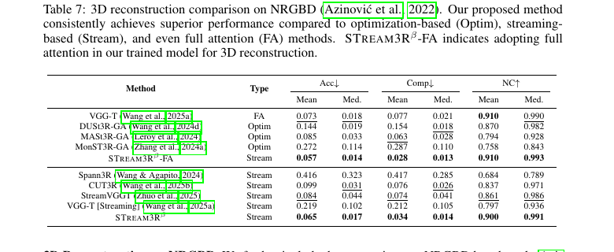

*原论文表 7 包含 StreamVGGT、VGG-T 流式变体和 STream3Rβ-FA。误差指标越低越好，NC 越高越好。*

#### 相机位姿估计

位姿评估在 Sintel、TUM-dynamics 和 ScanNet 上进行，报告经 Sim(3) 对齐后的 ATE、相对平移误差和相对旋转误差。模型无需已知相机标定。优化式基线总体仍能达到较低误差；在流式方法中，STream3Rβ表现最强，并在 TUM-dynamics 和 ScanNet 的 ATE 上优于 CUT3R：分别为 0.026 对 0.046、0.052 对 0.099。Sintel 上两者 ATE 同为 0.213。

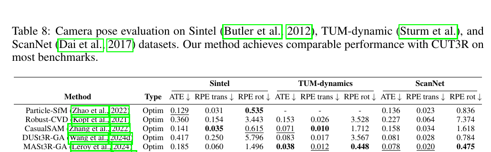

*原论文表 8 给出三个数据集上的 ATE、RPE 平移和 RPE 旋转结果；轨迹误差依赖论文采用的 Sim(3) 对齐协议。*

#### ETH3D 三维重建

ETH3D 用于检查较大场景和较长序列。全局对齐的 DUSt3R-GA、MASt3R-GA 表现较弱；STream3Rβ 的 Acc 均值/中位数为 0.363/0.227，Comp 为 0.245/0.094，NC 为 0.812/0.943。其平均完整度优于表中的 VGG-T（0.245 对 0.305），但平均准确度较差（0.363 对 0.280）；中位数 Acc 则 β 为 0.227、VGG-T 为 0.185。因此论文支持 β 在完整度和流式条件下有竞争力，不支持它在全部几何指标上超过离线 VGG-T。

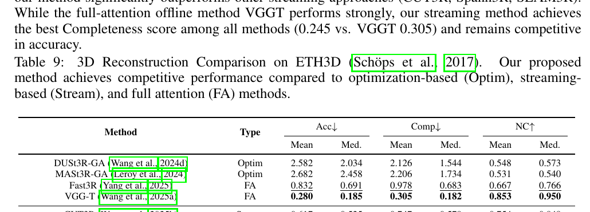

*原论文表 9 对比全局优化、流式和全注意力方法的 Acc、Comp、NC，分别报告均值和中位数。*

#### 与 VGGT-SLAM 的比较

作者在静态 NRGBD 和动态 Sintel、TUM-dynamics 上与 VGGT-SLAM 比较。约 150 帧 NRGBD 上，VGGT-SLAM 的 Acc 均值和 NC 均值较好，β 的 Comp 均值与中位数更低；整体属于相近但侧重点不同的结果。动态场景的位姿比较中，β 在 Sintel 的 ATE 为 0.213，VGGT-SLAM 为 0.305；TUM-dynamics 分别为 0.026 和 0.041。论文将任务边界解释为：STream3R希望同时重建动态前景和背景，SLAM 专用系统主要关注静态背景地图和相机定位。作者也指出，带 KV 缓存的前馈重建可作为 SLAM 前端，为关键帧选择、跟踪和建图提供支持。

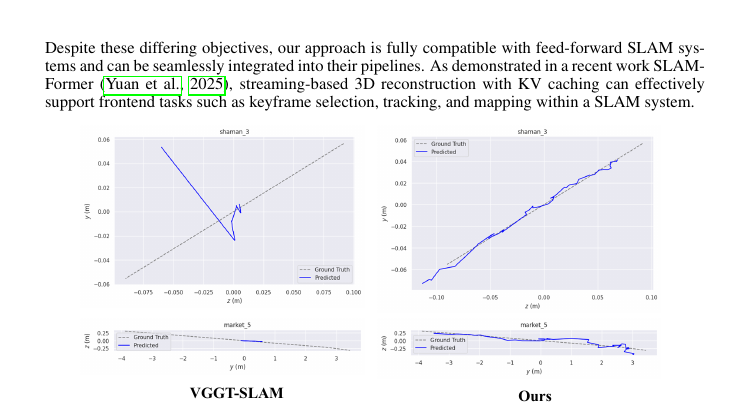

*原论文图 6 对比动态 Sintel 轨迹的位姿预测。它与表 12 的定量结果共同说明，该实验关注动态场景中相机轨迹的一致性。*

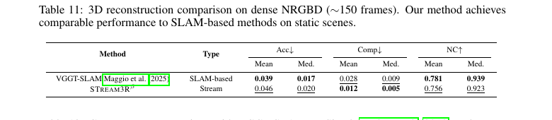

*原论文表 11 在约 150 帧的静态 NRGBD 场景中比较稠密重建质量。*

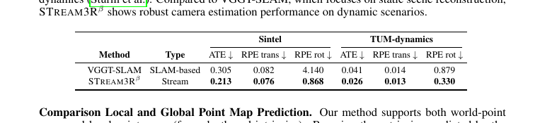

*原论文表 12 报告 Sintel 与 TUM-dynamics 上的 ATE、相对平移和旋转误差。*

#### 局部与全局点图比较

局部点图可用相机头预测的外参变换到全局坐标，因此有两条构建点云的路径：直接使用全局点图，或将局部点图投影到世界坐标。ETH3D 表 13 中，局部路径的平均 Acc/Comp 为 0.363/0.245，直接全局预测为 0.449/0.280；局部路径的中位 Acc 为 0.227，略差于全局路径的 0.215。结果说明局部深度与相机外参的分解在部分指标上有优势，但不能据此说它在每个指标都更好。

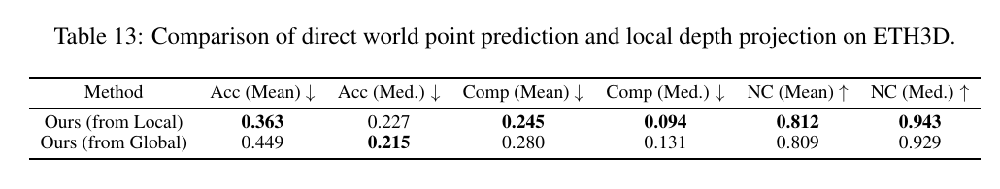

*原论文表 13 在 ETH3D 上逐项比较两种点云构造路径。*

#### 窗口注意力分析

表 14 在约 150 帧 NRGBD 序列上比较窗口 4、8、16、32、64、128 与完整因果缓存。窗口越大，显存越高：W[4] 为 6.00 GB，W[128] 为 24.51 GB，完整缓存为 30.30 GB。表中质量不是所有相邻窗口都严格单调，例如 W[8] 相比 W[4] 的若干指标略有变化；总体上更大窗口和完整缓存取得较好的结果。窗口长度提供了可调的历史上下文与内存折中。

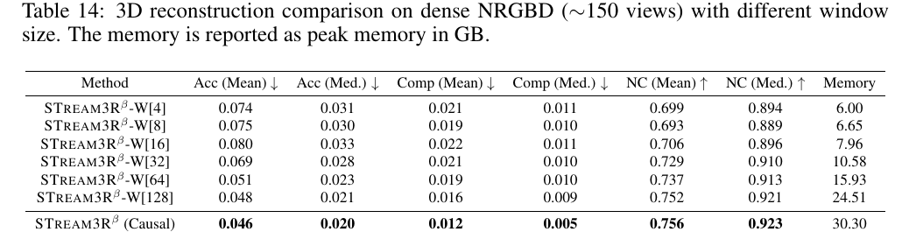

*原论文表 14 列出各窗口的 Acc、Comp、NC 和峰值显存。*

#### 更长序列重建

表 15 在 NRGBD 与 7-Scenes 上以 40、20、10、7、5、2 的帧间隔采样，输入视图数从约 30–35 增至约 500–750，并报告中位数指标。STream3Rβ在两组数据的各间隔上，表列 Accuracy 与 Completeness 均低于 CUT3R、Spann3R 和 SLAM3R，NC 则整体较高；序列越长，差距随任务和指标变化，不能简化成所有数值差距都扩大。

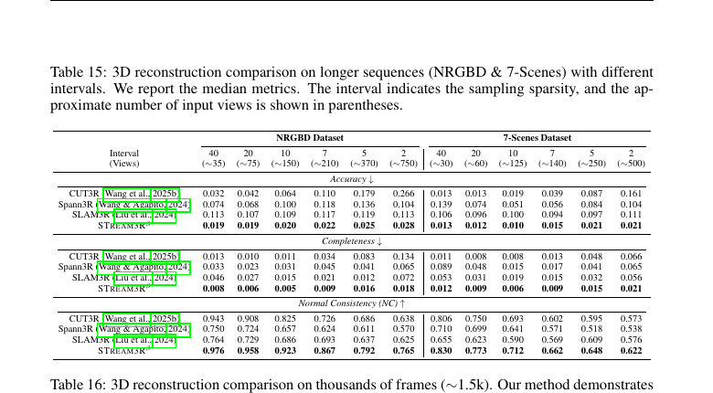

*原论文表 15 按数据集和采样间隔列出 Accuracy、Completeness、NC 中位数以及输入视图数。*

对约 1.5K 帧的轨迹，CUT3R 的 Acc 均值/中位数为 0.411/0.315、Comp 为 0.224/0.146、NC 为 0.544/0.581；STream3Rβ-W[16] 对应为 0.094/0.039、0.028/0.015、0.627/0.716。该对照显示固定窗口版本在此长轨迹协议下更稳定，但仍是保留首帧和有限近期帧的顺序预测，不包含回环后对历史轨迹的全局重估。

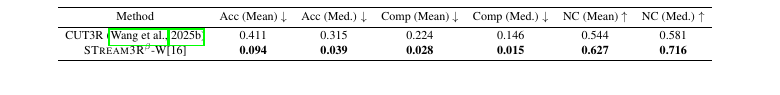

*原论文表 16 比较 CUT3R 与 STream3Rβ-W[16] 的长序列点云指标。*

### A.5 局限性

作者指出，朴素因果建模会发生误差累积和漂移，可能需要额外推理策略缓解。当前 STream3R是确定性回归模型，未来可探索自回归生成形式。论文还提出借鉴现代语言模型中的 MLA 等训练技术，以改善训练效率和性能。这些是作者提出的局限与后续方向，并非本文已经验证的解决方案。

## 方法关系

STream3R把每帧的几何预测和历史特征读取统一在因果解码器中：相比 CUT3R 的递归状态，它保留逐层历史 token；相比 StreamVGGT 的 VGG-T 路线，它从 DUSt3R/VGG-T 两种初始化分别得到 α、β 版本。历史读取、首帧全局锚定和局部/全局双坐标预测共同支撑在线点图输出。完整缓存仍增长，滑窗则通过限制近期上下文降低显存；两者都没有取代 SLAM 后端的重定位、回环和全局位姿图优化。论文的实验支持流式重建可覆盖动态场景和较长序列，同时也显示速度、绝对尺度、准确度和完整度需要按具体模型变体及评价协议分别判断。
