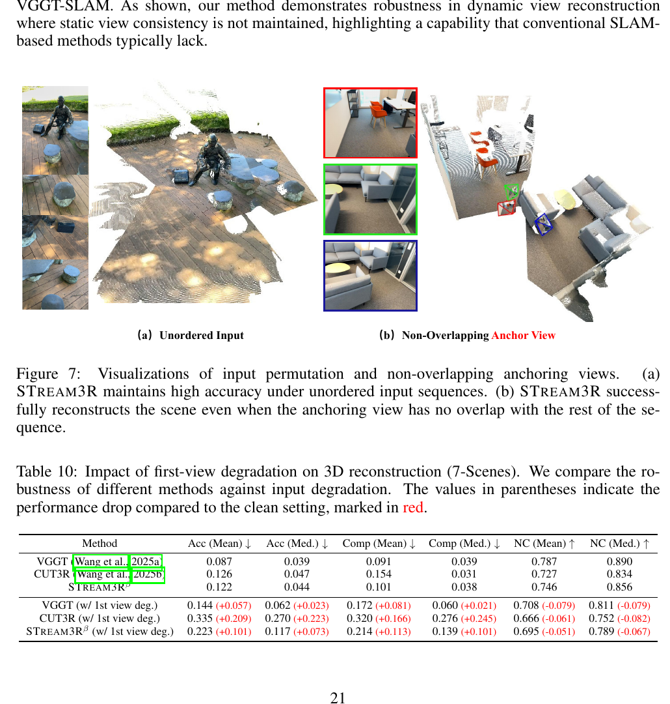
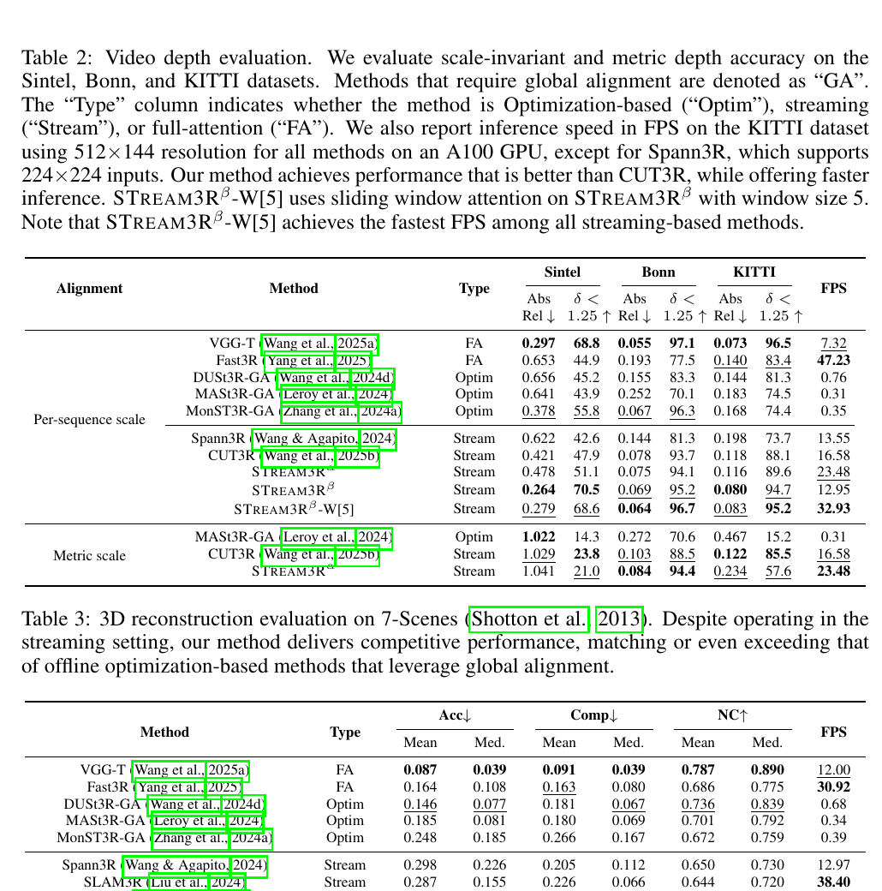
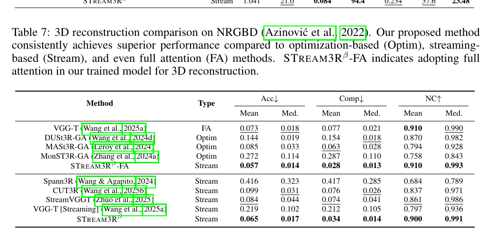
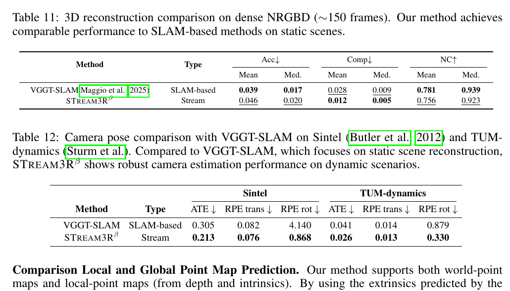
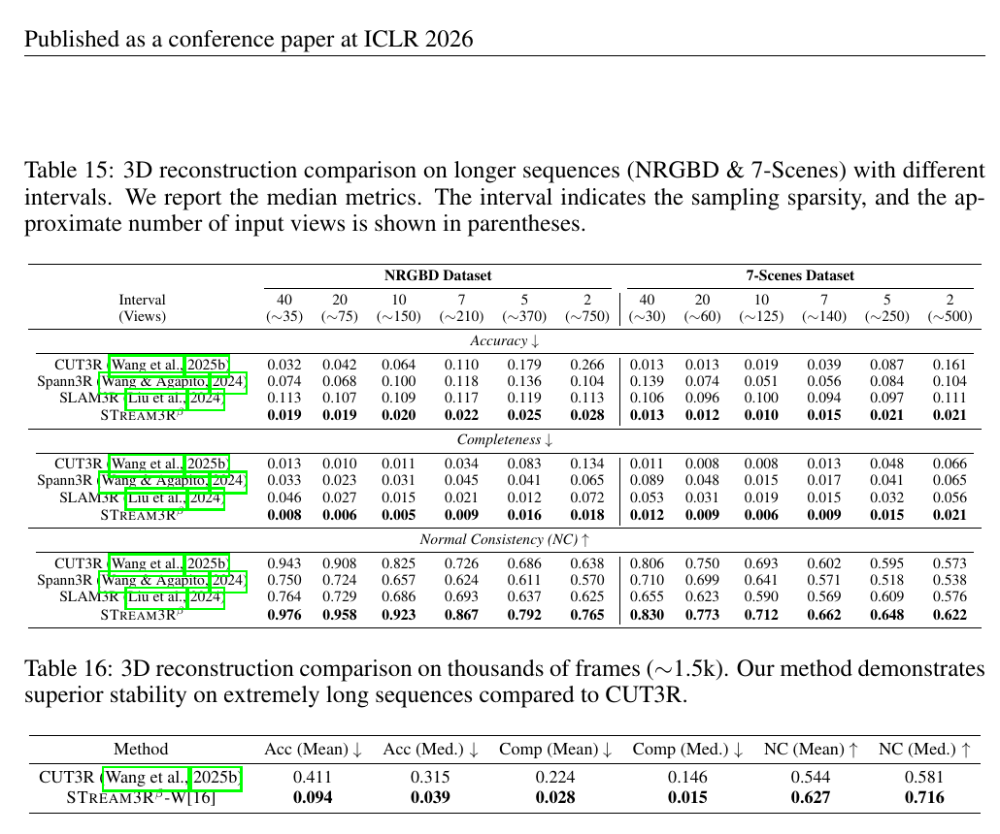

# STream3R 论文解读

> Yushi Lan、Yihang Luo、Fangzhou Hong 等，*STream3R: Scalable Sequential 3D Reconstruction with Causal Transformer*，发表于 ICLR 2026。本文依据 ICLR 正式版全文及附录，共 23 页。[论文页面](https://proceedings.iclr.cc/paper_files/paper/2026/hash/46989f00f32abadeca82205366463b97-Abstract-Conference.html) · [正式版 PDF](https://proceedings.iclr.cc/paper_files/paper/2026/file/46989f00f32abadeca82205366463b97-Paper-Conference.pdf) · [项目页](https://nirvanalan.github.io/projects/stream3r/) · [代码](https://github.com/NIRVANALAN/STream3R)

视频流不断产生新图像。一个流式重建模型需要在每帧到达时给出几何预测，并让新结果接入既有场景坐标。若每次都把从开头到当前的整段视频重新送入多视图模型，旧帧会被反复计算；若把历史压进单个固定状态，模型又可能难以保留足够的空间细节。

STream3R 将这个任务改写为**逐帧顺序配准**：当前帧在解码时读取此前帧的特征缓存，再预测自身的局部点图、以首帧为参考的全局点图以及相机参数。它借用语言模型常用的因果注意力和 KV 缓存，使过去的中间特征可以复用。这个设计便于逐帧运行，但若保留全部历史，缓存仍随序列变长；它提供的是在线三维重建能力，本身没有加入传统 SLAM 的回环检测和全局位姿图优化。

## 1. 从两视图点图到逐帧配准

DUSt3R 把两张图像分别编码成 patch 特征，再通过两条交叉注意力解码分支预测点图。点图为每个像素分配一个三维坐标，因此网络可以直接回归稠密几何，而不必先找出显式特征匹配再三角化。两张图的点图处在共享坐标系中；要纳入更多视图，常见做法是再进行全局对齐。

STream3R 保留点图预测的形式，同时改变多帧之间传递信息的方式。令输入图像序列为 $I_1,\ldots,I_N$，第 $t$ 帧的输出包括局部坐标系点图 $\hat X_t^{\mathrm{local}}$、全局点图 $\hat X_t^{\mathrm{global}}$ 和相机参数 $\hat P_t$：

$$
f_\theta((I_t)_{t=1}^{N}) = (\hat X_t^{\mathrm{local}},\hat X_t^{\mathrm{global}},\hat P_t)_{t=1}^{N}.
\tag{1}
$$

每张点图的形状为 $3\times H\times W$，对应图像每个像素的三维坐标。局部点图以当前相机为参考；全局点图以首张输入图像的相机坐标系为参考。相机参数 $\hat P_t\in\mathbb{R}^{9}$ 同时表示内参与外参。于是模型既可以直接估计共享坐标中的点，也可以从当前相机的局部几何和相机运动构造场景位置。

*原论文图 2。共享 ViT 编码器逐帧提取图像 token，单个解码器先处理帧内 token，再让新帧因果地读取历史缓存。预测头输出局部和全局点图、置信度以及相机参数；右侧展示随着新视图加入而增量扩展的点云。*

## 2. 因果解码器如何使用历史

图像经过共享权重的 ViT 编码器后成为特征 token。DUSt3R 有两个对称解码器，分别处理两张输入图；STream3R 去掉这组双分支，改用一个共享解码器处理任意长的输入序列。解码器的每一层包含帧内自注意力和历史因果注意力：当前帧先在自己的图像 token 之间交换信息，再以当前特征为查询，读取此前帧在对应层产生的特征。

若把当前帧第 $i$ 层的特征记作 $G_t^{i-1}$，历史特征记作 $G_0^{i-1},\ldots,G_{t-1}^{i-1}$，下式概括了这一层；其中 $G_0$ 沿用论文式（2）的首个历史特征索引：

$$
G_t^i=\operatorname{DecoderBlock}^i\!\left(G_t^{i-1},\;G_0^{i-1}\oplus G_1^{i-1}\oplus\cdots\oplus G_{t-1}^{i-1}\right),
\tag{2}
$$

其中 $\oplus$ 表示把历史帧 token 沿序列维拼接，第二个输入供因果注意力读取。推理时，注意力里的 Key 和 Value 可以缓存下来；新帧到来后，不必重新计算旧帧的这些投影。若每帧有 $K$ 个 token、缓存 $t$ 帧，缓存规模仍与 $tK$ 成正比。KV 缓存减少重复计算，却没有把完整历史压缩成固定大小的地图或状态。

首帧同时定义了全局坐标。论文将可学习的 `[reg]` token 逐元素加到第一帧 token 上，以提示网络该帧承载规范坐标系的信息。由于最初还没有历史帧，前两帧按 DUSt3R 的两视图约定处理，之后才使用因果历史读取。论文没有为后续帧额外添加帧位置嵌入；附录说明编码器的注意力使用 RoPE，而解码器不加这类帧位置编码，以适应不同长度输入。

把首帧固定为全局参考也带来一个自然疑问：如果首帧和后续视角没有重叠，是否会破坏其余帧的配准？附录展示了无序输入和非重叠锚点的可视化，并通过退化首帧实验量化这一影响。首帧经退化后，7-Scenes 上 CUT3R 的平均准确度误差由 0.126 上升到 0.335，STream3Rβ 则由 0.122 上升到 0.223；两者都受影响，但 β 的误差增幅较小。

*原论文图 7、表 10。图 7 展示无序视图输入，以及首帧与其余视图无重叠时的重建；表 10 比较首帧退化前后的 Acc、Comp 和 NC。首帧锚定没有阻止模型处理非重叠输入，但质量仍会因锚点退化而下降。*

*原论文图 3。图中比较 MonST3R、Fast3R、CUT3R 与 STream3Rα 在真实视频中的点云结果。它用于展示预测形态和场景覆盖，不能替代有统一协议的定量指标。*

## 3. 双坐标预测和训练目标

同一帧既预测局部点图，也预测首帧坐标系中的全局点图；每组点图还配有置信度图。两个 DPT 头分别读取各解码层的特征并生成这两种坐标下的输出，另一个相机头预测位姿与内参。全局点图直接提供统一场景坐标；局部点图则可结合相机外参变换到全局坐标。

重复预测两种坐标不是为了输出两份等价结果。论文沿用已有工作中的做法，认为冗余目标能简化训练，也便于利用只有局部几何或部分视图标注的数据。附录的 ETH3D 对比支持这一分解思路：由局部深度和预测相机外参投影得到的点云，平均准确度为 0.363、平均完整度为 0.245；直接使用全局点图时分别为 0.449 和 0.280。两个路径在中位准确度上则由直接全局预测略好，因此这个实验支持的是不同目标各有优势，而不是局部路径在所有指标上都占优。

*原论文表 13。表格比较局部深度结合相机外参投影得到的点云，以及直接预测的全局点图；局部路径在平均 Acc、Comp 和 NC 上更好，直接全局预测的中位 Acc 略好。*

点图损失以 DUSt3R 的置信度加权回归为基础。对预测坐标 $\hat x$、目标坐标 $x$ 和预测置信度 $\hat c$，其核心形式为：

$$
\mathcal L_{\mathrm{conf}}=\sum_{(\hat x,\hat c)}\left[\hat c\left\|\frac{\hat x}{\hat s}-\frac{x}{s}\right\|_2-\alpha\log\hat c\right].
\tag{3}
$$

$s$ 与 $\hat s$ 是目标和预测点图的尺度归一化因子。尺度不确定的数据使用归一化尺度，使监督不因整体尺度不同而惩罚几何形状；度量尺度数据则令两者相同，以保留米制尺度。置信度 $\hat c$ 调节坐标误差的贡献，$-\alpha\log\hat c$ 则避免模型把所有像素的置信度都压到零。

相机损失把位姿拆成四元数 $q_t$、平移 $\tau_t$ 和焦距 $f_t$，用二范数分别监督旋转、按尺度归一化的平移以及焦距。这样模型不只拟合点云，还要预测足以联系局部相机坐标与全局坐标的相机参数。

## 4. 两种模型版本与训练设置

论文报告两个版本。STream3Rα 从 DUSt3R 预训练权重初始化，使用 24 层 CroCo ViT 编码器和 12 层解码器，并保留其中一个解码分支。STream3Rβ 从 VGG-T 初始化，将全局注意力中的自注意力替换为因果注意力，再微调全部参数。两种版本都用 DPT-L 预测头；训练中使用 QK-Norm、FlashAttention 和 BF16 混合精度。

训练采用 AdamW，批量大小 64、学习率 $10^{-4}$、共 400K 次迭代。每个训练样本从同一场景随机抽取 4 至 10 帧，图像裁剪分辨率在 $224\times224$ 到 $512\times384$ 之间。正式版附录称训练数据共 29 个数据集；其中采样比例最高的 15 个包含 Co3Dv2、ScanNet++、ScanNet、Hypersim、Dynamic Replica、DL3DV、BlendedMVS、Aria Synthetic Environments、TartanAir、MapFree、MegaDepth、WildRGBD、Waymo、BEDLAM 和 ARKitScenes。训练 STream3Rβ 时去除单视图数据集，使用 19 个数据集。训练在 8 张 NVIDIA A100 上进行七天。

## 5. 深度估计与场景重建结果

单帧深度实验覆盖 Sintel、Bonn、KITTI 和 NYU-v2。STream3Rβ 在 Sintel、KITTI 和 NYU-v2 的绝对相对误差分别为 0.228、0.063 和 0.057，优于表中 VGG-T 的 0.271、0.076 和 0.060；在 Bonn 上 β 为 0.061，略逊于 VGG-T 的 0.053。该实验使用逐帧中位数尺度对齐，因此比较的是深度形状误差，不能据此判断输出具有准确的绝对尺度。

*原论文表 1。结果分别列出 Sintel、Bonn、KITTI 和 NYU-v2 上的绝对相对误差与阈值准确率。STream3Rβ 在多个数据集上的部分指标较强，在 Bonn 上则不是最优。*

视频深度表同时列出按序列尺度对齐的结果和度量尺度结果。以按序列尺度对齐的 KITTI 为例，STream3Rβ 的 Abs Rel 为 0.080，CUT3R 为 0.118；使用首帧加最近五帧的滑窗版本 β-W[5] 为 0.083，速度为 32.93 FPS。原始 β 的速度为 12.95 FPS，α 为 23.48 FPS，CUT3R 为 16.58 FPS；这些速度是在 A100、512×144 输入下测得。论文正文概括称模型比 CUT3R 快约 40%，但表中不同版本的速度并不一致：α 更快，β 更慢，W[5] 最快。因此解读时应按具体模型变体和指标比较，不能把“快约 40%”推广到所有版本。

*原论文表 2、表 3。视频深度表按序列尺度、度量尺度分别报告 Abs Rel 与 $\delta<1.25$，并给出 KITTI 推理速度；7-Scenes 表报告准确度（Acc）、完整度（Comp）和法线一致性（NC）。STream3Rβ 在 7-Scenes 上的 Acc 均值/中位数为 0.122/0.044，Comp 为 0.101/0.038，NC 为 0.746/0.856。与 CUT3R 相比，这些几何指标更好，但表中 FPS 为 20.12 对 17.00，差距约 18%，与正文“超过 50%”的速度概述不完全相符。*

附录还评估了相机位姿和 ETH3D 场景重建。位姿轨迹与真值经 Sim(3) 对齐后，STream3Rβ 在 TUM-dynamics 和 ScanNet 的 ATE 分别为 0.026 和 0.052，CUT3R 为 0.046 和 0.099；在 Sintel 上两者 ATE 均为 0.213。ETH3D 上，STream3Rβ 的平均完整度为 0.245，优于表中的 VGG-T 0.305，但平均准确度 0.363 高于 VGG-T 的 0.280。准确度与完整度分别衡量重建点到真值表面的距离和真值表面的覆盖程度，因此一个方法可以覆盖更多表面，同时点的位置误差略大。

*原论文表 8。表格列出 Sintel、TUM-dynamics 和 ScanNet 上的 ATE、相对平移误差及相对旋转误差。除位姿轨迹误差外，结果还受 Sim(3) 对齐协议影响。*

*原论文表 9。STream3Rβ 在 ETH3D 上与优化式、全注意力和流式方法比较；它的完整度较强，准确度则仍略逊于 VGG-T。*

补充材料在 NRGBD 上提供了与 StreamVGGT 的同表比较。STream3Rβ 的 Acc 均值/中位数为 0.065/0.017，Comp 为 0.034/0.014，NC 为 0.900/0.991；StreamVGGT 对应为 0.084/0.044、0.074/0.041、0.861/0.986。该表中的几何指标支持 STream3Rβ 在这一 NRGBD 协议下的结果更好，但它不能单独证明该模型在其他数据集、速度或全部任务上都优于 StreamVGGT。

*原论文表 7。表中包含 StreamVGGT、CUT3R、Spann3R 和直接将 VGG-T 用于流式推理的对照。误差类 Acc、Comp 越低越好，NC 越高越好。这里展示的是重建质量，不包含各方法运行速度。*

## 6. 架构消融与历史窗口

作者以相同 MASt3R 初始化、数据集、超参数和计算资源重新训练 CUT3R 与 STream3Rα。图 4 显示两个模型的局部点图分支收敛相近，STream3R 的全局分支下降更快；在相同训练时间内，STream3R 完成的训练步数多约 60%。论文将其归因于 CUT3R 每次读取状态后还要执行状态更新，而 STream3R 直接读取已有帧缓存。消融表在视频深度和 7-Scenes 几何指标上也都显示 α 优于该重训的 CUT3R 基线。

*原论文图 4。总损失和全局点图分支上，STream3Rα 的曲线下降更快；局部分支差距较小。该训练曲线来自低分辨率消融实验，不能直接视为所有正式模型设置下的训练效率比例。*

*原论文表 4。该消融使用 $224\times224$ 分辨率、相同预训练初始化和相同迭代数；STream3Rα 在视频深度各项指标及 7-Scenes 重建指标上均优于重新训练的 CUT3R。*

完整历史因果注意力使每一帧都能读取所有以前的特征，但 KV 缓存会线性增长。论文提供不需微调的滑窗版本 STream3R-W[5]：保留首帧 token 以固定规范坐标，再读取最近五帧。这样缓存大小可保持固定。附录进一步在约 150 帧 NRGBD 序列上测试从 4 到 128 的窗口，结果显示窗口增大时重建质量总体提高，显存也随之上升；完整因果缓存质量最高，但峰值显存为 30.30 GB，W[4] 为 6.00 GB。它体现了可调节的历史长度与资源取舍，而不是一个同时保持完整历史和常数内存的方案。

*原论文表 14。约 150 帧 NRGBD 评估中，窗口从 4 增至 128 时，显存从 6.00 GB 增至 24.51 GB，重建质量总体改善；完整因果缓存的峰值显存为 30.30 GB。*

## 7. 与 SLAM 的关系及长序列评估

STream3R 预测相机运动和稠密几何，也可用于构建共享坐标下的场景点云，因此可以成为 SLAM 系统中的前端组成部分。论文特别提醒，它和 SLAM 的目标并不完全相同：STream3R 面向同时包含动态前景与背景的流式三维/四维重建，SLAM 系统通常更关注静态背景地图和准确相机定位。模型通过因果历史得到连续预测，但没有显式回环候选检索、回环验证或全局位姿图优化。

*原论文表 11、表 12。NRGBD 约 150 帧静态重建中，VGGT-SLAM 的 Acc 均值和 NC 均值较好，STream3Rβ 的 Comp 均值更好；在 Sintel 和 TUM-dynamics 的动态位姿评测中，β 的 ATE 分别为 0.213 和 0.026，VGGT-SLAM 为 0.305 和 0.041。两组结果反映任务设置不同：不能把动态序列上的位姿优势解释成它取代了具备全局优化的 SLAM 后端。*

长序列实验使用不同抽帧间隔测试 NRGBD 与 7-Scenes。表 15 显示，在两组数据和多个帧间隔下，STream3Rβ 的准确度、完整度和法线一致性普遍优于 CUT3R、Spann3R 与 SLAM3R。更长的约 1.5K 帧轨迹中，STream3Rβ-W[16] 的 Acc 均值/中位数为 0.094/0.039，Comp 为 0.028/0.015，NC 为 0.627/0.716；CUT3R 分别为 0.411/0.315、0.224/0.146 和 0.544/0.581。这个结果说明有限窗口版本在该数据和协议下更稳定，但窗口方法仍持续保留首帧和最近历史，并不执行回环式的历史轨迹全局重估。

*原论文表 15、表 16。表 15 按抽帧间隔列出 NRGBD 和 7-Scenes 的中位数指标；表 16 比较约 1.5K 帧轨迹上的 CUT3R 与 STream3Rβ-W[16]。误差均值下降、法线一致性上升支持窗口版在该长轨迹上的稳定性，结论限于论文报告的数据与评价协议。*

在新视角合成实验中，作者把预测点图和相机位姿导出为 COLMAP 兼容格式，用作 3D Gaussian Splatting 的初始化几何。该流程可以不依赖外部 SfM 工具来初始化视频场景的高斯优化，说明点图和相机输出可接入后续场景表示优化；高斯优化本身并非 STream3R 的逐帧预测模块。

*原论文图 5。输入多视图经 STream3R 得到点云和相机，再用于初始化高斯场景并渲染新视角。该图展示的是下游初始化流程，不表示模型直接输出高斯参数。*

## 方法关系与适用边界

STream3R 的关键选择是把历史保存为逐层帧特征，并用因果注意力读取；CUT3R 把历史压进递归状态；StreamVGGT 则从 VGGT 的多任务视觉几何结构出发改造注意力并缓存历史 token。三者都可逐帧接收图像，但存储形式、预测头和训练来源不同。STream3R的 α、β 也不是同一初始化条件下的轻微变体：α 源自 DUSt3R，β 源自 VGG-T，因此跨版本结果不能只归因于因果解码器。

正式版结果覆盖深度、点云、相机位姿、缓存窗口和新视角合成。它展示了因果 Transformer 在在线几何预测中的可行性，也用长序列实验说明适度窗口裁剪能够在特定协议下控制缓存并保持较好的重建质量。论文同时承认，朴素因果建模仍可能累计误差和漂移；模型输出是确定性的回归结果，尚未扩展为自回归生成模型。对于 SLAM，持续得到相机和点图只是系统的一部分，长期地图一致性仍需要显式重定位、回环与后端优化等机制来处理。
