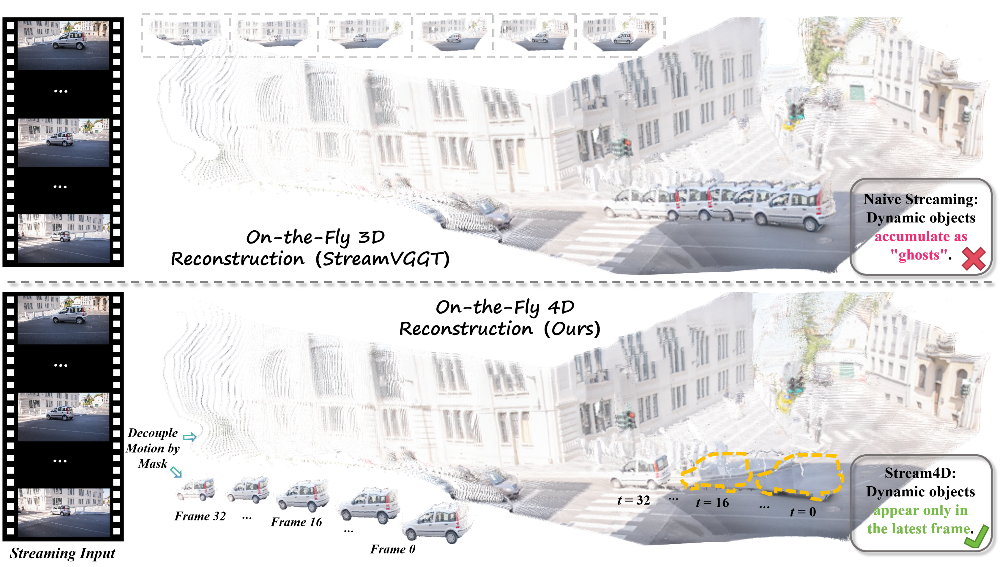
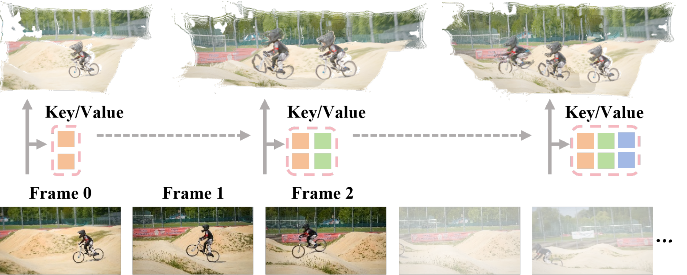
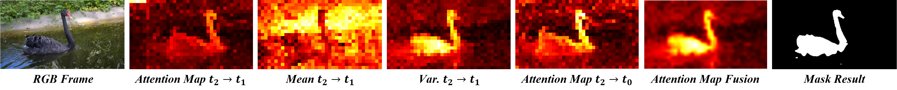
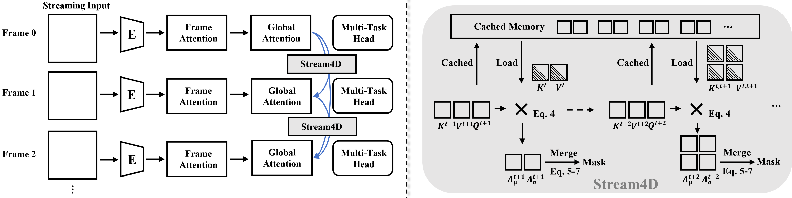
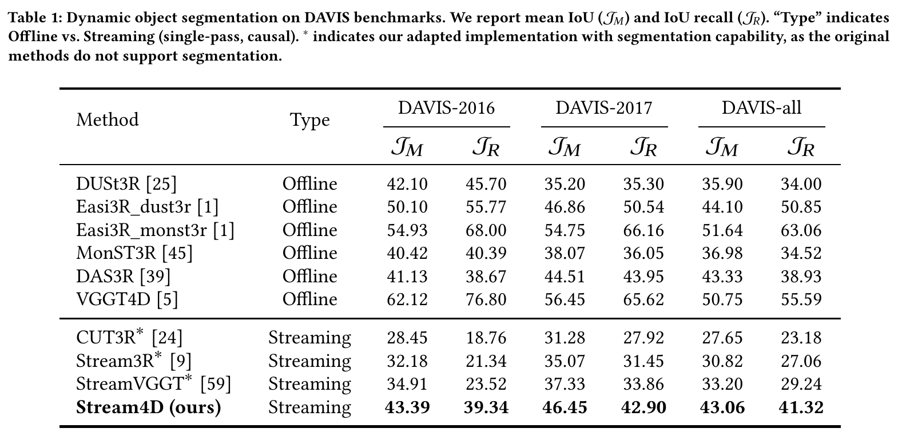
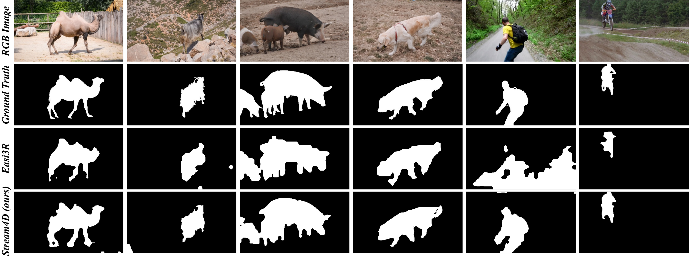
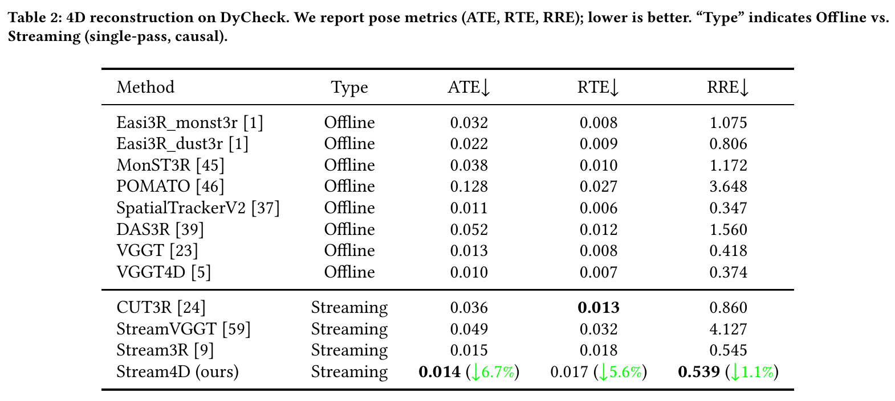
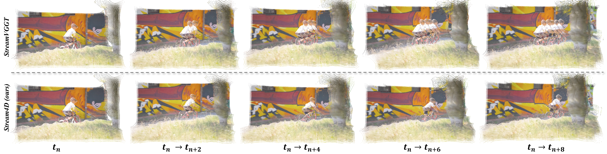
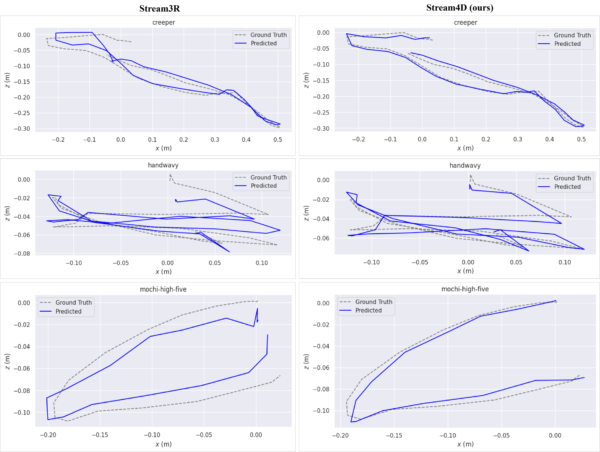
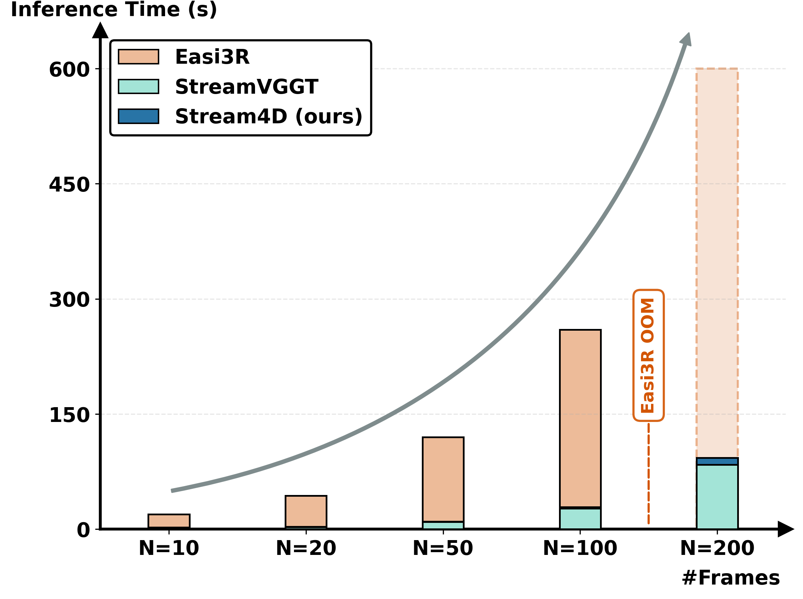

# Stream4D 论文解读

> Wei Zhang、Ying Feng、Mengtong Wu、Shiqiang Gong、Huaqi Zhang、Qi Zhang，*Stream4D: Streaming 4D Reconstruction with Training-free Motion Decoupling via Causal KV-Cache Attention*，arXiv:2610.31320v1（2026 年 10 月 22 日）。arXiv 页面注明该工作已被 ACM Multimedia 2026 接收。[arXiv 论文页](https://arxiv.org/abs/2610.31320) · [v1 PDF](https://arxiv.org/pdf/2610.31320v1)

流式重建把每一帧的视觉特征写入 Key、Value（KV）缓存，后续帧据此读取历史几何。静态场景中，这种因果累积可以省去反复处理整段视频；有运动物体时，同一物体却会在不同位置被多次写入，既干扰相机估计，也可能在地图里留下重影。Stream4D 的出发点是：因果注意力本身包含跨帧变化线索，因此可以从已有缓存中估计动态区域，再减弱这些区域对历史聚合的影响。

方法分成连续的两步。它先综合多层、多帧的注意力统计和深度变化，生成当前帧的动态掩码；随后用掩码衰减缓存中对应的 Key，并只将高置信度静态点加入静态点云。实验分别考察 DAVIS 动态分割、DyCheck 位姿估计，以及不同序列长度下的推理时间。

*原论文 Figure 1。上半部分的因果重建把行驶车辆逐帧融合，沿轨迹留下多个副本；Stream4D 在历史聚合时抑制动态区域，使场景中的移动物体主要保留在最新帧。*

## 1 引言

传统 SfM/MVS 依靠显式几何约束和迭代优化，面对长视频时需要在计算成本与扩展性之间取舍。端到端多视图模型可以直接从多帧预测几何，但成对匹配方法往往还要进行全局对齐，外部记忆方法则可能累积更新误差。Fast3R、VGGT 等模型通过全局注意力融合多视图信息，预测能力强；新帧到来时却需要重新处理完整序列，因而不适合持续在线推理。

StreamVGGT、Stream3R 等模型改用因果注意力，并将过去帧的 KV 保存下来。这样每一帧只需编码新输入并读取缓存，避免重复计算。不过，已有流式几何方法通常按静态场景设计。动态物体会破坏光度一致性和极线几何关系，误导相机位姿；它们的历史特征还会留在缓存中，逐渐累积成重影。

已有训练自由的动态重建方法 VGGT4D、Easi3R 也利用注意力统计，但分别依赖全局双向交互或相邻帧的局部比较。前者与严格因果处理不兼容；后者观察时间跨度短，难以在长序列中维持一致掩码。Stream4D 因此将问题限定为：如何直接从因果 KV 缓存中找到长期运动线索，并在不改动骨干网络结构、不重新训练的条件下，减少动态区域对历史几何的污染。论文称其为面向因果流式架构的训练自由 4D 重建框架；这个“首个”定位是作者的相关工作判断。

## 2 相关工作

### 流式重建

DUSt3R、MASt3R 等成对方法通过跨注意力处理图像对；Spann3R、CUT3R 维护外部记忆以增量更新场景。Fast3R、VGGT 则采用全局自注意力，在多个视图间直接交互，但新帧加入时要重跑完整序列。StreamVGGT 和 Stream3R 将几何预测改写为 decoder-only 的因果 Transformer，并以 KV 缓存或窗口注意力保存历史信息，改善了在线推理效率。Stream4D 沿用这类单遍架构，处理其尚未解决的动态物体问题。

### 4D 场景重建

早期动态场景重建常依赖 RGB-D 传感器，或通过自监督和测试时优化联合估计深度、位姿与运动。MegaSaM 借助单目深度先验，Uni4D 组合多个视觉基础模型和多阶段 BA；这些流程有效，但推理与优化成本较高。后续方法把动态处理移入网络或注意力：MonST3R 在动态数据上微调并利用光流，DAS3R 增加前馈运动掩码头，CUT3R 在静态与动态数据上微调，Easi3R 则在 DUSt3R 上自适应调节注意力、免去训练。

这些路线仍多采用双向 Transformer、依赖微调或需要额外后处理。Stream4D 的切入点不同：它从因果模型已有的注意力缓存中估计动态性，再修改缓存读取过程。这个做法保留流式骨干的在线特性，但有效性取决于注意力统计和深度先验是否能把动态与静态区域分开。

## 3 方法

给定按时间到达的图像序列 $\{I_t\}_{t=1}^{T}$，方法希望得到每帧动态物体掩码 $M_t$、相机运动以及静态场景点云 $X^*$。论文用 $P_t$ 和 $K_t$ 分别记相机外参与内参。每到新帧，骨干先编码当前图像并读取历史 KV；当前查询产生的注意力统计与深度先验随后融合，经时间平滑和阈值化得到动态掩码；最后，掩码衰减历史缓存中的动态 Key，并排除静态地图更新中的动态点。掩码生成依赖当前查询读到的历史线索，生成后又影响后续帧的缓存读取和地图累积。

### 3.1 流式 4D 几何重建

一般前馈几何模型可写为编码器、解码器和预测头的组合：

$$
F_t=\operatorname{Encoder}(I_t),\qquad
G_t=\operatorname{Decoder}(F_t),\qquad
(P_t,C_t)=\operatorname{Head}(G_t).
\tag{1}
$$

$F_t\in\mathbb R^{N\times C}$ 是图像 token，$G_t$ 是融合多视图信息后的几何 token，预测头输出点图 $P_t\in\mathbb R^{3\times H\times W}$ 和置信图 $C_t\in\mathbb R^{H\times W}$。论文在问题定义中用 $K_t$ 表示相机内参，注意力部分又用 $K_i^{(l)}$ 表示第 $l$ 层的 Key；两者含义不同，需按所在语境区分。

因果 Transformer 将第 $t$ 帧的几何特征限制在当前帧及过去帧的信息上：

$$
\{G_t\}_{t=1}^{T}=\operatorname{Decoder}\!\left(\operatorname{Causal\text{-}Attn}(\{F_t\}_{t=1}^{T})\right).
\tag{2}
$$

每层缓存历史 Key、Value，令 $\mathcal C_{t-1}=\{(K_i,V_i)\}_{i=1}^{t-1}$，新帧通过交叉注意力读取缓存，再把自身 KV 追加进去：

$$
G_t=\operatorname{Decoder}\!\left(\operatorname{CrossAttn}(F_t,\mathcal C_{t-1})\right),\qquad
\mathcal C_t=\mathcal C_{t-1}\cup\{(K_t,V_t)\}.
\tag{3}
$$

式（3）的集合表示的是历史缓存逐步增长。它解释了效率从何而来，也暴露动态场景中的风险：若运动物体的 token 不经筛选地写入历史，之后的帧仍会从这些位置读取信息，物体就可能在地图里留下多个时间位置的几何副本。论文的 Figure 2 展示逐帧更新过程；Figure 4 再把动态掩码插入这一缓存读写链路。

*原论文 Figure 2。每帧经过编码后读取过去的 KV，再把当前 $(K_t,V_t)$ 写入缓存；这是 Stream4D 所依赖的基础因果架构。*

### 3.2 流式动态分割

#### 从注意力统计提取运动显著性

当前帧查询 $Q_t^{(l)}$ 与第 $l$ 层历史 Key 计算注意力，其中 $d$ 是 Key 的通道维数：

$$
A_t^{(l)}=\operatorname{Softmax}\!\left(\frac{Q_t^{(l)}[K_1^{(l)},\ldots,K_{t-1}^{(l)}]^\top}{\sqrt d}\right).
$$

对每个 token，作者在一个自适应历史集合 $\mathcal H_t\subseteq\{1,\ldots,t-1\}$ 上统计注意力均值 $\mu_{t,i}^{(l)}$ 和标准差 $\sigma_{t,i}^{(l)}$。直觉是：静态区域在不同时间较稳定，平均注意力较高、波动较小；运动区域的对应关系随位置改变，注意力平均值偏低、波动偏高。于是每层先把这两个信号相乘，再跨层加权：

$$
S_t^{(l)}=(1-\bar\mu_t^{(l)})\odot\bar\sigma_t^{(l)},\qquad
S_t^{\mathrm{attn}}=\sum_{l\in\mathcal L}w_l S_t^{(l)}.
\tag{4}
$$

$\mathcal L$ 覆盖浅层、中层和深层，论文称权重 $w_l$ 偏向中层语义。乘积要求低均值和高方差同时出现，因而仅有一次注意力弱响应、但跨帧稳定的区域不会自动成为高动态分数。这里的均值和标准差是作者提出的经验统计量；正文没有完整定义自适应历史帧集合怎样选取，也没有给出各层权重数值，因此无法从论文复现出唯一的历史采样和聚合配置。

*原论文 Figure 3。图中比较输入、跨帧注意力、均值、方差、多尺度融合和最终二值掩码；动态天鹅对应较低均值、较高方差的显著区域。*

#### 用深度补充注意力线索

注意力在遮挡和纹理缺失处可能不稳定，Stream4D 再从预测深度中构造两种补充分数。第一种假定前景运动物体通常比背景更靠近相机，以当前深度分布的 $q$ 分位数作参照：

$$
S_t^{\mathrm{depth\text{-}prior}}
=\operatorname{Sigmoid}\!\left(\beta\left(\operatorname{Quantile}(D_t,q)-D_t\right)\right).
\tag{5}
$$

当像素深度小于该分位数时，括号内为正，Sigmoid 输出趋近 1，因而更像前景候选。这个先验是软线索，不等于“近处必为运动物体”；远处运动物体并不符合这一假设。$q$ 和斜率 $\beta$ 的取值在论文中没有报告。

第二种分数度量最近 $\tau$ 帧的深度变化：

$$
S_t^{\mathrm{depth\text{-}change}}
=\operatorname{Normalize}\!\left(\frac{1}{\tau}\sum_{i=t-\tau}^{t-1}|D_t-D_i|\right).
\tag{6}
$$

变化大的区域更可能包含运动或遮挡。不过，不同帧深度图处于各自的图像坐标中；论文没有说明式（6）在跨帧比较前是否进行重投影、配准或像素对应，也没有展开 Normalize 的具体范围。这是理解该分数实现方式时的来源缺口，不能自行假定它已经完成几何对齐。

注意力与深度分数按经验权重融合：

$$
S_t=\alpha_{\mathrm{attn}}S_t^{\mathrm{attn}}+
\alpha_{\mathrm{depth}}\left(
\alpha_{\mathrm{prior}}S_t^{\mathrm{depth\text{-}prior}}+
\alpha_{\mathrm{change}}S_t^{\mathrm{depth\text{-}change}}\right).
\tag{7}
$$

四个系数由实验确定，但论文没有给出具体数值。之后对当前和最近 $\tau$ 帧的显著图做时间平均，$\widetilde S_t=\frac{1}{\tau+1}\sum_{k=t-\tau}^{t}S_k$；再使用 Otsu 阈值法把显著图转为前景/背景掩码，并以形态学操作修补局部空洞与边界。时间平均让短暂的注意力尖峰不至于立刻改变掩码，但二值化也会把连续分数压成硬边界。论文没有报告不同视频上 $\tau$、阈值或形态学核的具体配置。

*原论文 Figure 4。当前查询读取缓存 Key/Value 并形成跨帧注意力统计，生成的掩码随后用于调整历史 Key；图中还展示掩码缓存如何随帧推进。*

### 3.3 运动解耦的流式重建

#### 软抑制历史 Key

给定动态 token 掩码 $M_i\in\{0,1\}^{N}$，Stream4D 对每个历史 Key 逐 token 缩放：

$$
\widetilde K_i=K_i\odot(1-\gamma M_i),\qquad
\widetilde{\mathcal C}_t=\{(\widetilde K_i,V_i)\}_{i=1}^{t-1},\qquad 0<\gamma<1.
\tag{8}
$$

当 $M_i=1$ 时，Key 被乘以 $1-\gamma$；$\gamma$ 越大，衰减越强。Value 不变，因此后续注意力仍可能读取该 Value，只是 Key 与 Query 的相似度被改变。论文将它称为 soft key masking，并在较早的若干解码层使用，同时维护掩码缓存以保持历史抑制一致。随后，当前帧从修改后的缓存计算几何特征：

$$
G_t=\operatorname{Decoder}\!\left(\operatorname{CrossAttn}(F_t,\widetilde{\mathcal C}_{t-1})\right).
\tag{9}
$$

乘小一个正数会降低正的 Query-Key 点积，但若点积为负，缩放会使它更接近零，反而可能提高该 Key 的 softmax logit。因此式（8）本身并不在数学上保证动态 token 的注意力概率逐项下降；它改变的是注意力竞争关系，是否总体减弱动态干扰要由实验支持。这也说明“把掩码乘到 Key 上”与直接屏蔽对应注意力项或置零 Value 并不等价。

#### 静态区域约束与地图更新

论文还写出一个仅在静态区域计算的光度与几何一致性损失：

$$
\mathcal L^{(t)}=
\sum_{i\in\mathcal H_t}C_t\odot(1-M_t)\odot
\left[\lambda_{\mathrm{photo}}\rho(I_t-I_i^{\pi})+
\lambda_{\mathrm{geom}}\lVert P_t-P_i^{\pi}\rVert_1\right].
\tag{10}
$$

$C_t$ 是置信度，$I_i^{\pi}$ 与 $P_i^{\pi}$ 表示重投影到当前参考下的历史图像和点图，$\rho$ 是光度误差函数。掩码因子 $(1-M_t)$ 将动态像素从一致性约束中排除。这里有一处论文没有讲清的关系：方法被描述为 training-free 且不需要额外数据，但正文未说明式（10）是在训练、测试时优化还是仅作为既有过程的定义；因此不能据此声称 Stream4D 会在推理阶段优化该损失。

静态场景点云 $X^*$ 则通过逐帧插入高置信度的静态点更新，并在插入前进行离群点过滤。整体上，掩码负责标出本帧中不应写入静态地图的区域；Key 衰减减少未来帧从缓存读取这些动态特征的影响；高置信静态点更新地图。它没有显式的回环或全局轨迹重优化步骤，长期位姿仍由所接入的因果骨干逐帧估计。

## 4 实验

论文评估三个任务：DAVIS 上的动态物体分割、DyCheck 上的 4D 重建与位姿估计，以及不同帧数下的推理效率。动态分割比较 DAVIS-2016、DAVIS-2017 和 DAVIS-all，指标是 mean IoU $J_M$ 与 IoU recall $J_R$，两者越高越好。DyCheck 报告绝对轨迹误差 ATE、相对平移误差 RTE 和相对旋转误差 RRE，均越低越好；论文表格没有注明这些误差的单位。效率实验使用长度 $N\in\{10,20,50,100,200\}$ 的序列、$512\times384$ 输入和单张 NVIDIA A100。

因果基线 StreamVGGT、Stream3R 与 Stream4D 使用相同分辨率和预处理，且只能单遍访问当前及历史帧。原始 StreamVGGT 没有分割头，作者将注意力聚合接入其实现以产生 saliency，再经过时间滤波和阈值化得到分割结果；Easi3R-online 则仅关闭其历史帧访问以满足因果设定。DUSt3R、MonST3R、DAS3R、VGGT4D 和 Easi3R 的离线结果采用作者推荐配置，作为可使用未来帧的参考上界。在线与离线的访问条件不同，不能把两类数字当成严格同条件对比。

### 4.1 动态物体分割

*原论文 Table 1。$J_M$ 为 mean IoU，$J_R$ 为 IoU recall；星号标记作者为不具备原生分割能力的方法所做的适配实现。*

Stream4D 在三种 DAVIS 设置上均优于表中流式基线。相较适配后的 StreamVGGT，$J_M$ 在 DAVIS-2016/2017/all 上分别由 34.91/37.33/33.20 提高到 43.39/46.45/43.06，绝对增加 8.48/9.12/9.86 个点；$J_R$ 则由 23.52/33.86/29.24 提高到 39.34/42.90/41.32。相比之下，离线 VGGT4D 的 $J_M$ 为 62.12/56.45/50.75，仍明显高于 Stream4D，说明严格因果条件下的结果虽改善，但与能访问全序列的离线方法仍有差距。

这些对比支持“动态掩码改善流式分割”的结论，但带星号的 StreamVGGT、Stream3R、CUT3R 并非原始模型自带分割头，均经过作者适配。比较反映的是整套适配方案的输出差异，不能简单解释为原始几何骨干自身就具有同等的分割能力。

*原论文 Figure 5。输入行、Easi3R 掩码和 Stream4D 掩码并列展示骆驼、山羊、猪、狗、滑板者与摩托车手等慢速或快速运动；图示显示 Easi3R 的边界抖动与缺口，以及 Stream4D 掩码的时间连续性。*

### 4.2 4D 重建

*原论文 Table 2。报告 ATE、RTE、RRE；下箭头表示误差越低越好。绿色百分比是相对 Stream3R 的改变量。*

在流式方法中，Stream4D 的 ATE/RTE/RRE 为 0.014/0.017/0.539，分别比 Stream3R 的 0.015/0.018/0.545 低 6.7%、5.6% 和 1.1%。CUT3R 的 RTE 为 0.013，仍低于 Stream4D；离线 SpatialTrackerV2 和 VGGT4D 的位姿误差也更低。作者说明 Stream4D 与 Stream3R 的重建指标保持一致，因此 Table 2 的差别主要体现相机位姿改善，而不能据此声称静态点云重建质量在所有维度都优于 Stream3R。

*原论文 Figure 6。上排的朴素流式结果把骑行者在多帧中的位置叠加进几何，下排使用 Stream4D 后，序列推进时历史副本减少，背景轮廓更稳定。*

*原论文 Figure 7。图中在 $x$-$z$ 平面对比 creeper、handwavy 和 mochi-high-five 的预测轨迹与真值；Stream4D 轨迹整体更贴近真值，但这是三个序列的定性示例。*

### 4.3 效率与可扩展性

*原论文 Figure 8。横轴为 10 至 200 帧；Easi3R 在 100 帧达到 260 秒，并在 200 帧前 OOM；StreamVGGT 与 Stream4D 的增长近似线性。*

在 200 帧、$512\times384$ 输入和单张 A100 上，Stream4D 用时 93.1 秒，StreamVGGT 为 84.1 秒，增加约 10.7%；Easi3R 在 100 帧已用时 260 秒，继续增长到 200 帧前发生显存不足。结果说明，在该测试设置和硬件上，运动分割与 Key 调制带来的耗时增量有限，且因果方案能处理更长输入。论文将 Stream4D 的增长描述为近线性；图中展示了若干采样长度，不能据此推出任意硬件、分辨率和骨干下的复杂度常数。

实验章节开头说会“followed by ablations”，但这份 10 页 arXiv v1 正文只列出 4.1 分割、4.2 重建和 4.3 效率，没有消融小节或消融表。因而目前无法从这版论文判断注意力统计、深度先验、时域平滑和软 Key 掩码各自贡献多少，也没有权重敏感性或误差条数据；这是论文报告范围的缺项。

## 5 结论与适用边界

Stream4D 将动态处理接入因果流式几何模型：利用跨帧、跨层注意力的低均值高方差模式形成动态显著性，再与深度前景先验及深度时间变化融合，经过时间平滑和阈值化得到掩码。掩码一方面衰减历史 Key，减弱动态 token 对后续注意力的影响；另一方面限制静态点云只吸收高置信静态点。DAVIS 的分割指标和 DyCheck 的位姿误差支持该设计在作者设置下优于流式基线，推理时间实验显示其开销接近 StreamVGGT。

适用边界也由论文设计直接决定。深度前景先验假定动态物体较近，深度变化项的跨帧像素对应未说明；层权重、阈值与平滑参数没有完整披露；式（8）缩放 Key 不保证每个动态 token 的注意力概率必然下降。另一个实现疑点是静态区域损失式（10）与“无需训练”的关系没有交代。论文也未提供消融结果，故无法量化各组件的独立贡献。最后，Stream4D 解耦的是动态特征对静态地图和位姿估计的干扰，当前版本仍主要重建静态场景，论文将动态物体自身的显式重建列为未来方向。

与 [StreamVGGT](../streamvggt/index.md) 和 [STream3R](../stream3r/index.md) 相比，Stream4D 增加了面向动态场景的掩码估计和缓存 Key 调制；与 [Easi3R](https://arxiv.org/abs/2503.24391) 相比，它针对因果历史缓存处理运动线索。它不替代回环检测、全局轨迹优化或完整 SLAM 后端，而是为流式几何前端补上动态区域抑制机制。
