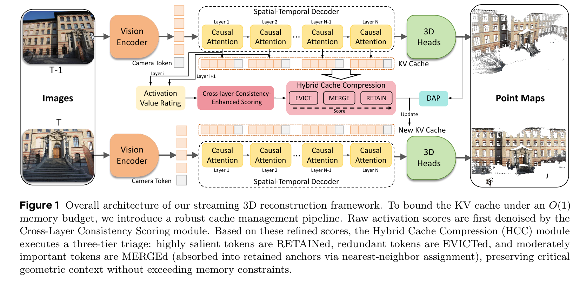
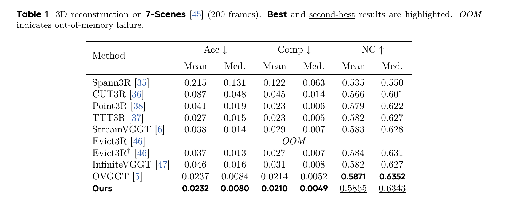
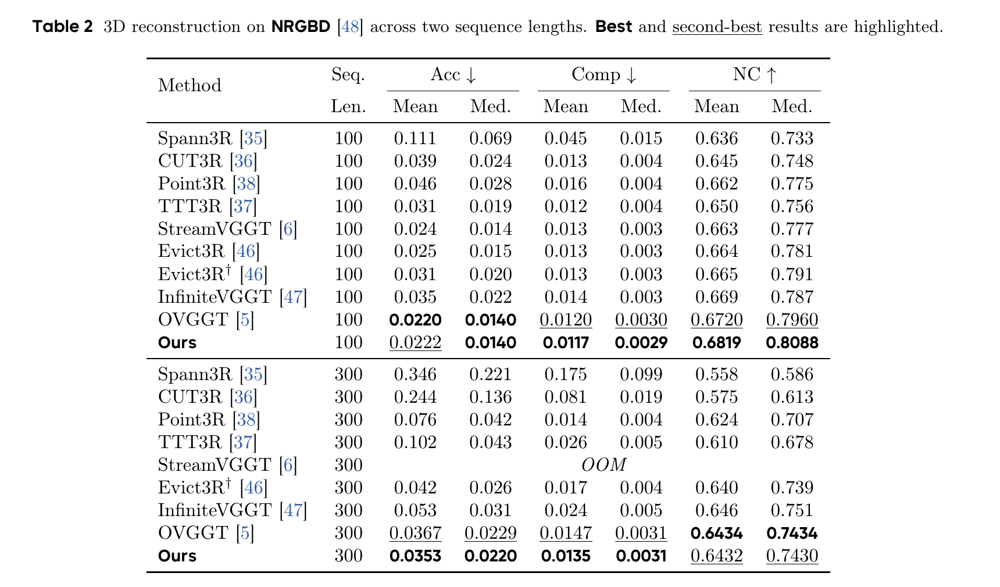
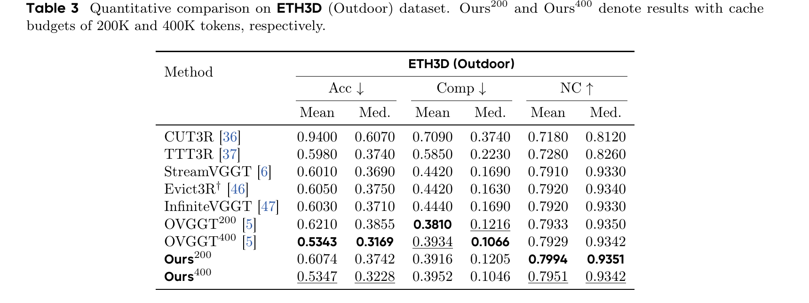
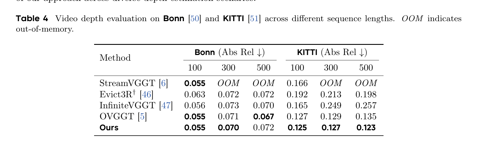
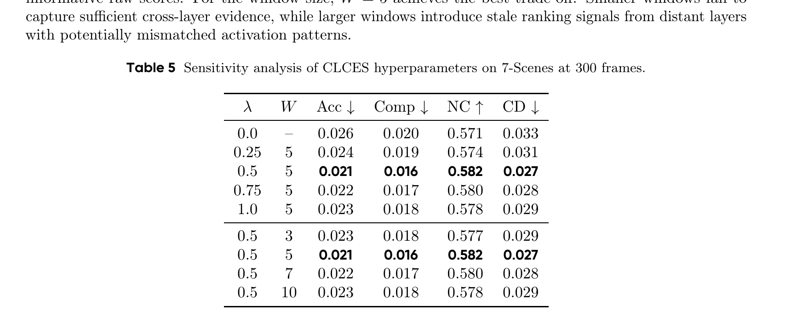
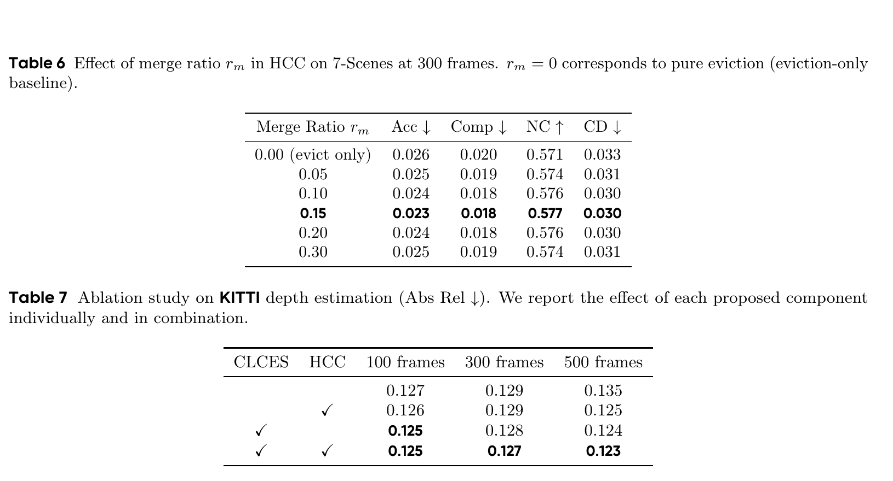
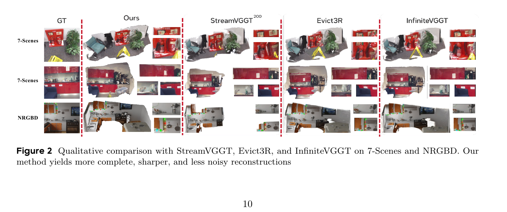
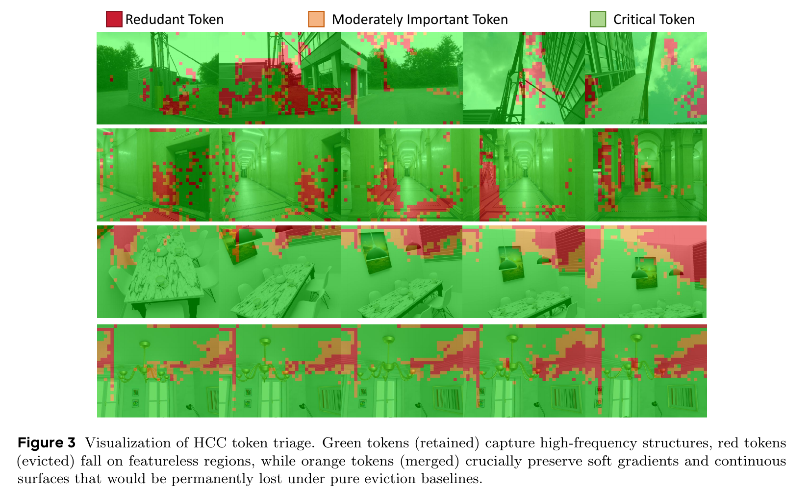

# StreamCacheVGGT 论文解读

> Xuanyi Liu、Chunan Yu、Deyi Ji 等，*StreamCacheVGGT: Streaming Visual Geometry Transformers with Robust Scoring and Hybrid Cache Compression*，arXiv:2604.15237v2（2026 年 4 月 17 日）。本文依据 arXiv v2 全文（15 页，含参考文献；未附独立补充材料）。[arXiv 论文页](https://arxiv.org/abs/2604.15237) · [v2 PDF](https://arxiv.org/pdf/2604.15237v2)

长视频中的因果 Transformer 会把历史 Key、Value（KV）逐帧留在缓存里，新帧可以继续读取它们，但缓存会随视频增长。StreamCacheVGGT 聚焦于有限预算下的缓存压缩：它用跨层一致性增强评分（CLCES）判断 token 的重要性，再让混合缓存压缩（HCC）分别保留重要 token、合并中等重要 token、淘汰低重要 token。论文将两者接入已有的流式 VGGT 管线，不重新训练几何模型。

固定缓存大小下，关键在于判断哪些历史 token 可以删除、哪些应与相似表示融合，以及如何在不同层的评分尺度变化时维持稳定判断。论文在室内重建、室外重建和视频深度任务上评估这套策略，并通过消融分析评分参数和合并比例。

## 1 引言

VGGT 通过跨视图注意力联合预测相机、深度和点图，几何质量较强；但全局注意力需要让不同帧的 token 彼此交互，随视图数增加，计算和显存压力迅速增长。StreamVGGT 将处理方式改为逐帧因果推理：每帧只访问当前和历史 token，并把每层产生的 Key、Value 存在 KV 缓存中。若每帧产生 $M$ 个 token、模型有 $L$ 层，缓存处理 $T$ 帧后的存储量大致随 $LTM$ 增长。

固定缓存预算时，系统需要持续压缩历史信息。单层 FFN 残差幅值可以在不读取完整注意力矩阵的情况下评估 token 的几何显著性，但分数会随网络层变化；逐层硬淘汰还可能删掉低纹理区域中单独分数较低、合起来却描绘连续墙面或深度渐变的 token。StreamCacheVGGT 围绕这两个问题提出跨层一致性增强评分（CLCES）和混合缓存压缩（HCC）：前者观察 token 的相对重要性排序在相邻层是否稳定，后者分别保留、合并或淘汰 token。

论文将这套缓存策略接入已有的流式 VGGT 管线，保持几何模型冻结，不进行重新训练。作者在室内与室外点图重建、视频深度估计上评估固定预算下的效果，并通过消融分析评分窗口和合并比例。

## 2 相关工作

### 2.1 几何基础模型

VGGT 是面向多视图几何的视觉基础模型，通过跨视图注意力联合预测相机、深度和点图。其全局交互有利于整合多视图证据，但对长视频逐帧处理时，重复保留所有历史 token 会带来持续增长的计算与显存需求。StreamCacheVGGT 以 VGGT 的流式变体为基础，研究如何控制其中间表示的缓存规模。

### 2.2 流式三维重建

StreamVGGT、Evict3R 和 OVGGT 等方法将三维重建改造成顺序处理：新帧到来时读取历史上下文，并在每层维护 Key、Value 缓存。Evict3R 与 OVGGT 等固定预算方法用 FFN 残差幅值估计 token 的重要性，再删除低分项。StreamCacheVGGT 针对逐层打分可能不稳定、低分 token 可能共同承载连续几何结构这两点，分别设计跨层评分和非二元压缩。

### 2.3 Transformer token 压缩

视觉 Transformer 的 token merging 工作表明，相似 token 的表示可以合并，以减少后续计算或存储。StreamCacheVGGT 将类似思路用于因果几何模型的 KV 缓存：对 Key 相似的中等重要 token 与保留 token 做加权融合。其目标是让一部分几何信息汇入已有槽位，同时控制缓存 token 数量；具体合并规则在第 3.3 节展开。

## 3 方法

### 3.1 预备知识与基础评分

在时间步 $t$，冻结的 DINOv2 主干将图像 $I_t$ 转换为 $M$ 个 patch、相机和寄存器 token。第 $l$ 层把当前帧的 Key、Value 接到前一时刻的缓存后面：

$$
C_t^{(l)}=[C_{t-1}^{(l)};(K_t^{(l)},V_t^{(l)})].
\tag{1}
$$

这里分号表示沿 token 维拼接。逐帧访问使每一步不必重新对整段视频做双向注意力，但若不整理缓存，历史 KV 会随处理帧数增加。

StreamCacheVGGT 以 FFN 残差范数作为基础分数：

$$
s_i^{(l)}=\left\|\lambda_2^{(l)}\cdot\operatorname{FFN}(\operatorname{LN}(h_i^{(l)}))\right\|_2.
\tag{2}
$$

$h_i^{(l)}$ 是第 $l$ 层 token $i$ 的隐藏表示，$\lambda_2^{(l)}$ 表示该层残差支路的缩放系数。FFN 残差范数可在不读取完整注意力矩阵的情况下计算，适合使用 FlashAttention 的实现；分数越高，token 越可能保留。原有方法按单层分数直接淘汰低分 token。CLCES 与 HCC 分别改进这个评分依据和淘汰方式。

### 3.2 跨层一致性增强评分

#### 从分数大小转为相对排序

不同层的激活幅度可能不在同一尺度，CLCES 因而先在每层内部对 $N$ 个 token 排序。论文定义排列 $\pi^{(l)}$ 并把分数转换为秩：

$$
\pi^{(l)}=\arg\min_{\pi\in\mathcal S_N}\sum_{j=1}^{N}j\,s_{\pi(j)}^{(l)},
\tag{3}
$$

$$
R_i^{(l)}=(\pi^{(l)})^{-1}(i)-1\in\{0,1,\ldots,N-1\}.
\tag{4}
$$

论文正文称式（3）按分数升序排列。但按照重排不等式，最小化“递增位置 $j$ 与分数的乘积和”会把较大的分数配到较小的 $j$，也就是降序；如果要得到升序，目标应使用相反的排列方向或改成最大化。式（4）的具体秩方向因此存在表述不一致。后续 CLCES 只使用秩在层间的方差；把所有秩同时反向映射为 $N-1-R_i$ 不改变方差，所以这处不一致不改变按公式计算的一致性分数，但读公式时应知道排序方向存在疑点。

为了在不同 token 数量间比较，秩被归一化到 $[0,1]$：

$$
\widetilde R_i^{(l)}=\frac{R_i^{(l)}}{N-1}.
\tag{5}
$$

对当前处理帧，论文取最近 $W$ 个全局注意力层组成窗口 $\mathcal W_l=\{l-W+1,\ldots,l\}$。每个 token 在窗口中的平均归一化秩与样本方差为：

$$
\mu_i=\frac{1}{W}\sum_{k\in\mathcal W_l}\widetilde R_i^{(k)},\qquad
\sigma_i^2=\frac{1}{W-1}\sum_{k\in\mathcal W_l}(\widetilde R_i^{(k)}-\mu_i)^2.
\tag{6}
$$

直觉上，持续在相似位置排名的 token 方差较小；只在个别层突然变得显著的 token 方差较大。作者以均匀分布 $U(0,1)$ 作为“无结构时随机排名”的参考，其标准差为 $1/\sqrt{12}$，据此定义一致性分数：

$$
\operatorname{Cons}_i=\max\left(0,1-\frac{\sigma_i}{1/\sqrt{12}}\right)
=\max(0,1-\sigma_i\sqrt{12}).
\tag{7}
$$

零方差对应分数 1；达到参考标准差或更大时，截断为 0。这里是作者采用的统计参照，不是 token 排名必然服从连续均匀分布的定理：有限 token 的归一化秩实际来自离散集合，且式（6）采用样本方差。因而它应被理解为一种归一化启发，而不是概率校准保证。

最后将一致性作为乘性修正，调节当前层的原始分数：

$$
\hat s_i^{(l)}=s_i^{(l)}(1+\lambda\,\operatorname{Cons}_i),\qquad\lambda\ge 0.
\tag{8}
$$

当 $\lambda=0$ 时回到单层基础评分；$\lambda$ 越大，跨层排序稳定的 token 获得的相对加成越强。乘法保留了原始分数的作用，不会只因秩稳定就把一个原始分数很低的 token 推成高分。默认窗口 $W=5$、权重 $\lambda=0.5$。

作者估算每层排序开销为 $O(N\log N)$，窗口统计为 $O(WN)$；相较注意力的 $O(N^2d)$，当 $W$ 较小时这部分开销较小。秩历史按当前帧计算并重置，因此论文称其不会增加持久缓存空间。

### 3.3 混合缓存压缩

#### 三类 token 与预算

HCC 将可处理集合 $U=U_{\mathrm{hist}}\cup U_{\mathrm{new}}$ 分成淘汰、合并和保留三部分；受 DAP 保护的集合 $P$ 不参与淘汰或合并。给定两个阈值 $\tau_{\mathrm{merge}}<\tau_{\mathrm{evict}}$：

$$
E=\{i\in U\mid\hat s_i<\tau_{\mathrm{merge}}\},
\tag{9}
$$

$$
M=\{i\in U\mid\tau_{\mathrm{merge}}\le\hat s_i<\tau_{\mathrm{evict}}\},
\tag{10}
$$

$$
R=\{i\in U\mid\hat s_i\ge\tau_{\mathrm{evict}}\}.
\tag{11}
$$

$E$ 中 token 被删除；$R$ 中 token 保持原样；$M$ 中 token 尝试合并到某个保留锚点。阈值按层根据分数分布动态选择，以满足目标合并比例和缓存预算。

#### 在 Key 空间寻找合并目标

对于每个中等分数 token $i\in M$，在保留 token 与受保护锚点 $R\cup P$ 中寻找 Key 余弦相似度最高的目标：

$$
j^*=\arg\max_{j\in R\cup P}\kappa(k_i,k_j).
\tag{12}
$$

$$
\kappa(k_i,k_j)=\frac{\langle k_i,k_j\rangle}{\|k_i\|_2\,\|k_j\|_2}.
\tag{13}
$$

随后按两者的增强分数对 Key 和 Value 做加权平均：

$$
k_{j^*}^{\mathrm{new}}=\frac{\hat s_{j^*}k_{j^*}+\hat s_i k_i}{\hat s_{j^*}+\hat s_i},\qquad
v_{j^*}^{\mathrm{new}}=\frac{\hat s_{j^*}v_{j^*}+\hat s_i v_i}{\hat s_{j^*}+\hat s_i}.
\tag{14}
$$

若多个 token 指向同一目标，融合后还要把目标分数更新为 $\hat s_{j^*}\leftarrow\hat s_{j^*}+\hat s_i$，使下一次融合继续使用累计权重。此过程将中等重要 token 的 KV 信息汇入已有槽位，槽位数不增加。论文把权重解释为信息量：若 token 表示是同一潜在几何特征的无偏噪声观测，且分数与观测噪声方差的倒数成比例，则该加权平均对应最小方差估计。这个解释依赖上述噪声模型；论文没有单独验证该模型对神经网络 Key、Value 表示成立。

压缩后的缓存写为：

$$
\widetilde C_t^{(l)}=P\cup R\cup\operatorname{merged}(M),\qquad
|\widetilde C_t^{(l)}|=|P|+|R|\le B^{(l)}.
\tag{15}
$$

式中合并后的 $M$ 内容占用目标 token 已有的槽位。作者据此将 HCC 描述为严格满足逐层预算的缓存更新。默认合并比例 $r_m=0.15$，即希望将可淘汰 token 的一部分路由到合并，而不是直接删除。论文在 DAP 保护机制中保留初始和历史锚点；固定预算是否成立，还依赖受保护锚点集合本身受既有 DAP 配置约束。

### 3.4 与 DAP 集成

Dynamic Anchor Protection（DAP）维护一组锚 token，避免缓存压缩时将关键空间参照一并移除。记初始锚与历史锚的并集为 $P=P_{\mathrm{init}}\cup P_{\mathrm{hist}}$；这些 token 不参与 HCC 的淘汰和合并，因此选择合并目标时，候选集合是 $R\cup P$。这让低纹理区域中较弱的 token 有机会并入稳定锚点，也使固定预算约束显式计入受保护 token：每层需满足 $|P|+|R|\le B^{(l)}$。

论文在整体流程中还将 CLCES 分数用于混合重要性计算，使当前激活与历史 Key 多样性共同影响缓存选择；实现顺序概括为 FFN 原始分数、CLCES、空间高斯平滑、HCC 分类与压缩、DAP 保护。这里有一处需要保留的顺序说明：HCC 的集合定义已将 $P$ 排除在可处理集合之外，而流程文字又把 DAP 保护列在 HCC 之后。可以确定锚点受保护且 HCC 目标包含 $P$，但论文没有把这两种描述如何在实现中协调写得完全一致，不能据此推断其精确执行次序。

实验默认参数为 $W=5$、$\lambda=0.5$、合并比例 $r_m=0.15$；缓存预算 $B=200\mathrm K$，空间平滑系数 $\alpha=0.5$，混合权重 $\beta=0.5$，DAP 阈值 $\tau=0.2$、$\eta=0.05$、最大锚数 $K_{\max}=3$。除 ETH3D 的 400K 对比外，主实验采用 200K 预算。论文报告在一张 Huawei Ascend 910B2 NPU 上运行。

*原论文图 1。输入逐帧经过视觉编码器和因果时空解码器，缓存评分与压缩模块更新历史 KV；DAP 保护一组锚 token，3D heads 输出点图。图中展示模块关系，具体计算见第 3.2–3.4 节。*

## 4 实验

### 4.1 实验设置与评价协议

论文在 7-Scenes、NRGBD、ETH3D、Bonn 和 KITTI 上测试，覆盖室内/室外点图重建与视频深度估计。7-Scenes 和 NRGBD 序列按步长 2 取 100–1000 帧，并另用步长 1 做全序列压力测试；ETH3D 使用完整序列。室内与室外重建报告 Accuracy（Acc，越低越好）、Completeness（Comp，越低越好）和 Normal Consistency（NC，越高越好）；深度估计报告 Abs Rel（越低越好）与 $\delta<1.25$ 准确率。除特别标注外，缓存预算为 200K tokens，所有实验在一张 Huawei Ascend 910B2 NPU 上运行。

基线包括因果流式 StreamVGGT、Evict3R、预算匹配的 Evict3R$^\dagger$、InfiniteVGGT 和 OVGGT；还列有 Spann3R、CUT3R、Point3R、TTT3R 等流式或顺序重建方法。不同方法若使用不同缓存预算或流式设定，不能只看一列数值就当作严格同资源比较；表 3 也分别给出 OVGGT 200K 与 400K 配置。7-Scenes 与 NRGBD 还包含步长 1 的全序列压力测试，论文报告 StreamVGGT 在较长设置发生显存不足。深度任务按 100、300、500 帧报告 Bonn 与 KITTI 的 Abs Rel 和 $\delta<1.25$；表 4 展示的是 Abs Rel。

### 4.2 室内三维重建

*原论文表 1。StreamCacheVGGT 的 mean/median Acc 和 Comp 数值在表中最佳；NC 则略低于 OVGGT。Evict3R 行标为 OOM，预算匹配的 Evict3R$^\dagger$ 可完成该设置。*

7-Scenes 的 200 帧结果中，StreamCacheVGGT 的 mean/median Acc 为 0.0232/0.0080，mean/median Comp 为 0.0210/0.0049，均略低于 OVGGT 的 0.0237/0.0084 和 0.0214/0.0052；NC 的 mean/median 为 0.5865/0.6343，略低于 OVGGT 的 0.5871/0.6352。优势集中在点到面距离相关指标，法线一致性没有领先。

*原论文表 2。100 帧下 StreamCacheVGGT 的 mean Acc 略差于 OVGGT；300 帧下 mean Acc 和 mean Comp 较低，median Comp 持平。两种长度下 OVGGT 的 NC 数值略高。*

NRGBD 的 100 帧结果中，StreamCacheVGGT mean Acc 为 0.0222，略高于 OVGGT 的 0.0220；median Acc 持平于 0.0140。mean/median Comp 为 0.0117/0.0029，优于 OVGGT 的 0.0120/0.0030；mean/median NC 为 0.6819/0.8088，高于 0.6720/0.7960。300 帧时，mean/median Acc 为 0.0353/0.0220，低于 OVGGT 的 0.0367/0.0229；mean Comp 为 0.0135，低于 OVGGT 的 0.0147，median Comp 两者同为 0.0031；mean/median NC 为 0.6432/0.7430，略低于 0.6434/0.7434。StreamVGGT 在表中 300 帧设置 OOM。这里同时有几何距离指标的改善和 NC 的轻微回落，优势仍依赖指标。

### 4.3 室外三维重建

*原论文表 3。Ours$^{200}$ 和 Ours$^{400}$ 表示 200K、400K token 缓存预算。200K 配置的 mean Acc 优于 OVGGT$^{200}$，mean Comp 较差，mean/median NC 略好。400K 配置下 OVGGT 的 Acc 与 mean Comp 更低，StreamCacheVGGT 的 median Comp 更低；双方 median NC 同为 0.9342。*

ETH3D 上 Ours$^{200}$ 的 mean/median Acc 为 0.6074/0.3742，低于 OVGGT$^{200}$ 的 0.6210/0.3855；mean Comp 为 0.3916，高于 OVGGT 的 0.3810，但 median Comp 0.1205 略低于 0.1216。Ours$^{200}$ 的 mean/median NC 为 0.7994/0.9351，高于 OVGGT 的 0.7933/0.9350。400K 时，Ours 的 mean/median Acc 为 0.5347/0.3228，略高于 OVGGT 的 0.5343/0.3169；mean Comp 0.3952 高于 0.3934，而 median Comp 0.1046 低于 0.1066。mean NC 为 0.7951，高于 OVGGT 的 0.7929；两者 median NC 都为 0.9342。结果体现不同几何指标之间的折中，不支持“所有指标都领先”的概括。

### 4.4 视频深度估计

*原论文表 4。表格按 100、300、500 帧报告 Abs Rel；加粗表示论文标出的最佳值。*

KITTI 上，StreamCacheVGGT 的 Abs Rel 从 100 帧的 0.125 降至 500 帧的 0.123，三种长度均优于表中其他方法。Bonn 上 100 帧为 0.055，与 OVGGT 并列；300 帧为 0.070，略好于 OVGGT 的 0.071；500 帧则为 0.072，差于 OVGGT 的 0.067。论文对 Bonn 的总体优势表述因此应按单个长度修正：长到 500 帧时并未保持领先。

### 4.5 消融实验

*原论文表 5。7-Scenes、300 帧；依次比较 $\lambda$ 和窗口 $W$。该裁图保留论文完整表格及标题。*

在 7-Scenes 300 帧的消融中，$\lambda=0.5,W=5$ 取得表中最好的 Acc、Comp、NC 和 Chamfer Distance（CD）：分别为 0.021、0.016、0.582 和 0.027。仅改变 $\lambda$ 时，0.25、0.75、1.0 对应的 Acc/Comp/NC/CD 分别为 0.024/0.019/0.574/0.031、0.022/0.017/0.580/0.028、0.023/0.018/0.578/0.029；固定 $\lambda=0.5$ 将 $W$ 改为 3、7、10，则对应 0.023/0.018/0.577/0.029、0.022/0.017/0.580/0.028、0.023/0.018/0.578/0.029。作者将其解释为两种信号的平衡：窗口过短不足以观察层间变化，过长则可能混入相距较远、激活模式不匹配的层；一致性权重过大则会压过原始分数。

*原论文表 6、表 7。表 6 在 7-Scenes 300 帧改变合并比例；表 7 在 KITTI 深度任务中分别启用 CLCES、HCC。*

合并比例从 $r_m=0$ 增至 0.15 时，7-Scenes 的 Acc/Comp/NC/CD 从 0.026/0.020/0.571/0.033 变为 0.023/0.018/0.577/0.030；比例继续升至 0.20、0.30 后，指标略有回退。表中 $r_m$ 表示可淘汰 token 中转向合并的比例，结果说明加大合并并非总能改善表示。KITTI 三种序列长度下，基础策略 Abs Rel 为 0.127/0.129/0.135；只加 HCC 为 0.126/0.129/0.125；只加 CLCES 为 0.125/0.128/0.124；两者合用为 0.125/0.127/0.123。组合在 300、500 帧上优于单独组件，100 帧时与 CLCES 单独使用持平。论文未给出多次运行方差或显著性检验。

### 4.6 定性分析

#### 4.6.1 重建结果可视化

*原论文图 2。作者展示 7-Scenes 与 NRGBD 场景中的 GT、StreamCacheVGGT、StreamVGGT、Evict3R 和 InfiniteVGGT 点云，并以局部放大区域对比表面完整性和细节。图中视觉差异属于定性证据，需与表格指标分开看。*

图 2 在 7-Scenes 与 NRGBD 中展示点云整体和局部放大区域。作者指出，橱柜、墙面等低纹理表面在基线结果中较容易出现孔洞或缺失；局部放大处，灭火器和厨房装饰等细节在 StreamCacheVGGT 中边界更清楚，InfiniteVGGT 则出现较多离散点状伪影。图像支持“表面更连续、局部细节较稳定”的定性观察，但不能替代表格指标，也没有把每一处几何误差归因到某一次 token 合并。

#### 4.6.2 三类 token 的可视化

*原论文图 3。红色为被淘汰 token，橙色为并入锚点的 token，绿色为保留 token。图中颜色显示作者对 token 重要性的空间分区；它是机制示意，不能单独证明合并后一定保留了相同几何信息。*

作者观察到，绿色 token 多位于建筑边缘、纹理家具等高频结构，红色 token 多位于天空或空白顶棚，橙色 token 则常沿墙面阴影、弱纹理过渡带分布。论文据此推测中等重要 token 能承载连续表面上的低频几何信息，合并它们可减少硬删除造成的表面缺口。这是对图中空间相关性的解释，尚不能证明融合后的表示无损，也不等同于对“冗余”区域的几何误差测量。

## 5 结论与适用边界

CLCES 和 HCC 分别处理评分稳定性与缓存更新方式：前者给跨层排序稳定的 token 增加权重，后者将 token 分流到保留、合并、淘汰三种操作。消融结果显示两者在 KITTI 深度估计中有互补效果；跨数据集对比则显示其优势随任务、序列长度和指标而变化，并非在所有指标上都优于 OVGGT 等基线。

StreamCacheVGGT 的主要贡献是把“挑哪些 token 留下”扩展为“哪些保留、哪些融合、哪些删除”，并用跨层排序稳定性修正单层 FFN 分数。它不改变 StreamVGGT 的逐帧因果骨干，也不进行在线微调；方法收益来自缓存管理。论文报告了固定缓存预算下跨多个任务的实验结果，尤其在 KITTI 500 帧深度和部分室内点图指标上有所改善。

这仍是单遍因果推理。论文在结论中承认，历史几何误差无法回溯修正，未来可加入轻量全局精化。即使缓存 token 数按预算控制，HCC 的合并也只是把多个 Key、Value 表示压成一个加权表示；注意力和后续非线性网络不会保证它与保留原 token 等价。跨层一致性度量依赖作者设定的均匀秩参照及窗口参数；噪声方差解释也依赖论文没有实证验证的假设。

作为流式几何模型，它没有显式回环检测、全局位姿图或历史轨迹再优化，不能与完整 SLAM 后端的全局一致性能力等同。与 [StreamVGGT](../streamvggt/index.md) 相比，它重点处理历史 KV 的重要性评分和压缩；与 [OVGGT](../ovggt/index.md) 相比，两者都面向常数缓存，但 StreamCacheVGGT 的特色在于跨层排序和中间等级 token 合并；[RetrieveVGGT](../retrievevggt/index.md) 则通过按当前查询检索历史帧构造注意力上下文，属于另一种缓存使用方式。
