# StreamGS 论文解读

> Yang Li、Jinglu Wang、Lei Chu、Xiao Li、Shiu-Hong Kao、Ying-Cong Chen、Yan Lu，*StreamGS: Online Generalizable Gaussian Splatting Reconstruction for Unposed Image Streams*，ICCV 2025，页码 25841–25850。[CVF 论文页](https://openaccess.thecvf.com/content/ICCV2025/html/Li_StreamGS_Online_Generalizable_Gaussian_Splatting_Reconstruction_for_Unposed_Image_Streams_ICCV_2025_paper.html) · [论文 PDF](https://openaccess.thecvf.com/content/ICCV2025/papers/Li_StreamGS_Online_Generalizable_Gaussian_Splatting_Reconstruction_for_Unposed_Image_Streams_ICCV_2025_paper.pdf) · [官方补充材料 ZIP（内含 PDF 与视频）](https://openaccess.thecvf.com/content/ICCV2025/supplemental/Li_StreamGS_Online_Generalizable_ICCV_2025_supplemental.zip)

StreamGS 接收没有已知相机参数的单目图像流，并在每帧到达时更新可渲染的 3D Gaussian 场景。它先用预训练 DUSt3R 为相邻帧预测点图和粗相机，再以内容自适应的跨帧匹配校正几何与位姿，最后融合重叠帧中对应的高斯特征，控制地图规模。整个流程在训练完成后以前馈方式运行，不做逐场景迭代优化；输出包括 Gaussian 场景和相机估计，可用于新视角合成。论文没有将它设计成带闭环和全局后端的完整 SLAM 系统。

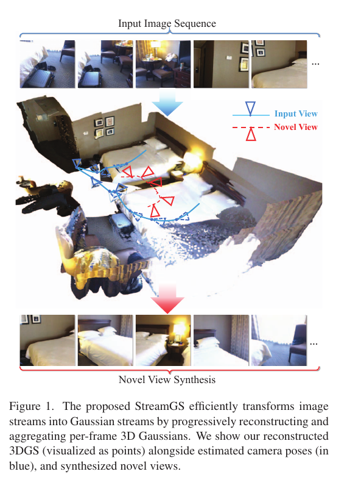

*原论文 Figure 1。系统从连续输入帧构建 Gaussian 场景，同时展示估计相机位姿与新视角合成结果。*

## 1 引言

引言先把在线重建与交互应用的即时反馈需求联系起来，再具体说明“无预先相机参数”“泛化重建”“冗余控制”三项约束。标准 SfM 要等图像集合足够完整后才能联合估计相机，这会带来延迟；传统 3DGS 则需要逐场景优化，难以直接处理连续流；若把每帧的高斯集合简单并集起来，重叠视角会重复描述同一表面，位姿误差还可能造成重影。

论文将贡献归纳为无须预设相机的在线泛化流水线、用于提升跨帧一致性的自适应细化与密度控制，以及跨数据集实验。其“150 倍”来自与优化型 CF-3DGS 的实验比较，不应理解成对所有方法或所有硬件条件都成立的普遍加速比。

## 2 相关工作

作者先回顾泛化 3DGS。单视图方法如 GRM、TriplaneGS 和 GMamba 由图像一次预测高斯，但通常依赖规范相机；多视图方法如 GS-LRM、LGM 和 MVGMamba 使用相机射线等嵌入融合视图，或通过 MVS 找到高斯中心，再由轻量网络预测其余属性。前一类多视图方法依赖已知相机且真实场景数据有限，后一类也依赖内外参，并多针对少量稀疏视图。把各视图的高斯直接取并集会遗漏跨视图对齐和重复消除问题。

接着，论文讨论免 SfM 的位姿自由 Gaussian 重建。CF-3DGS 根据深度先验逐帧优化相机与高斯，免去 COLMAP 预处理，但仍需要已知内参、依赖深度先验质量，并为每个视图执行大量优化。它因此难以承担长图像流的即时处理。

在线重建的相关工作覆盖 SLAM 与 NeRF 等表示。作者指出，许多方法需要 RGB-D、已知位姿或内参，且不一定以前馈 Gaussian 为地图表示。DUSt3R、MASt3R 等几何基础模型可以同时预测点图和相机，为免标定的前馈几何提供了起点；直接接上 Gaussian 预测头仍会遇到分布外几何误差、纹理特征不足，以及逐帧重复预测的问题。StreamGS 的定位是在预训练几何先验上加入内容自适应匹配和二维特征聚合，分别回应这些限制。

## 3 方法

设时间 \(t\) 前已收到的图像为 \(\mathcal I^t=\{I_i\}_{i=1}^{t}\)。目标是逐步得到场景 Gaussian 集合 \(\mathcal G^t\)。在每个时刻，方法只重点处理相邻帧 \((I_{t-1},I_t)\)，得到当前帧的高斯后与既有集合合并。论文 Figure 2 将流程分成初始重建、自适应细化和前馈自适应密度控制（ADC）。

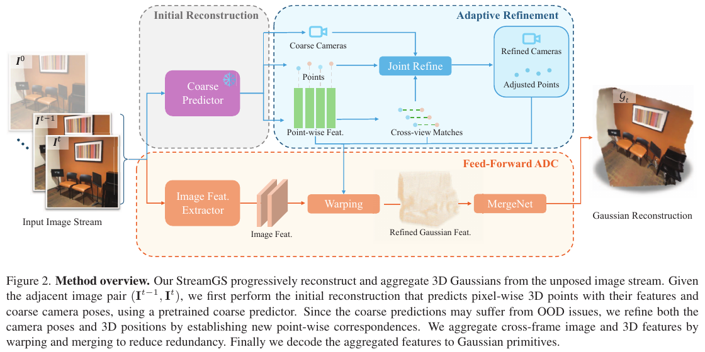

*原论文 Figure 2。DUSt3R 产生粗点图和相机，跨视图匹配参与联合细化；图像与几何特征随后经过 warping、MergeNet 聚合并解码成 Gaussian。*

### 3.1 预备知识

一个 3D Gaussian 由中心 \(\mu\)、协方差 \(\Sigma\)、球谐系数和不透明度 \(\alpha\) 表示。为保证协方差半正定，论文把它写成旋转与尺度的组合：

$$
G(x;\mu,\Sigma)=\exp\!\left[-\frac12(x-\mu)^T\Sigma^{-1}(x-\mu)\right],\qquad \Sigma=RSS^TR^T.
$$

其中 \(R\) 是旋转矩阵，\(S\) 是由尺度构成的矩阵；球谐系数表达视角相关颜色，\(\alpha\) 控制不透明度。StreamGS 为每个像素预测一个像素对齐的 Gaussian，因此预测前的点图和图像特征可以作为每个高斯属性解码的输入。后续“合并”操作处理的是这些像素对齐高斯的特征与参数，而不是在三维空间中遍历体素网格。

### 3.2 初始两视图重建

给定当前帧 \(I_t\) 和参考帧 \(I_{t'}\)，粗预测器 \(\phi_{3D}\) 输出两帧在参考坐标系下的点图及置信度：

$$
(X_{t|t'},X_{t'|t'},C_{t|t'},C_{t'|t'})=\phi_{3D}(I_t,I_{t'}). \tag{1}
$$

符号 \(X_{t|t'}\) 表示帧 \(t\) 的点图用帧 \(t'\) 的局部坐标系表达；置信度图表示各像素点预测的可信程度。为了后续把局部点图放到当前帧坐标中，方法还将图像顺序反转再运行预测器。在线时对 \((I_{t-1},I_t)\) 与 \((I_t,I_{t-1})\) 都做预测，前者提供以 \(t-1\) 为参考系的点，后者提供以 \(t\) 为参考系的点；后一对预测可以缓存并在下一时刻复用，避免重复计算。\(\phi_{3D}\) 使用预训练 DUSt3R。作者指出，若从单目视频训练该预测器，需要该输入场景的 3D 几何监督，而这类监督未必可得，因此保留预训练模型。

相机矩阵写作 \(P=K[R|t]\)。论文假定主点居中、像素为正方形，通过最小化点图重投影残差估计焦距：

$$
\hat f_t=\arg\min_f\sum_{p\in I_t}\left\|p-c-f\frac{(x_p,y_p)}{z_p}\right\|. \tag{2}
$$

这里 \((x_p,y_p,z_p)\) 是点图中像素 \(p\) 对应的三维点，\(c\) 为主点，\((x_p/z_p,y_p/z_p)\) 是针孔投影的归一化坐标。选择使投影点最贴近图像像素的位置来估计 \(f\)，从而得到内参 \(K\)。两帧的粗相对位姿再由带尺度的点云配准求得：

$$
[R_t|t_t]=\arg\min_{s,R,t}\sum_{p\in I_{t-1}} C^t(p)\left\|s(RX_{t|t-1}(p)+t)-X_{t|t-1}^{t}(p)\right\|_2^2, \tag{3}
$$

其中两帧置信度图逐像素相乘形成 \(C^t=C_{t|t-1}\odot C_{t|t}\)，\(s\) 是尺度因子，\(\odot\) 表示 Hadamard 乘积。优化通过旋转、平移和尺度把同一批对应三维点对齐；低置信像素对目标函数的影响较小。此时结果仍受冻结的 DUSt3R 对当前域适配程度限制，因此接下来用可学习特征重新建立对应。

### 3.3 自适应细化

匹配头 \(\phi_{match}\) 从相邻两帧提取稠密局部 3D 特征 \(F^{3D}_{t-1},F^{3D}_t\in\mathbb R^{H\times W\times d}\)。论文用余弦距离做双向最近邻检索：仅当像素 \(i_k\) 在另一帧最近邻为 \(j_k\)，且反向最近邻也返回 \(i_k\) 时，才保留为匹配 \(i_k\leftrightarrow j_k\)：

$$
\mathcal M_{t-1,t}=\{i_k\leftrightarrow j_k\mid i_k=NN(j_k),\ j_k=NN(i_k)\},\quad
NN(i_k)=\arg\min_{j_k}|1-\cos\langle F^{3D}_{t-1,i_k},F^{3D}_{t,j_k}\rangle|. \tag{4}
$$

双向互为最近邻会舍弃单向偶然相似的候选，得到较稳的像素对应。再只使用这些匹配点重复式（3）的相似变换估计，得到残差变换 \(\Delta=[\Delta R,\Delta t]\)，并将它施加到当前点图，形成修正后的 \(\widetilde X_{t|t-1}\)。同一组匹配还产生 3D–2D 对应，论文使用 PnP-RANSAC 更新当前相机位姿 \(\widetilde P_t\)。所以匹配同时约束几何点和相机：前一项校正粗点云间的相对变换，后一项直接从 3D 点到图像像素估计相机。

细化之后，轻量解码器从图像特征、修正点图和 3D 匹配特征预测 Gaussian 参数：

$$
G_i=[q_i,s_i,\alpha_i,c_i]=\phi_{GS}(F^{GS}),\qquad
F_i^{GS}=F_i^{2D}\oplus X_i\oplus F_i^{3D},\qquad F_i^{2D}=\phi_{2D}(I_i). \tag{5}
$$

\(q_i\) 是旋转四元数，\(s_i\) 是尺度，\(\alpha_i\) 是不透明度，\(c_i\) 表示颜色系数；\(\oplus\) 表示沿通道拼接。协方差由四元数对应的旋转矩阵构造为 \(\Sigma_i=R(q_i)s_is_i^TR(q_i)^T\)。额外的 \(\phi_{2D}\) 很重要：冻结的粗几何模型没有通过单目视频训练出足够的纹理表征，图像特征为颜色等外观属性解码提供信息。式（5）的单帧预测还不是最终地图，帧间重复高斯要到下一节处理。

### 3.4 前馈自适应密度控制

若把每帧的 \(H\times W\) 个 Gaussian 都直接加入地图，连续输入时集合会随帧数近似线性增长。作者观察到，匹配到的相邻帧 Gaussian 在不透明度、旋转、尺度和球谐属性上比随机配对更相似（Table 1），并且位置相近，因而有机会将它们合并。

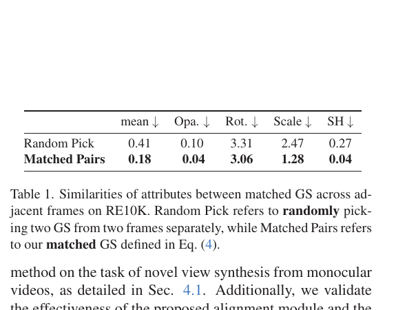

*原论文 Table 1。RE10K 上匹配对的平均属性差异更小，尤其不透明度、尺度和 SH 项；这是作者据以检验高斯合并的经验观察。*

为将三维聚合转成较便宜的二维特征操作，方法依据匹配关系把当前帧 Gaussian 特征扭到上一帧像素网格。论文还扩展匹配集合，将邻域像素也纳入映射，以缓解稠密映射中的空洞；对未匹配像素则保留上一帧对应位置的特征。其特征扭曲可写成

$$
F^{t|t-1}_{GS}(j)=\begin{cases}F^t_{GS}(k),&(j,k)\in\mathcal M^{t-1,t},\\ F^{t-1}_{GS}(j),&\text{otherwise.}\end{cases} \tag{6}
$$

其中 \(j\) 是参考帧像素，\(k\) 是当前帧中与之匹配的位置。得到同一像素网格上的特征后，MergeNet 由两层卷积组成，接收当前帧扭曲特征与上一帧特征的通道拼接并解码聚合 Gaussian：

$$
\widehat G_{t|t-1}=\phi_{MG}(F^{t|t-1}_{GS}\oplus F^{t-1}_{GS}),\qquad
\mathcal G^t=\mathcal G^{t-1}\cup G_{t|t-1}. \tag{7}
$$

这里 \(G_{t|t-1}\) 表示融合后的对应高斯与当前帧未匹配高斯。每个匹配对经特征融合后由两个高斯变成一个，未匹配区域仍保留自身高斯。论文称该过程为前馈 ADC：不依赖原始 3DGS 的渲染损失反向传播来执行逐场景密度调整，而是在学习好的特征与匹配上直接完成，因此适合在线推理。

### 3.5 损失函数

训练 \(\phi_{2D}\) 与 Gaussian 解码网络时，论文将渲染损失与合并重建损失相加：

$$
\mathcal L(I_i,\widehat I_i,\widehat I_i^M)=
\|I_i-\widehat I_i\|^2+\lambda\|I_i-\widehat I_i\|_{LPIPS}+\|\widehat I_i^M-\widehat I_i\|^2. \tag{8}
$$

\(\widehat I_i\) 是未合并的完整高斯渲染图，\(\widehat I_i^M\) 是 MergeNet 输出的合并高斯渲染图。前两项让未合并的预测接近真实图像，第三项让合并结果尽量重现合并前的渲染，避免只为压缩高斯数量而丢失过多外观。\(\lambda\) 平衡像素误差和感知误差。训练后轻量网络在推理时作前馈处理，论文报告训练收敛在数千步量级；正式主实验中各方法均训练 30k 次迭代。

## 4 实验

实验围绕单目视频新视角合成，使用 PSNR、SSIM 和 LPIPS 衡量渲染质量，并检查细化与合并模块。比较方法分成两类：pixelSplat、MVSplat 是已知位姿条件下的泛化方法；CF-3DGS 是免位姿但逐场景优化的方法。测试集包括训练域 RE10K，以及 ACID、ScanNet、DL3DV、MVImgNet。除 CF-3DGS 因速度较慢只测部分测试集外，泛化方法在 RE10K 相同训练划分上训练。

实现中，\(\phi_{2D}\) 和 MergeNet 均为两层卷积网络；Adam 学习率为 \(2\times10^{-4}\)，余弦调度，式（8）的 \(\lambda=0.05\)，训练分辨率 224×224、batch size 14，并在单张 80 GB NVIDIA Tesla A100 上训练和测试。补充材料进一步说明，训练上下文帧对的时间间隔至少为 25 帧，再从其间选 5 个目标帧；视频每隔 6 帧采样，MVImgNet 每隔 2 帧采样，RE10K 的目标帧则从上下文帧对之外采样。较远上下文帧配合区间内目标帧，有助于监督模型从较稀的输入视图生成中间结果。

### 4.1 新视角合成

#### 4.1.1 重建质量

Table 2 报告全部五个数据集的数值。RE10K 上 MVSplat 的 PSNR/LPIPS/SSIM 为 23.54/0.13/0.90，StreamGS 为 22.42/0.17/0.83；StreamGS 没有已知相机条件，在源域并非每项指标都领先。分布外数据上，StreamGS 的 PSNR 在 DL3DV、MVImgNet、ScanNet、ACID 分别为 20.54、25.05、28.43、28.50。它在 DL3DV、ScanNet 的 PSNR 高于表中其他方法，在 MVImgNet 上 CF-3DGS 更高（26.33），在 ACID 上 pixelSplat 的 PSNR 略高（29.93）。因此实验支持的是跨域情况下总体有竞争力，特别是对比依赖已知位姿的泛化方法；不能把结果概括成每个数据集、每项指标都最好。

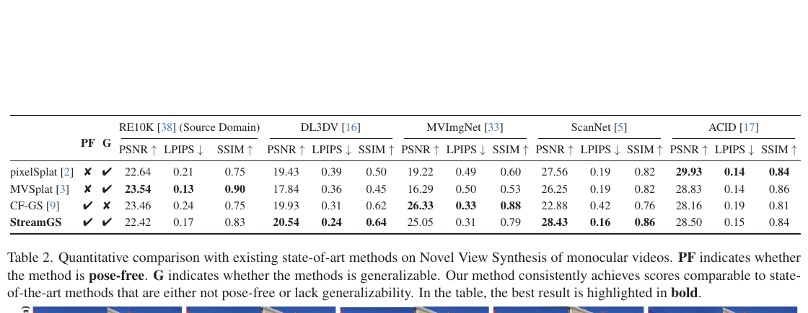

*原论文 Table 2。PF 表示是否位姿自由，G 表示是否泛化。StreamGS 两项均为是；pixelSplat 与 MVSplat 需要相机，CF-3DGS 则为逐场景优化。*

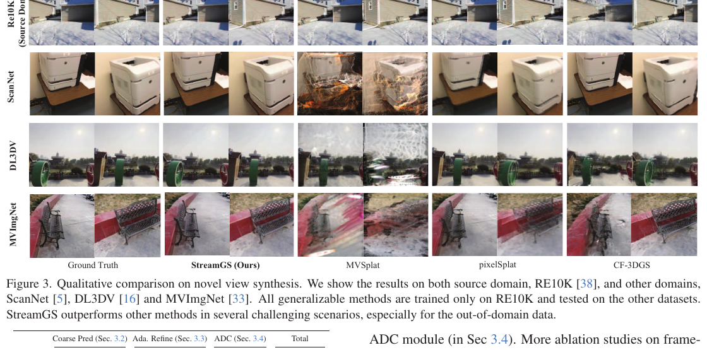

*原论文 Figure 3。各泛化方法仅在 RE10K 训练；图中展示其在源域与 ScanNet、DL3DV、MVImgNet 上的渲染差异。作者指出，若干分布外视图中 MVSplat 和 pixelSplat 出现深度漂浮伪影，StreamGS 的表现较稳。*

Figure 4 将连续帧输入下的 Gaussian 重建与新视角渲染并列展示，进一步比较 ScanNet 上的流式结果。StreamGS 和 MVSplat 都在 RE10K 训练，但 MVSplat 使用预先给定的相机；作者展示的两个场景中，MVSplat 的视图聚合出现明显伪影。

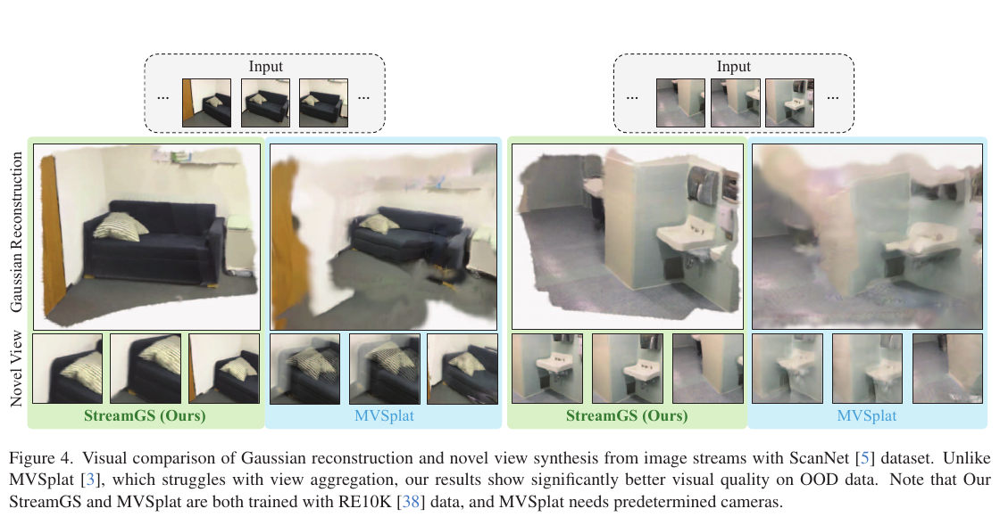

*原论文 Figure 4。左、右两组分别展示不同场景的输入序列、Gaussian 重建和新视角结果。*

作者把域外退化联系到纹理、光照、相机运动及场景类型的差异。例如 DL3DV 室外场景中的无纹理天空、受不同光照影响的物体，会削弱依赖双目线索的方法。StreamGS 的匹配驱动细化提供了跨帧校正信号，因此能缓解冻结几何先验的分布外问题，但并不意味着它在纹理缺失时完全免受误差影响。

#### 4.1.2 重建效率

论文以每帧处理时间比较效率。StreamGS 的粗预测、细化、ADC 分别耗时 0.02、0.08、0.01 秒，合计 0.11 秒；模型参数总量为 658.61M，其中粗预测器占 656.74M。Figure 5 将平均 PSNR 与 FPS 放在一起比较：StreamGS 报告约 9.09 FPS、PSNR 23.1；CF-3DGS 约 0.06 FPS、PSNR 23.15，故作者据此称其速度约快 150 倍，画质差距约 0.05 dB。比较也显示 StreamGS 慢于依赖预先相机的 pixelSplat 和 MVSplat，因为它额外执行跨帧匹配和位姿估计；因此这里的速度优势是相对优化型免位姿基线 CF-3DGS 的结果。

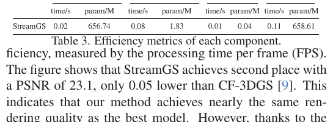

*原论文 Table 3。细化模块贡献了大部分额外推理时间，粗预测器则占据绝大多数参数量。*

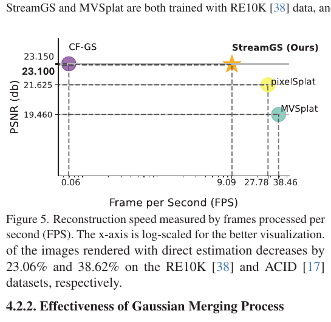

*原论文 Figure 5。横轴为对数刻度的 FPS，纵轴为 PSNR；StreamGS 接近 CF-3DGS 的渲染质量，同时推理速度更高。*

### 4.2 消融研究

#### 4.2.1 联合细化的作用

作者关闭推理阶段的匹配细化，直接使用式（2）和式（3）估计焦距与相对位姿。RE10K 上，PSNR 从启用细化时的 22.42 降为 17.25，SSIM 从 0.83 降为 0.58；ACID 上 PSNR 从 28.50 降为 17.23，SSIM 从 0.84 降为 0.48。论文将这类明显退化归因于 Gaussian 从偏移的相机中心和错误朝向投射，连新视角相机位姿也不准确。该对照说明，对这个系统而言，匹配约束下联合校正几何点和相机是必要模块。

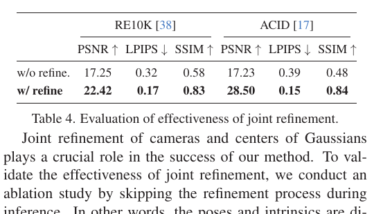

*原论文 Table 4。未细化时 RE10K 和 ACID 的三项指标均下降，尤其 PSNR 与 SSIM。*

#### 4.2.2 Gaussian 合并的作用

主文 Table 5 比较不合并与匹配合并：MVImgNet 和 ACID 的压缩比分别为 1.58、1.68，合并后 PSNR 分别从 25.70 降到 25.05、从 29.21 降到 28.07。补充材料 Table 7 增加 LPIPS、SSIM 和高斯减少比例：MVImgNet 的高斯减少 36.71%，质量为 PSNR 25.05、LPIPS 0.31、SSIM 0.79；ACID 减少 40.48%，质量为 28.50、0.15、0.84。补充材料报告的无合并 ACID PSNR 是 29.25，合并后是 28.50，与主文 Table 5 的 29.21 和 28.07 不完全相同；这里保留两张表各自给出的结果，原文没有解释这一差异。按补充材料数值，PSNR 降幅约 2.53% 与 3.90%。补充材料还称每帧约少 18,420 个与 20,311 个高斯。合并确实降低表示规模，但以一定的渲染质量损失为代价；“可忽略”是作者对该实验折中的评价。

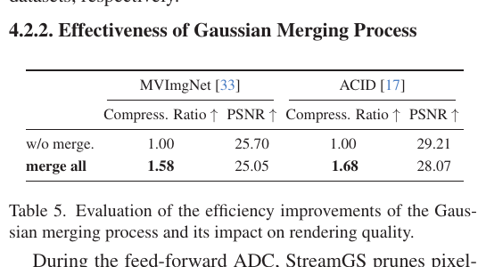

*原论文 Table 5。报告 MVImgNet 与 ACID 上的压缩比和 PSNR。*

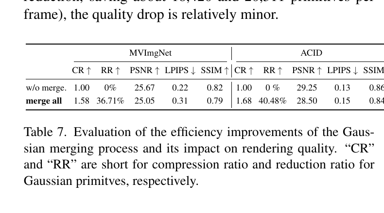

*官方补充材料 Table 7。CR 为压缩比、RR 为高斯减少率；完整表格也显示合并后 LPIPS 变差而 SSIM 略降。*

### 官方补充材料中的其他比较

补充材料还在 384×384 分辨率下比较 MVSplat 与 StreamGS（Table 6），并对照“MASt3R 加 Gaussian 头”（MASt3R+GSH）这一直接替代方案。高分辨率表中，MVImgNet 上 StreamGS 的 PSNR/LPIPS/SSIM 为 25.55/0.27/0.87，明显高于 MVSplat 的 15.64/0.59/0.47；ACID 上两者分别为 28.70/0.19/0.84 与 29.33/0.22/0.83。该结果同样不是 StreamGS 在每项指标上都胜出。

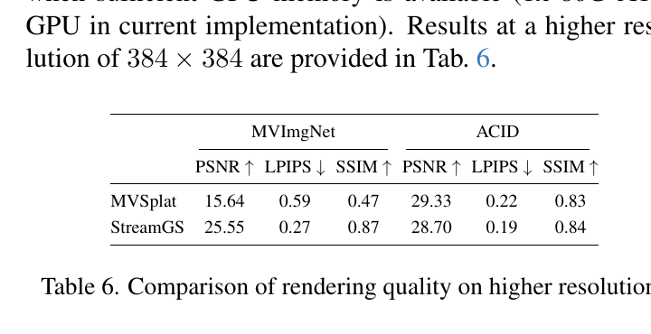

*官方补充材料 Table 6。实验在一张 80 GB A100 上进行；论文表示模型可在显存允许时扩展到更高分辨率。*

MASt3R+GSH 对照使用 Splatt3R 的 Gaussian 头。补充材料指出，MASt3R 对同一帧的正反顺序预测造成重复预测与融合困难；额外预测 84 个高斯参数通道也需要更丰富的纹理特征。Table 8 中 MASt3R+GSH 的粗预测耗时 19.63 ms、总耗时 122.35 ms，参数 697.16M；StreamGS 分别为 16.47 ms、120.91 ms 和 658.61M。两者总延迟相近，StreamGS 参数量较少。公平训练的 Table 9 将两者都训练 15k 次：MVImgNet 上 StreamGS 得到 23.05/0.27/0.80，优于 MASt3R+GSH 的 19.46/0.45/0.73；ACID 上分别为 27.12/0.16/0.83 与 15.15/0.42/0.60。作者认为轻量的图像与匹配特征网络更适合 Gaussian 外观预测。

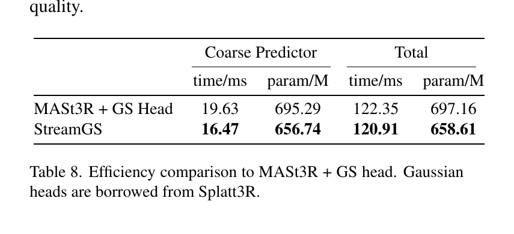

*官方补充材料 Table 8。Gaussian 头来自 Splatt3R；两种方法的粗预测与总耗时相近。*

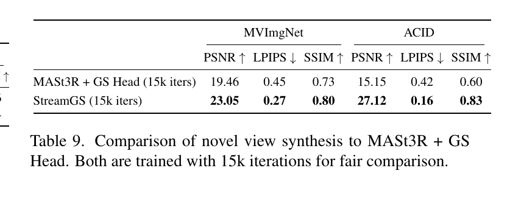

*官方补充材料 Table 9。相同训练迭代数下，StreamGS 在所列 MVImgNet 与 ACID 指标上均高于 MASt3R+GSH。*

## 5 结论与局限

StreamGS 的贡献可以理解为把跨帧几何对齐和重复高斯处理接入泛化 Gaussian 预测：DUSt3R 提供可复用的两视图点图，匹配头针对当前相邻帧补充内容自适应对应，点云配准与 PnP-RANSAC 分别更新点和相机，匹配关系最后又支持特征级 Gaussian 合并。几何细化和密度控制共用匹配信息，使前者改善跨帧一致性，后者在此基础上压缩表示。论文结果表明，这种前馈系统可在无预设相机的单目视频上获得有竞争力的跨域新视角合成，并减少优化型方法的处理延迟。

论文也明确指出两项局限：联合细化仍引入额外时间，使 StreamGS 慢于 MVSplat；纹理缺失区域和长序列仍是重建难点。主实验以新视角合成质量评价场景，不能由此推出长期轨迹无漂移、闭环后全局地图一致或动态物体被显式建模。与流式 SLAM 的联系在于它展示了基础几何先验如何辅助逐帧地图构建；其核心产物和评测仍是 Gaussian 场景重建，而非完整定位建图后端。
