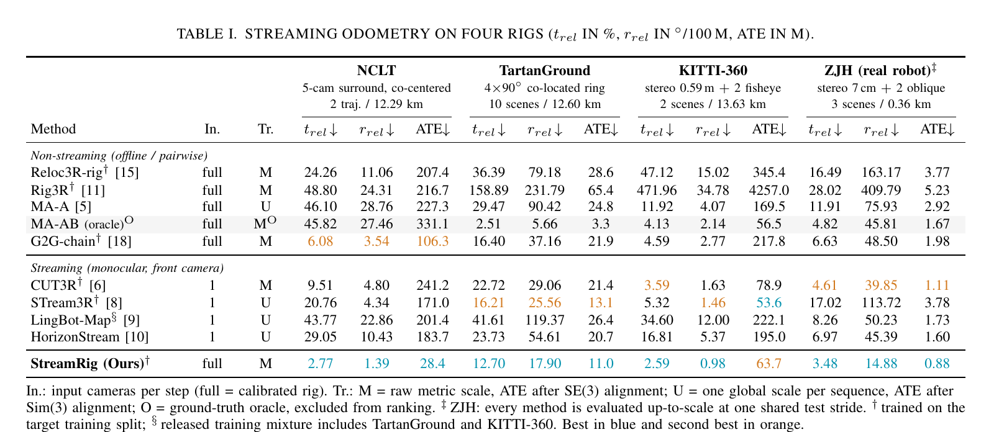
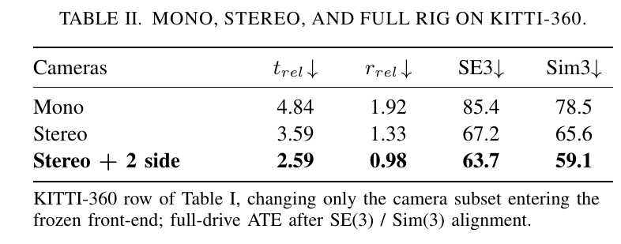
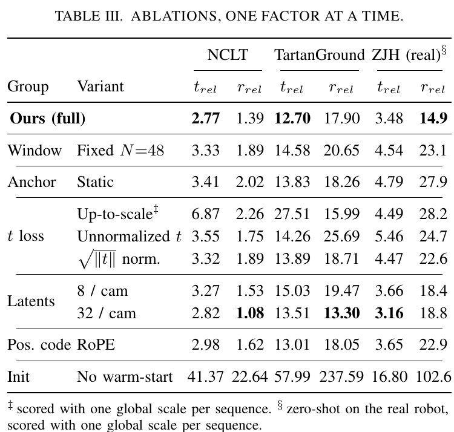
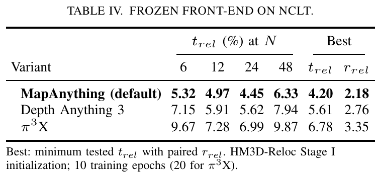
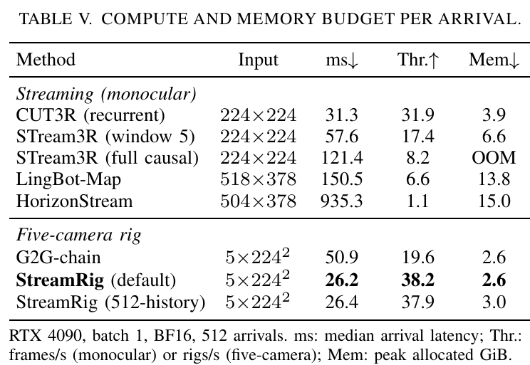

# StreamRig 论文解读

> *StreamRig: Exploiting Intra-Rig Geometry for Streaming Multi-Camera Odometry*，Yufei Wei、Shuhao Ye、Qi Wang 等。本文依据 arXiv v1（2026-09-30）。论文研究已标定多相机系统的流式视觉里程计，结合冻结的多视图模型与可训练的时序位姿后端。[论文页面](https://arxiv.org/abs/2609.40244) · [PDF](https://arxiv.org/pdf/2609.40244v1) · [官方代码](https://github.com/WeiYuFei0217/StreamRig)

## 1. 引言

移动机器人常安装多台朝向不同方向的相机。相机同步拍摄，安装位置和朝向保持固定，彼此之间的相对位姿可以事先标定。这套刚性连接的相机称为 **rig**。在 StreamRig 中，一个时刻的全部同步图像也称为一个 rig；下文将这份输入称为“一组观测”，以便区分相机装置与它连续采集的数据。

多相机里程计利用这些观测估计平台的运动。已知相机之间的固定变换后，只需估计其中一台参考相机的轨迹，就能推得其余相机的轨迹。多个方向的视野提供互补信息：某台相机受遮挡或缺少纹理时，其他相机仍可能提供运动线索。具有已知基线和重叠视野的相机还提供度量几何约束。

StreamRig 关心这些信息怎样用于在线估计。新的一组图像到来时，模型只能使用当前和过去的观测；随着运行时间增长，每步延迟与活动缓存又应维持在可控范围内。这同时提出了空间与时间两方面的要求：同一时刻要联合处理已标定的多视角，跨时刻要保留有用的历史。

已有方法分别解决了其中一部分。多视图三维模型能够联合理解一组图像，却通常把每次调用当作独立任务；把相邻两组的位姿预测串起来，便丢失了更早的观测历史。流式单目模型能够保留历史，但输入单位是一张图像。将同步的多相机图像逐张送入这类模型，会增加处理量，也没有显式利用它们在同一时刻满足的已知几何关系。

StreamRig 的方法是先处理组内几何，再处理组间时间关系。冻结的 MapAnything 根据图像和标定生成多视图特征；Rig-Resampler 将每台相机的特征压缩为少量向量；CausalBridge 使用压缩特征和历史缓存，最后由位姿头输出当前组相对某个较早参考组的位姿。这个参考组称为**锚点组**。运行一段时间后更换锚点，便能限制活动历史的长度。

训练上的困难同样来自这两层分工。冻结前端保留了已有的三维感知能力，却没有保证新后端能够读出运动。真实多相机数据的布局种类和几何监督又有限，因此论文先用两组观测之间的定位任务训练后端，再将其适配到因果序列。这一初始化过程是方法的重要组成部分。

## 2. 相关工作

传统多相机里程计将 rig 建模为广义相机：各像素的观测射线具有各自的起点和方向，而已知外参将它们统一到同一个参考系。系统利用跨时刻对应关系构造几何残差，再通过迭代优化估计运动。广义相机框架可以处理少重叠甚至无重叠的相机布局，但特征关联、动态干扰和平台适配仍会影响可靠性。

前馈三维模型提供了另一类几何表示。[DUSt3R](../dust3r/index.html) 从图像对预测点图，[VGGT](../vggt/index.html) 和 $\pi^3$ 联合处理图像集合，MapAnything、Depth Anything 3 与 $\pi^3$X 还可以接收已知相机几何。Rig3R 进一步引入相机身份、时间戳与 rig 相对射线等信息。与 StreamRig 关系最直接的是 G2G：它冻结多视图骨干，利用已知组内几何估计两组图像之间的刚体变换。不过，这类组间估计器在不同调用之间没有持续的时间状态。

流式模型则重点处理历史的保存和更新。Spann3R 使用外部空间记忆，CUT3R 使用固定大小的递归状态，TTT3R 调整状态更新；StreamVGGT 与 STream3R 缓存历史注意力的键和值，WinT3R 结合局部窗口和历史相机 token。[LingBot-Map](../lingbot-map/index.html) 压缩较早的观测，HorizonStream 结合递归状态和局部窗口。这些方法以单图像为每步输入，主要从视频中估计相机参数。

StreamRig 将两条路线连接起来：每步先得到一份利用标定的联合多相机观测，再在紧凑表示上积累时间上下文。组内感知和历史推理因此可以采用不同的特征规模，也可以分开训练。

## 3. 方法

### 3.1 问题定义与整体结构

设系统有 $C$ 台同步相机，时刻 $t$ 的输入为

$$
\mathcal R_t=\{(\mathbf I_t^c,\mathbf K^c)\}_{c=0}^{C-1}.
$$

$\mathbf I_t^c$ 是相机 $c$ 的图像，$\mathbf K^c$ 是内参。选相机 0 为参考相机，已知外参集合为 $\mathbf E=\{T_{0\leftarrow c}\}_{c=1}^{C-1}$。外参由标定得到，实际可能带有噪声。

这里约定 $T_{p\leftarrow q}$ 将坐标系 $q$ 中的点变到坐标系 $p$。若写成旋转和平移 $(R,t)$，它执行 $x_p=Rx_q+t$。因此，$T_{0\leftarrow c}$ 描述同一时刻相机 $c$ 相对于参考相机的安装关系；它与平台在不同时刻之间的运动是两个不同对象。

记当前锚点时刻为 $a_t\le t$。论文将任务写为

$$
\big(\mathcal R_{a_t},\dots,\mathcal R_t,\mathbf E\big)
\longmapsto T_{a_t\leftarrow t}\in\mathrm{SE}(3).
\tag{1}
$$

右侧是当前参考相机在锚点参考相机坐标系中的位姿，包含三维旋转和带米制尺度的平移。后文固定一个锚点时，简写 $a_t=a$；用帽子标记预测值时，写成 $\hat T_{a\leftarrow t}$。

锚点提供局部参考坐标系，也提供一组可供比较的图像特征。例如固定第 0 组为锚点，第 1、2、3 组分别输出 $\hat T_{0\leftarrow1}$、$\hat T_{0\leftarrow2}$ 和 $\hat T_{0\leftarrow3}$。预测第 3 组时可以利用中间两组的历史特征，但不必先预测三个相邻变换再相乘。这样减少了块内逐次复合的次数；单次长距离回归是否更准确，仍取决于模型和观测条件。

*原论文图 2。左上是每组输入的处理流程：冻结前端、特征压缩、因果桥接和位姿头。左下展开桥接层的角色标记、历史可见范围与锚点副本。右侧给出两阶段训练，以及周期换锚的推理流程。*

这条流程中有三种不同的输出。前端输出图像块特征，压缩器输出少量潜在特征，位姿头才输出刚体变换。前两者是网络向量，没有被定义为三维点或显式的点对应。

### 3.2 组内感知与 Rig-Resampler

#### 已知标定如何参与感知

每到一组新观测，MapAnything 联合接收全部 $C$ 张图像、由内参计算的逐像素射线方向，以及相对于相机 0 的外参。相机 0 的外参设为单位变换。这一步只处理当前同步组，不读取时间历史。

标定提供的是每个像素“从哪里、沿哪个方向观测”的几何信息。以针孔模型下的齐次像素坐标 $\tilde u=(u,v,1)^{\mathsf T}$ 为例，$\mathbf K^{-1}\tilde u$ 给出相机坐标系中的视线方向。若相机 $c$ 的固定外参为 $(R_{0\leftarrow c},t_{0\leftarrow c})$，则它的观测射线在参考相机系中可写成

$$
x_0(\lambda)=t_{0\leftarrow c}
+\lambda R_{0\leftarrow c}d^c(u),\qquad \lambda>0,
$$

其中 $d^c(u)$ 是归一化后的视线方向，$\lambda$ 是沿射线的距离。这个式子说明同一个像素索引在不同相机中对应不同的空间观测。它也说明标定本身仍未给出深度 $\lambda$；深度和场景关系需要从图像与几何先验中获取。上式用于解释标定的含义，论文的前端采用学习到的射线与位姿编码进行融合。

具体而言，DINOv2 先将每张图像编码为图像块 token。一个 token 是一块图像的特征向量。射线和位姿编码融入这些向量后，交替注意力在不同相机之间交换信息，得到

$$
\mathbf F_t\in\mathbb R^{C\times P\times D}.
$$

$P$ 是每台相机的图像块数，$D$ 是特征维数；论文默认使用 $224\times224$ 输入，对应 $P=256$、$D=768$。输出仍按相机组织，但某台相机的特征已经经过跨视角交互。组内几何由此影响后端接收到的表示。

MapAnything 在 StreamRig 训练中保持冻结，即参数不更新。可训练模块接收 $\mathbf F_t$，不再直接接收外参 $\mathbf E$，也没有显式的特定相机布局方程。冻结前端的输出可以离线缓存，省去训练时反复计算骨干的成本。这个接口也允许替换为其他能够接收图像、内参与相对位姿的多视图模型，论文在实验中检验了这一点。

#### 将图像块特征压缩为运动估计的输入

若五相机 rig 的全部特征都进入时序后端，每组便包含 $5\times256=1280$ 个 token。历史越长，存储和读取这些特征的成本越高。Rig-Resampler 在进入时间维度之前，对每台相机分别进行压缩。

压缩器使用 $L=16$ 个可学习查询，经两层交叉注意力读取该相机的 $P$ 个图像块特征。以其中一个查询 $q_l$ 为例，注意力会先计算它与各输入特征的相关分数，再将归一化权重用于汇总内容。单头核心运算可以表示为

$$
\alpha_{lp}=\operatorname{softmax}_{p}
\left(\frac{(W_Qq_l)^{\mathsf T}(W_Kf_p)}{\sqrt{d_k}}\right),
\qquad
m_l=\sum_{p=1}^{P}\alpha_{lp}W_Vf_p.
$$

这里 $f_p$ 是输入特征，$d_k$ 是投影维数。该式用于展开交叉注意力的聚合含义，省略了多头合并等结构：查询决定从哪些输入读取信息，输出由加权后的特征组成。因此，16 个输出向量能够汇集全部 256 个图像块的信息，并非仅挑选其中 16 个图像块。

全部查询经过压缩模块后得到

$$
\mathbf Z_t\in\mathbb R^{C\times L\times D}.
$$

查询参数在相机之间共享，各台相机分别产生 $L$ 个输出。五相机输入于是由 1280 个 token 降到 80 个。这里有一个关键顺序：**先联合感知完整的多相机组，再按相机压缩**。压缩器读取的每台相机特征已经包含组内上下文，同时输出保留了相机身份，后续仍能针对不同相机预测位姿。

这些潜在向量由最终位姿损失训练，目标是保留运动和尺度估计需要的信息。它们没有逐个对应某种手工定义的几何量，也不承担恢复全部稠密场景的任务。压缩带来的信息损失由后面的 token 数量消融衡量。

### 3.3 CausalBridge 与位姿头

#### 先标明相机和参考角色

CausalBridge 在压缩后的观测上处理时间关系。输入首先增加相机、组角色和锚点参考相机三类可学习的嵌入向量。论文式（2）为

$$
\hat{\mathbf Z}_s^{\,c}
=\mathbf Z_s^{\,c}
+\mathbf e_{\mathrm{cam}}^{\,c}
+\mathbf e_{\mathrm{group}}^{\,\mathbb1[s=a]}
+\mathbb1[s=a,\,c=0]\,\mathbf e_{\mathrm{anchor}}.
\tag{2}
$$

每个嵌入向量加到对应相机的全部潜在 token 上。$\mathbf e_{\mathrm{cam}}^{\,c}$ 标明相机身份，并在不同时刻共享；$\mathbf e_{\mathrm{group}}^1$ 标明锚点组，$\mathbf e_{\mathrm{group}}^0$ 标明查询组。最后一项只加在锚点组的相机 0 上，指出输出坐标系的参考相机。$\mathbb1[\cdot]$ 是条件成立时取 1、否则取 0 的指示数。

这些标记回答的是“来自哪台相机”和“承担什么角色”。式中没有时间位置编码。论文通过因果掩码约束信息的先后可见关系，并让特征内容参与时间推理；增加旋转时间位置编码的效果另有消融。输入长度不受固定时间位置表限制，也不意味着模型能够准确预测任意远的运动。

#### 历史缓存与锚点双向交互

桥接模块包含八层自注意力。同一组内的 token 可以相互读取；不同组之间，当前组可以读取过去，过去的组不读取未来。这样的约束使过去的计算能够缓存。

注意力中的 Query 用于读取信息，Key 用于与 Query 计算权重，Value 是被加权汇总的内容。对于一个已经处理完的历史组，只要其输入和可见范围都不改变，各层计算出的 Key、Value 也不必改变。新组到来后，计算当前组自己的 Query、Key、Value，并复用历史的 Key、Value，就能避免重算全部旧图像和旧特征。

但严格的单向读取限制了锚点的表示。位姿头需要比较锚点和当前组；如果锚点始终保持一份与查询无关的表示，它就无法在桥接过程中结合当前组的信息。若直接改写原锚点，又会破坏旧组计算可以复用的前提。

StreamRig 为每个查询组创建独立的**锚点快照** $\mathbf A_t$。其初值是式（2）标记后的锚点特征 $\hat{\mathbf Z}_a$ 的副本。这份副本与当前组共同经过桥接层，可以随当前查询更新；用于下一次查询的原始锚点特征仍保留不变。第 $t+1$ 组到来时重新复制原锚点，不延续 $\mathbf A_t$ 的更新结果。

设 $\mathcal V(X)$ 是一组 token 在某层允许读取的来源集合，论文式（3）规定

$$
\begin{aligned}
\mathcal V(\mathbf A_t)
&=\{\mathbf A_t,\hat{\mathbf Z}_t\},\\
\mathcal V(\hat{\mathbf Z}_t)
&=\{\mathbf A_t\}\cup
\{\hat{\mathbf Z}_s:a<s\le t\}.
\end{aligned}
\tag{3}
$$

第一行使快照读取自身与当前组。第二行使当前组读取自己的快照，以及锚点之后到当前时刻的各组；其中包含当前组自身。历史组不会读取其他查询的快照，快照也不会更新历史组。锚点的观测信息通过本次快照参与比较。

以锚点为第 0 组、当前为第 2 组说明这一范围：$\mathbf A_2$ 读取自身和第 2 组；第 2 组读取 $\mathbf A_2$、第 1 组和自身。第 1 组的缓存已经在此前计算完成，此时只作为读取来源。到第 3 组时，新建 $\mathbf A_3$，并读取第 1、2 组的缓存。

原论文图 2 左下角的 *Anchor–Current interaction* 对应这一过程：上方锚点特征沿 *Per-query copy* 生成副本，副本与当前组双向交互，左侧 KV cache 则向当前组提供历史信息。这三条路径分别承担初始化参考端、当前配对交互和历史读取。

“双向交互”发生在层与层之间。一层注意力根据进入该层的状态同时计算输出；下一层再使用更新后的状态。因此，第一层快照可汇总当前组的信息，第二层当前组就能读取已经结合自身观测的参考端特征。这种交互在八层中持续进行。

中间组的作用也由读取路径决定。某组到达时已经结合了它之前的历史，其缓存因此能够向后提供沿途上下文。当锚点与当前图像缺少共同视野时，网络仍有机会利用这些中间表示估计关系。论文没有定义显式的跨组点轨迹或三角化步骤，这里的传播对象始终是学习到的特征。

整个输出只依赖锚点到当前时刻的观测，训练时可以一次输入完整窗口，用掩码并行计算每个查询；推理时则逐组追加，复用旧的键值。快照使当前预测获得双向比较，而独立副本使这种比较不改变已经产生的历史状态。

#### 从桥接特征读出位姿

桥接完成后，位姿头为查询组的每台相机 $c$ 使用两个可学习查询，分别汇集旋转和平移信息。它们读取的来源是两部分输出的拼接：快照 $\mathbf A_t$ 中相机 0 的 token，以及当前组中相机 $c$ 的 token。前者提供参考端，后者提供待定位相机。两个三层多层感知机（MLP）随后输出六维旋转表示与三维平移。

六维旋转表示需要转成合法旋转矩阵。若网络输出两个三维向量 $b_1,b_2$，Gram–Schmidt 正交化的关系为

$$
r_1=\frac{b_1}{\|b_1\|},\qquad
u_2=b_2-(r_1^{\mathsf T}b_2)r_1,\qquad
r_2=\frac{u_2}{\|u_2\|},\qquad
r_3=r_1\times r_2.
$$

在向量非退化的条件下，三个方向构成正交右手基，组合为旋转矩阵。这个表示将网络的连续数值输出转为 $\mathrm{SO}(3)$ 中的旋转，再与平移合成 $\mathrm{SE}(3)$ 位姿。

里程计输出只取当前参考相机 $c=0$ 的预测，即 $\hat T_{a\leftarrow t}$。其他相机提供辅助训练目标。其标签由参考相机运动和已知外参导出：

$$
T_{a0\leftarrow tc}
=T_{a0\leftarrow t0}\,T_{t0\leftarrow tc}.
$$

右侧先把当前相机 $c$ 的坐标变到当前参考相机，再变到锚点参考相机。这样，所有相机都受到几何相关的位姿监督，却不需要额外标注每台相机的轨迹。这是训练目标之间的关系；推理时仍由网络读出位姿，没有在此执行重投影优化或局部 BA。

### 3.4 训练

#### 相对位姿损失

训练只监督相对位姿。对距锚点 $d$ 个采样步的目标，记真值旋转和平移为 $(\mathbf R,\mathbf t)$，预测为 $(\hat{\mathbf R},\hat{\mathbf t})$。论文采用

$$
\mathcal L_d
=\lambda_R\sqrt{\tfrac19\,
\mathbb E\big\|\hat{\mathbf R}^{\mathsf T}\mathbf R-\mathbf I\big\|_F^2}
+\lambda_t\,\mathbb E\!\left[
\frac{\tfrac13\big\|\hat{\mathbf t}-\mathbf t\big\|_1}
{\max(\|\mathbf t\|,\epsilon)}\right].
\tag{4}
$$

$\mathbb E$ 对固定 $d$ 下的样本和相机求平均，最后再对不同 $d$ 的 $\mathcal L_d$ 求平均。参数为 $\lambda_R=5$、$\lambda_t=1$、$\epsilon=0.1$ 米。

旋转项比较预测与真值的相对旋转和单位矩阵。两者相同时，相对旋转就是单位矩阵，误差为零。若相对旋转角为 $\theta$，则

$$
\|\hat{\mathbf R}^{\mathsf T}\mathbf R-\mathbf I\|_F^2
=6-2\operatorname{tr}(\hat{\mathbf R}^{\mathsf T}\mathbf R)
=8\sin^2(\theta/2).
$$

这里使用了旋转矩阵的正交性和 $\operatorname{tr}(R)=1+2\cos\theta$。小角度时，上式约为 $2\theta^2$，因此式（4）的旋转项近似与角误差的均方根成正比。这也解释了论文所称的 RMS chordal loss。

平移项先取三个坐标分量的平均绝对误差，再按真值位移长度归一化。若远目标的位移及预测误差都是近目标的十倍，未经归一化的损失也会大十倍；归一化后，两者的相对平移误差可以处于相近量级。分母中的 $\epsilon$ 则限制接近零位移时的放大。

这种归一化仍保留度量尺度监督：分子比较的是预测米数与真值米数，没有为每个预测自由拟合尺度。它改变近远目标的损失权重，而非放弃尺度准确性。

#### 先学组间定位，再适配因果序列

Stage I 训练的是 *group relocalization*，即两组观测之间的相对定位。这里的“组”由一台相机沿轨迹拍摄的一段短窗口构成，组内图像在不同位置拍摄。只要相对位姿已知，就能作为带有组内几何的多视角输入。两个具有共同视野的窗口可以组成训练对，也可以跨会话、跨轨迹配对。

因此，Stage I 的多视角组不局限于某台物理 rig 的固定布局。它让后端接触更多组内几何与组间位移，学习从冻结特征中估计相对变换。此时两组之间采用双向注意力，尚不施加在线序列的因果限制。训练还对输入外参加入旋转 $1.5^\circ$、平移 0.1 米的 $\mathrm{SE}(3)$ 扰动，而位姿目标保持干净。网络由此学习在输入标定存在扰动时预测正确目标；这并不构成在线自标定。

Stage II 延续同一套 Rig-Resampler、CausalBridge 和位姿头的参数，换成目标 rig 连续采集的同步图像组。两组之间的双向注意力换为式（3）的因果掩码，每个查询组拥有自己的锚点快照，并由它相对锚点的位姿监督。输入外参使用干净标定。前端在两个阶段均保持冻结。

阶段切换保留了已学到的组间对齐能力，再学习利用中间历史。直接跳过 Stage I，意味着一个随机后端必须同时学习读取几何特征与处理因果历史。后面的初始化消融表明，在论文相同的训练设置下，这样会明显恶化结果。

#### 平衡不同运动跨度的训练

Stage II 从 $[6,48]$ 中采样窗口长度 $N$，采样概率与 $N$ 成正比；原始帧之间的采样步长从 $[1,s_{\max}]$ 均匀抽取，$s_{\max}$ 按平台帧率和速度设置。

混合窗口使短距离目标在训练中获得更多相对权重。固定 48 组的窗口同时包含从 1 到 47 步的查询偏移，每个偏移在式（4）的平均中占一项；若只关注最邻近的几个偏移，它们在全部监督项中占比较小。较短窗口只包含较近目标，可以增加对短距离关系的训练；长度加权采样又保留了对长窗口的充分覆盖。平移归一化进一步控制远距离目标因绝对误差较大而主导损失的问题。

这一安排与缓存机制相联系：当前组会读取过去组的状态，长距离预测也依赖中间状态是否可靠。因此，训练近距离关系会影响后续可用的历史表示，而不只是改善一类独立输出。这是论文对混合窗口和归一化消融结果的解释。

可训练后端共 7460 万参数，占总计 6.38 亿参数的 11.7%。Stage II 共训练 57.6 万个窗口，总批量为 16，使用初始学习率 $10^{-4}$ 的 AdamW 和余弦衰减。缓存冻结特征后，NCLT 默认训练的估计成本约为 48 RTX 4090 GPU 小时。

### 3.5 流式推理与重新选取锚点

每步推理依次完成当前组的前端感知、特征压缩、桥接和位姿读出。桥接层复用早先各组在八层中留下的键和值，只为新组和本次锚点快照计算新的输出。当前组计算得到的键值随后供未来组读取。

固定锚点时，可以一直预测当前位姿，但缓存会随组数增长，锚点到当前的运动也可能超出训练范围。默认协议将序列分成最多包含 $N$ 组的活动块：上一块最后一组成为下一块锚点，活动窗口在此重新开始。相邻块共享边界组；$N=2$ 就退化为相邻观测组的成对链。

换锚还需要连接坐标系。记最初参考系为 $w$，系统已经保存当前锚点在该坐标系中的位姿 $T_{w\leftarrow a}$，当前输出为 $\hat T_{a\leftarrow t}$，则

$$
T_{w\leftarrow t}
=T_{w\leftarrow a}\,\hat T_{a\leftarrow t}.
$$

若两项分别为 $(R_{wa},t_{wa})$ 和 $(\hat R_{at},\hat t_{at})$，展开就是

$$
R_{wt}=R_{wa}\hat R_{at},\qquad
 t_{wt}=R_{wa}\hat t_{at}+t_{wa}.
$$

局部平移先旋转到初始参考系，再加上锚点位置。当块末尾 $b$ 成为新锚点时，保留已经得到的 $T_{w\leftarrow b}$，以它作为下一块的坐标连接。块内各查询直接相对同一锚点预测，跨块才由锚点间变换继续复合。整个轨迹仍会累积误差，但复合位置与相邻成对链不同。

周期换锚使持久活动状态最多对应 $N$ 个压缩组，即 $NCL$ 个 token 规模及其各层键值，另有当前计算使用的快照。压缩控制每组状态大小，换锚控制组数，两者共同限制内存。推理块长 $N$ 是部署参数，不必等于某次训练采样的窗口长度。

论文还给出可选的长历史模式。锚点可以在较长时段内保持不动；距当前超过 8 步的旧组，每台相机只保留前 4 个潜在 token 的键值，其余删除，训练采用对应的带状掩码。这能保留远处历史的读取入口并维持较低的实测每步延迟，但旧组仍不断增加，状态大小仍随序列增长，并付出短距离精度代价。默认的有界状态保证来自周期换锚。

## 4. 实验

### 4.1 数据与评价设置

论文在四种 rig 上测试完整轨迹。NCLT 是五相机环视 Segway，在八个训练会话上训练，在 2012-02-19 与 2012-08-20 两个完整会话上评估，总长 12.29 公里。TartanGround 是四台相机向外组成环视的仿真地面机器人，在十个未见场景各取三条最长轨迹测试，总长 12.60 公里。

KITTI-360 包含 0.59 米前向双目基线和两台侧视鱼眼相机，鱼眼图像校正为 $90^\circ$ 视图；训练使用 0000、0002–0007，测试为 0009、0010，总长 13.63 公里。ZJH 是作者采集的人形机器人数据，配置为 7 厘米前向双目加两台斜视相机。训练仅使用 25 个由真实扫描重建的仿真室内环境中的 131 条行走轨迹，随后在未见真实环境的三条序列上零样本测试，总长约 0.36 公里，真值来自 COLMAP rig 重建。

所有方法以因果方式运行完整序列，并由自己的预测组成轨迹。相对平移漂移 $t_{rel}$ 是分段相对位移误差除以该段真值路程，单位为百分比；相对旋转漂移 $r_{rel}$ 将分段角误差按路程归一化，单位为度/100 米。NCLT 与 KITTI-360 使用 100–800 米的段，TartanGround 与 ZJH 使用 10–80 米的段。ATE 则衡量整条轨迹对齐后的位置误差，单位为米。KITTI-360 两条测试路线长度不同，结果按路径长度加权汇总。

尺度协议需要与结果一起阅读。度量方法使用原始尺度，ATE 只进行整体旋转和平移的 $\mathrm{SE}(3)$ 对齐。论文标记为 U 的方法是未在目标数据上训练或不输出度量尺度的方法，先为每条序列拟合一个全局尺度，再计算相对漂移，ATE 使用允许整体缩放的 $\mathrm{Sim}(3)$ 对齐。ZJH 中仿真与真实机器人之间的尺度预先未知，因此所有方法都使用每序列一个全局尺度与相同测试步长。

对照方法分为多相机成对估计器与单目流式模型。G2G-chain 使用与 StreamRig 相同的图像、标定和冻结特征，但只估计相邻两组，再逐次复合。CUT3R 与 STream3R 按原训练方案在目标划分上微调；LingBot-Map 与 HorizonStream 使用发布权重。Reloc3R-rig 和 Rig3R 也在目标训练划分上训练。

MapAnything 另有两种调用条件：MA-A 只获得锚点组的外参；MA-AB 还获得查询组相对于共同参考系的真值外参，因而已含待估计的组间位姿信息。MA-AB 属于 oracle，仅作为诊断参考，不参与通常方法排名。

### 4.2 主要结果与相机数量

*原论文表 I。每个数据集依次报告 $t_{rel}$、$r_{rel}$ 与 ATE；M 表示原始度量尺度，U 表示每序列拟合一个尺度。ZJH 对所有方法均使用全局尺度对齐。MA-AB 带有真值信息，排除在方法排名之外。*

四个数据集上，StreamRig 的平移与旋转漂移均低于论文测试的非 oracle 方法。这个结果支持联合 rig 感知与时序状态的组合，但不同平台所体现的收益有所区别。

NCLT 包含室内外切换、照明变化、模糊和行人。G2G-chain 的平移漂移为 6.08%，已低于表中的全部单目流式对照；StreamRig 进一步降到 2.77%，旋转漂移由 3.54 降到 1.39 度/100 米。二者的前端和输入相同，差别涉及时序后端、历史利用与换锚方式，因此这组比较最接近论文要检验的核心问题：在相同组内感知基础上，持续使用中间历史能否改善轨迹。它没有单独隔离某一层注意力的贡献。

TartanGround 的困难更多来自坡面、植被、杂物和变化的遮挡。G2G-chain 的平移漂移为 16.40%，CUT3R 为 22.72%，STream3R 为 16.21%，StreamRig 为 12.70%。作者将这些结果解释为宽视野与历史信息具有互补作用。与不同骨干模型之间的比较仍同时改变了结构与训练条件，不能据此定量拆出某一项先验的独立收益。

KITTI-360 以较稳定的前向行驶为主，单目前向流式方法已较强。StreamRig 的相对漂移为 2.59% 和 0.98 度/100 米，但 ATE 并非所有方法中最低：STream3R 的 ATE 为 53.6 米，StreamRig 为 63.7 米，二者分别采用 $\mathrm{Sim}(3)$ 与 $\mathrm{SE}(3)$ 对齐。相对漂移与完整轨迹 ATE 衡量的对象不同，尺度协议也不同，不能将“最低相对漂移”扩展成所有指标均最优。

ZJH 检验的是仿真到真实人形机器人的迁移。行走带来逐步晃动，单位路程内的转动也较大。StreamRig 在真实序列上的平移漂移为 3.48%，旋转漂移为 14.88 度/100 米，ATE 为 0.88 米；CUT3R 的对应结果为 4.61%、39.85 度/100 米和 1.11 米。旋转漂移相对降低约 63%。这一结果支持论文训练配置下的仿真到真实迁移，范围是所测试的 rig 与三条真实序列。

*原论文图 3。轨迹经过整条序列的 $\mathrm{Sim}(3)$ 对齐，并移动到共同起点，用于展示形状和漂移。黑色虚线是真值。定量评价仍以上表各自的尺度协议为准；KITTI-360 使用原文所述的真值缺口衔接协议。*

为进一步控制输入差异，论文在 KITTI-360 上保持模型配置，只改变进入冻结前端的相机子集。

*原论文表 II。SE3、Sim3 两列分别是两种对齐方式下的完整路线 ATE，单位为米；$t_{rel}$ 与 $r_{rel}$ 的单位同表 I。*

单前向相机、前向双目、双目加两台侧视相机的平移漂移依次为 4.84%、3.59%、2.59%，旋转漂移依次为 1.92、1.33、0.98 度/100 米。仅用前向相机时，该模型弱于 CUT3R；增加已标定的双目输入后接近，再加入侧视后进一步改善。双目主要增加相近视野中的几何约束，侧视扩展观测方向；这些结果支持联合多相机输入有效，但三种配置没有将视差与视野贡献完全分离。

### 4.3 换锚间隔与训练跨度

换锚块长 $N$ 同时影响复合次数和单次预测难度。块较短时，整条轨迹需要连接更多锚点间估计，每次估计的误差都会参与后续复合。块较长时，锚点与当前组可能失去共同视野，相对位移也可能超出训练数据覆盖的范围。

*原论文图 4。实线为平移漂移、虚线为旋转漂移；三种颜色对应最大训练窗口为 48、256、512。星号表示超出训练窗口的测试点，顶部条形表示估计训练成本。横轴按测试块长逐项排列，并非统一数值间距。*

三种模型的平移误差曲线都呈 U 形。默认以 6–48 组窗口训练的模型，在约 $N=24$ 时最低；$N=48$ 时略升，超过训练跨度的 $N=64$ 明显恶化。论文的位移诊断还观察到，测试目标超过训练位移范围后，预测位移会在最大训练位移附近饱和。这将大块退化与位姿头学到的运动范围联系起来。

将最大训练窗口扩到 256 或 512，可以把可用的换锚范围向右扩展，但没有降低最低漂移，也没有保证整个训练跨度内都保持低误差。转弯还会使锚点到当前的直线位移远小于实际走过的路程，因此帧数、路程和回归的平移幅度需要区分。

更长窗口也提高了训练成本。扩展模型在每轮看见相同组数的前提下，分别使用更多轮次，且长历史下每组计算更贵。估计成本由 48 GPU 小时增至 270 和 710 GPU 小时。实验支持的是更长训练能够扩大可用范围，并未支持训练越长、最佳精度必然越高。

### 4.4 消融实验

*原论文表 III。每次改变一个因素，测试 NCLT、TartanGround 与 ZJH。ZJH 保留仿真训练、真实测试和全局尺度对齐条件；up-to-scale 损失变体也按全局尺度对齐评价。*

窗口与平移监督的结果对应前面的近远距离平衡。在 NCLT 上，完整配置为 2.77%，固定 48 组窗口变为 3.33%，去掉位移归一化为 3.55%，改为平方根归一化为 3.32%。只监督 up-to-scale 平移，即使评价时允许全局尺度对齐，仍为 6.87%。这表明度量监督的收益不只是给结果指定一个整体尺度，还影响运动关系本身的学习。

将每个查询独立更新的锚点快照换为静态锚点，NCLT 的平移漂移升至 3.41%，ZJH 由 3.48% 升至 4.79%。这支持参考端参与查询相关交互的作用；它没有说明快照中一定出现了可识别的显式几何对应。

每台相机的潜在 token 由 16 减为 8，NCLT 的平移漂移为 3.27%；增为 32 时为 2.82%，旋转漂移则由 1.39 降到 1.08 度/100 米。32 个 token 在不同平台上的平移收益并不一致，训练计算约为三倍，因此作者选择 16 个作为成本与精度的折中。

增加旋转时间位置编码 RoPE，没有在测试的 rig 上带来收益，NCLT 平移漂移为 2.98%。作者认为，组内几何已经由前端处理，桥接层又通过锚点角色和因果掩码获得了必要的组织信息。这个解释针对该结构和实验，不构成时间位置编码对所有流式几何模型都无用的结论。

最显著的变化来自初始化。去掉 Stage I，在相同训练设置下，NCLT 平移漂移从 2.77% 升至 41.37%，TartanGround 从 12.70% 升至 57.99%，ZJH 从 3.48% 升至 16.80%。冻结几何特征并不能代替后端的对齐训练，两阶段训练对这里的收敛质量十分关键。

*原论文表 IV。采用 HM3D-Reloc 的 Stage I 初始化，训练 10 轮，$\pi^3$X 训练 20 轮；Best 为所有测试块长中的最低平移漂移及其对应旋转漂移。*

前端替换实验中，MapAnything、Depth Anything 3 和 $\pi^3$X 都能收敛并形成类似的 U 形换锚曲线，最佳平移漂移分别为 4.20%、5.61%、6.78%。这一组的初始化和预算与主实验不同，不能将 4.20% 与主表的 2.77% 当成单因素对照。

结果验证了冻结前端接口可以迁移到其他多视图模型，也显示前端表示会影响后端读出。作者将排序与前端暴露组内几何的直接程度联系起来，尤其强调逐像素射线条件的作用；这种机制解释没有通过该表单独隔离验证。

### 4.5 计算与内存

*原论文表 V。RTX 4090，BF16，批量 1，连续 512 次输入，从内存中的 RGB 到位姿计时。单目模型每次输入一张图像，StreamRig 每次输入五相机组；吞吐分别以图像/秒与组/秒计，显存单位为 GiB。*

StreamRig 处理一组五相机输入的中位延迟为 26.2 毫秒，峰值显存为 2.6 GiB。CUT3R 处理一张单目图像为 31.3 毫秒、3.9 GiB。StreamRig 的前端加重采样器占 24.9 毫秒，桥接层与位姿头约占 1.3 毫秒：主要成本仍在当前组的感知，压缩后的时间推理占比较小。

成对链若每次重新编码两组图像，延迟为 50.9 毫秒。但缓存上一组的特征后，它与 $N=2$ 的 StreamRig 执行同等前端工作。因此，论文相对于可缓存成对链强调的是近似成本下利用历史获得更好的轨迹，而不是前端缓存只有 StreamRig 才能实现。

长历史模式在 512 组测试中为 26.4 毫秒、3.0 GiB。这个测试说明该长度下的实测延迟较低；旧组持续增加，仍不能由此推出无限序列上的固定内存或恒定延迟。

原论文图 1 将精度与成本放在一起展示，但两者来自不同配置：NCLT 2012-08-20 的精度使用 $N=24$ 的 StreamRig 和九帧窗口的微调 CUT3R；成本则分别使用 $N=2$ 和递归 CUT3R。图中的 LiDAR 点用于按预测位姿拼接可视化，没有作为里程计输入。理解性能比较时，需要保留这几个条件。

## 5. 结论

StreamRig 的核心联系在于两种尺度不同的特征处理。组内前端保留完整的多视角输入，利用已知标定形成几何特征；时间后端只保留每相机少量潜在向量，在因果约束下积累历史。每个查询独立复制锚点，使参考端能够参与当前比较，同时保留旧状态可缓存的性质。位姿头输出相对锚点的运动，周期换锚再将各段连接为完整轨迹。

训练与这一结构相配合。组间定位预训练先教会后端读取冻结表示，因果训练再教它利用中间状态；混合窗口和位移归一化平衡不同运动范围。实验分别从历史、相机子集、快照、初始化和前端替换等角度提供支持，也显示了回归范围与计算成本的限制。

论文当前仍是前馈里程计系统。它依赖标定与预训练特征，没有通过在线重投影优化修正每次预测；换锚限制了活动状态，但没有消除跨段漂移。作者对利用压缩特征进行同会话重访检索只做了探索，尚无定量闭环评价，接受阈值也需逐会话调整。可迁移的闭环触发、将重访融入状态，以及联合细化位姿与稠密几何，仍属于后续工作。

## 参考文献

- Yufei Wei, Shuhao Ye, Qi Wang, Xin Zheng, Qing Huang, Rong Xiong, and Yue Wang. *StreamRig: Exploiting Intra-Rig Geometry for Streaming Multi-Camera Odometry*. arXiv:2609.40244v1, 2026. [论文页面](https://arxiv.org/abs/2609.40244) · [PDF](https://arxiv.org/pdf/2609.40244v1)。
- [StreamRig 官方仓库](https://github.com/WeiYuFei0217/StreamRig)。正文方法与实验依据上述论文版本；相关工作条目详见原论文参考文献。
