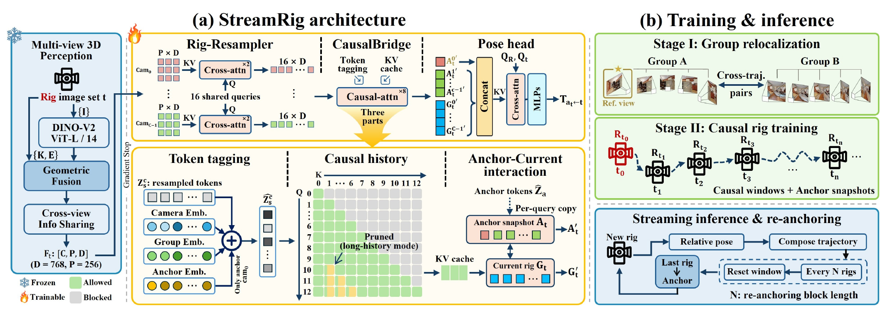
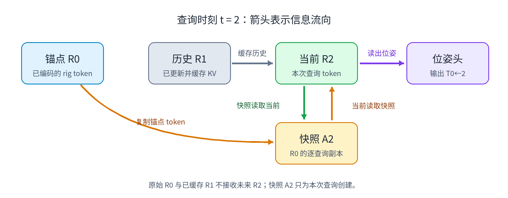
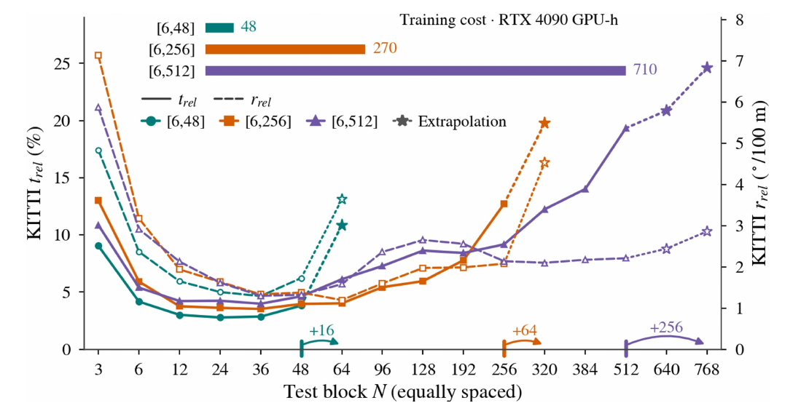
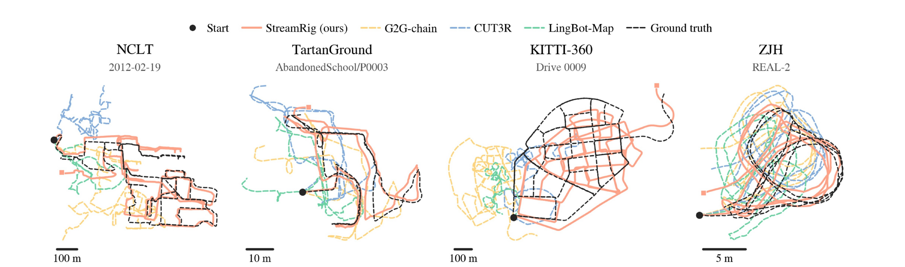

# StreamRig 的组内几何与因果位姿估计

> StreamRig 要把同一时刻的一组标定相机当成一次几何观测，又要在只看当前和过去图像的条件下持续输出位姿。本文沿着“组内几何感知 → 压缩后的历史 → 锚点与当前组交互 → 相对位姿 → 换锚”的顺序解释方法，并追溯两阶段训练和四组实验怎样支撑这条链路。MapAnything 内部的预训练过程只作必要交代，不展开其完整网络。论文：Yufei Wei 等，*StreamRig: Exploiting Intra-Rig Geometry for Streaming Multi-Camera Odometry*（2026）。[论文页面](https://arxiv.org/abs/2609.40244)

一辆车驶过路口，前向相机视野中的建筑很快消失，侧向相机仍可能看到它。几台相机同时固定在车身上，图像之间的相对位置由标定给出。把它们依次塞进单目视频模型，模型要自己从图像推回原本已知的组内关系，每个时刻的 token 和历史缓存也随相机数增加。反过来，若每次只拿相邻两组图像估计相对运动，再将结果逐段相乘，局部偏差会沿长轨迹积累。

StreamRig 在这两处同时动手：冻结多视图三维模型负责把一组同步图像融合成有标定几何的特征；可训练的轻量后端只保存压缩后的 rig 特征，从历史中直接回归当前组相对锚点组的位姿。这里的 **rig** 指一个时刻所有同步相机及其固定布局。方法的关键在于标定在哪里进入、历史在哪里起作用，以及后端为什么要先学组间对齐。

## 1. 从标定相机组到锚点相对位姿

记时刻 $t$ 的相机组为 $\mathcal R_t=\{(I_t^c,K^c)\}_{c=0}^{C-1}$，其中 $I_t^c$ 是第 $c$ 台相机的图像，$K^c$ 是内参。选相机 $0$ 为参考相机，$E=\{T_{0\leftarrow c}\}_{c=1}^{C-1}$ 是已知但可能有噪声的外参，$T_{0\leftarrow c}$ 把相机 $c$ 坐标变到同一时刻的相机 $0$ 坐标。图像组按时间到达，系统在时刻 $t$ 只能用 $\mathcal R_a,\ldots,\mathcal R_t$，其中 $a\le t$ 是当前锚点。

论文的任务输出是参考相机的刚体变换

$$
(\mathcal R_a,\ldots,\mathcal R_t,E)
\longmapsto \hat T_{a\leftarrow t}\in SE(3).
$$

$\hat T_{a\leftarrow t}$ 把当前组的参考相机坐标变到锚点组的参考相机坐标。它是**相对锚点的度量位姿**；整个序列的轨迹还需要在换锚时复合这些变换。论文不把真值轨迹输入模型，也不把后来到达的图像用于过去时刻的预测。

经典多相机里程计把整个 rig 当作广义相机，利用标定后的射线建立几何残差并迭代优化。另一类多视图基础模型能联合处理图像与几何，但通常针对固定图像集合，没有跨调用持久状态。单目流式模型有状态，却要从单张图像学习每时刻的尺度和相机关系。StreamRig 选择冻结多视图前端，把训练集中较少见的 rig 布局问题交给已有的三维先验；后端只学习如何从这种特征中读运动。这样的拆分能否成功，取决于冻结特征是否保留了足够的位姿线索，也取决于后端是否学会跨时刻对齐。

## 2. 组内几何先进入特征，再进入历史

同一图像像素 $\tilde u=(u,v,1)^{\mathsf T}$ 对应相机坐标系下的一条射线。为说明标定的作用，把方向归一化为 $d^c(u)=(K^c)^{-1}\tilde u/\|(K^c)^{-1}\tilde u\|$，并令 $T_{0\leftarrow c}=(R_{0\leftarrow c},t_{0\leftarrow c})$，则这条射线在 rig 参考系中是

$$
x_0(\lambda)=t_{0\leftarrow c}+\lambda R_{0\leftarrow c}d^c(u),
\qquad \lambda>0.
$$

$t_{0\leftarrow c}$ 和 $\lambda$ 的单位是长度；射线方向无量纲。式子给出了不同相机的像素如何被置于同一坐标系，并没有替任何像素解出深度 $\lambda$。两台无重叠视野的相机也不会因此在同一时刻直接形成三角测量。它说明模型已知哪些约束，不能当作 StreamRig 显式执行的三角化步骤。

冻结的 MapAnything 接收 $C$ 张图像、由内参得到的逐像素射线方向和以相机 $0$ 为参考的外参。其 DINOv2 编码器生成图像 token，射线与位姿编码融合进去，随后交替注意力在相机间交换信息。一个 rig 的输出是

$$
F_t\in\mathbb R^{C\times P\times D},\qquad P=256,\ D=768.
$$

每台相机仍有 $P$ 个 patch 特征，但它们已携带组内多视角上下文。**外参只在这一步输入**；后面的可训练模块接收 $F_t$，没有再次读取 $E$，也没有写死某一种相机布局。训练时冻结的前端特征可以预先缓存，梯度只更新后端。若标定本身错误，前端融合的几何也可能被误导；训练中的标定扰动只能提高容忍度，不能提供在线自标定。

把五相机 rig 的全部特征长期留在时序注意力中，每个时刻就是 $5\times256=1280$ 个 token。Rig-Resampler 因此对**每台相机分别**用 $L=16$ 个可学习查询，通过两层交叉注意力读取该相机的 $P$ 个特征。每个查询按特征相似度汇集 patch 信息，得到

$$
Z_t^c\in\mathbb R^{L\times D},\qquad
Z_t\in\mathbb R^{C\times L\times D}.
$$

查询参数在相机之间共享；增加一台相机只多产生 $L$ 个潜在 token，不需增加一套查询参数。五相机的历史输入于是从 1280 降到 80 个 token。压缩发生在组内融合**之后**，并保留相机身份；后面的位姿头还能分辨参考相机和其他视角。这里压掉的是稠密重建所需的细节，保留什么运动线索则由位姿损失学习。论文在 8、16、32 个潜在 token 的消融中检查了这项取舍。

*图 1　原论文图 2。左上是冻结感知、逐相机压缩、因果桥接与位姿头；左下标出 token 角色和注意力历史；右侧是两阶段训练与周期换锚。图中的冻结边界很关键：标定影响前端特征，后端在相对位姿监督下学习使用这些特征。*

## 3. 因果桥接让当前组读取历史

压缩后的 token 进入八层 CausalBridge。进入前，每个相机的潜在 token 都加上角色标记。论文的定义可写为

$$
\hat Z_s^c=Z_s^c+e_{\mathrm{cam}}^c
+e_{\mathrm{group}}^{\mathbf 1[s=a]}
+\mathbf 1[s=a,\,c=0]e_{\mathrm{anchor}}.
$$

$e_{\mathrm{cam}}^c$ 在所有时刻共享，告诉后端 token 属于哪台相机；$e_{\mathrm{group}}^0$ 和 $e_{\mathrm{group}}^1$ 区分查询组与锚点组；只有锚点参考相机还加 $e_{\mathrm{anchor}}$。这些标记为随后的位姿读出指明角色，并不包含时间顺序。论文不加显式时间位置编码，先后关系由因果掩码和特征内容提供。

普通因果掩码允许当前组读取过去，却不允许过去的锚点读取当前组。位姿头又需要从**锚点端和当前端**共同提取两者的关系。让旧锚点直接接收当前特征，会改变已缓存的历史状态，也会破坏整段序列可并行训练的因果结构。StreamRig 为每个查询时刻 $t$ 复制一份已标记的锚点 token，称为锚点快照 $A_t$。原锚点不更新；新快照只服务于这一次查询。

桥接层的精确定义是

$$
\mathcal V(A_t)=\{A_t,\hat Z_t\},\qquad
\mathcal V(\hat Z_t)=\{A_t\}\cup
\{\hat Z_s:a<s\le t\}.
$$

$\mathcal V(X)$ 表示 $X$ 在一层注意力里可读取的组。组内 token 可以自由交互。$A_t$ 读取自身和**当前** $\hat Z_t$，不读取中间历史；当前 $\hat Z_t$ 则读取自己的快照以及锚点之后、当前之前的所有组。原始锚点 $\hat Z_a$ 不作为当前组的另一个历史入口，它通过副本 $A_t$ 参与这次比较。

以图中简写的 $R_0=\mathcal R_0$、$R_1=\mathcal R_1$、$R_2=\mathcal R_2$ 为例，处理 $R_1$ 时生成并使用 $A_1$，其结果成为缓存。处理 $R_2$ 时重新从锚点生成 $A_2$：$A_2$ 读 $R_2$，$R_2$ 读 $A_2$ 与已缓存的 $R_1$。每层使用上一层的状态，所以 $A_2$ 在某层从当前观测得到的信息，能被下一层的 $R_2$ 读到；反向信息也沿层传播。参考端于是随本次查询改变，同时 $R_0$ 和 $R_1$ 的缓存保持不动。

*图 2　讲解用的三时刻示意。箭头表示信息流向；图中的 R0、R1、R2、A2 分别对应正文的 $R_0,R_1,R_2,A_2$。快照可与当前组交互，历史组只向当前组供给缓存，原锚点和历史缓存都没有接收未来图像的路径。*

当锚点和当前图像已没有共同视野，中间组提供沿途的观测上下文。注意力能够传递这种上下文，但论文没有证明网络在内部建立了显式三维点对应；快照消融所支持的是**查询相关的锚点表示有助于估计**。由于上述可见集合只包含 $a$ 到 $t$ 的观测，整窗训练可以一次计算，流式推理则在每到一组时复用前面八层的键值缓存。

## 4. 位姿头把两端表示变成刚体变换

对当前组的每台相机 $c$，位姿头准备两个可学习查询，分别用于旋转和平移。它们对桥接输出中“锚点快照的参考相机 token + 当前组的相机 $c$ token”做交叉注意力；两个三层感知机分别输出六维旋转表示和三维平移。六维旋转经 Gram–Schmidt 正交化成 $SO(3)$ 旋转矩阵，再与平移组成 $SE(3)$ 位姿。

系统发布的里程计结果取当前组**参考相机** $c=0$ 的输出，即 $\hat T_{a\leftarrow t}$。其余相机的回归值用于辅助监督。若 $T_{t0\leftarrow tc}$ 是组内已知外参，则它们的真值目标由

$$
T_{a0\leftarrow tc}
=T_{a0\leftarrow t0}\,T_{t0\leftarrow tc}
$$

得到：先把当前相机 $c$ 的坐标变到当前参考相机，再变到锚点参考相机。如此便能从一条参考相机轨迹导出其余相机的标签，让不同相机的压缩 token 一起接受几何一致的训练。论文最终仍只输出参考相机轨迹；这里没有显式重投影误差、局部 BA 或在线几何优化来修正每次前馈回归。

## 5. 两阶段训练先学组间对齐，再学在线历史

前端已有多视图几何先验，随机初始化的重采样器、桥接层和位姿头却还不会将特征对齐为相对位姿。训练也不能只靠固定 rig 的少量布局，期待后端自动学会各种基线与位移。论文把训练分成两阶段，三块后端模块与参数在阶段切换时保持不变，冻结前端则始终不更新。

**Stage I 是 group relocalization。** 一个 group 是沿单相机轨迹取出的短图像窗口；两个 group 只要有共同视野就可以组成训练对，来源可跨会话和轨迹。输入是两组图像及其组内几何，标签是由已有相机位姿求出的组间相对变换；这是位姿回归任务，没有匹配点的正负分类标签。两组之间允许双向注意，后端先学会在不同视角布局和较宽位移范围内对齐冻结特征。论文在这一阶段给输入外参加约 $1.5^\circ$、$0.1$ 米的 $SE(3)$ 扰动，位姿目标仍保持干净，迫使后端面对有噪声的标定条件。

**Stage II 改为目标 rig 的连续窗口。** 两组输入变成真正的同步多相机序列，双向注意变成上一节的因果掩码；窗口里每个查询组都配自己的锚点快照，也都以相对锚点位姿为监督目标。输入外参恢复为干净标定。此时后端把已经学到的组间对齐能力用于在线历史：中间 rig 提供信息，当前预测不能窥看未来。目标数据集的相机布局可以固定，但 Stage I 使参数进入更容易收敛的区域。去掉 Stage I，在相同训练设置下 NCLT 的平移漂移从 2.77% 升到 41.37%；这说明冻结特征本身还不足以让随机后端直接学好流式运动。

两个阶段的监督都是相对位姿。对固定查询间隔 $d$ 的真值 $(R,t)$ 和预测 $(\hat R,\hat t)$，论文的损失为

$$
\mathcal L_d=\lambda_R
\sqrt{\frac{1}{9}\,\mathbb E\!\left[\|\hat R^{\mathsf T}R-I\|_F^2\right]}
+\lambda_t\,\mathbb E\!\left[
\frac{\tfrac13\|\hat t-t\|_1}{\max(\|t\|,\epsilon)}\right].
$$

$\mathbb E$ 对同一间隔 $d$ 的样本和相机取平均，再对各个 $d$ 的 $\mathcal L_d$ 求平均。旋转项比较预测旋转与真值旋转的相对矩阵和单位矩阵，先求平方均值再开方；小旋转误差时，它近似按角度增长。平移项把三个坐标的绝对误差取平均，用真值位移长度归一化；$\epsilon=0.1$ 米防止近零位移导致分母失控。论文取 $\lambda_R=5,\lambda_t=1$。归一化并未删掉米制目标，它控制远距离样本因绝对位移大而占据过多梯度的倾向。

Stage II 的窗口长度 $N$ 从 6 到 48 取样，概率与 $N$ 成正比；帧间步长另从平台相关区间均匀取样。长窗仍被充分看见，但短窗中的近距离目标不会被固定长窗的大量远距离目标淹没。论文将固定 $N=48$、去掉平移归一化、改成平方根归一化及只监督比例尺度分别做消融，结果支持混合窗口和度量归一化共同维护近远距离的学习。整个后端约 7460 万参数，占 6.38 亿参数系统的 11.7%；Stage II 总计训练 57.6 万个窗口，批量 16，使用 AdamW 和余弦退火。NCLT 默认设置的估计训练成本约 48 RTX 4090 GPU 小时。

## 6. 换锚使长序列的活动状态有界

到达一个新 rig 时，前端只编码它一次，重采样器压缩后，当前 token 与本次锚点快照进入 CausalBridge。先前 rig 在各层留下的键值直接复用，位姿头给出 $\hat T_{a\leftarrow t}$。若 $T_{w\leftarrow a}$ 是锚点参考相机在全局起点 $w$ 坐标系下的累计位姿，则当前全局位姿由

$$
T_{w\leftarrow t}=T_{w\leftarrow a}\,\hat T_{a\leftarrow t}
$$

得到。块内多个查询都相对同一锚点读出，减少了整条轨迹逐帧复合的次数。每处理 $N$ 个 rig，块的最后一组 $b$ 成为下一块的锚点；保存 $T_{w\leftarrow b}$，清空旧活动窗口，再从 $b$ 继续。活动状态最多涉及一个块约 $NCL$ 个潜在 token 及对应层的键值。**重采样降低每个时刻的状态大小，周期换锚限制历史长度**，两者作用不同。

$N=2$ 退化成相邻 rig 的成对链，短块要反复复合估计误差。块太长时，锚点到当前的位移可能超出训练见过的范围；即使注意力能读取更长历史，位姿头也未必能外推。论文图 4 的 NCLT 曲线在中间 $N$ 形成低谷：默认训练跨度 6–48 的模型在约 $N=24$ 最低，$N=64$ 已明显变差。把训练跨度扩到 256 或 512 能把可用的换锚区间推远，却没有降低最优漂移，估计训练成本从 48 升到 270、710 GPU 小时。

*图 3　裁自原论文图 4。横轴是推理时的换锚块长度 $N$，实线和虚线分别是平移、旋转漂移；三种颜色对应训练最大跨度 48、256、512，星号标出超出训练窗口的测试，顶部横条是估计训练成本。曲线支持“更长训练可扩大可用范围”，不支持“训练越长最优误差越低”。*

论文还给出一个可选的**长历史模式**：不按固定块换锚；距当前超过 8 步的 rig 每台相机仅保留前 4 个潜在 token，并删去其余键值，训练时用相应带状掩码。这样远处历史仍可寻址，逐步延迟维持较低，但旧 rig 仍不断增加，显存会随序列增长，短距离精度也付出代价。它与默认的有界活动状态不是同一种内存保证。

## 7. 实验怎样区分组内几何、历史与训练的收益

论文在四种布局上评估完整序列：NCLT 是五相机环视 Segway，TartanGround 是四向仿真地面机器人，KITTI-360 是 0.59 米双目加两台侧视鱼眼，ZJH 是 7 厘米前向双目加两台斜视相机的人形机器人。ZJH 仅用仿真轨迹训练，在三个真实机器人序列上零样本评估。$t_{rel}$ 表示分段相对平移漂移（%），$r_{rel}$ 表示分段相对旋转漂移（度/100 米）；NCLT 与 KITTI-360 使用 100–800 米段，TartanGround 与 ZJH 使用 10–80 米段，跨数据集不能直接按数字比较难度。

方法从各自预测组成完整轨迹。部分单目方法输出不定尺度轨迹，评估前每条序列给一个全局尺度，再做 Sim(3) 对齐；度量方法在原始尺度上评估，ATE 做 SE(3) 对齐。ZJH 的仿真与真实机器人间尺度未知，是例外：**所有方法**在该数据集都按每条序列一个全局尺度评估。下表取论文表 I 的平移/旋转漂移；MA-AB 使用了查询组真值外参，属于 oracle，不参与通常方法排名。

| 方法 | NCLT | TartanGround | KITTI-360 | ZJH 真实机器人 |
|---|---:|---:|---:|---:|
| G2G-chain，完整 rig 的成对链 | 6.08 / 3.54 | 16.40 / 37.16 | 4.59 / 2.77 | 6.63 / 48.50 |
| CUT3R，单目前向流式 | 9.51 / 4.80 | 22.72 / 29.06 | 3.59 / 1.63 | 4.61 / 39.85 |
| StreamRig，完整 rig 的因果历史 | **2.77 / 1.39** | **12.70 / 17.90** | **2.59 / 0.98** | **3.48 / 14.88** |

每格依次为 $t_{rel}$（%）/ $r_{rel}$（度/100 米）。G2G-chain 和 StreamRig 使用相同图像、标定、冻结前端与特征，主要差别在后者可通过缓存的中间 rig 相对较远锚点估计；这个对照最能说明历史的作用。单目 CUT3R 同时改变了输入与模型，不能拿它的差距单独计算“多一台相机”的收益。四组上 StreamRig 的两项漂移均低于论文列出的非 oracle 对照；这并不等于每项 ATE 都更低，例如 KITTI-360 上 STream3R 经 Sim(3) 对齐的 ATE 为 53.6 米，StreamRig 度量尺度、经 SE(3) 对齐的 ATE 为 63.7 米，二者的尺度协议也不同。

*图 4　裁自原论文图 3。黑色虚线是真值，实线与彩色虚线是不同方法在 NCLT、TartanGround、KITTI-360、ZJH 的轨迹例子。作者为展示形状对整条序列做了 Sim(3) 对齐；这张定性图只说明轨迹偏离的样子，总体精度以表 I 的完整序列统计为准。*

为了单独看相机数，论文在 KITTI-360 上只改变**进入同一前端与后端配置的相机子集**。单前向相机、前向双目、双目加两台侧视相机的 $t_{rel}$ 分别是 4.84%、3.59%、2.59%，$r_{rel}$ 分别是 1.92、1.33、0.98 度/100 米。第二台前向相机扩展视野有限，却增加已标定的视差；侧视相机继续扩展方向。这个受控实验支持联合多相机感知有效，但不能仅凭三行数字拆分几何基线与视野覆盖各自的贡献。

冻结前端也不是可有可无的黑箱。论文在另一组统一的 NCLT 训练设置下，把 MapAnything 换成 Depth Anything 3 或 $\pi^3$ X；三者都能收敛并呈现随 $N$ 变化的 U 形曲线，其最佳平移漂移分别为 4.20%、5.61%、6.78%。这组数值与上表 2.77% 来自不同的初始化和训练预算，不能直接相减。它表明后端接口可以适配其他多视图前端，也表明前端提供组内几何的方式会影响最后的位姿质量。

消融继续检查各个设计。在 NCLT 上，静态锚点把 $t_{rel}$ 从 2.77% 提高到 3.41%，支持逐查询快照；8 个 token/相机为 3.27%，32 个为 2.82%，说明 16 个是成本和精度的折中；加入旋转时间位置编码为 2.98%，本设置下并无收益。固定 48 帧窗口为 3.33%，去掉位移归一化为 3.55%，去掉 Stage I 为 41.37%。TartanGround 和 ZJH 的相应消融大体支持同样方向，但 32 个 token 的旋转收益与平移收益不完全一致，不能概括成“压缩越少越好”。

效率比较按 RTX 4090、BF16、批量 1、从 RGB 到位姿、连续 512 次输入计时。StreamRig 每个五相机 rig 中位延迟 26.2 毫秒、峰值显存 2.6 GiB；CUT3R 每个单相机帧为 31.3 毫秒、3.9 GiB。StreamRig 的前端与重采样占 24.9 毫秒，桥接与位姿头约 1.3 毫秒，增加相机的主要边际成本仍在前端。G2G-chain 若每对重新编码两组要 50.9 毫秒；若缓存上一组特征，$N=2$ 的链与 StreamRig 做同等前端工作，论文强调的优势便是**相近成本下使用更长历史改善精度**。原论文图 1 的示例精度与速度来自不同配置，不能读成一次同时测得的精度—速度点。

## 小结

StreamRig 的核心并非把几台相机的图像简单拼接。标定约束先进入冻结的多视图前端，使每个 rig 成为有共同几何参考的观测；逐相机压缩让这些观测进入可缓存的时序状态。逐查询锚点快照使参考端能面向当前观测更新，而旧历史仍保持因果性。位姿头从锚点与当前相机的表示回归度量相对位姿，两阶段训练先教后端对齐几何特征，再教它在在线可见性下使用历史。换锚把活动状态限制在块内，并决定长距离估计与逐段复合之间的误差取舍。

论文的证据覆盖了四种 rig、相机数控制、前端替换、快照与训练消融，也留下清楚的边界：结果依赖标定和预训练特征；超出训练位移范围的长锚点预测会退化；长历史模式没有有界内存保证；位姿回归后没有在线重投影优化。作者只展示了重访检索的探索性观察，没有定量验证可用的闭环校正，因此长期系统漂移仍需另行处理。

## 参考文献

Wei, Y., Ye, S., Wang, Q., Zheng, X., Huang, Q., Xiong, R., and Wang, Y. “StreamRig: Exploiting Intra-Rig Geometry for Streaming Multi-Camera Odometry.” arXiv:2609.40244, 2026. [论文页面](https://arxiv.org/abs/2609.40244)，[PDF](https://arxiv.org/pdf/2609.40244)。
