# StreamSplat 论文解读

> Zike Wu、Qi Yan、Xuanyu Yi、Lele Wang、Renjie Liao，*StreamSplat: Towards Online Dynamic 3D Reconstruction from Uncalibrated Video Streams*，arXiv:2506.08862v2（2026 年 3 月 2 日修订），ICLR 2026。[arXiv 论文页](https://arxiv.org/abs/2506.08862) · [v2 PDF](https://arxiv.org/pdf/2506.08862v2) · [ICLR 2026 论文页与 PDF](https://proceedings.iclr.cc/paper_files/paper/2026/hash/c822d05dcc00695ed6b63c9e97bb3449-Abstract-Conference.html)

StreamSplat 要解决的是：当相机内外参未知、视频帧逐步到达、场景里又有人或物体运动时，能否在线生成可渲染的动态三维表示。它以单帧伪深度和 RGB 为输入，预测具有共同正交规范坐标的 3D Gaussian；相邻帧间的动态解码器分别预测前向和后向变形，再通过时间相关的透明度变化，把持续存在、刚出现和将消失的 Gaussian 软融合进规范场景。论文报告该模型在动态视频重建、插帧和新视角合成上优于相应基线，并可在线处理任意长视频流。它不显式估计相机轨迹，也没有 SLAM 后端；相机运动被吸收到 Gaussian 的变形中，因此更准确地说，它是面向无标定视频流的动态场景重建方法。

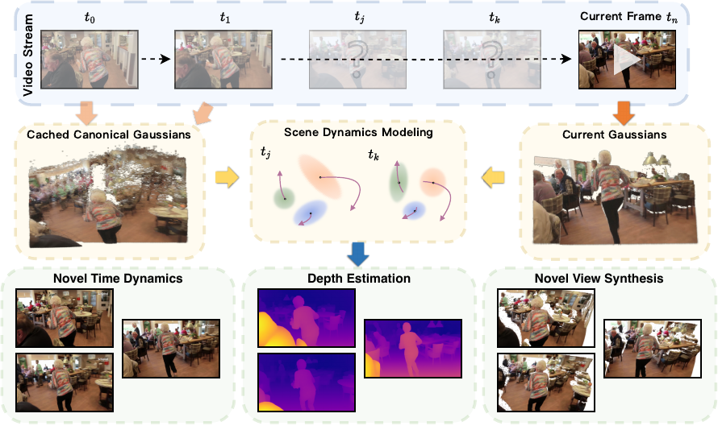

*原论文 Figure 1。输入视频帧经在线处理形成持续的规范 Gaussian 场景；同一表示可用于新时间、新深度和新视角的渲染。*

## 1 引言

动态三维重建也称 4D 重建，需要同时恢复场景的空间结构和随时间变化的外观、形状。NeRF、动态 Gaussian Splatting 等传统方法通常先取得完整视频并校准相机，再为每个场景反复优化静态几何和时间变形，最后执行跨帧聚合。即使近期方法把计算时间从数天压到数小时，这条流程仍依赖完整序列、相机参数和逐场景优化，难以满足实时交互或稀疏观测下的延迟约束。

## 2 相关工作

### 动态三维重建

早期动态 NeRF 方法以隐式 MLP 表达场景，再针对每段视频优化时间条件表示或变形场。后续动态 3DGS 用显式 Gaussian 提高渲染效率，但常见方法仍需要已标定相机和全序列优化。它们通常先建立固定的 Gaussian 集合，再拟合逐 Gaussian 变形；如果场景在时间中出现新表面或遮挡关系变化，固定集合及硬对应会让新增、消失内容难以处理。

### 前馈重建

DUSt3R、VGGT 和 MonST3R 等模型可以从未标定图像估计几何或相机信息，但多数输出点图或坐标表示；动态场景中的点云在形变时不易保持对应。前馈静态 3DGS 方法能直接预测 Gaussian，但通常针对静态场景。StreamGS 面向静态图像流，动态 Gaussian 方法则多依赖标定和完整序列。StreamSplat 的区别在于：对每对相邻帧联合预测双向变形，并用透明度时间函数融合 Gaussian，从而在没有相机标定和逐场景优化时在线处理动态视频。

## 3 方法

StreamSplat 把每帧表示为规范空间中的静态 Gaussian，再用时间变形场解释相邻帧之间的运动。正交投影提供统一的规范坐标，降低对不同相机内参的依赖；伪深度帮助确定 Gaussian 的深度位置；双向变形让前后两帧的 Gaussian 都能为中间时间提供解释；透明度变化则让不同帧的 Gaussian 在同一时间段内软融合。

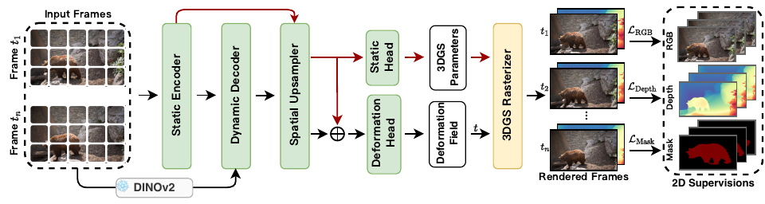

*原论文 Figure 2。静态编码器先为两帧分别产生规范 Gaussian，动态解码器预测它们之间的变形，最后可在区间内任意时间渲染。*

### 3.1 概率式 3D Gaussian 编码

#### 规范空间与像素对齐位置

通常的透视投影需要焦距、主点和相机位姿。StreamSplat 面向内参可能未知、甚至来自鱼眼镜头的视频，选择共享的正交规范空间：图像像素坐标经统一缩放后对应规范平面位置，深度由单目估计器提供。这样不必逐视频恢复相机内参；视点变化及透视效果由后续学习的变形场吸收。正交投影是处理多种未知相机模型的建模选择，并不意味着真实相机成像本身没有透视。

给定一帧 RGB 图像和 Depth Anything V2 预测的伪深度，模型将 RGB-D 划分成 $8\times8$ patch，经 Transformer 静态编码器形成 Gaussian 特征，再由上采样器把特征扩展到每个 $2\times2$ patch 一个 Gaussian token。每个 token 通过线性预测头给出位置偏移 $\boldsymbol{o}_i$、旋转 $\mathbf R_i$、尺度 $\mathbf S_i$、透明度 $\alpha_i$ 和颜色 $\boldsymbol c_i$。其中偏移的前两维修正像素对齐位置，第三维控制深度：

$$
\boldsymbol{\mu}_i = \bigl(u_i + o_{i,0},\ v_i + o_{i,1},\ g(o_{i,2})\bigr),\qquad g(z)=\frac{2}{1+z}.
$$

$(u_i,v_i)$ 是该 Gaussian 对应的像素坐标，$o_{i,2}$ 表示逆深度参数，$g$ 将其映射为正深度。采用逆深度是为了让相机附近的深度变化得到较好的表达。位置仍由图像像素提供空间锚点，网络主要预测相对偏移；这把无序的三维点定位改成局部且结构化的预测。

#### 概率位置采样

3DGS 的渲染结果对 Gaussian 初始化位置敏感，而一次前馈网络没有后续迭代来修正陷入局部极小值的位置。StreamSplat 不直接回归唯一偏移，而是预测截断在 $[-1,1]$ 内的正态分布参数，并从中采样：

$$
\boldsymbol{o}\sim\mathcal{N}_{[-1,1]}(\boldsymbol{\mu}_p,\boldsymbol{\Sigma}_p).
$$

$\boldsymbol{\mu}_p$ 和 $\boldsymbol{\Sigma}_p$ 分别是网络预测的均值与协方差。训练时从分布采样，使位置预测可以探索邻近几何；渲染误差再对采样结果提供梯度。确定性预测只尝试单一位置，一旦位置初始化不理想便难以自行离开；概率采样因此提高找到较优 Gaussian 位置的机会。附录实现还对动态速度 $\mathbf v$ 使用相同的概率采样策略。

### 3.2 动态变形预测

场景运动会带来非刚性形变，也会出现新表面、遮挡和消失内容。对每一对相邻帧，StreamSplat 同时预测两个方向：前向场把上一帧的 Gaussian 从 $t=0$ 变形到当前帧 $t=1$；后向场则把当前帧的 Gaussian 变形回 $t=0$。两组预测覆盖同一个时间区间，中间时间都能参与渲染。双向设计为跨帧建立对称监督，也让模型不必在每帧显式决定 Gaussian 数目增减。

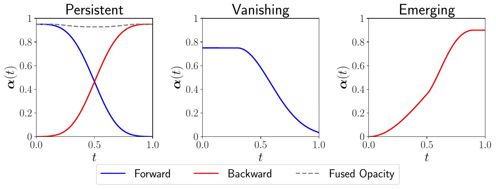

*原论文 Figure 3。透明度随 Gaussian 的创建时间和时间区间变化：持续存在的 Gaussian 在相邻帧间保有贡献；消失或新出现的 Gaussian 则逐渐淡出或淡入。*

#### 透明度变形与软融合

对一个两帧区间，将上一帧记作 $t=0$、当前帧记作 $t=1$。Gaussian 的位置随时间线性变形，透明度则由以下函数调节：

$$
\alpha(t)=\alpha\cdot\frac{\sigma\!\left(-\gamma_0\left(|t-t_0|-\gamma_1\right)\right)}{\sigma(\gamma_0\gamma_1)}.
\tag{1}
$$

$\alpha$ 是该 Gaussian 的初始透明度，$t_0\in\{0,1\}$ 是它由哪一帧创建，$\gamma_0>0$ 控制淡入淡出过渡的陡峭程度，$\gamma_1\in[0,1]$ 控制衰减窗口。分母归一化后，Gaussian 在自己的创建时刻保持初始透明度。离创建时间越远，透明度按 sigmoid 逐渐减小。模型还预测速度 $\mathbf v$，位置由 $\boldsymbol\mu(t)=\boldsymbol\mu_0+\mathbf v(t-t_0)$ 得到；实现中 $\mathbf v\in[-1,1]^3$，限制一个两帧区间的位移范围。

上一帧前向变形和当前帧后向变形产生的 Gaussian 可能覆盖相近区域。若将二者直接相加，重叠会造成重复渲染；若执行离散的一对一匹配，则需要额外匹配和融合步骤。StreamSplat 让两组 Gaussian 的透明度随时间连续变化，并以图像与深度重建损失训练。当两组 Gaussian 在空间上互相解释时，梯度会使它们形成软对应；持久内容由两侧共同承载，新出现或消失内容则通过透明度淡入淡出。这里的“软匹配”来自可微重建与透明度竞争，不是单独运行的匹配算法。

动态解码器以冻结的静态编码器得到的两帧 Gaussian 特征为输入，同时读取 DINOv2 图像特征。Transformer 生成双向形变特征，再经相同上采样器扩展到 Gaussian token，最后将形变 token 与同位置的静态 token 拼接，经两层 MLP 预测每个 Gaussian 的速度和透明度参数。这样，静态分支提供当前观测的几何与外观，动态分支提供跨帧运动及生命周期。

### 3.3 训练与推理

#### 分阶段训练

联合学习静态 Gaussian 位置和动态形变较困难，论文分两阶段训练。第一阶段训练静态编码器：单帧 RGB-D 输入生成 3DGS，渲染得到 RGB 图像 $\hat I_t$ 和深度 $\hat D_t$。目标由图像重建损失和尺度、平移不变的深度损失组成：

$$
\mathcal L_{\text{static}}=\mathcal L_{\text{recon}}(\hat I_t,I_t)+\lambda_{\text{depth}}\mathcal L_{\text{depth}}(\hat D_t,D_t).
\tag{2}
$$

$\mathcal L_{\text{recon}}$ 是 RGB 空间的 $L_2$ 损失与 LPIPS 之和。深度预测和伪深度先分别进行中位数中心化、再以平均绝对偏差归一化：

$$
\mathcal L_{\text{depth}}=\mathbb E\left\|\tau(\hat D_t)-\tau(D_t)\right\|,\qquad
\tau(\mathbf x)=\frac{\mathbf x-\operatorname{median}(\mathbf x)}{\mathbb E\left\|\mathbf x-\operatorname{median}(\mathbf x)\right\|}.
\tag{3}
$$

这样的损失不强迫伪深度拥有精确的绝对尺度或偏移。伪深度在细节和深度边界处可能不可靠，作者再按预测深度与伪深度的归一化差异调整深度损失权重：

$$
\hat\lambda_{\text{depth}}=\lambda_{\text{depth}}\,\sigma\!\left(-\frac{\left\|\tau(\hat D_t)-\tau(D_t)\right\|}{w}\right).
$$

$w$ 控制 sigmoid 对误差的敏感度；差异越大，权重越低，降低不可靠伪标签对训练的影响。论文将 $\lambda_{\text{depth}}$ 作为固定超参数，实际计算使用衰减后的 $\hat\lambda_{\text{depth}}$。

第二阶段冻结静态编码器，只训练动态解码器。训练时从一段视频中随机选两帧，分别编码为静态 Gaussian，预测两方向变形，并在这两帧之间选取时间进行渲染：

$$
\mathcal L_{\text{dynamic}}=\mathbb E_t\left[\mathcal L_{\text{recon}}(\hat I_t,I_t)+\lambda_{\text{depth}}\mathcal L_{\text{depth}}(\hat D_t,D_t)+\lambda_{\text{mask}}\mathcal L_{\text{mask}}(\hat I_t\odot M_t,I_t\odot M_t)\right].
\tag{4}
$$

$M_t$ 是 DAVIS、YouTube-VOS 提供的二值运动前景掩码；掩码损失让动态解码器额外关注运动区域。静态损失训练单帧的三维基元，动态损失则要求双向变形后的基元在两帧之间也能重建图像和深度。

#### 在线推理

在线处理第 $k$ 帧时，系统先预测伪深度并编码出当前特征 $\mathbf h_k$。动态解码器读取上帧特征 $\mathbf h_{k-1}$ 与当前特征，输出前向 Gaussian $\mathcal G^+_{k-1}(t)$ 和后向 Gaussian $\mathcal G^-_k(t)$。系统用前向结果更新规范集合中持续 Gaussian 的变形，再聚合后向生成的当前 Gaussian，以时间透明度进行融合；随后可从给定视角渲染 $t_{k-1}$ 到 $t_k$ 之间的帧，剔除在当前时间透明度降为零的 Gaussian，并保存 $\mathbf h_k$ 供下一帧使用。两侧 Gaussian 的联系由连续透明度和重建损失形成软关联，不依赖单独的离散匹配步骤。

因此，推理状态包含规范 Gaussian 集合和上一帧编码，并非每次都重新读取全视频。论文声称可处理任意长流，但这不等于固定大小显存：Gaussian 集合会随场景中持续存在的几何内容维护和更新，内存开销不能简单说成与场景复杂度无关。

## 4 实验

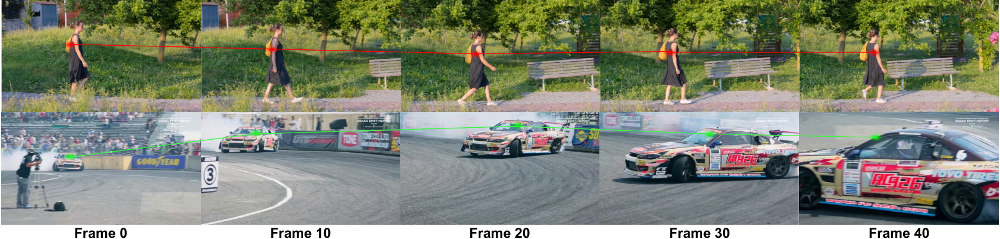

*原论文 Figure 4。研究者给初始帧的随机 Gaussian 标色并追踪其身份；标记跨越视点、尺度变化和物体运动仍能持续出现，用于观察融合后表示的时间一致性。*

### 4.1 实验设置

训练数据包括静态场景 CO3Dv2 和 RealEstate10K，以及动态视频 DAVIS 和 YouTube-VOS。静态数据集按普通视频使用，不输入预先标定的相机信息；仅 DAVIS 和 YouTube-VOS 的动态训练样本提供分割掩码来监督运动相关分支。同一预训练模型用于静态和动态测试。输入调整为 $512\times288$，评测图像为 $256\times256$；静态重建使用两张至少有 60% 重叠的输入视图，并在二者间取五个目标视图；动态视频以 5 帧或 8 帧间隔稀疏采样，对非输入帧计算指标。

指标为 PSNR、SSIM 和 LPIPS，前两者越高越好，LPIPS 越低越好。论文在 8 张 A100 上训练约 3 天。第一阶段 batch size 为 128，第二阶段为 256（使用梯度累积）；分别使用峰值学习率 $5\times10^{-4}$ 和 $10^{-4}$，并使用 AdamW、权重衰减 0.05、梯度裁剪 1.0 和 BF16 混合精度。模型结构、轮数和损失权重的完整配置见附录表 9。

### 4.2 动态场景重建

#### DAVIS 视频重建和帧插值

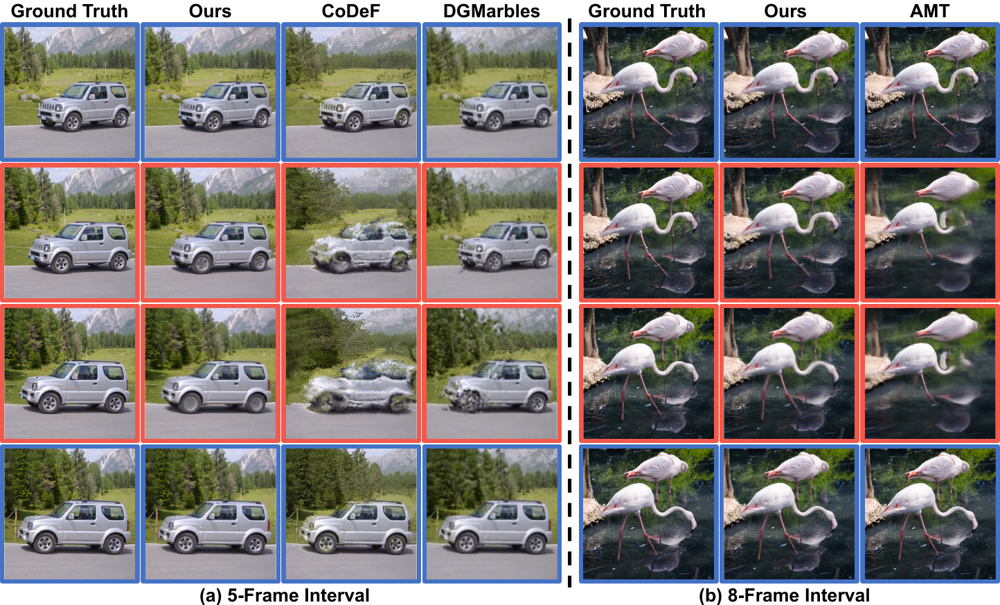

*原论文 Figure 5。蓝框为输入帧，红框为待预测帧；左侧展示 5 帧间隔的车辆场景，右侧展示 8 帧间隔的火烈鸟场景。StreamSplat 在较大时间间隔下仍重建出连续外观。*

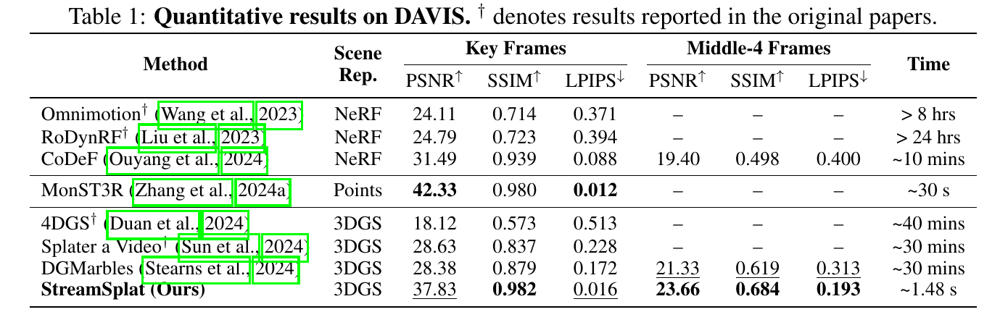

*原论文 Table 1。对比 NeRF、点图和 3DGS 表示。带 † 的数据来自对应论文；Key Frames 衡量输入关键帧，Middle-4 Frames 衡量四个中间帧。*

在关键帧重建上，MonST3R 的 PSNR 最高（42.33），LPIPS 最低（0.012）；StreamSplat 的 PSNR 为 37.83、SSIM 为 0.982、LPIPS 为 0.016，和它接近，但并非每项都最佳。表中时间栏约为 1.48 秒；正文另报告动态重建单帧约 0.049 秒，并称相对优化式基线可快 1200 倍，两种数字对应的统计口径不同。表中的逐场景优化方法耗时为数十分钟至数小时。中间四帧上，StreamSplat 的 PSNR 23.66、SSIM 0.684、LPIPS 0.193，优于表中 CoDeF 和 DGMarbles 的中间帧结果。这说明双向动态表示的主要优势体现在未观测时间的重建，而非所有关键帧静态指标都超过专门方法。

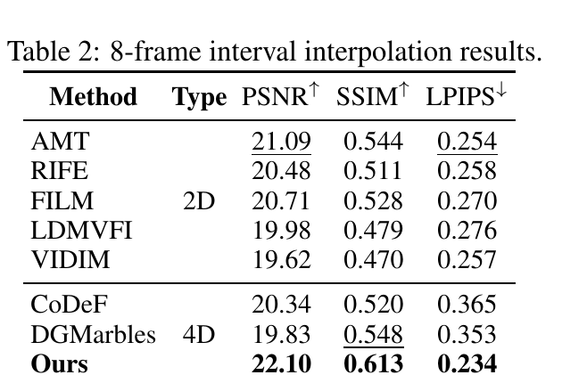

*原论文 Table 2。与 2D 视频插帧及 4D 重建方法比较；StreamSplat 在 PSNR、SSIM、LPIPS 三项指标上均列于表中首位。*

8 帧间隔时，StreamSplat 达到 22.10 dB PSNR、0.613 SSIM 和 0.234 LPIPS。AMT 是表中次好的 2D 方法，PSNR 为 21.09、LPIPS 为 0.254；CoDeF、DGMarbles 两种 4D 基线也低于 StreamSplat。这个设置比较稀疏输入下的中间帧重建，不能据此推断相机轨迹精度或任意场景的定位效果。

#### 时间连续性与长时间渲染

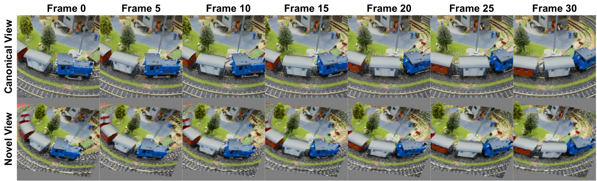

*原论文 Figure 6。顶部以帧 0、5、10、15、20、25、30 展示规范视角下的连续变化；底部展示同一时刻序列从新视角的渲染结果。*

该示例用同一 Gaussian 场景在多个时间点和视角渲染，说明场景表示不局限于输入帧相机。图 4 追踪的初始 Gaussian 在改变视点、尺度、运动、遮挡和模糊时仍能维持身份；这为“融合后是否保留跨帧几何”提供了直观证据。它属于选定样例的可视化，不能代替跨序列统计。

### 4.3 静态场景重建

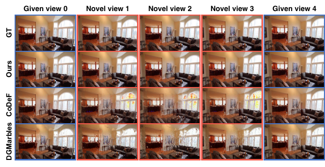

*原论文 Figure 7。蓝框是给定视角，红框是新视角；StreamSplat 的结果在该场景中保持更连续的颜色和几何，CoDeF 与 DGMarbles 出现可见伪影。*

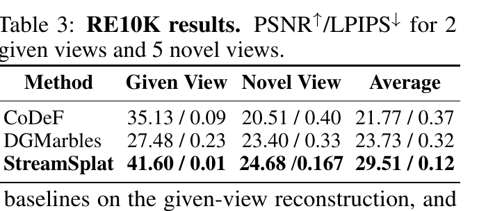

*原论文 Table 3。报告两个给定视图、五个新视图及平均 PSNR/LPIPS。*

表 3 聚焦动态方法：给定视图上 StreamSplat 达到 41.60 dB PSNR，明显高于 CoDeF 的 35.13 和 DGMarbles 的 27.48；新视图上为 24.68 dB，也高于两种动态基线。完整静态与动态对照以及静态方法的新视角结果见附录 B。对于没有相机位姿输入的动态方法，论文使用相对时间戳渲染新视图，这与已知相机位姿的静态方法条件不同。

### 4.4 消融实验

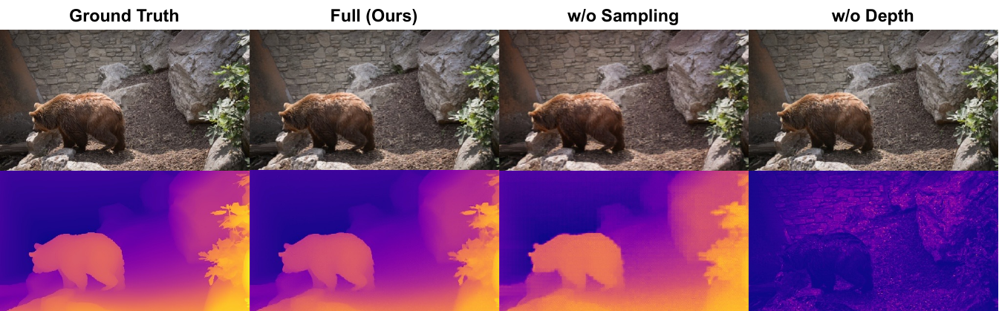

*原论文 Figure 8。第一行比较输入图像与完整模型、无概率采样、无深度监督的外观；第二行显示对应深度图。*

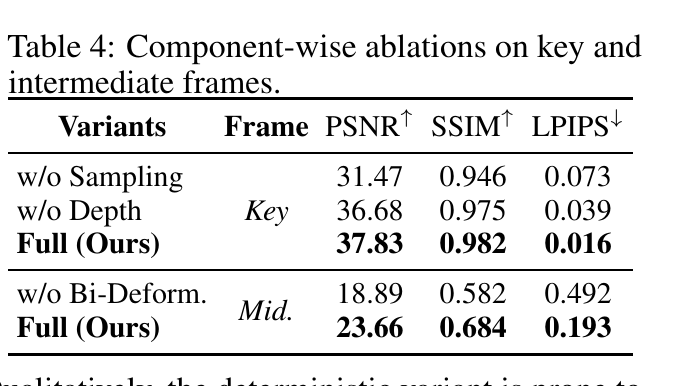

*原论文 Table 4。关键帧消融比较采样与深度监督；中间帧消融比较双向和单向变形。*

去掉概率采样后，关键帧 PSNR 从 37.83 降到 31.47，下降 6.36 dB；作者观察到确定性位置更容易陷入深度方向的局部极小值，重建变模糊。去掉伪深度监督时，PSNR 为 36.68，数值下降较小，但 Figure 8 的几何与深度图明显失真，论文认为网络把深度和 RGB 信息纠缠起来。中间帧去掉双向变形后，PSNR 从 23.66 降至 18.89，LPIPS 从 0.193 上升到 0.492；这支持双向关联对长时间间隔插值的作用，更多图像对照见附录 C Figure 13。

## 5 结论

StreamSplat 将无标定视频流转成动态 3DGS：单帧分支以像素锚定、伪深度和概率偏移初始化规范 Gaussian；双帧分支分别预测前向与后向速度和透明度生命周期；在线更新再把两侧 Gaussian 通过透明度和渲染损失软融合。模型无需测试时的逐场景优化，可在任意时间和视角下渲染。

论文在 DAVIS 的中间帧重建、8 帧间隔插值和多个动态基准上报告较强表现；消融表明概率采样和双向变形对关键帧位置质量与中间帧连续性均有贡献。不过，其结果不能解读成通用 SLAM 性能：它未显式输出相机位姿，正交规范坐标把相机运动与物体形变交由同一动态表示解释。

## 附录 A 背景：3D Gaussian Splatting

3DGS 用一组带位置、协方差、透明度和颜色的三维 Gaussian 表示场景。一个 Gaussian 在空间点 $\mathbf x$ 的透明度贡献为

$$
\alpha(\mathbf x)=\alpha\exp\!\left(-\frac12(\mathbf x-\boldsymbol\mu)^T\mathbf\Sigma^{-1}(\mathbf x-\boldsymbol\mu)\right).
$$

协方差通过旋转和尺度参数化，投影到图像后按深度排序并做 alpha compositing。若第 $i$ 个投影 Gaussian 的颜色和透明度为 $\mathbf c_i,\alpha_i$，像素颜色可写成 $\mathbf C=\sum_i\mathbf c_i\alpha_i\prod_{j<i}(1-\alpha_j)$。动态 3DGS 再给规范 Gaussian 增加时间变形，例如位置可写成 $\hat{\boldsymbol\mu}_t=\boldsymbol\mu+\boldsymbol\mu(t)$。StreamSplat 具体采用速度积分和透明度生命周期函数，因而除位置外，物体出现、消失也由同一 Gaussian 参数化。

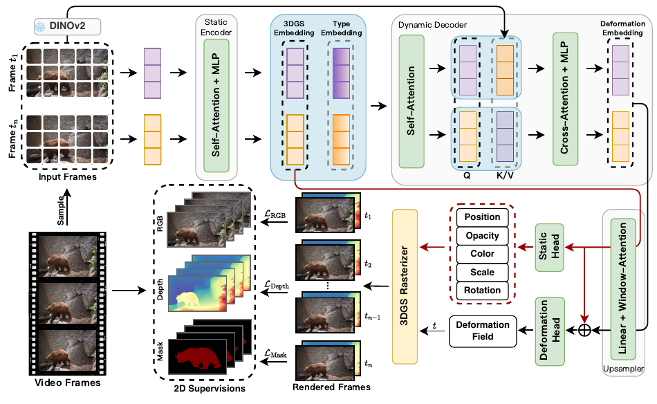

*原论文 Figure 9。静态 RGB-D 编码、DINOv2 特征、动态解码、Gaussian 参数头与渲染器之间的关系；该图补充图 2 的高层流程。*

## 附录 B 实现细节

静态图像 token 输入为 RGB 加一通道伪深度，分辨率 $288\times512$，patch size 为 8，特征维度为 768。静态编码器和动态解码器各有 10 层、12 个注意力头；动态解码器 drop-path 为 0.1。两层窗口注意力上采样器将 token 扩大 16 倍，并把维度由 768 降至 192；静态头是线性层，形变头是两层 MLP。训练总轮数分别为 50 和 70，损失权重为 MSE 1.0、LPIPS 0.05、深度 0.05、掩码 3.0。论文表 9 也列出优化器、学习率、warm-up 和混合精度配置，置于许可说明之后以保留原文附录顺序。

动态解码器对两帧静态嵌入添加可学习的 source/target 类型嵌入，先进行联合自注意力，再让上一帧嵌入读取当前图像的 DINOv2 特征、当前帧嵌入读取上一帧特征，之后经前馈层得到两帧的形变嵌入。上采样后的形变 token 与对应静态 Gaussian token 拼接，再由 MLP 输出速度和透明度参数。该双向结构使两个方向共享同一对帧的信息，但各自预测不同的位移与创建时刻。

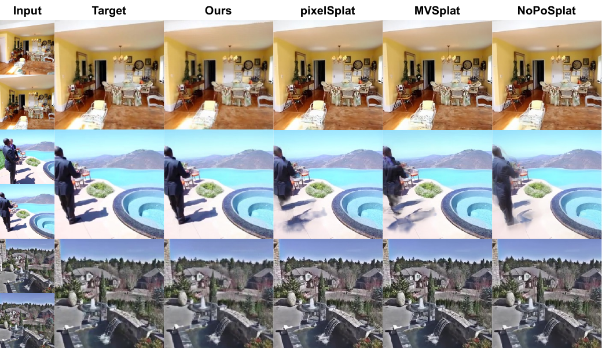

*原论文 Figure 10。输入、目标与 StreamSplat、pixelSplat、MVSplat、NoPoSplat 的静态重建对比。*

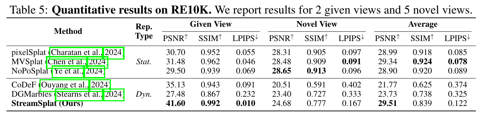

*原论文 Table 5。给定视图、五个新视图及平均 PSNR、SSIM、LPIPS；Stat. 和 Dyn. 分别为静态与动态表示。*

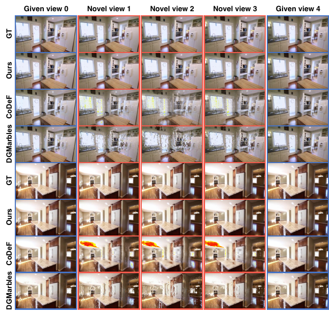

*原论文 Figure 11。给定视图和多个新视图的比较；StreamSplat 在示例中的颜色与结构更连贯。*

表 5 中给定视图的静态方法最高 PSNR 为 MVSplat 的 31.48，低于 StreamSplat 的 41.60；新视角合成则由 NoPoSplat 的 28.65 领先，高于 StreamSplat 的 24.68。StreamSplat 在动态方法中取得较好结果。这使方法的优势更准确地落在统一处理动态场景和未标定输入上，而非所有静态新视角指标都领先。

## 附录 C 更多实验结果

附录 C 汇集静态场景、跨数据集动态视频、消融和零样本新视角合成的补充证据。RE10K 的静态方法对照见附录 B 的 Table 5 及 Figures 10、11；这里补充视频数据、未见数据集的相机条件和更多动态样例。

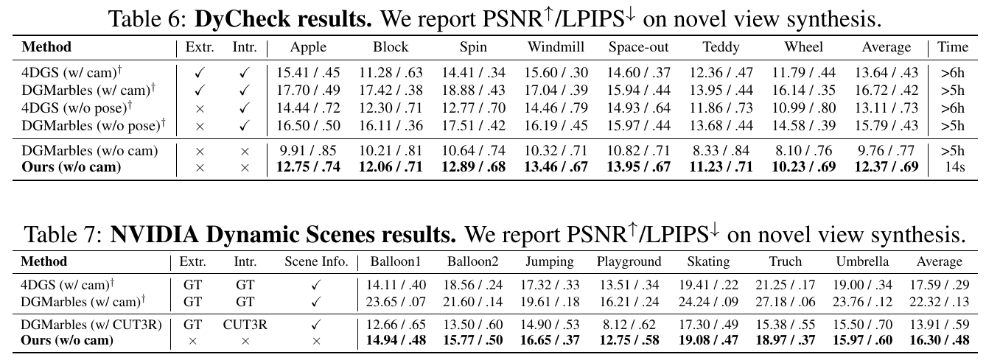

*原论文 Tables 6、7。指标为 PSNR/LPIPS，表中注明是否使用真实相机位姿、内参和场景信息。*

### 跨数据集视频重建

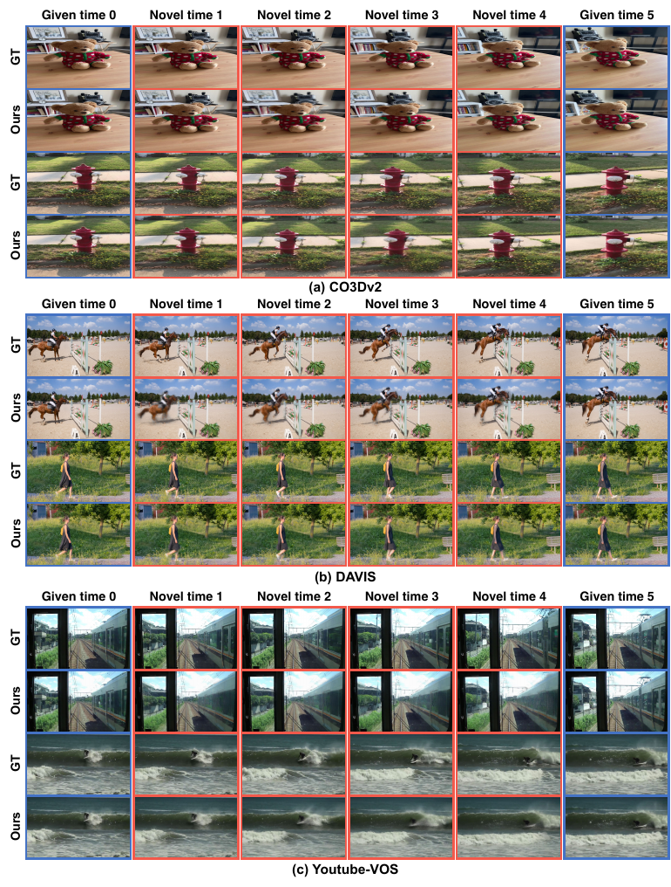

*原论文 Figure 12。多个数据集上按 8 帧间隔重建；蓝框为输入、红框为预测帧。*

Figure 12 将 8 帧间隔结果扩展到 CO3Dv2、DAVIS 和 YouTube-VOS，展示了动态对象、反射表面和较大相机运动等场景。该图提供定性跨数据集证据，没有新的汇总数值。

### DyCheck 与 NVIDIA Dynamic Scene 零样本评估

DyCheck 使用 7 个 iPhone 场景。为模拟无标定输入，评测固定相机位姿、把运动交由 Gaussian 表达，并对所有方法使用固定内参。StreamSplat 不输入相机参数，平均为 12.37 dB PSNR/0.69 LPIPS；同样无相机参数的 DGMarbles 为 9.76/0.77，使用真实内参的 4DGS 无位姿设置为 13.11/0.73。论文报告 StreamSplat 约 14 秒，而逐场景优化方法需 5–6 小时以上，并据此称速度超过 1200 倍。这个比较涉及不同相机信息条件，应按表中的设置解读。

NVIDIA Dynamic Scenes 含 7 个场景。StreamSplat 的平均 PSNR/LPIPS 为 16.30/0.48，高于使用 CUT3R 内参的 DGMarbles（13.91/0.59）；该 DGMarbles 设置还使用真实相机位姿和场景元数据。StreamSplat 仍低于同时使用真实相机参数的 4DGS（17.59/0.29）及 DGMarbles（22.32/0.13）。所以这些零样本结果支持“无相机输入时优于相应无标定动态基线”，不支持“超过具备真实相机参数的所有方法”。

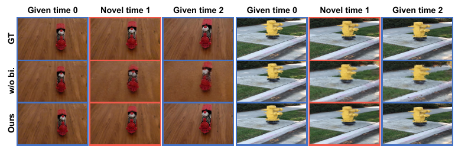

*原论文 Figure 13。比较无双向变形和完整模型在两个时序场景的给定帧与中间帧。*

定性消融与主文 Table 4 的数值相符：缺少双向变形时，中间帧会出现更明显的形状和颜色误差；完整模型更能保持帧间对应结构。这是所示场景的视觉比较，主文表格给出量化差异。

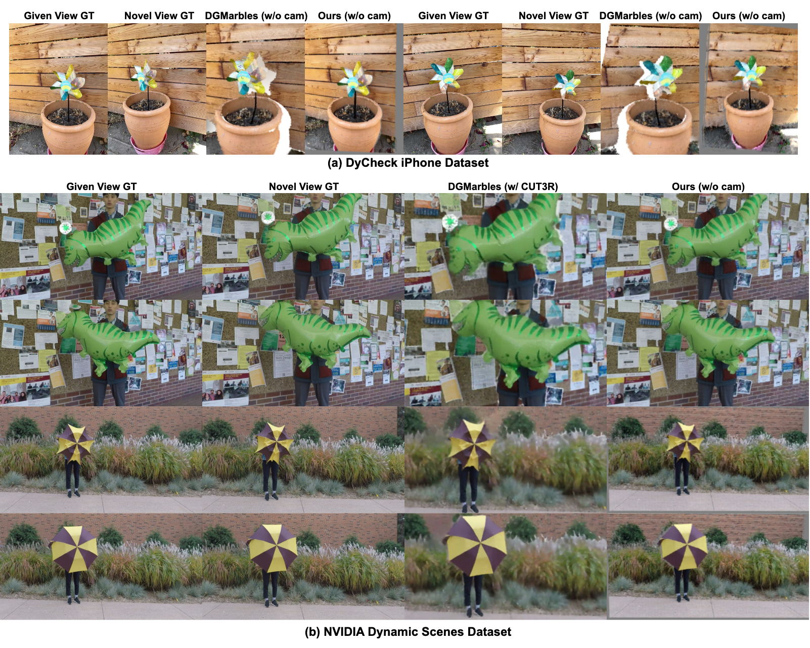

*原论文 Figure 14。上半部分展示 DyCheck 花盆场景，下半部分展示 NVIDIA Dynamic Scenes 的恐龙气球与雨伞场景；比较给定视图、目标视图、DGMarbles 与 StreamSplat 的渲染。*

### Gaussian 持久性与拓扑变化

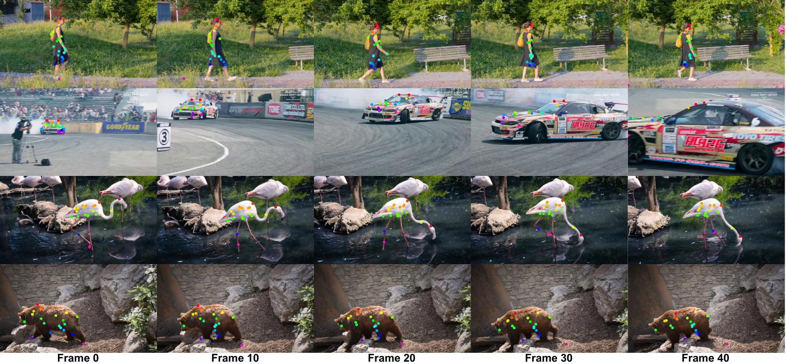

*原论文 Figure 15。多个颜色标记的 Gaussian 从初始帧向后传播，用于观察在线融合后不同区域是否仍保留身份。*

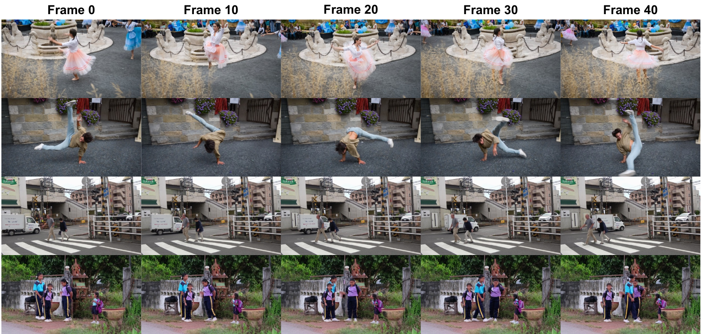

*原论文 Figure 16。DAVIS 中舞蹈、杂技、行人进出遮挡以及多人互相遮挡等片段的重建结果。*

作者用 Figure 16 展示大幅肢体变化、自遮挡、细结构遮挡和多人相互遮挡下的定性结果；图中重建能保持较清晰的外观和相对连续的几何。它说明透明度生命周期可处理 Gaussian 的淡入淡出，但仍是选取片段的可视化，不等于所有拓扑变化都被恢复。

### 单帧推理耗时

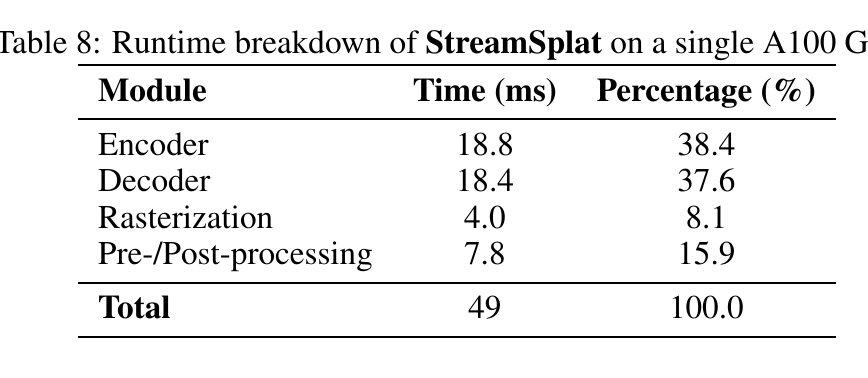

*原论文 Table 8。编码器、解码器、光栅化和前后处理共约 49 ms/帧。*

编码器耗时 18.8 ms（38.4%），解码器 18.4 ms（37.6%），光栅化 4.0 ms（8.1%），前后处理 7.8 ms（15.9%），总计 49 ms。主文所称近实时约 0.049 秒/帧即来自这一单张 A100、默认测试分辨率下的分解，不能直接视为其他硬件上的速度保证。

## 附录 D 设计讨论

### 正交投影与未知相机模型

正交规范空间让模型不必将未知内参作为显式输入，且能统一处理针孔、广角和鱼眼来源的视频；相机运动及透视缩短由 Gaussian 变形近似。附录以 DyCheck 的 Windmill 场景比较：DGMarbles 无相机条件下 PSNR 为 10.61，StreamSplat 为 13.46。作者还报告将 DGMarbles 焦距扰动 10% 会明显降低结果。此证据说明正交表示在这些设置中可行，不能推出正交模型在所有近距离强透视场景都无失真。

### 透明度与速度限制

恒定透明度难以处理新出现或消失的表面，消融可见其会产生重影和模糊；时间透明度允许 Gaussian 随生命周期衰减。速度被限制在 $[-1,1]^3$，作者的解释是：一个帧间隔位移达到 1 已接近跨越整张图像，通常意味着相邻帧几乎没有重叠；再扩大范围会更接近视频生成任务，而不是由相邻观测约束的重建。这个范围是模型实现设计，不是一般运动物理规律。

### 重建与生成的边界

StreamSplat 的表示受输入帧和重建损失约束；时间变化由固定 Gaussian 的几何变形及透明度控制，未从随机过程生成新内容。稀疏的 5/8 帧间隔评测用于测试大时间间隔下能否保持几何和外观。尽管如此，它的任务定义仍是重建：不能把可任意时间渲染误读为可无条件生成未来场景。

## 附录 E 局限

第一，模型依赖外部单目伪深度，细节和深度边界处的噪声可能带来几何误差；自适应损失权重只能降低不可靠监督的影响，不能消除伪深度依赖。第二，动态解码器每次只以两帧窗口训练，快速运动或长时间遮挡会使较早帧信息丢失。第三，正交投影虽适配未知内参，但近距离强透视仍可能造成相机模型不匹配和残余变形。作者提出未来加入轻量相机估计、透视感知细化，并探索跨更长历史选择和融合 Gaussian 的方法。

## 附录 F 数据与模型许可

论文列出的训练数据许可为：CO3Dv2 使用 CC BY-NC 4.0，RealEstate10K 使用 CC BY 4.0，DAVIS 使用 BSD 3-Clause，YouTube-VOS 使用 CC BY 4.0；预训练模型 Depth Anything V2 列有 Apache-2.0 与 CC BY-NC 4.0，DINOv2 列有 Apache-2.0 与 CC BY 4.0。具体使用仍应遵循各数据集和模型发布方的许可条款。

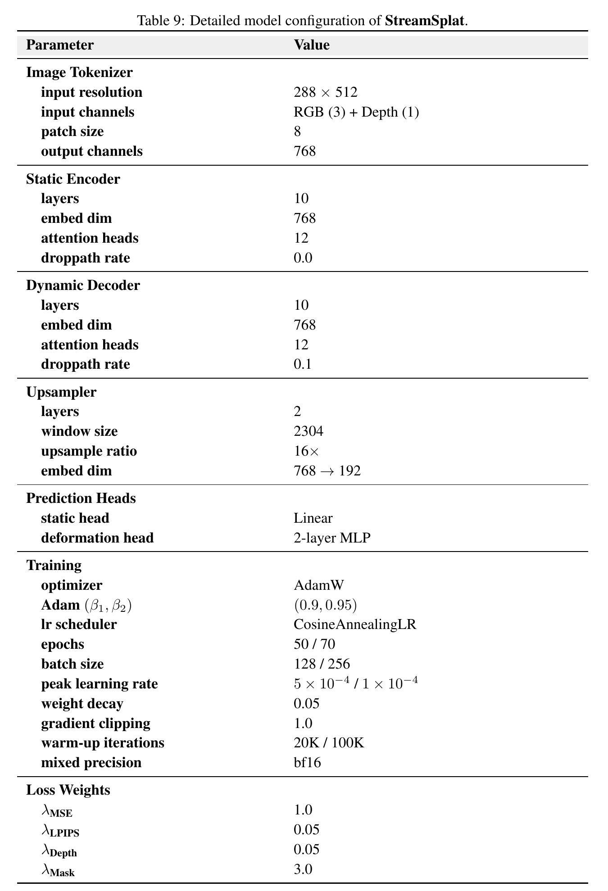

*原论文 Table 9。附录末尾的模型配置表，包含编码器结构、训练配置与损失权重。*
