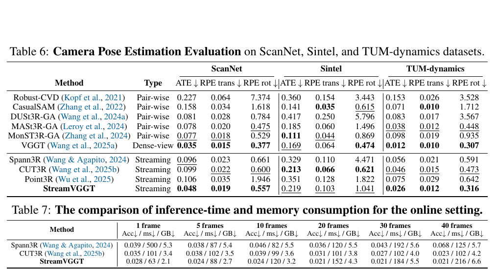
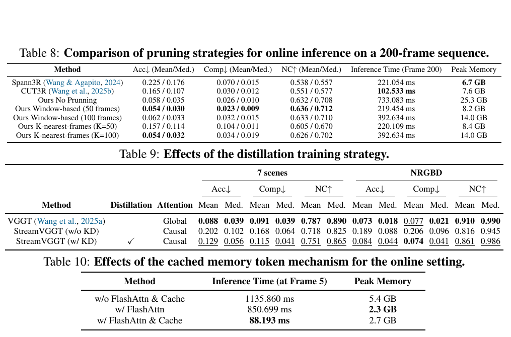
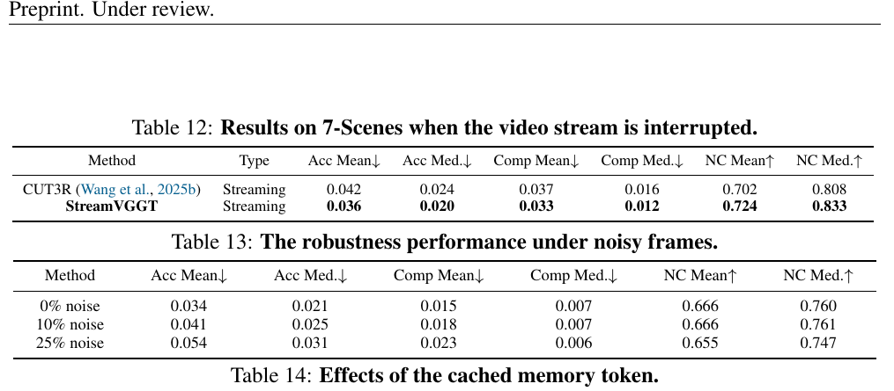
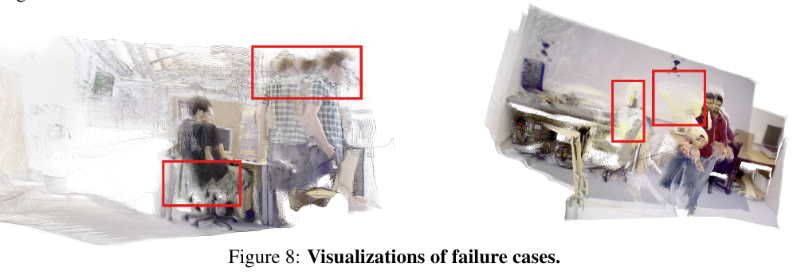

# StreamVGGT 论文解读

> Dong Zhuo、Wenzhao Zheng、Jiahe Guo 等，*Streaming 4D Visual Geometry Transformer*，发表于 ICLR 2026。本文依据 arXiv v2（2026 年 3 月 31 日）全文与附录。 [论文页面](https://arxiv.org/abs/2507.11539v2) · [PDF](https://arxiv.org/pdf/2507.11539v2) · [项目页](https://wzzheng.net/StreamVGGT/) · [代码](https://github.com/wzzheng/StreamVGGT)

StreamVGGT 要解决的是视觉几何基础模型的离线处理方式与视频流输入之间的矛盾。VGGT 把整段图像交给双向 Transformer 联合推理；新图像到来后，如果要让它参与全局交互，模型需要重新处理序列。StreamVGGT 将 VGGT 解码器中的全局注意力改成因果时序注意力，并在推理时缓存历史键和值，使模型可以逐帧预测相机参数、点图、深度和跟踪信息。

这个设计让新帧能够复用已算出的中间表征，但并未把历史状态压成固定大小：缓存会随着帧数增加，单帧延迟与显存也因此上升。论文通过窗口裁剪和近邻帧选择处理更长输入；这些策略带来速度、内存和几何质量之间的取舍。理解这种取舍，有助于把 StreamVGGT 放在流式重建与完整 SLAM 的边界上。

## 从整段推理改为逐帧更新

VGGT 等全局交互模型可以同时查看多个视图，从而让不同帧的预测共享场景线索。代价是它们需要拿到整段输入。逐帧处理则希望第 $t$ 帧到来时，马上给出当前相机和几何估计，而且不能把之前所有帧重新编码一次。StreamVGGT 沿用预训练 VGGT 的视觉几何表征，通过改变解码器的信息流，让推理符合这一因果条件。

*原论文图 1。图像帧经过 StreamVGGT 后进入缓存记忆和几何预测，再输出更新后的场景。示意图说明系统的在线处理路径；它本身不代表缓存大小固定。*

论文将多视图解码方式概括为三类。成对方法只在当前图像对之间传递信息；记忆增强方法把历史压进一个可读写状态；全局交互方法让所有帧彼此注意。StreamVGGT 属于第四种可直接在线执行的因果 Transformer：每帧只读取当前及此前图像，不读取未来帧。

设第 $t$ 帧为 $I_t$，编码器把它映射为图像 token $F_t$。解码器再把各帧 token 转成几何 token $G_t$，预测头从中恢复相机、点图、深度等结果。论文先给出统一表示：

$$
F_t=\operatorname{Encoder}(I_t),\qquad G_t=\operatorname{Decoder}(F_t),\qquad (P_t,C_t)=\operatorname{Head}(G_t).
\tag{1}
$$

其中 $P_t$ 是逐像素三维点图，$C_t$ 是预测置信度。成对模型只融合两张图的特征；记忆模型读取并更新状态 $M_t$；VGGT、Fast3R 等全局模型则让完整帧集合两两交互。StreamVGGT 把最后一种注意力限制到时间因果方向：

$$
\{G_t\}_{t=1}^{T}=\operatorname{Decoder}\!\left(\operatorname{TemporalSelfAttn}(\{F_t\}_{t=1}^{T})\right).
\tag{5}
$$

计算按帧因果排列，当前帧能利用历史但看不到未来。训练时可以一次送入多帧，再用因果掩码阻止未来帧的信息泄漏；推理时则逐帧到达。论文将这种解码器称为时空解码器，因为每层组合帧内的空间注意力与帧间的因果注意力。

*原论文图 3。编码器逐帧提取图像 token，时空解码器交替处理帧内空间关系和历史时间关系，再由相机、点图与深度预测头生成在线结果。训练输入可以包含完整片段，但因果注意力只允许每一帧读取自身及过去。*

## 键值缓存如何复用历史计算

因果掩码解决了“当前帧不看未来”的信息约束，却还没有避免重复计算。若每次都把全部历史帧重新送入解码器，虽然因果结构仍成立，处理开销仍会随视频增长。StreamVGGT 在逐帧推理时保存历史 token 对应的键和值，也就是 Transformer 注意力计算中的 Key 和 Value。当前帧的查询可以直接访问缓存，已处理帧的键值无需重新生成。

论文将这段推理写为：

$$
G_T=\operatorname{Decoder}\!\left(\operatorname{CrossAttn}\!\left(F_T,\{M_t\}_{t=1}^{T-1}\right)\right),\qquad
M_T=\operatorname{TokenCachedMemory}(G_T).
\tag{6}
$$

这里 $F_T$ 是最新帧 token，$M_t$ 表示此前各帧缓存的键值状态。缓存是模型内部的隐式记忆，不等同于显式三维地图；模型从缓存读取表征后预测当前帧输出，并把新一轮产生的状态继续存入缓存。论文以可学习相机 token 标记第一帧作为公共参考，使后续相机和点图增量对齐到同一坐标系。

*原论文图 4。历史帧的时空解码结果被转成键值缓存；新帧只需运行图像编码器，再在缓存上执行时序注意力和空间注意力，最后产生多任务输出。缓存复用减少了重新计算，但缓存仍保留历史 token。*

论文将因果时序结构与全局注意力作复杂度上的对比，强调在线新增一帧不需要重做此前各帧的编码和输出。不过，注意力读取范围仍包含历史缓存，缓存本身也随着序列累积。因此应区分“对旧帧做增量复用”和“每帧成本不随序列长度变化”：StreamVGGT 达成前者，没有自动保证后者。后面的显存和时延实验正好展示了这一点。

## 多任务输出与教师蒸馏

StreamVGGT 沿用 VGGT 的多任务预测方式。相机头估计相机位姿与内参表示；几何头预测点图、深度图及对应置信度；跟踪头基于稠密特征输出二维点轨迹。论文把每帧相机参数写为 $g_t\in\mathbb{R}^{9}$，点图为 $P_t\in\mathbb{R}^{3\times H\times W}$，深度图为 $D_t\in\mathbb{R}^{H\times W}$，点轨迹为 $y_t\in\mathbb{R}^{2\times M}$。多任务结果共享同一组几何 token，因此某一帧的预测能共同依赖因果上下文。

直接从有限标注训练因果学生模型成本较高。论文使用预训练 VGGT 作教师，为相机、深度、点图和跟踪生成伪标签及置信信息，再蒸馏到 StreamVGGT。总损失由相机、深度和点图三项构成：

$$
\mathcal{L}=\mathcal{L}_{camera}+\mathcal{L}_{depth}+\mathcal{L}_{pmap}.
\tag{7}
$$

相机项使用 Huber 损失比较预测参数和目标参数：

$$
\mathcal{L}_{camera}=\sum_{i=1}^{N}\|\hat g_i-g_i\|_{\epsilon}.
\tag{8}
$$

深度项与点图项都用预测置信度调节像素误差，同时约束空间梯度，避免只匹配逐像素数值而忽视局部结构。以深度项为例：

$$
\mathcal{L}_{depth}=\sum_{i=1}^{N}\left(
\|\hat\Sigma_i^D\odot(\hat D_i-D_i)\|
+\|\hat\Sigma_i^D\odot(\nabla\hat D_i-\nabla D_i)\|
-\alpha\log\hat\Sigma_i^D\right).
\tag{9}
$$

点图项将 $D_i$ 换成三维点图 $P_i$，并使用点图置信度 $\hat\Sigma_i^P$：

$$
\mathcal{L}_{pmap}=\sum_{i=1}^{N}\left(
\|\hat\Sigma_i^P\odot(\hat P_i-P_i)\|
+\|\hat\Sigma_i^P\odot(\nabla\hat P_i-\nabla P_i)\|
-\alpha\log\hat\Sigma_i^P\right).
\tag{10}
$$

论文在正文解释这些目标来自教师模型的软预测与置信度，但损失式仍用“ground truth”符号 $g_i,D_i,P_i$ 表示目标。这里将它们理解为训练监督目标；StreamVGGT 的蒸馏实验正是以教师生成的伪标签取代常规逐数据集标注，而不是说所有输入数据都附有相同形式的真值。

网络描述还提到跟踪头输出二维点轨迹，但式（7）的总损失只列出相机、深度和点图三项，没有另列跟踪损失。论文在该处没有进一步说明跟踪头的训练目标，因此这里不补写一个未报告的损失项。

模型基于 VGGT 初始化，保留图像编码器并微调约 9.5 亿参数。网络含 24 层时空注意力模块，训练输入每次从不同场景随机采样 10 帧，长边缩放至 518 像素，使用 AdamW、峰值学习率 $10^{-6}$，训练 10 个 epoch。作者报告训练用 4 张 NVIDIA A800、耗时 7 天。微调数据来自 13 个数据集，包括 Co3Dv2、BlendMVS、ARKitScenes、MegaDepth、WildRGB、ScanNet、Hypersim、OmniObject3D、MVS-Synth、PointOdyssey、Virtual KITTI、Spring 和 Waymo；测试所用 Sintel、Bonn、KITTI、NYU-v2 等被排除在训练集合之外。

## 重建与相机估计结果

论文在 7-Scenes、NRGBD、ETH3D 上评估三维重建。7-Scenes 每个场景使用 3—5 帧，NRGBD 使用 2—4 帧；报告准确度（Acc）、完整度（Comp）和法线一致性（NC）。ETH3D 每个场景随机取 10 帧，并用有效掩码过滤无效点。TUM-Dynamics 则每条序列抽取 50 帧，评估动态环境下的几何重建。

*原论文表 1—3。StreamVGGT 在 7-Scenes 的完整度和法线一致性优于 CUT3R，但平均准确度略差；在 NRGBD 上三项均略优于 CUT3R。ETH3D 的 Overall 数值低于 CUT3R、也低于 VGGT，说明流式模型与离线模型的比较因数据集和指标而异。TUM-Dynamics 的结果则显示其动态场景重建与 VGGT、CUT3R 接近。*

单帧深度评估覆盖 Sintel、Bonn、KITTI、NYU-v2；视频深度评估覆盖 Sintel、Bonn、KITTI，并按序列尺度对齐预测深度。StreamVGGT 在不同数据集上并非所有指标都占优。比如单帧深度表中，它在 Sintel 的 Abs Rel 为 0.254，优于表内其它方法；在 KITTI 上为 0.072，与 VGGT 持平，并优于 MASt3R 的 0.079（Abs Rel 越低越好）。因此，论文支持它是有竞争力的流式几何模型，不能据此推断它在所有任务或域上都超过离线模型。

位姿评估使用 ScanNet、Sintel 和 TUM-Dynamics，报告绝对轨迹误差 ATE、相对平移误差与相对旋转误差，并在与真值轨迹比较前作 Sim(3) 对齐。这种对齐会吸收整体旋转、平移和尺度差异，所以结果描述的是对齐后的轨迹误差，不是原始输出具有绝对米制尺度的单独证明。

*原论文表 6—7。相对其它流式方法，StreamVGGT 在 ScanNet 和 TUM-Dynamics 的 ATE 较低；Sintel 上它的 ATE 高于 VGGT 和 CUT3R。效率表按 1 到 40 帧报告新帧耗时和显存；StreamVGGT 的处理时间从 63 ms 增至 216 ms，显存从 2.1 GB 增至 6.6 GB。耗时测量的是给定长度序列中最后一帧的推理，硬件为单张 A800，输入分辨率约 518×392；不能把表内数值当作与所有运行环境无关的恒定帧率。*

这组效率实验揭示了缓存策略的核心边界：缓存避免重复编码已有帧，但查询集合随历史变长，因而当前帧处理成本和显存继续上升。对中等长度输入，它比重新跑全局模型更适合逐帧输出；面向超长序列时，还需要额外的状态管理。

## 缓存裁剪与蒸馏消融

作者用两类策略控制长序列缓存。一种是**窗口式流式推理**：将视频切成固定长度片段，分别预测点云，再根据相机外参把片段对齐。另一种是**K 近邻帧缓存**：每帧只读取历史中选定的 K 帧。两者都降低长视频的峰值资源需求，但裁剪会丢失上下文，因此要一起看几何指标、推理耗时和显存。

*原论文表 8—10。200 帧测试中，不裁剪缓存需要 25.3 GB、处理第 200 帧约 733 ms；50 帧窗口约 8.2 GB、219 ms。K 近邻缓存的结果随 K 和评价指标而异。表 9 中移除蒸馏后，7-Scenes 与 NRGBD 几何误差明显变大。表 10 显示在第 5 帧，FlashAttention 与缓存一起使用可将推理时间从 1135.860 ms 降至 88.193 ms；其中缓存降低重复计算，FlashAttention 降低注意力内存开销。*

表 8 也说明“有界缓存”并非免费获得。窗口为 50 帧的策略在表中取得较低的准确度、完整度误差和较高法线一致性，但它需要跨窗口配准；K=50 的近邻策略虽然峰值显存为 8.4 GB、耗时约 220 ms，其准确度和完整度却明显恶化。K=100 恢复部分重建质量，资源占用也重新升高到 14 GB。窗口对齐和近邻筛选改变了使用的历史结构，不能简单等同于原始缓存仅做无损压缩。

## 长序列、回环模拟与失败情况

附录把 7-Scenes 中超过 70 帧的序列按每 10 帧抽取评估点，呈现准确度、完整度和法线一致性随时间的变化；还报告视频中断和输入受噪声污染时的结果。中断实验选取每条序列前 50 帧并移除中间连续 25 帧。噪声实验则随机遮挡输入区域，比较 0%、10% 和 25% 遮挡率下的几何指标。

*原论文图 6、表 11。图 6 显示 7-Scenes 长序列中每隔 10 帧采样的重建指标；表 11 将前 50 帧正向播放后再反向播放，测量回到同一帧时的位姿误差。该测试反映重复观测下的轨迹闭合误差，不等同于包含地点识别、回环候选验证和全局后端优化的 SLAM 回环系统。*

*原论文表 12—14。StreamVGGT 在移除中间帧的实验中优于 CUT3R；遮挡比例升高时准确度误差增大，法线一致性略降。表 14 报告 40 帧序列最后一帧的缓存推理耗时由 4.7 s 降至 0.07 s，但其中的 Acc、Comp、Overall 数值与主文 ETH3D 表 2 不一致，不能与表 2 直接拼接成同一评价结论。*

附录给出的失败可视化包括严重动态遮挡和快速自运动，论文将其与轨迹漂移或定位失败联系起来。模型能利用因果上下文减轻局部观测不足，却没有显式的动态物体剔除或可重新优化的全局位姿图，因此对长时间累计误差和极端运动仍然敏感。

*原论文图 8。两组点图中的红框标出动态人物附近及其运动造成的重建异常。论文将这类情形归为严重动态遮挡和剧烈自运动下的漂移或定位失败。*

## 与 STream3R 的附录比较

StreamVGGT 的附录还补充了和 STream3R 的同表对比。对比覆盖 7-Scenes、NRGBD、单帧深度以及 TUM-Dynamics。作者指出 STream3R 用 29 个训练数据集、8 张 A100 训练 7 天；StreamVGGT 用 13 个数据集、4 张 A800 训练 7 天。两组资源数字有助于说明蒸馏方案的训练成本，但训练硬件型号、数据集构成和具体实验不能被简化成一个跨论文的严格算力对照。

*原论文表 15—17。两种模型各有领先指标：在 7-Scenes 上，StreamVGGT 的准确度中位数和法线一致性较好，STream3R 的完整度较好；在 NRGBD 上，STream3R 的准确度和完整度多数指标占优。TUM-Dynamics 也呈现指标交错，结果不支持单一方法在全部任务上全面领先。*

## 方法关系与适用边界

StreamVGGT 的贡献是把 VGGT 的全局双向解码改造成了可因果执行的时空 Transformer，再用键值缓存把训练时的因果注意力行为带到逐帧推理。它沿用预训练几何模型的表征能力，用教师伪标签降低学生模型训练成本，并以多任务预测维持相机与稠密几何之间的联系。

这里的“在线”描述输入到达方式和每帧输出方式。模型能把第一帧作为坐标参考，继续预测后续相机和点图；论文还通过正反播放重复帧考察闭合误差，在这组模拟中报告 0.008 m 平移误差和 0.48° 旋转误差。但系统没有显式的回环检测、位姿图和重定位模块，也未将历史位姿作为优化变量回溯修正。因此，将它称为**流式视觉几何重建模型**比称为完整 SLAM 系统更准确。

对 SLAM 而言，StreamVGGT 展示的是学习式前端可以如何持续给出相机和稠密几何；全局一致性、异常回环验证、地图持久化和长期漂移校正仍需进一步机制。缓存让已算出的信息可复用，但本身并不会判断哪些历史观测应被保留，也不会在重访后重优化历史轨迹。站内的 [VGGT-Long](../vggt-long/index.md) 展示了分块、回环和全局 Sim(3) 优化路线；[DPV-SLAM](../dpv-slam/index.md) 则将回环约束与位姿图后端接入学习式前端。由此可以把 StreamVGGT 看作连接全局前馈几何模型与在线重建系统的一种架构，而非流式 SLAM 问题的终点。
