# StreamVGGT 论文解读

> Dong Zhuo、Wenzhao Zheng、Jiahe Guo、Yuqi Wu、Jie Zhou、Jiwen Lu，*Streaming Visual Geometry Transformer*。本文依据 arXiv v2（2026-03-31，18 页）全文及附录。 [论文页面](https://arxiv.org/abs/2507.11539v2) · [PDF](https://arxiv.org/pdf/2507.11539v2) · [项目页](https://wzzheng.net/StreamVGGT/) · [代码](https://github.com/wzzheng/StreamVGGT)

## 1. 引言

StreamVGGT 针对一个具体矛盾：视觉几何基础模型可以通过多视图交互提高三维重建质量，但许多模型要等整段图像到齐后才能推理。若视频每来一帧就重新输入全部历史图像，计算会重复；若只看当前图像，跨帧几何关系又难以维持。作者将 VGGT 的双向全局解码改为因果时序解码，并缓存已处理帧的键和值，使新帧能够读取历史表征、增量地产生相机与几何预测。

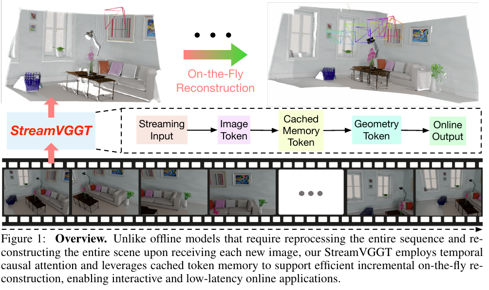

*原论文图 1。流式输入经图像编码、缓存记忆和几何预测后生成在线输出。这里的缓存是网络内部的 token 状态，不是固定大小的显式三维地图。*

图 2 比较了不同序列长度下，最后一帧的推理时延与显存。40 帧时，VGGT 约需 2089 ms、11.4 GB；StreamVGGT 约需 216 ms、6.6 GB。序列变长时，StreamVGGT 的成本仍上升，因为可读取的历史缓存也变长；因此增量推理并不等于每帧成本恒定。

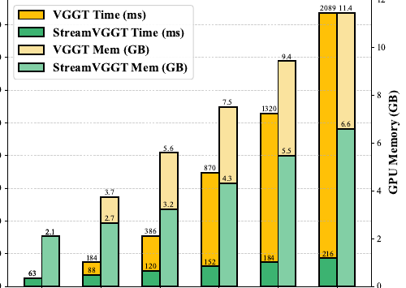

## 2. 相关工作

**传统三维重建。** SfM 通过跨视图特征匹配恢复稀疏三维点，再联合优化相机位姿与点的位置。增量注册、三角化和 Bundle Adjustment 在静态场景中可以获得较高精度，但其全局优化和几何验证步骤不适合低时延地逐帧更新。MVS 利用已知相机位姿建立多视图光度约束以生成稠密深度；NeRF 等方法通过体渲染拟合连续场景表示。论文将这些方法归为较重的离线重建流程。

**学习式三维重建。** DUSt3R 与 MASt3R 从图像对直接预测点图和对应关系，但全局场景仍需对成对结果进行对齐。Fast3R、VGGT 等前馈模型让多个视图在一次 Transformer 推理中交互，免去迭代对齐；然而新帧加入时，离线全局注意力需要重跑完整序列。StreamVGGT 要保留这类多视图模型的上下文能力，同时让信息流符合时间因果关系。

**流式重建。** Spann3R 以可寻址空间记忆融合点图；CUT3R 用循环状态递归读写场景信息；Point3R 将空间指针与几何结构结合。它们都能在线输出，但递归更新可能累积误差。StreamVGGT 选择另一种记忆方式：不把历史压成一个递归状态，而是缓存历史帧的视觉 token，让因果注意力读取历史表示。缓存更直接地保留了上下文，代价是其规模随时间增长。

## 3. 方法

### 3.1 流式三维几何重建

令视频帧为 $I_t\in\mathbb R^{3\times H\times W}$。论文先用下面的统一形式描述多视图重建：

\[
F_t=\operatorname{Encoder}(I_t),\quad G_t=\operatorname{Decoder}(F_t),\quad (P_t,C_t)=\operatorname{Head}(G_t). \tag{1}
\]

编码器把第 $t$ 帧变成图像 token $F_t\in\mathbb R^{N\times C}$；解码器融合跨帧信息，得到几何 token $G_t$；预测头再给出逐像素点图 $P_t\in\mathbb R^{3\times H\times W}$ 和置信图 $C_t\in\mathbb R^{H\times W}$。式（1）只定义公共的数据通路，不意味着所有方法都使用相同的信息连接方式。

作者据此把多视图解码策略分为三类。DUSt3R、MASt3R 等成对方法只在两帧间交互：

\[
\{G_1,G_2\}=\operatorname{Decoder}(\operatorname{CrossAttn}(F_1,F_2)). \tag{2}
\]

每次推理只融合一对图像，不保留可供后续帧使用的持久状态。Spann3R、CUT3R 等记忆增强方法把当前帧特征与上一步记忆 (M_{t-1}) 一起输入，并更新记忆：

\[
G_t,M_t=\operatorname{Decoder}(\operatorname{CrossAttn}(F_t,M_{t-1})). \tag{3}
\]

Fast3R、VGGT 等全局交互方法让所有图像 token 彼此注意：

\[
\{G_t\}_{t=1}^{T}=\operatorname{Decoder}(\operatorname{GlobalSelfAttn}(\{F_t\}_{t=1}^{T})). \tag{4}
\]

这提供了全局上下文，但 token 间的全连接注意力需要随序列增长而重新处理大量历史交互。StreamVGGT 把它替换为时间因果注意力：

\[
\{G_t\}_{t=1}^{T}=\operatorname{Decoder}(\operatorname{TemporalSelfAttn}(\{F_t\}_{t=1}^{T})). \tag{5}
\]

每帧只能读取自己和此前帧，不能读取未来帧。训练时可以并行输入整段序列，通过因果掩码实现这种限制；推理时则按帧输入。论文将式（5）的复杂度优势描述为更适合低时延流式处理。需要把整段训练时的因果注意力与增量推理区分开：在完整序列上，历史 token 仍然参与注意力；在线缓存只避免重新计算已有帧的键和值，并没有让每帧访问的历史长度固定。

### 3.2 带缓存记忆 token 的因果架构

模型沿用 VGGT 的图像编码器、时空解码器和多任务预测头。DINO 图像编码器把图像切成 $N$ 个 $C$ 维 token。时空解码器由空间注意力和时间注意力组成：前者在当前帧内部传播空间信息，后者沿时间读取当前和历史帧。训练时所有帧可同时送入模型，因果掩码确保每一帧的表示不依赖未来帧。

在线推理时，模型把历史帧的键和值缓存为隐式记忆 $M_t\in\mathbb R^{T\times N\times C}$。对最新一帧 $T$，论文将过程写为：

\[
G_T=\operatorname{Decoder}\!\left(\operatorname{CrossAttn}\!\left(F_T,\{M_t\}_{t=1}^{T-1}\right)\right),\qquad M_T=\operatorname{TokenCachedMemory}(G_T). \tag{6}
\]

新帧图像 (F_T) 作为查询，读取之前缓存的键和值，产生当前几何 token (G_T)，再将新 token 转成缓存供后续帧使用。缓存保存的是模型表示，不是可直接编辑或执行回环优化的场景地图。因缓存包含历史帧 token，单帧注意力计算和显存会随序列长度增加；图 2 的时延、显存曲线展示了这个边界。

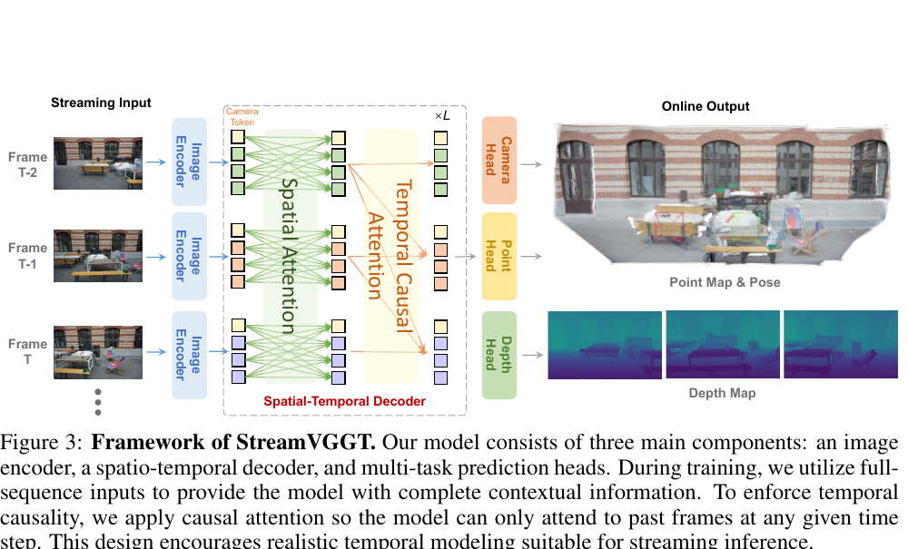

*原论文图 3。训练时可整段输入，但时间注意力受因果约束；每层结合帧内空间信息和历史帧信息。*

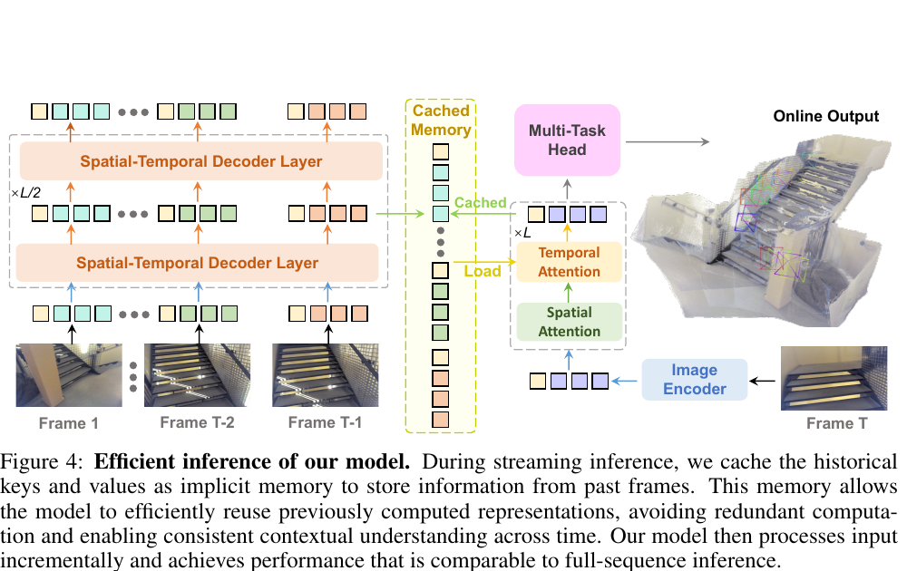

*原论文图 4。逐帧推理只需编码新图像，再读取已有缓存并追加当前帧表示。*

**多任务预测头。** 相机头输出 $g_t\in\mathbb R^9$，由平移、旋转四元数和视场角描述相机参数。点图和深度头分别输出 $P_t\in\mathbb R^{3\times H\times W}$、$D_t\in\mathbb R^{H\times W}$，并给出对应置信图。几何头用 DPT 将几何 token 转为稠密特征，再由卷积层预测点图、深度与置信度；它还产生稠密跟踪特征，供跟踪头预测 $y_t\in\mathbb R^{2\times M}$ 的二维轨迹。可学习相机 token 将第一帧设为坐标参考，使后续帧逐步对齐到共享参考系。

### 3.3 基于蒸馏的训练

**知识蒸馏。** 双向 VGGT 作为教师，因果 StreamVGGT 作为学生。教师为相机参数、深度、点图和跟踪生成伪标签与置信度，避免为每个数据集单独准备全套标注和处理流程；软预测和不确定度也向学生提供监督。论文提到教师生成跟踪伪标签，但所列总损失没有跟踪损失项，正文也未进一步写出它的训练目标，因此不能据此补出跟踪损失公式。

总损失包含相机、深度和点图三项：

\[
\mathcal L=\mathcal L_{camera}+\mathcal L_{depth}+\mathcal L_{pmap}. \tag{7}
\]

相机项对预测参数 \(\hat g_i\) 与目标参数 \(g_i\) 使用 Huber 损失：

\[
\mathcal L_{camera}=\sum_{i=1}^{N}\|\hat g_i-g_i\|_{\epsilon}. \tag{8}
\]

下标 \(\epsilon\) 表示 Huber 惩罚，降低异常参数差值的影响。深度项同时比较逐像素深度误差和空间梯度误差：

\[
\mathcal L_{depth}=\sum_{i=1}^{N}\left(\|\hat\Sigma_i^D\odot(\hat D_i-D_i)\|+\|\hat\Sigma_i^D\odot(\nabla\hat D_i-\nabla D_i)\|-\alpha\log\hat\Sigma_i^D\right). \tag{9}
\]

\(\hat\Sigma_i^D\) 是预测深度置信度，\(\odot\) 表示逐元素乘法，\(\nabla\) 是空间梯度，\(\alpha\) 控制置信度正则项。置信度加权的两项分别约束深度值和局部变化；对置信度取对数的项避免模型单纯把置信度压低来逃避误差。点图损失使用同样结构：

\[
\mathcal L_{pmap}=\sum_{i=1}^{N}\left(\|\hat\Sigma_i^P\odot(\hat P_i-P_i)\|+\|\hat\Sigma_i^P\odot(\nabla\hat P_i-\nabla P_i)\|-\alpha\log\hat\Sigma_i^P\right). \tag{10}
\]

其中 \(\hat P_i,P_i\) 为预测点图和目标点图，\(\hat\Sigma_i^P\) 为点图置信度。论文的损失说明一处称监督目标为 ground truth，一处则说明实际采用教师伪标签；这里按训练策略将公式中的 $(g_i,D_i,P_i)$ 视作监督目标，其中可由教师输出来提供。原文未给出跟踪损失的公式。

## 4. 实验

### 4.1 实现细节

模型沿用 VGGT 架构，设 (L=24) 层时序与空间注意力模块，并集成 FlashAttention-2。初始化来自预训练 VGGT；冻结图像骨干后，微调约 9.5 亿参数，共 10 个 epoch。训练使用 AdamW，前 0.5 个 epoch 线性预热，随后余弦衰减，峰值学习率 (10^{-6})。每次迭代从不同场景随机采样 10 帧；图像最长边缩放到 518 像素，长宽比可变。训练在 4 张 NVIDIA A800 上进行 7 天。

### 4.2 训练数据集

训练数据由 13 个数据集组成：Co3Dv2、BlendMVS、ARKitScenes、MegaDepth、WildRGB、ScanNet、Hypersim、OmniObject3D、MVS-Synth、PointOdyssey、Virtual KITTI、Spring 和 Waymo。它覆盖室内外、合成与真实采集、不同时间尺度的场景。测试所用的 Sintel、Bonn、KITTI、NYU-v2 等数据集被排除在训练集合之外，以评估跨数据域泛化。

### 4.3 三维重建

7-Scenes 每个场景输入 3–5 帧，NRGBD 输入 2–4 帧，报告准确度 Acc、完整度 Comp 和法线一致性 NC，表中同时列均值与中位数。Acc、Comp 越低越好，NC 越高越好。StreamVGGT 在 7-Scenes 的平均 Acc 为 0.129，略差于 CUT3R 的 0.126；Comp 为 0.115、NC 为 0.751，优于 CUT3R 的 0.154、0.727。NRGBD 上 StreamVGGT 的 Acc/Comp/NC 为 0.084/0.074/0.861，均略优于 CUT3R 的 0.099/0.076/0.837。结果显示不同场景集上的优势不完全相同。

ETH3D 每个场景随机抽取 10 帧并用有效掩码排除无效点，报告 Acc、Comp 和两者的 Overall（Chamfer 距离）。StreamVGGT 的数值为 0.609/0.545/0.577，Overall 低于 VGGT 的 0.686，也低于 CUT3R 的 1.411；因为这是误差指标，越低越好。它在 Acc 上优于 VGGT，但 Comp 略差于 VGGT 的 0.443。TUM-Dynamics 每条序列抽取 50 帧，评估动态场景的 4D 重建；StreamVGGT 的 Acc/Comp/NC 均值为 0.085/0.058/0.617，优于 CUT3R 的 0.105/0.060/0.582，但略逊于 VGGT 的 0.050/0.055/0.622。

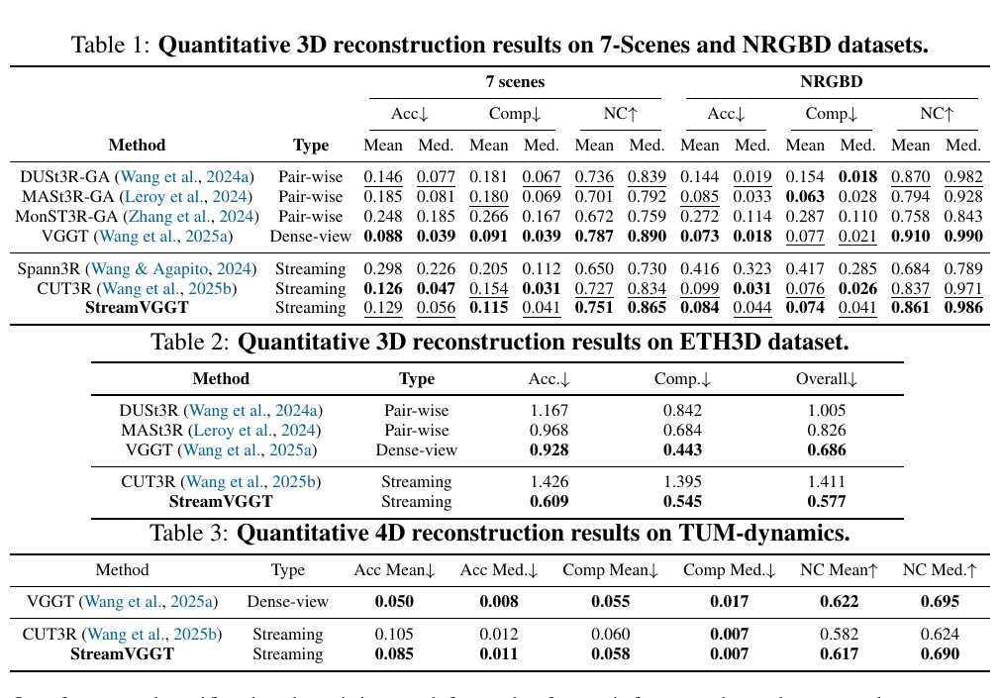

### 4.4 单帧和视频深度估计

单帧深度在 KITTI、Sintel、Bonn、NYU-v2 上评估，四个测试集均不参与训练。Abs Rel 越低越好，\(\delta_{1.25}\) 表示预测深度落在真值 1.25 倍范围内的比例，越高越好。StreamVGGT 在所有四个数据集上优于表中其它流式基线 Point3R；但与离线 VGGT 的对比因数据集不同而交错，例如它在 Sintel、NYU-v2 的两项指标领先，在 Bonn 的 Abs Rel 更低但 \(\delta\) 相同，在 KITTI 上 Abs Rel 相同、\(\delta\) 更高。

视频深度评估按帧考察深度质量，并以每段视频一个尺度对预测深度和真值对齐。StreamVGGT 在 Sintel、Bonn 上优于 CUT3R，KITTI 上则 Abs Rel 为 0.173，差于 CUT3R 的 0.118 与 VGGT 的 0.061。不能据此概括为所有视频数据集都超过离线模型。

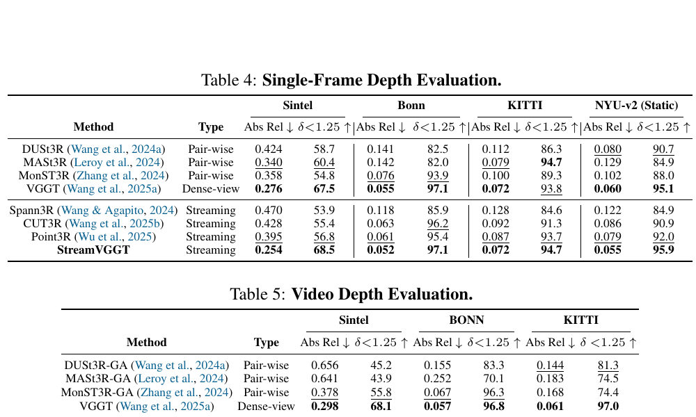

### 4.5 相机位姿估计

相机位姿在 ScanNet、Sintel 和 TUM-Dynamics 上评估，指标为 ATE、相对平移误差 RPE trans 和相对旋转误差 RPE rot；所有轨迹先和真值进行 Sim(3) 对齐，因此误差描述的是对齐后的轨迹，不是未对齐输出的绝对尺度保证。StreamVGGT 在 ScanNet 的 ATE 为 0.048，优于表中列出的流式基线；Sintel 的 ATE 为 0.219，差于 VGGT 的 0.169 和 CUT3R 的 0.213；TUM-Dynamics 的 ATE 为 0.026，优于其它列出的流式方法。不同基准下没有单一方法包揽所有指标。

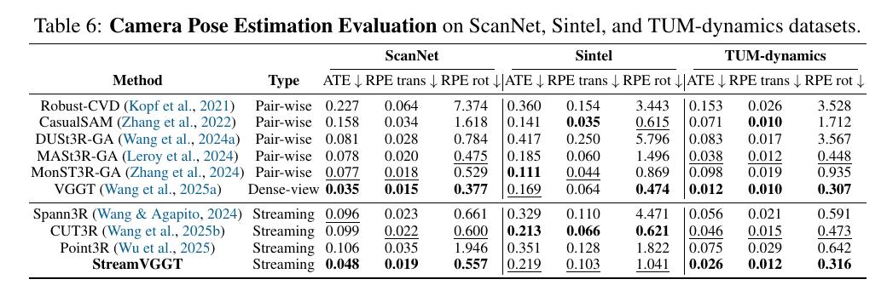

### 4.6 实验分析

**推理时间与显存。** 图 2 评估 A800 上最后一帧的耗时与显存，VGGT 和 StreamVGGT 输入分辨率为 518×392；表 7 另将 StreamVGGT 与 CUT3R、Spann3R 比较，后两者输入为 512×384。StreamVGGT 的表中结果从 1 帧的 63 ms、2.1 GB 增至 40 帧的 216 ms、6.6 GB。图 2 中 VGGT 在 40 帧为 2089 ms、11.4 GB。不同分辨率和测量设置限制了横向比较；可以确定的是缓存减少了对历史帧的重复计算，但没有消除长序列的资源增长。

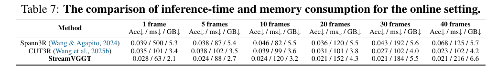

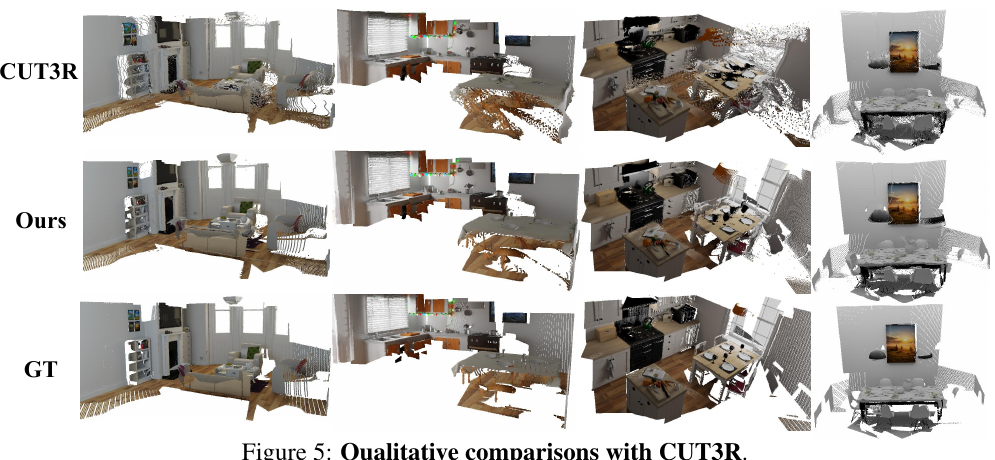

*原论文图 5。图中按 CUT3R、StreamVGGT 和真值展示重建点云。*

**长序列缓存裁剪。** 表 8 在 200 帧序列上比较不裁剪、固定窗口和近邻帧缓存。无裁剪的第 200 帧耗时 733 ms、显存 25.3 GB；50 帧窗口方案为 219 ms、8.2 GB，Acc/Comp/NC 均值为 0.054/0.023/0.636，相比无裁剪的 0.058/0.026/0.632 没有变差。100 帧窗口占 14.0 GB、393 ms。K=50 近邻缓存占 8.4 GB、220 ms，但几何误差较大；K=100 占 14.0 GB、393 ms。窗口策略将视频切块，再用相机外参对齐各块点云；近邻策略只让每帧读取最近 (K) 帧。表中 K=50 的 Comp 均值/中位数为 0.104/0.011，差距较大，原文未解释，故保留为表中报告值而不进一步推断。

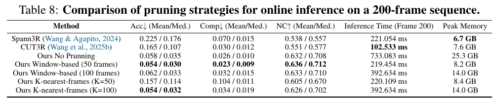

**蒸馏消融。** 表 9 在相同训练预算下比较 VGGT 教师、未蒸馏的因果学生和蒸馏学生。以 7-Scenes 平均 Acc 为例，无蒸馏从 0.129 增至 0.202，NRGBD 从 0.084 增至 0.189；点图、深度相关的其它指标也普遍变差。蒸馏让学生保留因果结构的同时获得较强几何质量，但实验还包括 ETH3D，表格中具体只展示 7-Scenes 与 NRGBD 两列结果。

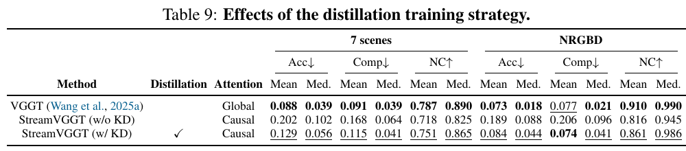

**缓存机制消融。** 表 10 在第 5 帧比较注意力实现和缓存：不开 FlashAttention、不开缓存为 1135.860 ms、5.4 GB；只开 FlashAttention 为 850.699 ms、2.3 GB；两者都开为 88.193 ms、2.7 GB。按表内结果，缓存显著缩短推理时间，FlashAttention 降低注意力显存需求；两者组合的显存高于仅开 FlashAttention，说明速度和峰值显存并非同一个量。

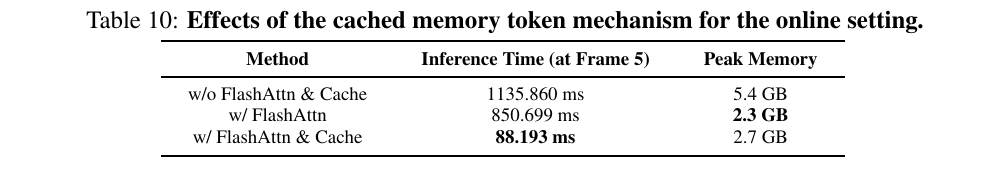

## 5. 结论

StreamVGGT 用因果时序注意力和历史键值缓存实现逐帧三维几何更新，并通过 VGGT 教师蒸馏训练因果学生。作者报告其在多个重建、深度和位姿基准上达到有竞争力的结果，推理延迟低于对照的离线 VGGT；长序列实验同时显示缓存随时间增长，需要通过窗口切分或近邻帧筛选控制资源。论文提出的后续方向是适应动态场景和压缩轻量化记忆。

## 附录 A：额外实验

### A.1 复杂场景下的重建表现

作者用 7-Scenes 中超过 70 帧的序列考察长时序一致性，每隔 10 帧统计 Acc、Comp 和 NC。对回环情形，他们将前 50 帧正向播放后再反向播放，以相同帧重新出现时的相机位姿差作为闭合误差。表 11 中 StreamVGGT 的平均平移误差为 0.008 m、旋转误差为 0.48°，CUT3R 分别为 0.0861 m 和 1.39°。这是重复帧前后位姿一致性的模拟，不是具备地点识别、回环候选验证与位姿图优化的完整 SLAM 回环系统。

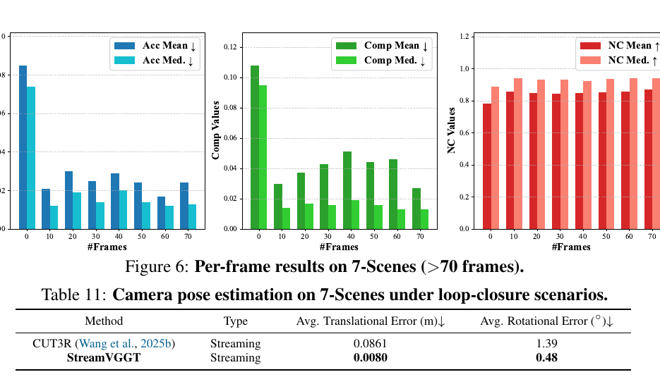

视频中断实验在每条序列前 50 帧中移除中间连续 25 帧。表 12 中 StreamVGGT 的 Acc、Comp、NC 均值为 0.036、0.033、0.724，均优于 CUT3R 的 0.042、0.037、0.702。噪声实验随机遮挡图像区域：遮挡从 0% 增至 25% 时，Acc 均值从 0.034 增至 0.054、Comp 均值从 0.015 增至 0.023，NC 均值从 0.666 降至 0.655，表明输入破坏仍会削弱几何质量。

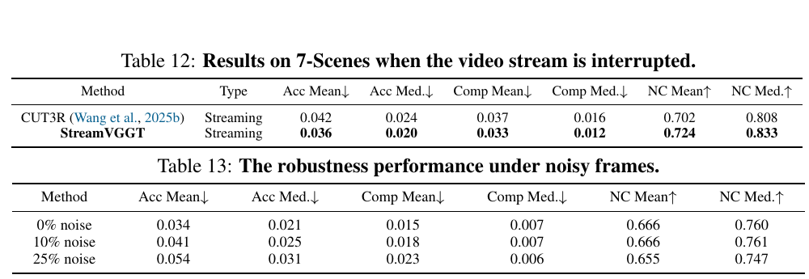

### A.2 更多分析

缓存 token 的 ETH3D 对照中，作者报告完整序列因果注意力与流式缓存的 Acc、Comp、Overall 都是 0.782、0.723、0.753，最后一帧时延分别为 4.7 s 和 0.07 s。表 14 的几何数值与主文表 2（StreamVGGT 为 0.609、0.545、0.577）不一致；论文没有说明归一化或协议差别，因此这组数值应按原表引用，不与表 2 混为同一结果。

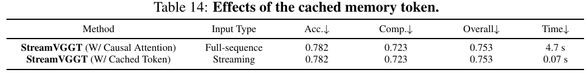

图 7 对比 7-Scenes 上的真值、StreamVGGT 和 CUT3R 点云。图 8 给出失败案例，包含严重动态遮挡和剧烈自运动，作者将其与漂移或定位失败联系起来。

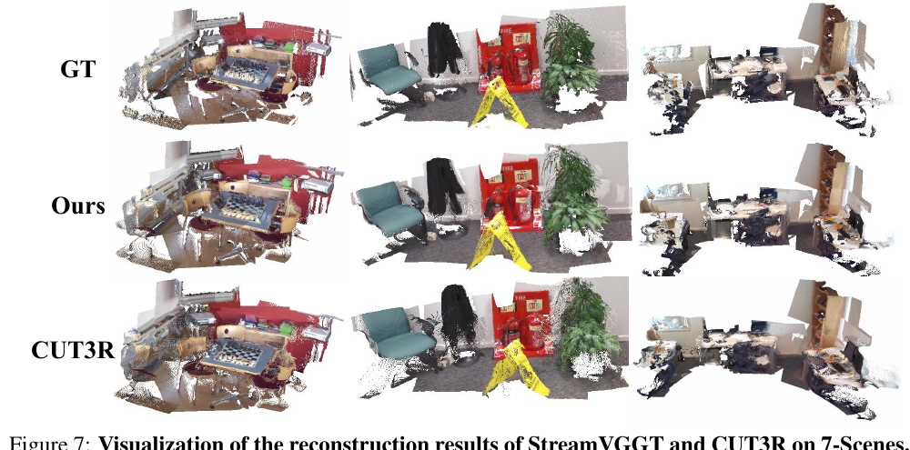

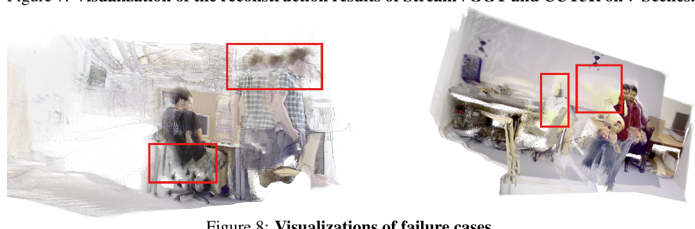

图 9 对比 ScanNet 场景中的 StreamVGGT 和 CUT3R 位姿轨迹；图 10 展示 StreamVGGT 的点图与相机位姿。它们是定性轨迹和重建示例，不能替代表 6 的量化误差。

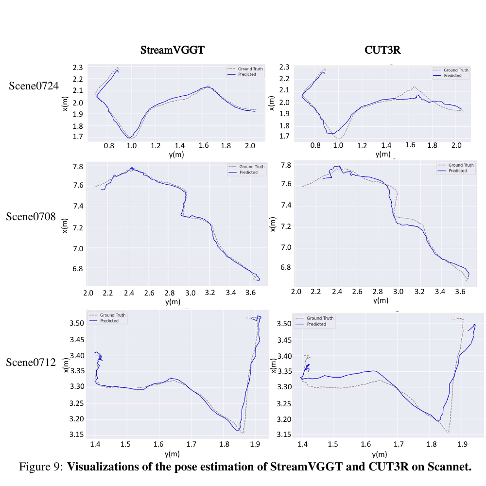

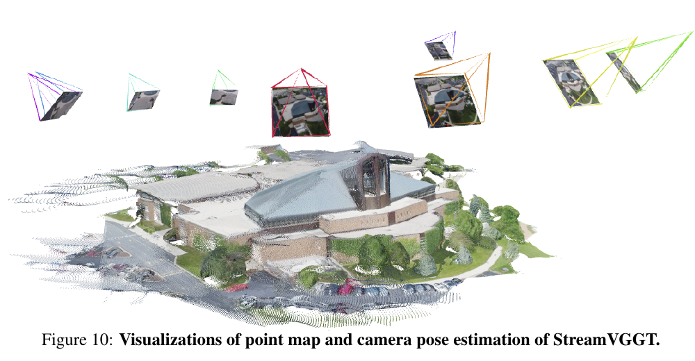

**与 STream3R 的更多比较。** 表 15–17 对比同期流式模型 STream3R。7-Scenes 上两者的均值与中位数表现交错；NRGBD 多数几何指标 STream3R 较好。单帧深度方面，StreamVGGT 在 Bonn 和 NYU-v2 略占优，在 Sintel、KITTI 的 Abs Rel 与阈值准确率不及 STream3R。TUM-Dynamics 上 StreamVGGT 的 Acc 和 NC 略好，Comp 均值更差，中位数相同。由此不能概括为某一方法在所有任务上全面领先。

训练资源方面，论文报告 STream3R 用 29 个数据集、8 张 A100 训练 7 天；StreamVGGT 用 13 个数据集、4 张 A800 训练 7 天。硬件、数据和任务条件不同，这些数字反映各自报告的训练配置，不是严格的算力等价比较。

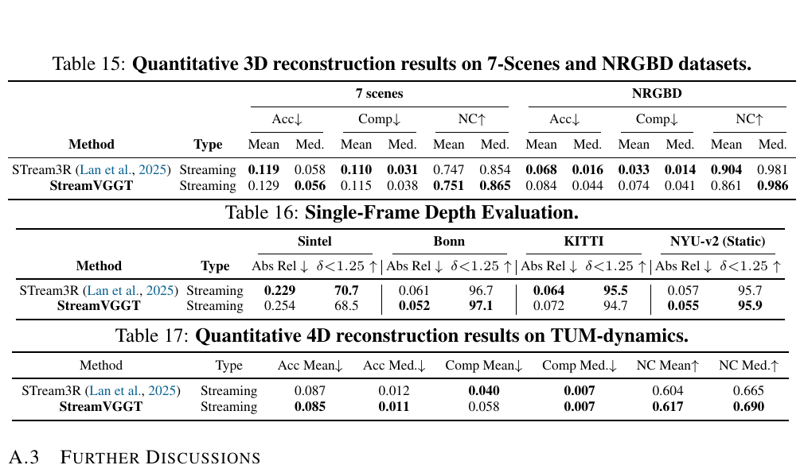

### A.3 进一步讨论

论文明确指出，缓存保留历史帧的信息，也会使长序列的计算和显存持续增长；这给轻量设备和移动端部署带来压力，记忆效率仍是待解决问题。作者将低时延流式几何定位于自动驾驶、机器人和 AR/VR 等应用场景，并将动态场景适应与轻量记忆压缩列为后续方向。

## 参考资料

- Zhuo et al., “Streaming Visual Geometry Transformer,” arXiv:2507.11539v2, 2026. [论文页面](https://arxiv.org/abs/2507.11539v2) · [PDF](https://arxiv.org/pdf/2507.11539v2) · [项目页](https://wzzheng.net/StreamVGGT/) · [官方代码](https://github.com/wzzheng/StreamVGGT)。
