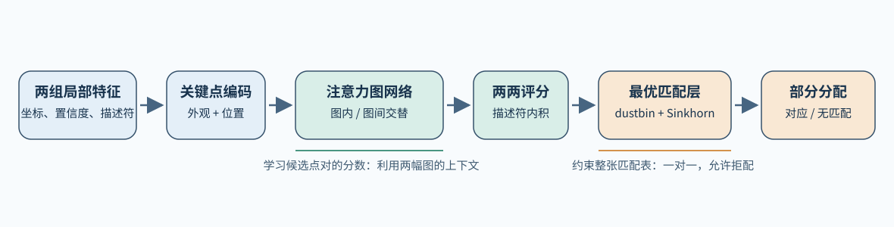
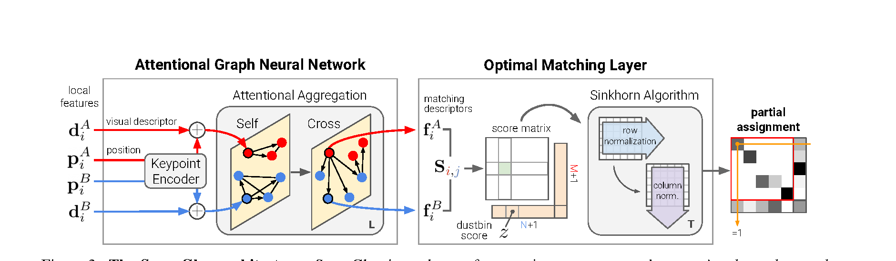
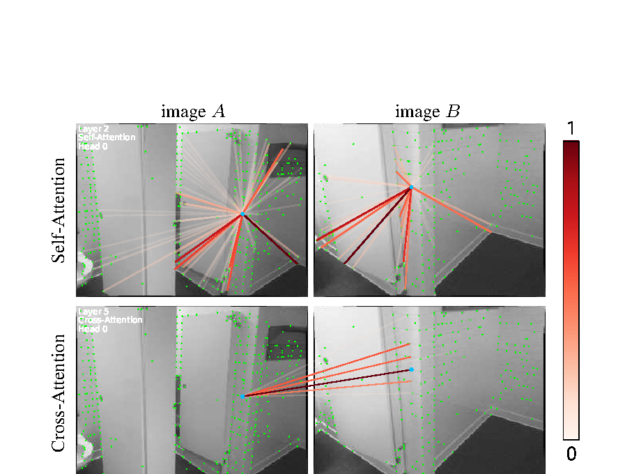
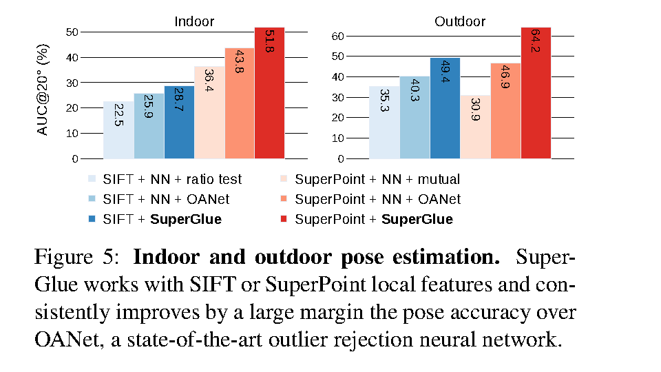
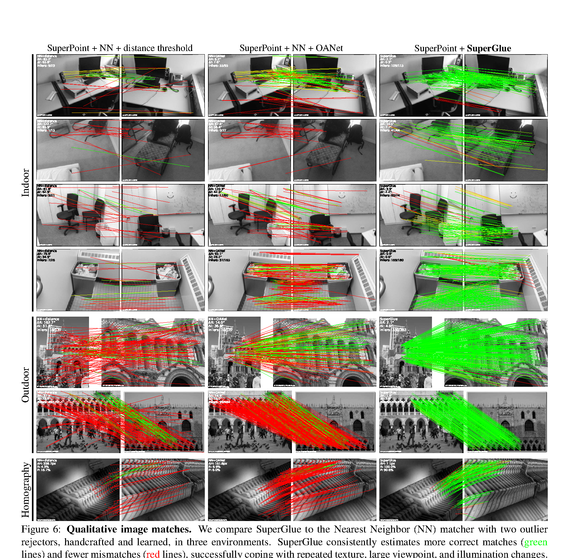

# SuperGlue：注意力与最优传输如何完成局部特征匹配

> 本文介绍 Paul-Edouard Sarlin、Daniel DeTone、Tomasz Malisiewicz 和 Andrew Rabinovich 在 CVPR 2020 的工作 *SuperGlue: Learning Feature Matching with Graph Neural Networks*。文章沿着“局部描述符的歧义 → 图内与图间的信息交换 → 允许无匹配点的部分分配 → Sinkhorn 训练与位姿实验”展开，并对 dustbin 的质量约束作具体推导。

两幅图像都拍到同一栋楼的一排窗户时，每个窗角的局部图像块都很相似。即使特征描述符足够稳定，也可能无法独立判断某个窗角对应哪一扇窗。场景边缘还会出现只在一幅图中可见的点，它们没有真实对应，最近邻搜索却总能找到一个“最相似”的候选。

经典匹配流程通常先独立提取两幅图的局部特征，再做最近邻搜索，接着用互检、比值检验或学习型内点分类器删除可疑匹配，最后用 RANSAC 估计几何关系。这个流程能降低误匹配，但一旦真实对应点没有进入最近邻结果，后续过滤很难把它找回来。互检还主要检查双方是否相互偏好，无法利用图中其他点提供的上下文。

SuperGlue 的切入点是**学习匹配过程本身**。它接收前端已经提取的关键点和描述符，让点在同一幅图以及两幅图之间交换信息，然后对所有候选点对评分，最后在整张评分矩阵上求一个满足容量约束的分配。作者因此把它放在局部特征前端与位姿估计后端之间，称为可学习的 *middle-end*。它不负责重新检测关键点，也不直接输出相机位姿。

这条链路有两个互相依赖的问题。注意力网络要回答“面对当前两幅图，这一对点到底有多可信”；最优匹配层要回答“所有被认为可信的点对能否同时成立”。前者让描述符利用上下文，后者要求每个点至多参与一条真实匹配，并允许点没有对应。两者的输入、输出和约束可以先在同一张图里看清。

图中前半段生成**匹配分数**，后半段形成**部分分配**。图内、图间注意力对分数的作用与 Sinkhorn 对整张表的作用不同；如果只保留其中一半，分别会失去上下文消歧或整体约束。

## 1. 为什么匹配不能只看最近邻

先用一组点贯穿方法。图像 $A$ 中有两个外观相似的窗角 $A_1,A_2$，还有只出现在 $A$ 中的边缘点 $A_3$；图像 $B$ 中有窗角 $B_1,B_2$。前端对每个点给出坐标、检测置信度和局部描述符，SuperGlue 此时还不知道谁与谁对应。为先看清分配难题，假设它处理完这些输入后，产生如下点对分数；数值是讲解用的虚构数值，不是论文实验数据：

| 点对分数 | $B_1$ | $B_2$ |
|---|---:|---:|
| $A_1$ | 0.91 | 0.90 |
| $A_2$ | 0.89 | 0.20 |
| $A_3$ | 0.10 | 0.15 |

逐行选最大值时，$A_1$ 和 $A_2$ 都选 $B_1$。互检会保留 $A_1\leftrightarrow B_1$，却丢掉 $A_2$。如果 $A_1,A_2$ 都应匹配，那么一对一方案 $A_1\leftrightarrow B_2$、$A_2\leftrightarrow B_1$ 的真实点对分数之和是 $1.79$，另一种组合只有 $1.11$。$A_1$ 对 $B_2$ 只是第二高分，放到整张表里却参与了更好的组合。$A_3$ 的两个候选都很弱，还应考虑把它判为无对应。下文会回到这组点，跟踪它们从输入到分配及训练标签的去向。

这个例子先说明**独立选择与联合分配会得到不同结果**。真实图像中还需要判断分数本身是否可靠：重复窗户的多个候选都可能很相似，而 $A_3$ 面对的所有候选都可能是错的。因此，SuperGlue 一方面通过上下文改变这些分数，另一方面给“无匹配”保留出口。

令图像 $A$ 有 $M$ 个关键点、图像 $B$ 有 $N$ 个关键点。每个点的输入由位置、检测置信度和视觉描述符组成：

$$
p_i=(x_i,y_i,c_i),\qquad d_i\in\mathbb R^D.
$$

最终的软匹配矩阵 $P\in[0,1]^{M\times N}$ 需要满足原文式（1）：

$$
P\mathbf 1_N\leq\mathbf 1_M,
\qquad
P^{\mathsf T}\mathbf 1_M\leq\mathbf 1_N.
\tag{1}
$$

第一条限制每个 $A$ 点在所有 $B$ 点上的总匹配质量，第二条限制每个 $B$ 点被所有 $A$ 点占用的总质量。小于号使两侧的点都可以没有对应。若只对每一行做 softmax，行和会被强制为一，也没有列方向的容量竞争；它无法直接产生原文定义的部分分配。

这一表述说明论文并不是在最后简单“选几个最高分”。分数来自网络，分配则是带约束的优化问题。接下来就看这张示意分数表怎样由两张图中的上下文产生，再怎样接受整体约束。

## 2. 两张图中的关键点怎样交换信息

### 2.1 位置进入描述符，但不直接充当几何解

输入的视觉描述符 $d_i$ 通常来自单幅图像。它概括点附近的外观，却不知当前要与哪幅图匹配。SuperGlue 将位置和检测置信度经过一个 MLP 编码，再加到视觉描述符上：

$$
x_i^{(0)}=d_i+\operatorname{MLP}_{\mathrm{enc}}(p_i).
\tag{2}
$$

$x_i^{(0)}$ 是注意力网络中的初始点状态。坐标使网络可以比较点群布局；置信度使检测器对该点可靠性的判断也进入后续计算。这个加法并没有产生相机位姿或极线方程，它只是让网络在处理外观时不丢掉位置证据。

在贯穿例子中，$A_1,A_2,A_3,B_1,B_2$ 各自都执行一次式（2）：前端提供的 $p_i,d_i$ 变成五个 $x_i^{(0)}$。即使两个窗角的 $d_i$ 很接近，位置和置信度仍随各自的 $p_i$ 进入状态；$A_3$ 此时也没有被删除。图 3 左侧的 keypoint encoder 做的正是这一步，后面的交替注意力才开始利用其他点的信息。

论文把两组点放在一张具有两类边的图中。同一幅图里的点彼此通过 **self edge** 相连；不同图像的点通过 **cross edge** 相连。self edge 对应自注意力，允许一个点查看本图的其他点；cross edge 对应交叉注意力，允许它查看另一幅图的候选。两类边都覆盖相应集合中的全部关键点，不预设一个固定的局部邻域。

这里的“图神经网络”可以按消息传递来理解：节点保存点状态，边决定本层可以从哪里收集消息。不同于需要先构建三维场景图的做法，这张图直接由两组已检测的二维关键点构成。

*原论文图 3。从左向右读：两组位置与视觉描述符进入 keypoint encoder，交替通过图内自注意力和图间交叉注意力，得到依赖图像对的匹配描述符；右侧计算点对分数、加入 dustbin，再通过 Sinkhorn 迭代得到部分分配。贯穿例子的 $A_3$ 在右侧可以流向 dustbin。图中 $M,N$ 分别表示两幅图中的关键点数。*

### 2.2 自注意力与交叉注意力承担不同的工作

给定目标点 $i$ 和当前边类型 $E$，其消息是连接到它的来源点的加权和：

$$
m_{E\to i}
=\sum_{j:(i,j)\in E}\alpha_{ij}v_j,
\qquad
\alpha_{ij}=\operatorname{softmax}_{j}(q_i^{\mathsf T}k_j).
\tag{3}
$$

查询 $q_i$ 来自目标点的当前状态，键 $k_j$ 与值 $v_j$ 来自来源点的当前状态。原文式（5）把两端的投影关系写得更明确：设目标点在图像 $Q$、来源点在图像 $S$，其中 $(Q,S)$ 可以是 $(A,A)$、$(B,B)$、$(A,B)$ 或 $(B,A)$，则在第 $\ell$ 个更新模块中

$$
q_i=W_{1,\ell}x_i^{Q,(\ell)}+b_{1,\ell},\qquad
k_j=W_{2,\ell}x_j^{S,(\ell)}+b_{2,\ell},\qquad
v_j=W_{3,\ell}x_j^{S,(\ell)}+b_{3,\ell}.
$$

同一个模块的投影参数用于两幅图中的所有点，不同模块各自学习参数；实际计算有 4 个注意力头。权重 $\alpha_{ij}$ 决定“这一层从哪个点接收多少信息”，它不是最终的匹配概率。自注意力层取 $Q=S$；交叉注意力层取 $Q\ne S$，因而 $A_1$ 的 query 会与 $B_1,B_2$ 的 key 计算权重，收到的是它们的 value。反方向更新 $B$ 点时，目标与来源对调。两侧在同一模块中都读取第 $\ell$ 层状态，再一起产生第 $\ell+1$ 层状态，而不是先更新 $A$ 再让 $B$ 读取已更新的 $A$。

回到这五个点：自注意力模块中，$A_1$ 可以从 $A_2,A_3$ 聚合信息，$B_1$ 可以从 $B_2$ 聚合信息；交叉注意力模块中，$A_1$ 再从 $B_1,B_2$ 聚合信息，$B_1$ 则从 $A_1,A_2,A_3$ 聚合信息。图内消息提供同图布局线索，图间消息提供另一幅图中的候选线索；下一轮图内模块才能利用上一轮图间更新的结果。重复这种更新后，两个外观相似的窗角可能获得不同状态，$A_3$ 也可能得到不支持任何跨图候选的状态。这描述的是网络可能学到的作用，论文没有为窗户或无匹配点设立显式检测规则。

每个消息更新模块把收到的消息与原状态拼接，再做残差更新。原文式（3）可写成：

$$
x_i^{(\ell+1)}
=x_i^{(\ell)}
+\operatorname{MLP}_{\ell}
\left([x_i^{(\ell)}\Vert m_{E\to i}]\right).
\tag{4}
$$

每轮先用图内边更新，再用图间边更新，两幅图对称地处理。公开实现将 `['self','cross']` 重复 9 次：共 9 轮、18 个消息更新模块，每个模块有 4 个注意力头。下文用 $x^{(18)}$ 表示这 18 次更新后的状态，公式里的层编号 $\ell$ 对应其中一次消息更新。残差保留已有点状态，也让后续模块能够叠加新的上下文。原论文图 4 展示的注意力头有的关注近邻，有的关注显著或相似的远处点。

*原论文图 4。上排显示同一幅图内部的自注意力，下排显示从一幅图指向另一幅图的交叉注意力；连线颜色越深，表示该注意力头分配的权重越高。*

论文附录还统计了 100 对 ScanNet 图像中的注意力范围：从第一轮到最后一轮，自注意力与交叉注意力覆盖的空间距离整体缩小了十倍以上。前面几轮先聚合较大范围的布局，后面逐渐关注目标点附近以及可能的对应位置；这是跨样本的平均趋势，中间层会有起伏，并非每个点都按同一条路线收窄。

经过 9 轮图内、图间更新后，网络线性投影得到匹配描述符：

$$
f_i=W x_i^{(18)}+b.
\tag{5}
$$

需要区分 $d_i$ 与 $f_i$。$d_i$ 是前端在单张图中生成的局部视觉描述符；$f_i$ 经过两张图间的交叉注意力，依赖当前待匹配的图像对。同一个 $A$ 点更换另一张待匹配图时，输入描述符可以不变，最终 $f_i$ 却可能改变。SuperGlue 的匹配能力很大一部分来自这种**条件化表示**。贯穿例子的五个输入点到这里变成五个匹配描述符；$f_i^A,f_j^B$ 两两内积，才形成开头 $3\times2$ 表中的六个点对分数。表里的数字不是某一层的注意力权重 $q_i^{\mathsf T}k_j$，而是完整注意力网络输出的匹配分数。

这种构造还符合匹配任务的对称性。关键点作为集合输入，交换 $A_1,A_2,A_3$ 的输入顺序，只会相应交换输出矩阵的行，不会改变物理对应；交换图像 $A,B$，对应的评分矩阵则转置。位置编码、共享投影、按集合聚合的注意力和双侧容量约束共同维持这种性质。论文把它称作对点顺序及图像顺序的等变性；它保证输出跟随输入重排，并不保证预测一定正确。

### 2.3 几何规律从哪里进入

真实对应点是同一三维点在两幅图中的投影。静态场景下，同一图像对的匹配还受到共同相机运动约束。SuperGlue 没有显式求解这些几何量再回头修正描述符；它将二维位置放入点状态，让图内、图间注意力学习哪些空间与外观关系有助于对应判断，再用几何真值构造监督。论文所说的“学习三维世界与几何变换的先验”应按这条链路理解。

这也限定了它的保证范围。网络可能学到对某些视角、结构和训练分布有效的关系，但注意力权重本身不是基础矩阵或位姿估计。即使匹配满足一对一约束，也不意味着所有点对已经通过了同一个极线几何检验。

## 3. 无匹配点怎样进入分配问题

有了 $f_i^A$ 和 $f_j^B$，SuperGlue 用内积计算所有候选点对的分数：

$$
S_{ij}=\langle f_i^A,f_j^B\rangle,
\qquad S\in\mathbb R^{M\times N}.
\tag{6}
$$

论文没有将这些匹配描述符归一化到单位长度，因此向量模长也可以影响匹配分数。$S$ 是尚未施加一对一约束的评分矩阵；每个点对是否被保留，还要看它与其他点对以及“无匹配”选项如何竞争。

SuperGlue 给 $S$ 加一列和一行，形成 $(M+1)\times(N+1)$ 的扩展矩阵 $\bar S$。右侧一列供 $A$ 中的点选择“在 $B$ 中没有对应”；下方一行供 $B$ 中的点选择“在 $A$ 中没有对应”。新增分数统一设为一个可学习量 $z$，包括右下角：

$$
\bar S_{i,N+1}
=\bar S_{M+1,j}
=\bar S_{M+1,N+1}=z.
\tag{7}
$$

把新增位置写成矩阵，扩展分数就是

$$
\bar S=
\begin{bmatrix}
S & z\mathbf 1_M\\
z\mathbf 1_N^{\mathsf T} & z
\end{bmatrix}
\in\mathbb R^{(M+1)\times(N+1)}.
$$

这两处扩展称为 **dustbin**。它们不是两个普通关键点，因为一次遮挡可能让许多点同时无法匹配。假如直接给 $M\times N$ 真实点表的每行、每列都设单位质量，那么 $M\ne N$ 时两侧总质量不等，平衡传输甚至没有可行解；$M=N$ 时虽可求解，却会强制每个点参与真匹配。SuperGlue 采用的 dustbin 构造把“不配”也放进传输表，使扩展问题的总质量相等，同时允许真实点之间的分配行和、列和小于一。这是论文所用的部分匹配构造，并不意味着所有部分传输方法都必须设置 dustbin。论文给扩展分配 $\bar P$ 指定如下行、列质量：

$$
a=(\underbrace{1,\ldots,1}_{M\text{ 个}},N)^{\mathsf T},
\qquad
b=(\underbrace{1,\ldots,1}_{N\text{ 个}},M)^{\mathsf T},
$$

$$
\bar P\mathbf 1_{N+1}=a,
\qquad
\bar P^{\mathsf T}\mathbf 1_{M+1}=b.
\tag{8}
$$

每个真实点仍只拥有或需要一个单位的质量；附加行和列分别有 $N$ 与 $M$ 单位的容量。两边质量总量同为 $M+N$，因此运输问题可以同时满足全部行与列。$N$ 和 $M$ 是容量设计，不是网络预测的遮挡点数量。

右下角为什么也需要分数，可以直接算出来。设真实点之间的总匹配质量为 $s=\sum_{i=1}^{M}\sum_{j=1}^{N}\bar P_{ij}$。普通 $A$ 行一共具有 $M$ 单位质量，其中 $s$ 流向真实 $B$ 列，所以剩下 $M-s$ 流向右侧 dustbin。普通 $B$ 列需要 $N$ 单位质量，其中 $s$ 来自真实 $A$ 行，所以还需要下方 dustbin 提供 $N-s$。下方 dustbin 的行和必须是 $N$，因而右下角必须取

$$
\bar P_{M+1,N+1}=N-(N-s)=s.
\tag{9}
$$

若分配是离散的，$s$ 就是真实匹配的对数；若分配是软的，$s$ 是总匹配质量。右下角没有表达一条真实匹配，它只是使两侧无匹配出口的质量守恒。删去扩展行列后，左上角的 $P$ 恰好允许行和、列和小于一，这就是式（1）的部分分配。

在开头的 $M=3,N=2$ 例子中，$\bar S$ 有四行三列。若只为演示而暂取 $z=0.4$，式（7）的扩展分数矩阵具体是

$$
\bar S=\begin{bmatrix}
0.91&0.90&0.40\\
0.89&0.20&0.40\\
0.10&0.15&0.40\\
0.40&0.40&0.40
\end{bmatrix},\qquad
a=(1,1,1,2)^{\mathsf T},\quad b=(1,1,3)^{\mathsf T}.
$$

$A_3$ 所在的第三行多出“无对应”这一列，$B_1,B_2$ 也各有通向下方 dustbin 行的选择。选择 $A_1\leftrightarrow B_2$、$A_2\leftrightarrow B_1$、$A_3\to\text{dustbin}$ 时，扩展表还需在右下角放两单位质量；所有被占用位置的分数合计为 $0.90+0.89+3z=2.99$。换成 $A_1\leftrightarrow B_1$、$A_2\leftrightarrow B_2$ 则是 $0.91+0.20+3z=2.31$。这只是比较满足质量约束的离散方案，论文实际用下面的 Sinkhorn 求软分配，不能把这组手算结果当成它的精确输出。

## 4. Sinkhorn 如何把分数变成软分配

现在有了点对分数 $\bar S$，也有必须满足的行列质量 $a,b$。传统图匹配若把“两个候选匹配是否彼此兼容”也作为变量，会形成二次指派问题，求解代价很高。SuperGlue 先由图神经网络把点群和跨图上下文汇总到每个点的状态里，再用内积生成线性的 $M\times N$ 点对分数；全局匹配因此成为带容量约束的线性指派。若直接求离散解，它又不能方便地通过匹配监督反向更新前面的网络。论文于是采用熵正则的最优传输：保留一对一约束的整体结构，同时让分配保持连续、可微，并可用 Sinkhorn 高效近似求解。

为了看清求解对象，可以把原文讨论的熵正则问题写为

$$
\bar P^*
=\arg\max_{\bar P\geq0}
\left[\langle\bar S,\bar P\rangle
+\varepsilon H(\bar P)\right],
\qquad
\bar P\mathbf1=a,
\quad
\bar P^{\mathsf T}\mathbf1=b,
\tag{10}
$$

其中 $H(\bar P)=-\sum_{ij}\bar P_{ij}\log\bar P_{ij}$。第一项让高分点对获得更多质量；第二项使解保持软值。$\varepsilon$ 的尺度可以吸收到分数中。令 $K=\exp(\bar S/\varepsilon)$，最优传输的缩放形式为 $\bar P=\operatorname{diag}(u)K\operatorname{diag}(v)$。为了使行和、列和分别达到 $a,b$，交替更新：

$$
u\leftarrow a\oslash(Kv),
\qquad
v\leftarrow b\oslash(K^{\mathsf T}u).
$$

$\oslash$ 表示逐元素相除。调好行后，列和可能仍不对；调好列后，行和又会变化，于是反复迭代。有限次迭代得到的是对目标边缘质量的近似满足。论文配置使用 100 次迭代，最后删去 dustbin 行列，保留真实点之间的软分配 $P$。推理实现再要求 $P_{ij}$ 同时是第 $i$ 行和第 $j$ 列的最大值，并且置信度超过 $0.2$，才输出为离散匹配；因此 Sinkhorn 本身仍是软分配，硬匹配由后续互选与阈值步骤产生。

这里有两种不同的“竞争”。注意力阶段，一个点选择从哪些点接收信息，改变自身的匹配描述符；Sinkhorn 阶段，候选点对在行列容量中竞争，改变最终的匹配质量。在贯穿例子里，前者产生六个真实点对分数，后者同时考虑它们与 dustbin 分数，让 $A_3$ 有机会把质量交给“无对应”列；最后再由行列互选和阈值输出离散点对。前者决定**分数是否看懂了上下文**，后者决定**高分候选能否同时成立**。论文将 Sinkhorn 称为可微的 Hungarian 算法；更精确地说，它求得的是熵正则化后的软分配，并非直接返回离散的 Hungarian 解。

## 5. 训练信号与模型规模

训练时需要同时教会网络“配对”与“拒配”。在已知单应变换的图像对上，可以直接把关键点映射到另一张图；在有相机位姿和深度的场景中，可以利用三维重投影构造真值。设贯穿例子的几何真值确认 $A_1\leftrightarrow B_2$、$A_2\leftrightarrow B_1$，并确认 $A_3$ 在 $B$ 中没有对应，那么监督目标就是提高 $\bar P_{1,2}$、$\bar P_{2,1}$ 和 $\bar P_{3,3}$；最后一个下标 $3=N+1$，指右侧 dustbin 列。

比如某次预测给这三项分配 $0.8,0.7,0.6$，它们对损失的贡献为 $-\log0.8-\log0.7-\log0.6\approx1.09$。若模型把 $A_3$ 的质量错误地给了真实 $B$ 点，$\bar P_{3,3}$ 会变小，惩罚就会增大。这里的概率仅用于说明损失，不是由上面的虚构分数精确运行 Sinkhorn 所得。令 $\mathcal M$ 是可靠对应点集合，$\mathcal I$ 与 $\mathcal J$ 分别是两幅图中可靠判定为无对应的关键点集合。论文的负对数似然损失为

$$
\mathcal L
=-\sum_{(i,j)\in\mathcal M}\log\bar P_{ij}
-\sum_{i\in\mathcal I}\log\bar P_{i,N+1}
-\sum_{j\in\mathcal J}\log\bar P_{M+1,j}.
\tag{11}
$$

真匹配被推向真实点对单元，无匹配点被推向相应 dustbin。这样，“拒绝某个点”不是推理末端补上的启发式规则，而是训练目标的一部分。注意力、点对评分与 Sinkhorn 都可微，因此一个错误的最终分配能够反向改变前面产生分数的方式。

论文实验常把 SuperGlue 与 SuperPoint 结合。SuperPoint 的描述符从半稠密特征图双线性采样；公平比较匹配器时，作者固定视觉描述符前端，只训练 SuperGlue。训练时，SuperPoint 的检测与描述在数据增强后按批次即时执行，并加入随机关键点来满足批次点数、提高鲁棒性。输入位置按图像最大边长归一化。网络中间维度为 256，使用 9 轮图内／图间注意力（共 18 个消息更新模块，每个 4 个头）以及 100 次 Sinkhorn 迭代。推理时用 $0.2$ 的匹配置信度阈值筛选，或把置信度交给后续加权位姿估计。

真值标签也经过筛选，不是把每个点都硬塞进一个匹配格子。作者先计算两图全部检测点之间的重投影误差矩阵；只有在行、列两个方向上都是最近对应，且误差低于阈值的点对，才标为匹配。阈值在单应性、室内、室外训练中分别为 3、5、3 像素。室内与室外的位姿、深度有误差，因此只有最小重投影误差分别大于 15、5 像素的点才标成无匹配；在中间范围、对应含糊的点不硬标负例。Sinkhorn 归一化仍约束未标注位置。这样损失奖励可靠对应和明确无对应点，而不会把不确定的几何标签当成真值。

三种设置都用 Adam，初始学习率 $10^{-4}$，训练至第 90 万步；学习率先保持不变，再按表中因子逐步衰减。表中的点数与批次大小对应 SuperPoint 输入：

| 训练设置 | 每批图像对 | 每图点数 | 开始衰减 | 每步衰减因子 | 模型来源 |
|---|---:|---:|---:|---:|---|
| 合成单应性 | 32 | 512 | 20 万步 | 0.999998 | 单独训练 |
| 室内 ScanNet | 64 | 400 | 10 万步 | 0.999992 | 单独训练 |
| 室外 MegaDepth | 16 | 1024 | 5 万步 | 0.999992 | 以单应性模型初始化 |

SIFT 训练则用每图 1024 点、每批 24 对。三套训练数据分别提供平面变换、室内 RGB-D 几何和室外多视图几何监督，让模型学到适用于不同场景的匹配先验。

两个阶段都要处理大量点之间的关系。图内注意力涉及约 $M^2+N^2$ 个点对，图间注意力、评分矩阵与每次 Sinkhorn 迭代涉及约 $MN$ 个点对。因此，关键点数量直接影响计算和显存。论文报告 1200 万参数，在 GTX 1080 上处理其室内图像对平均约 $69\,\mathrm{ms}$；附录按 500 次运行统计，512 点和 1024 点时分别约为 14.5 FPS 和 11.5 FPS，图神经网络与最优匹配层耗时相近。这些速度依赖硬件、点数和实现，不能视作方法恒定的数值。

## 6. 实验中分别验证了什么

### 6.1 单应性估计检验找回匹配的能力

作者从 Oxford、Paris 的百万张干扰图像中取真实图像，在线施加随机透视、缩放、旋转、平移和光度扰动；训练时不重复使用同一图像对。测试集有 1024 对 640×480 图像，使用 SuperPoint 分数最高的 512 个点，重投影误差小于 3 像素才算正确。已知单应性使匹配精度、召回率及角点重投影误差都能计算；所有比较方法使用相同 SuperPoint 特征，因此可较直接地比较匹配器。

这里的**匹配精度**是输出匹配中正确匹配所占比例，**召回率**是被找回的真匹配占全部真值对应的比例。原文表 1 中，最近邻互检的精度为 $43.8\%$、召回率为 $56.5\%$；SuperGlue 分别为 $90.7\%$ 和 $98.3\%$。这里尤其值得看召回率：只对最近邻候选做内外点分类，很难恢复没进入候选集合的真对应；SuperGlue 从全部点对构建评分矩阵，因而有机会找回它们。

同一实验还分别用 RANSAC 和直接线性变换 DLT 估计单应矩阵，以图像四角的平均重投影误差统计 10 像素阈值内的 AUC。SuperGlue 对应的 AUC 分别为 $53.67$ 与 $65.85$，DLT 在这组受控数据上反而更高。这说明输出点对在该实验中较干净，不意味着所有真实三维场景都可以舍弃鲁棒几何估计。论文还将只用合成单应性训练的模型放到真实 HPatches 图像上测试：视角子集的精度／召回率为 $91.4\%/95.7\%$，光照子集为 $89.1\%/91.7\%$，说明这套训练学到的匹配能力可以迁移到真实图像变化。取舍也应看到：光照子集上 OANet 的精度为 $96.3\%$，高于 SuperGlue 的 $89.1\%$；SuperGlue 的召回率则高于 OANet 的 $83.5\%$。这组数据支持更强的找回能力，不能概括成每项指标都领先。

### 6.2 室内外位姿检验匹配能否服务后端

室内实验使用 ScanNet。作者根据真值位姿和深度计算两图可见区域重叠，只取重叠率 $[0.4,0.8]$ 的宽基线图像对；由此筛得约 2.3 亿个训练候选图像对，训练时每轮从每个场景抽 200 对，测试集为 1500 对。图像缩放至 640×480，每幅图最多取 1024 个 SuperPoint 点（NMS 半径 4 像素）。匹配之后仍使用本质矩阵与 RANSAC 求相对位姿；位姿误差取旋转角误差与平移方向角误差中的较大值，并统计在 5°、10°、20° 阈值内的 AUC。AUC 越高，表示更多图像对落在较小的姿态误差内；论文直接积分累计误差曲线，而不是用粗直方图近似。这个设计检验的是匹配质量能否改善几何估计，而不是让 SuperGlue 取代后端。

表中的**匹配精度**是输出匹配中正确匹配所占比例；**匹配分数**则是正确匹配数除以检测到的关键点数，较高表示更多检测点成为正确对应。匹配分数不按两图实际重叠率校正，因此较低重叠的图像对会自然拉低它。两个指标要和位姿 AUC 一起看：只输出很少匹配可能精度高，却未必提供足够几何约束。

Table 2 的部分结果如下。前三行固定了 SuperPoint 前端，可以直接比较不同匹配器；第四行说明它也能使用 SIFT，不能与前面三行直接归因为同一前端上的匹配器差异。

| 局部特征与匹配器 | AUC@5° | AUC@10° | AUC@20° | 匹配精度 | 匹配分数 |
|---|---:|---:|---:|---:|---:|
| SuperPoint + 最近邻互检 | 9.43 | 21.53 | 36.40 | 50.4% | 18.8% |
| SuperPoint + OANet | 11.76 | 26.90 | 43.85 | 74.0% | 25.7% |
| SuperPoint + SuperGlue | 16.16 | 33.81 | 51.84 | 84.4% | 31.5% |
| SIFT + SuperGlue | 6.71 | 15.70 | 28.67 | 74.2% | 9.8% |

室外实验使用 PhotoTourism，学习型方法在 MegaDepth 上训练，并排除测试场景。训练图像对的重叠率为 $[0.1,0.7]$，测试 11 个场景、重叠率为 $[0.1,0.4]$，图像最长边缩放至 1600 像素，每图取 2048 点。表 3 的位姿 AUC 和匹配指标如下：

| 局部特征与匹配器 | AUC@5° | AUC@10° | AUC@20° | 匹配精度 | 匹配分数 |
|---|---:|---:|---:|---:|---:|
| SuperPoint + 最近邻互检 | 9.80 | 18.99 | 30.88 | 22.5% | 4.9% |
| SuperPoint + OANet | 21.03 | 34.08 | 46.88 | 52.4% | 8.4% |
| SuperPoint + SuperGlue | 34.18 | 50.32 | 64.16 | 84.9% | 11.1% |
| SIFT + 最近邻比值检验 | 15.19 | 24.72 | 35.30 | 43.4% | 1.7% |
| SIFT + SuperGlue | 23.68 | 36.44 | 49.44 | 74.1% | 7.2% |

固定 SuperPoint 前端时，SuperGlue 相比 OANet 的 AUC@20° 从 $46.88$ 提高到 $64.16$，精度从 $52.4\%$ 提高到 $84.9\%$；SIFT 组合也有提升，但不能把跨前端差异当作匹配器的单因素比较。室内外证据共同支持这种中间层能与不同类型的局部特征配合，增益大小仍依赖图像对和评估协议。

论文附录还评估 Aachen Day-Night 绝对定位：每张图最多取 4096 个 SuperPoint 点，将夜间查询图像注册到由白天图像建立的 3D 模型中。定位误差在 1 米、5° 内的查询比例，从 SuperPoint 最近邻互检的 59.2% 提升到 SuperGlue 的 70.4%。这说明匹配增益能传到定位流程；实际位姿仍由 COLMAP 等几何后端估计。

原论文的图 5 把室内与室外的位姿结果画在同一张图中。柱高是 AUC@20°；颜色区分 SIFT 与 SuperPoint 前端，因此应先在同一种前端内比较匹配器。两组中 SuperGlue 都高于相应的最近邻和 OANet 基线。

*原论文图 5。纵轴为 AUC@20°，分别比较 ScanNet 室内场景与 PhotoTourism 室外场景中的局部特征和匹配器组合。*

定量指标概括整体趋势，原论文图 6 展示了具体图像对上的匹配分布。绿色线表示正确匹配，红色线表示错误匹配；三列依次为最近邻加距离阈值、最近邻加 OANet、SuperPoint 加 SuperGlue。可以看到 SuperGlue 在不少室内外例子中保留了更多正确对应，但仍会出现错误连线，所以它的输出仍需要下游几何估计验证。

*原论文图 6。绿色表示正确匹配，红色表示错误匹配；行分别展示室内、室外和单应性场景。*

### 6.3 消融实验检验上下文和分配各自的贡献

Table 4 在同一室内 SuperPoint 设置下逐个拿掉模块，比单纯比较完整模型更能说明论文思想：

| 方法 | AUC@20° | 匹配精度 |
|---|---:|---:|
| 最近邻互检 | 36.40 | 50.4% |
| 无消息传递，保留位置编码与最优匹配层 | 38.56 | 66.0% |
| 去掉交叉注意力 | 42.57 | 74.0% |
| 去掉位置编码 | 47.12 | 75.8% |
| 缩至 3 轮图内／图间更新 | 46.93 | 79.9% |
| 完整 9 轮（18 个更新模块） | 51.84 | 84.4% |

用线性投影代替图网络、保留位置编码器与最优匹配层时，精度有提升，位姿 AUC 却只从 $36.40$ 到 $38.56$。加入上下文网络后才出现主要增益；去掉跨图通信或位置编码，性能又下降。一对一约束可以减少候选冲突，但它无法凭空认出重复纹理中的正确点。上下文改善评分之后，分配约束才能在更好的候选之间发挥作用。这也回扣开头例子：整体分配能让第二高分的 $A_1\leftrightarrow B_2$ 胜出，但只有图神经网络利用图内、跨图线索，才可能先把这组候选评得合理。附录还展示了失败的室内图像对：运动异常或缺少可重复关键点时，SuperGlue 也会失配，说明几何先验无法补回图像里没有的稳定对应。

这些消融改动也有明确边界：“无消息传递”把图神经网络换成单个线性投影，但保留位置编码器和最优匹配层；“无交叉注意力”把交叉注意力模块换成自注意力，参数量与完整模型相同，因而每张图各自推理、成为 Siamese 结构；“无位置编码”只移除位置编码器，网络仍用视觉描述符。这样，表中下降能分别指向上下文传递、跨图交流和位置信息，而不是误读成同时删掉了整个匹配器。

论文还报告，若训练时把梯度从 SuperGlue 继续传回 SuperPoint 描述符网络，室内 AUC@20° 从 $51.84$ 提高到 $53.38$。这个设置冻结检测器，只更新描述符网络，并且不额外添加 SuperPoint 损失。它说明中间层与前端可以联合优化；主表中的比较通常固定描述符前端，不能把额外联训带来的收益算作基础匹配器的效果。

## 7. 方法关系与适用范围

SuperGlue 的关键是让匹配分数依赖**当前这一对图像**：图内关系帮助区分相似点，图间消息提供候选线索，带 dustbin 的最优传输再让各点对与“无对应”选择共同竞争。实验把这条链路分成了可检验的部分：单应性实验显示更多真对应被找回，室内外位姿实验显示这些对应能帮助几何估计，消融实验则说明上下文传递与位置编码的贡献。

它仍依赖前端检测到可重复的关键点；若同一物理位置只在一幅图中出现，匹配器无法创造缺失的另一端，只能把该点送入 dustbin。注意力学到的几何先验也不是显式极线约束，输出满足软的一对一结构，却不能保证所有点对符合某个相机运动。因此，真实位姿实验在 SuperGlue 之后仍使用 RANSAC。计算量还随关键点对数增长，这也成为后续 [LightGlue](../lightglue/index.html) 重新设计匹配器的出发点；站内另有一篇文章专门拆解 [SuperGlue 的注意力图神经网络](../superglue-attentional-gnn/index.html)。

## 参考资料

- P.-E. Sarlin, D. DeTone, T. Malisiewicz, and A. Rabinovich. [*SuperGlue: Learning Feature Matching with Graph Neural Networks*](https://arxiv.org/abs/1911.11763)（[PDF](https://arxiv.org/pdf/1911.11763)）. CVPR, 2020. 文中的模型、参数和实验数据均依据该论文；三对二点的分数示例及 dustbin 质量推导用于解释原文机制。
- [SuperGlue 官方推理实现](https://github.com/magicleap/SuperGluePretrainedNetwork)，用于核对公开配置中的 9 轮 self/cross 模块及推理阈值。
