# TTSA3R 论文解读

> Zhijie Zheng、Xinhao Xiang、Jiawei Zhang，*TTSA3R: Training-Free Temporal-Spatial Adaptive Persistent State for Streaming 3D Reconstruction*，arXiv:2601.22615v4（2026 年 10 月 16 日）。[arXiv 论文页](https://arxiv.org/abs/2601.22615) · [v4 PDF](https://arxiv.org/pdf/2601.22615v4)

TTSA3R 针对固定内存的循环重建中“保留旧几何”和“吸收新观测”的冲突，为 CUT3R 的持久状态加入逐 token 的自适应写入。它同时考察候选状态的变化幅度，以及对应图像区域是否提供了新证据，再将两者融合为状态更新权重。论文报告其短序列精度与基线接近、长序列稳定性更好；遮挡、低重叠和噪声仍会削弱更新信号。

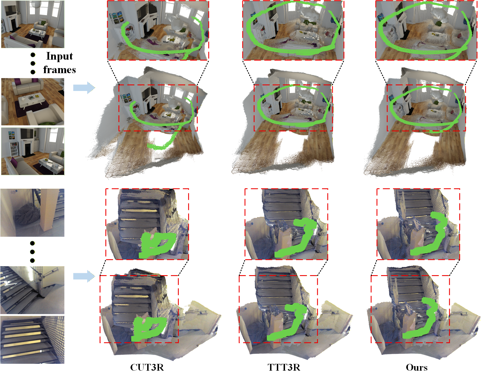

*原论文 Figure 1。CUT3R 的均匀状态替换会出现轨迹漂移和几何变形；TTT3R 能缓和但仍留下伪影；TTSA3R 用时空自适应写入进一步维持轨迹和场景结构。*

## 1 引言

SfM 和 MVS 通过迭代优化恢复相机与几何，NeRF、3D Gaussian Splatting 则常对单个场景优化，迁移到新场景时还需重新处理。DUSt3R、VGGT 等前馈几何模型可以联合推理多个视图，但全局注意力的计算随帧数快速增长，整段视频都输入模型时，长序列会带来显著的内存负担。流式方法逐帧处理观测，减少反复访问历史帧的需要。

流式系统的历史表示方式各不相同。Spann3R、Point3R 使用空间记忆保存三维位置或几何；STream3R、StreamVGGT 等使用因果注意力缓存历史 Key/Value，序列越长缓存越大。CUT3R 则将历史压进固定数量的持久状态 token，因此状态内存不会随视频长度增长。它的代价是每次新观测都必须与有限状态竞争表示空间：低质量或重复观测若持续覆盖旧状态，早期信息会逐渐遗忘，误差随序列累积。

先前的训练自由方法已经尝试控制状态更新。TTT3R 根据当前状态与图像观测之间的对齐置信度为状态 token 计算更新权重；MUT3R 利用多层自注意力提取运动线索，压低动态区域的影响；Rethinking the State Update Gate 则在逐 token 权重外增加帧级标量。TTSA3R 关注另一问题：一个状态 token 的候选表示在相邻帧间是否仍在变化，以及它所关注的图像区域是否提供了新的视觉证据。前者提示状态内容是否稳定，后者检验这种变化是否与观测中的空间信息相呼应。

## 2 相关工作

### 经典重建与前馈几何模型

SfM 与 SLAM 通过特征对应、相机参数估计和几何优化恢复场景；神经辐射场和 3DGS 更强调可渲染的场景表示，通常要针对具体场景优化。DUSt3R 直接回归图像对的点图，MASt3R 增加像素级匹配，VGGT 联合处理多个视图，Fast3R 则面向大规模图像集。它们能够从数据中学习通用几何先验，但全局处理多帧不适合无界长序列的低延迟在线推理。

### 流式重建与自适应状态

流式模型逐步接收图像并生成每帧几何。Spann3R 保存空间记忆，Point3R 以三维位置组织显式指针记忆；STream3R 使用因果 Transformer，WinT3R 采用滑动窗口和相机 token 池；LONG3R 设计时空记忆门控，LongStream 使用关键帧相对位姿和周期缓存刷新，LASER 则将离线模型转为流式过程。不同系统在内存随序列增长、是否需要专门训练，以及历史信息如何压缩等方面并不相同。

在循环式固定状态模型中，CUT3R 的持久 token 能将状态内存限制为常量，但统一替换状态不区分可靠旧几何和噪声写入。周期重置可以减缓漂移，却会丢掉跨重置边界的历史。TTT3R 与 MUT3R 在推理阶段利用注意力产生自适应权重，Rethinking the State Update Gate 将门控扩展至整帧。TTSA3R进一步跟踪候选状态 token 的跨帧变化，并把变化映射回当前图像空间，检验状态变化能否由对应观测支持。它的控制单位仍是状态 token，但依据同时涉及时间稳定性和图像空间上下文。

## 3 方法

TTSA3R 保留 CUT3R 的固定大小持久状态和逐帧解码路径，在状态更新处插入时间掩码与空间掩码。图像编码、解码和任务头先照常计算；之后 TAUM 与 SCUM 根据已有的候选状态、图像 token 和交叉注意力计算掩码，再将候选状态与上一步持久状态按掩码插值。

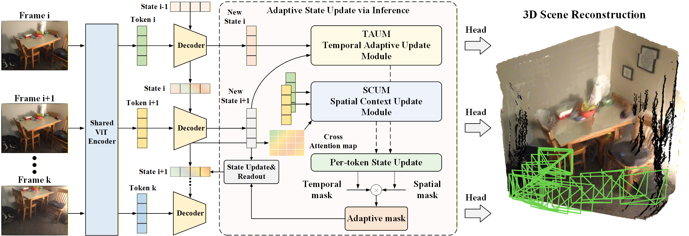

*原论文 Figure 2。共享 ViT 编码器生成图像 token，解码器结合当前图像和前一状态生成候选状态及多层特征；TAUM、SCUM 各自计算逐 token 掩码，经融合后更新持久状态，任务头从解码特征预测深度、位姿和点图。*

### 3.1 CUT3R 推理基础

给定输入帧序列 $\{I_t\}_{t=1}^{T}$，图像编码器将当前帧变为 $K$ 个、维度为 $C$ 的图像 token：

$$
F_t=\operatorname{Encoder}(I_t),\qquad F_t\in\mathbb{R}^{K\times C}.
\tag{1}
$$

$K$ 是图像 patch 数，$C$ 是特征维数。共享权重的 Transformer 解码器将当前图像 token 与前一时刻的持久状态 $S_{t-1}\in\mathbb{R}^{N\times C}$ 一起处理，得到候选状态 $\tilde S_t$ 和多层解码特征 $G_t$：

$$
\tilde S_t,G_t=\operatorname{Decoder}(F_t,S_{t-1}),\qquad
G_t=(G_t^{(0)},\ldots,G_t^{(L)}).
\tag{2}
$$

$N$ 是状态 token 数，$L$ 是解码层数。任务头使用解码特征预测点图、相机位姿和逐像素置信度：

$$
X_t,T_t,\operatorname{conf}_t=\operatorname{Head}(G_t).
\tag{3}
$$

这里 $X_t$ 是图像坐标对齐的点图，$T_t$ 是相机位姿。CUT3R 的状态更新可写为掩码插值：

$$
S_t=\tilde S_t\odot M+S_{t-1}\odot(1-M).
\tag{4}
$$

$M\in\{0,1\}^{N\times1}$ 是沿通道广播的逐 token 掩码，$\odot$ 表示逐元素乘法。CUT3R 将 $M$ 全设为 1，因此每帧都用候选状态完全替换旧状态。TTSA3R 保留插值结构，但以连续值 $M_{\text{final}}\in(0,1)^{N\times1}$ 控制每个 token 的新旧状态比例：门控接近 1 时更换入候选状态，接近 0 时保留更多历史状态。

### 3.2 时间自适应更新模块

TAUM 的目标是判断每个状态 token 的候选表示是否仍在变化。若一个 token 的候选表示连续多帧变化很小，它可能已形成较稳定的几何表征；变化较大的 token 则可能仍需当前观测细化。但变化也可能来自错误估计，因此时间变化只作为一类线索，稍后还要由 SCUM 检查它是否对应当前图像中的空间变化。

对第 $i$ 个状态 token，先计算连续两帧候选状态之差在特征维上的 $L_2$ 范数，再除以所有 $N$ 个 token 的平均变化量：

$$
\begin{aligned}
\Delta_t&=\operatorname{Norm}(\tilde S_t-\tilde S_{t-1}),\\
\hat\Delta_t&=\Delta_t\bigg/\left(\frac{1}{N}\sum_{i=1}^{N}\Delta_t^{(i)}\right).
\end{aligned}
\tag{5}
$$

$\operatorname{Norm}$ 对每个 token 的通道维求 $L_2$ 范数，所以 $\Delta_t$ 对每个 token 给出一个非负变化幅度；$\hat\Delta_t$ 是相对于当前帧所有 token 平均值归一化后的变化量，其 token 均值为 1。这个归一化使阈值表达“比当前场景平均变化大多少”，而不是依赖网络特征的绝对尺度。

作者使用候选状态 $\tilde S_t$ 和上一帧候选状态 $\tilde S_{t-1}$，而不是已经融合后的持久状态 $S_t$。若用融合状态计算变化，低门控 token 因旧状态被保留而自然变化很小，下一帧又会被判断为稳定，从而可能陷入持续冻结。候选状态显示解码器在给定当前观测时想写入什么，因此可以在最终门控之前衡量它的变化。第一帧没有前一帧作比较，直接令 $S_1=\tilde S_1$。

随后用 sigmoid 把归一化变化映射为软掩码：

$$
M_{\text{temp}}=\sigma(\hat\Delta_t-\tau),\qquad M_{\text{temp}}\in\mathbb{R}^{N\times1}.
\tag{6}
$$

论文在所有实验中固定 $\tau=1.5$。当 token 的相对变化超过全体 token 平均值的 1.5 倍时，$\hat\Delta_t-\tau$ 为正，掩码大于 0.5，候选状态获得较大权重；低于阈值时，掩码较低，更多旧状态被保留。它是平滑连续的控制，不会像硬阈值那样直接把 token 更新置零。

### 3.3 空间上下文更新模块

仅看时间变化无法区分“观测支持的几何细化”和“模型自身的噪声波动”。SCUM 检查状态 token 所关注的图像区域是否变化：如果某 token 与图像区域交互较强，而且对应 patch 的特征相较上一帧也有差异，当前帧就更可能为该 token 带来有效空间信息。

首先，在同一 patch 位置上比较连续帧的图像特征，以余弦距离表示变化：

$$
D_t=1-\operatorname{CosSim}(F_t,F_{t-1}),\qquad D_t\in\mathbb{R}^{1\times K}.
\tag{7}
$$

余弦相似度沿特征维计算，输出对每个图像 patch 的差异度。相同 patch 索引不等同于几何对应点；这个信号描述编码器在相邻帧同一网格位置上的特征改变，可能来自相机视点变化，也可能来自场景运动。

然后收集解码器中状态 token 对图像 token 的交叉注意力 logits。状态 $S_{t-1}$ 作查询，当前图像 token $F_t$ 作键和值。对 $L$ 层和 $H$ 个头的 pre-softmax logits 求平均，再取绝对值：

$$
A_t=\left|\frac{1}{LH}\sum_{l=1}^{L}\sum_{h=1}^{H}
\operatorname{Logit}^{(l,h)}(S_{t-1},F_t)\right|,
\qquad A_t\in\mathbb{R}^{N\times K}.
\tag{8}
$$

$A_t$ 的第 $i,k$ 项表示第 $i$ 个状态 token 对第 $k$ 个图像 token 的交互强度。这里平均的是解码器中 softmax 之前的 logits，而不是 softmax 后概率；随后对平均结果取绝对值，因而正负 logits 的符号不再保留。

对每个状态 token，将其与各图像 patch 的交互强度乘以对应 patch 的变化度，在 patch 维取最大值，再经过 sigmoid 得到空间掩码：

$$
M_{\text{spat}}=\sigma\left(\max_{\text{spat}}(A_t\odot D_t)\right),
\qquad M_{\text{spat}}\in\mathbb{R}^{N\times1}.
\tag{9}
$$

$D_t$ 在状态 token 之间共享，计算时按 patch 维广播。乘积要求一个 patch 同时具有较强状态交互和较大特征变化；最大池化让最相关的变化区域决定该状态 token 的空间支持度。因为 $A_t$ 和 $D_t$ 非负，sigmoid 输入非负，所以 $M_{\text{spat}}$ 落在 $[0.5,1)$。因此 SCUM 本身只会保留或调低 TAUM 的权重，最多将其压到一半附近，不会独自把 token 完全冻结。

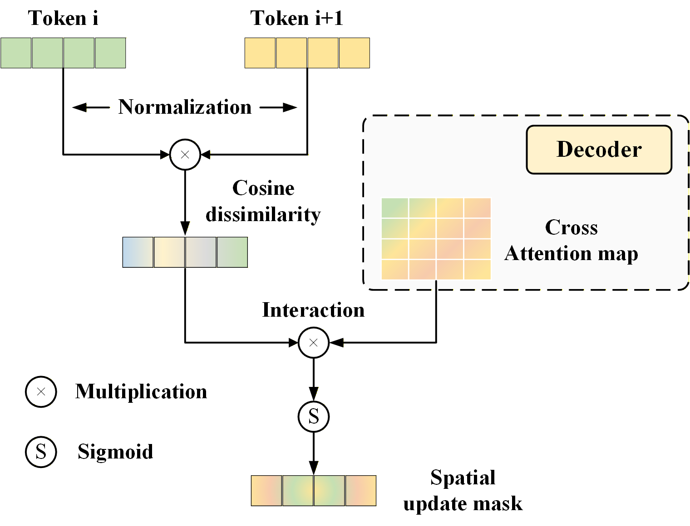

*原论文 Figure 3。图示将跨帧余弦差异与状态—图像交叉注意力相乘，再沿图像 patch 聚合并通过 sigmoid，生成空间更新掩码。*

### 3.4 融合掩码并更新状态

时间掩码指出某状态 token 的候选表示是否仍显著变化，空间掩码判断这种变化是否与当前观测中的相关区域相呼应。作者用逐元素乘法融合：

$$
M_{\text{final}}=M_{\text{temp}}\odot M_{\text{spat}}.
\tag{10}
$$

乘积只有在两种信号都较高时才会产生较大的最终写入权重；若时间变化高但没有图像区域提供相应证据，SCUM 会调低写入。融合后的状态更新为：

$$
S_t=M_{\text{final}}\odot\tilde S_t+
(1-M_{\text{final}})\odot S_{t-1}.
\tag{11}
$$

这一步是新旧状态的凸组合：例如某 token 的最终掩码为 0.2，则新候选状态贡献 20%，旧状态保留 80%。任务头在状态更新前已从解码特征预测当前帧结果，因此门控影响后续帧可读到的状态，不会回头改写当前帧已经输出的深度、位姿或点图。算法对首帧直接初始化状态；后续每帧依次编码、解码、输出任务结果、计算两个掩码并融合更新。

TAUM、SCUM 所用的图像和解码器内部特征都已在主干推理中产生，TTSA3R 不增加可学习参数，也不增加一次前向计算。它仍需在相邻帧间保留上一组候选状态和图像特征，但这些是固定大小的信息，不随总帧数增长。

## 4 实验

### 实验设置

论文评估视频深度、相机位姿和三维重建。深度数据集为 Sintel、Bonn、KITTI，位姿数据集为 Sintel、TUM-dynamics、ScanNet，重建数据集为 NRGBD。基线分为几何优化方法（DUSt3R-GA、MASt3R-GA、MonST3R-GA）、全注意力方法（Easi3R、VGGT）和流式方法（Spann3R、Point3R、CUT3R、TTT3R、STream3R、StreamVGGT、MUT3R）。TTSA3R 将 CUT3R 作为基础循环模型，以训练自由的推理时机制加入门控。

深度指标为 Abs Rel（预测与真值深度差的绝对值按真值归一化）和 $\delta<1.25$（相对误差小于 1.25 倍的像素比例）。表中同时列出 per-sequence scale 和 metric scale：前者按序列尺度对齐，侧重尺度不变的几何误差；后者直接比较绝对深度，保留度量尺度误差。位姿用 ATE、相对平移误差 RPE$_{\text{trans}}$ 和相对旋转误差 RPE$_{\text{rot}}$，先经 Sim(3) 对齐真值。重建以 Accuracy（Acc）和 Normal Consistency（NC）评价。论文的 RPE$_{\text{rot}}$ 表头没有明确说明单位，本文保留指标名称，不自行补单位。

长序列都取各测试序列的前缀：目标长度不足的序列使用全长。Bonn 深度实验选取 balloon2、crowd2、crowd3、person_tracking2、synchronous 五段序列，从第 30 帧开始、步长为 1，长度为 50–500 帧；metric-scale 指标按有效像素数加权平均。长序列位姿实验使用所有 TUM-dynamics 序列（步长 1）和 ScanNet 测试场景（步长 3），长度为 50–800 帧，先做 Sim(3) 对齐再按序列平均。NRGBD 重建每隔一帧采样，输入长度为 50–250 帧，按场景平均 Acc 与 NC。周期重置实验使用 1000 帧 TUM-dynamics 和 500 帧 Bonn。实验在单张 NVIDIA A6000 上运行。

### 4.1 视频深度估计

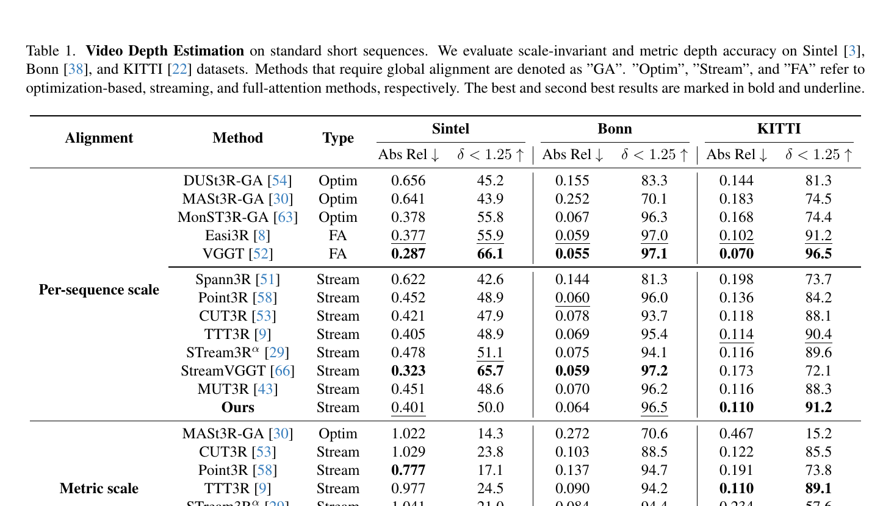

*原论文 Table 1。按 per-sequence scale 与 metric scale 分组；加粗和下划线分别表示最好与次好结果。*

短序列结果显示，TTSA3R 并非在所有数据集和对齐协议上都领先。Per-sequence scale 下，KITTI 流式方法中 TTSA3R 的 Abs Rel 为 0.110、$\delta$ 为 91.2%，略好于 TTT3R 的 0.114 和 90.4%；但在 Sintel 上 StreamVGGT 更好，在 Bonn 上 StreamVGGT 的 0.059/97.2 也略优于 TTSA3R 的 0.064/96.5。Metric scale 下，Bonn 的 TTSA3R 在流式方法中最好（0.079/96.6），但 KITTI 的 TTT3R 略优（0.110/89.1 对 0.111/88.9）。表格反映的是多个协议和基线之间的权衡，不能概括成对所有深度任务的统一领先。

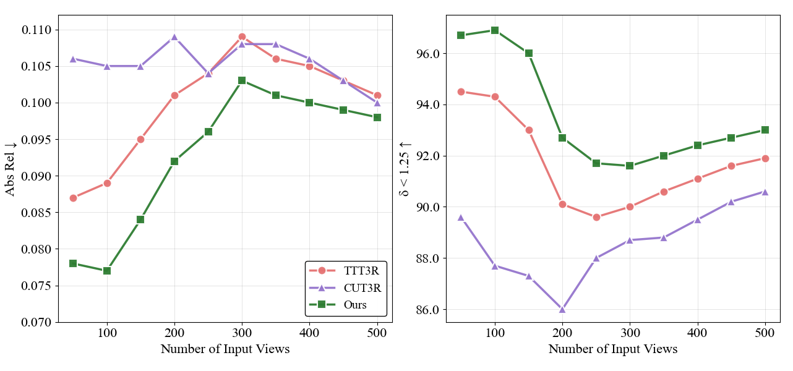

*原论文 Figure 4。Bonn 上输入长度从 50 增至 500 帧，左图为 Abs Rel，右图为 $\delta<1.25$；作者报告 TTSA3R 在各长度上 Abs Rel 最低、$\delta$ 最高。*

长序列 Bonn 曲线中，TTSA3R 在每个测试长度都获得最低 Abs Rel 和最高 $\delta<1.25$。到 500 帧时，$\delta$ 为 93.0%，高于 TTT3R 的 91.9% 和 CUT3R 的 90.6%；Abs Rel 优势在 250 帧后缩小。换言之，模型对每个像素的绝对深度误差与误差阈值内的像素比例都要看，单一指标不能覆盖全部差异。

### 4.2 相机位姿估计

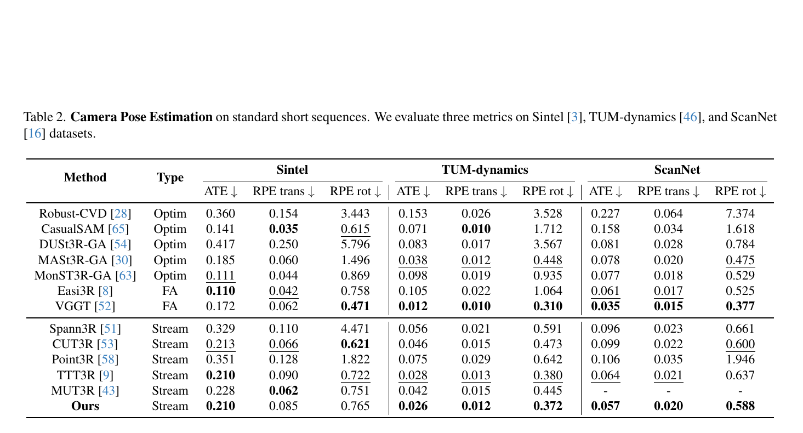

*原论文 Table 2。比较优化式、全注意力和流式方法在 ATE、RPE 平移及 RPE 旋转上的结果。*

在 TUM-dynamics 上，TTSA3R 在流式方法中取得最低 ATE 0.026、RPE$_{\text{trans}}$ 0.012 和 RPE$_{\text{rot}}$ 0.372；ScanNet 上对应为 0.057、0.020、0.588，也优于表中的流式基线。Sintel 上 ATE 0.210 与 TTT3R 并列，但 RPE 平移 0.085 和 RPE 旋转 0.765 并非流式方法中的最好值。全注意力 VGGT 在 TUM-dynamics 与 ScanNet 的 ATE 仍低于 TTSA3R。短序列表因此支持的是：TTSA3R 在部分基准的流式方法中改善显著，且不意味着它超过所有处理范式的所有指标。

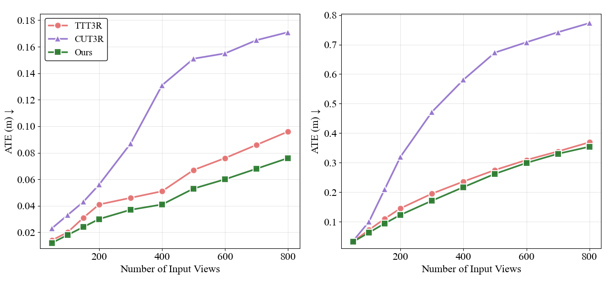

*原论文 Figure 5。TUM-dynamics 与 ScanNet 上随输入帧数增加的 ATE、RPE 平移和 RPE 旋转曲线；TTSA3R 相对 CUT3R 的误差差距随序列增长扩大。*

长序列曲线覆盖 TUM-dynamics 和 ScanNet，作者报告 TTSA3R 在两套曲线的各测试长度上都有最低位姿误差，并且随着序列变长，和 CUT3R 的差距扩大。这里的长序列结果与短序列表并不矛盾：固定状态门控的目标是减少累计漂移，序列越长，避免重复覆盖状态的效果越容易显现。

### 4.3 三维重建

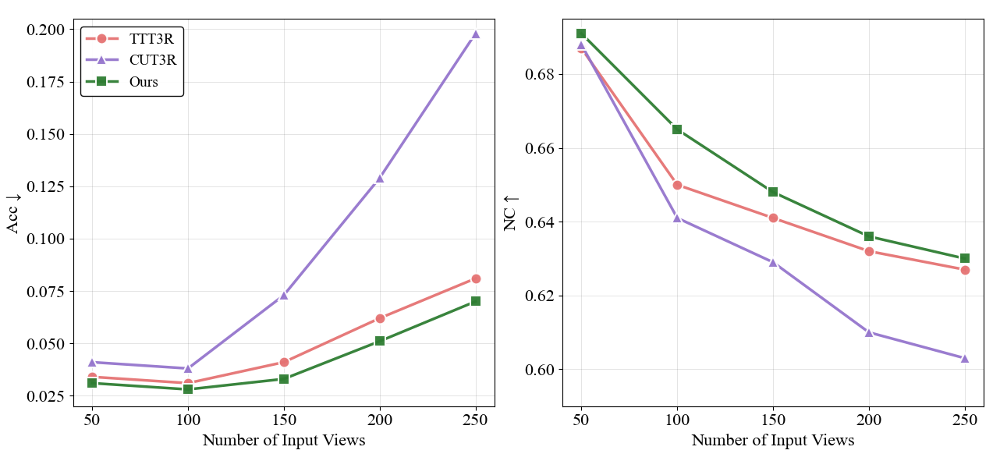

*原论文 Figure 6。左图为点云 Accuracy，越低越好；右图为 Normal Consistency，越高越好。输入从 50 增至 250 帧，曲线比较 CUT3R、TTT3R 与 TTSA3R。*

NRGBD 上，输入长度从 50 增至 250 帧时，论文所说的“误差增加”按相对增量 $(e_{250}-e_{50})/e_{50}$ 计算：TTSA3R 为 1.33，CUT3R 为 3.8。换成末端误差与起始误差之比，分别约为 2.33 和 4.8；每个测试长度上 TTSA3R 都优于 TTT3R。这个比较支撑长序列中的稳定性结论，但只在该重建数据集、帧采样方案和 Acc/NC 指标下成立。

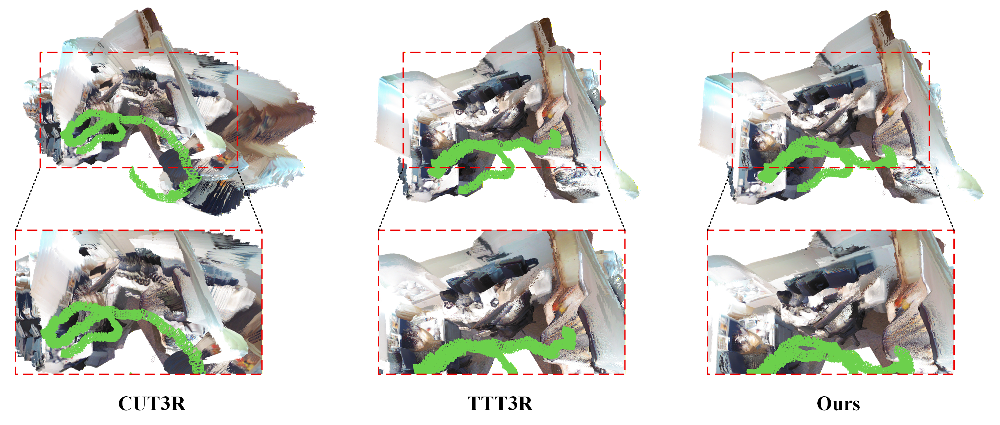

*原论文 Figure 7。图中在场景点云上展示人物轮廓的重建效果；TTSA3R 的人物形状和边界更完整。*

定性结果中，CUT3R 的几何扭曲更明显，TTT3R 减少部分伪影但仍残留表面不一致；TTSA3R 的点云结构更连贯。视觉示例补充了曲线指标无法呈现的局部形状差异，但不能替代定量表格。

### 4.4 消融与进一步分析

#### 两个模块分别贡献什么

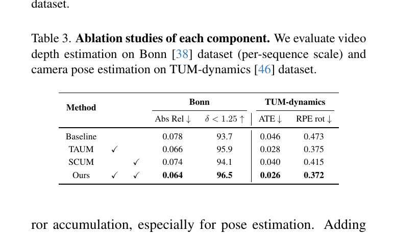

*原论文 Table 3。CUT3R 是基线；TAUM、SCUM 分别加入，再组合评估。Bonn 用 per-sequence scale，位姿使用 TUM-dynamics。*

只加 TAUM，Bonn Abs Rel 从 0.078 降到 0.066、$\delta$ 从 93.7% 升到 95.9%，TUM ATE 从 0.046 降到 0.028、RPE$_{\text{rot}}$ 从 0.473 降到 0.375；只加 SCUM 时这四项为 0.074、94.1%、0.040 和 0.415。两者组合后为 0.064、96.5%、0.026 和 0.372。TAUM 对该表中的改善更明显，SCUM 单独也有效，组合则在这四项指标上最好。

#### 自适应门控与周期状态重置

周期重置会将状态恢复到初始值，切断较早帧对当前状态的影响。论文沿用 TTT3R 采用的 $R=100$ 重置间隔。为把各重置片段的相机位姿接回统一世界坐标，令 $T_k^{\text{local}}(t)$ 表示第 $k$ 段内、以本段重置坐标系表达的位姿，$t_k$ 是该段首帧；然后按边界相机位姿衔接：

$$
T_k^{\text{global}}(t)=T_{k-1}^{\text{global}}(t_k-1)
\left[T_k^{\text{local}}(t_k)\right]^{-1}T_k^{\text{local}}(t).
\tag{12}
$$

首项把上一段最后一帧放到全局坐标，第二项撤销新段首帧在段内坐标中的变换，最后一项将当前帧从新段坐标映射到全局。因此重置对比不另做全局优化，而是直接用度量相机位姿拼接，测量保留绝对尺度时的结果。

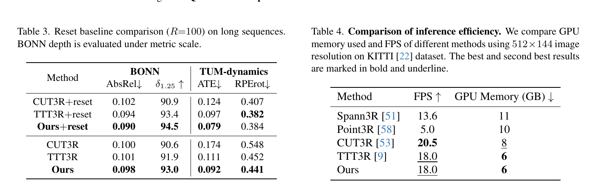

*原论文 Supplementary Tables 3、4。左表比较每 100 帧重置与不重置，TUM-dynamics 使用 1000 帧、Bonn 使用 500 帧，Bonn 按 metric scale 评估；右表是在 KITTI、512×144 分辨率下比较速度和显存，粗体与下划线标出最好和次好结果。*

重置本身改善了 CUT3R（TUM ATE 0.174→0.124）和 TTT3R（0.111→0.097）。TTSA3R 不重置时 ATE 为 0.092，已经低于二者重置后的值；TTSA3R 再结合重置后进一步降至 0.079，Bonn Abs Rel 也由 0.098 降至 0.090。结果表明软门控与硬重置可以互补，重置并未被门控完全取代。

#### 相机轨迹与推理效率

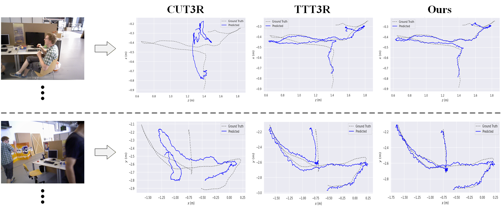

*原论文 Figure 8。两个含运动人物的室内序列中，灰色虚线为真值，蓝线为预测；曲线沿最大方差的两个坐标轴绘制。*

轨迹可视化显示，CUT3R 在连续运动和快速视角变化时会逐渐偏离并出现突变；TTT3R 减小了偏移但仍有误差，TTSA3R 的路径更贴近真值。论文也指出各方法逐帧回归相机位姿都会有局部抖动，不能把轨迹更平滑直接等同于完全消除漂移。

原论文补充材料 Table 4 与 Table 3 同页，上方合并图的右半边比较 FPS 与 GPU 显存。

在 A6000 上，TTSA3R 为 18.0 FPS、6 GB 显存，与 TTT3R 相同；CUT3R 为 20.5 FPS、8 GB。TTSA3R 的门控没有额外前向过程，但该数字不表示它比基础 CUT3R 更快。空间记忆方法 Spann3R 与 Point3R 分别为 13.6 FPS/11 GB 和 5.0 FPS/10 GB。该表是在指定数据集、分辨率和 GPU 上的单点比较，不能直接外推到其他硬件或输入尺寸。

## 5 结论与局限

TTSA3R 在 CUT3R 的候选状态与旧状态插值更新中加入两种逐 token 控制。TAUM 将相邻候选状态的变化按当前帧所有 token 的平均变化归一化，再用固定阈值映射为时间掩码；SCUM 把图像 patch 的跨帧余弦差异与状态—图像交叉注意力 logits 相乘，挑出有空间相关性的变化。两掩码相乘后，最终权重控制新候选状态写入多少、旧状态保留多少。按相邻候选状态而非门控后的状态计算时间变化，避免低权重本身造成下一帧进一步冻结。

在长序列深度、位姿和 NRGBD 重建上，作者报告了比 CUT3R 更稳的误差曲线，并用组件消融、重置对照和掩码可视化分析其机制。其边界同样清楚：短序列基准上并非所有指标都占优；方法假设相邻帧有足够视觉重叠，严重遮挡、噪声或低重叠会让时间变化和空间对应信号不可靠；它也受限于 CUT3R 本身的表示能力。训练自由和固定状态内存使其适合推理时改进循环状态写入，但它没有扩展状态容量，也不替代回环或全局几何优化。

## 补充材料

### 1 算法流程

补充材料的伪代码明确了每帧的先后顺序：编码 $I_t$ 得到 $F_t$，解码 $(F_t,S_{t-1})$ 得到候选状态 $\tilde S_t$ 和特征 $G_t$，由任务头输出深度、位姿和点图；对 $t>1$，分别以 $(\tilde S_t,\tilde S_{t-1})$ 计算 TAUM，以 $(F_t,F_{t-1},\operatorname{Attention}(S_{t-1},F_t))$ 计算 SCUM，逐 token 相乘后更新状态；$t=1$ 直接令状态等于候选状态。由于时间掩码需要上一帧的候选状态、空间掩码需要上一帧图像特征，算法需保存这两组固定大小信息供下一步比较。

### 2 掩码融合策略

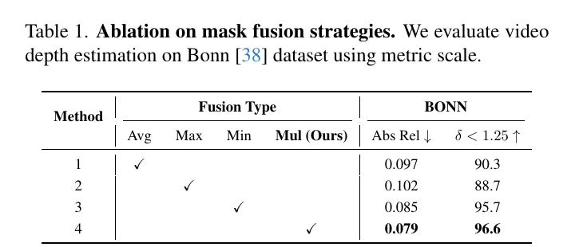

*原论文 Supplementary Table 1。Bonn 使用 metric scale，比较平均、最大、最小和逐元素乘积融合。*

乘积融合得到 Abs Rel 0.079、$\delta$ 96.6%，优于平均（0.097/90.3）、最大（0.102/88.7）和最小（0.085/95.7）。最大融合会让任一高门控信号主导，导致较激进更新；最小融合会让较小掩码独自控制，另一信号不起作用。乘积使 SCUM 对 TAUM 作连续调制，与本文的“时间变化需要空间证据支持”设计相符。

### 3 阈值敏感性

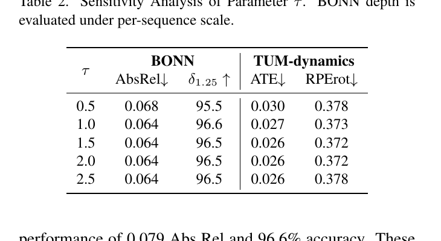

*原论文 Supplementary Table 2。Bonn 深度按 per-sequence scale，位姿用 TUM-dynamics。*

$\tau$ 从 0.5 增至 1.0 时性能改善；从 1.0 到 2.5，Bonn 指标基本稳定，TUM ATE 在 1.5–2.5 均为 0.026，RPE$_{\text{rot}}$ 在 1.5 和 2.0 为 0.372。$\tau=0.5$ 时更新较激进，结果较差。作者将 1.5 的含义联系到式（5）的归一化：它提高相对变化超过场景平均 50% 的 token 更新权重；这是一项跨数据集固定的阈值选择，不代表每种序列均存在相同的最佳值。

### 4 状态重置对比

每隔 $R=100$ 帧将循环状态重置为初始状态，再按式（12）用 metric 位姿把每段拼接到统一坐标系。补充表与主文分析给出相同结论：重置有帮助，TTSA3R 不重置已能胜过重置后的 CUT3R 与 TTT3R，二者结合还能继续改善。该对比使用了无需优化的位姿拼接，不能等同于带全局后端的重置系统。

### 5 推理效率

补充表 4 的条件为 KITTI 上 512×144 图像分辨率，比较模型速度和显存；TTSA3R 与 TTT3R 都为 18 FPS、6 GB，CUT3R 为 20.5 FPS、8 GB。补充材料正文据此说明该门控不需要新增可学习参数或前向过程，效率与 TTT3R 相当。此处的 FPS 和显存数据是论文设定下的推理结果，不是跨硬件的复杂度保证。

### 6 掩码行为

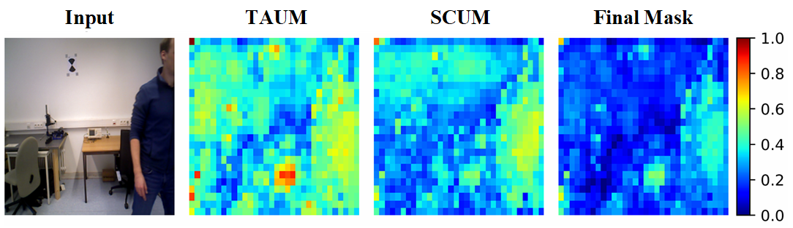

*原论文 Supplementary Figure 3。以 Bonn 一帧为例，左侧为输入，其后依次为 TAUM、SCUM 和最终掩码；所有掩码都投影至图像平面并使用共同的 min-max 归一化。*

因此颜色表示同一张图内的相对强弱，不是各掩码绝对值的直接比较。TAUM 的高响应较分散，反映状态变化大的 token；SCUM 把响应集中到它所关注且图像特征确实变化的区域；最终掩码同时要求时间变化和空间关联，视觉上更加集中。该图展示一帧上的定性分布，不能单独作为所有序列的统计结论。

### 7 ScanNet 相机轨迹补充对比

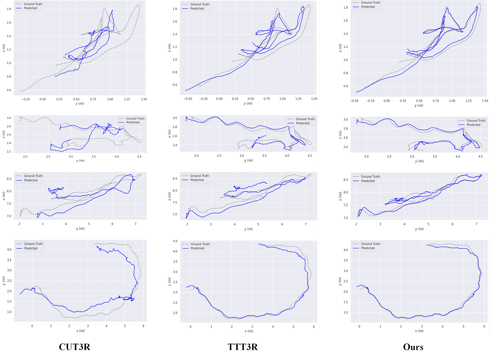

*原论文 Supplementary Figure 1。灰色虚线为真值，蓝线为预测；展示 ScanNet 中四个场景的两个最大方差坐标轴。*

补充轨迹对比展示 CUT3R 的均匀更新会在复杂运动中积累误差，TTT3R 有改善但仍会偏离，TTSA3R 的曲线较贴近真值。这是作者选择的代表场景，可与主文长序列曲线和短序列表互补阅读。

### 8 更多动态视频重建

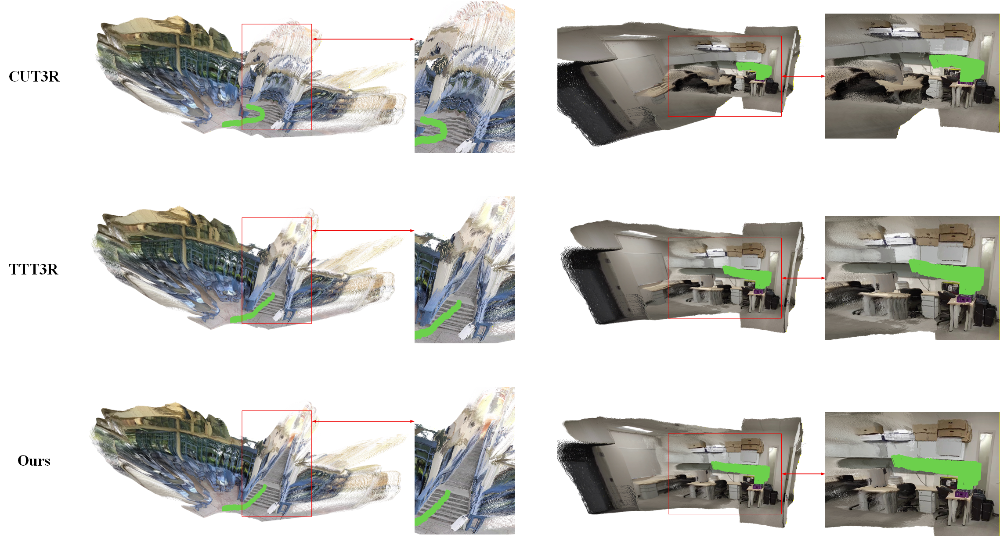

*原论文 Supplementary Figure 2。左侧庭院场景比较楼梯结构，右侧室内场景比较家具轮廓；每行展示 CUT3R、TTT3R 与 TTSA3R。*

作者指出，CUT3R 会出现楼梯表面破碎、家具几何融合等问题，TTT3R 改善部分结构但仍有变形和边缘不一致，TTSA3R 在这些样例中保留了更多结构与细节。图中实例是定性对比，不宜替代对不同场景的量化验证。

### 9 长序列评测协议

每个目标长度使用同一测试序列的前缀，短于目标长度的序列则取全长。Bonn 使用五段序列，从第 30 帧、步长 1 开始，截取 50–500 帧；metric-scale 指标按有效深度像素加权平均。位姿实验使用 TUM-dynamics 全部序列（步长 1）和 ScanNet 测试场景（步长 3），长度 50–800，Sim(3) 对齐后按序列平均。NRGBD 每隔一帧取样，输入长度 50–250 帧，对场景平均 Acc、NC。周期重置比较另使用 1000 帧 TUM-dynamics 和 500 帧 Bonn。统一用前缀控制输入长度，便于比较误差随历史增长的变化，但也意味着不同长度的数值来自同一批序列前缀。

### 10 与其他门控信号比较

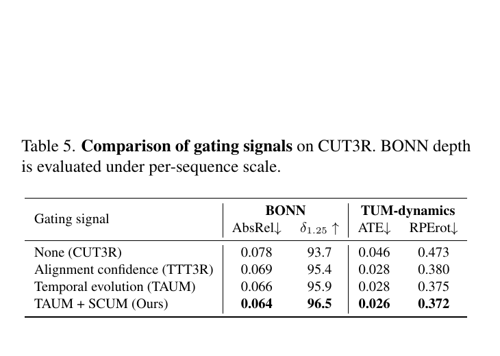

*原论文 Supplementary Table 5。所有门控应用在同一个预训练 CUT3R 上；Bonn 深度采用 per-sequence scale。*

在相同 CUT3R 基线上，将 TTT3R 的当前帧对齐置信度门控替换为 TAUM，Bonn Abs Rel 从 0.069 降到 0.066，RPE$_{\text{rot}}$ 从 0.380 降到 0.375，TUM ATE 保持 0.028；再加入 SCUM 后，表中四个指标均进一步改善。这个对照支持候选状态跨帧变化提供了有用信号，空间上下文又带来额外收益；结论只针对该冻结骨干和这些评测指标。

TTSA3R 与 [TTT3R](../ttt3r/index.md)、[CUT3R](../cut3r/index.md) 同属固定状态的训练自由更新路线；与 [Rethinking the State Update Gate](../rethinking-state-update-gate/index.md) 的帧级标量门控相比，TTSA3R 在状态 token 维度融合时间与空间信号。它们都限制写入造成的历史覆盖，但控制粒度与证据来源不同。
