# TTT3R 论文解读

> Xingyu Chen、Yue Chen、Yuliang Xiu、Andreas Geiger、Anpei Chen，*TTT3R: 3D Reconstruction as Test-Time Training*，发表于 ICLR 2026。本文依据 ICLR 会议正式版 25 页全文及其附录。[ICLR 论文页](https://proceedings.iclr.cc/paper_files/paper/2026/hash/530eb593743559fa3c926a1fc1f520e9-Abstract-Conference.html) · [会议版 PDF](https://proceedings.iclr.cc/paper_files/paper/2026/file/530eb593743559fa3c926a1fc1f520e9-Paper-Conference.pdf) · [arXiv v4](https://arxiv.org/abs/2509.26645v4) · [项目页](https://rover-xingyu.github.io/TTT3R/) · [代码](https://github.com/Inception3D/TTT3R)

在线重建模型逐帧接收图像，必须把过去的场景信息压缩成能够继续使用的状态。CUT3R 用固定数量的状态 token 读写历史，模型内部的推理显存不随序列长度增长，但状态会在持续更新中逐渐遗忘早期内容。TTT3R 保留 CUT3R 的网络和状态表示，只改写写入状态的步长：它把每个状态 token 与当前图像之间的对齐分数汇总成一个门控系数，匹配证据较弱时少写入，证据较强时多更新。

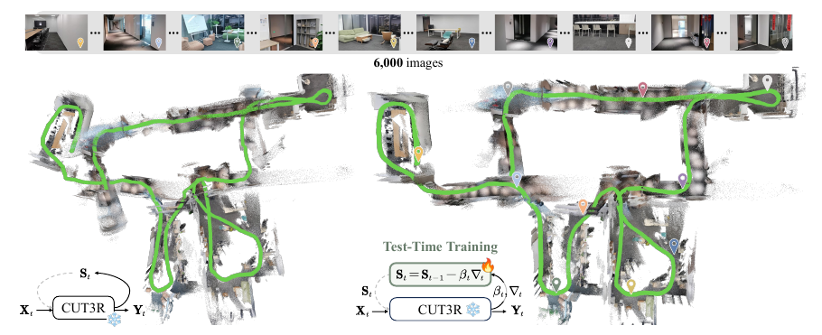

*原论文图 1。作者以六千张图像的场景展示长序列重建，并将 CUT3R 的状态更新解释为快速权重的在线适配。该示意图同时包含每 100 帧重置状态的设置；下文会区分这项附录扩展与不重置的 TTT3R 主方法。*

## 定长状态降低了历史缓存成本

论文先把以点图为核心的流式重建写成一个通用序列模型。输入图像 $I_t$ 被切分为图像 token $X_t$，状态 $S_{t-1}$ 接收当前观察并更新，输出 token $Y_t$ 再被解码成当前图像的像素对齐点图 $P_t$：

$$
X_t=\operatorname{Tokenize}(I_t),\quad
S_t=\operatorname{Update}(S_{t-1},X_t),\quad
Y_t=\operatorname{Read}(S_t,X_t),\quad
P_t=\operatorname{De-tokenize}(Y_t).
\tag{1}
$$

位姿和相机内参可以从点图通过几何算法求得，也可以由图像 token 的预测头直接回归。这个框架把不同方法的关键差异放在状态如何更新和读取：全注意力方法保留每帧的键和值；因果 Transformer 避免重算旧帧的输出，却仍需要随视频累加 KV 缓存，历史存储量随帧数线性增长。循环方法则把历史压入固定数量的状态 token。论文将 CUT3R 的状态更新概括为

$$
S_t=S_{t-1}+\operatorname{softmax}\!\left(Q_{S_{t-1}}K_{X_t}^{\mathsf T}
\right)V_{X_t},
\tag{3}
$$

其中状态 $S_{t-1}\in\mathbb R^{n\times c}$ 含 $n$ 个记忆 token，当前图像有 $hw$ 个 token；$Q_{S_{t-1}}$ 是状态查询，$K_{X_t}$ 和 $V_{X_t}$ 分别是图像键和值。交叉注意力矩阵形状为 $n\times hw$，它让每个状态 token 从当前图像汇总信息，再把所得特征加回状态。状态 token 数目固定，因此历史记忆与序列长度无关；每步只处理当前图像和固定状态，推理内存也近似固定。

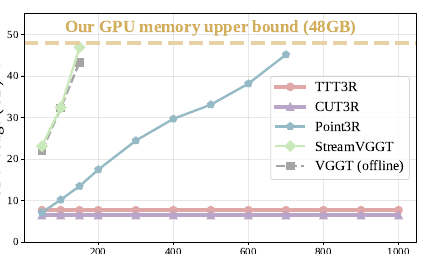

*原论文图 2。输入图像数增加时，TTT3R 与 CUT3R 的显存曲线基本保持平坦；保存显式空间记忆的 Point3R 和保留键值历史的注意力方法则随输入增长。图中硬件上限为 48 GB。*

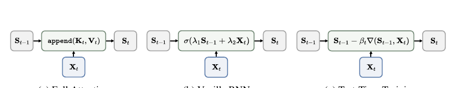

*原论文图 3。全注意力把每步状态附加到不断增长的历史；普通循环网络把历史压进定长状态；TTT 视角则把状态当作可在推理时更新的快速权重。*

定长状态解决了缓存不断扩大的问题，却没有自动解决长程记忆质量。状态容量有限时，每次新观察都会和已有信息竞争；如果模型始终以相近强度写入，低质量或不相关的观察也可能改动重要状态。TTT3R 要调节的是这一步写入的“可塑性”，而不是增加一条新的历史缓存。

## 从测试时训练得到状态更新视角

测试时训练（Test-Time Training，TTT）把循环状态视为快速权重：模型参数在推理时保持冻结，状态则随新输入在线更新。论文用一般形式表示为

$$
S_t=S_{t-1}-\beta_t
\nabla(S_{t-1},X_t),
\tag{4}
$$

这里的 $\beta_t$ 是学习率，控制当前观察对状态造成多大改变。论文用线性 TTT 说明快速权重如何存储一条键值关联：状态 $S$ 把键 $K_{X_t}$ 映射到目标值 $V_{X_t}$，并以平方重建误差为目标，

$$
\mathcal L_t(S)=\|SK_{X_t}-V_{X_t}\|_F^2,\qquad
\nabla_S\mathcal L_t=2(SK_{X_t}-V_{X_t})K_{X_t}^{\mathsf T}.
\tag{5}
$$

$SK_{X_t}$ 是状态对当前键给出的值，减去目标 $V_{X_t}$ 得到重建残差；右乘 $K_{X_t}^{\mathsf T}$ 将值空间的残差传回状态参数空间。键决定关联位置，值提供目标内容，学习率控制一次更新的幅度。求导产生的系数 2 可以并入学习率，不改变更新方向。这个线性回归例子用来解释测试时训练的快速权重视角；TTT3R 推理时并不逐帧优化这个平方损失或模型参数。它将 CUT3R 已有的交叉注意力写入视作状态更新方向，再由当前对齐分数控制该方向的步长。

CUT3R 的交叉注意力本身已经提供了“写到哪里、写入什么”的机制。论文将其状态增量写成 TTT 形式下的更新方向，并把原有均匀写入看作学习率固定的情形。问题在于，所有状态 token 的更新强度缺少对匹配质量的显式调节：注意力会对当前图像 token 做 softmax 归一化，仍要输出一组加权内容写入状态，模型无法直接通过一个独立的学习率门抑制不可靠的状态更新。

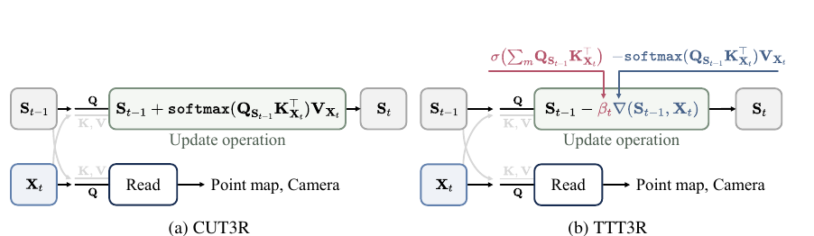

*原论文图 4。TTT3R 沿用 CUT3R 的读取、点图和相机预测结构，只在状态更新方向前加入按状态 token 计算的学习率。*

## 用对齐分数为每个状态 token 设定步长

对当前图像的 $h\times w$ 个 token，交叉注意力会为每个状态 token 产生一行状态—图像匹配分数。TTT3R 对每行的空间位置求平均，再经过 sigmoid，得到该状态 token 的学习率：

$$
\beta_t=\sigma\!\left(\frac{1}{hw}\sum_{m=1}^{hw}Q_{S_{t-1}}K_{X_t,m}^{\mathsf T}
\right)
\in (0,1)^{n\times1}.
\tag{7}
$$

其中 $n$ 是状态 token 数量，$m$ 遍历当前图像的空间 token。这样得到的 $\beta_t$ 为每个状态 token 产生一个值，而非给整张图像或整个状态共用一个门。将它按状态 token 维度广播到特征通道后，完整更新为

$$
S_t=S_{t-1}-\beta_t\odot
\nabla(S_{t-1},X_t),\qquad
-
\nabla(S_{t-1},X_t)=\operatorname{softmax}\!\left(Q_{S_{t-1}}K_{X_t}^{\mathsf T}
\right)V_{X_t}.
\tag{8}
$$

右侧第二个等式对应 CUT3R 的交叉注意力写入方向。对齐分数较高时，sigmoid 输出较大的 $\beta_t$，状态更充分吸收当前特征；对齐分数较低时，更新幅度减小，已有状态较多保留下来。由于这个学习率直接从网络已经计算的状态—图像关系中得到，TTT3R 不增加可学习门控参数，也不需要在每帧对模型权重执行反向传播。它是一次前向状态更新规则的变化。

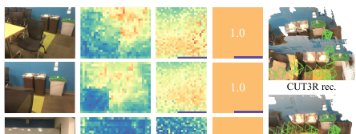

*原论文图 5。图中将输入图像、状态与图像间的注意力、TTT3R 学习率、CUT3R 固定学习率和重建结果并列展示。低质量纹理区域对应的写入被抑制，重访时则能利用已有状态恢复场景结构。*

这里的“置信度”是一个由注意力 logits 的空间均值构成的启发式信号。它反映状态查询与当前图像键的整体对齐程度，并不等同于经过标注校准的概率，也不直接检测动态物体、回环或几何外点。TTT3R 保留 CUT3R 其余的编码器、状态结构、输出头和训练权重；论文的主方法是在预训练 CUT3R 上无额外训练地应用这条规则。

作者把重访场景下状态能够重新读出旧几何称为在线回环能力。它依赖隐状态中仍保留了相关线索，没有另外加入回环候选检索、几何验证或位姿图优化。因此这里的“回环”是状态读写带来的重访恢复效果，与传统 SLAM 系统中的显式回环闭环流程不同。

## 主实验显示状态更新能延缓漂移

论文用一张 48 GB 显存的 NVIDIA GPU 测量不同长度输入下的推理速度和峰值显存，并在 ScanNet、TUM-Dynamics 的 50–1000 帧序列上比较位姿。轨迹误差在与真值做 Sim(3) 对齐后计算 ATE。图中 VGGT 是离线方法，保留全历史但推理成本较高；StreamVGGT 以 KV 缓存实现因果推理；Point3R 通过显式点记忆减少遗忘；CUT3R 与 TTT3R 则保持固定大小递归状态。

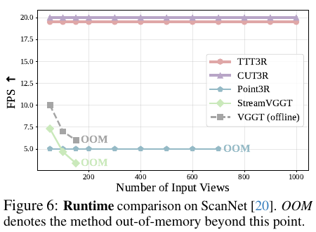

*原论文图 6。TTT3R 与 CUT3R 在输入长度增加时保持实时级帧率；显式点记忆方法速度较低，而全注意力方法在更长序列上因显存耗尽而提前停止。*

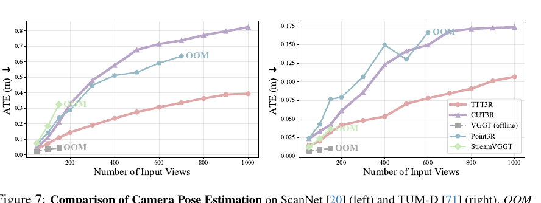

*原论文图 7。两组长序列结果中，CUT3R 的 ATE 随输入增长而明显变大；TTT3R 的误差增长较缓，Point3R 在显存耗尽前准确度有所提升。作者概括其相对 CUT3R 的全局位姿估计改善可达约两倍。*

作者报告 TTT3R 保持 CUT3R 的实时推理与显存效率，处理数千张图像时约为 20 FPS、6 GB GPU 显存。图 7 中输入上限为 1000 帧；更长序列的结果另用状态重置设置展示。此处“约两倍”是论文对实验结果的概括，具体误差因数据集和序列长度而不同。

深度评估包括 Bonn 与 KITTI。相对深度按每个序列的尺度与真值对齐，评估 Abs Rel 和 $\delta<1.25$；度量深度则不做尺度对齐，直接检查以米为单位的预测。两种协议回答的问题不同：前者淡化整体尺度偏差，后者把绝对尺度误差保留下来。

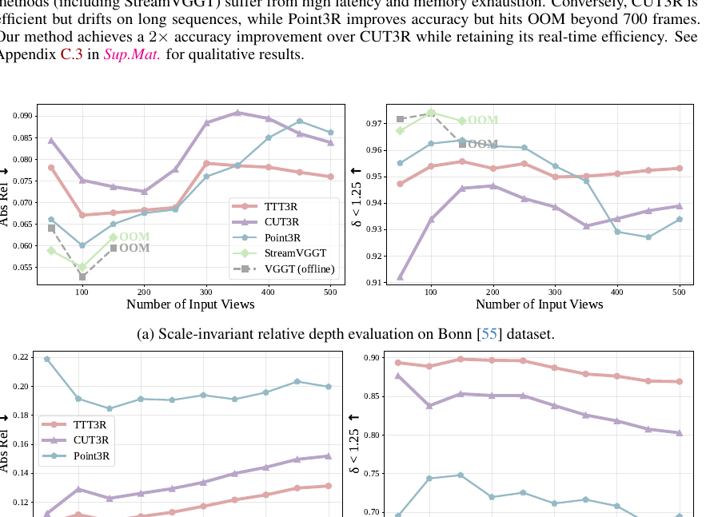

*原论文图 8。上组为 Bonn 的序列尺度对齐相对深度，下组为 KITTI 的度量深度。随着输入长度增加，TTT3R 在多个在线基线中维持较好的整体曲线；不同数据集和尺度协议下的排名并不完全相同。*

在短序列补充比较中，TTT3R 在 KITTI 的序列尺度对齐结果为 Abs Rel 0.113、$\delta<1.25$ 为 90.4%；度量尺度结果为 0.110 和 89.1%。它优于同表中的 CUT3R（分别为 0.118/88.1% 与 0.122/85.5%），但在其他数据集和方法比较中并非所有指标都领先。例如度量尺度 Bonn 的 Abs Rel 上 STream3R 为 0.084，TTT3R 为 0.090；Sintel 的相对深度结果也受到其他在线方法超过。数值依赖数据集、序列长度和尺度协议，不能用单一指标概括全部深度表现。

三维重建实验在 7-Scenes 上逐步增加输入图像数，以 Chamfer Distance 衡量点云准确度与完整度：它取重建点到真值最近邻距离的均值和真值点到重建最近邻距离的均值，再将两者平均；Normal Consistency 则衡量表面法线一致性。TTT3R 的误差随输入增加而增长较慢，尤其相较于 CUT3R，长序列下几何破碎和轨迹偏移有所缓解。

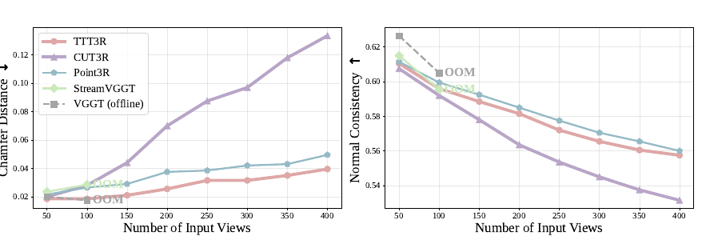

*原论文图 9。横轴是输入图像数量；左侧 Chamfer Distance 越低越好，右侧 Normal Consistency 越高越好。全注意力基线在较长序列上出现 OOM，CUT3R 的 Chamfer Distance 则随序列增长更快。*

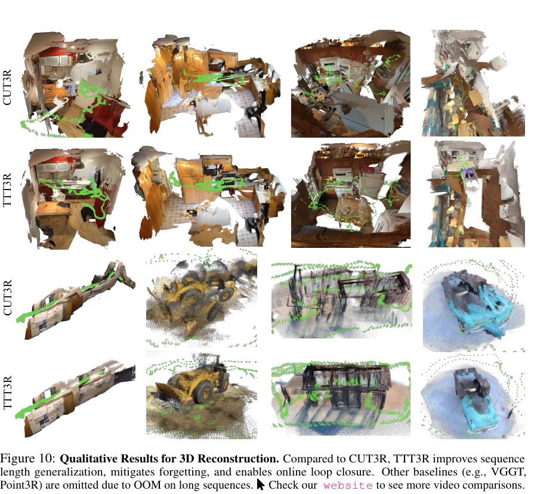

*原论文图 10。多个室内和动态场景中，TTT3R 输出的点云和轨迹较少出现 CUT3R 的漂移、重影和几何断裂；长序列上的 VGGT、Point3R 对照因显存问题未能展示。*

## 附录中的门控与重置消融

作者进一步将置信度学习率与三种可训练门控比较：全局标量 ScalarLR、由当前输入预测的标量 ConditionLR，以及逐状态 token 预测的 TokenLR。新增门控只训练 4–64 帧序列，编码器和输出头冻结。TTT3R 的闭式门控在 TUM-Dynamics 的 1000 帧 ATE 为 0.106 m，低于 CUT3R 的 0.173 m 和表现最好的可训练 TokenLR 的 0.154 m；KITTI 500 帧度量深度 Abs Rel 为 0.131，也低于 CUT3R 的 0.152 和 TokenLR 的 0.148。TTT3R 微调版把位姿 ATE 进一步降至 0.091 m，但 KITTI 深度 Abs Rel 从 0.131 变为 0.133，略有退化。这个对照说明可训练门控的效果受训练上下文长度影响；它并不证明所有可学习门控在更长序列训练后都会更差。

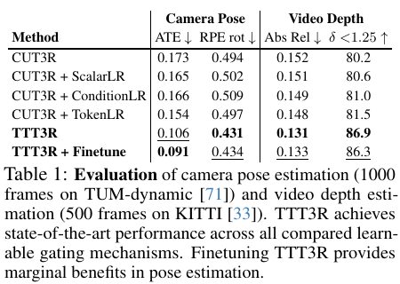

*原论文表 1。位姿指标使用 TUM-Dynamics 1000 帧，深度指标使用 KITTI 500 帧；两项实验并非同一数据集或同一输入长度。*

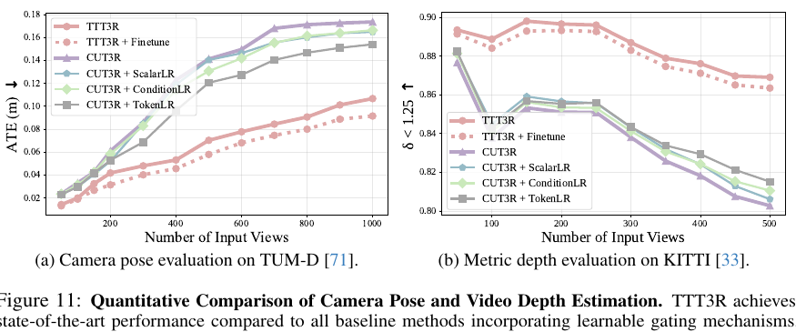

*原论文图 11。不同可训练门控在较短输入时接近 CUT3R，长度增加后与闭式 TTT3R 的差距逐渐拉开。*

附录还把 TTT3R 与周期性清空状态、向初始状态做指数滑动平均（EMA）收缩，以及只用关键帧写状态的 BurnIn 比较。基线各自先挑选较好的超参数：状态每 100 帧重置一次，EMA 收缩率为 0.001，BurnIn 关键帧间隔为 100 帧。对比中，TTT3R 在 TUM-Dynamics 1000 帧的 ATE 为 0.106 m；CUT3R+Reset、CUT3R+EMA、CUT3R+BurnIn 分别为 0.126、0.164、0.144 m。再叠加 Reset 的 TTT3R+Reset 达到 0.093 m。KITTI 度量深度上，TTT3R 为 0.131，TTT3R+Reset 为 0.115。重置进一步改善了这组指标，但它属于额外的分块处理策略。

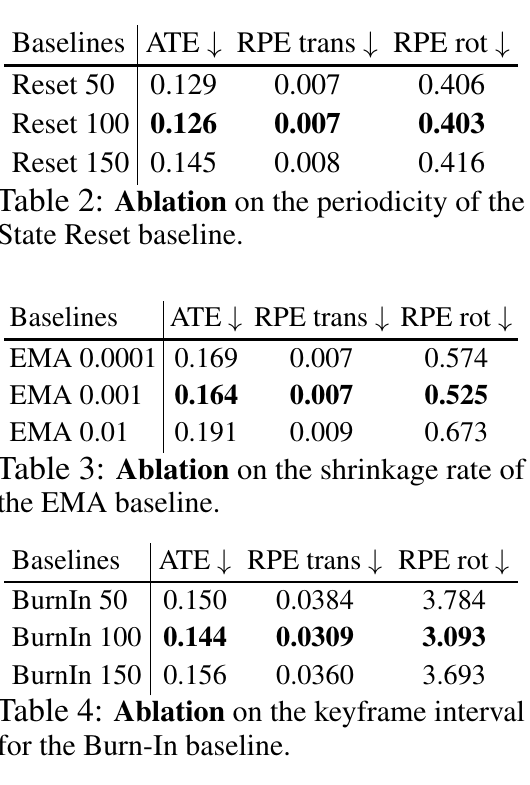

*原论文表 2–4。作者分别选择重置周期、EMA 收缩率和 BurnIn 间隔；三种基线各自的较优设置均为 100 帧周期或 0.001 收缩率。*

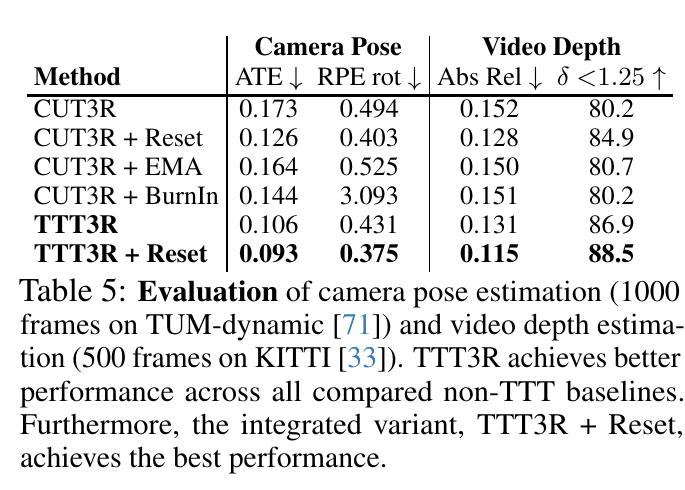

*原论文表 5。在 TUM-Dynamics 1000 帧位姿与 KITTI 500 帧深度实验中，TTT3R+Reset 的两项结果优于表内其他方法。*

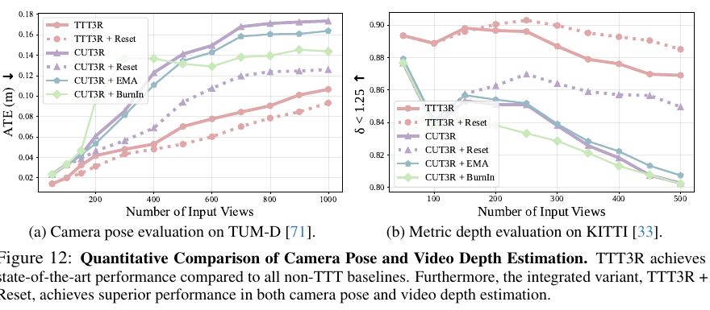

*原论文图 12。曲线显示 TTT3R+Reset 在所比较的位姿与 KITTI 度量深度设置中进一步改善结果；这组附录结果与主文不含 Reset 的 TTT3R 结果分开报告。*

## 定期重置把可视化范围扩展到千帧以上

论文承认，TTT3R 会减缓但没有彻底消除状态遗忘。作者将其与“未探索状态”假设联系起来：训练时大多处理不超过 64 帧，循环状态在远长于训练上下文的滚动过程中可能进入训练时未见过的区域。作为补充，TTT3R+State Reset 每 100 帧把状态恢复到初始值，再利用预测的全局度量相机位姿对各段结果进行对齐。论文说明这一步不执行额外优化。

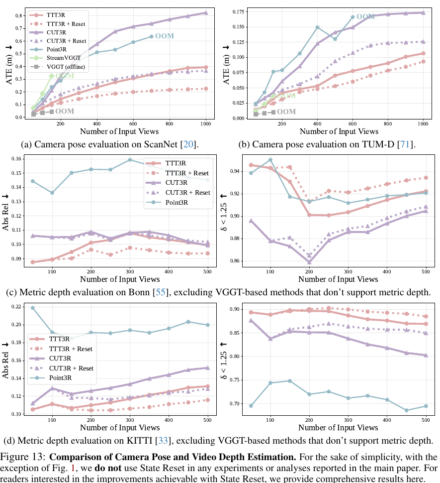

*原论文图 13。TTT3R 与每 100 帧重置的变体在 ScanNet、TUM-Dynamics、Bonn 和 KITTI 上比较。论文主文的主要实验和分析不使用 Reset；此图与表 5 单独报告该策略带来的变化。*

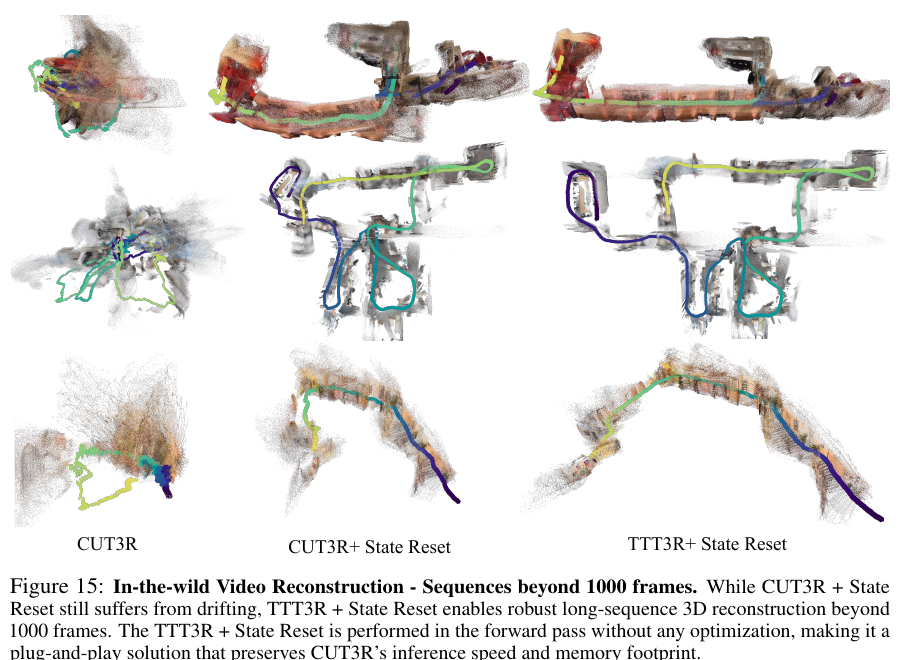

*原论文图 15。超过 1000 帧时，CUT3R+Reset 仍会漂移，TTT3R+Reset 在图示长视频里保持了更连贯的结构。它说明组合变体能够扩展展示范围，不代表不重置的 TTT3R 已解决千帧以上的状态遗忘。*

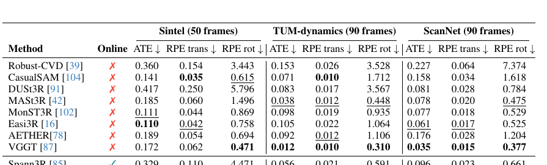

*原论文表 6。Sintel 50 帧、TUM-Dynamics 和 ScanNet 各 90 帧的位姿对照。TTT3R 在在线方法中表现有竞争力，但不同数据集上的领先项不同；在线方法与保留完整上下文的离线方法之间仍有差距。*

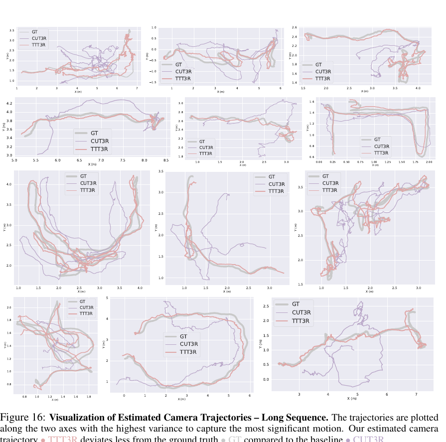

*原论文图 16。附录将多个长序列的轨迹投影到方差最大的两个坐标轴，比较真值、CUT3R 与 TTT3R；图示轨迹中 TTT3R 的偏差较小。*

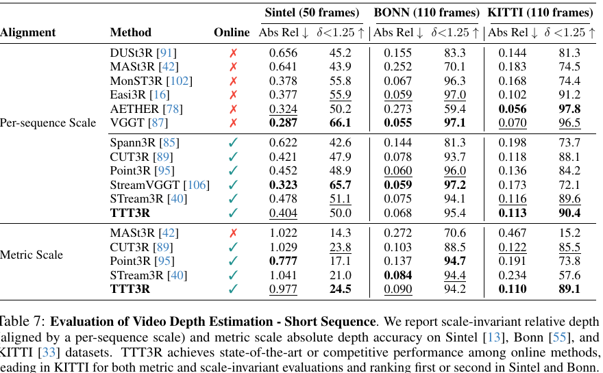

*原论文表 7。分别列出 Sintel、Bonn、KITTI 上按序列尺度对齐的相对深度，以及未经尺度对齐的度量深度。两种对齐方式下的结果不能混为一个排名。*

## 方法关系与适用边界

TTT3R 与 [CUT3R](../cut3r/index.md) 使用同一套循环状态和几何预测结构，差异集中在状态更新步长。它不像 [StreamVGGT](../streamvggt/index.md) 和 [STream3R](../stream3r/index.md) 那样保留不断增长的历史 KV 缓存，也不像 [Point3R](../point3r/index.md) 那样显式保留空间点记忆；它让一个固定状态以逐 token 的速率吸收当前观察。与 [HorizonStream](../horizonstream/index.md) 学习不同时间尺度的递归遗忘相比，TTT3R 依据当前状态—图像对齐动态调节本步写入。

这个设计改动轻，保留了 CUT3R 的常数状态和实时推理特性，并在多项长序列指标上缓解了漂移。它的置信度来自特征内积，是否能稳定表达真实几何可靠度取决于预训练状态和输入分布；附录里学到的门控在最多 64 帧序列上训练，不能据此推导所有更长序列上的行为。TTT3R 主方法在千帧左右仍会遗忘，离线全注意力模型在可承受的短上下文里仍保有更完整的历史信息。每 100 帧重置的变体是对此的附加补救，也引入分段对齐步骤。总体而言，论文的贡献是用一个来源于当前注意力的闭式步长，改善固定大小几何状态的长期写入，而不是建立带显式回环和全局图优化的 SLAM 后端。
