# UFM 论文解读

> Yuchen Zhang、Nikhil Keetha、Chenwei Lyu、Bhuvan Jhamb、Yutian Chen、Yuheng Qiu、Jay Karhade、Shreyas Jha、Yaoyu Hu、Deva Ramanan、Sebastian Scherer 与 Wenshan Wang，*UFM: A Simple Path towards Unified Dense Correspondence with Flow*，NeurIPS 2025 主会论文，收录于 *Advances in Neural Information Processing Systems 38*，28 页（含附录）。[论文集页面](https://proceedings.neurips.cc/paper_files/paper/2025/hash/9d89448b63ce1e2e8dc7af72c984c196-Abstract-Conference.html) · [论文 PDF](https://proceedings.neurips.cc/paper_files/paper/2025/file/9d89448b63ce1e2e8dc7af72c984c196-Paper-Conference.pdf) · [arXiv 版本](https://arxiv.org/abs/2506.09278) · [项目页](https://uniflowmatch.github.io/) · [官方实现](https://github.com/UniFlowMatch/UFM)

## 1 引言

稠密对应要回答一个直接的问题：源图像里的每个像素，在目标图像中的对应位置在哪里？两类常见任务都要回答它。光流通常处理相邻视频帧，物体可以运动，但位移相对较小；宽基线匹配处理视角、时间或外观差异较大的图像，通常假设场景静止，却要应对很大的位移。两种任务的数据和几何条件不同，过去的模型也因此沿着不同路线发展。

光流模型常用代价体、由粗到细的估计或循环更新来处理帧间运动。宽基线稠密匹配则常先在粗特征上做全局匹配，再逐层细化 warp。DKM 建立了后一路线的重要范式，RoMa 在 DKM 的基础上使用 DINOv2 等特征增强大视角变化下的鲁棒性（可参见 [DKM 解读](../dkm/index.md) 与 [RoMa 解读](../roma/index.md)）。这些模型在宽基线场景中效果很好，但结构较重；专门面向光流的模型则未必能直接适应宽基线数据。

UFM 要检验的是：两项任务的共同目标既然都是建立像素对应，能否用同一个模型和混合数据训练，而不是为光流与宽基线匹配分别准备专用模型？论文选择直接预测每个像素的位移场，并将两类数据放入同一训练过程。为避免模型只凭单张图像的场景先验猜测遮挡区或画面外的点，训练时只在两幅图都能看到的区域监督对应关系，同时预测可见性掩码。

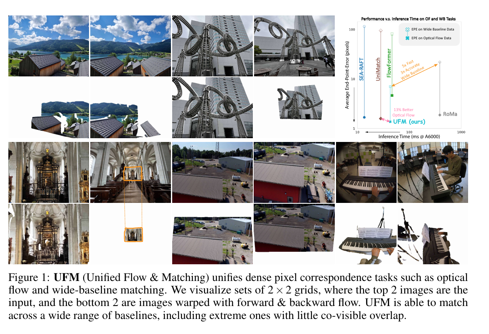

*原论文图 1。每组上方为输入图像，下方为按双向预测 warp 后的图像；示例覆盖小位移和大视角差异。右侧概览同时比较光流与宽基线任务上的误差和推理时间。*

> 可以把 UFM 的目标理解为让一个像素对应模型同时看懂两种“移动”：视频里物体在动，或者相机换了很大的位置。模型始终输出同一种量——源图每个像素到目标图的二维位移；变化的是训练样本里的运动范围、可见区域和场景条件。

## 2 相关工作

论文把已有方法分成光流、稠密宽基线匹配和统一对应三条路线。RAFT、SEA-RAFT 等方法通过相关性或代价体反复更新光流；FlowFormer 等方法用 Transformer 汇总匹配代价。它们通常针对相邻视频帧和动态场景设计。宽基线方法则着重应对大视角或时间差异。DKM 先在粗尺度建立对应，再用回归式 warp 细化器恢复像素精度；RoMa 以冻结的 DINOv2 粗特征提升鲁棒性，并结合专用细特征修正位置。UFM 的论文指出，前两类专用结构在另一类数据上表现会受限，且宽基线模型的结构可能拖慢大规模训练。

此前也有人尝试统一对应任务，例如 GLUNet 与 RGM。论文认为，这些方法尚未证明把两类数据放在一起训练，能稳定超过仅用任务内数据训练的专用模型。UFM 因而不仅提出一个网络，还同时研究输出表示、数据采样和训练监督：直接回归像素位移；把 12 个光流与宽基线数据集混合；只在可见像素监督对应；再用局部特征分类细化初始位移。

## 3 统一光流与匹配模型

### 3.1 UFM 架构

给定源图 $I_1$ 和目标图 $I_2$，UFM 输出正向位移场 $\phi_1$ 与可见性 $C_1$：

$$
\{\phi_1,C_1\}=f_{\mathrm{UFM}}(I_1,I_2).
$$

$\phi_1\in\mathbb{R}^{2\times H\times W}$ 在每个源像素位置给出水平和垂直位移。若源位置为 $(u,v)$，对应位置就是目标图中的 $(u,v)+\phi_1(u,v)$。$C_1\in\mathbb{R}^{1\times H\times W}$ 表示这个源像素是否能在目标图中看到。反向输入图像顺序后，也能得到从目标到源的位移场。

输入若是相邻视频帧，这张位移场就是光流；输入若是来自静态场景、视角相差很大的两张照片，它就是宽基线稠密对应。预测结果也可以用来 warp：按位移从目标图中取样，将目标内容放到源图坐标下，检查预测对应是否把同一场景位置对齐。Warp 在这里是对应场的可视化与使用方式，UFM 的主干直接预测位移，并不需要先把图像 warp 后再做一次全局匹配。

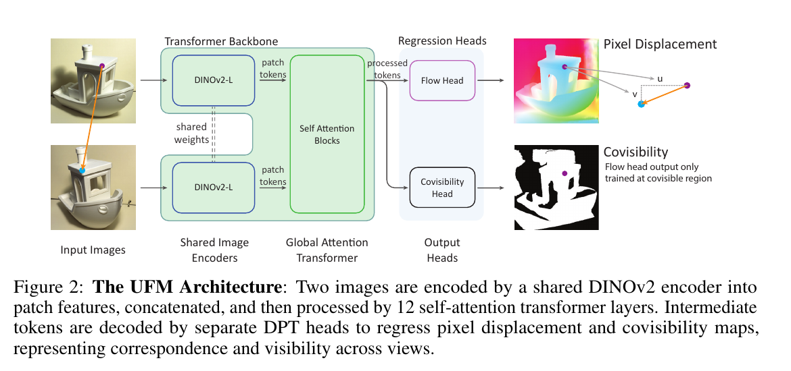

*原论文图 2。两张图共享 DINOv2 编码器，patch token 拼接后进入 12 层自注意力 Transformer；两个 DPT 预测头分别输出像素位移与可见性。*

两幅图先分别通过共享权重的 DINOv2 ViT-L 编码为 patch token。作者为两幅图加入区分视图的索引位置编码，再将 token 拼接起来，通过 12 层自注意力 Transformer。这样每个图像 token 都能在同一注意力序列中读取另一幅图的信息。作者报告，自注意力比交叉注意力更容易利用 FlashAttention 加速，且两种结构的光流回归精度相近。

Transformer 的第 6、9、12 层特征以及图像编码器特征被送入两个独立的 DPT 头。一个头将源图特征解码到像素级位移，另一个头预测可见性 logit 并经 sigmoid 转成概率。作者的消融发现，共用一个 DPT 头预测两种输出会降低表现，因此将对应关系和可见性分开解码。

这个结构与 DKM、RoMa 的粗到细流程有一个关键区别。论文把“粗到细”分成两种含义：一是先在低分辨率 patch 网格上预测，再上采样到像素；二是把较粗的位移猜测逐步修正到更准确。UFM 不采用第一种方式：全局 Transformer 在 patch token 上交换信息，DPT 头把特征解码为像素级位移；它仍会逐步细化预测，并在 UFM-Refine 中对初始位移做局部匹配。这样初始位移不必受低分辨率匹配网格限制。使用相同主干和训练数据，把 DPT 回归头换成 UniMatch 的 patch 匹配头后，六套数据中有五套 EPE 更高，ETH3D 则略低；作者据此报告 patch 匹配头的平均 EPE 高约 22%。

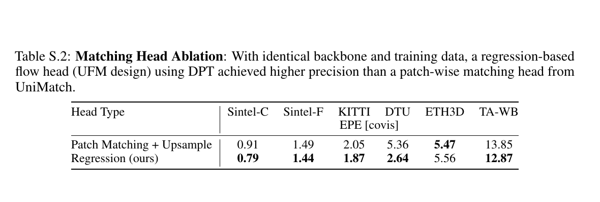

*原论文补充表 S.2。两种输出头使用相同主干和训练数据；回归头在多数测试集上误差较低，但 ETH3D 的数值略高。*

### 3.2 局部分类细化

直接回归能给出覆盖全图的初始对应，但初始位移不总是足够精确。UFM-Refine 因此保留回归结果作为初始猜测，再在它周围做一次小范围匹配。它为两幅图提取局部细节特征，并结合 Transformer 主干中已对齐的全局特征。对源图中的一个像素，模型用初始位移定位目标图中的邻域，只在 $7\times7$ 个候选位置上计算特征相似度。

设 $F_s$ 为源像素特征，$F_n$ 为邻域候选特征，$G_n$ 为各候选相对初始预测位置的坐标偏移，$b$ 为常数偏置。注意力权重由特征相似度经 softmax 得到，候选偏移的加权平均作为位移残差：

$$
\Delta\phi=\operatorname{softmax}(F_s^\top F_n+b)G_n.
$$

加权坐标并非直接替换初始匹配，而是用于修正它。若初始位置附近有一个明显更相似的点，权重会集中到它；若多个候选相似，残差会综合这些候选的位置。这个局部搜索把全图范围的大位移问题交给回归主干处理，再把更细的定位交给分类式匹配，因此不需要对所有像素两两做全局比较。论文报告，这种实现比 MASt3R 快约 60 倍；与其后续加速版本相比约快 24 倍。细化模块另行训练，主干保持冻结。

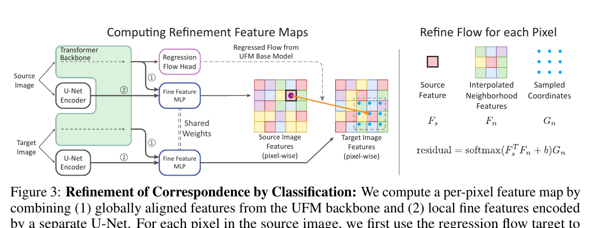

*原论文图 3。全局对齐特征与 U-Net 局部特征共同形成像素描述；初始 warp 决定目标图中 $7\times7$ 的候选邻域，softmax 权重对候选坐标加权后产生残差。*

补充材料进一步说明，细化训练只覆盖真值落在 $7\times7$ 邻域内的像素。真值通常处在亚像素位置，因此作者把监督分配给相邻四个像素，而不是只把最近的一个网格位置当作类别标签。若真值在网格单元内的偏移为 $(\alpha,\beta)$，四个角点的权重按双线性形式分配：

$$
w_1=(1-\alpha)\beta,\quad w_2=\alpha\beta,\quad
w_3=(1-\alpha)(1-\beta),\quad w_4=\alpha(1-\beta).
$$

这样邻近位置的监督会随亚像素目标连续变化，细化器可以用分类概率的加权坐标恢复比特征网格更细的位置。

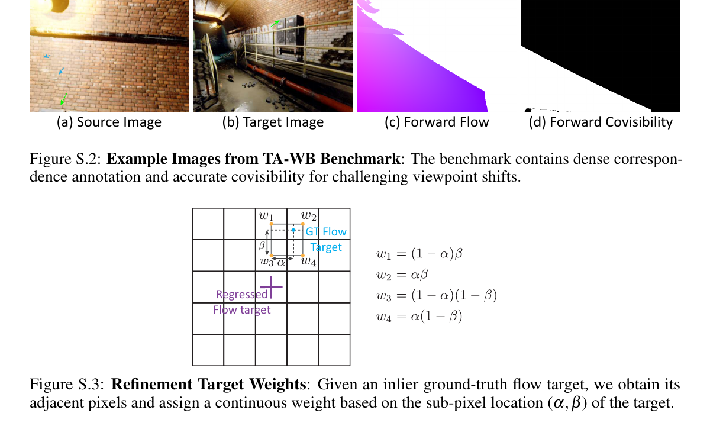

*原论文补充图 S.3。落在网格单元内部的真值位移被分配到相邻四个坐标，权重由水平和垂直的小数偏移共同确定。*

### 3.3 训练目标

位移误差只在真值可见的源像素上计算。令 $C^{gt}[i]$ 表示像素 $i$ 是否在目标图中可见，$\phi_1^{gt}$ 为位移真值，$I$ 为源图像素集合，论文的稳健端点误差可写为：

$$
\mathcal L_{\mathrm{EPE}}=
\frac{\sum_{i\in I} C^{gt}[i]\,
l_{\mathrm{robust}}(\|\phi_1[i]-\phi_1^{gt}[i]\|_2)}
{\sum_{i\in I}C^{gt}[i]}.
$$

这里的端点误差是预测位移向量与真值向量之间的欧氏距离。采用稳健 Charbonnier 损失，是因为数据中可能存在难以匹配的像素或不准确标签：较小误差附近的梯度更集中，有助于精确拟合内点；大误差的影响受到抑制，避免少数错误监督主导更新。论文沿用 RoMa 的参数 $\alpha=0.5$、$c=0.24$。

由于不可见区域没有对应监督，模型在那里可以输出任意位移。推理时必须把这些位置排除，所以网络另外预测可见性掩码，并用二元交叉熵训练。两项损失的最终组合是：

$$
\mathcal L=\mathcal L_{\mathrm{EPE}}+10\,\mathcal L_{\mathrm{BCE}}.
$$

论文先把可见性 logit 经 sigmoid 转成概率，再用该概率排除无对应的区域；但损失公式把带 “logits” 下标的量直接放进 $\log(C)$ 和 $\log(1-C)$，与前面的 sigmoid 定义不一致。本文按标准实现将其解释为对概率计算二元交叉熵（或对原始 logit 使用数值等价的 BCE-with-logits）。可见性损失权重 10 是作者根据实验选择的设置。

### 3.4 混合光流与宽基线数据

UFM 的训练集合计 12 个数据集，覆盖静态场景、动态场景、真实与合成数据。BlendedMVS、MegaDepth、TartanAir V2、ScanNet++ V2、Habitat CAD 和 StaticThings 提供宽基线图像对；FlyingChairs、FlyingThings、Spring、Monkaa、HD1K 与 Kubric4D 提供动态样本，其中 Kubric4D 同时包含时间变化和视角变化。训练时样本来自两类数据，因此一次梯度更新就可能同时包含光流和大视角匹配例子。

对应真值与可见性标签要和数据类型匹配。静态场景通过源图深度反投影到三维，再投影到目标图；若目标深度与投影点不一致，就认为像素被遮挡或无法确认对应。补充材料中的可见性阈值随目标距离增长：

$$
e=\|p_s-p_t\|_2<\tau_d+\tau_r\|p_s-O_2\|_2.
$$

$p_s$ 和 $p_t$ 是两幅图中对应像素反投影得到的三维点，$O_2$ 是目标相机中心，$e$ 是两点距离。固定三维误差阈值对近处和远处表面不够合适，距离项允许远处点使用相对宽松的容差。光流数据有动态物体，需要结合场景流或深度变化追踪三维点；Kubric4D 还可以利用物体位姿。FlyingChairs 没有完整深度与场景流信息，作者以视野范围近似对应监督，但不将这份近似标签用于可见性分类训练。

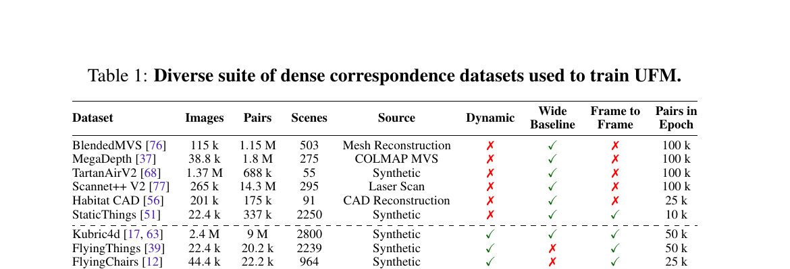

*原论文表 1。表中列出各数据集是否包含动态、宽基线和帧间样本；Kubric4D 同时覆盖动态与宽基线，最右列给出每个 epoch 抽取的图像对数量。*

统一训练要有难度可控、真值可靠的宽基线测试集。作者从 TartanAir V2 构建 TartanAir-Wide Baseline（TA-WB）：场景提供环绕相机的六个方向图像，作者先体素化场景并计算相机与可见体素的关系，再选源相机和可见体素，按所需视角差筛选目标相机，最后用共同可见性过滤。渲染出的图像还要通过曝光、可见比例和可匹配性检查。训练用样本将相机中心角度差在 $0^\circ$ 到 $120^\circ$ 间均匀分布；测试集留出不同场景资产、外观和几何。

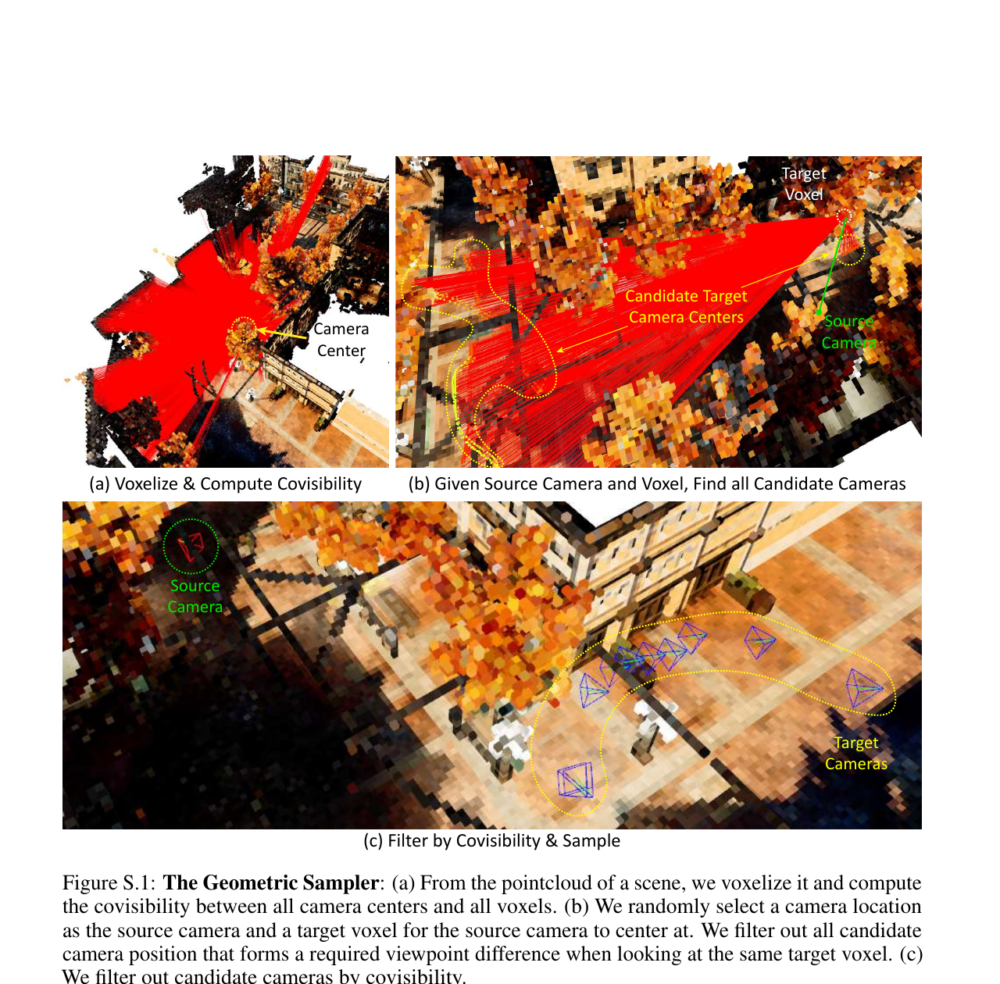

*原论文补充图 S.1。采样器先用体素和可见性找出可行相机候选，再按指定视角差筛选，并剔除无法共同看到目标体素的相机。*

主模型 UFM 560 训练 48 个 epoch，最长边为 560 像素；Transformer 和 DPT 头的峰值学习率为 $10^{-4}$，DINOv2 编码器用 $5\times10^{-6}$ 微调以保留预训练表示。训练使用 AdamW、10% 线性 warmup、余弦衰减，权重衰减 0.05，$\beta=(0.9,0.95)$。利用双向对应构造对称 batch 后，有效 batch 为 96 对，其中一半是唯一图像对；作者报告在 8 张 H100 上训练约 4 天。

UFM 980 从 UFM 560 初始化，继续用光流数据训练 15 个 epoch，并把学习率降为原来的十分之一。宽基线数据缺少 1K 深度标注，因此这个高分辨率版本没有继续用低分辨率宽基线 warp 上采样作为训练真值；它只用光流数据训练，并将监督范围扩展到所有像素，以符合光流基准的标准评测协议。

## 4 统一稠密对应的评测

论文将宽基线匹配与光流分别评测，也用同一网络的不同训练版本回答两个问题。宽基线实验在 ETH3D、DTU 和 TA-WB 上比较所有真值可见像素的端点误差及 1、2、5 像素阈值误差；另在 ETH3D、ScanNet-1500 与 TA-WB 上评估相对位姿。光流实验使用 Sintel 和 KITTI-2015，报告只在可见像素上算的 EPE，也报告包含遮挡和越界像素的标准指标。两个任务的输入分辨率和基准不同，推理时间不能脱离对应设置直接横向比较。

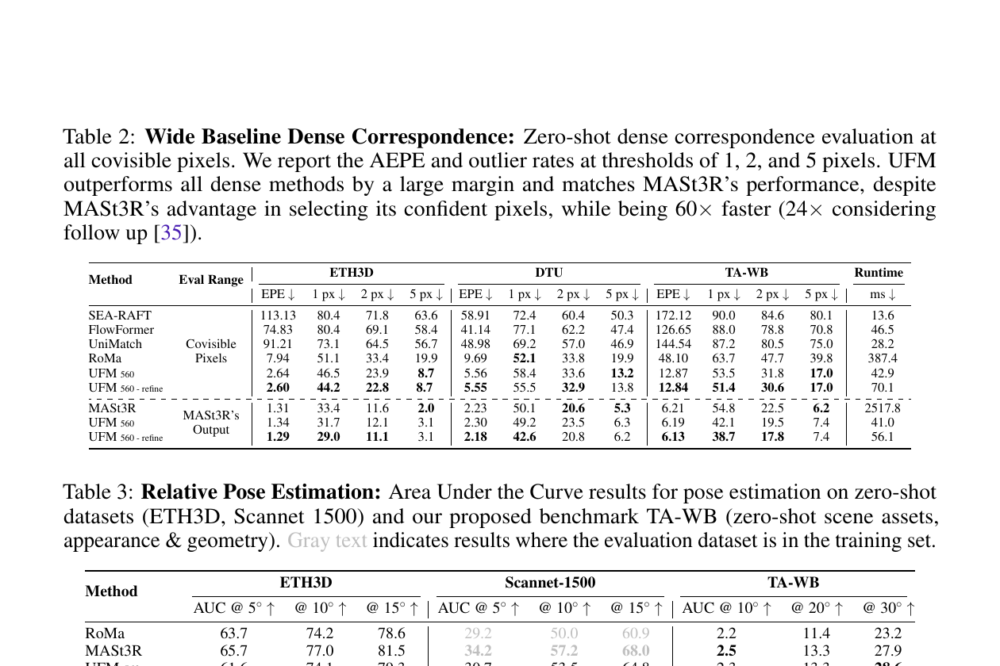

*原论文表 2、表 3。表 2 对比全体可见像素上的匹配误差和运行时间；MASt3R 一栏只评估其通过循环一致性筛选的输出点。表 3 报告不同角度阈值下的位姿 AUC。*

在表 2 的宽基线稠密评测中，UFM 560 的基线版在 ETH3D、DTU 和 TA-WB 上的 EPE 分别为 2.64、5.56、12.87 像素，运行时间为 42.9 ms；加入局部细化后，EPE 为 2.60、5.55、12.84 像素，时间为 70.1 ms。论文按三套基准汇总后报告，UFM 相对最佳稠密基线 RoMa 平均误差低 62%、速度快 6.7 倍。MASt3R 的精度接近 UFM，但其运行时间在同一表中为 2517.8 ms；这个比较也需注意，MASt3R 只在它筛出的置信匹配点上评测，UFM 则需在全体可见像素上给出稠密输出。

位姿结果补充了匹配误差之外的几何用途。UFM-Refine 在 ETH3D 的 AUC@5°、@10°、@15° 为 66.7、77.1、81.6，在 TA-WB 的 @10°、@20°、@30° 为 2.5、13.5、28.6；ScanNet-1500 上位于 MASt3R 后。细化后的结果通常优于 UFM 560 基线，说明初始回归场还能与额外局部匹配结合。

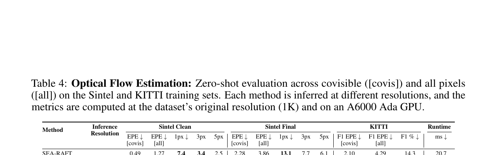

*原论文表 4。分别列出 560 与 980 输入分辨率下的光流误差与运行时间；“可见像素”和“全部像素”对应不同评测范围。*

在零样本光流评测中，UFM 980 在 Sintel Final 上的全像素 EPE 为 2.04，在 KITTI 上为 2.94，优于表中其他模型对应的全像素结果。Sintel Clean 上 UniMatch 的全像素 EPE 为 0.96，低于 UFM 980 的 1.16，因此 UFM 并非每个指标都领先。运行时间上，UFM 980 在 A6000 Ada 上为 122.9 ms，低于 FlowFormer 的耗时但高于 SEA-RAFT 与 UniMatch。模型的优势更集中在用一套结构覆盖多个任务和大位移，而非在所有任务、指标、硬件设置上都最快。

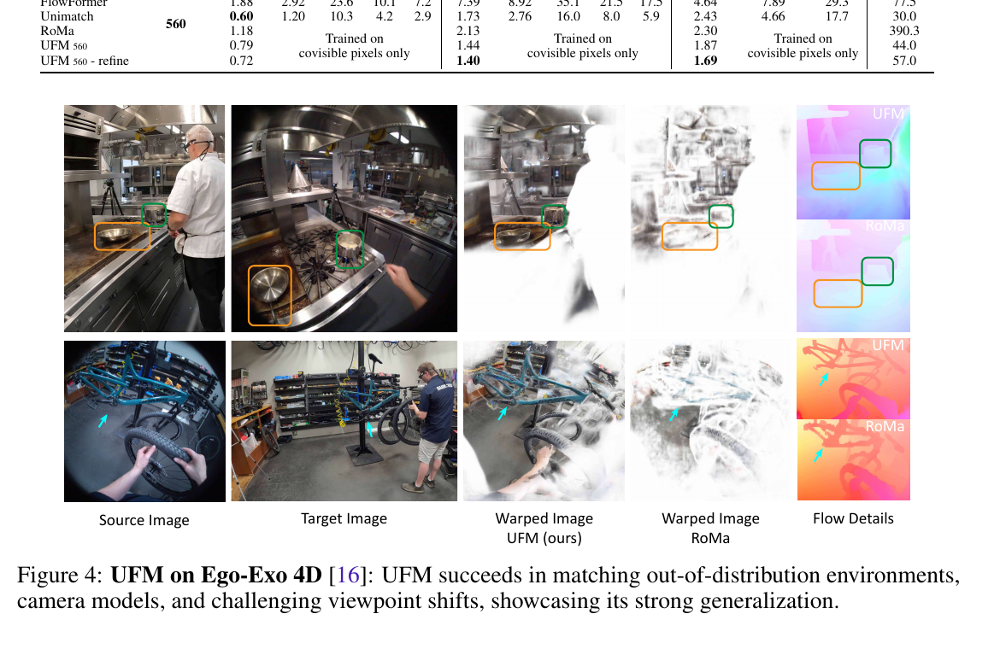

*原论文图 4。第一人称与第三人称相机带来视角和相机模型变化；论文用双向 warp 的可视化比较 UFM 与 RoMa。*

Ego-Exo4D 定性结果展示了模型对不同场景和相机视角的泛化。WxBS 则揭示了另一面：UFM 能处理尺度、视点、纹理、光照以及部分季节变化，但在多种变化同时出现、或可见光与极暗热红外跨光谱匹配时较弱，RoMa 在这些子集上更鲁棒。UFM 虽以 DINOv2 初始化，却在端到端训练中微调编码器；补充材料的实验显示，冻结 DINOv2 最后一层特征会明显损害该架构在 FlyingChairs 上的表现，中间层冻结特征更好，而微调后不同层之间差距缩小。作者推测，长时间微调可能削弱预训练特征中的语义匹配能力。

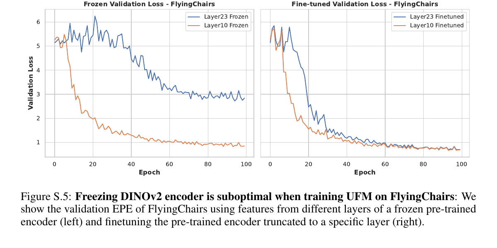

*原论文补充图 S.5。冻结编码器时，中间层特征的验证误差明显低于最后一层；允许微调后，两者差距收敛。该实验支持“UFM 需要适合对应任务的特征”的观察，但不直接证明语义能力下降的唯一原因。*

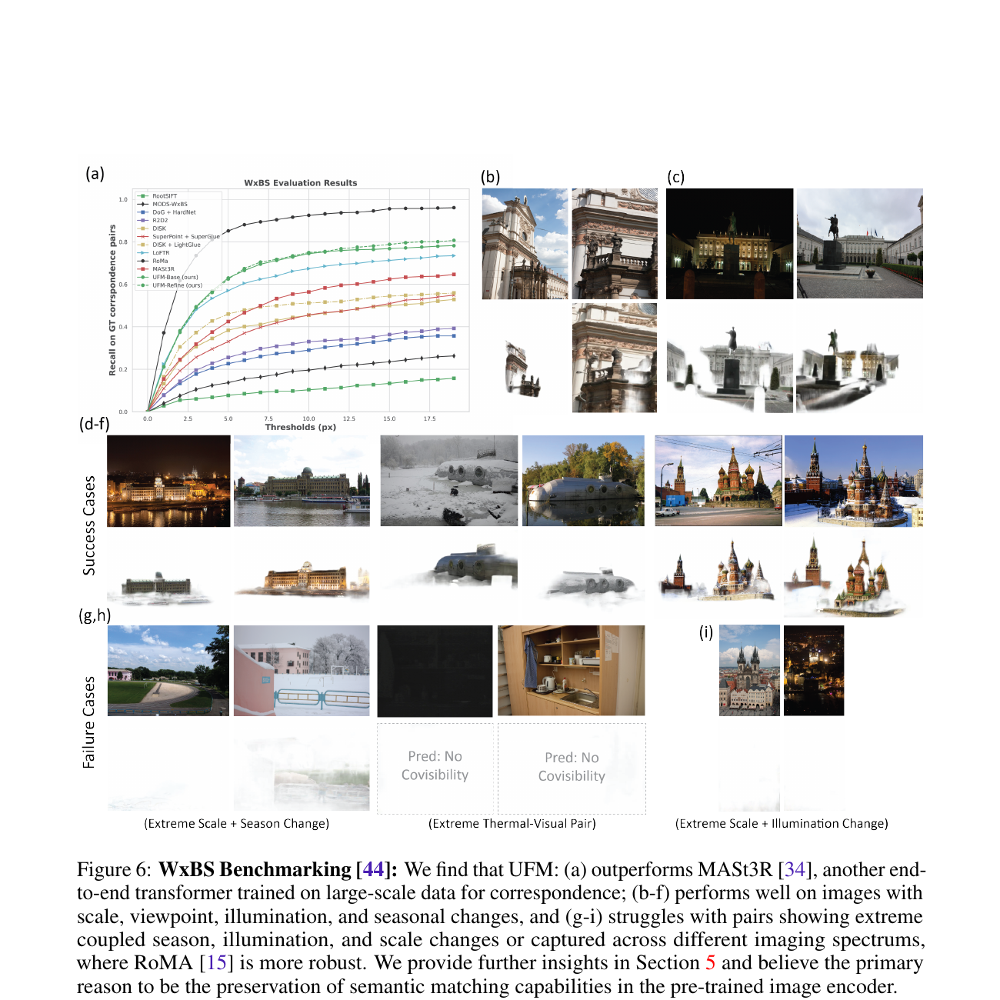

*原论文图 6。UFM 在一般尺度、视点和光照变化下能找回对应；季节、光照与尺度极端耦合，或跨成像光谱时，匹配会失败，RoMa 在部分例子中更稳健。*

### 联合训练是否带来互补

作者分别用光流数据（OF）、宽基线数据（WB）和两类数据的并集训练同一架构，并让不同版本看到相同数量的各自训练样本。混合训练后，Sintel Clean、Sintel Final 和 KITTI 的 EPE 分别为 1.02、1.48、2.62，低于 OF-only 的 1.27、1.81、15.57；TA-WB 的 1、2 像素误差率从 WB-only 的 61.5、35.3 降到 59.2、34.2。论文据此认为，两类数据能互相改善，而不是只让模型在数据占比更大的某一类任务上获益。

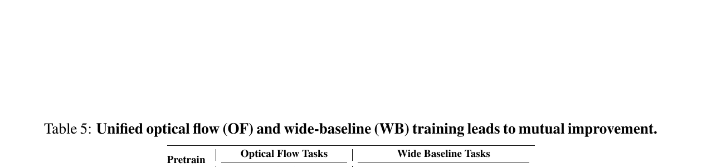

*原论文表 5。OF + WB 行在光流与宽基线指标上都优于相应的专用训练行。*

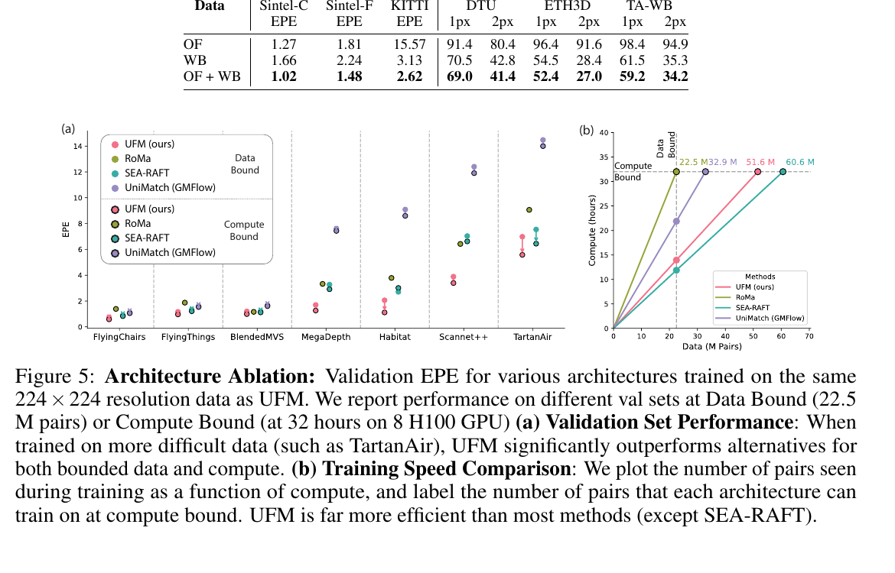

*原论文图 5。左侧比较不同验证集上的 EPE，右侧比较固定计算预算下处理的图像对数量；作者在所测数据量和算力上限下观察到 UFM 的扩展效率较高。*

同一数据与算力约束下的架构比较显示，UFM 在更难的 ScanNet++ 和 TartanAir 验证集上随训练数据和计算量增加而改善明显。论文将其归因于较简单的直接回归结构更容易扩展到大规模混合数据。这里的结果来自特定的 8 张 H100、数据量和训练时长设置，说明的是论文所测条件下的可扩展性。

## 5 局限与方法关系

UFM 的主要贡献是把光流与宽基线匹配放入同一输出表示和训练框架：网络始终预测像素位移与可见性，用可见区域真值联合训练。直接回归便于统一标签、避免粗网格对初始位置精度的限制，也更利于大规模训练；局部分类细化则在需要时补充精细定位。论文的消融结果为联合训练的互补性提供了证据，但其跨模态语义鲁棒性还不如 RoMa。

作者列出两项重要限制。第一，训练集和 TA-WB 偏向静态物体，可能削弱对动态物体的预测；KITTI 测试集上 UFM 的前景 F1 误差率为 22.08%，高于背景的 8.67%，而 UniMatch 的前景误差率为 17.27%。第二，长时间微调可能让 DINOv2 偏离原先的语义表示，使极端季节变化或跨光谱匹配变难。增加场景流数据、加入语义匹配训练或保留更强的预训练约束，是论文提出的后续方向，仍需更多实验验证。

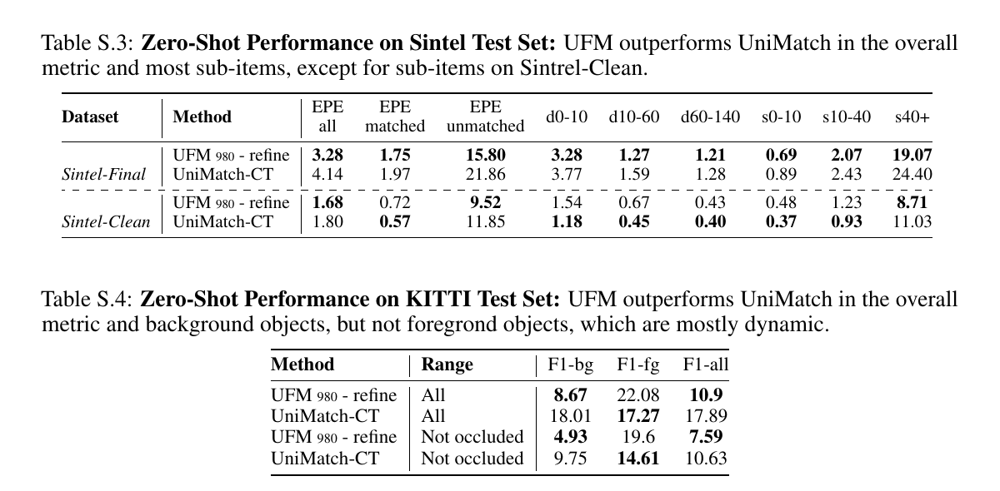

*原论文补充表 S.3、S.4。KITTI 的前景动态物体误差高于背景；Sintel-Clean 的部分子指标则由 UniMatch 取得更好结果。*

按方法脉络看，DKM 建立了粗全局匹配与多尺度 warp 细化的宽基线稠密匹配流程；RoMa 沿用这一流程，并重点增强大视角及外观变化下的鲁棒性；UFM 则把问题扩展到光流与宽基线的共同训练，采用直接稠密回归作为统一输出，再以局部分类补精度。三者都预测像素对应，但训练假设与关注点不同：DKM、RoMa 主要面向静态场景的宽基线匹配，UFM 试图覆盖动态光流和静态宽基线两域。
