# VGG-T³ 论文解读

> Sven Elflein、Ruilong Li、Sérgio Agostinho、Zan Gojcic、Laura Leal-Taixé、Qunjie Zhou、Aljosa Osep，*VGG-T³: Offline Feed-Forward 3D Reconstruction at Scale*，CVPR 2026。本文依据 [CVPR 论文页面](https://openaccess.thecvf.com/content/CVPR2026/html/Elflein_VGG-T3_Offline_Feed-Forward_3D_Reconstruction_at_Scale_CVPR_2026_paper.html)、[正式论文 PDF](https://openaccess.thecvf.com/content/CVPR2026/papers/Elflein_VGG-T3_Offline_Feed-Forward_3D_Reconstruction_at_Scale_CVPR_2026_paper.pdf) 和[补充材料](https://openaccess.thecvf.com/content/CVPR2026/supplemental/Elflein_VGG-T3_Offline_Feed-Forward_CVPR_2026_supplemental.pdf)。

VGGT 能把一组无序图像一次送入网络，联合预测各视图的相机和几何；代价是全局注意力要让所有图像 token 两两交互，图像越多，计算越快地变重。VGG-T³ 的关键改动是改变“场景记忆”的形态：不再保留随图像数增长的 Key-Value（KV）序列，而是在测试时训练一个固定大小的 MLP，让它近似从 Key 到 Value 的映射。这样全局查询成本由二次增长转成线性增长，同时仍可从全体图像聚合场景信息。

这个取舍并非没有代价。论文报告在 1,000 张图像上，VGG-T³ 的重建用时约 58 秒，显著快于 VGGT，但稠密几何仍与二次复杂度基线有差距；相机位姿任务也没有稳定胜过 VGGT。

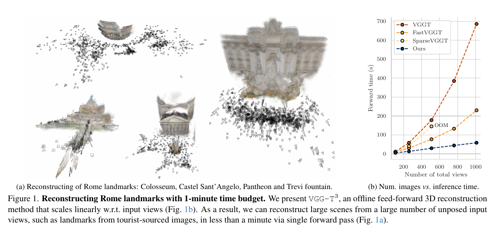

## 1. 引言

传统 SfM 流程通常先提取局部特征、建立图像间匹配，再估计相机并联合优化相机和三维结构。这类方法在图像重叠充分、匹配关系连通时可以得到高质量结果，但弱重叠、快速运动等情况会带来困难。VGGT 等前馈模型把多视图推理放进 Transformer，通过全局注意力直接聚合所有图像特征，能在较少重叠时保持鲁棒性，却受到输入规模限制。

作者把这一限制追溯到全局注意力内部的 KV 表示。每个输入 token 投影成 Query、Key、Value；所有图像的 Key 和 Value 合在一起，形成随输入增长的隐式场景表示。每个 Query 都要与整组 Key 计算相似度，再对 Value 加权求和，因此图像数为 $N$、每张图有固定数量 token 时，全局交互的主要计算随 $N^2$ 增长。稀疏注意力和 token 合并能降低常数或减少参与交互的 token，但输入越长仍需要处理更多 KV，渐近复杂度依旧是二次的。

论文借鉴固定维度隐式表示的思路：类似 DeepSDF 用小型潜变量记录具体形状、预训练解码器提供形状先验，这里让一个固定大小的 MLP 记录当前场景。与形状重建不同，VGG-T³ 不重训整个解码器，而是以测试时训练（Test-Time Training，TTT）把预训练 VGGT 的 KV 关系压进 MLP 参数。重建图像集合时更新 MLP；之后给定新图像时冻结该 MLP，把它当作场景记忆来查询相机和几何。

作者强调这种表示带来两类规模扩展：每张图像的 token 可以分批放在 CPU 内存或分散到多张 GPU 上，累加测试时训练的梯度；场景 MLP 的参数量则不随图像数增加。论文摘要报告重建 1,000 张图像需 54 秒，正文大规模实验报告约 58 秒；两处数字略有差异，文中实验对比采用正文及图表中的 58 秒。作者还提出用同一场景 MLP 做新图像定位，作为联合重建与定位的初步展示。

## 2. 相关工作

### 2.1. 经典 SfM 与前馈模型

Bundler、COLMAP、GLOMAP 等经典 SfM 系统分阶段处理特征、匹配、相机估计和联合优化。它们可以利用整个图像集反复修正几何，但要求图像间有足够重叠和连接。前馈模型则用网络直接预测几何。双视图模型从图像对回归相对位姿和参考视图深度；多视图模型进一步聚合多张图像，联合预测相机和每视图深度或全局点图。VGGT、Fast3R、π³ 通过全局 token 注意力融合信息；Light3R-SfM 用场景图及最短路径树汇聚特征；FLARE 将相机估计与逐视图几何估计拆开处理。

### 2.2. 大规模重建

输入集合较小时，全局注意力能让每个视图直接利用所有其他视图的信息，但成本随视图数平方增加。Slam3R、VGGT-SLAM、VGGT-Long 等方法通过视频分块、局部注意力或滑动窗口扩展到长序列；由于逐段建立局部状态，全球信息被拆开，可能产生漂移，也不适合任意顺序的无序图像集合。FastVGGT 的 token 合并和 SparseVGGT 的块稀疏注意力仍然在全局 KV 上执行注意力，因此降低了开销但没有改变二次渐近复杂度。VGG-T³ 要压缩的是整组 KV 的表示本身，而不是仅减少注意力中参与计算的 token。

### 2.3. 在线重建与测试时训练

StreamVGGT、Stream3R 等因果模型按时间顺序接收图像，只访问先前的 Key 和 Value；它们适合流式输入，但仍需缓存随时间增长的 KV。CUT3R、Must3R 使用固定大小的隐状态逐步更新，Point3R、Long3R、MapAnything 则采用显式空间记忆。TTT3R 把 CUT3R 的状态更新解释为测试时训练，作为线性时间的自回归方法。VGG-T³ 同样在测试时优化参数，却选择全局、离线地处理整个无序图像集；它用 MLP 压缩预训练多视图模型中的 KV，并在实验中比较它和 TTT3R 的速度与精度。

作者也把方法放在更一般的线性注意力背景下：线性注意力、状态空间模型可用固定状态递归累积信息，而 TTT 将隐藏状态视作可优化变量。VGG-T³ 使用的是这个“测试时更新小型状态”的观点，但目标很具体：将 VGGT 全局层变长的 Key→Value 关系压进固定维度网络。

### 2.4. 视觉定位

传统视觉定位常通过特征匹配建立 2D–3D 对应，再用 PnP 求相机位姿。场景坐标回归直接预测像素对应的世界坐标；ACEZero 也尝试从无位姿图像联合建立地图与定位，但需要大量迭代优化。VGG-T³ 的做法是先用映射图像优化场景 MLP，再把未参与优化的查询图像输入冻结网络，直接预测其相对场景的相机和几何。论文将其定位为前馈定位的可行性证明，而不是取代显式建图定位管线。

## 3. 大规模前馈三维重建

任务输入是一组无序图像 $\{I_i\}_{i=1}^N$。模型要为每张图像估计相机外参（旋转、平移）、针孔相机内参，以及稠密深度或点图。论文从 VGGT 的交替注意力结构出发：每张图先被切成 token，网络交替执行图像内注意力和跨图像的全局注意力。图像内注意力处理单帧空间关系；全局注意力让不同视图的信息共同影响场景几何，但带来二次复杂度。

### 3.1. 预备知识：VGGT 与测试时训练

在某个全局注意力层中，输入 token $x_i$ 经过线性投影得到：

\[
q_i=\mathrm{LN}_q(W_qx_i),\qquad k_i=\mathrm{LN}_k(W_kx_i),\qquad v_i=W_vx_i.
\]

这里 $(q_i,k_i,v_i)$ 分别是查询、键和值；LayerNorm 对查询和键做归一化以稳定注意力。标准 softmax 注意力对每个查询计算：

\[
o_i=\sum_j \mathrm{softmax}_j\!\left(\frac{q_i^\top k_j}{\sqrt d}\right)v_j.
\]

相似度决定从哪些 token 读取信息，权重和为 1，再对对应 Value 加权求和。全局层中的 $j$ 遍历所有图像 token，所以每个查询都要查看随图像数增加的 KV 集合。

TTT 将注意力解释成学习一个映射 $T_\theta:K\rightarrow V$。给定当前层全部 Key–Value 训练样本，优化小网络参数：

\[
\theta^*=\arg\min_\theta\sum_i L_t(T_\theta(k_i),v_i),\qquad o_i=T_{\theta^*}(q_i).
\]

第一步用 Key 作输入、Value 作监督目标，更新 fast weights（这里就是 MLP 参数）；第二步把 Query 输入训练好的映射，得到该层输出。与 softmax 对所有 Key 逐一算相似度不同，MLP 的一次前向计算成本固定，因此对每个 token 单独执行时，总体随 token 数线性增加。它近似重建注意力要完成的读取行为，但不保证与 softmax 的输出完全相等；容量有限的 MLP 会形成速度与精度的权衡。

### 3.2. 把场景 KV 压入 MLP

#### 用预训练 VGGT 初始化

作者保留 VGGT 的图像编码、图像内注意力和解码头，用预训练的 QKV 投影作为起点，只替换全局注意力层。直接把 softmax 换成 TTT 时，测试时优化收敛很慢。作者发现原有 LayerNorm 的可学习变换会改变 MLP 需要拟合的特征空间，于是在线性化模型中去掉这两个 LayerNorm，改用 L2 归一化；这样从预训练权重出发更容易优化。消融结果也支持先用 softmax 注意力训练模型、再后训练线性化，优于从头用 TTT 训练。

#### ShortConv2D：避免退化的 Key–Value 拟合

单纯拟合 $K\rightarrow V$ 有一个结构性问题：两者来自同一 token 的线性投影，$K=W_kx$、$V=W_vx$。当 $W_k$ 可逆时，二者之间本来就是线性关系 $V=W_vW_k^{-1}K$，MLP 只需学到这个逐 token 变换，就可能得到看似很低的训练误差，却没有学习融合邻近空间信息的能力。作者因此先把 Value 恢复到每张图的二维 patch 网格，用单层 3×3 卷积混合相邻 patch，再展平为 $V'$。训练目标改成从局部 Key 预测带邻域上下文的 $V'$。Key 没有做相同的空间混合，于是映射不再只是同一 token 上的平凡线性变换，MLP 必须编码更丰富的局部几何上下文。相机 token 和 register token 不参与卷积，直接保留。

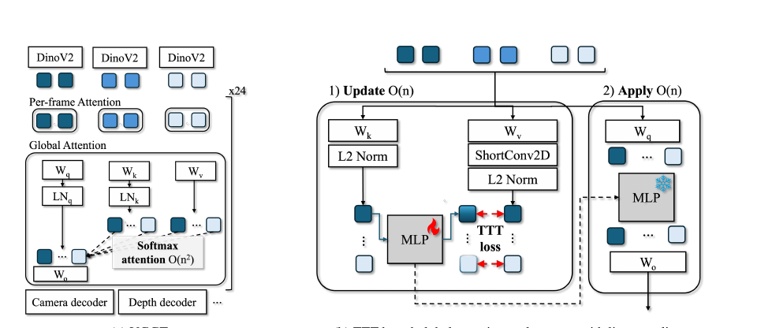

#### 序列长度与测试时扩展

VGGT 训练时最多使用 24 张图。VGG-T³ 若测试时始终只优化一步，面对远超训练规模的图像集合会出现表示容量不足：补充实验观察到从 100 张扩展到 1,000 张时，重建误差可增至约 5 倍。作者比较不同步数后发现，训练范围内一步通常足够；1,000 张场景用两步明显更好。继续加到三、四步没有持续收益，因此默认使用两步。这里“线性扩展”指给定优化步数下总 token 处理量按输入规模线性增长，并不意味着无论场景多大都能用同样少的更新达到相同精度。

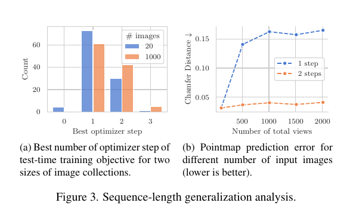

### 3.3. 大规模重建

#### 线性计算与小批量梯度

TTT 的总损失是所有 token 局部损失之和，因此总梯度也是各 token 梯度的和：

\[
\nabla_\theta L_{\mathrm{total}}=\sum_i\nabla_\theta L(k_i,v_i)=\sum_s\sum_{i\in s}\nabla_\theta L(k_i,v_i),
\]

其中 $s$ 表示一个小批次。无需同时把整个场景的全部 KV 放入 GPU，就能逐批算梯度并累加到同一组 MLP 权重上。单 GPU 推理时，批次可在 CPU 内存与 GPU 之间搬运；多 GPU 时，各卡处理不同图像分片，再同步小型 MLP 的更新。通信的对象是固定大小的 fast weights，而不是所有图像的 KV。作者据此将全局注意力替换后的计算从 $O(N^2)$ 改成 $O(N)$，同时支持单卡处理大型集合和多卡分布式处理。

#### 冻结场景表示做新图像定位

对建图图像完成 TTT 后，场景 MLP 参数保持冻结。查询新图像时，网络只把它的 Query 送入每个全局层的 MLP，从已压缩场景状态读取信息，不再用查询图像更新场景参数。于是查询成本不随建图图像数重新做全局配对。相机解码有个实现细节：VGGT 相机头使用建图图像保留的 camera tokens，因此定位时仍要把这些 token 送入相机头的 softmax 层；论文所说的固定 MLP 场景表示并不意味着整个相机解码路径都完全不保留映射图像信息。

## 4. 实验

作者比较离线方法 VGGT、FastVGGT、SparseVGGT，以及线性时间的自回归方法 TTT3R。所有实验均从公开 VGGT 检查点开始，冻结 VGGT 其余参数，只微调全局注意力层的投影与新增 TTT 模块。主文报告用 AdamW 训练线性化部分 100k 步，使用 8 张 A100 80GB，成本约为从头训练 VGGT 的 12%；测试时 MLP 用 Muon 优化。补充材料给出数据混合、分辨率与优化细节，见后文。

### 4.1. 标准基准

#### 点图估计

NRGBD、7scenes、DTU、ETH3D 上按稠密和稀疏划分评价点图，指标是 Chamfer Distance（CD，越低越好）和 Normal Consistency（NC，越高越好）。表 1 显示 VGG-T³ 在六组数据划分中都比 TTT3R 的点图误差低；例如 DTU 的 CD 从 5.708 降到 1.654，ETH3D 从 0.885 降至 0.480。在与二次复杂度方法比较时，结果总体接近但不全面领先：例如 DTU 上 VGGT 的 CD 为 1.537，略低于 VGG-T³；7scenes 稀疏划分中 VGG-T³ 也未达到 VGGT。FastVGGT 在 NRGBD 稀疏划分因一个样本只有两视图而无法运行。该表支持“比 TTT3R 更准、与全局注意力模型有竞争力”，不支持“全面超过 VGGT”。

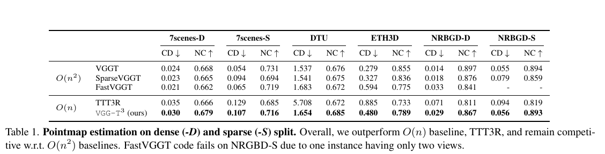

#### 视频深度

Bonn、KITTI、Sintel 上评价视频深度。每段序列允许一个尺度对齐，并报告绝对相对误差（Abs Rel，越低越好）和深度阈值 $\delta<1.25$ 的比例（越高越好）。VGG-T³ 在 KITTI 的两项结果优于 TTT3R，Bonn 的误差略差于 TTT3R；Sintel 上也优于 TTT3R，但仍弱于 VGGT 等二次注意力基线。因而论文所称“较大幅度优于线性基线”主要是整体比较，具体到每个数据集并非每项指标都胜出。

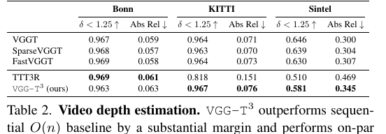

#### 相机位姿

TUM-RGBD、ScanNet、Sintel 上用 ATE、旋转 RPE 和平移 RPE 评价位姿，均为越低越好。此处是论文明确承认的弱项：线性化模型在相机位姿上表现不稳定。作者推测，VGGT 在注意力前加入专用 camera token，使图像 patch 与相机 token 成为异质输入，可能较难由同一个 MLP 记忆。VGG-T³ 能处理无序图像，TTT3R 则在无序输入时误差显著恶化；但在有序视频上，TTT3R 的位姿通常更准确。可见“支持无序输入”与“各项位姿指标更优”是两回事。

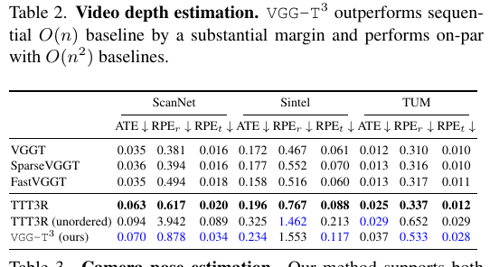

### 4.2. 大规模三维重建

作者用 7scenes 视频覆盖较充分的场景，均匀抽样并改变图像数，比较重建误差和用时。VGG-T³ 在约 1,000 张图像上用时约 58 秒；VGGT 超过 11 分钟，约慢 11.6 倍；FastVGGT 超过 4 分钟，约慢 4.3 倍。误差—用时图显示，VGG-T³ 比 TTT3R 的重建质量更好，且图像数增加时误差相对稳定。与全局注意力模型之间仍有 CD 差距，虽然差距会随输入图像变多而缩小。正文另报 2,000 张图像用时 48.5 秒（4 卡），相对 VGGT 的约 27 分钟快约 33 倍。补充材料指出，VGGT 基线使用了显存优化和 Ulysses 上下文并行，也对长序列 softmax 温度做了调整以增强基线；即便如此，大规模输入下仍明显更慢。

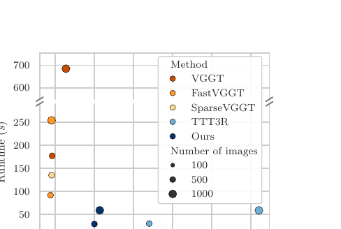

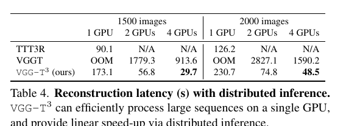

### 4.3. 前馈视觉定位

映射图像先经 Sim(3) 对齐，再以未用于建图的图像作为查询，报告旋转误差、平移误差及在 10cm/10°、20cm/20° 阈值内定位成功比例。VGG-T³ 在 7Scenes 和 Wayspots 上都优于 TTT3R，Wayspots 差距更明显：10cm/10° 成功率从 0.69% 提升至 13.41%。不过作者说明，使用准确相机位姿显式建图的专用定位方法仍可能更准确；该实验展示的是从无位姿图像建立紧凑场景状态后，再前馈定位的可能性。

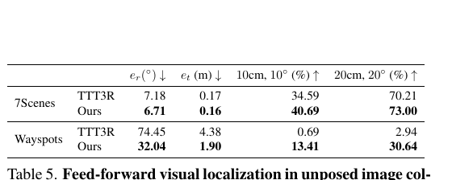

### 4.4. 消融实验

消融在 ScanNet++、224×224 分辨率、每组 2–24 张图像的设置下进行。与直接从头用 TTT 训练相比，先以 softmax 注意力训练再线性化大幅降低 CD（0.262 降至 0.097，采用 LoLCATs 线性化的对照为 0.097），而作者提出的 TTT 线性化为 0.074。再加 3×3 ShortConv2D 后，CD 降至 0.066、NC 从 0.833 升到 0.838，位姿 mAA(30) 从 72.16 升到 74.14。仍未完全达到 softmax 上限（CD 0.061、NC 0.844、mAA 76.33），这与全篇的速度—精度取舍一致。

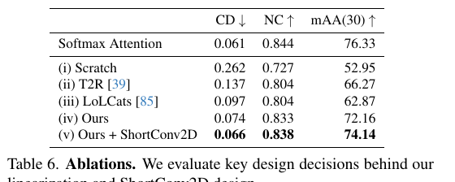

## 5. 结论与局限

VGG-T³ 将预训练 VGGT 全局注意力中的变长 KV 场景表示，改写成通过测试时训练更新的固定大小 MLP。每个 token 的 Key–Value 监督可分批计算，因而可以在单卡上处理超大图像集合，也可以在多卡上只同步小型 fast weights。作者展示了千张图像重建和基于冻结场景状态的前馈定位。

论文同时指出，MLP 固定容量与二次注意力的表达能力之间仍有差距，特别是在宽基线场景；相机位姿也是当前方法的明显弱项。对于流式 SLAM 方向，VGG-T³ 更适合作为离线全局重建与流式固定状态的对照：它不按帧到达顺序增量建图，而是先看完整组无序图像并在测试时优化场景状态。它的价值在于展示“固定大小、可查询的场景记忆”如何扩展离线前馈重建，并不直接解决在线时序更新、实时闭环或长期漂移问题。

## 补充材料：实现细节与额外结果

### A. 训练数据、实现与评测

训练集合由室内、室外、物体中心和混合数据组成，包括 Hypersim、Replica、ScanNet++、MegaDepth、CO3Dv2、DL3DV-10K、TartanAirV2 等。补充材料列出完整数据集。图像集合的采样从随机首图开始，之后从与当前集合任一图像共视率高于 0.3 的候选中均匀抽取，直到达到目标大小；共视矩阵由深度一致性预先计算。每个 GPU 的总图像数约为 48，集合大小在 2–24 张之间；长边缩放至 518，宽高比从 0.5 到 2.0 均匀采样，并对每张图独立做颜色扰动。

线性化阶段使用 AdamW，学习率从 $10^{-4}$ 经 warmup 后余弦衰减到 $10^{-6}$，权重衰减 0.05；测试时内部优化使用 Muon、0.1 学习率和 5 次 Newton–Schulz 迭代。TTT MLP 输入输出维度为 1024，隐藏维度投影为输入维度的 4 倍。只训练全局层的 QKV 和输出投影及 TTT 新增参数；图像编码、帧内注意力和预测头冻结。推理时评测使用 A100 80GB。大规模点图评测为节省 ICP 对齐时间，用等间距抽取的 10 张关键帧计算指标，其余帧作为支持视图；TTT3R 的关键帧放在输入末尾，确保它先看过该场景其他图像。

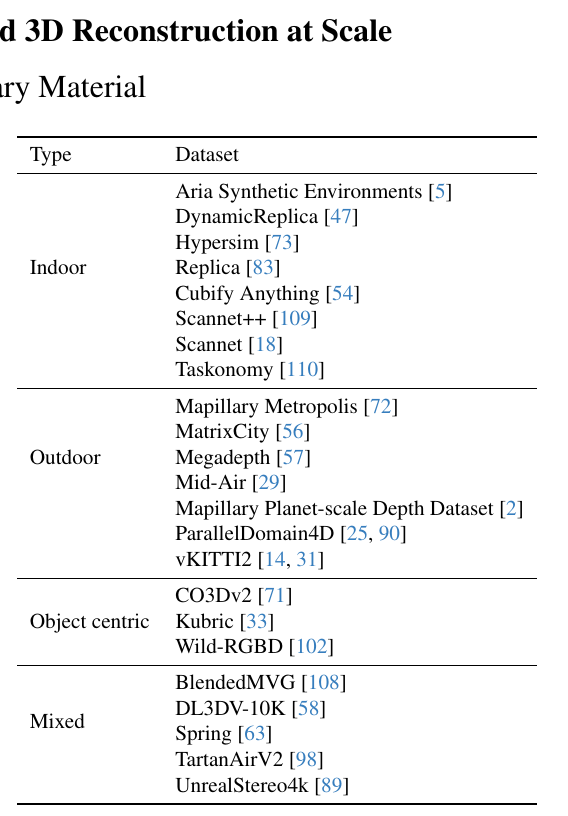

### B. 更强的 VGGT 基线

作者对 VGGT 做了显存与长序列改进，以便和 VGG-T³ 做更公平的规模比较：丢弃交替注意力中后续不用的激活，使单张 80GB GPU 可处理最多约 1,000 张图像；用 Ulysses 上下文并行让 VGGT 可运行 2,000 张图像，但 2 卡运行耗时可达 47 分钟。此外，作者随输入长度调整全局 softmax 的缩放，让注意力熵在训练长度附近保持一致，并在更长序列上适当锐化注意力。该修正改善 VGGT 大规模基线成绩，所以主文的速度与误差比较并非故意让原始 VGGT 使用未优化设置。

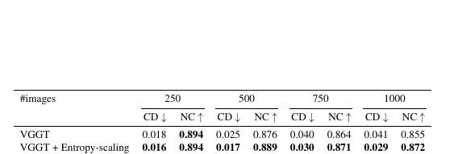

### C. 额外消融

补充图 4 在 NRGBD 上改变图像数和 TTT 更新步数：不做更新时误差最高；训练长度范围内一步够用，但集合扩大后误差上升；两步在较广范围内最稳，三、四步没有进一步改善。ShortConv2D 的补充表比较 3×3、5×5，以及作用在 Key、Value 或二者上的设置。只对 Value 使用 3×3 滤波最好；5×5 没有进一步提升，K 与 V 同时滤波反而降低性能。论文的解释是，K 和 V 同样混合空间邻域会重新建立二者相关性，削弱任务所需的映射难度。

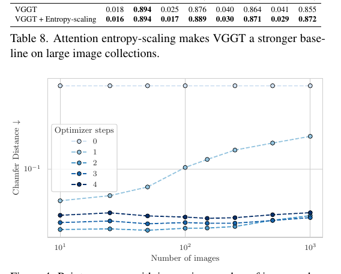

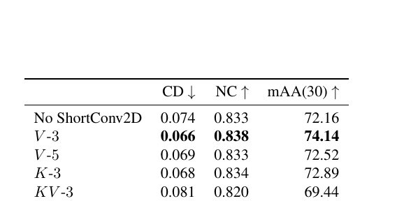

### D. 更多定性结果

补充图 5 比较 VGGT、TTT3R、VGG-T³ 对千张图像集合的重建。作者指出，TTT3R 与 VGG-T³ 都能在一分钟内处理，但 VGG-T³ 的几何更连贯；VGGT 局部细节略清晰，耗时则超过 11 分钟。图 6 展示 Wayspots 与 7scenes 的查询定位：绿色是未参与建图查询图像的真值相机，红色是预测相机和几何。图 7 展示跨时间定位：用 KITTI 车载序列建图，再定位七年后拍摄的游客照片；即使街景外观改变、拍摄视角更高，方法仍能把查询相机放到场景中。图 8 则给出 Waymo 大范围序列的重建对比：部分场景接近 VGGT，复杂布局中也会出现质量退化。作者将其视为固定容量场景表示在更大空间范围上的现有限制。

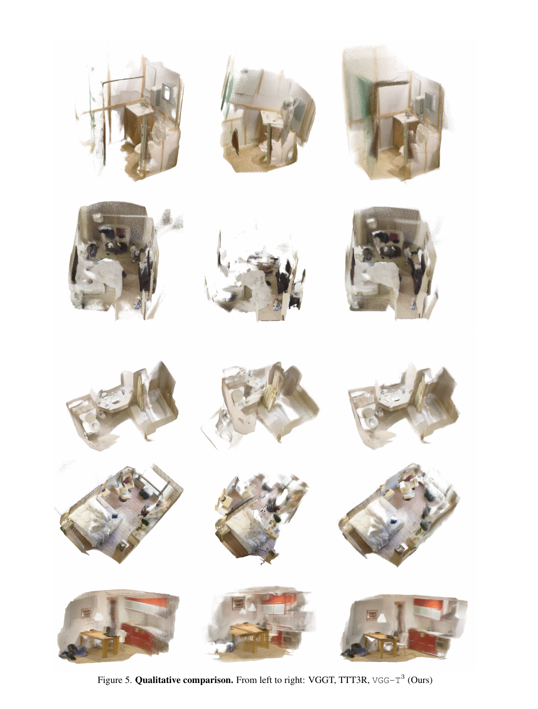

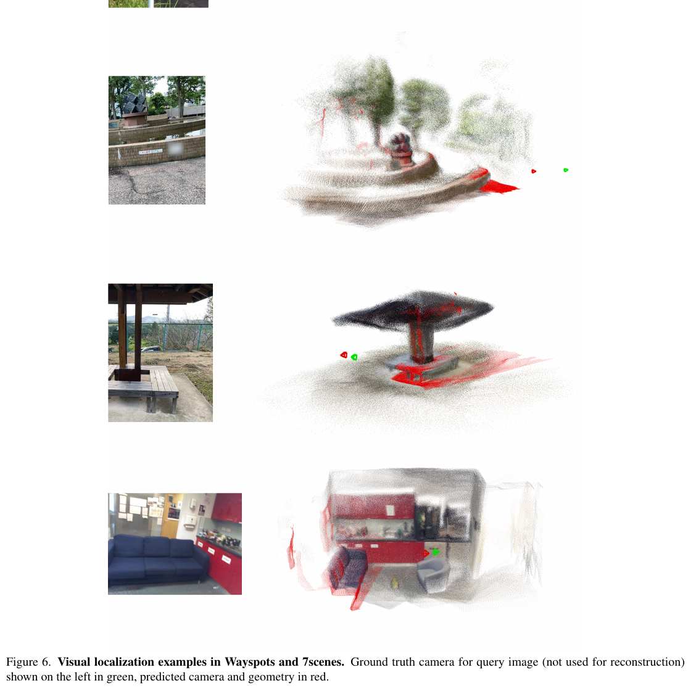

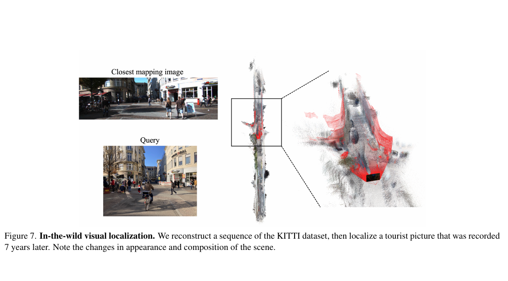

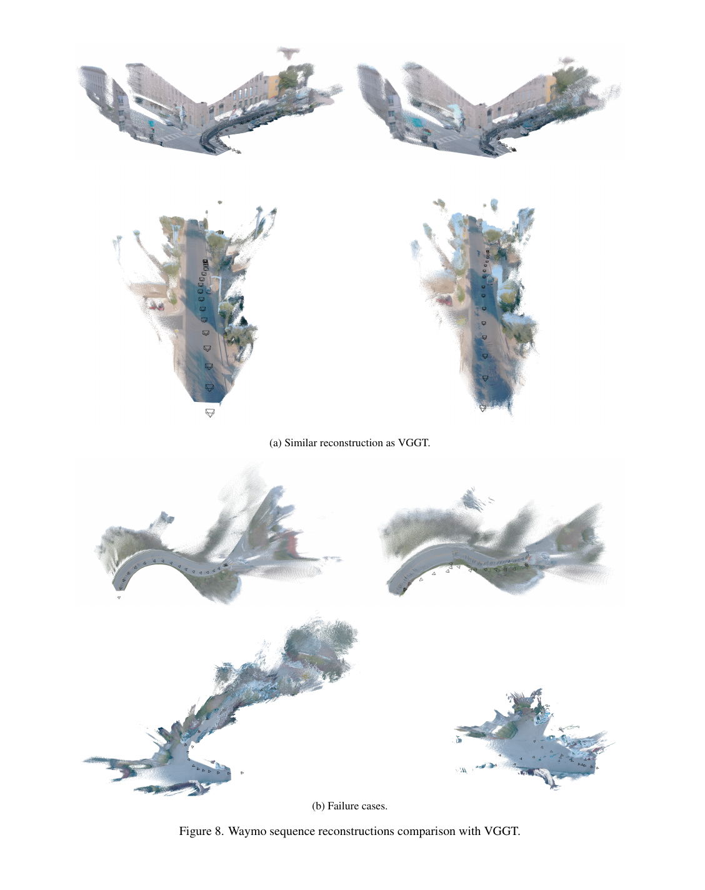
