# VGGT-Geo 论文解读

> Kai Qin、Jing Li、Sisi Zlatanova 等，*VGGT-Geo: Probabilistic Geometric Fusion of Visual Geometry Grounded Transformer Priors for Robust Dense Indoor SLAM*，ISPRS International Journal of Geo-Information 15(2), 85，2026 年正式版。本文依据 2026 年 2 月 16 日出版的 23 页论文 PDF；出版社页面未列出独立补充材料。[论文页面](https://www.mdpi.com/2220-9964/15/2/85) · [论文 PDF](https://mdpi-res.com/d_attachment/ijgi/ijgi-15-00085/article_deploy/ijgi-15-00085.pdf) · [DOI](https://doi.org/10.3390/ijgi15020085)

VGGT-Geo 想解决的是前馈三维几何模型与 SLAM 后端各自的短板：VGGT 能从一段图像中给出结构完整的相机和点图初值，但逐段预测在长序列中会产生尺度与几何不一致；传统优化能利用跨帧约束，却依赖可靠的匹配和初始化。论文用 VGGT 为滑动窗口提供初值，再让 DINOv3 特征置信度、MASt3R 匹配点、LETR 线段和 MoGe-2 度量深度共同约束一个位姿—逆深度优化问题。它的核心不是让网络替代几何，而是用前馈先验启动优化，并用多种观测在窗口内校正预测。

## 1 引言

传统稠密 SLAM 通常先估计相机轨迹，再把多视图深度融合为表面或 TSDF 地图。几何优化能够建立明确的跨帧约束，但特征提取、匹配和迭代求解带来计算开销，也使初始化和参数设置变得重要。深度传感器能提供公制尺度，不过重建结果受传感器噪声和量程影响。神经隐式表示与 3D Gaussian Splatting 擅长表达场景外观和形状，论文认为当时不少系统仍需要离线处理，且质量受到初始几何影响。

DUSt3R、Spann3R、SLAM3R、VGGT 等前馈方法则直接从图像预测稠密点图或相机几何，减少了显式几何求解。作者指出，仅靠局部窗口的预测和融合，长序列可能出现漂移；纹理重复或缺失也会让网络输出产生浮点、重影和表面拉丝。若只把预测点图不断累积，早期几何误差会进入后续地图。

论文以图 1 对比多帧直接累积 VGGT 点图与 VGGT-Geo 的结果：前者出现双层和错位表面，后者的墙面更连续。作者据此提出三个设计目标：用 VGGT 提供场景级初始化；用 DINOv3 的置信度调节观测约束；用点、线和度量深度共同形成滑窗后端。图 1 是作者选择的场景示例，显示该场景中的重影差异，不能单独证明对所有数据都消除了漂移。

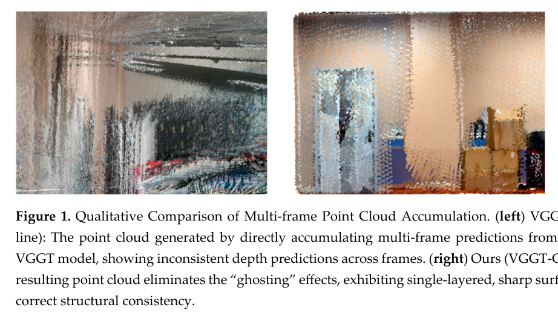

作者将贡献归为前馈几何与优化的耦合、置信度加权的多模态后端，以及在 TUM、Replica 和自采室内环境中的评估。第三项中“优于现有方法”和“零样本泛化”的强度要结合后文看：部分自采对比仅评估两条序列，另一部分基线失败；公共数据结果则来自特定数据和对齐协议。

## 2 相关工作

### 2.1 三维视觉基础模型

手工局部特征在纹理丰富、成像稳定的场景中有效，但在白墙、玻璃和光照变化下容易变少或失配。DUSt3R 以图像对直接回归点图，MASt3R 增加用于特征关联的匹配头；VGGT 面向多图像输入，能够联合预测相机参数、深度和点图。论文认为这些基础模型具有较强的零样本几何能力，但直接用于长视频时，局部输出之间仍可能缺少全局一致性约束。

### 2.2 学习与几何优化结合的 SLAM

SLAM3R 采用局部预测再全局融合，论文将其归为没有显式 BA 后端的前馈路线；MASt3R-SLAM 则将学习式点匹配接入后端图优化。VGGT-SLAM 在子图之间估计射影变换，并在 SL(4) 流形上做全局优化。VGGT-Geo 选择另一种结合方式：VGGT 只负责提供窗口初值，优化变量仍是相机位姿、共享内参和逐帧逆深度，匹配点、线段与深度先验构成优化残差。

作者对基线的局限有较强判断，例如称 [MASt3R-SLAM](../mast3r-slam/index.md) 在弱纹理区域容易退化、[VGGT-SLAM](../vggt-slam/index.md) 对前端初始化敏感；[SLAM3R](../slam3r/index.md) 则代表局部预测再融合的前馈路线。这些是论文作者的经验陈述；它们的证据范围应限于本文采用的数据、实现和设置，不能泛化成对原系统所有场景的结论。

### 2.3 几何先验与不确定性

室内环境常含墙角、门框和天花板边缘。点特征在长直边或白墙附近可能分布退化，而线段能提供方向信息，特别有助于约束相机旋转；线本身却难以约束沿线方向的平移。深度先验能为单目尺度提供锚点，但错误深度或错误线匹配若被当成硬约束，也会把优化带偏。VGGT-Geo 的处理方式是保留这些不同来源的残差，并用像素级置信度和 Huber 核降低部分不可靠观测的影响。

## 3 方法

### 3.1 系统概览与概率形式

系统处理按时间到达的 RGB 图像序列 $\mathcal I=\{I_1,\ldots,I_N\}$。对当前关键帧窗口，待估计状态写作

$$
\mathcal X=\{\mathcal T,\mathcal K,\mathcal D\},\tag{1}
$$

其中 $\mathcal T=\{T_i\in SE(3)\}_{i=1}^N$ 是相机位姿，$\mathcal K$ 是假定在窗口内共享的相机内参，$\mathcal D=\{D_i\}_{i=1}^N$ 是各帧的稠密逆深度图。图 2 显示两条前端路径：图像序列经 VGGT 得到相机和点图初值；同时，经 DINOv3 得到用于几何约束的特征与置信度，再与 MoGe-2 深度、MASt3R 匹配点和 LETR 线段一起交给图优化器。

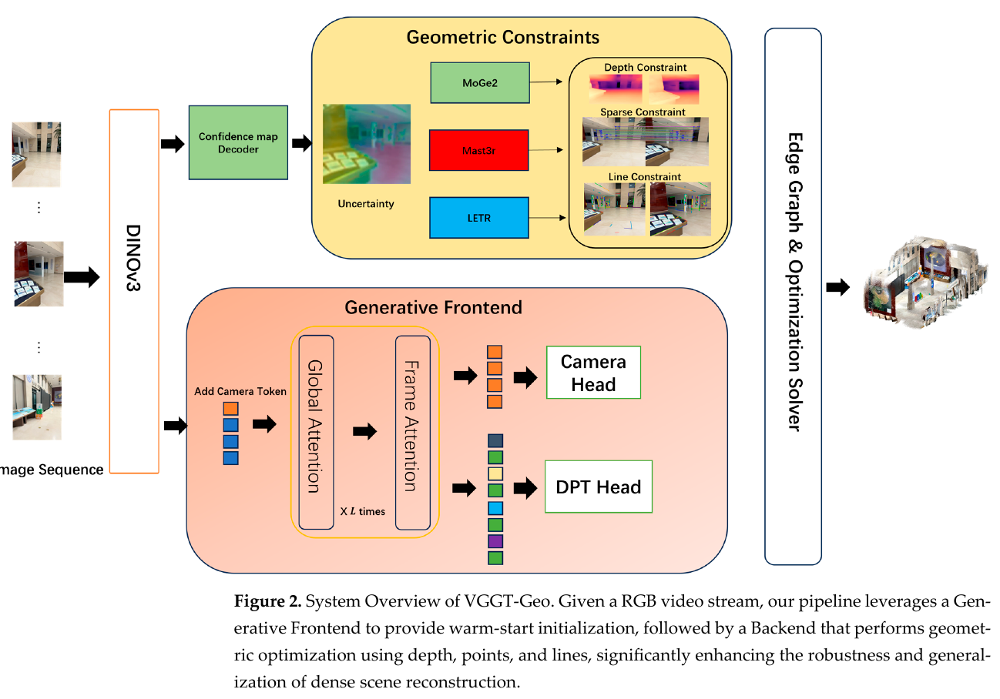

给定图像观测和预训练模型提供的先验 $\mathcal Z$，论文将状态估计写成最大后验问题：

$$
\mathcal X^*=\arg\max_{\mathcal X}P(\mathcal X\mid\mathcal Z)
\propto P(\mathcal Z\mid\mathcal X)P(\mathcal X).\tag{2}
$$

这里，$P(\mathcal Z\mid\mathcal X)$ 对应多视图几何观测，$P(\mathcal X)$ 对应生成模型提供的先验。取负对数后得到窗口内的能量：

$$
E_{\mathrm{total}}(\mathcal X)=\sum_{(i,j)\in\mathcal E}E_{\mathrm{geo}}(i,j)
+\lambda\sum_{i\in\mathcal V}E_{\mathrm{prior}}(D_i).\tag{3}
$$

图节点 $\mathcal V$ 是关键帧，边 $\mathcal E$ 是存在足够几何对应的帧对。$E_{\mathrm{geo}}$ 由稀疏点和稠密线段残差组成；$E_{\mathrm{prior}}$ 是基于 MoGe-2 深度的正则项。VGGT 的预测通过初始值进入优化，而不是作为式（3）中的单独损失项。论文在 3.1 节重复说明了这一点，但没有给 VGGT 输出置信度或显式先验分布。

### 3.2 生成式前端与置信度感知

VGGT 对一个滑动窗口中的图像并行预测相机外参、内参和稠密点图。作者将其称为 warm-start：由点图投影得到的深度作为逆深度状态初值，避免从常速度或随机深度开始做非线性优化。初值的作用是确定求解起点；之后位姿与深度仍可由后端观测残差修正。论文没有给出 VGGT 点图转深度、尺度处理和相机坐标系转换的完整实现细节。

第二条路径使用冻结的 DINOv3 ViT-L/16 提取稠密特征，并由特征解码器产生像素级置信度图 $\Omega\in[0,1]^{H\times W}$。作者把高置信区域解释为结构清晰、特征显著且较易匹配的区域，把白墙、反光和模糊区域视为低置信区域。后端随后用 $\Omega$ 调节点、线和深度残差的影响。论文把置信度与 DINOv3 的注意力显著性联系起来，但没有完整说明从注意力张量到单像素置信度的计算、训练目标或校准方法，因此这里应理解为论文提出的置信度建模，而不是已经证明为概率校准的不确定度。

### 3.3 几何约束

记关键帧集合为 $\mathcal V$，相机位姿 $T_i\in SE(3)$，共享针孔内参 $k=(f_x,f_y,c_x,c_y)$。论文的 BA 变量为所有活跃帧位姿、逆深度和内参；总目标展开为

$$
E_{\mathrm{total}}(\{T_i\},\{D_i\},k)=
\sum_{(i,j)\in\mathcal E}\left[E_{\mathrm{line}}(T_i,T_j,D_i,k)+E_{\mathrm{sparse}}(T_i,T_j,D_i,k)\right]
+\alpha\sum_{i\in\mathcal V}E_{\mathrm{depth}}(D_i).\tag{4}
$$

$E_{\mathrm{line}}$ 是跨帧线约束，$E_{\mathrm{sparse}}$ 是 MASt3R 特征匹配点约束，$E_{\mathrm{depth}}$ 是 MoGe-2 深度正则项；$\alpha$ 控制深度先验的强度，对应式（3）的 $\lambda$。三个残差共用位姿和逐帧深度状态，因此一个模态的观测可以通过共同变量影响其他约束的解释。系统用 Levenberg–Marquardt 求解该非线性最小二乘问题。

#### 3.3.1 置信度加权的线约束

在曼哈顿结构中，墙角、门框和顶棚边界能提供稳定方向，但局部点可能稀少或近似共线。论文用 LETR 检测参考帧 $I_i$ 中的二维线段 $l_i$，并在当前帧 $I_j$ 中找到匹配线段 $l_j$。它不显式维护 Plücker 三维线变量，而是利用参考线端点的逆深度，在当前帧中重投影沿线采样点。

当前图像中的线段以归一化直线方程表示：

$$
a_j u+b_j v+c_j=0,\qquad a_j^2+b_j^2=1.\tag{5}
$$

约束 $a_j^2+b_j^2=1$ 使代数距离对应像素到直线的有符号垂直距离。沿参考线按 $\Delta s$ 均匀采样像素 $u_{i,s}$，利用参考帧的逆深度反投影到三维，再通过相对位姿 $T_{ij}=T_jT_i^{-1}$ 和当前相机内参投影到 $I_j$，得到 $u'_{i,s}$。论文在此处称所用的稠密逆深度来自 DINOv3，但前文把 DINOv3 描述为特征与置信度提取器、把深度初值归于 VGGT，并把度量深度先验归于 MoGe-2；它没有交代这几种深度量在式（6）中的具体对应关系。单个采样点到目标线段所在直线的残差为

$$
r_{\mathrm{line}}(u_{i,s})=a_j u'_{i,s}+b_j v'_{i,s}+c_j.\tag{6}
$$

把该残差对线段采样点、匹配线和置信度加权后，论文写成

$$
E_{\mathrm{line}}(i,j)=\sum_{m\in\mathcal L_{ij}}\sum_{s\in\mathcal S(l_i^m)}
\rho\!\left(\Omega(u_{i,s})\,\lVert r_{\mathrm{line}}(u_{i,s})\rVert^2\right).\tag{7}
$$

其中 $\mathcal L_{ij}$ 是帧对间的匹配线集合，$\mathcal S(l_i^m)$ 是第 $m$ 条参考线的采样位置，$\rho$ 是 Huber 鲁棒核。低置信像素对目标的影响减小；Huber 核再降低大残差的影响。线上的多个采样点共同惩罚投影位置偏离目标直线，因此主要提供垂直于线方向的约束；沿线方向的平移仍需其他观测补足。

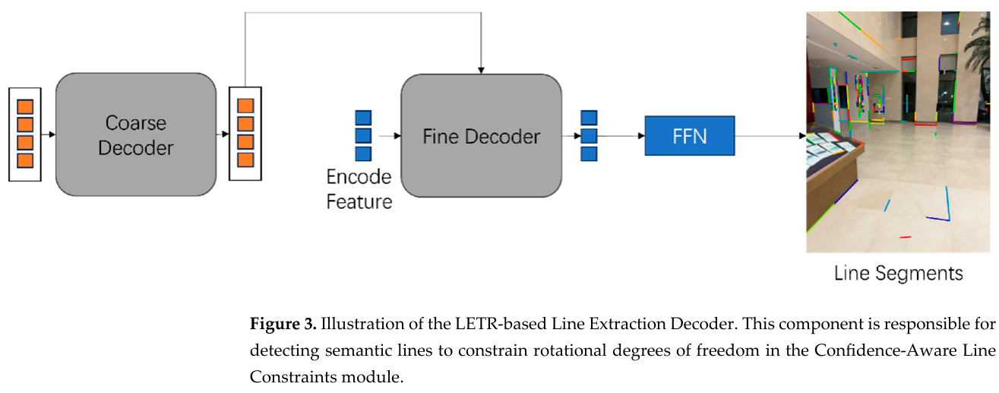

#### 3.3.2 稀疏匹配点联合优化

线特征擅长提供方向约束，但存在孔径问题：沿线滑动时，投影仍可能落在同一条线附近。MASt3R 匹配头提供跨帧稀疏点对应，为平移带来更均衡的约束。论文不单独维护每个三维路标点，而是用关键帧的逆深度图把像素反投影到三维，再投影至匹配帧。图 4 表示 MASt3R 的特征对应如何进入这一过程。

设 $\mathcal C_{ij}$ 是图像 $I_i,I_j$ 的匹配点对集合，匹配像素为 $(u_i,u_j)$，其重投影误差定义为

$$
r_{\mathrm{sparse}}(u_i)=\pi(T_i,T_j,D_i(u_i),u_i)-u_j,\tag{8}
$$

其中 $\pi$ 表示反投影、相对位姿变换和针孔投影组成的运算。稀疏点能把已知深度与位姿联系起来，误差进入置信度加权的 Huber 目标：

$$
E_{\mathrm{sparse}}(i,j)=\sum_{(u_i,u_j)\in\mathcal C_{ij}}
\rho\!\left(\Omega(u_i)\,\lVert r_{\mathrm{sparse}}(u_i)\rVert^2\right).\tag{9}
$$

论文另将归一化置信度映射为 $\Omega'(u_i)=\alpha\Omega(u_i)+\epsilon$，以正的下界避免低置信度点完全失去权重。这里的 $\alpha$ 与式（4）控制深度先验的 $\alpha$ 共用符号，但文中没有说明二者是否采用同一数值，解释时应把它们视作不同语境中的超参数。图 4 展示匹配头的点图、置信度、局部特征和几何匹配关系。

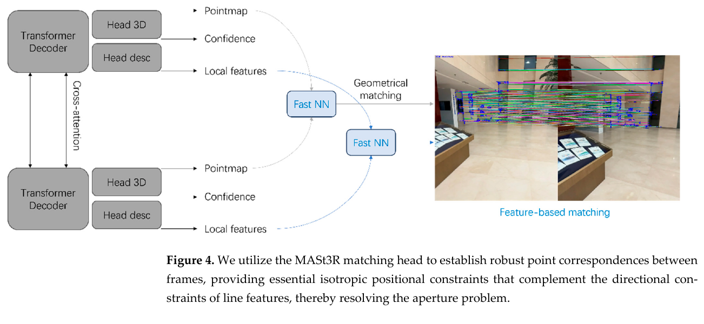

#### 3.3.3 带度量先验的自适应深度正则

单目多视图几何存在整体尺度自由度。作者将 MoGe-2 的度量深度作为尺度锚点，并用置信度加权的鲁棒项限制优化深度偏离先验：

$$
E_{\mathrm{depth}}(i)=\sum_{u\in\mathcal U_i}
\rho\!\left(\Omega(u_i)\,\lVert D_i(u)-D_i^{\mathrm{prior}}(u)\rVert^2\right).\tag{10}
$$

当纹理弱、几何观测稀少时，深度正则在目标中更能影响解；纹理和匹配可靠时，点与线的重投影误差可以推动当前深度偏离网络预测，以满足多视图一致性。这里的“软锚”并不意味着深度绝对固定，强度仍由 $\alpha$、置信度和鲁棒核共同决定。

式（1）把 $D_i$ 定义为逆深度，方法部分又称 MoGe-2 输出为绝对度量深度，式（10）却直接相减，没有写出从深度到逆深度的变换。论文没有消除这一量纲歧义，故本文保留它的“优化深度状态与度量先验对齐”这一意图，不把公式擅自改写为已确认的逆深度残差。

### 3.4 后端图构建与优化

系统不对每一帧都运行完整优化，而根据相对运动选择关键帧。若当前帧相对上一关键帧的平移 $\Delta t$ 或旋转 $\Delta R$ 超过阈值，则插入新关键帧：

$$
\lVert\Delta t\rVert>\tau_t\quad\text{或}\quad
\lVert\operatorname{Log}(\Delta R)\rVert>\tau_R.\tag{11}
$$

若跟踪内点率低于阈值，也会强制插入关键帧，避免困难区域的跟踪失败被继续传播。新增关键帧不会只与时间上相邻的一帧连接；系统在当前优化窗口内检索候选关键帧，统计 MASt3R/DINOv3 的有效匹配数 $N_{\mathrm{match}}^{(i,j)}$，超过阈值才建边：

$$
(i,j)\in\mathcal E\quad\text{if}\quad N_{\mathrm{match}}^{(i,j)}>\tau_{\mathrm{match}}.\tag{12}
$$

因此图边取决于共视匹配，不是固定的时间链。论文对关键帧插入时的“内点率阈值”和建边时的“匹配数量阈值”没有分别给出完整定义；实现细节又把有效跟踪特征数低于 $\tau_{\mathrm{match}}=50$ 与式（12）的匹配阈值使用同一符号，二者是否相同并不清楚。窗口大小为 10，窗口满后通过 Schur 补边缘化最老关键帧，把其线性化 Hessian 与梯度信息存为先验，再在新窗口继续优化。LM 的阻尼项用于缓解 Hessian 条件差和单目自由度导致的不稳定。论文未描述窗口外回环检索、长期全局图或重定位模块；其“全局一致性”主要来自活跃窗口中的共视边以及边缘化留下的信息。

## 4 实验

### 4.1 实验设置

#### 4.1.1 数据集

评测由三部分组成。自采室内数据覆盖八层办公楼，轨迹最长约 200 m，含长走廊、玻璃幕墙、白墙、楼梯等退化结构。作者用 Leica P50 地面激光扫描仪和多站测量建立点云基准，报告平均点云误差约 ±2 mm；RGB 相机以 4096×3072 采集。自采数据受保密协议限制，没有公开下载地址。

公共数据包括 TUM RGB-D（真实室内轨迹）、Replica（合成室内几何）和 Tanks and Temples（大尺度重建）。

#### 4.1.2 基线与指标

对比方法包括基于点特征和优化的 MASt3R-SLAM、没有显式 BA 后端的 SLAM3R，以及在 SL(4) 流形上优化子图的 VGGT-SLAM。指标包括绝对轨迹误差 ATE、相对平移误差 RTE、相对旋转误差 RRE、深度 RMSE，以及 Tanks and Temples 的 F-score 和平均距离。自采轨迹对比使用一次刚体变换对齐到 FAST-LIVO2 提供的轨迹，并进行了相机—LiDAR 外参标定和时间同步；因此该轨迹参照来自 LiDAR 惯性视觉系统，不等同于独立全站仪测得的相机真值。深度误差只在 LiDAR 点投影可见的像素区域计算。

#### 4.1.3 实现细节

实现报告为 PyTorch 1.2.1、单张 NVIDIA RTX 5090，DINOv3 ViT-L/16 与 LETR 使用官方预训练权重并冻结，输入缩放到 640×480。窗口大小为 10，平移阈值 0.15 m、旋转阈值 5°、匹配数量阈值 50、深度项权重 $\alpha=2.0$、Huber 阈值 $\delta=1.5$ 像素，线段采样步长 $\Delta s=10$ 像素。论文的实现细节段落对阈值符号的定义有排版缺损；以上数值依照可辨认的正文保留，不补造缺失符号。

### 4.2 评估结果

#### 4.2.1 自采数据集结果

图 5 展示四类自采场景的点云：Scene 1（办公室）、Scene 2（大厅）、Scene 3（长走廊）和 Scene 4（多层楼梯）。作者报告 VGGT-Geo 的几何结构较完整；基线有局部漂移、破碎或失败。图 6 展示相机位姿叠加在场景几何中的可视化。表 1 只给 Scene 1 和 Scene 2 的轨迹数字：VGGT-Geo 的 ATE 分别为 4.1、4.7 cm，RTE 为 1.2、1.3 cm，RRE 为 0.79°、1.21°；VGGT-SLAM 两场景均标为跟踪失败。MASt3R-SLAM 的 ATE 分别为 7.8、6.1 cm，SLAM3R 为 12.6、9.2 cm。

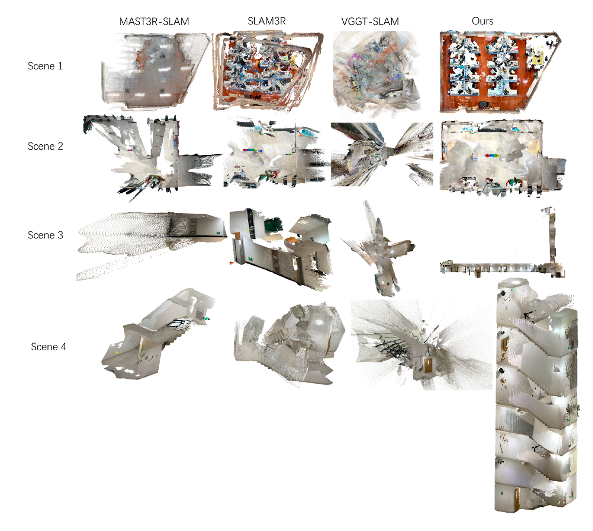

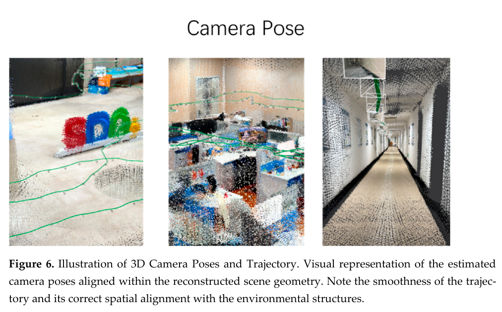

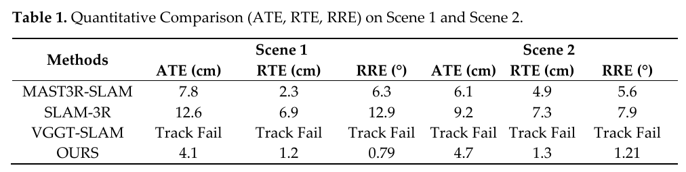

图 7 给出办公室、展示区、楼梯和走廊的 RGB 与估计深度图。表 2 报告两场景的深度 RMSE：VGGT-Geo 为 5.2、4.9 cm；MASt3R-SLAM 为 12.4、15.7 cm；SLAM3R 为 10.9、16.8 cm；VGGT-SLAM 标记失败。这里有一处原文内部不一致：表 2 标题明确写 Scene 1、Scene 2，但前文解释结果时称 Scene 3 的深度也在表中。因表格只包含两列且没有 Scene 3 数值，本文按表格所列范围陈述，不推断走廊深度误差。

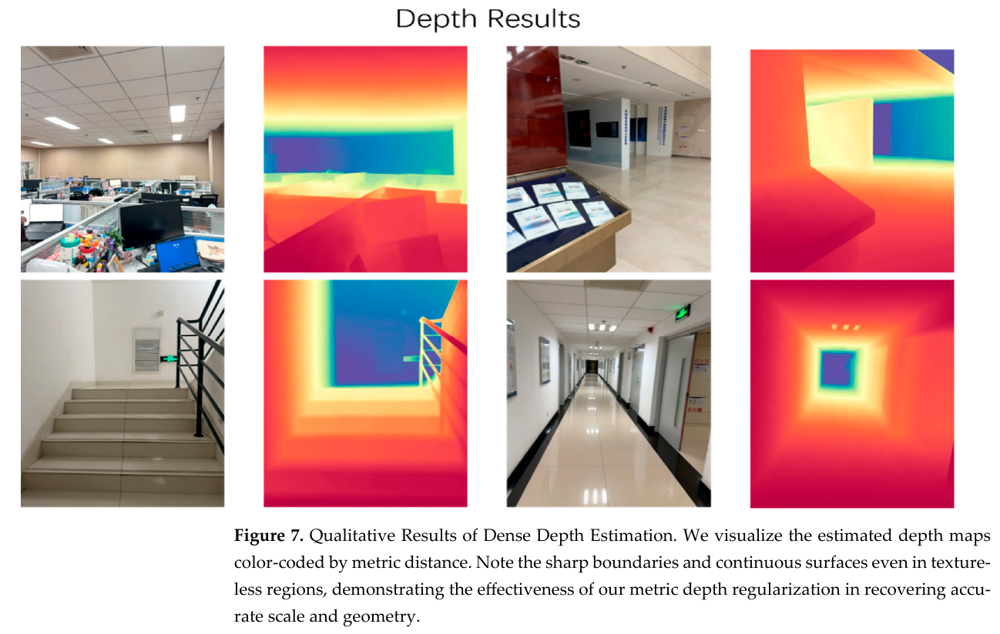

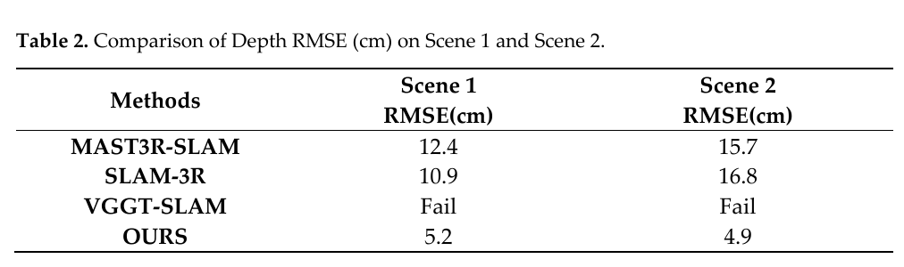

#### 4.2.2 公共数据集结果

#### TUM RGB-D

图 8 展示五个序列上的重建对比，其中 VGGT-SLAM 在 xyz 序列标为失败。表 3 的 ATE 单位为厘米，作者报告五个序列平均值：VGGT-Geo 1.92 cm，MASt3R-SLAM 3.42 cm，SLAM3R 4.91 cm；VGGT-SLAM 在已报告的四个序列上平均为 2.61 cm，xyz 失败。逐序列看，VGGT-Geo 在 desk、desk2、room、xyz 和 longoffice 分别为 2.43、3.71、0.82、1.42 和 1.21 cm。论文称必要时进行了最优刚体配准，但没有在结果段列出每个序列是否配准，解释这些数字时应保留这一协议限制。

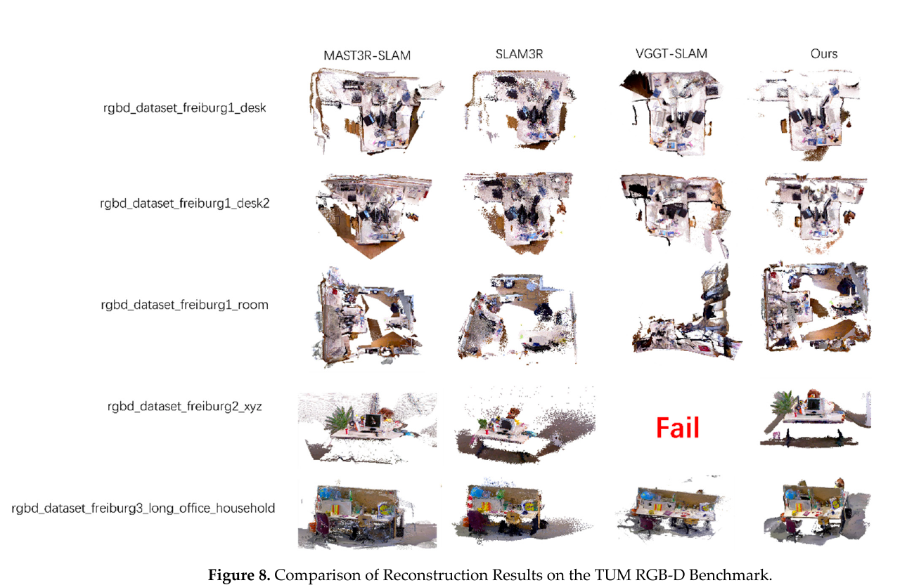

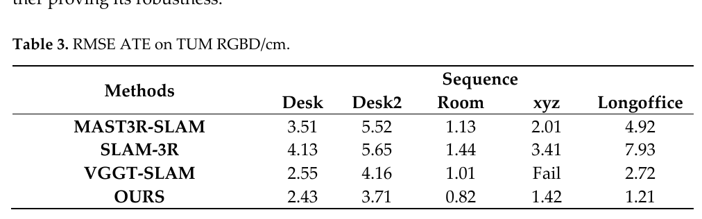

#### Replica

图 9 展示四个 Office 与三个 Room 场景的点云。表 4 报告七个场景的 ATE RMSE（厘米），VGGT-Geo 的均值为 2.50 cm，MASt3R-SLAM 为 2.97 cm，SLAM3R 为 4.27 cm，VGGT-SLAM 为 9.89 cm。VGGT-Geo 在 Office2、Office3、Room0、Room1、Room2 分别取得 1.65、2.18、2.87、3.01、3.56 cm；Office0、Office1 分别为 1.98、2.26 cm。相较 MASt3R-SLAM，VGGT-Geo 在 Office0 略高（1.98 对 1.67 cm），因此逐场景结果并非每项都领先；优势体现在该组场景的平均 ATE 和多数子场景。

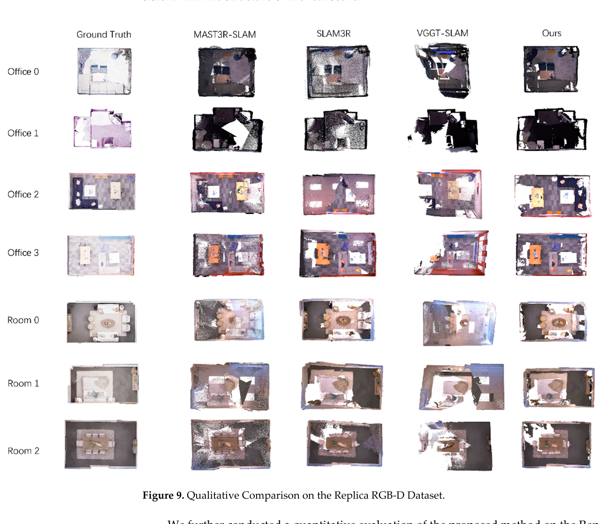

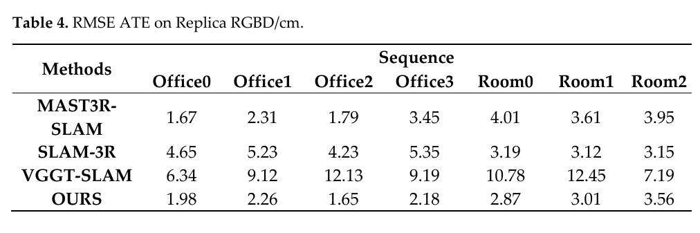

##### 4.2.3 大场景数据集结果：Tanks and Temples

图 10 对比 Barn、Palace 和 Temple 的点云。论文说明 Palace 和 Temple 属于 Advanced 子集，没有官方相机轨迹真值，因此这两处只有定性展示。定量表 5 列出 Barn、Caterpillar 和 Truck 三个场景，指标为 1 cm 阈值下的 F-score 与平均距离：VGGT-Geo 在三场景的 F-score 为 0.813、0.745、0.712，平均距离为 5.17、8.23、9.56 cm。与 MASt3R、SLAM3R 的对应 F-score 分别为 0.765/0.686、0.698/0.623、0.654/0.589。

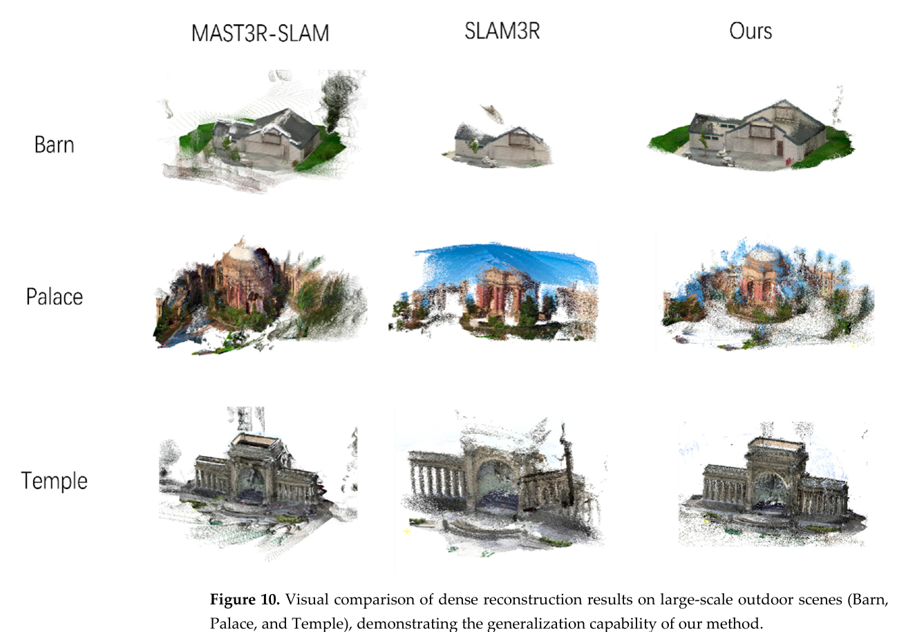

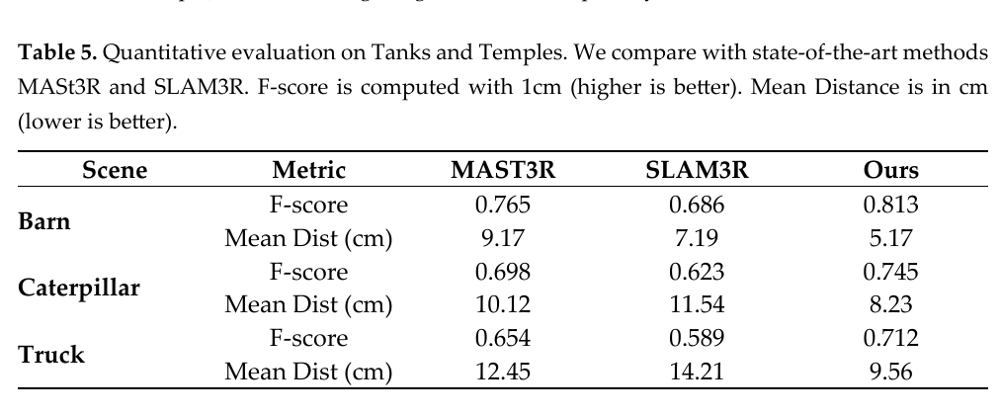

这里也存在表述范围不一致：正文称只在 Barn 使用公开真值做定量评估，表 5 却还列出 Caterpillar 和 Truck；正文说主要比较 MASt3R 与 SLAM3R，但表格同时列出三场景数值而没有说明另外两场景的真值来源或评测协议。本文照录表中数字，并把可核对的定量范围视为未充分交代，不把表 5 扩展解释为完整 Tanks and Temples 基准结果。

### 4.3 消融实验

表 6 在办公室 Scene 1 与长走廊 Scene 3 上比较完整系统和四个变体。完整系统 ATE 为 0.041 m、0.068 m。去掉深度先验后，办公室误差为 0.082 m，走廊跟踪失败；去掉置信度后分别为 0.065 m、0.154 m；去掉线约束后为 0.058 m、0.092 m；把 VGGT 初值换成常速度模型后为 0.081 m、0.186 m。此表支持这些组件在这两条序列上有帮助，尤其深度先验对走廊系统能否运行的影响很大；它不能单独证明每个组件在其他场景、不同超参数下都有相同收益。表头称三种变体，但实际列出四种消融，也与上文“Seq-02（长走廊）”和表格“Scene 3”编号不一致。

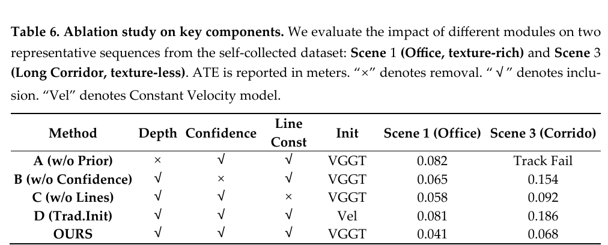

## 5 结论与方法边界

论文把 VGGT 的前馈几何用于初始化，以冻结的 DINOv3 和 LETR 提取带置信度的点线观测，再把这些观测与 MoGe-2 深度先验共同纳入关键帧滑窗 BA。多种约束共享位姿与深度状态：稀疏匹配点补充平移信息，线段增强结构方向约束，深度先验提供公制尺度参考；窗口边缘化则让计算量受限。TUM、Replica 和自采场景结果显示该组合在作者设定下能够获得较低轨迹误差，但论证范围受数据、硬件和对齐协议限制。

论文结尾报告 RTX 5090 上通常约 3–5 FPS、峰值显存约 21.2 GB；作者指出基础模型推理仍是实时处理瓶颈，动态物体也会造成重建伪影，计划加入蒸馏、边缘加速、动态掩码与语义约束。自采数据因隐私协议不公开，也限制了独立复现。按论文自己的速度数据，系统更适合描述为低速滑窗重建原型，不能仅凭“实时”措辞推断其满足高帧率应用。

从方法关系看，VGGT-Geo 保留了传统几何优化的显式状态和残差，把预训练模型放在初始化、特征关联和尺度先验的位置。它的“概率几何融合”在实现上主要体现为置信度乘残差平方后再通过 Huber 核的加权目标；论文没有给出完整的置信度校准、各观测协方差估计或窗口外回环机制。加上逆深度与度量深度的符号量纲未完全对齐、表 2/5/6 的文字与表格范围有冲突，当前结果更适合作为一种前馈先验与几何后端结合的设计实例，而不是已经被充分验证的通用 SLAM 性能结论。
