# VGGT-GS SLAM 论文解读

> **论文**：*VGGT-GS SLAM: Uncalibrated Monocular Gaussian Splatting SLAM with Feed-Forward Priors*  
> **作者**：Yuhang Han、Hao Wang、Jiaxi Cao、Xingyu Liu  · **版本**：arXiv:2609.19628v1，2026-09-17  
> [论文页面](https://arxiv.org/abs/2609.19628) · [PDF](https://arxiv.org/pdf/2609.19628)

单目视频通常没有现成的深度传感器数据，也可能缺少可靠的相机内参和镜头畸变参数。VGGT-GS SLAM 面向这种输入：先让 VGGT 对一个局部关键帧窗口预测相机、深度和置信度，再把预测转成 3D Gaussian 子图；之后以可微渲染误差共同优化相机位姿、Gaussian 属性和共享相机模型。多个子图各自在局部坐标系优化后，系统再用 Gaussian-native alignment（GNA）估计相邻子图尺度，并检查回环候选。

整套方法的关键在于把两个不同问题分开处理。子图内部，图像观测用来校准相机和地图；子图之间，带尺度的高斯分布提供空间匹配信号。回环验证也使用高斯匹配，但通过验证后保留 VGGT 推出的回环变换，由全局 Sim(3) 位姿图负责调整子图关系。论文在 TUM-RGBD、7-Scenes 和 ScanNet 上评估定位，在 Replica 和 TUM-RGBD 上评估新视角合成，并分析标定、尺度对齐、回环、窗口大小和运行开销。

## 一、问题背景与论文定位

对未标定的单目 RGB 视频，位姿、场景几何、内参与镜头畸变都要从图像中恢复，误差可能互相吸收。VGGT-GS SLAM 用 VGGT 初始化局部 Gaussian 子图，在子图内通过可微渲染联合校正地图、位姿和相机模型，再用 Gaussian-native alignment（GNA）连接子图尺度并验证回环候选。图 1 对比 TUM-RGBD floor 上的轨迹和点云；作者报告相较 VGGT-SLAM 2.0，局部地图更少出现结构碎裂和撕裂。

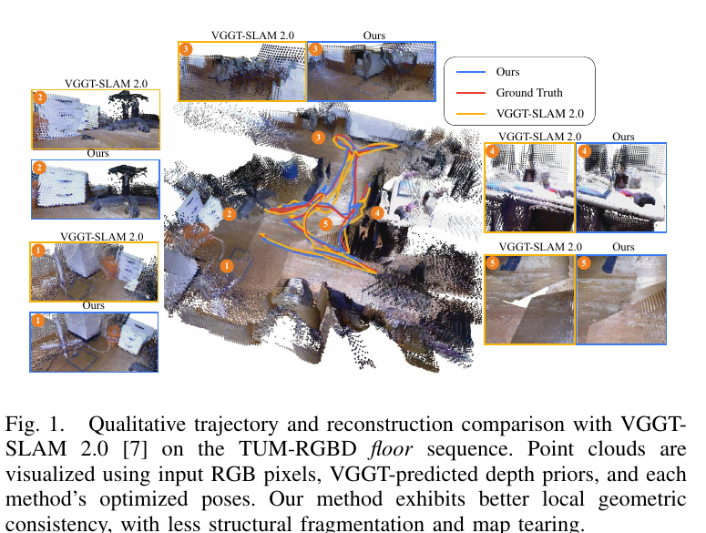

*原论文图 1。作者将较少的局部几何碎裂和地图撕裂作为 VGGT-GS SLAM 相较 VGGT-SLAM 2.0 的定性结果。*

## 二、相关工作

### Gaussian Splatting SLAM

Gaussian SLAM 用显式高斯地图支持可微渲染；已有系统包括 RGB-D 方法 GS-SLAM、SplaTAM，以及单目 MonoGS。长序列工作会再加入子图、回环和位姿图；VGGT-GS SLAM 的重点是未标定单目输入下的相机自标定与 Gaussian 子图尺度连接。

### 单目 SLAM 中的相机自标定

自标定需要联合估计相机参数、运动和场景结构，且可观测性受运动与几何影响。与把标定参数作为输入的 ORB-SLAM3、DSO 等系统不同，VGGT-GS SLAM 将内参与径向—切向畸变放入 Gaussian 可微渲染链路，与位姿及地图共同优化。

### 前馈几何先验进入 SLAM

MASt3R-SLAM 用点图进行跟踪、局部融合、回环和全局优化；VGGT-SLAM 通过 SL(4) 子图对齐处理未知标定带来的投影歧义；VGGT-SLAM 2.0 加入重叠帧标定一致性、关键帧因子图和注意力式回环验证。AIM-SLAM 和 VGGT-SLAM++分别改进关键帧选择与后端组织；GeoGS-SLAM 也融合无标定前馈先验与 Gaussian mapping。本文工作的主要侧重点，是让渲染损失对相机内参与畸变的解析梯度进入局部 BA，并在子图尺度对齐和回环检测时利用 Gaussian 的协方差。

## 三、方法

### A. 子图与初始化

系统先从视频选出关键帧，再按连续窗口分组。每个子图窗口有 $S+O$ 帧：其中 $S$ 帧是当前子图新增关键帧，$O$ 帧与前一个窗口重叠。论文默认 $S=24, O=1$。重叠关键帧为相邻子图建立共同的图像锚点。

每个窗口交给 VGGT，得到各帧外参 $T_{i}^{c\leftarrow w}$、内参 $K_i$、深度 $D_i$ 和置信度 $C_i$。这些输出先初始化子图位姿和几何。子图内共享内参 $K$ 取各帧 $K_i$ 的平均，五个畸变系数先置零。

初始化 Gaussian 时，方法将有效深度像素反投影到世界坐标系。只保留 $D_i(p)>10^{-8}$ 的深度，并以固定步长稀疏采样像素；每个保留点生成一个 Gaussian，均值是反投影三维点，球谐颜色系数来自该像素 RGB，旋转设为单位旋转，透明度设为 $0.5$。尺度根据同一帧采样点的最近邻距离 $d_{nn,j}$ 初始化：

\[
\ell_j=\log(0.1d_{nn,j})\,\mathbf 1_3. \tag{1}
\]

这里 $\ell_j$ 是三个方向相同的对数尺度，$\mathbf 1_3$ 表示三维全一向量。因此初始 Gaussian 是球形，半径按采样点的局部密度设置；较密集区域会得到更小的初始支撑范围。

### B. 联合束调整

每个子图中，系统联合优化三组变量：Gaussian 地图表示决定渲染出的颜色与深度；各帧相机位姿和仿射曝光参数校正视点与亮度；子图共享的内参及径向—切向畸变参数校正相机投影模型。首帧位姿固定，作为局部坐标系参考；其余位姿通过左乘 SE(3) 增量更新。焦距在对数空间更新，主点以加法更新。三个径向畸变参数 $k_j$ 和两个切向畸变参数 $p_j$ 通过双曲正切限制范围：

\[
k_j=s_k\tanh(\rho_{k_j}),\quad j=1,2,3;\qquad
p_j=s_p\tanh(\rho_{p_j}),\quad j=1,2.
\]

$s_k,s_p$ 控制允许的径向与切向参数范围，$\rho$ 是无界优化变量。这样优化器仍能在无约束变量上工作，同时物理相机参数不会越过设定范围。论文使用 AdamW 和不同参数组的学习率。

BA 目标由颜色重建、VGGT 深度先验和 Gaussian 形状正则项构成：

\[
\mathcal L_{BA}=\mathcal L_{rgb}+\lambda_{depth}\mathcal L_{depth}+\lambda_{iso}\mathcal L_{iso}. \tag{2}
\]

固定首帧只确定了子图的局部坐标系，还不能确定单目场景的公制尺度。深度先验项提供预测尺度参考；它是网络估计的几何约束，不是传感器测得的深度。

**颜色重建项。** 为容纳视频帧间曝光变化，系统用 $I'_i(p)=\exp(a_i)I_i(p)+b_i$ 对输入亮度做仿射调整。有效像素上组合平均绝对误差与 DSSIM：

\[
\mathcal L_{rgb}=(1-\lambda_{dssim})\|\hat I-I'\|_{1,\mathcal V^I}
+\lambda_{dssim}\bigl(1-\operatorname{SSIM}(\hat I,I')\bigr). \tag{3}
\]

$\hat I$ 是 Gaussian 渲染图，$\mathcal V^I$ 排除无效像素和近黑边界。曝光补偿有一个容易混淆的尺度自由度：如果所有 Gaussian 颜色都变暗，曝光增益也可变亮，反之亦然。论文在曝光稳定变体中固定首帧 $a_1=b_1=0$，并在后续地图细化时冻结曝光参数。但定位和新视角合成主结果使用的是未加这些附加约束的仿射补偿。

**深度先验项。** 对有效像素，论文先计算相对深度误差，再减去容忍带 $\tau_{depth}$，只惩罚超出容忍带的部分：

\[
r_i(p)=\left[\frac{|\hat D_i(p)-D_i(p)|}{\max(D_i(p),\epsilon)}-\tau_{depth}\right]_+,
\quad [x]_+=\max(x,0). \tag{4}
\]

只在先验深度、渲染深度和渲染透明度均有效的位置计算。置信度 $C_i(p)$ 先按其中位数归一化，再限制在上界 $c_{max}$，得到 $\tilde C_i(p)$；若置信度不可用，则令权重为 1。最后以置信度加权的平方残差除以总权重：

\[
\mathcal L_{depth}=\frac{\sum_i\sum_{p\in\mathcal V_i^D}\tilde C_i(p)r_i(p)^2}
{\sum_i\sum_{p\in\mathcal V_i^D}\tilde C_i(p)+\epsilon}. \tag{5}
\]

相对误差使近处和远处深度不会仅因数值尺度不同而受到完全不同的惩罚；容忍带则允许先验存在小误差而不持续拉动地图。它约束的是渲染深度与 VGGT 先验的一致程度，并非新增一份独立的深度观测。

**各向同性正则项。** 每个 Gaussian 的物理尺度为 $s_j=\exp(\ell_j)$，三轴平均尺度为 $\bar s_j$。正则项惩罚三轴尺度偏离平均值：

\[
\mathcal L_{iso}=\frac{1}{3M}\sum_{j=1}^M\|s_j-\bar s_j\mathbf 1_3\|_1. \tag{6}
\]

$M$ 是 Gaussian 数量。这个项抑制极端细长的 Gaussian，但并不强迫所有 Gaussian 尺寸相同。

### C. 解析相机标定雅可比

若相机参数只通过非可微或不完整的投影链路进入光栅化，颜色误差就无法可靠地反向修正焦距、主点和畸变。作者因此推导 2D Gaussian 中心和协方差对九个标定变量
\(\theta_{cal}=(f_x,f_y,c_x,c_y,k_1,k_2,k_3,p_1,p_2)\) 的解析导数，并将其接入 gsplat 的可微 Gaussian 投影。

对相机坐标中的点 $(x,y,z)^\top$，先归一化为 $u=x/z,v=y/z$，令 $r^2=u^2+v^2$。径向因子为
\(d=1+k_1r^2+k_2r^4+k_3r^6\)。加上切向畸变后：

\[
u_d=du+2p_1uv+p_2(r^2+2u^2), \tag{7}
\]
\[
v_d=dv+p_1(r^2+2v^2)+2p_2uv, \tag{8}
\]
\[
(U,V)=(f_xu_d+c_x,\ f_yv_d+c_y). \tag{9}
\]

这组关系把相机空间射线映到图像像素。焦距缩放畸变后的归一化坐标，主点再平移像素位置；径向畸变随离主轴距离增加，切向畸变则由 $p_1,p_2$ 描述非对称偏移。

令 $m_d=(u_d,v_d)^\top$、$m_{2d}=(U,V)^\top$、$D_f=\operatorname{diag}(f_x,f_y)$、$c=(c_x,c_y)^\top$，则 $m_{2d}=D_fm_d+c$。论文将投影均值的相机参数导数写为：

\[
\frac{\partial m_{2d}}{\partial q}=
\frac{\partial D_f}{\partial q}m_d+D_f\frac{\partial m_d}{\partial q}
+\frac{\partial c}{\partial q}. \tag{10}
\]

对协方差，设 $A=\partial(u_d,v_d)/\partial(u,v)$，$B=\partial(u,v)/\partial(x,y,z)$，则投影雅可比 $J=D_fAB$，图像平面协方差为

\[
\Sigma_{2d}=J\Sigma^c_{3d}J^\top. \tag{11}
\]

所以相机参数的变化不仅移动 Gaussian 的像素中心，也会改变其椭圆在图像中的大小和方向。对任一标定变量 $q$：

\[
\frac{\partial J}{\partial q}=\frac{\partial D_f}{\partial q}AB
+D_f\frac{\partial A}{\partial q}B,\quad
\frac{\partial\Sigma_{2d}}{\partial q}=
\frac{\partial J}{\partial q}\Sigma^c_{3d}J^\top+
J\Sigma^c_{3d}\left(\frac{\partial J}{\partial q}\right)^\top. \tag{12}
\]

这补齐了“改变相机参数—改变投影 Gaussian—改变渲染损失”的梯度路径。CUDA 核返回物理畸变系数的梯度，再通过双曲正切参数化链式求导到无界变量，例如
\(\partial\mathcal L/\partial\rho_{k_j}=(\partial\mathcal L/\partial k_j)s_k(1-\tanh^2\rho_{k_j})\)。论文指出这些推导对应未裁剪投影。

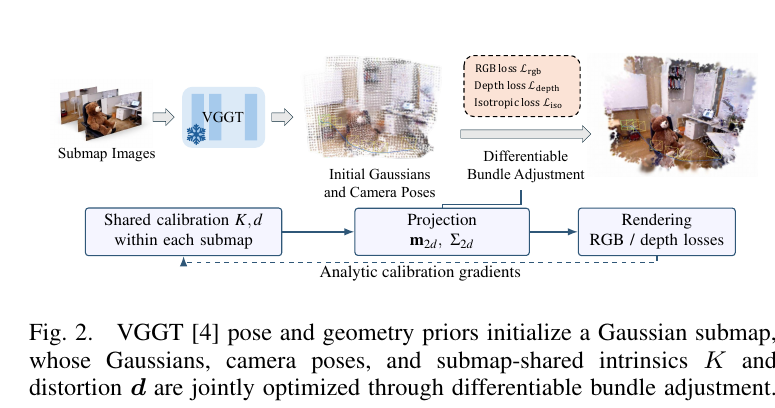

*原论文图 2。VGGT 初始化子图位姿与 Gaussian，渲染 RGB/深度误差经过解析标定梯度回传到共享内参与畸变。*

### D. 子图的 Gaussian-native alignment

每个子图有自己的局部坐标系，相邻子图因重叠关键帧可以确定相对旋转，但尺度仍需校准。设 $A$ 为参考子图，$B$ 为待变换的源子图。重叠图像的相机位姿确定旋转 $R$，同一像素的深度对应给出初始尺度 $s_0$；相机中心 $c_A,c_B$ 再把平移固定为

\[
$t_0=c_A-s_0Rc_B$.
\]

这里 $R$ 不在 GNA 中继续优化，优化量只有对数尺度 $u=\log s$，初值 $\log s_0$。给定源 Gaussian 的均值 \(\mu_j^B\) 和协方差 \(\Sigma_j^B\)，它映射到参考系后为

\[
\mu_j^{B\to A}(u)=c_A+sR(\mu_j^B-c_B),\qquad
\Sigma_j^{B\to A}(u)=s^2R\Sigma_j^BR^\top,\quad s=e^u. \tag{13}
\]

尺度乘在均值相对相机中心的位移上；协方差按尺度平方变化，因为它描述二阶空间范围。旋转和平移由相机锚定，Gaussian 匹配只负责修正相对尺度。

匹配前，系统按透明度、锚点视角可见性和空间尺度筛选 Gaussians，只留下投影到对方锚点图像受支持像素区域的点。随后按稳健场景尺度归一化均值与协方差。对参考 Gaussian $i$ 和变换后源 Gaussian $j$，定义位移 $d_{ij}=\mu_i^A-\mu_j^{B\to A}$，合并协方差
\(S_{ij}=\Sigma_i^A+\Sigma_j^{B\to A}+(\epsilon+\tau^2)I_3\)，并计算带 log-determinant 项的匹配核：

\[
\kappa_{ij}(u)=-\frac12\left(d_{ij}^\top S_{ij}^{-1}d_{ij}
+\lambda_{det}\log|S_{ij}|\right). \tag{14}
\]

Mahalanobis 项按两个 Gaussian 的联合空间范围衡量中心差异；若中心距离落在协方差覆盖范围内，惩罚就较小。log-determinant 项则控制协方差体积对匹配分数的影响。这里的匹配对象因此是具有位置、形状和朝向的三维分布，不只是点中心。

作者再为每个 Gaussian 设权重
\(w_i=\max\{\alpha_i^2/[1+\log(1+n_i)],10^{-6}\}\)，其中 \(\alpha_i\) 是透明度，$n_i$ 是观察次数。对源点 $j$，在参考点中找 $k$ 个近邻 $N_A(j)$，以 \(w_i e^{\kappa_{ij}}\) 对相似度作归一化汇总，并在源集合中按 $w_j$ 加权，得到从 $B$ 到 $A$ 的方向分数 \(\ell^{B\to A}\)。反方向以同样方式计算 \(\ell^{A\to B}\)。双向评分减少单边覆盖造成的偏差；不同带宽阶段会刷新近邻，在每个阶段优化期间固定近邻集合。

论文先定义从源子图到参考子图的方向分数：

\[
\ell^{B\to A}=
\frac{\sum_j w_j\log\left(
\frac{\sum_{i\in N_A(j)}w_i e^{\kappa_{ij}}}
{\sum_{i\in N_A(j)}w_i}\right)}
{\sum_jw_j}. \tag{15}
\]

反方向分数以交换 A、B 的方式得到。双向评分减少单边覆盖造成的偏差；不同带宽阶段会刷新近邻，在每个阶段优化期间固定近邻集合。最终优化目标由双向匹配分数和尺度间距先验组成：

\[
\mathcal L_{GNA}(u)=-\ell^{B\to A}(u)-\ell^{A\to B}(u)
+\lambda_{sp}\left(u-\log\frac{m_A}{m_B}\right)^2. \tag{16}
\]

$m_A,m_B$ 是所选 Gaussian 集合的最近邻间距中位数；先验让估计尺度与两侧采样密度相容。优化后，尺度更新被限制在初值附近，且只有归一化目标改善时才接受，否则回退到 $s_0$。相邻子图使用这项结果形成序贯约束。

### E. 用 GNA 验证回环

每个映射窗口会将当前帧 SALAD 描述子与历史子图比较，排除紧邻前一个子图后，最多保留距离低于阈值 \(\tau_r\) 的最佳候选。回环候选帧只会被追加到单独的一次 VGGT 推理批次中，产生跨子图桥接初值；它不进入原先的局部映射窗口。随后仍由 GNA 评估该桥接。

回环场景中，GNA 的尺度变化不用于细化回环变换，而作为是否接受约束的证据。设优化后尺度为 $s^*$，则最终损失和对数尺度改变量为

\[
\mathcal L^*=\mathcal L_{GNA}(u^*),\qquad
\Delta s=\log(s^*/s_0). \tag{17}
\]

只有 GNA 成功、\(\mathcal L^*\leq\tau_L\) 且尺度改变量通过阈值 \(\tau_s\) 检查，候选才能加入全局图；原文写作 \(\Delta s\leq\tau_s\)。另有旋转一致性检查：若桥接与前序链的旋转差异超过 90°，就拒绝候选。注意，尺度阈值在论文中按这一单侧不等式定义，不能擅自替换成绝对值条件。

通过验证的回环保留原始 VGGT 桥接变换。全局位姿图的节点为子图到全局坐标的 Sim(3) 变换 $G_i$，边约束 $G_i^{-1}G_j$ 来自顺序相邻关系和通过的回环；首节点有强锚定先验。优化只更新这些节点变换，不回头改局部 Gaussian、相机位姿或标定。将子图放到全局坐标时，均值按 $sR\mu+t$ 变换，协方差按 $s^2R\Sigma R^\top$ 变换；全局地图仍由变换后的子图组成，不做 Gaussian 合并。

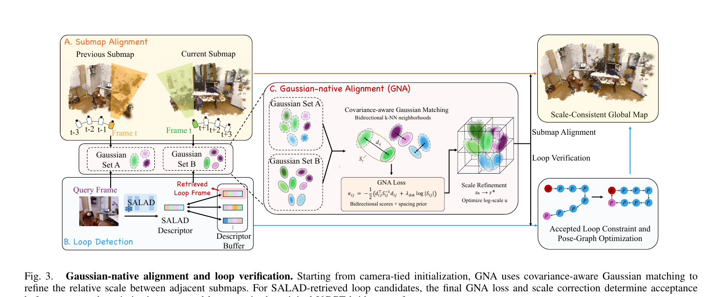

*原论文图 3。顺序子图会用 GNA 细化尺度；回环则先验证，进入位姿图时仍采用原始 VGGT 桥接变换。*

### F. 其他实现细节

**关键帧选择。** 系统跟踪 Lucas–Kanade 图像点。当图像平面平均 L1 位移超过阈值 \(\tau_{disp}\)，或有效跟踪点少于 10 个时，就选择新关键帧。默认位移阈值为 30 像素。

**Gaussian 细化。** 子图 BA 期间，系统依据累计的图像空间梯度克隆或拆分 Gaussians，并删除低透明度 Gaussian，采用 MonoGS 的细化策略。

**非关键帧位姿。** 完成序列映射和子图 Sim(3) 图优化后，系统仍需为非关键帧估计位姿，以形成逐帧轨迹并支持新视角渲染。对每一帧，选用起始关键帧不晚于该帧的最近子图；不把地图合成一个全局 Gaussian 集合。固定 Gaussian 地图和标定参数后，在 SE(3) 上优化该帧位姿 90 次。

## 四、实验

### A. 实验设置

所有实验只输入 RGB。论文报告的机器为 NVIDIA RTX PRO 6000 GPU 与 AMD EPYC 9355 CPU；除特别注明，基线使用作者发布实现本地复现。默认每个子图包含 24 个新增关键帧和 1 个重叠帧，运行 550 次联合 BA 迭代。畸变参数范围为 $s_k=2,s_p=0.05$；深度与各向同性损失权重分别为 \(\lambda_{depth}=0.3,\lambda_{iso}=10\)，相对深度容忍值 \(\tau_{depth}=0.03\)，置信度上限 (c_{max}=5)。回环验证阈值为 \(\tau_L=1000,\tau_s=0.20\)。这些是论文的默认配置，不表示对所有相机和运动都已证明最优。

### B. 定位评估

定位在 TUM-RGBD、7-Scenes 的 sequence 01 和 ScanNet 六个序列上评估。指标是经过 Sim(3) 对齐后的平移 ATE RMSE，单位为米。对复现方法使用各自最终关键帧，对本文方法使用全局图优化后的关键帧。未标定 DROID-SLAM 按 VGGT-SLAM 的设置使用 GeoCalib 内参估计。表中“×”表示时间跨度覆盖不足序列的 70%；带脚注的数值来自论文报告，并非统一复现。作者还特别指出，VGGT-SLAM++ 在 TUM 表中的报告平均数与表内各序列数值算术平均略有差别，保留其报告值。

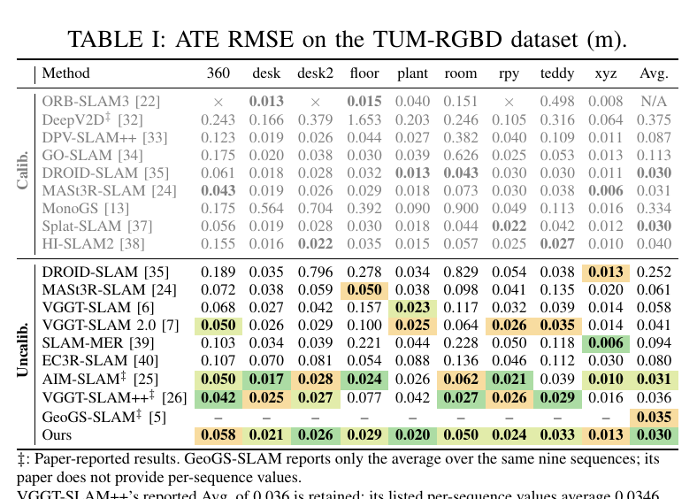

*原论文表 I。TUM-RGBD 上未标定方法的平均 ATE 中，VGGT-GS SLAM 为 0.0304 m，略低于 AIM-SLAM 的 0.031 m。*

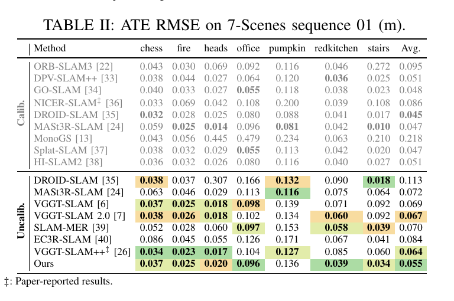

*原论文表 II。7-Scenes sequence 01 的未标定方法中，本文平均 ATE 为 0.055 m。*

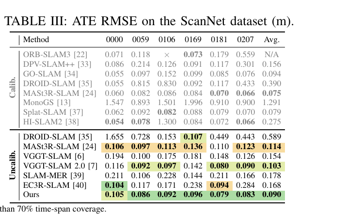

*原论文表 III。本文在未标定方法中五个序列排名第一，平均 ATE 为 0.090 m；比较对象 VGGT-SLAM 2.0 为 0.103 m。*

在 TUM-RGBD 上，论文报告未标定方法平均 ATE 最低为 0.0304 m，AIM-SLAM 为 0.031 m；本文在 desk2 和 plant 排名第一，在另外五段序列排名第二。它与已标定的 DROID-SLAM 和 Splat-SLAM 平均值约 0.030 m 接近。7-Scenes 上，0.055 m 比 VGGT-SLAM++ 的 0.064 m 低约 14.1%，在 office 和 redkitchen 排名第一，在 chess、fire、stairs 排名第二。ScanNet 上则在六段中的五段领先未标定对比，平均值从 VGGT-SLAM 2.0 的 0.103 m 降至 0.090 m。这些结果支持其在所测室内数据集上具有较强的未标定定位表现，不能直接推出室外或不同相机运动下也同样成立。

### C. 新视角合成

新视角合成（NVS）在 Replica 和 TUM-RGBD 上与 RGB-only 神经及 Gaussian SLAM 方法比较。每隔五帧评估一次，并排除建图关键帧；不同方法使用共同的帧集合。Replica 图像为 640×360，TUM 图像为 512×384。已标定方法使用去畸变 RGB，本文输入原始 RGB；在 TUM 评估时，本文保存的渲染图会用数据集标定参数双线性映射到共同的无畸变评估坐标系。所有方法使用相同参考 RGB 和几何有效裁剪区域，PSNR 对三个颜色通道计分。评估保存的 8-bit RGB 图像，计算 PSNR、SSIM 和基于 AlexNet 的 LPIPS；先在场景内对帧取平均，再对场景等权平均。

TUM 直接使用 BA 后的地图。Replica 另对每个子图做 500 次 mapping refinement 和 500 次 RGB-only refinement，位姿和标定固定。也就是说，两个数据集的 NVS 地图精化协议并不完全相同。

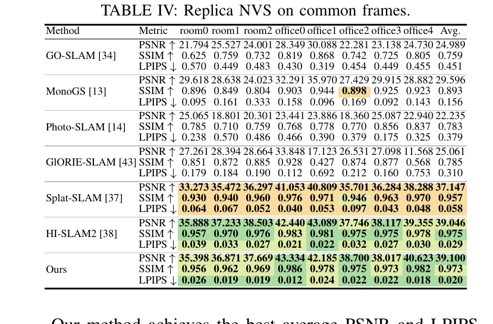

*原论文表 IV。Replica 上本文平均 PSNR 为 39.100 dB、LPIPS 为 0.020。*

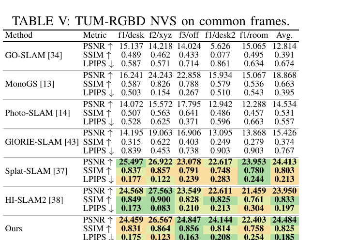

*原论文表 V。TUM 上本文 PSNR 为 24.484 dB，与 Splat-SLAM 的 24.413 dB 接近；HI-SLAM2 的 SSIM 最高，本文 LPIPS 更低。*

Replica 上，本文平均 PSNR 和 LPIPS 最佳：39.100 dB 与 0.020；HI-SLAM2 为 39.046 dB 与 0.029。TUM 上 PSNR 24.484 dB，与 Splat-SLAM 的 24.413 dB 接近；LPIPS 0.185 低于 HI-SLAM2 的 0.197，但 SSIM 0.825 低于 HI-SLAM2 的 0.833。因而指标结论需分别描述，不能概括成所有数据集、所有指标都领先。双三次重映射后，论文报告平均排名保持不变。

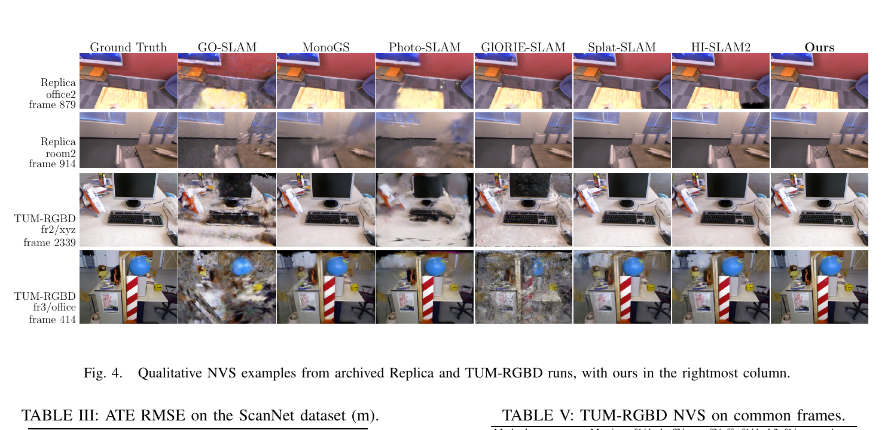

*原论文图 4。展示两套数据集的四个渲染帧，本文结果位于最右列。*

### D. 更多实验

**标定梯度验证。** 作者将 CUDA 标定梯度与 PyTorch float64 自动微分参考比较，报告相对 L2 误差在 \(4.1\times10^{-7}\) 以内，包含重参数化与视场裁剪。对 (10^3) 到 (10^5) 个 Gaussian，FP32 投影前向和反向比匹配的 PyTorch 参考快 6.1 到 12.0 倍；计时使用预热的 CUDA Graph，并包含地图和相机梯度。

在默认设置中，95 个 Freiburg1 子图上的标定细化使序列平均投影误差从 14.791 降至 11.185 像素，射线角误差从 1.435° 降至 1.059°。误差以 640×480 图像上的 41×31 均匀采样点计算，内参表达于 640×480 分辨率。投影误差衡量参考相机射线通过估计相机模型投影后的像素位移；射线误差衡量同一像素反投影射线之间的夹角。六窗口控制实验中，只优化内参时投影误差从 13.982 降至 10.627 像素；内参与畸变共同优化得到 10.746 像素，结果相近。

**组件消融。** 表 VI 每次移除一个组件。去掉 GNA 后 ATE 从完整系统的 0.0304 m 上升到 0.0720 m，是该消融中影响最大的一项。关闭标定优化后为 0.0324 m；移除曝光补偿、深度损失和各向同性正则项后分别为 0.0313、0.0316 和 0.0311 m。移除深度损失也同时移除了深度尺度参考，作者没有另加尺度锚点，因此这一行不只表示“少了一个图像先验”，还改变了系统的尺度约束条件。

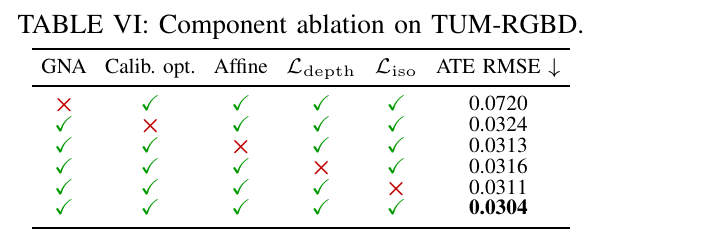

*原论文表 VI。逐项移除 GNA、标定优化、曝光补偿、深度损失或各向同性正则项后的定位误差。*

**GNA 匹配消融。** 作者在 TUM Freiburg1 九个序列的 86 对连续子图上测试，关闭回环并保持 Gaussian 选择与优化设置相同。仅用初始相机对齐时平均 ATE 为 0.0583 m；只匹配中心为 0.0604 m；用球形 Gaussian 为 0.0539 m；完整 GNA 为 0.0533 m。作者据此报告，匹配 Gaussian 分布而非中心使均值 ATE 降低 11.8%；显式考虑形状和方向相对球形 Gaussian 有小幅改善，间距先验在该实验中的作用较小。另一个密度测试只保留任一侧 25% Gaussian，在九对子图上估计的相对尺度与全密度最多相差 0.80%，前提是更新界限和接受标准不变。

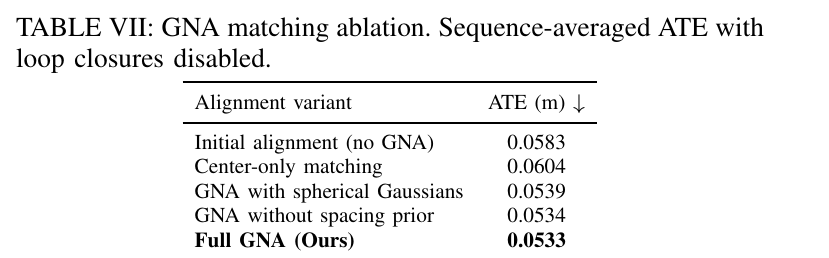

*原论文表 VII。关闭回环时，不同对齐变体的序列平均 ATE。*

**回环验证。** Freiburg1 上 SALAD 检索采用 \(\tau_r=1.05\)，离线取 top-5、在线取 top-1，共有 357 个候选，其中 347 个有有效真值关联。以双向真值深度重叠至少 15% 定义有效回环，得到 255 个有效回环与 92 个错误匹配。表 VIII 中，单独的旋转检查会接受 83 个错误回环；VGGT-SLAM 2.0 验证器在其代码阈值 0.95 下为 247 TP、8 FN、7 FP、85 TN。GNA 不加旋转检查时为 249、6、3、89；完整 GNA 为 249、6、2、90。完整方法有效回环召回率 97.65%，错误回环拒绝率 97.83%。这组结果显示在该离线候选定义和真值重叠标准下，GNA 比所列验证器少接受错误匹配；不能将其解释为在任意回环数据库中的普遍误检率。

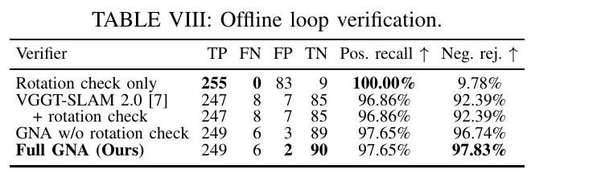

*原论文表 VIII。真阳性、假阴性、假阳性、真阴性及正负类率。*

在固定地图的另一组在线 top-1 回放中，作者称回环验证贡献了大部分定位增益；在相邻子图之间添加 GNA 对齐后，平均 ATE 再降低 2.6%。两者结合，将约 1 秒间隔关键帧的旋转 RPE RMSE 从 3.181° 降至 1.520°。该 RPE 对间隔约 1 秒（±0.1 秒且不插值）的相对旋转误差计分。对相同已接受回环，保留原始 VGGT 变换优于用 GNA 修正后的变换，这支持作者将 GNA 用作回环验证器，而非回环变换优化器。

**子图大小权衡。** 表 IX 比较每子图新增 2、4、8、16、24、32 帧，在九个 Freiburg1 序列上统计。24 帧默认设置取得最低平均 ATE 0.030 m。窗口越大，后台 FPS 越高、平均 GPU 使用量越低，但峰值显存从 10.277 GiB 增至 13.281 GiB（24 帧）和 13.512 GiB（32 帧）。Full FPS 除 SLAM 阶段外还计入数据载入与非关键帧位姿估计；Backend FPS 只计 SLAM 阶段。

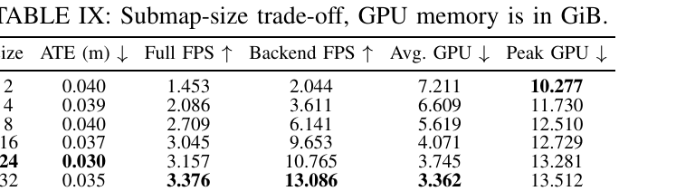

*原论文表 IX。较大窗口提高报告的处理速度并降低平均 GPU 使用量，但峰值显存上升；ATE 在 24 帧设置最低。*

**运行时间与显存。** 表 X 比较 TUM fr1/xyz 与 Replica office0 前 1000 帧。完整系统计时包括载入、SLAM 和非关键帧位姿估计，不含额外精化。本文分别为 252.80 秒/304.23 秒，峰值显存 13.28/14.24 GiB。论文据此报告本文在两个序列均快于表中 MonoGS、Splat-SLAM 和 GlORIE-SLAM；但峰值显存不比所有基线低。非关键帧位姿估计占本文总运行时间的 69.0% 和 57.1%，是所报告运行时间中的主要部分。

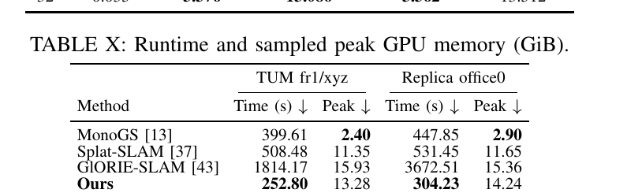

*原论文表 X。计时包含加载与非关键帧位姿估计，表中峰值显存显示本文速度优势并未转化为最低显存占用。*

**前馈前端泛化。** 作者保持 24 帧子图设置，将 VGGT 换成 DA3-Large 或 Fast3R。表 XI 的 Raw 数值已经包含子图对齐、位姿图优化和回环，不是孤立网络预测；“+Backend”则再接入本文 Gaussian BA 和 GNA。DA3-Large 从 0.064 降到 0.033 m（49.0%），Fast3R 从 0.178 降至 0.137 m（22.7%），VGGT 从 0.074 降至 0.0304 m（58.9%）。这说明相同后端在三个测试前端上都改善了该实验中的 ATE，但各前端的改进幅度不同。

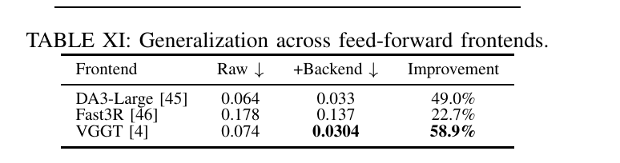

*原论文表 XI。Raw 包含既有子图与全局优化，右列是再加入本文 Gaussian BA 与 GNA 后的 ATE 改变量。*

## 五、结论与边界

VGGT-GS SLAM 从 VGGT 的相机与深度预测生成 Gaussian 子图，再用含颜色、深度和形状项的可微 BA 联合优化局部几何与相机。解析标定雅可比让共享内参和径向—切向畸变参与图像渲染优化；GNA 则利用 Gaussian 的中心、协方差和相机锚定初始化处理相邻子图尺度，并在回环加入全局图前筛查错误桥接。论文报告的室内基准结果表明，这种组合在定位和新视角合成上具有竞争力。

论文同时明确指出性能会受前馈先验质量和标定可观测性影响，局部地图形变与窗口带来的延迟也是局限。表 IX、X 进一步显示速度、窗口大小和峰值显存之间存在权衡；完整运行时间中非关键帧位姿估计占比较高。整体方法仍是局部 Gaussian BA、子图尺度连接与全局 Sim(3) 图优化的组合，并未在全局回环后重优化每个局部地图，也不会合并 Gaussian 子图。

**核心认识**：前馈几何在这里负责提供局部结构的起点，图像渲染误差负责联合校正局部地图和标定参数，而跨子图的 Gaussian 分布匹配负责尺度对齐与回环筛选。三个层级使用不同约束和变量，读懂它们各自修改什么，才能解释论文的精度、效率与全局一致性结果。
