# VGGT-Long 论文解读

> Kai Deng 等人的 *VGGT-Long: Chunk it, Loop it, Align it -- Pushing VGGT's Limits on Kilometer-scale Long RGB Sequences*（arXiv v2，2026 年 3 月 16 日）研究如何将 VGGT 扩展到公里级单目 RGB 序列。方法结合重叠分块、置信度加权对齐与回环约束，通过块级 Sim(3) 优化组织长序列地图。[论文页面](https://arxiv.org/abs/2507.16443v2) · [论文 PDF](https://arxiv.org/pdf/2507.16443v2) · [官方实现](https://github.com/DengKaiCQ/VGGT-Long)

VGGT-Long 讨论的是如何在不重新训练 VGGT 的前提下处理长序列。关于 VGGT 的网络接口与多任务训练，可参阅[站内前文](../vggt/index.md)。

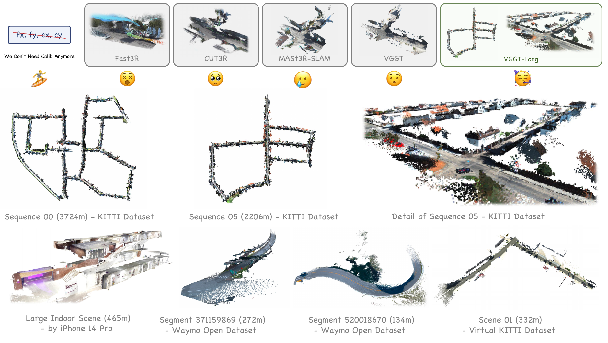

*图 1（原论文图 1）　在大规模室外场景中，已有方法存在两类问题：一是严重漂移，如 CUT3R 和 Fast3R；二是无法完成整段长序列，如 MASt3R-SLAM 和 VGGT。VGGT-Long 能够在保持场景重建精度的同时，完成公里级场景重建。图中还展示了手机采集的室内场景、Waymo 与 Virtual KITTI 的结果。*

## 摘要

三维视觉基础模型近期在三维感知上展现了出色能力。然而，受内存限制，将这些模型扩展到大规模 RGB 流的三维重建仍然具有挑战。VGGT-Long 以分块和块间对齐构建重建系统，将单目三维重建扩展到公里级、无预设边界的室外环境。

系统采用分块处理策略，结合重叠区域对齐和轻量级回环优化，解决现有模型的可扩展性瓶颈。无需相机标定、深度监督或模型重新训练，VGGT-Long 就能获得与传统方法相当的轨迹估计和重建性能。论文在 KITTI、Waymo 和 Virtual KITTI 上进行评估。

VGGT-Long 不仅能够处理基础模型通常无法完成的长 RGB 序列，还能在多种条件下生成准确、一致的几何结构。结果表明，利用基础模型完成真实环境中的可扩展单目三维场景重建具有潜力，尤其适用于自动驾驶场景。代码已在[项目仓库](https://github.com/DengKaiCQ/VGGT-Long)公开。

> 这里“无需深度监督或重新训练”针对 VGGT-Long 的系统构建与使用。它直接调用预训练 VGGT 和地点识别模型，没有为长序列另设训练损失；VGGT 本身的预训练仍使用几何监督。

## 1 引言

根据单目 RGB 流感知三维环境对自动驾驶至关重要，但已有方法在公里级、未标定序列上仍面临困难。与小规模室内三维视觉任务不同，驾驶场景包含长轨迹、稀疏的帧间对应、动态物体和复杂的室外条件。一些方法 [6](#ref-6)、[44](#ref-44)、[45](#ref-45) 能处理大规模单目场景，但往往依赖复杂的多模块流程，或假定相机内参已知。其他方法引入 LiDAR [47](#ref-47)、IMU [46](#ref-46) 或双目 [3](#ref-3) 等额外传感器，绕开了一个对自主系统十分关键的核心问题：仅凭单目 RGB，完成可扩展且无需标定的重建。

近期，三维视觉经历了端到端基础模型兴起的范式变化，这些模型大多基于 Transformer [38](#ref-38)。从 DUSt3R [42](#ref-42)、MASt3R [15](#ref-15)，到 CUT3R [41](#ref-41)、Fast3R [43](#ref-43)，再到最近的 VGGT [40](#ref-40)，这一系列工作试图用单个统一的深度学习模型替代复杂的多组件 SfM 和 SLAM 流程。模型在大规模数据集上训练，将相机位姿估计、内参回归和三维场景表示——通常是点图——整合到同一框架中。一个关键目标是让误差能够贯穿整个系统反向传播，从而形成直接处理原始、未标定 RGB 输入的强大通用三维重建模型。

然而，CUT3R、Fast3R 等基础模型在室外环境仍有严重漂移，即使序列只有几十帧，也会限制实际应用。相比之下，VGGT 能生成相当稳定、准确的局部重建，在重建质量上达到领先水平。其主要限制在于巨大的计算与内存开销。

基于 Transformer 的基础模型对计算和内存的需求，严重限制了可扩展性。标准自注意力 [38](#ref-38) 的开销随输入规模呈二次增长。Flash-Attention [4](#ref-4)、[5](#ref-5) 等技术降低了注意力的显存读写开销，但长序列的计算与显存需求仍然很高。例如，VGGT 在 24 GiB RTX 4090 上只能处理 60—80 张图像。扩展到约 4600 帧的 KITTI 00 轨迹时，所需显存将远远超过当前硬件能力。这一瓶颈使模型局限于小规模场景；在长序列上，内存与漂移累积都变得难以处理。

> 原文将 FlashAttention 的作用表述为“计算复杂度降为线性”，这里需要区分复杂度对象。标准稠密注意力仍要计算所有查询与键的相互作用，算术量对 token 数仍为二次；FlashAttention 主要通过分块和片上计算减少显存读写，避免显式保存完整注意力矩阵。这里应区分计算量、显存占用和 I/O 复杂度，可对照原文参考文献 [4](#ref-4)、[5](#ref-5)，以及 [FlashAttention 原论文](https://arxiv.org/abs/2205.14135)对 I/O 感知精确注意力的定义。

这项工作与近期将基础模型整合进大规模系统的研究有关。其中一个代表是 MASt3R-SLAM [23](#ref-23)，它在 MASt3R [15](#ref-15) 之上构建 SLAM 系统。为了获得全局一致性，其后端使用位姿图优化和光束法平差（Bundle Adjustment，BA），这些都是现代 SLAM 的标准组件。

作者据此考察，大规模重建能否依靠更少的系统组件完成。其出发点是 VGGT 已有较强局部几何能力，主要障碍在于可扩展性，因此尝试以较小的额外开销连接局部结果。

VGGT-Long 据此采用三个步骤：将序列划分为重叠块，鲁棒地对齐相邻块，再通过高质量回环模块校正漂移。这种“分块并对齐”的方式避免了对复杂图优化后端，例如 BA [35](#ref-35)，的依赖。它体现了底层 VGGT 模型的能力：只要采用合适策略，就能将出色的局部重建拼接成全局一致的公里级地图。作者希望借此检验强基础模型与轻量后端结合的能力。

论文第 3.3 节依然对块之间的相似变换进行联合优化，数学上可以解释为块级 Sim(3) 位姿图。作者强调的简化，是减少优化变量和系统组件：不在全局阶段联合调整每个三维点、每帧相机和内参，也不执行完整 BA。

论文将贡献概括为以下三点：

1. 首次提出一个系统，将单目三维重建模型扩展到公里级、无预设边界的室外场景，无需相机标定和深度监督。
2. 提出简单有效的分块与对齐流程，解决 VGGT 等基础模型在长视频上的显存限制，同时取得与已标定传统方法相当的精度。
3. 处理局部模型用于长序列时累积的 Sim(3) 漂移，表明 VGGT 无需复杂后端即可作为大规模重建系统的可靠前端。

## 2 相关工作

### 运动恢复结构（Structure-from-Motion，SfM）

SfM 根据多视图图像估计相机位姿和稀疏三维结构。经典 SfM 流程 [1](#ref-1)、[8](#ref-8)、[26](#ref-26) 通常采用增量策略：检测关键点 [7](#ref-7)、[36](#ref-36)、匹配特征 [2](#ref-2)、[17](#ref-17)，再通过 BA [35](#ref-35) 优化位姿和结构。这类流程较为鲁棒，但高度依赖特征提取，在无纹理或存在歧义的场景中受到限制。

近期深度学习方法尝试增强或替代传统模块。PixSfM [16](#ref-16)、DFSfM [12](#ref-12) 等混合框架将深度特征与经典优化结合，进一步细化特征轨迹与三维结构。完全可微的 SfM 流程 [27](#ref-27)、[31](#ref-31)、[32](#ref-32)、[37](#ref-37) 则进一步探索端到端相机位姿与深度估计，但经常面临可扩展性或泛化问题。VGGSfM [39](#ref-39) 将稠密特征与多视图一致性整合进统一框架，表明学习系统可以在真实数据集上超越经典 SfM。

### SLAM 与视觉里程计

为了克服基础模型的扩展性限制，研究者尝试将它们整合到更大的 SLAM 系统。传统 SLAM [21](#ref-21)、[22](#ref-22) 依赖人工设计的特征和优化，学习方法 [14](#ref-14)、[33](#ref-33) 则将可微组件融入深度网络，但这些方法或难以扩展到长序列，或需要预先标定相机。

MASt3R-SLAM [23](#ref-23) 围绕 MASt3R [15](#ref-15) 构建了无需标定的复杂实时 SLAM 框架，使用位姿图优化、BA 等后端机制保证全局一致性。同期工作 VGGT-SLAM [19](#ref-19) 引入完整 SLAM 系统，通过基于 SL(4) 的因子图优化对齐子地图，以获得准确的室内重建。相比之下，VGGT-Long 面向大规模室外场景，采用基于 Sim(3) 的轻量流程，相较于完整 SLAM 框架，更重视简洁性与可扩展性。

### 基于 Transformer 的三维视觉方法

近期一个趋势是发展端到端三维基础模型，主要采用 Transformer 架构。这些方法根据具有重叠内容的图像进行稠密几何重建，假定相机位姿与标定均未知。DUSt3R [42](#ref-42) 及其后续 MASt3R [15](#ref-15) 率先展示了根据未标定图像对，联合估计相机参数和稠密三维几何的可行性。

之后的 CUT3R [41](#ref-41)、Fast3R [43](#ref-43) 进一步改进了这一范式。最近，VGGT [40](#ref-40) 在重建质量上达到新的领先水平，直接根据 RGB 输入生成稳定且准确的局部三维地图。不过，这些模型共同受到显著计算与内存开销的限制，只能处理较短图像序列。

VGGT-Long 的特点在于极简设计。它利用 VGGT 已有的局部重建能力，通过简单有效的分块与对齐框架，以尽可能小的额外开销，将其扩展到长序列和大规模场景。

## 3 方法

长单目 RGB 序列的处理分为三个阶段：序列分块、块间对齐，以及回环检测与校正。该方法在保留 VGGT 局部精度的同时，维持室外长序列的全局精度。

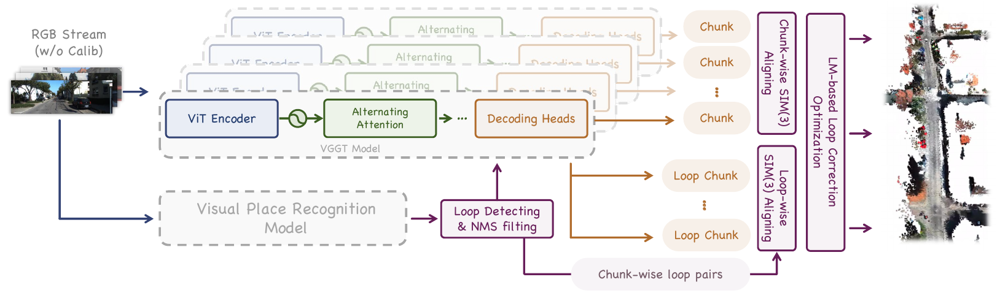

*图 2（原论文图 2）　VGGT-Long 将长序列划分为不同块，以滑动窗口方式处理 RGB 流。系统充分利用 VGGT 输出的点图和置信度，对各块进行轻量级回环处理与对齐，从而将 VGGT 扩展到自动驾驶长序列数据。*

图 2 上路独立处理连续帧块，用共享图像连接相邻局部地图；下路检索时间上相隔较远的重访图像，重新调用 VGGT 构造回环块。两路最终都输出块间 Sim(3) 测量，交给右侧 LM 优化。图中的多份 VGGT 轮廓表示多次调用同一个预训练模型。

### 3.1 序列分块与置信度辅助的局部对齐

给定长图像序列 $\mathcal I=\{\mathbf I_1,\ldots,\mathbf I_N\}$，将其划分为 $K$ 个重叠块。设块长为 $L$、重叠长度为 $O$，对于 $k=1,\ldots,K$，第 $k$ 块定义为帧索引从 $(k-1)(L-O)$ 到 $(k-1)(L-O)+L$ 的子序列。

每块 $\mathcal C_k$ 独立输入 VGGT [40](#ref-40)，输出一组局部一致的相机位姿，以及三维点图 $\mathbf P_k\in\mathbb R^{H\times W\times3}$ 和对应置信度 $\mathbf c_k\in\mathbb R^{H\times W}$。

> 原文用从 1 起的输入序列记号，却将第一块起点写为 0，也没有明确区间端点。若采用 Python 半开区间，块 $k$ 可写为 $[(k-1)(L-O),(k-1)(L-O)+L)$，尾块截断到 $N$。原文还省略了点图的帧维：实际上一块内的每张图都有点图与置信度，各帧点坐标统一在该块参考系中。

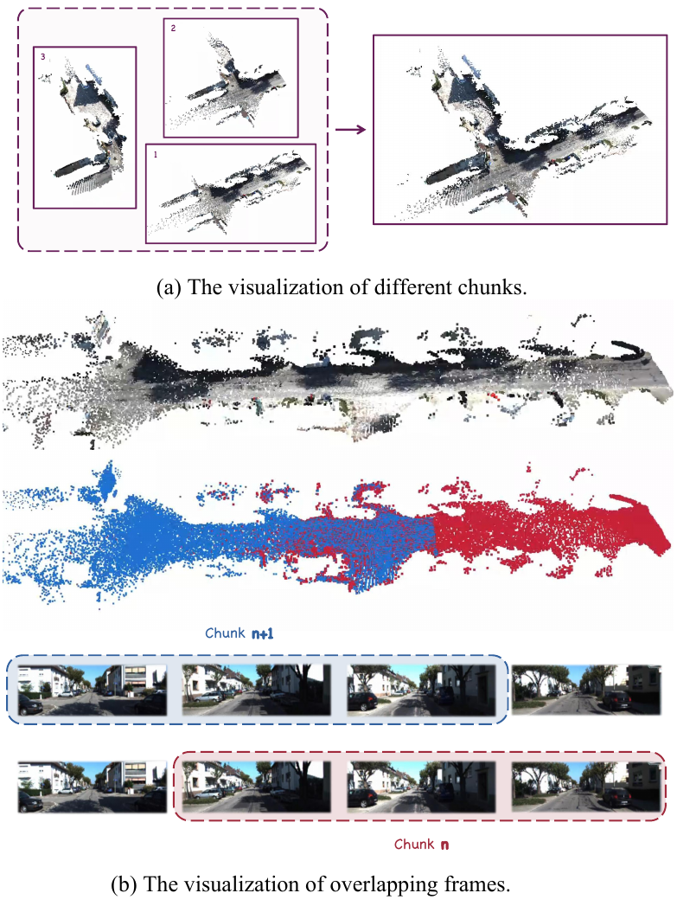

*图 3（原论文图 3）　(a) VGGT-Long 将公里级序列划成不同块进行处理；(b) 对齐关系由重叠帧在三维空间中的一致性得到。*

块间对齐利用 VGGT 输出的置信度。VGGT 的输出置信度反映模型对点云预测的确定程度。在室外场景中，天空、迎面车辆、快速移动的行人，以及雨天的雨滴，都会不同程度影响 Sim(3) 对齐。VGGT 对这些点赋予较低置信度，对建筑物、静止车辆等静态场景赋予较高置信度。对齐策略基于这一经验抑制不可靠预测。

对相邻块 $\mathcal C_k$ 和 $\mathcal C_{k+1}$，在重叠区域寻找三维对应点 $\{(\mathbf p_k^i,\mathbf p_{k+1}^i)\}$ 及其置信度 $\{(\mathbf c_k^i,\mathbf c_{k+1}^i)\}$。为了鲁棒地估计将 $\mathcal C_{k+1}$ 对齐到 $\mathcal C_k$ 的相对变换 $\mathbf S_{k,k+1}\in\operatorname{Sim}(3)$，方法采用迭代重加权最小二乘（IRLS），最小化以下鲁棒代价：

$$
\mathbf S_{k,k+1}^*=\arg\min_{\mathbf S\in\operatorname{Sim}(3)}
\sum_i\rho\left(\|\mathbf p_k^i-\mathbf S\mathbf p_{k+1}^i\|_2\right).
\tag{1}
$$

其中 $\rho(\cdot)$ 是 Huber 损失，用于减弱离群点的影响。IRLS 通过迭代最小化加权平方误差，求解这一非线性问题：

$$
\mathbf S^{(t+1)}=\arg\min_{\mathbf S\in\operatorname{Sim}(3)}
\sum_i\mathbf w_i^{(t)}\|\mathbf p_k^i-\mathbf S\mathbf p_{k+1}^i\|_2^2.
\tag{2}
$$

在第 $t$ 次迭代，对应点 $i$ 的权重为模型置信度 $\mathbf c_i$ 与 Huber 损失导出的鲁棒项之积：

$$
\mathbf w_i^{(t)}=\mathbf c_i\cdot
\frac{\rho'(r_i^{(t)})}{r_i^{(t)}},
\qquad
r_i^{(t)}=\|\mathbf p_k^i-\mathbf S^{(t)}\mathbf p_{k+1}^i\|_2.
\tag{3}
$$

这里 $r_i^{(t)}$ 是上一次迭代得到的残差。每个加权最小二乘子问题通过加权 Umeyama 算法高效地闭式求解。

通过这种方式，对齐过滤快速运动物体、天空等区域的低置信度预测，见图 4。对缓慢行驶车辆等中等置信度对象，降低其对齐权重；对建筑物等高置信度结构赋予更高权重。实现中直接丢弃置信度低于整块置信度中位数 $0.1$ 倍的点。剩余通过过滤的低置信度点，其贡献也会因权重衰减而减小。

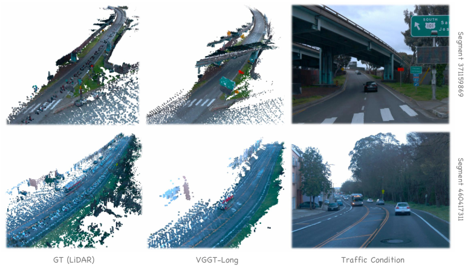

*图 4（原论文图 4）　置信度感知对齐抑制高速动态物体，例如车辆，对对齐和重建的影响。图中可见，较密集的车辆未能在 LiDAR 点云中被有效过滤，而 VGGT-Long 可以处理这种情况。*

假设两块分别包含 $(I_1,I_2,I_3,I_4)$ 与 $(I_3,I_4,I_5,I_6)$。在预处理一致时，共享图像 $I_3$ 的同一像素 $u$ 产生两份三维预测，直接构成点对；$I_4$ 同理。系统不需要在两张不同图像间搜索这些对应。即使像素看见运动汽车，两份预测仍对应同一次拍摄；其不可靠性主要来自网络在不同多帧上下文中对运动区域的几何估计。

同一块内点图使用共同参考系，不同块的参考系与尺度可能不同。式（1）中的变换作用为 $\mathbf S\mathbf x=sR\mathbf x+\mathbf t$，其中 $s>0$、$R\in SO(3)$，分别有 1 个尺度、3 个旋转、3 个平移自由度。若同一面墙在两块中分别宽 10、12 个预测单位，需要缩放才能对齐；Sim(3) 对齐只统一单位，不能单凭单目输入保证单位是米。

取阈值为 $\delta$ 的 Huber 损失：

$$
\rho_\delta(r)=
\begin{cases}
\frac12r^2,&0\le r\le\delta,\\
\delta(r-\frac12\delta),&r>\delta.
\end{cases}
$$

求导后，$\rho_\delta'(r)/r$ 在小残差区为 1，在大残差区为 $\delta/r$；零残差处取连续极限。因此小残差保留置信度权重，大残差进一步降权。比如 $c_i=0.8$、$r_i=4\delta$，得到 $w_i=0.2$。每轮用新的变换重新计算残差和权重，再求解式（2）。$\delta$ 与残差都在目标块的局部长度单位中。

原文式（1）没有显式写入置信度，但式（3）包含 $c_i$。若把 $c_i$ 看作固定权重，式（2）—（3）对应的鲁棒目标应为 $\sum_i c_i\rho_\delta(r_i)$。这里保留原公式，并明确这一记号差异。置信度是模型对预测的可靠性评分，并非显式运动标签，也不保证全部运动点都被剔除。

设源点为 $\mathbf q_i=\mathbf p_{k+1}^i$、目标点为 $\mathbf p_i=\mathbf p_k^i$，归一化权重 $\alpha_i=w_i/\sum_jw_j$，两组加权质心为 $\bar{\mathbf q}$、$\bar{\mathbf p}$。固定旋转和尺度后，令目标对平移的导数为零，得到 $\mathbf t=\bar{\mathbf p}-sR\bar{\mathbf q}$。代回便得到中心化问题。

令

$$
C=\sum_i\alpha_i(\mathbf p_i-\bar{\mathbf p})
(\mathbf q_i-\bar{\mathbf q})^\mathsf T=U\Sigma V^\mathsf T,
\quad D=\operatorname{diag}(1,1,\det(UV^\mathsf T)).
$$

在非退化情形，标准加权相似配准解为

$$
R=UDV^\mathsf T,\qquad
s=\frac{\operatorname{tr}(\Sigma D)}
{\sum_i\alpha_i\|\mathbf q_i-\bar{\mathbf q}\|_2^2},\qquad
\mathbf t=\bar{\mathbf p}-sR\bar{\mathbf q}.
$$

$D$ 保证旋转不含反射。具体而言，记中心化后的两组加权方差为

$$
\sigma_p^2=\sum_i\alpha_i\|\mathbf p_i-\bar{\mathbf p}\|_2^2,
\qquad
\sigma_q^2=\sum_i\alpha_i\|\mathbf q_i-\bar{\mathbf q}\|_2^2.
$$

展开中心化目标得

$$
E(s,R)=\sigma_p^2+s^2\sigma_q^2-2s\operatorname{tr}(R^\mathsf TC).
$$

正尺度条件下，最优旋转最大化 $\operatorname{tr}(R^\mathsf TC)$；SVD 与行列式修正给出 $R=UDV^\mathsf T$，对应迹值为 $\operatorname{tr}(\Sigma D)$。再令 $\partial E/\partial s=2s\sigma_q^2-2\operatorname{tr}(\Sigma D)=0$，便得到上面的尺度公式。权重固定后，一次 SVD 就能求解这一步；IRLS 的迭代发生在重估权重的外层。

> 在官方提交 `c160869` 中，`weighted_align_point_maps` 以两侧置信度几何均值 $\sqrt{c_k^ic_{k+1}^i}$ 构造权重；相邻块门槛取两份重叠区域置信度中位数较小值的 $0.1$ 倍，两边均超过才保留。`weighted_estimate_sim3` 的尺度采用两组中心化点加权均方根半径之比，再通过 SVD 求旋转。存在噪声时，这个尺度一般不同于上面最小二乘公式给出的最优尺度，因此标准推导与该版本代码并不逐项等价。

### 3.2 回环检测与回环级 Sim(3) 对齐

为了校正顺序估计中累积的漂移，系统对整个序列进行回环检测。这个过程识别属于同一场景的非相邻块，并鲁棒地估计它们之间的 Sim(3) 变换。

首先，用预训练视觉地点识别（VPR）模型 [13](#ref-13) 为序列每幅图像 $\mathbf I_i$ 提取紧凑、有辨识力的全局特征向量 $\mathbf d_i$。该模型以 DINOv2 [24](#ref-24) 为骨干，描述子编码图像的高层语义与几何内容。

得到全部图像的描述子后，开始检索潜在回环。对每个描述子执行高效最近邻检索，寻找余弦相似度高的其他图像。如果图像对 $(\mathbf I_i,\mathbf I_j)$ 的相似度超过阈值 $\tau_s$，且帧索引充分分离，即 $|i-j|>\Delta t_{\min}$，则作为潜在回环。

为了确保回环彼此有区分，并避免时间邻近帧中的冗余匹配，流程应用非极大值抑制（NMS），在局部时间窗口中选出最强匹配，得到高置信度的图像级回环对。

对每个确认的回环对 $(\mathbf I_i,\mathbf I_j)$，系统重新调用 VGGT，生成回环场景的局部重建。将分别以 $i$、$j$ 为中心的两个帧子序列拼接成临时图像批次，再输入 VGGT。与第 3.1 节按时间连续的滑窗处理不同，这个批次包含同一地点在时间上不连续的视图，为 VGGT 提供更加多样、时间分散的观察，通过更宽基线获得更鲁棒的场景几何。

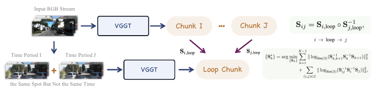

*图 5（原论文图 5）　回环级 Sim(3) 对齐。*

所得三维点图称为“以回环为中心的块”，见图 5。随后将它与对应原始块 $\mathcal C_i$、$\mathcal C_j$ 的点图对齐，后者来自时间连续帧。为了计算最终回环变换 $\mathbf S_{ij}$，方法通过这个新块串联对齐关系。具体而言，先计算原始块到回环块的变换，再组合为

$$
\mathbf S_{ij}=\mathbf S_{i,\mathrm{loop}}\circ
\mathbf S_{j,\mathrm{loop}}^{-1}.
\tag{4}
$$

其中 $\mathbf S_{i,\mathrm{loop}}$ 和 $\mathbf S_{j,\mathrm{loop}}$ 分别将回环块对齐到 $\mathcal C_i$、$\mathcal C_j$ 的坐标系，计算方法见第 3.1 节。原文将这一复合描述为从块 $\mathcal C_i$ 到 $\mathcal C_j$，即 $i\rightarrow\mathrm{loop}\rightarrow j$；该方向与式（4）存在歧义，需结合下文统一约定。借助共同的高质量局部重建，这种方式在两个远距离块之间建立联系，为全局优化提供鲁棒几何约束。

检索只能提供地点相似性，没有直接给出三维相对位姿。设原始两块分别包含早期片段 $(I_1,I_2)$ 和重访片段 $(I_7,I_8)$，将四幅图联合推理后，得到同一回环参考系中的点图。回环块与早期块共享 $I_1,I_2$，与后期块共享 $I_7,I_8$，于是两侧又都能按同帧同像素建立三维对应，分别完成配准。跨时间联系来自这次联合推理。

> 采用列向量，并将 $S_{a\leftarrow b}$ 定义为把 $b$ 系坐标变到 $a$ 系。若按原文对两个变换的定义，令 $A=S_{i\leftarrow\ell}$、$B=S_{j\leftarrow\ell}$，则式（4）为 $AB^{-1}$，实际方向是 $j\rightarrow\ell\rightarrow i$，与原文随后描述相反；原文此前“原始块到回环块”的方向也与此处对 $A,B$ 的定义不一致。反方向应为 $BA^{-1}$。

官方版本 `c160869` 的 `compute_sim3_ab(A,B)` 返回 $BA^{-1}$，优化器按对应方向使用。若 $A=(s_a,R_a,\mathbf t_a)$、$B=(s_b,R_b,\mathbf t_b)$，则

$$
s_{ba}=s_b/s_a,\quad R_{ba}=R_bR_a^\mathsf T,\quad
\mathbf t_{ba}=\mathbf t_b-s_{ba}R_{ba}\mathbf t_a.
$$

原公式与文字均予以保留，理解和实现时需要选择一致方向。回环视图也未必具有有效宽基线；检索错误、遮挡或反向行驶都可能使几何约束失效，论文没有给出对所有错误回环的排除保证。

### 3.3 基于 LM 的全局 Sim(3) 优化

为了获得全局一致性，方法沿用 [6](#ref-6)、[18](#ref-18)、[28](#ref-28) 的思路，对全部块的 Sim(3) 变换进行全局优化。求解器直接最小化非线性最小二乘目标，其中包含两类几何约束：来自相邻块的顺序约束（第 3.1 节），以及来自非相邻块的回环约束（第 3.2 节），无需构建复杂因子图。

目标是联合优化全部块的变换 $\{\mathbf S_k\}_{k=1}^K$，使它们尽可能符合相对测量。优化问题为

$$
\begin{aligned}
\{\mathbf S_k^*\}=\arg\min_{\{\mathbf S_k\}}\;&
\sum_{k=1}^{K-1}\left\|
\log_{\operatorname{Sim}(3)}\left(
\mathbf S_{k,k+1}^{-1}\mathbf S_k^{-1}\mathbf S_{k+1}
\right)\right\|_2^2\\
&+\sum_{(i,j)\in\mathcal L}\left\|
\log_{\operatorname{Sim}(3)}\left(
\mathbf S_{ij}^{-1}\mathbf S_i^{-1}\mathbf S_j
\right)\right\|_2^2.
\end{aligned}
\tag{5}
$$

其中 $\mathbf S_{k,k+1}$ 为相邻块相对变换，$\mathbf S_{ij}$ 为回环变换，$\mathcal L$ 为全部回环的集合。$\log_{\operatorname{Sim}(3)}(\cdot)$ 将 Sim(3) 变换映射到李代数 $\mathfrak{sim}(3)$ 的七维切空间表示，使优化可以在无约束的局部增量上进行。

该问题通过 Levenberg–Marquardt（LM）求解。全局优化以块为单位，仅维护少量 Sim(3) 变量，即使 KITTI 通常也只有几十个，见图 6。优化只需少量迭代即可收敛，处理时间为毫秒级，见图 7。

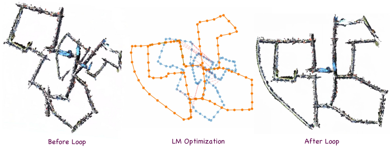

*图 6（原论文图 6）　缺少回环约束时，误差会在公里级尺度上持续累积。全局 LM 优化可以缓解这种累积误差。*

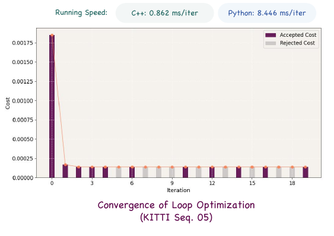

*图 7（原论文图 7）　回环优化仅需约 3 次迭代即可收敛，并达到毫秒级性能。图中展示 KITTI 05 的代价变化，标出的 C++、Python 速度分别为每次迭代 0.862 ms、8.446 ms。*

将 $\mathbf S_k$ 解释为“第 $k$ 块到全局”的变换，则 $\mathbf S_i^{-1}\mathbf S_j$ 把第 $j$ 块坐标变到第 $i$ 块。这与第 3.1 节“后一块到前一块”的测量方向一致。当测量准确满足时，$\mathbf S_{ij}^{-1}\mathbf S_i^{-1}\mathbf S_j=I$，对数为零。七维残差同时描述旋转、平移和尺度的不一致。

初始全局状态可由顺序测量串接：固定 $\mathbf S_1=I$，令 $\mathbf S_{k+1}=\mathbf S_k\mathbf S_{k,k+1}$。有回环后，同一远距离关系既可以由顺序链预测，也可以由回环块测量，两者有差异时，式（5）将修正分配到各块。它不会重新寻找三维点对应，参与求解的是已经估计好的块间变换。

为看清一次优化的计算，令每块以切空间增量 $\Delta\boldsymbol\xi_k\in\mathbb R^7$ 更新为 $\mathbf S_k\operatorname{Exp}(\Delta\boldsymbol\xi_k)$。将所有残差堆叠为 $\mathbf e$，一阶近似为 $\mathbf e+J\Delta\boldsymbol\xi$。LM 可写成求解

$$
(J^\mathsf TJ+\lambda D)\Delta\boldsymbol\xi
=-J^\mathsf T\mathbf e,
$$

$D$ 为正的阻尼尺度矩阵，$\lambda$ 随试探步骤是否降低代价而调整。求得增量后更新变换，再计算残差并迭代。这里是解释 LM 的一般形式，未声称论文逐项给出了该矩阵或代码完全采用此写法。全局共同参考系需要固定，例如固定首块为单位变换。

全局结果将每块点和相机中心变到共同坐标系：$\mathbf x_w=s_kR_k\mathbf x_k+\mathbf t_k$；相机朝向只组合旋转。该操作整体移动和缩放局部地图，不重新预测块内深度、内参或非刚性畸变，也不把优化结果反馈给 VGGT。论文式（5）未给出逐边协方差或显式鲁棒回环核，因此不能据此推断它能自动抵御任意错误回环。

## 4 实验

论文在 KITTI Dataset Odometry Track [11](#ref-11)、Waymo Open Dataset v1.4.1 [30](#ref-30) 和 Virtual KITTI v1.3.1 [9](#ref-9) 上评估 VGGT-Long，以衡量大规模单目三维重建性能。实验计算机运行 Ubuntu 22.04，配备 12 个 Intel Xeon Gold 6128 3.40 GHz CPU 和 67 GiB RAM。大多数实验使用 24 GiB NVIDIA RTX 4090；块长为 90 或更大时，改用 48 GiB NVIDIA L20。

### 4.1 评价指标

评价采用四种指标。轨迹估计采用近期文献常用的绝对轨迹误差（Absolute Trajectory Error，ATE）[29](#ref-29)，评价长序列的长期一致性。

重建评价沿用 VGGT [40](#ref-40) 的设置，采用三个指标：Accuracy，即每个预测点到最近真值点的欧氏距离；Completeness，即每个真值点到最近预测点的欧氏距离；Chamfer Distance，即前两者的平均。考虑到单目三维方法固有的尺度歧义，计算重建指标前，评估先对预测位姿和真值位姿做粗对齐，随后通过点到点 ICP [25](#ref-25) 进一步细化对齐，再计算这些指标。

少量点都落在正确表面时，Accuracy 可以很小，但真值中未被覆盖的区域仍使 Completeness 很大。二者都是距离误差，越小越好。ATE 在表中以 RMSE 和米报告，越小表示整体轨迹偏差越小。重建距离是在上述对齐后计算的，不能当作模型无需对齐便恢复绝对米制尺度的证明。原文对 ATE 的对齐自由度没有同样详细的说明，这里不补造评估选项。

### 4.2 实验设置

计算重建指标时，为避免离群点云干扰，对基于 Transformer 的三维方法，统一保留置信度高于平均置信度 $0.75$ 倍的点。对 DROID-SLAM 这类不输出置信度的方法，原文写作保留深度值大于平均逆深度 $0.75$ 倍的点，作为过滤后的点云。

> 上述原句混用了 depth 和 inverse depth，二者量纲不同，无法直接作为明确的比较规则。这里保留原文信息，未将其静默改为某一种过滤算法。该歧义影响点云评价协议的完全复现。另需区分：这里的 $0.75$ 倍均值用于重建评价，3.1 节的 $0.1$ 倍中位数用于块间对齐。

推理遵循 VGGT 设置，将图像下采样到宽度 518 像素，高度按长宽比保持。流程先让 VPR 处理全部图像，再释放 VPR 模型的显存占用，为 VGGT 分配足够资源。

### 4.3 CPU 内存管理策略

为处理 CPU 内存无法容纳全部 VGGT 输出的大规模场景，流程采用分块写盘策略：每处理完一个块，就将结果存盘。在随后的对齐阶段，只将相关块对加载到 CPU 内存中计算 Sim(3)，完成后立即释放。

这一设计将 CPU 内存压力转移到磁盘存储，有助于避免因过量占用 CPU 内存导致的系统崩溃、卡死或其他严重故障。计算完成后，系统清理中间结果，减少存储开销。最终输出的彩色点云与相机位姿采用流式写入，以绕开大规模重建的 CPU 内存容量限制，减少海量点云带来的 RAM 压力。

普通块独立推理，重叠图像会重新进入 VGGT，不复用上一块的注意力缓存。忽略尾块，共有约 $N/(L-O)$ 次调用，处理图像的总次数约为 $NL/(L-O)$；若 $O=L/2$，约为原帧数的两倍，另有回环块开销。固定块长控制单次推理显存，写盘控制主要稠密输出的内存压力，但描述子、约束和最终输出规模仍随序列增长。先扫描全序列做 VPR 的流程，也与严格只读取过去帧的在线因果模型有所区别。

### 4.4 KITTI、Waymo 与 Virtual KITTI

首先评估经典 SLAM 基准 KITTI Odometry。长序列和室外环境为单目重建带来显著挑战。表 1 报告 11 段序列的 ATE。

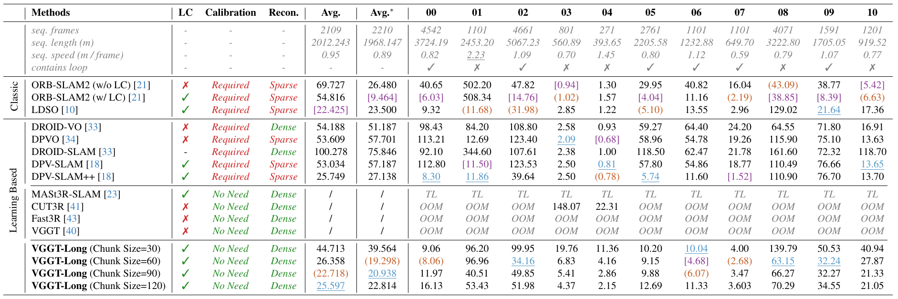

*表 1（原论文表 1）　KITTI Odometry 上的相机轨迹结果，ATE RMSE［m］，越小越好。重叠长度为块长的一半。LC 表示回环；Calibration 表示是否需要标定；Recon. 表示稀疏或稠密重建。序列 01 为高速序列，运动模式与其他序列明显不同；Avg.* 排除该序列，Avg. 为所报告总体均值。OOM 表示单张 RTX 4090 上 CUDA 显存不足，TL 表示跟踪丢失。轨迹可视化见图 8。紫色、橙色、蓝色依次表示第一、第二、第三名。表内图像保留全部原始数值与标记，可打开图片放大查看。*

作者报告 VGGT-Long 在所列配置下相对 DROID-SLAM、DPVO 取得较好结果。与 ORB-SLAM2、LDSO 不同，VGGT-Long 不依赖已标定内参，仍能保持有竞争力的精度。VGGT-Long 能成功处理全部序列，而 Fast3R、CUT3R、VGGT 等基础模型会因内存溢出失败。这验证了分块与对齐框架可以将 VGGT 有效扩展到长序列。

在 KITTI Odometry 上运行 MASt3R-SLAM 时，作者观察到约 100 帧之后跟踪停滞。新帧无法成为关键帧，导致建图停止更新，尽管程序仍然运行。这意味着跟踪丢失。该实验将跟踪丢失定义为：系统较长时间无法注册新帧，从而地图与轨迹不再更新。

虽然图 6 显示了更好的重建校正，表 1 也显示了更好的跟踪性能，中央路口仍有部分区域没有对齐。作者将其归因于该区域缺少显式回环约束。

> 比较这些结果时，需要同时看表内各配置和完成情况。表中 CUT3R 在部分短序列仍能完成，并非每列都 OOM。90、120 帧配置使用 L20 48 GiB，不能归到 RTX 4090 的硬件条件。块长 30、60、90、120 的 Avg. 分别为 44.713、26.358、22.718、25.597 m，说明块长增加并非持续改善。LDSO 的 Avg. 为 22.425 m，低于 90 帧配置；排除高速 01 后，开回环 ORB-SLAM2 的 Avg.* 为 9.464 m，60 帧 VGGT-Long 为 19.298 m。论文支持的是无需输入标定的长序列可扩展性与竞争力，不能泛化为所有条件下精度最优。MASt3R-SLAM 的失败现象也限定于作者所测配置。

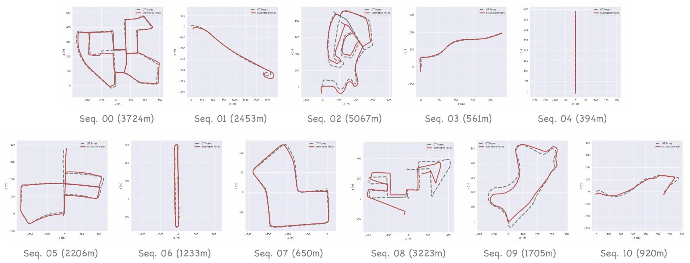

*图 8（原论文图 8）　KITTI 轨迹可视化。虽然序列 08 在三维空间存在重叠，但经常对应同一车道上的不同驾驶方向，这时二维 RGB 回环检测模块无法找到潜在回环。尽管如此，根据表 1，即使在这种情况下，VGGT-Long 的数值精度仍优于许多已有方法。*

泛化测试使用 Waymo。该数据集的城市驾驶场景具有明显的外观变化和不同交通条件。VGGT-Long 在十段 200 帧片段上取得平均 1.996 m ATE。与 CUT3R、MASt3R-SLAM 相比，其误差显著更低，见表 2。在视角多样性较强的片段中，VGGT-Long 持续生成更准确、完整的三维重建。

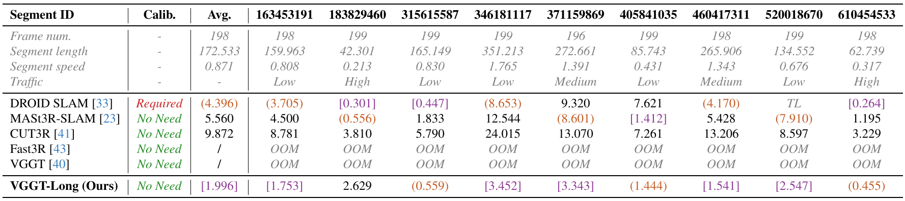

*表 2（原论文表 2）　Waymo Open Dataset 相机轨迹结果，ATE RMSE［m］，越小越好。Frame num. 为帧数，Segment length 为片段长度，Segment speed 为每帧移动距离，Traffic 为交通密度；紫色、橙色表示第一、第二名。*

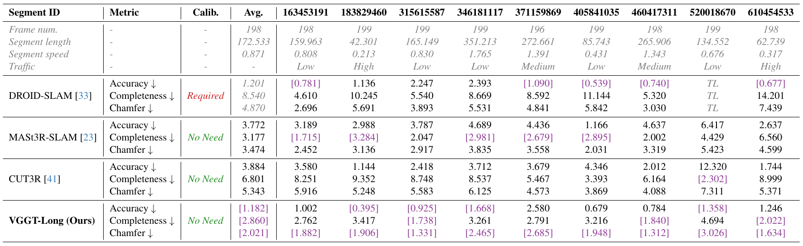

*表 3（原论文表 3）　Waymo 点图估计结果。真值点云来自车载 LiDAR，其扫描高度通常低于人眼，覆盖范围实际上比 RGB 相机的观测范围窄。例如在片段 371159869 中，LiDAR 真值没有感知到高架桥结构，而几乎所有视觉方法都能在不同程度上将其检测并重建。因此本表数字仅供参考，建议结合图 10—13 进行更直观的比较。无论视觉比较还是参考数值，VGGT-Long 都展现出更好的重建性能。紫色表示第一名。*

> 原文称十段，表 2、3 仅展示九个片段 ID。表 2 展示的九个 VGGT-Long ATE 算术平均约 1.969 m，与报告 Avg. 1.996 m 不同，缺失项或汇总差异未交代。报告值在此保留，缺失项无法由表内数据确定。DROID-SLAM 还有一个 TL，其有效样本与全部成功方法不同。表 3 的 VGGT-Long 三项 Avg. 为 1.182、2.860、2.021，DROID-SLAM 为 1.201、8.540、4.870，MASt3R-SLAM 为 3.772、3.177、3.474；这些报告值说明同时比较 Accuracy 与 Completeness 的必要性，但应保留样本和真值覆盖的限制。

随后通过 Virtual KITTI 的合成域变化评估鲁棒性。该数据集提供多种天气与光照条件。如表 4 所示，VGGT-Long 在雾、雨、日落等全部测试条件下保持稳定 ATE。DROID-SLAM 偶尔丢失跟踪，CUT3R 出现较大漂移，VGGT-Long 则在不重新训练或域适应的条件下完成所列测试。

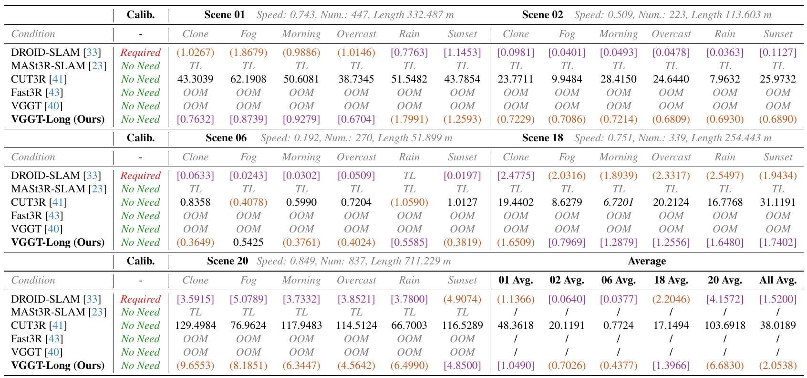

*表 4（原论文表 4）　Virtual KITTI 相机轨迹结果，ATE RMSE［m］，越小越好。列条件依次为 Clone（原始条件）、Fog（雾）、Morning（早晨）、Overcast（阴天）、Rain（雨）、Sunset（日落）；Speed 为每帧移动距离，Num. 为帧数，Length 为长度。最后一组为各场景及总体均值；紫色、橙色表示第一、第二名。*

> 表 4 报告 VGGT-Long 总体平均为 2.0538 m，DROID-SLAM 为 1.5200 m。DROID-SLAM 在 Scene 06 雨天 TL，但在多个成功场景误差更低；VGGT-Long 完成所列条件，并非每个条件精度都最好。对于出现失败项的方法，平均误差还需要结合完成率理解。

作者进一步讨论了基线在部分困难场景下的表现。关于 DROID-SLAM 在室外长序列上表现不佳的原因，[6](#ref-6)、[18](#ref-18) 已有详细讨论。MASt3R-SLAM 在短序列上可以工作，但在长序列中容易失败，作者将其与 MASt3R [15](#ref-15) 特征匹配及关键帧管理联系起来。自动驾驶场景相比室内往往变化较少，例如长直道路，系统可能长时间不生成新关键帧；等到最终生成时，与上一关键帧的距离过大，特征匹配失败，从而丢失跟踪。

CUT3R 则使用持续状态 token 编码整个三维场景，这与新视角合成中的 NeRF [20](#ref-20) 有相似之处。因此，CUT3R 在大规模室外场景上也面临类似 NeRF 的挑战：紧凑表示难以容纳辽阔环境中的大量几何细节。

> 这些失败机制是作者给出的解释。关键帧间隔、匹配失败与状态容量提供了可能原因，但这些实验没有逐项控制相关变量，不能将解释视为已经独立验证的因果结论。

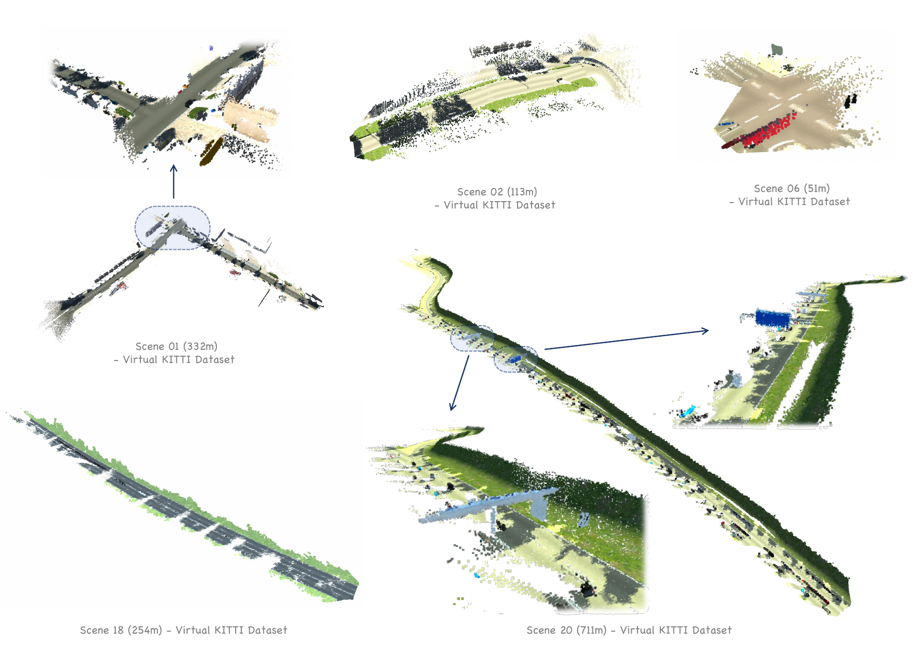

*图 9（原论文图 9）　Virtual KITTI 的可视化结果。图中包含 Scene 01、02、06、18、20，箭头连接局部放大区域。*

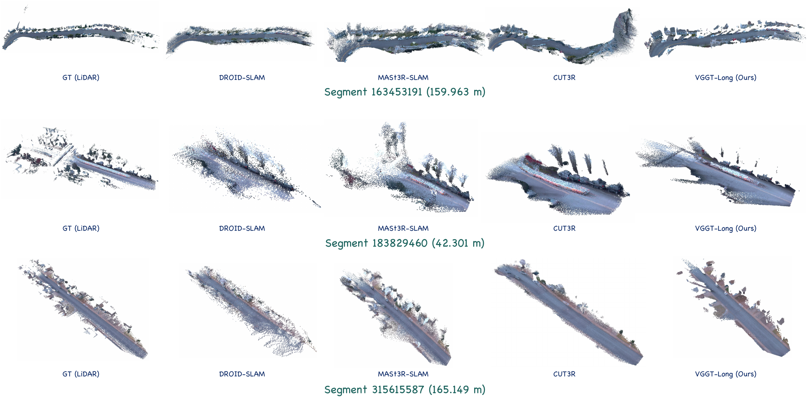

*图 10（原论文图 10）　Waymo Open Dataset 的可视化对比，第一部分。*

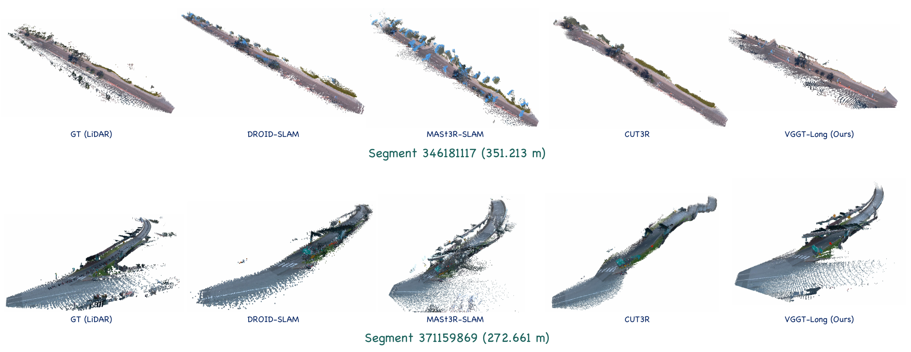

*图 11（原论文图 11）　Waymo Open Dataset 的可视化对比，第二部分。*

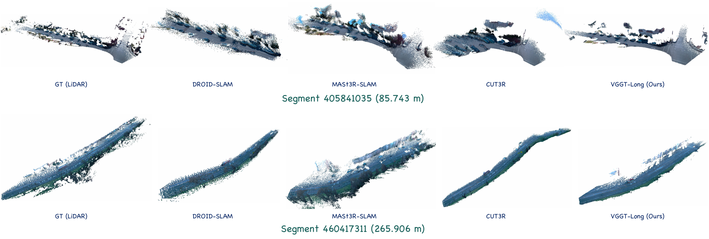

*图 12（原论文图 12）　Waymo Open Dataset 的可视化对比，第三部分。*

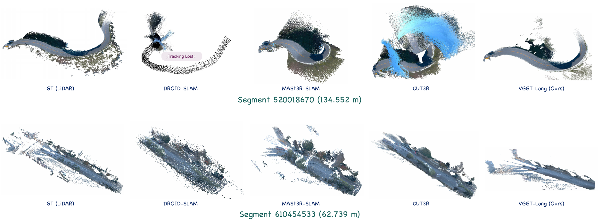

*图 13（原论文图 13）　Waymo Open Dataset 的可视化对比，第四部分。*

四幅图依次展示九个 Waymo 片段，各行从左至右均为 LiDAR 真值、DROID-SLAM、MASt3R-SLAM、CUT3R、VGGT-Long。图 13 的弯道片段标出了 DROID-SLAM 的 Tracking Lost。与表 3 相同，这里要同时看结构覆盖与位置一致性；LiDAR 未覆盖的结构不能仅凭缺少真值就认定视觉重建错误。这些图在原 PDF 中位于参考文献之后，可按原图号定位。

### 4.5 回环优化分析与消融实验

表 5 报告了 VGGT-Long 在若干 KITTI 序列上的运行时间。所有计时排除磁盘 I/O，因为它受操作系统后台程序、磁盘带宽和内存吞吐等因素影响。在作者的计算机上，每块加载约 25 ms、写入约 95 ms；由于每段 KITTI 序列只有几十块，这部分开销可以忽略。因此磁盘延迟不会显著影响总体运行时间。

系统能够高效地逐块处理，每块约 2.6—2.8 s；Sim(3) 对齐约 0.2 s。图 7 评估了回环优化模块的效果与效率。基于 Sim(3) 的 LM 求解器平均约 3 次迭代收敛，每步少于 15 ms：C++ 每次迭代约 0.4—1.3 ms，Python 约 3.5—13 ms。这些结果表明，即使在公里级序列上，系统也有用于实时或近实时场景的可行性。

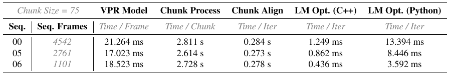

*表 5（原论文表 5）　VGGT-Long 各组件运行时间。块长为 75；VPR 按每帧计时，Chunk Process 按每块计时，Chunk Align 与 LM Opt. 按每次迭代计时。作者将这些组件的运行速度概括为接近实时。*

> 表 5 的块对齐为每次迭代 0.273—0.284 s，正文概括为约 0.2 s；IRLS 本身可能运行多轮。LM 的毫秒数仅属于块级优化。完整流程还包含重复的重叠帧推理、回环块和排除在表外的 I/O，块批次也需要等待图像到齐。因此这些分项计时不能直接等同于端到端在线实时性，磁盘开销是否可忽略也与具体设备有关。

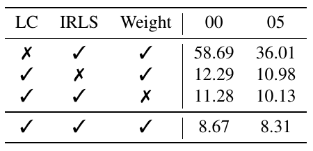

*表 6（原论文表 6）　消融实验，ATE RMSE［m］，越小越好。实验表明回环显著减少累积误差，全部组件结合时取得最好结果。*

表 6 给出 KITTI 上的消融。“LC”表示是否启用回环；“IRLS”表示块间对齐是否采用迭代重加权最小二乘，关闭后改为一次置信度加权对齐；“Weight”表示是否采用置信度权重，关闭时将 VGGT 置信度图统一为相同值。

移除回环或 IRLS 权重都会造成明显精度下降。具体而言，关闭回环后，序列 00 的 ATE 增加到 58.69 m，而关闭 IRLS 会导致 13% 的性能下降。回环、IRLS 和置信度加权全部启用时，性能最好。

两列分别是序列 00、05。完整配置为 8.67、8.31 m；关闭回环为 58.69、36.01 m；只关闭 IRLS 为 12.29、10.98 m；只关闭置信度权重为 11.28、10.13 m。由此可见，远距离几何约束、残差降权与模型置信度分别提供帮助。原文的“13%”没有给出可由这些数值直接复算的口径，不能替作者补定其定义。这里也没有单独消融回环块联合推理与其他回环配准方案，无法把全部回环收益进一步归因于某个子步骤。

## 5 结论

VGGT-Long 借助预训练基础模型，将仅使用单目 RGB 的三维重建扩展到长序列和无预设边界的视频场景。方法无需相机标定，克服了已有三维视觉模型的显存限制。在 KITTI、Waymo、Virtual KITTI 上的大量实验表明，VGGT-Long 能够在多种真实和合成环境中实现准确、可扩展的三维重建。作者将室外长序列中的精度与一致性列为后续方向。

分块控制单次推理容量，置信度与 IRLS 改善块间配准，回环提供顺序链以外的约束，LM 将这些约束分配到各块。整个方案依赖局部几何足够可靠、共享区域可配准，以及回环能被识别并正确重建。缺少回环时仍会累积漂移；局部形状无法由一个相似变换解释时，块级优化也无法逐点修复。这些条件决定了轻量全局对齐能解决的问题范围。

## 参考文献

以下编号沿用原文，英文条目保留论文的著录信息，省略原 PDF 的反向页码。

[1] Sameer Agarwal, Yasutaka Furukawa, Noah Snavely, Ian Simon, Brian Curless, Steven M Seitz, and Richard Szeliski. Building rome in a day. Communications of the ACM, 54 (10):105–112, 2011.

[2] Hongkai Chen, Zixin Luo, Jiahui Zhang, Lei Zhou, Xuyang Bai, Zeyu Hu, Chiew-Lan Tai, and Long Quan. Learning to match features with seeded graph matching network. In Proceedings of the IEEE/CVF international conference on computer vision, pages 6301–6310, 2021.

[3] Igor Cvišić, Ivan Marković, and Ivan Petrović. Soft2: Stereo visual odometry for road vehicles based on a point-to-epipolar-line metric. IEEE Transactions on Robotics, 39 (1):273–288, 2022.

[4] Tri Dao. FlashAttention-2: Faster attention with better parallelism and work partitioning. In International Conference on Learning Representations (ICLR), 2024.

[5] Tri Dao, Daniel Y. Fu, Stefano Ermon, Atri Rudra, and Christopher Ré. FlashAttention: Fast and memory-efficient exact attention with IO-awareness. In Advances in Neural Information Processing Systems (NeurIPS), 2022.

[6] Kai Deng, Yigong Zhang, Jian Yang, and Jin Xie. Gigaslam: Large-scale monocular slam with hierarchical gaussian splats. arXiv preprint arXiv:2503.08071, 2025.

[7] Daniel DeTone, Tomasz Malisiewicz, and Andrew Rabinovich. Superpoint: Self-supervised interest point detection and description. In Proceedings of the IEEE conference on computer vision and pattern recognition workshops, pages 224–236, 2018.

[8] Jan-Michael Frahm, Pierre Fite-Georgel, David Gallup, Tim Johnson, Rahul Raguram, Changchang Wu, Yi-Hung Jen, Enrique Dunn, Brian Clipp, Svetlana Lazebnik, et al. Building rome on a cloudless day. In European conference on computer vision, pages 368–381. Springer, 2010.

[9] A Gaidon, Q Wang, Y Cabon, and E Vig. Virtual worlds as proxy for multi-object tracking analysis. In CVPR, 2016.

[10] Xiang Gao, Rui Wang, Nikolaus Demmel, and Daniel Cremers. Ldso: Direct sparse odometry with loop closure. In 2018 IEEE/RSJ International Conference on Intelligent Robots and Systems (IROS), pages 2198–2204. IEEE, 2018.

[11] Andreas Geiger, Philip Lenz, and Raquel Urtasun. Are we ready for autonomous driving? the kitti vision benchmark suite. In 2012 IEEE conference on computer vision and pattern recognition, pages 3354–3361. IEEE, 2012.

[12] Xingyi He, Jiaming Sun, Yifan Wang, Sida Peng, Qixing Huang, Hujun Bao, and Xiaowei Zhou. Detector-free structure from motion. CVPR, 2024.

[13] Sergio Izquierdo and Javier Civera. Optimal transport aggregation for visual place recognition. In Proceedings of the ieee/cvf conference on computer vision and pattern recognition, pages 17658–17668, 2024.

[14] Krishna Murthy Jatavallabhula, Soroush Saryazdi, Ganesh Iyer, and Liam Paull. gradslam: Automagically differentiable slam. arXiv preprint arXiv:1910.10672, 2019.

[15] Vincent Leroy, Yohann Cabon, and Jérôme Revaud. Grounding image matching in 3d with mast3r. In European Conference on Computer Vision, pages 71–91. Springer, 2024.

[16] Philipp Lindenberger, Paul-Edouard Sarlin, Viktor Larsson, and Marc Pollefeys. Pixel-Perfect Structure-from-Motion with Featuremetric Refinement. In ICCV, 2021.

[17] Philipp Lindenberger, Paul-Edouard Sarlin, and Marc Pollefeys. Lightglue: Local feature matching at light speed. In Proceedings of the IEEE/CVF International Conference on Computer Vision, pages 17627–17638, 2023.

[18] Lahav Lipson, Zachary Teed, and Jia Deng. Deep patch visual slam. In European Conference on Computer Vision, pages 424–440. Springer, 2025.

[19] Dominic Maggio, Hyungtae Lim, and Luca Carlone. Vggt-slam: Dense rgb slam optimized on the sl (4) manifold. arXiv preprint arXiv:2505.12549, 2025.

[20] Ben Mildenhall, Pratul P Srinivasan, Matthew Tancik, Jonathan T Barron, Ravi Ramamoorthi, and Ren Ng. Nerf: Representing scenes as neural radiance fields for view synthesis. Communications of the ACM, 65(1):99–106, 2021.

[21] Raul Mur-Artal and Juan D. Tardos. ORB-SLAM2: An open-source SLAM system for monocular, stereo, and RGB-d cameras. IEEE Transactions on Robotics, 33(5):1255–1262, 2017.

[22] Raul Mur-Artal, J. M. M. Montiel, and Juan D. Tardos. ORB-SLAM: A versatile and accurate monocular SLAM system. IEEE Transactions on Robotics, 31(5):1147–1163, 2015.

[23] Riku Murai, Eric Dexheimer, and Andrew J Davison. Mast3r-slam: Real-time dense slam with 3d reconstruction priors. In Proceedings of the Computer Vision and Pattern Recognition Conference, pages 16695–16705, 2025.

[24] Maxime Oquab, Timothée Darcet, Theo Moutakanni, Huy V. Vo, Marc Szafraniec, Vasil Khalidov, Pierre Fernandez, Daniel Haziza, Francisco Massa, Alaaeldin El-Nouby, Russell Howes, Po-Yao Huang, Hu Xu, Vasu Sharma, Shang-Wen Li, Wojciech Galuba, Mike Rabbat, Mido Assran, Nicolas Ballas, Gabriel Synnaeve, Ishan Misra, Herve Jegou, Julien Mairal, Patrick Labatut, Armand Joulin, and Piotr Bojanowski. Dinov2: Learning robust visual features without supervision, 2023.

[25] Szymon Rusinkiewicz and Marc Levoy. Efficient variants of the icp algorithm. In Proceedings third international conference on 3-D digital imaging and modeling, pages 145–152. IEEE, 2001.

[26] Johannes L Schonberger and Jan-Michael Frahm. Structure-from-motion revisited. In Proceedings of the IEEE conference on computer vision and pattern recognition, pages 4104–4113, 2016.

[27] Cameron Smith, David Charatan, Ayush Tewari, and Vincent Sitzmann. Flowmap: High-quality camera poses, intrinsics, and depth via gradient descent. arXiv preprint arXiv:2404.15259, 2024.

[28] Hauke Strasdat, J Montiel, and Andrew J Davison. Scale drift-aware large scale monocular slam. Robotics: science and Systems VI, 2(3):7, 2010.

[29] Jürgen Sturm, Nikolas Engelhard, Felix Endres, Wolfram Burgard, and Daniel Cremers. A benchmark for the evaluation of rgb-d slam systems. In 2012 IEEE/RSJ international conference on intelligent robots and systems, pages 573–580. IEEE, 2012.

[30] Pei Sun, Henrik Kretzschmar, Xerxes Dotiwalla, Aurelien Chouard, Vijaysai Patnaik, Paul Tsui, James Guo, Yin Zhou, Yuning Chai, Benjamin Caine, et al. Scalability in perception for autonomous driving: Waymo open dataset. In Proceedings of the IEEE/CVF conference on computer vision and pattern recognition, pages 2446–2454, 2020.

[31] Chengzhou Tang and Ping Tan. Ba-net: Dense bundle adjustment network. arXiv preprint arXiv:1806.04807, 2018.

[32] Zachary Teed and Jia Deng. Deepv2d: Video to depth with differentiable structure from motion. arXiv preprint arXiv:1812.04605, 2018.

[33] Zachary Teed and Jia Deng. Droid-slam: Deep visual slam for monocular, stereo, and rgb-d cameras. Advances in neural information processing systems, 34:16558–16569, 2021.

[34] Zachary Teed, Lahav Lipson, and Jia Deng. Deep patch visual odometry. Advances in Neural Information Processing Systems, 36, 2024.

[35] Bill Triggs, Philip F McLauchlan, Richard I Hartley, and Andrew W Fitzgibbon. Bundle adjustment—a modern synthesis. In International workshop on vision algorithms, pages 298–372. Springer, 1999.

[36] Michał Tyszkiewicz, Pascal Fua, and Eduard Trulls. Disk: Learning local features with policy gradient. Advances in Neural Information Processing Systems, 33:14254–14265, 2020.

[37] Benjamin Ummenhofer, Huizhong Zhou, Jonas Uhrig, Nikolaus Mayer, Eddy Ilg, Alexey Dosovitskiy, and Thomas Brox. Demon: Depth and motion network for learning monocular stereo. In Proceedings of the IEEE conference on computer vision and pattern recognition, pages 5038–5047, 2017.

[38] Ashish Vaswani, Noam Shazeer, Niki Parmar, Jakob Uszkoreit, Llion Jones, Aidan N Gomez, Łukasz Kaiser, and Illia Polosukhin. Attention is all you need. Advances in neural information processing systems, 30, 2017.

[39] Jianyuan Wang, Nikita Karaev, Christian Rupprecht, and David Novotny. Vggsfm: Visual geometry grounded deep structure from motion. In Proceedings of the IEEE/CVF Conference on Computer Vision and Pattern Recognition, pages 21686–21697, 2024.

[40] Jianyuan Wang, Minghao Chen, Nikita Karaev, Andrea Vedaldi, Christian Rupprecht, and David Novotny. Vggt: Visual geometry grounded transformer. In Proceedings of the Computer Vision and Pattern Recognition Conference, pages 5294–5306, 2025.

[41] Qianqian Wang, Yifei Zhang, Aleksander Holynski, Alexei A Efros, and Angjoo Kanazawa. Continuous 3d perception model with persistent state. arXiv preprint arXiv:2501.12387, 2025.

[42] Shuzhe Wang, Vincent Leroy, Yohann Cabon, Boris Chidlovskii, and Jerome Revaud. Dust3r: Geometric 3d vision made easy. In Proceedings of the IEEE/CVF Conference on Computer Vision and Pattern Recognition, pages 20697–20709, 2024.

[43] Jianing Yang, Alexander Sax, Kevin J Liang, Mikael Henaff, Hao Tang, Ang Cao, Joyce Chai, Franziska Meier, and Matt Feiszli. Fast3r: Towards 3d reconstruction of 1000+ images in one forward pass. arXiv preprint arXiv:2501.13928, 2025.

[44] Nan Yang, Rui Wang, Jorg Stuckler, and Daniel Cremers. Deep virtual stereo odometry: Leveraging deep depth prediction for monocular direct sparse odometry. In Proceedings of the European conference on computer vision (ECCV), pages 817–833, 2018.

[45] Huangying Zhan, Chamara Saroj Weerasekera, Jia-Wang Bian, Ravi Garg, and Ian Reid. Df-vo: What should be learnt for visual odometry? arXiv preprint arXiv:2103.00933, 2021.

[46] Ji Zhang and Sanjiv Singh. Visual-lidar odometry and mapping: Low-drift, robust, and fast. In 2015 IEEE international conference on robotics and automation (ICRA), pages 2174–2181. IEEE, 2015.

[47] Ji Zhang, Sanjiv Singh, et al. Loam: Lidar odometry and mapping in real-time. In Robotics: Science and systems, pages 1–9. Berkeley, CA, 2014.

## 实现版本与来源

实现细节依据 [VGGT-Long 官方提交 c160869](https://github.com/DengKaiCQ/VGGT-Long/tree/c160869d1d99c96bb227f414afb3bc68c29c9a76)，主要涉及 `vggt_long.py`、`loop_utils/sim3utils.py`、`loop_utils/sim3loop.py` 与 `base_models/base_model.py`。该仓库后续已支持其他基础模型，这里的实现分析对应论文中的 VGGT-Long。

原论文作者为 Kai Deng、Zexin Ti、Jiawei Xu、Jian Yang、Jin Xie，原文按 [CC BY 4.0](https://creativecommons.org/licenses/by/4.0/) 授权。本文在原文基础上进行了中文转述与机制分析，图表经过裁切。
