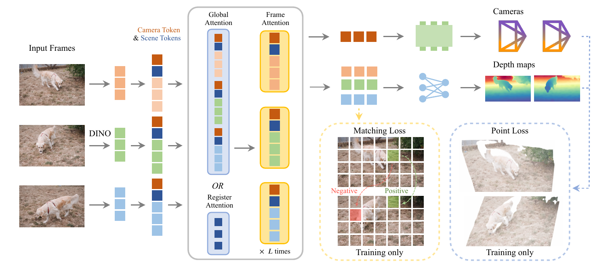
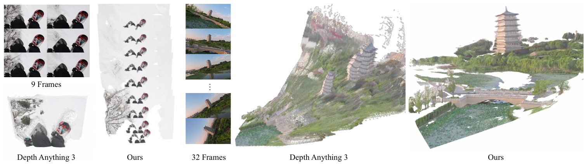
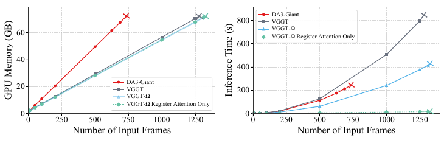
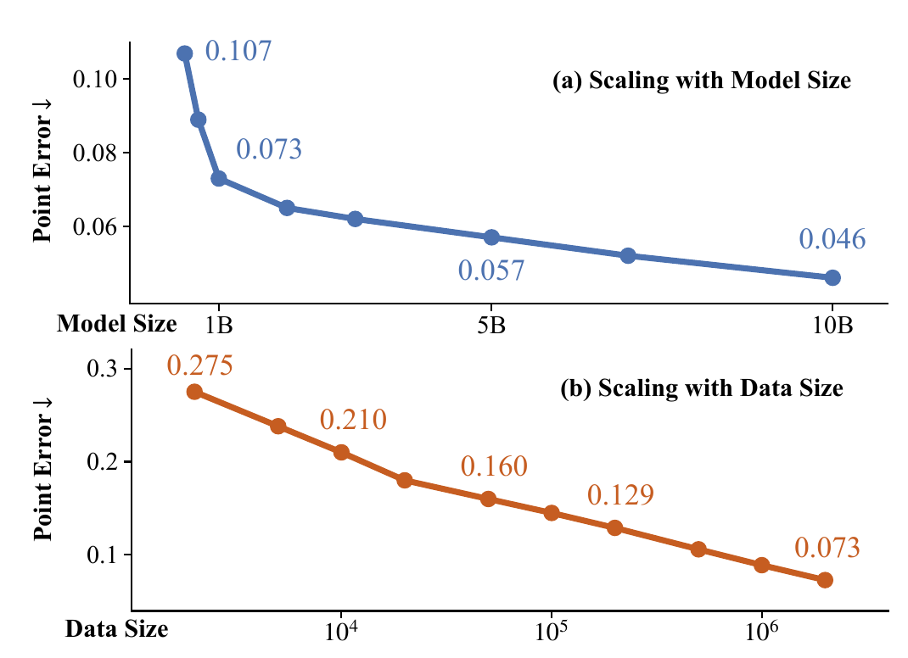
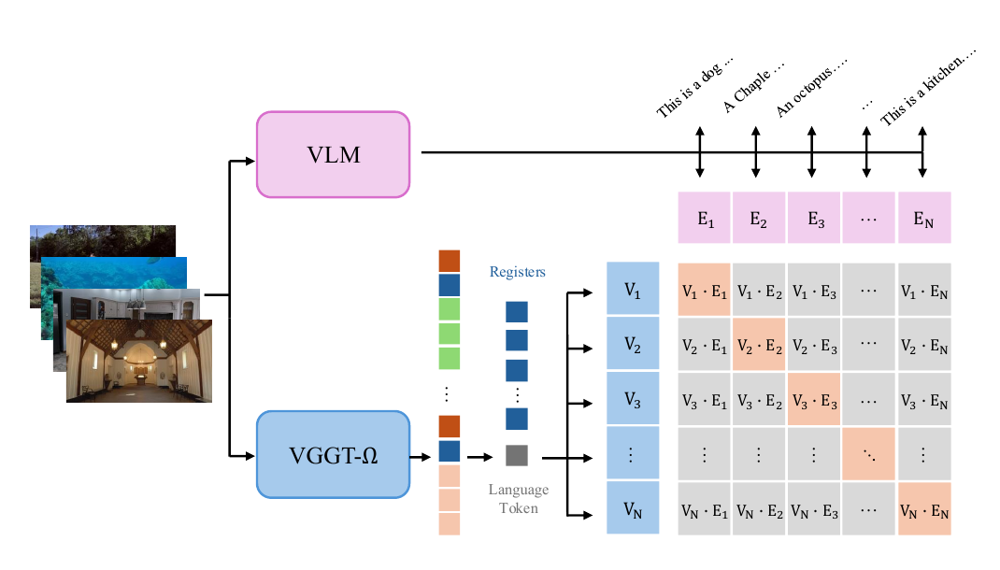

# VGGT-Ω 论文解读

> *VGGT-Ω*（Jianyuan Wang 等，arXiv:2605.15195v1，2026-05-14）研究前馈三维重建的规模效应，通过寄存器注意力、轻量预测头和高质量数据扩展训练，兼顾静态与动态场景，并探索几何表征在动作和语言任务中的用途。[论文页面](https://arxiv.org/abs/2605.15195) · [PDF](https://arxiv.org/pdf/2605.15195v1)

[VGGT](../vggt/index.md) 用交替注意力联合处理多张图像，再以几何多任务学习约束共享表征。VGGT-Ω 延续这一基础，将重点放在训练能否继续扩大：哪些计算可以缩减，怎样得到更多可靠标签，以及模型容量与数据覆盖扩大后，重建能力是否持续改善。

## 摘要

VGGT-Ω 研究前馈三维重建模型能否随参数量和数据量扩大而持续改善。论文将结构改造、高质量视频标注与教师学生自监督结合：降低稠密预测的开销，以寄存器替代部分全局注意力，并在更丰富的静态、动态数据上训练。作者报告了重建精度和训练效率的提升，另以机器人任务和语言检索检验寄存器的场景表征价值。

## 1 引言

前馈模型已经能够联合预测多视图几何，并为其他任务提供几何相关特征。论文据此提出更进一步的研究问题：重建能否像其他基础模型的预训练任务一样，通过扩大数据和模型持续获得收益？VGGT-Ω 是为检验这一问题而设计的 VGGT 后继模型。

引言将结构改动分为三个方向。第一，让一部分跨帧通信通过少量寄存器进行，使它们汇总场景信息，同时减少全局注意力的计算。第二，移除稠密解码器中显存开销较大的高分辨率卷积。第三，将深度、点和对应关系的多任务监督保留下来，但减少独立稠密输出头。

数据方面，作者引入动态视频标注流程，并用教师学生训练利用无标签视频。模型和数据的规模实验给出持续下降的三维点误差；重建之外的实验则考察这些训练是否产生可复用的场景信息。

降低单次训练开销，可以让更多高质量序列和更大模型进入可承受的训练范围；几何能力是否随之改善，还要由扩大规模后的实验检验。因此，主实验比较的是整套模型和训练方案；对某个模块的归因，需要查看第 4.3 节的消融。

## 2 相关工作

### 三维重建

论文将自身定位在直接从图像预测相机和场景几何的前馈方法中。DUSt3R、MASt3R 以图像对为基本处理单元，多视图重建还需要结果对齐；VGGT 等方法将联合处理范围扩展到整组图像。后续研究沿着计算压缩、流式状态、额外传感器、动态几何和下游表征等方向发展。

动态重建还要处理相机运动与场景运动的耦合。MegaSaM 等方法结合预测与优化，另一些方法扩展点图、加入时间状态，或直接查询四维场景信息。VGGT-Ω 采用相机参数与逐帧深度的输出形式，其具体理由在第 3.3 节给出。

### 视觉 Transformer 中的寄存器

相关研究发现，ViT 的少量图像 token 会承载全局信息，表现出较高范数并影响空间特征的连贯性。独立寄存器为这类信息提供额外位置。VGGT-Ω 进一步让寄存器参与跨帧汇总，并检验它们能否作为下游任务的表征。

这里的寄存器参与当前输入集合的计算，其状态如何跨推理调用保存，需要另外定义。如何保存旧帧状态、限制未来可见性，是 [LingBot-Map](../lingbot-map/index.md) 等流式系统另外处理的问题。

## 3 方法

### 3.1 新的可扩展架构

模型将 $N$ 张图像 $I_1,\ldots,I_N\in\mathbb R^{3\times H\times W}$ 映射为各自相机和深度：

$$
((\mathbf g_1,D_1),\ldots,(\mathbf g_N,D_N))
=f(I_1,\ldots,I_N).
$$

$D_i\in\mathbb R^{H\times W}$；$\mathbf g_i=(\mathbf q_i,\mathbf t_i,\mathbf f_i)\in\mathbb R^9$ 包含四元数、平移和水平／垂直视场角，维度分别为 4、3、2。论文假定主点在图像中心。与 VGGT 相比，模型不再直接输出独立点图和跟踪特征，但仍保留相应监督。

*原论文图 2，裁去页内其他内容。图像经 DINO 编码后，与相机 token、场景 token 一起进入交替注意力。右上输出相机与深度；下方两个虚线框是仅用于训练的匹配损失和点损失。图中的 OR 表示跨帧层可采用全局注意力或寄存器注意力。*

#### 3.1.1 特征提取与 token 化

DINOv3 初始化的视觉 Transformer 将每张图编码为

$$
\mathbf z_i^F=\operatorname{DINO}(I_i)
\in\mathbb R^{H'W'\times C},\qquad H'=H/r,\quad W'=W/r,
$$

其中 $r$ 是 patch 边长。每帧再添加一个相机 token $\mathbf z_i^{\rm cam}\in\mathbb R^{1\times C}$ 与十六个场景 token $\mathbf z_i^{\rm scene}\in\mathbb R^{16\times C}$。相机 token 用于预测相机，场景 token 汇总场景信息。参考图像和其余图像使用两套可学习初始化。拼接后的形状为

$$
\mathbf z=(\mathbf z_1,\ldots,\mathbf z_N)
\in\mathbb R^{N\times(H'W'+17)\times C},\qquad
\mathbf z_i=(\mathbf z_i^F,\mathbf z_i^{\rm cam},\mathbf z_i^{\rm scene}).
$$

参考图像决定共同几何坐标系，其独立初值让网络能够辨认这一角色。其余图像虽然共享另一套初值，但各自的 token 会读取不同图像和上下文，因而形成不同表示。

#### 3.1.2 寄存器注意力

原 VGGT 在帧内自注意力和全局自注意力之间交替。帧内层分别处理每个 $\mathbf z_i$；全局层处理拼接后的完整集合 $\mathbf z$。论文不为每帧显式加入帧序嵌入，参考帧的角色由特殊 token 初值区分。

全局注意力的开销随总 token 数平方增长。原论文图 3 展示了第 13 层注意力权重的稀疏现象，作者据此尝试让部分跨帧通信由少量寄存器承担。默认替换 25% 的全局层，在替换位置仅执行

$$
({\mathbf z_1^{\rm scene}}',\ldots,{\mathbf z_N^{\rm scene}}')
=\operatorname{attn}(\mathbf z_1^{\rm scene},\ldots,\mathbf z_N^{\rm scene}).
$$

更新后的寄存器在后续帧内层与本帧图像 token 交互，将汇总的信息传回局部表示。

两种跨帧层的差异可以通过标准自注意力的读取范围看清。对参与计算的 token 集合 $Z$，其核心为

$$
Q=ZW_Q,\quad K=ZW_K,\quad V=ZW_V,\qquad
\operatorname{Attn}(Z)=\operatorname{softmax}\!\left(\frac{QK^\mathsf T}{\sqrt d}\right)V.
$$

$W_Q,W_K,W_V$ 是可学习投影，$d$ 是每个注意力头的维数。每一行 query 与各 key 的相似度，经 softmax 变为读取各 value 的权重。全局层的 $Z$ 包含全部帧 token；寄存器层的 $Z$ 只包含场景 token。实际网络还使用残差、QKNorm 等结构，此式用于说明两者的读取范围。

沿一次计算展开，设输入有三帧，每帧十六个 scene token。进入寄存器跨帧层时，共 48 个 scene token 参与自注意力，图像 token 和 camera token 不参与这次跨帧读取。各位置同时读取该层输入状态；其他位置在同一层刚算出的结果不会被立即再次使用。随后帧内层读取更新后的 scene token，本帧图像 token 才获得这一路跨帧信息。

在这条路径中，scene token 先通过此前的帧内层吸收本帧图像内容，再经寄存器层汇总其他帧，随后将结果传回图像 token。场景信息通过这一系列更新逐步形成，并由几何训练约束其内容。

若每帧有 $M$ 个图像 token，仅比较注意力的两两交互部分，全局范围约为 $N^2(M+17)^2$，寄存器范围约为 $(16N)^2$。这不能直接换算为整网加速比，因为帧内注意力、投影、前馈网络（FFN）和其他全局层仍然存在。默认模型保留 75% 全局层，也继续保留直接的跨图像细节交互。

#### 3.1.3 解码

深度解码保留 Dense Prediction Transformer（DPT）的低分辨率部分，将高于输入四分之一分辨率的卷积块替换成 MLP 与 pixel shuffle。MLP 生成 $2u^2$ 个通道，$u=4$，重排关系在原文写为

$$
(H'\times W',2u^2)
\longrightarrow(uH')\times(uW')\times2.
$$

两个输出通道分别是深度与置信度。纯 MLP 解码在一些定量指标上有效，却产生块状深度伪影，室外远景尤其明显，因此最终方案保留较便宜的低分辨率卷积。

相机头联合读取各帧的相机 token 和寄存器，经过轻量 Transformer，再由 MLP 生成每帧相机参数。这里采用一次预测，省去了原 VGGT 的迭代细化。

> 原文第 3.1.1 节的 $H',W'$ 指 DINO patch 网格；解码段又用相同符号描述 pixel shuffle 的输入网格。解码的局部形状应结合前述 DPT 上采样过程理解，不能直接将 $r=16$ 的 patch 网格乘四就认作最终原尺寸输出。这里保留原式，按解码器局部网格理解后一处符号。

这种解码改动主要减少的是训练激活：高分辨率卷积需要保存大量空间特征以供反向传播，即使参数量不大也可能占用很多显存。pixel shuffle 将低分辨率位置上的通道固定重排到高分辨率位置，避免在高分辨率持续处理大量隐藏通道；它本身没有可学习参数。

### 3.2 训练损失

模型保留四类训练约束：

$$
\mathcal L=\lambda_{\rm cam}\mathcal L_{\rm cam}
+\lambda_{\rm depth}\mathcal L_{\rm depth}
+\lambda_{\rm point}\mathcal L_{\rm point}
+\lambda_{\rm match}\mathcal L_{\rm match}.
\tag{1}
$$

相机项对预测与真值的九维参数采用 $\ell_1$ 误差：$\mathcal L_{\rm cam}=\sum_i|\hat{\mathbf g}_i-\mathbf g_i|$。作者观察到它比原 VGGT 的 Huber 目标更稳定。

深度项结合置信加权、相对深度和空间梯度。下式沿用原符号，并展开原文隐含的像素求和：

$$
\begin{aligned}
\mathcal L_{\rm depth}
={}&\sum_{i=1}^{N}\left[
\left\|c_i^D\odot(1+D_i^{-1})\odot e_i\right\|
+\left\|c_i^D\odot\nabla e_i\right\|
\right]\\
&-\alpha\sum_{i=1}^{N}\sum_{\mathbf u}\log c_i^D(\mathbf u),
\qquad e_i=\hat D_i-D_i.
\end{aligned}
$$

$c_i^D$ 是网络预测的权重图，$\odot$ 为逐元素乘法。原文在这里没有注明范数的具体类型，公式保留其记法。计算只作用于具有有效监督的位置。

训练标签先按场景点到首相机原点的平均距离归一化，具体计算见附录 A.1。在这一规范尺度下，真值深度为 2、预测为 2.2 时，$e=0.2$，$(1+D^{-1})e=0.3$，其中包含绝对误差 0.2 与相对误差 0.1。梯度项进一步比较相邻像素的误差变化。因此，整体平移了的深度面和局部边界错误会受到不同约束。

原文称 $c_i^D$ 为不确定性图，解码段又称 confidence。按公式的作用理解，它是直接乘在残差上的置信权重；降低该权重能减小残差项，但同时受到 $-\log c_i^D$ 惩罚。两部分共同限制“将所有置信度降到零”的退化选择。

点损失使用由预测深度和相机反投影出的点，与参考相机坐标系中的真值点图 $P_i$ 比较：

$$
e_i=\pi^{-1}(\hat D_i,\hat{\mathbf g}_i)-P_i.
$$

原文说明点损失沿用深度损失的形式，以点残差替换深度残差。这样不必再学习一个独立点图解码器。

为说明反投影，采用世界到相机约定 $X_i=R_iX_w+\mathbf t_i$，内参为 $K_i$，像素齐次坐标为 $\tilde{\mathbf u}$。先由深度获得相机系点 $X_i=\hat D_i(\mathbf u)K_i^{-1}\tilde{\mathbf u}$，再解出

$$
\hat X_w=R_i^\mathsf T\left(
\hat D_i(\mathbf u)K_i^{-1}\tilde{\mathbf u}-\mathbf t_i\right).
$$

首相机坐标系作为世界系。改变深度、内参或外参都会改变 $\hat X_w$，所以点残差的梯度能够同时影响深度和相机分支。上述反投影在预测相机与深度之后计算公共坐标点；网络仍直接预测相机和深度，无须显式三角化。

匹配项直接作用于最后一层的图像 token。将特征 $\ell_2$ 归一化后，以其余弦相似度 $s$ 定义

$$
\mathcal L_{\rm match}
=\mathbb E_{\rm pos}[-\log\sigma(s)]
+\mathbb E_{\rm neg}[-\log(1-\sigma(s))].
$$

$\sigma$ 为 sigmoid；正样本趋向相近，负样本趋向分离。附录 A.2 说明怎样通过几何投影和外观约束构造这些样本。

### 3.3 动态重建

动态场景需要对运动作出统计假设。传统非刚性 SfM 常用低秩或局部刚性约束；数据驱动模型希望通过训练获得更广的先验。输出表示决定了相机运动与场景运动怎样耦合：若先预测公共点图再恢复相机，运动表面需要额外处理；深度与射线图也会增加稠密输出开销。

VGGT-Ω 直接预测相机和逐帧深度，不输出显式运动掩码。对固定相机前的舞者，这种表示允许相机保持不变，而各帧深度随着人体运动变化。

每帧深度描述该时刻像素看到的表面。将这些深度变换到公共参考系，可以展示动态几何；若要判断跨帧哪个三维点属于同一物体、它怎样运动，还需要对应与身份信息。这项动态能力因而主要体现为相机与逐帧几何恢复。

### 3.4 自监督训练

教师与学生都从监督训练的 VGGT-Ω 初始化。作者在约 1800 万条无标签视频上应用这一协议。同一帧集合分别经过随机增强，包括颜色变化、模糊、$90^\circ$ 旋转、patch 掩码与图像顺序置换。恢复共同顺序后，学生匹配教师的多层 token，并对相机和深度做回归。学生通过梯度更新，教师采用

$$
\theta^T\leftarrow m\theta^T+(1-m)\theta^S
$$

进行指数滑动平均；附录给出 $m=0.999$。相机头和深度头在自监督阶段冻结，作者以此限制坍塌。

冻结的是读出头的参数，梯度仍能经过它传回输入特征。头继续把骨干特征映射成几何预测，学生的回归误差仍可沿该映射更新骨干；固定读出使学生在同一几何映射下调整表征。教师参数则仅由滑动平均更新。

> 改变图像顺序可能改变参考相机。特征可按图像身份恢复排列，几何数值还涉及参考系和尺度；旋转增强也会影响像素与相机约定。正文没有完整列出这些对齐运算。仅按帧身份重排不足以确定这些几何回归目标的具体实现，复现时仍需核对相应代码。

### 3.5 训练数据

#### 3.5.1 数据来源

作者组合真实采集、合成环境、物体与人体等公开和内部数据，已有数据部分约包含 300 万条序列，每条为 10 至 20000 张图像。对非合成数据，使用多视图一致性去除不可靠深度，并舍弃有效深度过少的序列。Kubric、PointOdyssey 因虚假背景几何被排除；合成背景与真实场景外观不一致的问题在附录 B 继续讨论。

#### 3.5.2 数据标注流水线

新增标注从约 4000 万条内部互联网风格视频中筛选，最终得到约 20 万动态和 60 万静态序列。流水线按如下顺序逐步缩小不确定性。

VLM 先排除剪辑、严重模糊、水印等明显不适合的片段，并评估视差、纹理和动态内容。论文给出的比例约为 50% 直接拒绝、40% 因几何条件不足而不进入后续标注、10% 继续处理。

Grounding DINO 检测人、汽车等可能运动的类别，相关包围框区域不参与匹配、跟踪和验证。静态区域的对应由 SIFT、SuperPoint & SuperGlue、ALIKED & LightGlue 和 VGGSfM Tracker 等方法提供。RANSAC 本质矩阵内点不足时，以原 VGGT 初始化相机，再运行 COLMAP 的 BA 与过滤。

重建后继续拒绝注册率低于 99.5%、视场角超出 $[30^\circ,120^\circ]$ 或畸变比超过 0.1 的序列。基于 patch 的 MVS 生成深度，经反投影和跨视图检查保留可靠像素；有效深度不足 5% 的序列被排除。最后，用 500 条静态与 500 条动态人工标注序列训练几何质量分类器，结合轨迹、视差和点云等特征进一步过滤。分类器由 XGBoost、随机森林与 CatBoost 集成。

这里的“动态序列”表示视频中存在运动内容。刚体重建依靠剩余静态部分提供相机和深度，潜在运动区域被保守排除。附录 A.4 明确说流水线只能为刚性像素产生深度，动态像素的学习依靠合成数据补足。几何监督的有效范围要随标签来源区分。

> 引言将新增视频概括为约三分之一含动态内容，第 3.5.2 节则报告 20 万动态与 60 万静态。两处近似统计并不完全一致，不能合并成一个精确比例。与已有数据合计时，论文使用约 400 万序列这一量级，为原 VGGT 监督数据的十五倍以上。

## 4 实验

### 4.1 实现细节

四个主要模型为 200M、500M、1B、10B，交替注意力块数分别为 12、12、24、16，隐藏维度为 384、768、1024、4096。每块包含一个全局／寄存器层与一个帧内层。DINOv3 初始化的视觉编码器参与训练。

训练共 24 万步：16 万监督、5 万自监督、最后 3 万监督。AdamW 使用 5% 线性预热及后续余弦衰减，监督与自监督峰值学习率分别为 $2\times10^{-4}$、$10^{-4}$。每批帧数均匀采自 $[1,24]$，图像面积约 $512\times512$，宽高比在 $[0.33,1.33]$ 内变化。训练使用 128 张 96GB H100，配合 bfloat16、梯度检查点和 FSDP。

第一阶段建立几何预测，第二阶段将教师目标用于更多无标签视频，最后重新接入几何真值。这里的“可扩展”对应大规模训练的效率与效果，完整训练仍需要较多算力。

### 4.2 基准评测

#### 定量比较

评测包含静态的 7 Scenes、NRGBD、ETH3D，以及动态的 DyCheck、Sintel、TUM-Dynamic，每场景随机取十帧。基线使用公开发布模型，DA3 采用约 1B 参数的 Giant 版本。[原表 1—2](https://arxiv.org/pdf/2605.15195v1#page=8) 给出完整的相机与深度结果。

相机 AUC 在相对旋转和平移方向的角度误差阈值下统计，越大越好。Sintel 的 AUC@3° 上，MegaSaM 为 22.5，VGGT 为 15.0，DA3 为 16.2，VGGT-Ω 1B 和 10B 分别为 35.3 与 40.0；10B 的 AUC@30° 为 79.1。ETH3D 上，MegaSaM、DA3 和 VGGT-Ω 10B 的 AUC@30° 分别为 38.1、87.0、90.4，体现出静态宽基线与动态视频方法之间的差异。

深度采用越小越好的 AbsRel 和越大越好的 $\delta_{1.25}$。Sintel 上，DA3 的结果为 0.118、86.1%，VGGT-Ω 1B 为 0.097、89.5%，10B 为 0.081、93.5%。更大的模型在这些相机与深度指标上继续改善。

AUC@3° 考察较严格的相机误差范围，不能当作平均角度误差。摘要中的“提升 77%”对应 $(40.0-22.5)/22.5\approx77.8\%$ 的相对增幅，绝对差为 17.5 个百分点。

AbsRel 是 $\operatorname{mean}(|\hat D-D|/D)$，$\delta_{1.25}$ 是满足 $\max(\hat D/D,D/\hat D)<1.25$ 的有效像素比例。它们描述评测协议下的深度误差；正文未完整列出各数据集的深度尺度拟合细节，无法据此确定是否采用逐帧中值对齐等操作。这些结果也不代表绝对米制测量能力。

#### 定性结果

原图 4—6 展示交通、人体运动、自然环境、室内与航空场景。作者以 MegaSaM 的漂移、平面错位，以及 DA3 在重复纹理和相机横滚下的重复结构，说明其模型在选定困难场景中更一致。

*原论文图 6。左侧使用九帧，右侧使用三十二帧。雪地缆车场景比较相机移动和重复纹理的处理，塔身场景比较相机横滚后的结构一致性。它们是定性案例，整体效果应结合原表 1—2 理解。*

#### 推理显存与速度

作者先修正 VGGT 推理中不必要的中间特征缓存：原实现保存所有 24 层张量，稠密头实际只读取四层。随后在单张 80GB A100、PyTorch SDPA 和 Flash Attention v2 下比较。VGGT、DA3 使用 $518\times336$ 输入及 14 像素 patch，VGGT-Ω 使用 $512\times336$ 及 16 像素 patch。

修正后，VGGT 与 VGGT-Ω 的推理显存相近，可处理千帧以上输入；测试中 DA3 约在 750 帧达到显存上限，另外两者约为 1250 帧。VGGT-Ω 的较大 patch 减少约四分之一图像 token，寄存器替换进一步带来约 20%—25% 加速。全替换寄存器的版本将千帧耗时由 240.2 秒降至 11.7 秒，但同时降低精度。

*原论文图 7。横轴为输入帧数，左图为 GB，右图为秒；叉号表示显存不足。全寄存器版本的主要优势体现在耗时，显存曲线仍接近默认版。图中的 VGGT 已经过缓存修正。*

Flash Attention 分块计算并在线累积 softmax，不显式存储完整注意力矩阵。因此，减少跨图像两两交互可以大幅减小计算量，峰值显存却仍受 token、帧内层和 FFN 中间张量影响。论文的“训练显存约剩 30%”是结构改动的训练结果，与这里的推理显存结论有不同条件。

### 4.3 消融研究

消融默认使用 1B 模型、200 万序列、64 张 GPU 和 15 万监督步。point error 先利用相机参数将深度反投影为点，计算对应预测点与真值点的 $\ell_2$ 距离，在六个数据集上平均。作者选择对应点误差，避免无序点云最近邻距离被大平面主导。

*原论文图 1，放在对应消融处讨论。上下两图分别扩大参数量和独立训练序列数，纵轴均为越低越好的 point error，但轴尺度不同。各模型训练 token 总数近似相同。*

模型从约 0.2B 增至 10B 时，图中误差由 0.107 降至 0.046；训练序列由约 2000 增至 200 万时，由 0.275 降至 0.073。它呈现类似幂律的趋势，论文未给出可任意外推的精确规律。

全局注意力版本误差为 0.071；替换 25% 后为 0.073，对应骨干训练约节省 23% FLOPs 和 16% 显存。删除点与匹配损失，误差升至 0.078；恢复 VGGT 多头多任务设置可到 0.070，但训练开销更大。将 10% 监督步数换为自监督，误差由 0.073 变为 0.070，作者另观察到泛化改善。

标注质量实验只比较新流水线与 MegaSaM 均通过过滤的 Sintel 子集，排除 23 条中的 8 条序列以及所有动态区域。新流水线的相机 AUC@30°、深度 $\delta_{1.25}$ 为 96.4、99.3%，MegaSaM 对应为 62.1、77.2%。这一结果检验留下的伪标签质量，覆盖率与动态像素标签能力并不由它证明。

同 token 预算的规模曲线考察增加模型容量或独立序列的收益；模块消融比较结构与监督取舍；伪标签实验考察筛选后标注的准确性。尤其要区分 10% 替换的自监督消融和第 4.1 节的完整三阶段日程，两者的训练条件不同。

### 4.4 寄存器的应用

#### 机器人任务

冻结 VGGT-Ω，将 scene token 拼接到 OpenVLA-OFT 的原输入，再按后者的标准协议训练动作模型。[原表 3](https://arxiv.org/pdf/2605.15195v1#page=11) 中，Spatial、Object、Goal、Long 成功率分别由 97.6%、98.4%、97.9%、94.5% 提高到 99.3%、99.2%、99.0%、96.7%，平均由 97.1% 到 98.5%。这为寄存器中包含可用空间信息提供了下游证据。

#### 语言对齐

VLM 联合观察序列并生成场景描述，对生成的文本隐藏状态做平均池化与归一化，得到语言向量。几何侧将寄存器与一个可学习 language token 输入小型自注意力模块，再由 language token 输出投影为归一化向量。该 token 只读取寄存器，不直接读取图像 patch。

*原论文图 8。上支路由 VLM 得到序列描述向量，下支路由寄存器读出场景向量，中间矩阵比较批次内匹配和错配序列。language token 只能读取下支路的寄存器，因此对齐效果可用于检验寄存器信息的可读出性。*

训练使用对称 InfoNCE，跨 GPU 收集向量形成批内负样本。VLM 冻结，VGGT-Ω 端到端微调，学习率固定为 $10^{-5}$。约一万步后，在作者整理的 100 条视频上，以原 VLM 向量检索得到 top-1 76.8%、top-3 97.0%；换成描述文本经 Qwen3 得到的纯文本向量，不再训练，结果为 47.5%、77.8%。

设一个批次有 $B$ 段视频，第 $i$ 段的几何向量为 $v_i$、语言向量为 $E_i$。相似度矩阵的第 $i$ 行将 $v_i$ 与全部 $E_j$ 比较，正确对象为 $E_i$；第 $i$ 列则将 $E_i$ 与全部 $v_j$ 比较，正确对象为 $v_i$。两个方向共同训练，使配对向量比批次内其他向量更接近。这里的 $B$ 表示批次序列数，与前文一条序列里的帧数 $N$ 不同；原图 8 的下标用于示意批次中的候选序列。

论文还讨论用新任务 token 预测尺度、重力方向和人体存在等用途，但仅报告初步探索。

机器人实验检验冻结的几何特征能否帮助动作模型；语言实验允许几何模型适配新的对齐目标。后者说明寄存器经适配后可以与语言对齐；原始重建模型的零样本语言理解能力还需单独评测。

## 5 进一步观察

本节是探索性经验，证据强度与主实验、受控消融不同。论文尝试通过选择性平均 VGGT 和 VGGT-Ω 的权重，观察不同模块影响的行为。帧内 FFN 混合可以改变部分深度与视场角现象，Q/K/V 混合没有相同效果；外参行为也不能仅由 FFN 解释。这提供研究线索，尚不足以严格定位几何信息的存储位置。

对中间图像 token 归一化，再做 PCA 和 k-means，原图 9 的浅层聚类可分离运动舞者，中层信号较弱，深层倾向于突出所有人。模型没有显式接收帧的时间顺序，这提示几何训练可以产生运动相关表示。

作者还比较了若干训练与解码选择。在线归一化预测对收敛后定量指标影响不大，点云的空间分布更均匀，但优化更不稳定；从零训练也能接近 DINOv3 初始化的结果，却要约 4—8 倍迭代。无效区域预测头能识别天空，但没有可靠解决天空深度缺少监督的问题，因此未纳入最终模型。

将全部全局层替换成寄存器层可将 FLOPs 降至原来的约 6%，重建性能则回到原 VGGT 水平。辅助几何输入在预训练中未必有利，微调阶段再引入的初步结果更好。合成数据与真实数据有互补作用，作者给出约 80%／20% 的采样经验；在合成标签足够干净时，还提出更高合成比例的可能性。

微调方面，作者倾向于小峰值学习率、预热及完整余弦日程，并提醒小数据上的置信损失可能不稳定。自监督改善主要体现在泛化，多数基准的提升较小；其他新视角生成、掩码和几何表示方案在其实现中没有获得同样收益。当前成功的教师学生方案仍依赖监督预训练。

纯 MLP 稠密解码在速度、显存和一些指标上有优势，块状伪影却难以消除。作者尝试过局部方差监督和多通道概率建模等方法，最终仍保留低分辨率卷积。其关于室外深度数值分布的解释属于推测。

聚类与权重混合提供的是表征探针：前者展示运动相关结构，后者揭示部分参数变化与输出行为的联系。运动分割的可靠性、几何信息的具体存储方式，都还需进一步验证。此类观察适合形成下一步假设，不能替代明确任务上的评价。

## 6 讨论

作者选择简单架构作为可复用基础。迭代细化相机、向稠密头注入 RGB 等改动还能改善结果，但最终模型优先保留简洁结构与骨干表征质量。论文观察到骨干训练充分后，新的预测头可用较少额外训练获得效果。

前馈重建的价值在于效率、困难条件下的预测能力，以及可迁移的几何表征。传统优化仍有优势：在几何条件良好时，BA 能得到很高的相机精度，前馈预测可以为其提供初始化。论文还提出，显式几何输出和场景 token 都可能帮助多模态系统，重建训练将来可能融入更统一的模型。

低视差时，模型可以依靠数据先验给出合理几何，但输入没有因此增加独立的尺度观测。用于测量或高精度渲染时，仍需检查相机、尺度与多视图一致性。统一多模态模型仍是作者提出的研究方向。

## 7 结论

VGGT-Ω 将寄存器注意力、轻量稠密预测、多任务监督和数据扩展结合，用实验说明前馈重建在更大模型与更多数据下仍可改善。寄存器的机器人与语言实验，进一步支持重建训练可以产生可复用的场景信息。

这篇工作的核心关系是：结构改动降低训练开销，数据流程提高监督规模与可靠性，规模实验检验能力是否持续增长。各环节都有收益，也有精度、覆盖率和计算预算的取舍。

## 附录 A 补充细节

### A.1 训练与架构

四个损失权重为 $\lambda_{\rm cam}=5.0$、$\lambda_{\rm depth}=1.0$、$\lambda_{\rm point}=0.5$、$\lambda_{\rm match}=0.1$。真值先转到第一台相机坐标系，再按所有三维点到原点的平均距离缩放深度与平移；预测不在线归一化。训练使用梯度范数裁剪阈值 1.0 与 QKNorm。

随机矩形掩码概率为每帧 0.05，高宽各从 $[32,128]$ 像素采样，掩码 RGB 置黑，深度标为无效。颜色扰动参数为亮度、对比度、饱和度各 0.5，色相 0.1。有时间顺序的数据从局部时间窗口抽帧，可能形成语义相关却重叠较少的输入。

> 正文称九维相机最后两维为视场角，附录却提到对 focal length 使用 ReLU。二者需要结合具体实现的参数变换理解，不能直接认作同一数值。这里沿用正文的输出定义，附录的实现表述仍需进一步核对。

若首相机坐标系中的有效真值点为 $X_k$，记 $s=\frac{1}{K}\sum_{k=1}^K\|X_k\|_2$，则标签深度与平移分别使用 $D_i/s$、$\mathbf t_i/s$。这里的 $K$ 是有效点数，与第 3.2 节的内参矩阵 $K_i$ 不同。推理时没有真值来计算 $s$；网络学习的是训练标签采用的规范，而非无条件的米制距离。

### A.2 构造正负样本对

先采样查询帧有效像素，由标签深度反投影，再投到其他帧。保留图内投影，要求与目标深度在 1% 相对容差内，并排除图像边缘 4 像素窄带。按查询 patch 统计其三维点投到各目标 patch 的重叠比例，超过 10% 的目标 patch 构成正样本。查询 patch 还须有足够的有效投影，采样倾向于对应更多的位置。

负样本不直接取正样本集合的补集。作者随机生成候选，要求目标 patch 中心具有足够大的对极／Sampson 距离，同时两个 patch 的平均 RGB 差异足够大，再平衡正负数量。

投影失败可能来自遮挡、动态运动或标签缺失；这些条件不足以说明两个 patch 确定不对应。附加几何与外观条件有助于减少误负样本。原文没有给出两个“大于”条件的完整数值阈值，这仍是精确复现的缺口。

### A.3 VLM 提示词

提示词将几何适用性分为硬拒绝、软拒绝与接受，并输出静态／动态元数据。硬拒绝关注剪辑、严重成像问题和非物理内容；软拒绝关注视差、纹理、反射、景深和动态物体占比等。完整英文提示词见 [PDF 第 24—25 页](https://arxiv.org/pdf/2605.15195v1#page=24)。

### A.4 标注过滤标准

分类器的主要几何特征包括轨迹平滑性、视差角、点云形状、深度完整度和噪声比例。原文的平移平滑项写为

$$
S_{\rm trans}=\frac{1}{N-2}\sum_{i=1}^{N-2}
\|\mathbf t_{i+1}-2\mathbf t_i+\mathbf t_{i-1}\|^2.
\tag{2}
$$

> 式（2）在 $i=1$ 时读取 $\mathbf t_0$；若使用零基帧编号，该范围可成立。若沿正文把帧记为 $1,\ldots,N$，则中心下标应取 $2,\ldots,N-1$。式（2）保留原文写法，使用时应先统一帧编号。

对等间隔采样，$\mathbf t_{i+1}-2\mathbf t_i+\mathbf t_{i-1}$ 是两段相邻位移之差，可作为离散加速度。匀速轨迹如 0、1、2 的该项为零，0、1、4 则为 2。它用于识别不合理抖动；若采样时间不等或运动本来就急剧变化，还需结合其他特征，不能单独判定重建错误。

视差特征为稀疏点寻找能看到它的相机对，先取最大夹角，再对点集合取中位数。PCA 特征用点云协方差特征值 $v_1\ge v_2\ge v_3$，分别定义线性度 $(v_1-v_2)/v_1$、平面度 $(v_2-v_3)/v_1$ 和散布度 $v_3/v_1$。噪声特征则统计近邻平均距离超过全局均值两个标准差的点所占比例。这些检查均建立在运动区域已排除的前提下。

### A.5 语言对齐

VLM 描述联合多视图的稳定场景内容、粗布局与外观，不逐帧描述，也不强调相机顺序或动作。语言向量仅池化生成文本的隐藏状态，排除图像与提示词 token，最多生成 128 个新 token。几何模型端按第 4.4 节微调。完整提示词和样例见 [PDF 第 26 页](https://arxiv.org/pdf/2605.15195v1#page=26)。

## 附录 B 数据质量

数据质量会影响模型学到的具体行为。无标签视频中的镜头切换可能带来损失尖峰和梯度问题；监督数据中的噪声则可能在相似场景再次出现，即使常见基准没有明显反映。

代表性问题包括真实传感器的前景背景泄漏、细结构深度被平滑、合成环境背景代理几何，以及不同数据集对透明窗口深度的定义不一致。作者还讨论行人边缘被 MVS 标成背景后，模型可能将人体贴到墙面的现象。

BA 伪标签的穹顶效应尤其值得留意：在视差不足、视线近似平行、闭环薄弱或自标定不准时，重投影误差可以很低，恢复的轨迹与场景却整体弯曲。原图 10 展示了相关数据问题。监督几何过滤和额外深度预测比较，可帮助筛除这类标签。

重投影误差只检查当前相机、三维点和图像观测是否相容；当问题存在退化或系统性标定误差时，相机与结构可能共同变形而维持较小残差。因此，扩充训练数据还需要检查尺度形状与标签语义，而不能只按序列数量衡量。

## 附录 C 局限

作者报告了强运动模糊、视场角短时间剧变、严重畸变和部分多显示器办公场景的失败。训练时对人脸、商标等内容的掩盖或模糊，也可能造成局部不稳定深度。

这些局限与训练分布和标签质量有关。论文的规模收益是所测试数据、预算和结构下的经验结果；未解决的几何歧义和分布外失败，仍需在具体使用条件下检验。

## 参考资料

- Jianyuan Wang et al. *VGGT-Ω*. 2026. [arXiv](https://arxiv.org/abs/2605.15195) · [v1 PDF](https://arxiv.org/pdf/2605.15195v1)。
- [VGGT-Ω 项目页面](https://vggt-omega.github.io/)。
