# VGGT-SLAM 2.0 论文解读

> Dominic Rosario Maggio、Luca Carlone，*VGGT-SLAM 2.0: Real-time Dense Feed-forward Scene Reconstruction*，Robotics: Science and Systems XXII（RSS 2026）正式版，论文 11 页，DOI: 10.15607/RSS.2026.XXII.051。[RSS 论文页](https://www.roboticsproceedings.org/rss22/p051.html) · [RSS 正式版 PDF](https://www.roboticsproceedings.org/rss22/p051.pdf) · [arXiv v2](https://arxiv.org/abs/2601.19887) · [官方代码](https://github.com/MIT-SPARK/VGGT-SLAM) · [论文关联演示视频](https://www.youtube.com/watch?v=GBdOvd6p4OU)

[VGGT-SLAM](../vggt-slam/index.md) 将 VGGT 的多视图重建切成互相重叠的子图，再把子图逐步对齐到全局地图。第一版为适应未标定相机，在子图之间估计 15 自由度的射影变换，并在 SL(4) 流形上做因子图优化。这能表达相机内参误差造成的仿射和射影形变，但若只靠稀疏的子图间约束，长时间没有回环时会快速漂移；而在平面场景中，估计一般射影变换还容易退化。

VGGT-SLAM 2.0 保留未知内参下的射影建模，同时重新组织图约束：图节点对应每个子图内的关键帧，子图内边用 VGGT 位姿约束旋转和平移，重叠帧之间的边利用“这两帧实际是同一张图像”这一已知事实，约束相机姿态和标定一致，并单独估计尺度。论文的另一项关键改动是从 VGGT 第 22 层注意力中构造回环候选验证分数，用它过滤外观相似但没有真实重叠的帧。作者报告该设计改善了 TUM 和 Clio 场景中的位姿误差，并展示了 Jetson Thor 上的在线建图。

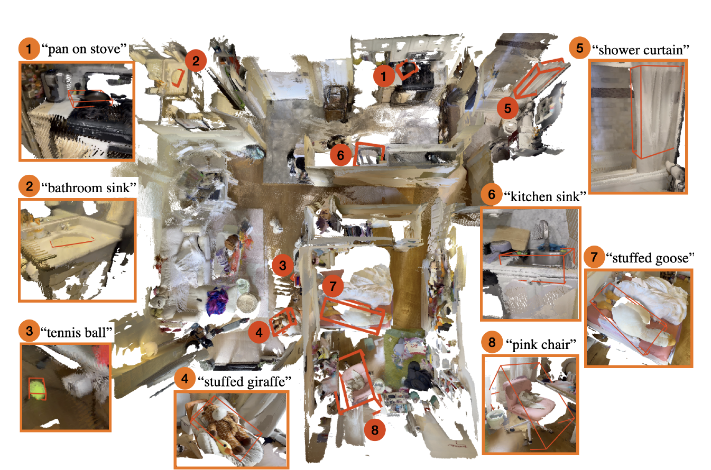

*原论文图 1。系统从未经标定的 iPhone RGB 图像建立公寓点云地图，再按文本查询在三维地图中标出锅、浴室水槽、网球、浴帘等物体。它展示了地图怎样被用于下游空间查询。*

## 未标定子图为何需要射影自由度

VGGT 对一个有限图像集合预测相机、深度和点图。第一版 VGGT-SLAM 用重叠图像把多个 VGGT 子图连接起来；VGGT 的相机标定和点图存在误差时，单个子图可能不只是发生刚体运动和尺度变化，还会出现由相机标定误差引起的仿射、射影形变。因此，仅以 $\mathrm{Sim}(3)$ 对齐所有子图可能不足以解释这些差异。

VGGT-SLAM 2.0 先把每帧的点图定义在各自相机坐标系，而非全部定义在子图首帧坐标系。设 $X_j^b$ 是图像 $j$ 相机坐标系中的三维点，$X_i^a$ 是将其用齐次坐标表示并变换到图像 $i$ 坐标系后的点，则二者关系写为

$$
X_i^a=H_j^i X_j^b.
\tag{1}
$$

单帧到全局的齐次变换写成

$$
H_i=\begin{bmatrix}KR&t\\v^\mathsf T&s\end{bmatrix}.
\tag{2}
$$

其中 $R$ 和 $t$ 表示旋转、平移，$K$ 是相机标定矩阵，$s$ 是尺度项，$v$ 表示射影分量。按论文的自由度计数，旋转 3 维、平移 3 维、尺度 1 维、标定矩阵 5 维、射影项 3 维，总计 15 维。由于 $4\times4$ 矩阵整体只定义到一个非零尺度，作者将变换规范化到行列式为 1 的 $\mathrm{SL}(4)$，并在该流形上优化。

选择 15 自由度并不意味着每条边都独立估计任意射影变换。论文利用图像来自哪个子图、哪些帧实际重叠的结构先验，把子图内约束和子图间约束分开设计。这个分解是第二版降低漂移和避免平面退化的核心。

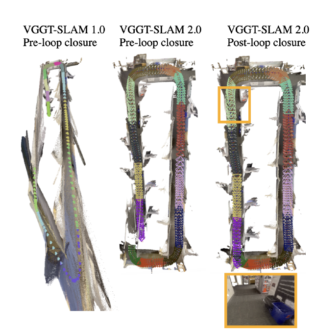

*原论文图 2。左图为第一版在回环检测前出现明显射影漂移；中图为第二版在同一阶段的漂移较小；右图显示回环加入后进一步校正的轨迹。*

## 关键帧图把两类约束分开

新图中的每个节点 $H_i$ 对应一个子图内的关键帧。VGGT 子图通常包含 $n$ 帧，相邻子图共享一张重叠图像；循环闭合时，作者额外创建一个只含两帧的小子图。图中用橙色边连接同一子图内的关键帧，用黑色边连接子图间的重叠帧。

同一 VGGT 子图中的射影形变是共享的，因此子图内两帧之间只需使用 VGGT 估计的相对旋转和平移。若 $T_i,T_j$ 是相机位姿，其相对变换为

$$
H_j^i=T_i^{-1}T_j.
\tag{3}
$$

这条边属于 $\mathrm{SE}(3)$。将其纳入图优化，主要是修正 VGGT 位姿的短程旋转和平移误差；由于两帧共处同一子图，不需要对每个关键帧单独估计标定和射影校正。

相邻子图的重叠边有更强的信息：它们对应的是同一相机在同一时刻拍摄的同一张图像。因而，两边对该帧估计的相机位置、方向和相机标定必须一致。重叠帧之间相对姿态为单位变换；标定差异和尺度差异则由边约束吸收。论文将这类边参数化为

$$
H_j^i=\begin{bmatrix}K_i^{-1}K_j&0\\0^\mathsf T&s\end{bmatrix}.
\tag{4}
$$

这里 $K_i,K_j$ 是两个子图各自预测的标定矩阵。它们不必是真实相机内参，约束只要求同一重叠图像在两个子图里的标定估计相同。尺度 $s$ 则利用两边对应的三维点估计：先按两种预测标定把点云变换到相同标定下，再对有足够深度置信度的对应点，计算相机中心到点的距离比，取中位数作为尺度估计。中位数降低少量深度异常点对尺度的影响。

于是，平面场景下的子图对齐不必再从平面上的二维对应点中求一个一般 15 自由度变换；系统已知重叠图像的姿态和标定应相同，只需从点云估计尺度。与此同时，整个图仍能在 $\mathrm{SL}(4)$ 中表达未标定几何带来的全局射影歧义。这里的“抑制退化”来自利用重叠帧身份固定更多自由度，而不是把相机假设改成已知内参。

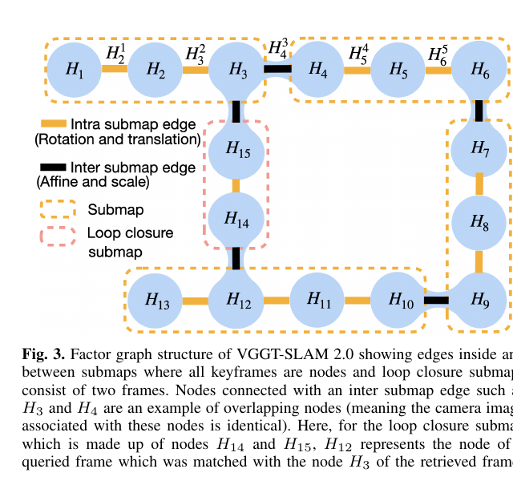

*原论文图 3。节点 $H_3$ 与 $H_4$ 对应两个相邻子图对同一重叠图像的估计；回环小子图由检索帧 $H_{14}$ 和查询帧 $H_{15}$ 组成，并通过跨子图边接入原关键帧图。*

## 从 VGGT 第 22 层验证回环候选

回环检测先由 SALAD 检索可能相似的历史帧。单靠图像检索会把相似外观误当作重访地点，例如办公室里一排近似的隔间。VGGT-SLAM 2.0 接着把查询图和候选图送入 VGGT，从中读取模型本身的注意力，判断模型是否真的在两张图间建立了可重建的对应。

作者观察到，在 VGGT 的 24 层中，第 22 层对跨视图对应呈现出较集中的注意力响应；相邻的第 21、23 层没有同样清楚的模式。这个观察也出现在低纹理墙面等区域。设 $Q^{(1)},K^{(1)}$ 是图像 1 的 query、key token，$Q^{(2)}$ 是图像 2 的 query token；token 特征在注意力头间取平均。对图像 1 的每个 key token $t$，论文先计算图像 2 中最大注意力相对于图像 1 自注意力最大值的比率：

$$
\gamma_t=\max_{q\in Q^{(2)}}\left(\frac{\operatorname{Softmax}(Q^{(2)}K^{(1)\mathsf T})}{\max_{q\in Q^{(1)}}\operatorname{Softmax}(Q^{(1)}K^{(1)\mathsf T})}\right)_t.
\tag{5}
$$

分母为图像 1 内该 key token 能获得的最大注意力，作为参照；分子为图像 2 的 query 对同一 key token 的最大响应。图像重叠时，部分 token 会在跨图注意力中重新获得强响应。由于两张有效候选图常常只有局部重叠，作者没有对全部 token 简单平均，而是取比率最高的 25% 做均值：

$$
\alpha_{match}=\operatorname{Mean}_{\text{top }25\%}\bigl(\{\gamma_t\}\bigr).
\tag{6}
$$

这个分数不需训练额外验证网络，也不依赖相机匹配器；它测量的是 VGGT 内部注意力是否支持两张图的几何关联。论文给出的重叠样例分数为 1.026；不重叠样例为 0.491；SALAD 对相似办公桌产生误检的样例为 0.550。批量实验使用 $\alpha_{match}=0.85$ 作为验证阈值。

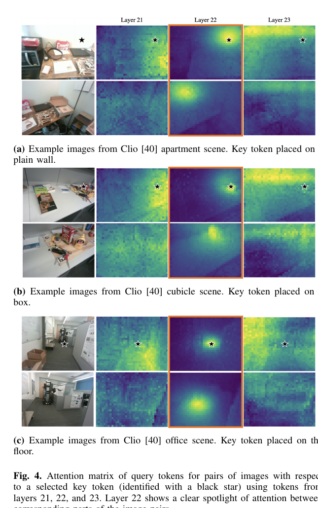

*原论文图 4。三组低纹理、杂乱物体和地面例子中，第 22 层（中列）在被选中的 key token 对应位置表现出更集中的跨图响应。*

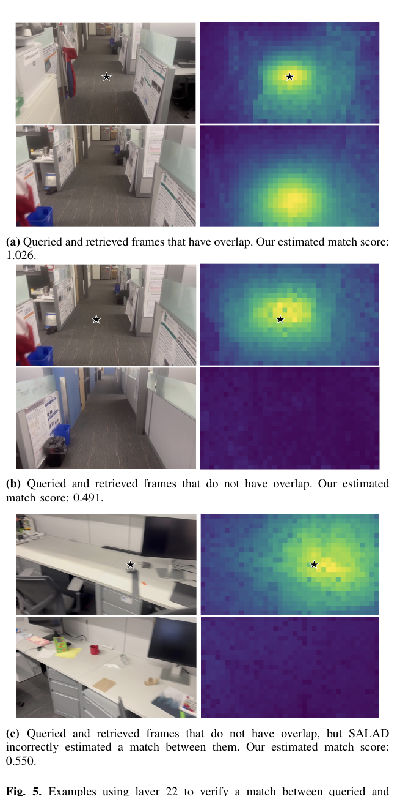

*原论文图 5。候选帧重叠时注意力图响应较强；不重叠时响应弱；即便 SALAD 将相似办公桌检索为匹配，VGGT 注意力分数仍较低。*

## 回环如何接入全局重建

系统为当前子图查询更早子图中的候选帧，并跳过最近的相邻子图，因为它必然和当前子图共享重叠帧。每个 SALAD 候选先通过 VGGT 注意力验证，只有达到阈值的候选才进入闭环。为避免在当前多帧子图生成之前就要求完成检索，作者把匹配到的历史帧和当前查询帧另组成一个两帧 VGGT 子图，然后把这条新边连接到查询帧、检索帧各自原来所在子图的重叠帧。

验证也允许把 SALAD 阈值从第一版使用的 0.80 放宽到 0.95，先保留更多潜在候选，再让 VGGT 注意力拒绝误匹配。所有闭环约束加入关键帧图后，系统按第一版的方法在 $\mathrm{SL}(4)$ 上用 GTSAM 做全局优化，论文注明未使用鲁棒损失。优化器只更新关键帧的射影位姿变量，不联合优化场景点本身。

优化完成后，世界到相机的投影矩阵由 VGGT 标定和全局变换组合得到：

$$
P_i=K_i^{3\times4}(H_i^w)^{-1}.
\tag{7}
$$

$K_i^{3\times4}$ 是补零后的相机标定矩阵，$H_i^w$ 是相机帧到世界坐标系的变换。分解 $P_i$ 可恢复全局相机标定和位姿；将点图用 $H_i^w$ 变换则得到全局三维点。与第一版写法相比，点已定义在各自相机坐标系，因此这里不再额外乘 VGGT 的子图首帧位姿。

## 定量结果与运行速度

定量实验尽量固定 VGGT-SLAM 第一版的超参数：关键帧间最小视差为 50 像素，点置信度筛选阈值为 25%；一般 SALAD 检索阈值为 0.95，注意力验证阈值为 0.85。TUM RGB-D 位姿对比特意采用 32 帧子图，与第一版对比设置一致。论文还报告了 ScanNet++、ScanNetV2 和 Waymo 的结果，这部分数值汇总自引用文献 [50]，应与作者直接运行的 TUM 和 Clio 实验区分。

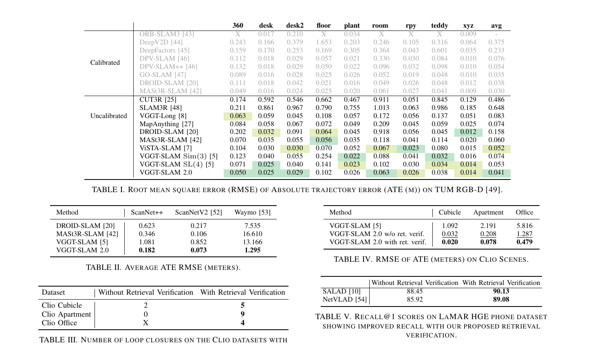

*原论文表 I–V。表 I、II 比较多个数据集上的 ATE-RMSE；表 III、IV 展示 Clio 场景的回环数量与位姿误差；表 V 比较 LaMAR HGE phone 上的 Recall@1。*

在 TUM RGB-D 上，VGGT-SLAM 2.0 的平均 ATE-RMSE 为 0.041 m。第一版 VGGT-SLAM 的 $\mathrm{SL}(4)$ 版本为 0.053 m，$\mathrm{Sim}(3)$ 版本为 0.074 m；ViSTA-SLAM 为 0.052 m。第二版相对第一版 $\mathrm{SL}(4)$ 结果约降低 23% 的位姿误差。这个比较是未标定方法之间的结果；表格也列出已标定方法，不能忽略二者的相机输入条件差异。

回环验证在 Clio 的三个场景中改变了闭环数量和质量。未验证、SALAD 阈值 0.80 时，Cubicle 检出 2 个回环，Apartment 为 0 个，Office 出现误检；将阈值放宽到 0.95 并加入验证后，三者分别为 5、9、4 个，且 Office 没有误闭环。Clio 三个场景的 ATE-RMSE 也都降低：例如 Office 从不验证时的 1.287 m 降为 0.479 m；第一版在该场景达到 5.816 m。LaMAR HGE phone 的 Recall@1 上，验证使 SALAD 从 88.45 提高到 90.13，NetVLAD 从 85.92 提高到 89.08。

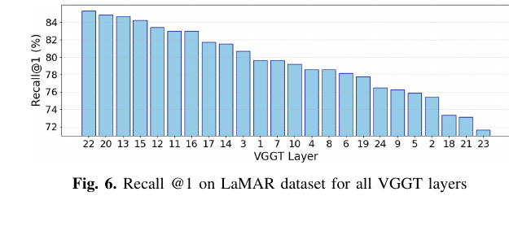

*原论文图 6。第 22 层的 Recall@1 最高；其相邻层 21、23 的结果较低。实验使用 LaMAR HGE phone validation scene，并以 15 m 定义候选是否相关。*

系统在一张 RTX 3090 上处理 16 帧子图时约为 8.4 FPS；计算开放词汇 CLIP 向量后约为 6.3 FPS。表 VI 报告每个子图的平均开销：VGGT 推理 1248 ms、关键帧检测 176 ms、回环检测 128 ms、后端优化 8 ms，语义模块可选并增加 368 ms。硬件相同时，作者测得 MASt3R-SLAM 约 7.2 FPS、VGGT-SLAM 第一版约 6.9 FPS。Jetson Thor 机器人演示使用 4 帧子图，达到 3.5 FPS；这里的实时能力是系统按小子图持续更新地图，不能与桌面 GPU 的离线子图帧率混为一谈。

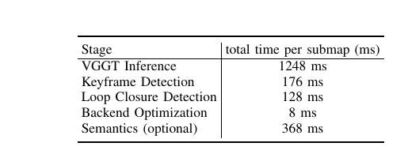

*原论文表 VI。VGGT 推理占表列主要耗时的一半以上，优化后端本身约 8 ms；语义嵌入和查询所需的前置计算作为可选模块单独统计。*

## 地图上的开放词汇物体查询

论文还把静态三维点云扩展为可文本查询的场景表示。建图期间，每张关键帧图像用 Perception Encoder 的 CLIP 模型计算图像嵌入，并连同关键帧保存。用户输入文本后，系统计算文本嵌入并检索余弦相似度最高的关键帧；随后将该帧和文本交给 SAM 3 生成二维分割掩码。掩码投到该关键帧对应的三维点云后，系统为这些点计算最小三维有向包围盒。论文报告从文本输入到三维框输出约 0.36 秒，测试硬件为 RTX 3090。

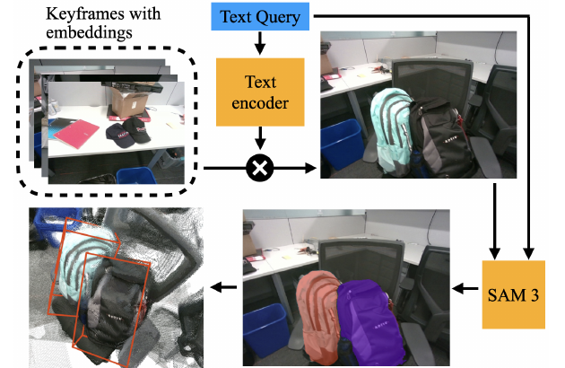

*原论文图 7。文本和关键帧嵌入先确定相关图像，SAM 3 产生二维掩码，再由掩码覆盖的地图点恢复三维目标框。*

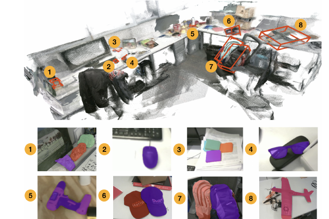

*原论文图 8。系统在一张 RealSense D455 采集的 cubicle 地图中，定位 rock、mouse、sticky notes、glasses、drill、hat、backpack 和 plane 等文本指定目标。*

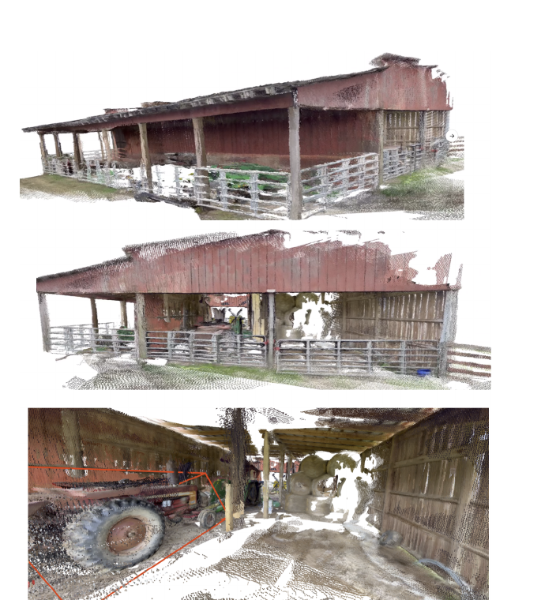

*原论文图 9。谷仓重建包含 34 个 16 帧子图，图中下方还用“large tractor”查询示例演示目标定位。*

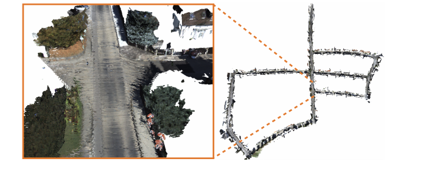

*原论文图 10。KITTI 序列 05 覆盖超过 2.2 公里；图注写 42 个 32 帧子图，但正文同节称 KITTI 场景有 44 个子图，原文没有解释这一差异。作者同时指出，这类长距离道路中的回环稀疏和道路近似平面会令第一版漂移；第二版通过新的子图图约束提高了该案例的稳定性。*

## 适用边界与方法关系

VGGT-SLAM 2.0 的核心贡献在于重排“子图如何变成全局一致地图”的约束，而非替换 VGGT 前端。与第一版相比，它把对齐变量从单纯的子图间 15 自由度拟合，改为以关键帧为节点、在图结构中分别表达子图内相机运动与跨子图重叠约束；并从 VGGT 内部注意力中获得无需训练的回环验证信号。与 [MASt3R-SLAM](../mast3r-slam/index.md) 通过射线匹配和几何残差优化关键帧位姿的路线相比，VGGT-SLAM 2.0 保持 VGGT 的子图前馈预测，以全局射影因子图处理长程一致性。

这套系统仍有明确失败条件。论文展示了一个四卧室空房案例：关键帧若只看到没有纹理的白墙，VGGT 本身可能无法重建，第二版也会随之发散；作者提出未来可加入跟踪丢失后的恢复模块。后端只优化位姿，不优化点，因此局部点图错位时仍会残留几何伪影。子图首帧也具有不对称影响：VGGT 的其他帧点图相对首帧定义，首帧还参与子图尺度估计；选择不佳会影响重建和尺度。户外长序列结果也显示，版间结构改进没有消除对回环密度和场景几何可观测性的依赖。

因此，论文提供的是一套把 VGGT 多视图几何纳入在线稠密 SLAM 的系统设计：相邻重叠图像固定变换中的已知部分，关键帧图控制局部漂移，VGGT 注意力为回环检索把关。它减少了一般射影子图配准中的不稳定自由度，同时保留了未知内参下必要的射影表达；地图质量仍受 VGGT 单子图重建能力、回环分布以及点图不可优化等因素限制。
