# VGGT-SLAM 论文解读

> Dominic Maggio、Hyungtae Lim、Luca Carlone，*VGGT-SLAM: Dense RGB SLAM Optimized on the SL(4) Manifold*，NeurIPS 2025 正式版。本文依据正式论文 PDF（29 页）和补充材料 PDF（9 页）。[论文页面](https://proceedings.neurips.cc/paper_files/paper/2025/hash/bc65ab11abfbad890171109686233f4e-Abstract-Conference.html) · [论文 PDF](https://proceedings.neurips.cc/paper_files/paper/2025/file/bc65ab11abfbad890171109686233f4e-Paper-Conference.pdf) · [补充材料](https://proceedings.neurips.cc/paper_files/paper/2025/file/bc65ab11abfbad890171109686233f4e-Supplemental-Conference.zip) · [官方代码](https://github.com/MIT-SPARK/VGGT-SLAM)

## 摘要

VGGT-SLAM 将 VGGT 的前馈场景重建扩展为适用于未标定单目视频的稠密 SLAM：它把长序列拆成多个 VGGT 子图，再用局部对齐与全局回环约束拼成地图。一般点云配准可用 Sim(3) 表示旋转、平移和统一尺度；论文指出，未标定多视图重建还可能包含剪切、拉伸和透视变化，因而需要 15 自由度的射影变换。作者在特殊线性群 SL(4) 上构造因子图优化，并在长视频实验中报告相较 VGGT 单次推理可以处理更长场景、提升地图质量。该方法的主张不是所有场景都必须用 SL(4)：大多数有强几何先验的数据上 Sim(3) 已表现良好，SL(4) 主要用于投影歧义明显的情况。

## 1 引言

单目 SLAM 要从多张图像估计相机的六自由度位姿并重建三维场景。传统方法使用多视图几何、数据关联和 bundle adjustment；近年来，DUSt3R 一类前馈模型直接从图像对预测稠密点云，VGGT 则一次处理多张图像，联合预测深度、点图、特征轨迹、相机位姿和内参。但 VGGT 的输入视图数受显存限制：论文以 24 GB RTX 4090 为例，单次推理大约可处理 60 张图像，数百或数千帧长序列无法一次输入。

一种直观扩展是把视频切成相互重叠的子图，再用 Sim(3) 对齐。若子图只在旋转、平移和尺度上不同，Sim(3) 足够；作者观察到，未标定图像和弱视差会造成更一般的射影歧义，局部结构可能出现剪切、拉伸或透视变形。单纯调节统一尺度和刚体位姿无法完全消除这种误差。

论文回到经典多视图几何中的射影重建：未标定相机重建的三维结构一般只在一个 4×4 射影变换下确定。作者将其归一化到 SL(4)，用该群中的相对变换表示子图间约束，再在因子图中联合优化所有子图。论文声称的贡献包括：在不使用相机标定且不额外训练的情况下，将 VGGT 扩展到更大场景；识别并分析 Sim(3) 不足的场景；提出直接在 SL(4) 流形上优化的 SLAM 因子图。

*原论文图 1 对比 Clio 公寓与隔间片段中的两种对齐。上排 Sim(3) 留下局部错位，下排 SL(4) 能修正该示例中的投影歧义。实验特别将视差阈值设为 0 以放大这种差异，不能据此推断所有正常序列都需要 SL(4)。*

## 2 相关工作

### 经典场景重建

经典 SfM 和 SLAM 通常提取、匹配几何特征，再用 SE(3) 位姿和 bundle adjustment 求解相机与场景；稠密 SLAM 将地图扩展到更密集表面。未标定相机也可进行经典射影重建。Sim-Sync 等方法联合估计相机位姿与逐图像尺度。VGGT-SLAM 的后端同样是优化系统，但其变量是子图间的 4×4 射影变换。

### 前馈场景重建

DUSt3R 从图像对直接预测共享坐标系中的点图，并可从点图估计焦距和位姿；MASt3R 还输出用于两视图匹配的描述子。MASt3R-SfM 将多个视图纳入全局优化，但随图像数量增长，计算负担迅速上升。Spann3R 用学习记忆，CUT3R 用循环状态实现多图像增量重建；Pow3R允许额外提供相机或深度先验，Splatt3R 和 PreF3R 将前馈几何扩展至 Gaussian Splatting。与本工作最相关的是 MASt3R-SLAM：它在线运行并优化 Sim(3) 与回环，但 MASt3R 每次只处理两张图。VGGT可在单次前向中看更多视图并直接预测相机，因此适合生成窗口子图；难点在于这些子图未必只相差 Sim(3)。

### SL(4) 上的优化

SL(3) 上的 8 自由度单应矩阵常用于图像平面配准和全景拼接。SL(4) 对应三维齐次坐标中的 4×4 射影变换，具有 15 个自由度。论文将此类变换引入点云子图对齐，并在 SL(4) 上建立因子图。

## 3 回顾 VGGT

VGGT将输入图像集合送入微调过的 DINO 主干网络形成 token，再交替执行全局与逐帧注意力。相机头预测内参和相对首帧的位姿；DPT 头可预测逐帧深度、首帧坐标系下的稠密点图、点跟踪特征和置信度。

VGGT-SLAM使用深度图 $D=\{D_1,\ldots,D_{\bar w}\}$、置信度图 $C=\{C_1,\ldots,C_{\bar w}\}$ 和相机头输出，不使用 VGGT 的 3D 点图 DPT 头。原因是论文观察到，用深度和相机投影矩阵反投影得到的点云更准确。每个 VGGT 输入集合产生一个局部子图 $S$，其中的点云 $X_S$ 位于该子图第一帧的坐标系。置信度低于整个子图平均置信度乘阈值 $\tau_{\mathrm{conf}}$ 的点被剔除。随后每个子图成为后端因子图中的一个节点。

## 4 VGGT-SLAM

系统分为四个阶段：根据输入流挑选关键帧并生成子图；估计相邻子图的相对射影变换；检索旧视图形成回环；最后在 SL(4) 流形上联合优化所有子图的全局变换。

### 4.1 基于子图的增量关键帧选择与生成

系统用 Lucas–Kanade 光流估计当前图像相对上一关键帧的视差；视差超过用户设定阈值 $\tau_{\mathrm{disparity}}$ 时，图像才成为关键帧。足够视差可提供多视图深度线索，并减少送入 VGGT 的图像数。积累到窗口大小 $w$ 后生成新子图。

新子图图像集合由三部分构成：$w$ 张新关键帧；上一子图中最后一张非回环图像 $M_{\mathrm{prior}}$，确保相邻子图重叠；以及最多 $w_{\mathrm{loop}}$ 张旧回环帧。可写为 $I_{\mathrm{latest}}=\{M_{\mathrm{prior}}\}\cup I_{\mathrm{new}}\cup I_{\mathrm{loop}}$。这里 $w$ 统计新图像数，$w_{\mathrm{loop}}$ 限制额外回环帧数；它们并不是窗口内图像总数。整组图像送入 VGGT 得到子图 $S_{\mathrm{latest}}$。

### 4.2 处理射影歧义的局部子图对齐

设重叠子图 $S_i,S_j$ 分别有自己的局部坐标点云 $X_{S_i},X_{S_j}$。目标是求相对 4×4 变换 $H_{ij}$，把子图 $j$ 的点变换到子图 $i$：

$$
X_{a}^{S_i}=H_{ij}X_{b}^{S_j}.
\tag{1}
$$

这里的点按齐次坐标参与变换。若 $H$ 只包含刚体运动，它属于 SE(3)；再允许统一尺度，则属于 Sim(3)。然而，$X_S$ 来自未标定相机。射影重建定理指出，若图像对应足以唯一确定基础矩阵，则恢复出的三维结构一般只在一个 15 自由度射影变换下确定。这个变换对对应点相同，但两相机中心连线上的点不能被唯一恢复。场景先验（如已知平行线）可把射影重建约束到仿射结构；若再有正交等信息，可进一步恢复度量结构。VGGT通常利用学习先验产出接近度量的结果，但在先验不足时仍可能留下射影歧义。

4×4 矩阵有 16 个元素，整体乘以任意非零比例表示同一射影变换，因此可归一化行列式至 1，作为 SL(4) 元素并保留 15 个自由度。它不同于平面图像变换中的 3×3、8 自由度 SL(3) 单应矩阵。

相邻子图共享至少一张图像，因此同一像素在两个子图中自然提供稠密三维对应，不需额外检测特征匹配。将 4×4 矩阵展平为 $h\in\mathbb{R}^{16}$，由一对对应点构造线性约束 $A_k h=0$；至少五组非退化点能给出最小解：

$$
A_k h=0.
\tag{2}
$$

由于 VGGT 深度点可能有离群值，论文使用五点 RANSAC 估计变换。矩阵解只确定到尺度，最终除以行列式的四次方根，使行列式为 1。论文的默认实验设置为 300 次 RANSAC、内点阈值 0.01。

子图变换还要用于修正相机矩阵。令 $P_j\in\mathbb{R}^{3\times4}$ 为 VGGT 相机头产生的相机矩阵，论文采用 $P_i=P_jH_{ij}^{-1}$，再分解修正后的矩阵以恢复相机位姿。因此同一射影变换同时作用于点云和相机投影关系。

### 4.3 回环

回环包含图像检索和几何约束两步。系统对每个关键帧计算并存储 SALAD 描述子。新子图的 $w$ 张关键帧积累完成后，在较早子图中检索描述子距离较近的旧图像，选择最多 $w_{\mathrm{loop}}$ 张超过相似度阈值 $\tau_{\mathrm{desc}}$ 的图像。检索会跳过最近 $\tau_{\mathrm{interval}}$ 个子图，减少把相邻帧误判为回环。旧图像与新关键帧一起送入 VGGT。

回环帧在旧子图和新子图中是同一幅图像，故再次获得无需匹配的稠密点对应。系统用式（2）同样的五点 RANSAC 估计两个子图的相对单应变换，并将其作为因子图回环边。作者提到可使用 VGGT DINO token 代替 SALAD 描述子，但那需要保存较大特征；当前方案存储 SALAD 特征与原图的内存开销较小。

### 4.4 后端：SL(4) 流形上的非线性因子图优化

令 $H_i$ 将子图 $i$ 映射到全局地图，$H_{ij}$ 是从子图 $j$ 到 $i$ 的相对测量。若测量无噪声，应有 $H_i^{-1}H_j=H_{ij}$。作者假设相对变换误差服从高斯分布，通过最大后验估计最小化里程计边与回环边的加权残差：

$$
\hat H=\arg\min_{H_i\in\mathrm{SL}(4)}\sum_{(i,j)\in\mathcal L}\left\|\operatorname{Log}\!\left(H_i^{-1}H_jH_{ij}^{-1}\right)\right\|_{\Omega_{ij}}^2.
\tag{3}
$$

$\mathcal L$ 同时包含相邻子图里程计边与回环边；$\Omega_{ij}\in\mathbb{R}^{15\times15}$ 是信息矩阵，实验中取单位阵。矩阵残差本身不能直接当成欧氏向量做局部最小二乘；Log 将群元素映射到 SL(4) 的 15 维李代数切空间，便于计算增量。

设 $\xi\in\mathbb{R}^{15}$ 是切空间参数，$\operatorname{Exp}$ 将其映回 SL(4)。对节点的小更新记作 $\xi\oplus\delta=H\operatorname{Exp}(\delta)$，测量函数是 $h(\xi_i,\xi_j)=\operatorname{Log}(H_i^{-1}H_j)$。在当前解附近作一阶 Taylor 展开：

$$
h(\xi_i\oplus\delta_i,\xi_j\oplus\delta_j)\simeq h(\xi_i,\xi_j)+J_i\delta_i+J_j\delta_j,
\tag{4}
$$

其中论文给出 $J_i=-\operatorname{Ad}_{H_i^{-1}H_j}$、$J_j=I_{15\times15}$。伴随映射将不同节点坐标系中的切向量转换到统一线性化坐标。令 $e_{ij}=\operatorname{Log}(H_i^{-1}H_jH_{ij}^{-1})$，局部增量问题为：

$$
\hat\delta=\arg\min_{\delta}\sum_{(i,j)\in\mathcal L}\|e_{ij}+J_i\delta_i+J_j\delta_j\|_{\Omega_{ij}}^2.
\tag{5}
$$

系统用 Levenberg–Marquardt 求解该线性化问题，再通过 $H\leftarrow H\operatorname{Exp}(\hat\delta)$ 更新节点。指数映射确保更新后的状态仍在 SL(4) 上。整个过程类似位姿图优化，但节点变量从 SE(3)/Sim(3) 位姿改为一般射影变换。

## 5 实验

### 5.1 实验设置

姿态评测使用 7-Scenes 和 TUM RGB-D，以 evo 计算 ATE RMSE；7-Scenes另用于稠密地图质量，报告准确度、完整度和 Chamfer 距离。基线包括未标定设置下的 DROID-SLAM 和 MASt3R-SLAM，也列出使用真值相机内参的方法；稠密评测加入 Spann3R。论文使用 MASt3R-SLAM 的已发表数字，未标定 DROID-SLAM 通过自动标定流程估计内参。VGGT-SLAM 会受 RANSAC 随机性影响，表格报告五次运行平均，并在消融中给出结果分布。

Sim(3) 版本保持相同系统结构，但使用 VGGT 位姿估计旋转和平移、利用重叠点云估计尺度，并以 SE(3) 因子构建后端。主要参数为 $w_{\mathrm{loop}}=1$、$\tau_{\mathrm{disparity}}=50$ 像素、$\tau_{\mathrm{interval}}=2$、$\tau_{\mathrm{desc}}=0.8$、$\tau_{\mathrm{conf}}=25\%$，RANSAC 为 300 次、阈值 0.01。运行设备为 RTX 4090 和 AMD Ryzen Threadripper 7960X。

### 5.2 位姿估计评测

7-Scenes 上，窗口 $w=32$ 的 SL(4) 与 Sim(3) 平均 ATE 都为 0.067 m，未标定 MASt3R-SLAM 为 0.066 m。TUM RGB-D 上，SL(4) 平均 ATE 为 0.053 m，优于 Sim(3) 的 0.074 m 和未标定 MASt3R-SLAM 的 0.060 m。可见在相机或场景先验较强的数据集上，Sim(3) 已足够；TUM 上 SL(4) 则改善部分困难序列。

*原论文表 1 报告 7-Scenes 各序列 ATE RMSE。星号表示未标定基线，灰色行使用已标定内参。*

*原论文表 2 报告 TUM RGB-D 各序列 ATE RMSE。TUM floor 上 SL(4) 误差较大，是平面点导致 15 自由度单应估计退化的例子。*

作者指出 TUM floor 中大量图像只看到平面地面，单应矩阵因此不唯一，后端可发散。TUM 360 在小窗口下也较困难，因为子图更容易出现近似纯旋转，导致 VGGT 深度更不准确、RANSAC 离群点比例更高。

### 5.3 稠密重建评测

7-Scenes 稠密重建表中，SL(4) 的准确度为 0.052 m、完整度为 0.058 m、Chamfer 距离为 0.055 m；未标定 MASt3R-SLAM 对应为 0.068、0.045、0.056 m。SL(4) 的准确度与 Chamfer 较低，MASt3R-SLAM 的完整度更好。各项并不一致，宜逐指标看，而非概括成整体全面领先。

*原论文表 3 同时报告 ATE、准确度、完整度和 Chamfer 距离。$@n$ 表示每隔 $n$ 张图选择一个关键帧。*

### 5.4 时间分析

office_loop 序列、$w=16$ 时，VGGT 推理平均 662 ms，关键帧检测 176 ms，回环检索 105 ms；Sim(3)/SL(4) 的相对变换估计分别为 11/28 ms，后端优化为 0.4/0.5 ms。主要差异来自五点 RANSAC 的相对单应估计，比 Sim(3) 多约 17 ms，约为 VGGT 前向的 2.5%。VGGT始终处理固定大小子图，因此模型前向显存不随全局累计图像数增长；整套 SLAM 系统仍要保存地图和检索信息。

*原论文表 4 报告五次运行平均时间，单位为毫秒。*

### 5.5 定性结果

7-Scenes office 示例由 8 个子图组成；另一条办公室走廊轨迹约 55 米、形成闭环，由 22 个子图拼接。图中相机颜色代表所属子图。论文再次用案例说明，当视差很小时，Sim(3) 可能无法消除子图间的投影歧义；图 1 为突出问题将阈值设为 0。

*原论文图 2 展示 7-Scenes office 的 8 个子图和约 55 米的办公室走廊闭环的 22 个子图，窗口均为 $w=16$。*

### 5.6 消融实验

图 3 从三个角度分析系统。首先，在 $w=8,16,32$ 下有无回环的 ATE 对比显示，使用回环总体能降低误差；五次随机运行的误差分布较集中，成对 t 检验中标注的结果达到论文图注所列显著性。其次，子图数增多时，回环带来的 ATE 降幅通常增加，因为可加入更多闭环约束。最后，置信度阈值 $\tau_{\mathrm{conf}}$ 越高，移除低置信点越多，稠密准确度通常提高，但完整度降低。作者以 25% 作为准确度与覆盖率的折中默认值。

*原论文图 3(a) 比较不同窗口大小下的回环效果，(b) 展示回环收益与子图数量的关系，(c) 展示置信度阈值对 ATE、准确度、完整度和 Chamfer 的影响。*

## 6 局限性

SL(4) 是论文为未标定重建中的投影歧义提供的建模空间，但更高自由度也增加了估计风险。共面点会使 15 自由度单应估计退化；VGGT 深度中的离群点会影响五点 RANSAC，高比例离群点或局部一致的错误点仍可能给出错误变换。较长的回环间隔或错误相对单应会导致不仅是尺度、旋转、平移漂移，还可能产生场景透视漂移。SL(4) 单应保持直线，不能校正镜头畸变，因此输入假定已去畸变。作者提出未来需研究平面退化鲁棒性、进一步的射影后端优化，以及按场景在 Sim(3) 和 SL(4) 间选择或结合的系统。

## 7 结论

VGGT-SLAM 用关键帧和固定大小窗口把 VGGT 的多视图前馈重建扩展到长视频，再用共享图像的稠密点对应估计子图间变换，通过检索回环建立非相邻约束。SL(4) 因子图把一般射影歧义纳入全局优化。实验显示，在多数 7-Scenes 结果上 Sim(3) 与 SL(4) 相近；TUM 和人工挑选的弱视差案例中 SL(4) 能改善对齐，也暴露平面退化、离群深度和透视漂移风险。该工作把学习式局部稠密几何与经典多视图射影理论结合，SL(4) 的收益取决于局部重建偏离相似变换模型的程度。

## A SL(4) 的切空间

SL(4) 由行列式为 1 的 4×4 实矩阵构成，其李代数 $\mathfrak{sl}(4)$ 是所有迹为 0 的 4×4 矩阵，因此维数为 15。作者用 12 个非对角基矩阵 $E_{ab}$（在 $(a,b)$ 位置为 1，其余为 0），以及三个无迹对角基矩阵

$$
B_1=\operatorname{diag}(1,-1,0,0),\quad B_2=\operatorname{diag}(0,1,-1,0),\quad B_3=\operatorname{diag}(0,0,1,-1)
$$

构造 15 个生成元 $G_k$。令 $B$ 的列为各生成元 $G_k$ 的向量化表示，则论文的伴随矩阵写作 $\operatorname{Ad}_H=B^{-1}(H\otimes H^{-\mathsf T})B$。这说明伴随映射由群变换 $H$ 在李代数基上的共轭作用表示。将切空间坐标 $\xi\in\mathbb{R}^{15}$ 组合成李代数矩阵 $\xi^\wedge=\sum_{k=1}^{15}\xi_kG_k$，再指数映射回群：

$$
H=\operatorname{Exp}(\xi)=\exp(\xi^\wedge)=\exp\!\left(\sum_{k=1}^{15}\xi_kG_k\right).
\tag{6}
$$

这就是第 4.4 节的群上增量更新。$\operatorname{Log}$ 与 $\operatorname{Exp}$ 在局部互逆，分别把矩阵变换转换成 15 维增量、再把增量变回合法的 SL(4) 矩阵。

## B 更多定量结果

### B.1 不同子图大小

补充表 5–7 分别报告 7-Scenes 位姿、TUM RGB-D 位姿与 7-Scenes 稠密重建在 $w=1,8,16,32$ 下的结果。$w$ 是新加入子图的关键帧数量；当 $w=1$ 时，一个子图仍包含前一子图共享帧以及最多一个回环帧。7-Scenes 上 $w=1$ 的 Sim(3) 平均 ATE 为 0.070 m，SL(4) 为 0.090 m；随着窗口变大，$w=32$ 时两者均为 0.067 m。TUM 上 SL(4)-$w=32$ 平均 ATE 0.053 m，而 Sim(3)-$w=8$ 为 0.040 m；这说明 SL(4) 并非对所有窗口和序列都有优势。TUM 的 $w=1$ 未报告，因为 floor 与 360 等场景的后端数值不稳定。

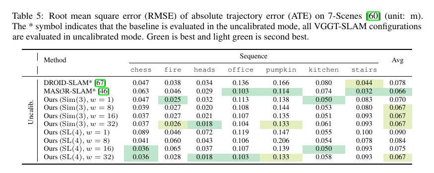

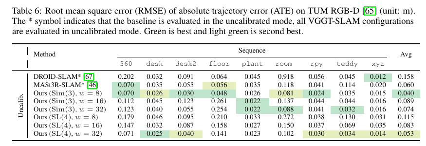

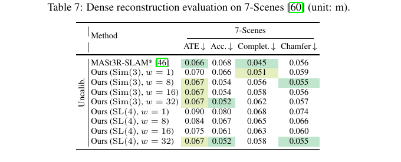

*补充材料表 5–7 按窗口大小列出位姿与稠密重建指标。*

### B.2 每场景的子图数

表 8、9 列出不同 $w$ 下 7-Scenes 和 TUM RGB-D 每序列的子图数及回环数（括号内）。例如 7-Scenes fire 在 $w=1$ 时形成 50 个子图、46 个回环；$w=32$ 时为 2 个子图、0 个回环。TUM 360 在 $w=1$ 时为 168 个子图、151 个回环，$w=32$ 时为 6 个子图、1 个回环。更小窗口让系统更频繁调用 VGGT 和回环检索，也提高遇到退化局部几何的概率。

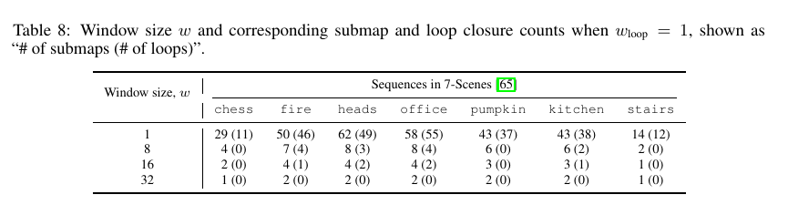

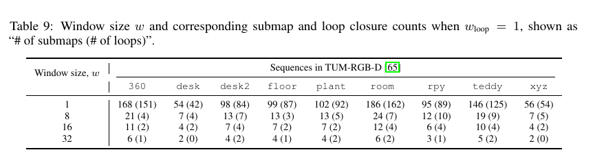

### B.3 焦距一致性评估

VGGT若在一个场景内对同一相机预测的焦距变化很大，说明子图几何可能存在超出统一尺度的差异。office_loop 中 22 个子图的焦距分布较集中，7-Scenes也相对稳定；tabletop 和 bollards 的焦距变化更明显。表 10 中 office_loop 的焦距标准差/范围为 7.3/36.9 像素，7-Scenes 为 9.0/59.7；tabletop 为 37.1/122.8，bollards 为 51.8/177.3。作者观察到后两类场景正是 SL(4) 较 Sim(3) 改善更明显的例子。这是支持射影歧义分析的相关证据，不是焦距变化导致 SL(4) 优势的因果实验。

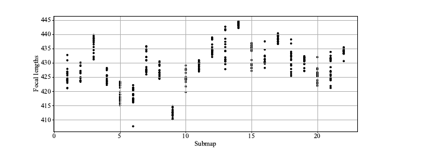

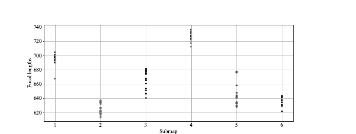

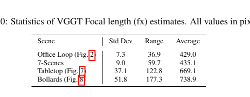

*补充材料图 4、5展示各子图关键帧的 $f_x$ 估计；表 10 报告标准差、范围和平均值，单位为像素。*

## C 更多定性结果

### C.1 SL(4) 与 Sim(3) 的额外例子

补充材料展示 tabletop、banana 与 bollards 场景。tabletop 的 $w=32$ 例子中，SL(4) 修复局部对齐；$w=16$ 的香蕉场景里，Sim(3) 拼接产生了第二根香蕉的视觉重影；户外 bollards 场景中，Sim(3) 把原本分布在水箱周围的单个路桩拼成簇，SL(4) 的结构更一致。它们说明高自由度变换在特定弱约束场景中的作用，也都是定性示例。

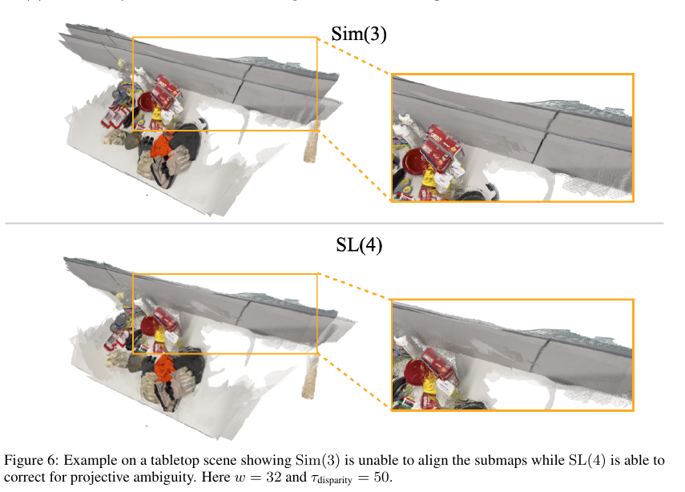

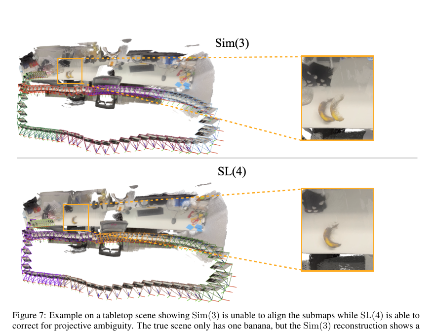

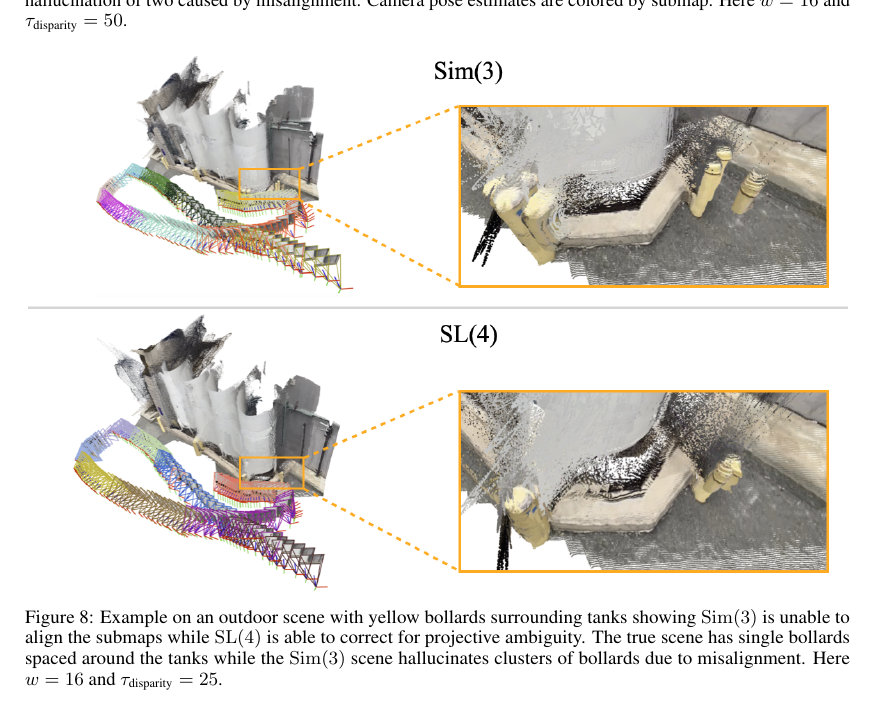

### C.2 7-Scenes 定性结果

补充材料给出 fire 和 heads 两个序列的 SL(4) 重建，分别由两个子图拼接。相机位姿以子图着色；heads 图为视觉展示裁去部分场景。

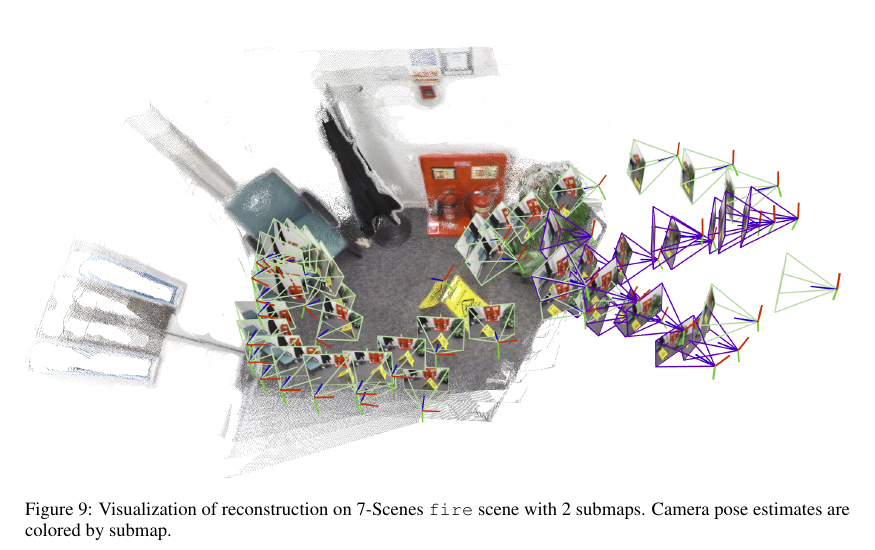

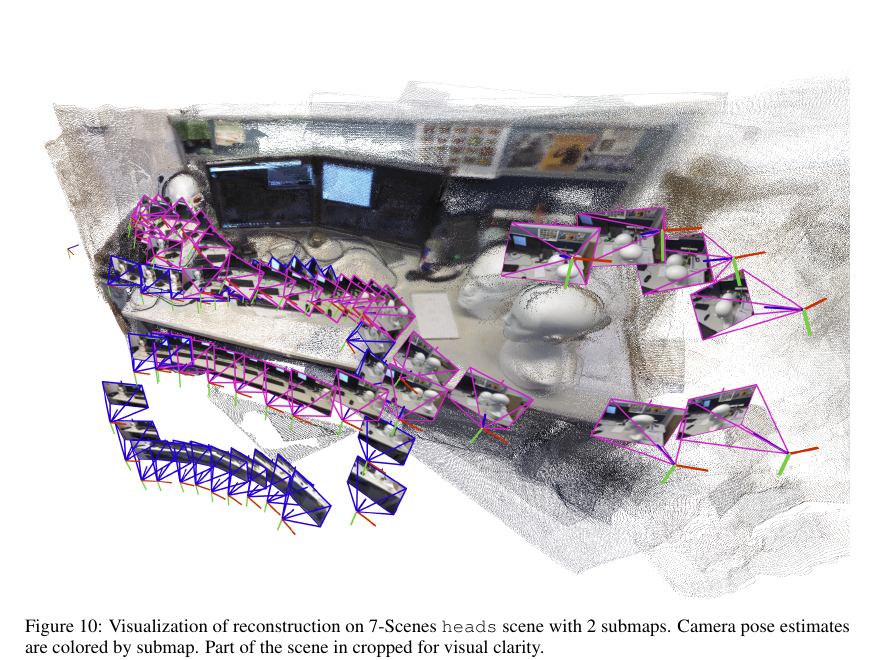

### C.3 TUM RGB-D 定性结果

TUM room 与 360 序列各由六个子图重建，xyz 序列由两个子图构成。它们补充展示不同运动和室内结构下的稠密地图及按子图区分的相机轨迹；这些可视化与表格中的轨迹误差互补，不能单独代表定量性能。

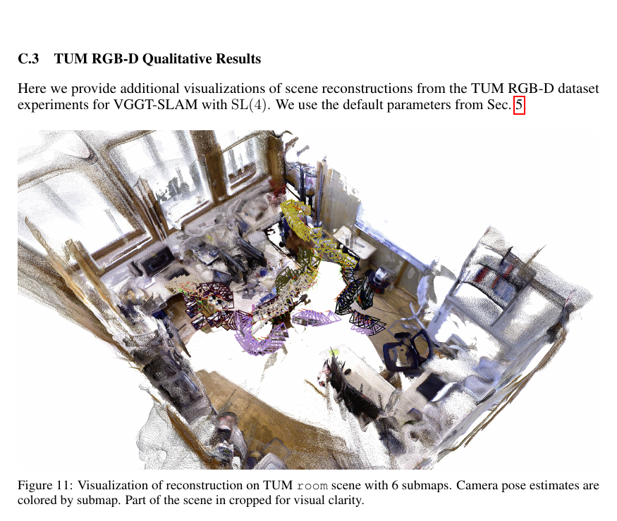

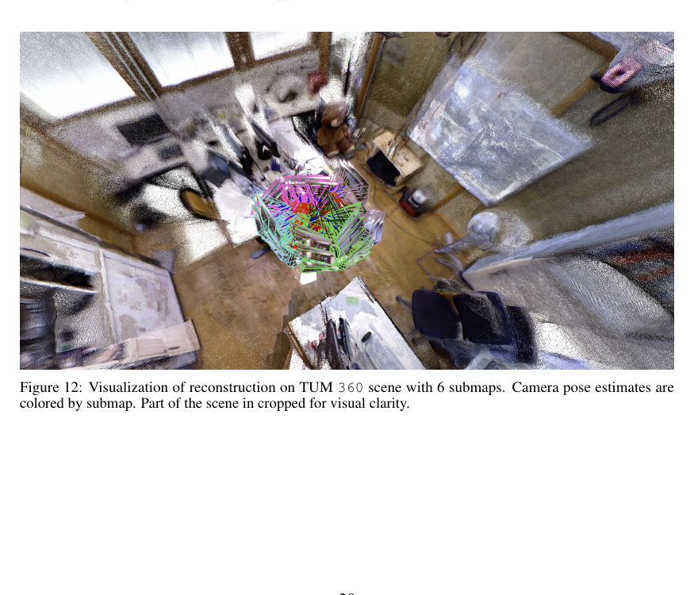

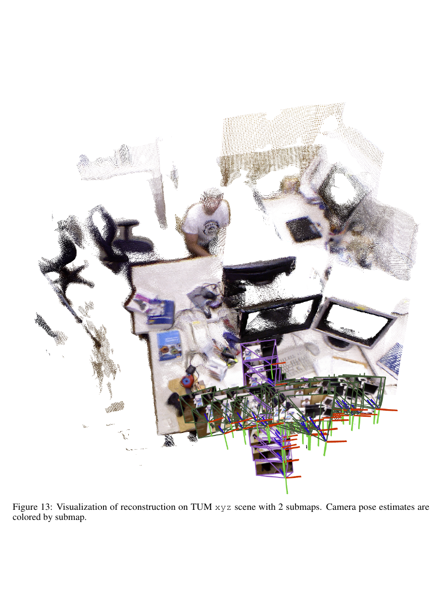

### C.4 户外定性结果

作者在 TartanAir 的 Neighborhood Easy、P005 左目序列上展示户外重建，使用 $w=16$、$\tau_{\mathrm{disparity}}=50$、$\tau_{\mathrm{conf}}=50\%$，得到 8 个子图。该结果补充了主实验以室内数据为主的覆盖范围。

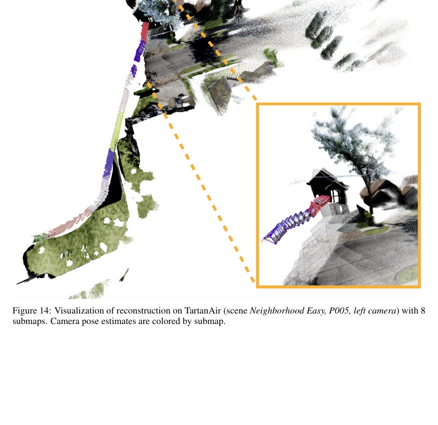

## 方法关系

VGGT-SLAM不是把所有帧送入一个更大的 VGGT，而是把 VGGT作为局部稠密重建器，再通过共享帧对应、SALAD 回环检索和 SL(4) 因子图把子图连成地图。其理论依据是未标定重建在一般情况下存在 15 自由度投影歧义；工程代价则是高自由度变换需要足够丰富的非共面几何和可靠深度对应。对 VGGT 学到的几何先验较可靠的场景，Sim(3)仍可能足够；对弱视差或焦距预测变化大的场景，SL(4)提供更合适的对齐空间，但面临平面退化、离群点和透视漂移。该系统仍是基于视觉前端和因子图后端的 SLAM，地图效果取决于关键帧选择、回环检索与相对变换质量。
