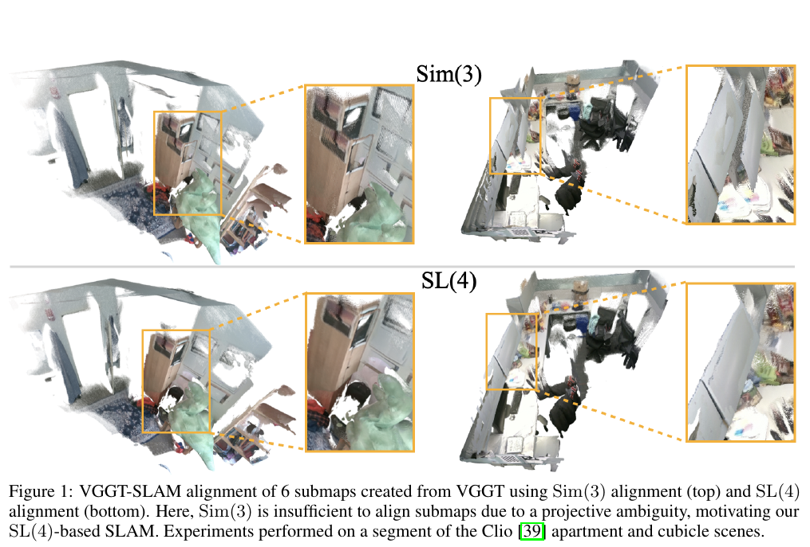
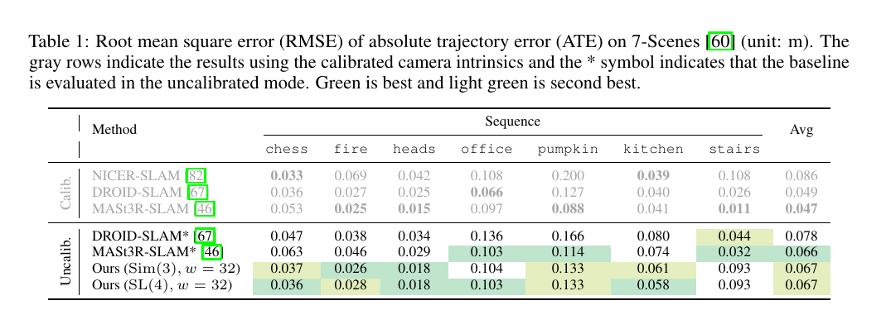
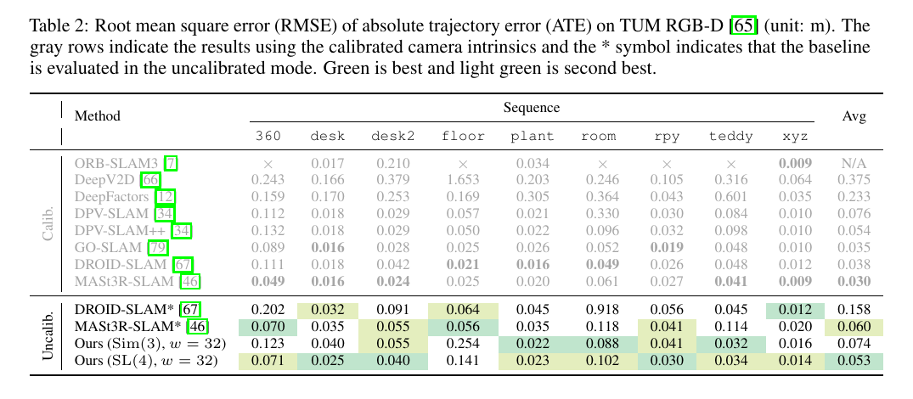
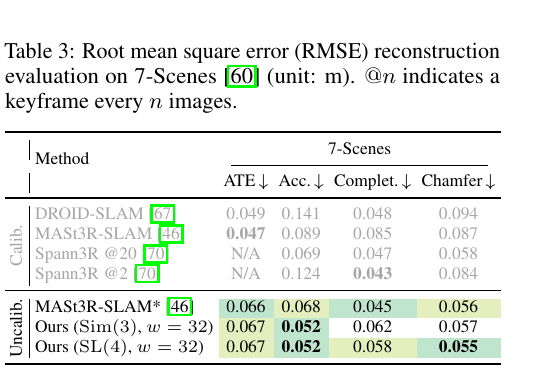
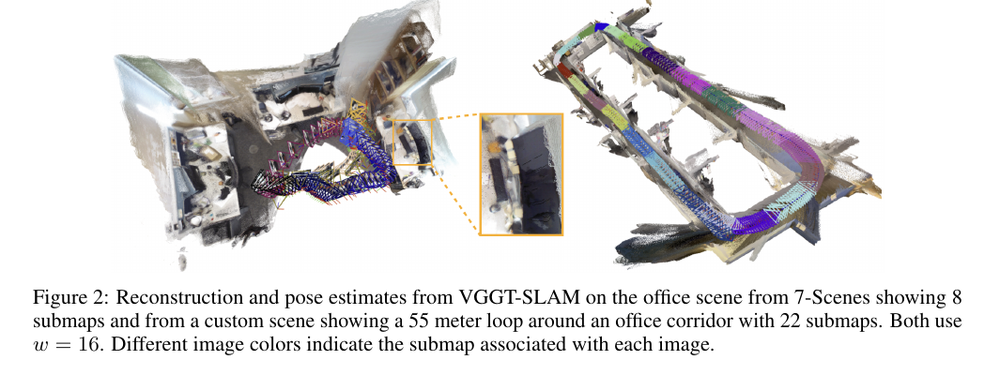
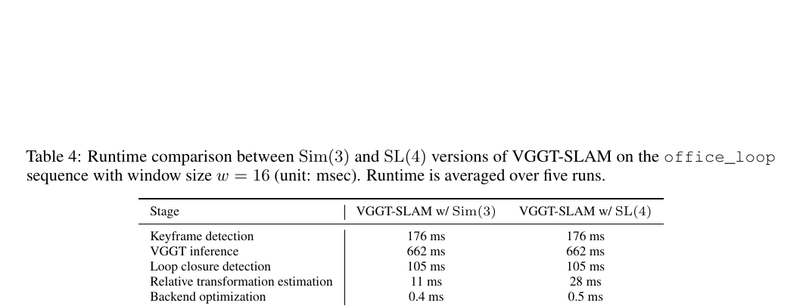
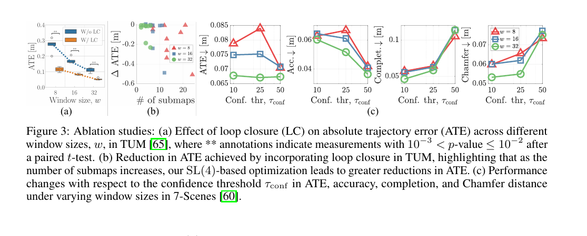

# VGGT-SLAM 论文解读

> Dominic Maggio、Hyungtae Lim、Luca Carlone，*VGGT-SLAM: Optimized on the SL(4) Manifold*，NeurIPS 2025 正式版。[论文页面](https://proceedings.neurips.cc/paper_files/paper/2025/hash/bc65ab11abfbad890171109686233f4e-Abstract-Conference.html) · [论文 PDF](https://proceedings.neurips.cc/paper_files/paper/2025/file/bc65ab11abfbad890171109686233f4e-Paper-Conference.pdf) · [补充材料](https://proceedings.neurips.cc/paper_files/paper/2025/file/bc65ab11abfbad890171109686233f4e-Supplemental-Conference.zip) · [官方代码](https://github.com/MIT-SPARK/VGGT-SLAM)

VGGT 可以从一组图像前馈预测相机参数、位姿和稠密深度，但它一次处理的是有限图像集合。若把连续视频切成重叠窗口，每个窗口独立得到一份局部点云，下一步就要把这些局部坐标系拼起来。常见做法是用 Sim(3) 对齐两份点云：估计旋转、平移和统一尺度。VGGT-SLAM 指出，这个模型在很多序列上足够好，但当未标定相机导致的几何误差超出尺度差异时，Sim(3) 无法消除剪切、拉伸和透视变化造成的错位。

论文的核心贡献是把子图对齐写成 15 自由度的四维射影变换，并在特殊线性群 SL(4) 上建立因子图优化。前端仍由 VGGT 负责每个子图的稠密几何，系统再以重叠图像连接相邻子图、检索旧视图建立回环约束，最后全局优化这些变换。这里的 SL(4) 是更一般的投影坐标对齐形式；它本身不意味着单目系统恢复了有绝对尺度保证的欧氏地图。

## 从 VGGT 输出到局部子图

输入是一条未标定的单目 RGB 图像流。系统用 Lucas–Kanade 光流估计当前帧相对上一关键帧的视差，超过阈值时才选作关键帧。这样做一方面避免相邻图像过度重复，另一方面为 VGGT 提供有足够视差的多视图信息。关键帧积累到窗口大小 $w$ 后，系统将它们送入 VGGT。论文的默认配置取 $w=32$ 个新关键帧。

送入模型的图像集合还包含上一子图最后一张非回环图像，确保相邻子图有重叠；如检索到回环图像，也会额外加入最多 $w_{\mathrm{loop}}$ 张。默认 $w_{\mathrm{loop}}=1$。因此窗口里新增帧、相邻子图的共享帧和回环帧承担不同作用：新增帧扩展覆盖范围，共享帧给出直接对齐所需的共同观测，回环帧则把久远地点接回当前子图。

VGGT 对每张图像预测深度、相机内参和相对第一帧的相机位姿，并输出深度置信度。系统用相机头预测的内参和位姿反投影深度，形成第一相机坐标系下的稠密点云；论文没有使用 VGGT 的点图头。置信度低于全子图平均置信度 $25\%$ 的点被剔除。这样得到的局部地图称为一个子图 $S_i$，并在后端对应一个待优化节点。

## 为什么 Sim(3) 有时不够

若两份局部点云只相差旋转、平移和尺度，Sim(3) 能使其重合。未标定多视图几何却允许更一般的投影歧义：在没有足够相机或场景先验时，由图像重建出的三维结构可能与欧氏真值相差一个 4×4 射影变换。它除尺度、旋转和平移外，还能包含剪切、拉伸和透视变形。VGGT 的学习先验在很多场景中能给出接近度量的结果，所以 Sim(3) 经常表现良好；当先验失准、视差较小时，残留的射影差异就可能让拼接后的场景错位。

*原论文图 1。上排使用 Sim(3)，下排使用 SL(4) 对齐子图；放大框显示前者无法消除局部透视错位。实验来自 Clio 公寓与隔间场景。该图展示射影歧义的实例，不代表每个数据集都需要 SL(4)。*

这里的 4×4 矩阵作用于齐次三维点。矩阵整体乘以任意非零标量表示相同的投影变换，因此可归一化到行列式为 1，作为 SL(4) 的元素。一般 4×4 矩阵有 16 个参数，行列式约束去掉一个自由度，留下 15 个。它和图像平面上的 3×3 单应矩阵不同；后者描述二维平面变换，只有 8 个自由度。

若两份子图 $S_i,S_j$ 有共享图像，VGGT 会分别为该图像预测稠密深度，并将对应像素反投影成两组三维点。由于像素位置相同，点的对应关系不需要再用特征匹配估计。系统求一个齐次变换 $H_{ij}$，使子图 $S_j$ 中的点映射到 $S_i$：

$$
\mathbf X_a^{S_i} \sim H_{ij}\mathbf X_b^{S_j}.
\tag{1}
$$

$\sim$ 表示齐次坐标相差一个比例。对每组对应点，线性化后得到关于 $H_{ij}$ 参数的约束；至少需要五组非退化三维点。实际深度会有离群值，论文采用五点 RANSAC 估计变换，实验设置为 300 次迭代、阈值 0.01，之后按行列式归一化到 SL(4)。这一步是局部相对对齐：它计算两个子图的关系，还没有把所有子图放到同一个全局坐标系。

估计出的射影变换也用于修正相机矩阵。若 $P_j$ 是 VGGT 给出的相机矩阵，论文使用 $P_i=P_jH_{ij}^{-1}$，再分解修正后的相机矩阵恢复位姿。这个过程说明后端对齐的不只是点云外观；同一变换也决定了子图中相机轨迹如何进入统一地图。

## 用回环约束连接非相邻子图

相邻子图通过共享图像自然形成里程计约束，长序列还需要把重新观测到的旧地点连回地图。VGGT-SLAM 为每个关键帧计算 SALAD 图像描述子；新子图形成时，在较早子图的描述子中检索相似帧，并用阈值筛除低相似度候选。最近的若干子图会跳过检索，避免把相邻视图当成回环。选出的旧帧加入当前子图，再由 VGGT 一起预测几何。

因为旧帧在历史子图和当前子图中是同一张图像，它也提供稠密点对应。系统对每个检索到的旧帧按前述五点 RANSAC 估计当前子图与旧子图之间的射影变换，并把它作为一条回环边加入图中。这样，图像检索负责提出候选地点，几何估计负责构造约束，后端再判断所有相对关系如何共同满足。

## 在 SL(4) 上做全局因子图优化

令 $H_i$ 表示将子图 $i$ 变换到全局参考系的矩阵，$H_{ij}$ 表示从子图 $j$ 到子图 $i$ 的相对测量。若这些估计完全一致，应有 $H_i^{-1}H_j=H_{ij}$。实际估计含噪，论文在群上用对数映射将变换残差转成 15 维向量，并最小化所有相邻边与回环边的加权残差：

$$
\hat H=\arg\min_{H_i\in\mathrm{SL}(4)}
\sum_{(i,j)\in\mathcal L}
\left\|
\operatorname{Log}\!\left(H_i^{-1}H_jH_{ij}^{-1}\right)
\right\|_{\Omega_{ij}}^2.
\tag{3}
$$

$\mathcal L$ 包含里程计边和回环边，$\Omega_{ij}$ 是测量信息矩阵；实验中取单位阵。残差为零时，预测的全局相对变换与边测量一致。对数映射的作用是把 SL(4) 上的矩阵误差放到它的切空间中，用 15 维向量表示，才能构造局部线性最小二乘问题。

优化采用 Levenberg–Marquardt。每次迭代先在当前估计附近线性化边残差，求各节点 15 维增量 $\delta_i$，再通过指数映射更新 $H_i\leftarrow H_i\operatorname{Exp}(\delta_i)$。指数映射确保更新后的矩阵仍在 SL(4) 上。其结构与经典位姿图相似，区别在节点变量由 SE(3) 或 Sim(3) 位姿换成了更一般的投影变换。

## 定量结果与速度

位姿评测使用 7-Scenes 和 TUM RGB-D，指标为绝对轨迹误差 ATE 的均方根，单位米。所有 VGGT-SLAM 实验均不输入相机标定参数。7-Scenes 上，窗口 $w=32$ 的 SL(4) 版本平均 ATE 为 0.067 m，与同窗口 Sim(3) 相同；未标定 MASt3R-SLAM 为 0.066 m。TUM RGB-D 上 SL(4) 平均 ATE 为 0.053 m，低于 Sim(3) 的 0.074 m 和未标定 MASt3R-SLAM 的 0.060 m。论文结果支持 SL(4) 在部分困难场景中能改善对齐，但并未显示它在所有序列上都优于 Sim(3)。

*原论文表 1。报告 7-Scenes 各序列的 ATE RMSE。标有星号的方法为未标定模式；灰色行是使用已标定内参的对照。*

*原论文表 2。TUM RGB-D 各序列 ATE RMSE。TUM floor 上 SL(4) 误差较大，反映平面点退化对 15 自由度估计的影响。*

稠密重建评测在 7-Scenes 上进行，报告点云准确度、完整度和 Chamfer 距离，三项越低越好。SL(4) 的准确度为 0.052 m、完整度 0.058 m、Chamfer 距离 0.055 m；同表中未标定 MASt3R-SLAM 的对应值为 0.068、0.045、0.056 m。由此看出，VGGT-SLAM 的准确度和 Chamfer 较低，完整度则略高，整体差异有限。

*原论文表 3。比较准确度、完整度和 Chamfer 距离；这些列在不同方法间表现并不完全同向。*

定性结果展示了两个不同尺度的拼接场景：7-Scenes office 由 8 个子图组成，另一段办公室走廊形成约 55 米的闭环轨迹，由 22 个子图拼接。两者窗口均为 $w=16$，相机轨迹颜色表示图像所属子图。

*原论文图 2。左侧为 7-Scenes office，右侧为包含 22 个子图的办公室走廊回环序列。*

窗口 $w=16$ 的 office_loop 序列上，VGGT 推理平均耗时 662 ms，关键帧检测 176 ms，回环检索 105 ms。SL(4) 相对变换估计为 28 ms，Sim(3) 为 11 ms；后端优化分别为 0.5 ms 和 0.4 ms。作者报告增加的 RANSAC 计算约为 VGGT 推理时间的 2.5%。VGGT 始终处理固定大小的子图，因此模型推理显存不随累计帧数增长；但这不等于总系统资源对序列长度完全没有开销，系统仍需存放地图和检索描述子。

*原论文表 4。每个阶段的耗时取五次运行平均值，单位毫秒；主要开销来自 VGGT 前向推理。*

## 消融结果与适用边界

消融实验显示，加入回环通常会降低轨迹误差；子图数量越多，回环带来的误差下降也越明显。置信度阈值越高，保留下来的点越少，准确度通常改善而完整度下降，默认阈值设为平均置信度的 25%。作者对多个子图窗口大小也做了对照：较小窗口会更频繁地产生子图与回环，但也更容易遇到几何退化。补充材料还给出焦距预测的变化统计；例如 tabletop 与 bollards 场景的焦距离散程度高于 office_loop 和 7-Scenes，与这些场景中 SL(4) 相对 Sim(3) 更有帮助的观察相呼应。这是经验上的相关证据，不是对射影误差来源的单独因果证明。

*原论文图 3。左图比较不同窗口大小下有无回环的 ATE，中图显示回环对 ATE 的改善与子图数量的关系，右侧各图展示置信度阈值对轨迹和稠密重建指标的影响。*

方法的主要边界来自 15 自由度估计本身。若共享点近似共面，完整射影变换会退化，可能没有唯一解；论文在 TUM floor 场景观察到后端发散。小窗口还会增加遇到近纯旋转的机会，VGGT 的深度精度降低后，五点 RANSAC 更容易受离群点影响。作者使用 RANSAC 抑制错误对应，但大量或局部一致的错误深度仍可能带来错误变换。更高自由度也多出场景透视漂移的可能；回环能约束漂移，却无法保证每次回环测量都准确。最后，射影变换保持直线，不能校正镜头畸变，所以系统假设输入图像已去畸变。

VGGT-SLAM 将一个前馈重建模型扩展为多窗口、可回环的稠密地图系统。它的关键判断是：子图间误差不总是单纯的尺度和位姿差异，未标定重建在一般情况下还可能有投影变形。SL(4) 后端为这类误差提供了建模空间，也带来更难的估计条件。实验中，常规序列上 Sim(3) 已经很有竞争力；SL(4) 的优势主要体现在出现明显投影歧义的困难场景，而平面几何、近纯旋转和离群深度仍是需要谨慎处理的情况。
