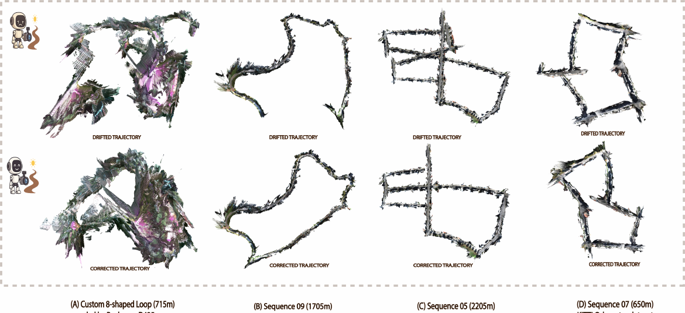
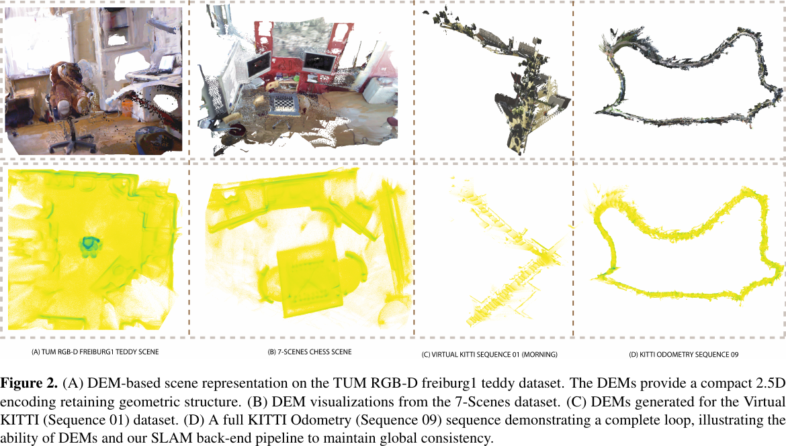
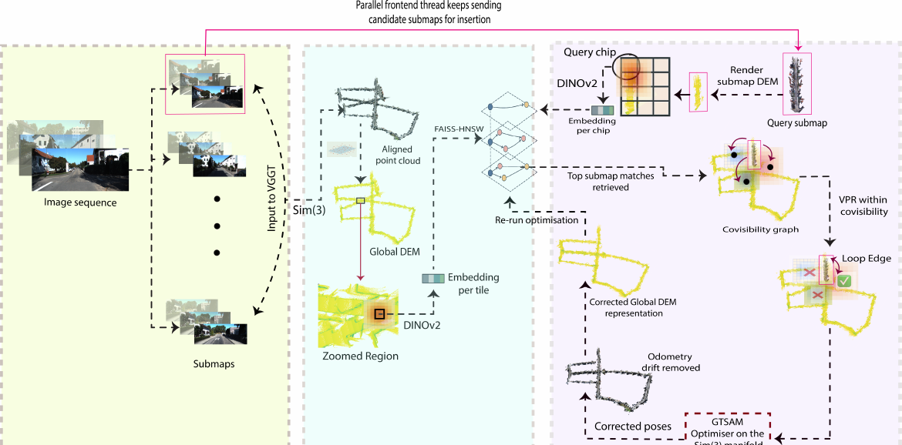
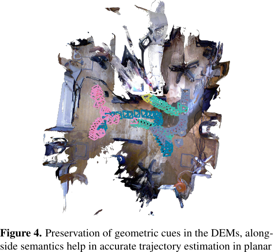
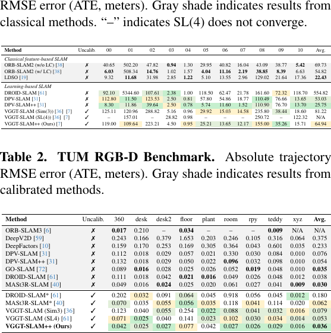
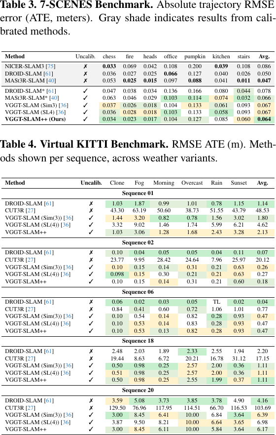
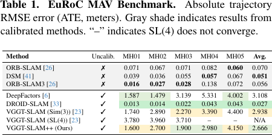
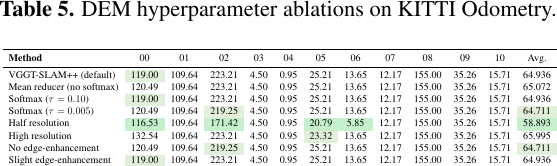
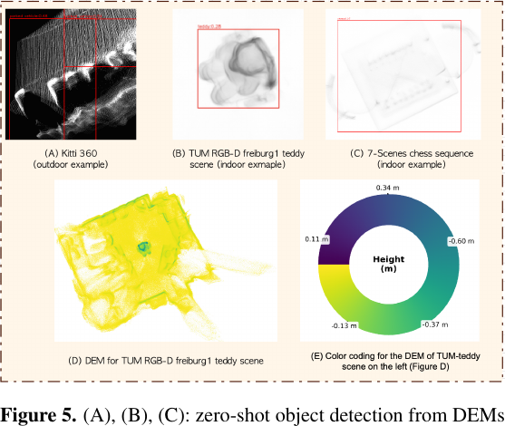
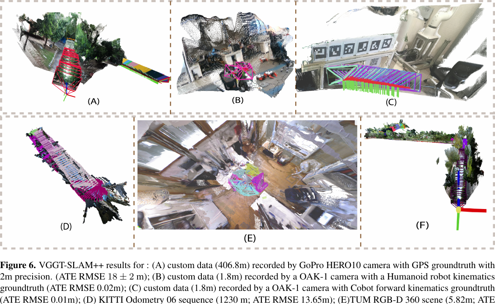

# VGGT-SLAM++ 论文解读

> Avilasha Mandal、Rajesh Kumar、Sudarshan Sunil Harithas、Chetan Arora，*VGGT-SLAM++*，CVPR 2026 Workshop on Visual Odometry, Localization and Visual Calibration（VOCVALC），正式收录版，pp. 1008–1018。[CVF 论文页](https://openaccess.thecvf.com/content/CVPR2026W/VOCVALC/html/Mandal_VGGT-SLAM_CVPRW_2026_paper.html) · [正式版 PDF](https://openaccess.thecvf.com/content/CVPR2026W/VOCVALC/papers/Mandal_VGGT-SLAM_CVPRW_2026_paper.pdf) · [补充材料](https://openaccess.thecvf.com/content/CVPR2026W/VOCVALC/supplemental/Mandal_VGGT-SLAM_CVPRW_2026_supplemental.zip) · [官方代码](https://github.com/Leopardise/vggt-slam-pp)

[VGGT-SLAM](../vggt-slam/index.md) 将视频切分成 VGGT 子图，估计子图间变换，再用全局约束修正轨迹。VGGT-SLAM++针对这条流程中的时间尺度问题：稀疏的长程回环能修正全局漂移，却难以及时制止连续若干子图内的局部误差。它用 VGGT 生成稠密几何，以紧凑的数字高程图（Digital Elevation Map，DEM）表示局部结构，通过图像检索在空间上找相邻子图，并频繁优化这些子图的 Sim(3) 位姿。

*原论文图 1。上排为前端里程计轨迹，下排为后端校正轨迹；图中用数个长序列示例呈现高频后端对局部漂移的修正。*

## 从 VGGT 子图到紧凑地图

前端逐帧读取 RGB 视频，以 Lucas–Kanade 光流估计当前帧与上一关键帧之间的视差。视差达到阈值后，当前帧加入子图；每个子图最多 32 帧，并从前一子图继承一张过渡帧。与 VGGT-SLAM 把回环帧放进子图不同，该系统设置回环帧数 $w_{loops}=0$，把回环查找交给独立的空间后端。VGGT 对子图预测相机、深度和稠密点图，前端再以 motion-only Sim(3) 求解器将它与前一子图对齐。

论文正文把视差阈值写成 $\tau_{disparity}=40\,\mathrm{m}$。但该阈值是由图像光流计算的视差，正文中的米制单位与量的定义不吻合；官方代码说明给出的参数是 $\tau_{disparity}=40$，没有标注单位。这里保留数值并记录原文不一致，不将其自行改写成像素或其他单位。

子图点图中远处的天空和无纹理区域可能产生离群点。补充材料说明，作者按三维点到原点的范数筛除过近或过远的点，尤其抑制约 30 米以外的 far-field floaters，减少它们对后续地面拟合和 DEM 高度梯度的干扰。经过筛选的子图点云仍用于三维地图；DEM 是供检索和后端使用的紧凑结构表示。

构造 DEM 时，系统先用 RANSAC 与 SVD 从稠密点图估计主平面，再把点投影到与该平面对齐的规范坐标系：平面内坐标形成规则栅格，点到平面的有符号距离作为高度。栅格采用固定的米/像素分辨率；落入同一像素的多个高度通过均值、最大值或 softmax 加权聚合。softmax 温度 $\tau$ 控制聚合由均值向最大值过渡，论文默认 $\tau=0.02$。全局 DEM 再切成 $2\,\mathrm m\times2\,\mathrm m$ 的瓦片。

*原论文图 2。上排展示点图和轨迹，下排展示对应的 DEM；KITTI 序列 09 的完整闭环示例显示了规范化俯视表示对观察方向变化的稳定性。*

DEM 不是普通彩色高程图。DINOv2 处理的是灰度 DEM；论文中的黄绿高度配色只用于人类查看。作者认为俯视高度图保留了局部平面结构和高度边缘，又把子图转成可索引的二维图像形式，使图像编码器能用于检索。

## 结构嵌入与协视图搜索

上述 DEM 成为跨子图检索的输入：系统把新子图和全局 DEM 切成 $2\,\mathrm m\times2\,\mathrm m$ 瓦片，再用 DINOv2 将灰度瓦片编码成检索向量；协视图搜索按向量相似度寻找空间上可能相邻的子图。

对每张全局 DEM 瓦片，系统取其周围 $9\times9$ 个瓦片作为邻域，分别切成图像 patch 并送入 DINOv2。设 $f_\theta(p_j)$ 是第 $j$ 个 patch 的特征，$w_j$ 是降低邻域边缘影响的高斯位置权重，$m_j$ 是依 DEM 梯度构造的可见性权重。平坦或信息较少的区域权重较低，坡度边缘和高度不连续处权重较高。瓦片描述子为

$$
v_k=\frac{\sum_j w_jm_jf_\theta(p_j)}{\sum_j w_jm_j}.
\tag{1}
$$

这个加权池化将邻域 patch 特征汇成一个瓦片向量。新到达子图的 DEM 也切成 $2\,\mathrm m\times2\,\mathrm m$ 查询片，经过相同编码过程；不同之处在于查询描述子聚合整个子图区域的 patch，而全局描述子是以中心瓦片为中心的 $9\times9$ 邻域表示。两类向量位于同一特征空间，可以直接计算余弦相似度：

$$
s(\chi_q,\tau_k)=\frac{v_q^\mathsf T v_k}{\lVert v_q\rVert\,\lVert v_k\rVert}.
\tag{2}
$$

全局瓦片描述子保存在 CPU 上的 FAISS-HNSW 索引中。对每个查询片，近似最近邻检索返回相似瓦片，再把相似度累加到瓦片所属的父子图：

$$
\operatorname{Score}(S)=\sum_{\tau_k\in S}s(\chi_q,\tau_k).
\tag{3}
$$

累计得分靠前的子图成为协视图候选；论文采用 top-$K=10$。因此，这一阶段先利用紧凑的 DEM 描述子缩小空间检索范围，并不直接把相似度当作最终回环约束。全局协视图图中的节点是子图，边表示 DEM 与 DINOv2 检索到的强结构联系。随后 AnyLoc 只在这些候选邻域中进一步计算查询片和历史瓦片之间的地点识别对应，再由对应投票形成子图间的回环候选。

*原论文图 3。VGGT 子图和 Sim(3) 里程计构成前端；DEM 瓦片嵌入与平均相似度投票构成协视图搜索；AnyLoc 进一步提出回环边，后端再优化空间关联子图的位姿。*

## 高频 Sim(3) 空间校正

每条候选回环边给出子图间的相对 Sim(3) 变换 $\hat T_{ij}$，以及由描述子一致性和三维对齐残差估计的边不确定度 $\Sigma_{ij}$。后端在当前协视图范围内优化各子图位姿 $T_i\in\mathrm{Sim}(3)$，最小化加权测地误差：

$$
\min_{\{T_i\}}\sum_{(i,j)\in E}
\left\|\log_{\mathrm{Sim}(3)}\!\left(T_j^{-1}T_i\hat T_{ij}\right)\right\|^2_{\Sigma_{ij}}.
\tag{4}
$$

$T_j^{-1}T_i\hat T_{ij}$ 衡量由当前节点位姿诱导的相对变换与回环测量之间的残差；$\log_{\mathrm{Sim}(3)}$ 将群上的变换差映射到切空间，便于用高斯—牛顿法更新。边不确定度决定每条约束对目标函数的权重。前端仍持续生成子图，后端则在空间相关的子图集合上并行、高频地执行校正，以期在长距离回环发生前先压制累积漂移。

论文把该步骤称作 spatially corrective local bundle adjustment。按式（4）所展示的优化变量，它直接优化的是子图 Sim(3) 位姿，没有在这个目标函数中列出逐点路标或点图变量。因此，理解其实现时应把它看作以空间协视图为范围的子图位姿图优化；论文术语中的 LBA 不代表这里联合优化了稠密三维点。

*原论文图 4。TUM RGB-D freiburg1 floor 场景中的 DEM 与轨迹展示了作者报告的近似平面场景案例。该结果应结合论文附录中对关键帧视差门限的说明理解：系统仍需要足够的基线信息。*

论文强调 DEM 能在平面环境中支持结构匹配和回环。不过补充材料 A6 同时说明，关键帧视差门限用于避免极小基线下的投影歧义。因而，这组平面场景结果说明方法能处理具有非零视差的平面轨迹，不能据此推断其解决了任意小基线条件下的几何退化。

## 实验结果与消融

作者在 KITTI Odometry、TUM RGB-D、7-Scenes、Virtual KITTI 和 EuRoC 上评测，并以 ATE RMSE（米）报告轨迹误差。主文表 1–4 中的 KITTI 平均误差为 64.94 m，TUM 为 0.036 m，7-Scenes 为 0.064 m；其余序列和天气变体应按各表具体范围解读。

*原论文表 1–2。KITTI 表使用未标定输入报告各序列 ATE；TUM 表同时列出已标定和未标定方法，比较时需留意相机条件。*

*原论文表 3–4。7-Scenes 按室内场景列误差；Virtual KITTI 表对序列 01、02、06、18、20 的不同天气变体分别报告结果。*

作者报告 VGGT-SLAM++ 相对 VGGT-SLAM 基线在 KITTI、TUM、7-Scenes、Virtual KITTI 和 EuRoC 上分别改善 20%、45%、5%、14% 和 9%。这里要区分各数据集改善比例与总体数字：论文结果段先称总体 18.6% 来自四个数据集的平均（基线 17.13 m、本文 13.94 m），紧接着讨论部分又称该比例覆盖五个数据集。由于 EuRoC 是单独列在补充材料中的灰度实验，正文的计算描述与讨论段口径不一致，故不把 18.6% 无条件表述为五个数据集上的统一平均。

*原论文补充材料表 1。EuRoC 是灰度数据，VGGT-SLAM++ 平均 ATE 为 2.666 m；相较 VGGT-SLAM 的 Sim(3) 平均值 2.938 m 有改善，但仍明显高于 DROID-SLAM 的 0.027 m。论文将这一差距联系到 VGGT 前端主要在 RGB 数据上训练。*

*原论文表 5。消融改变高度聚合器、softmax 温度、DEM 分辨率和边缘增强系数；不同设置在部分序列上并列或接近，结果没有显示单一超参数在全部序列上都占优。*

补充材料给出的平面筛选、软最大值温度和不同栅格分辨率结果，说明 DEM 构造参数会改变局部结构描述，但表 5 中许多序列的误差相同或相近。该消融支持这些设置在所测序列中的可用性，不构成对任意场景或分辨率的普遍最优保证。

计算资源方面，论文使用 RTX 4090 24 GB 显存和 Threadripper PRO 5955WX、32 GB 内存的工作站，报告前端约 16 FPS，后端约 1.89 FPS；平均使用约 8 GB RAM 和 20 GB VRAM。作者把旧子图点云放在磁盘、全局 DEM 与 FAISS-HNSW 索引放在 CPU，当前协视图相关数据驻留 GPU。这些数据描述的是该实现和硬件上的测量；论文所说的子线性检索也不意味着随地图增长总内存恒定。

*原论文图 5。作者用 Grounding DINO 在 DEM 上展示 parked vehicle、teddy 和 chess 的零样本检测；图中的彩色高度图只供可视化，DINOv2 检索输入仍为灰度图。该实验是 DEM 保留结构线索的辅助示例，不是 SLAM 定位精度的替代指标。*

*原论文图 6。结果包括 GoPro GPS、OAK-1 机器人运动学真值、KITTI 06 与 TUM RGB-D 360 等案例；其中 GPS 真值精度约 2 m，解释厘米级结果时不能忽略各数据集真值精度与路径长度差异。*

## 方法关系与适用边界

VGGT-SLAM++保留 VGGT 的前馈子图几何，把高频漂移校正交给独立后端。DEM 将密集点图压缩成平面内坐标和高度，DINOv2 生成结构描述子，FAISS-HNSW 先找空间相关子图，AnyLoc 再提出回环候选，最后 Sim(3) 位姿图用这些测量在局部空间范围内校正轨迹。这种分层搜索试图平衡地图增长、检索成本和几何约束频率。

代价是检索表示只保存相对于主平面的二维位置与高度，垂直悬挑和多层重叠结构会被压缩；这是由 2.5D DEM 表示直接带来的信息取舍。系统的点图重建仍是稠密的，但回环检索依赖 DEM 的主平面拟合和足够的视差。灰度 EuRoC 结果也显示，后端能改善 VGGT-SLAM 基线，却无法弥补前端在非 RGB 输入上的表现落差。结合这些边界，论文的主要贡献是把紧凑几何检索和高频子图位姿优化接到 VGGT 前端后面，而不是让前馈重建本身变成无状态限制的全局 SLAM。
