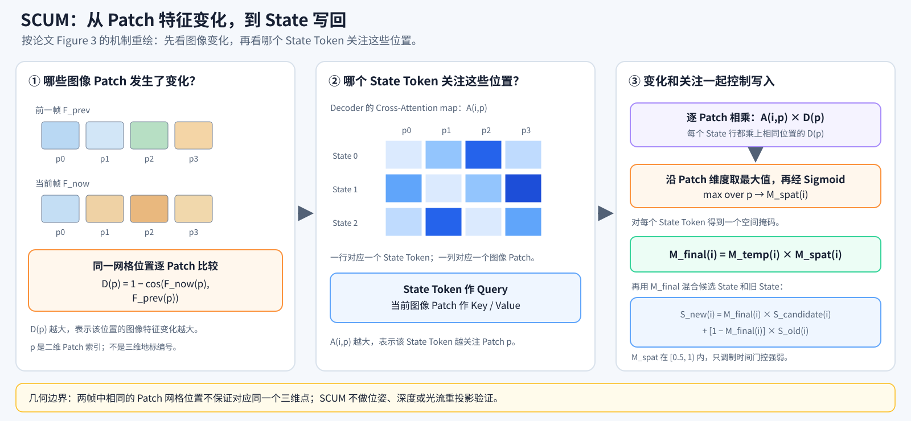
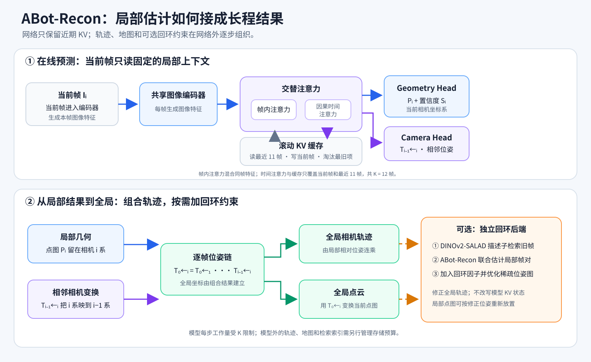
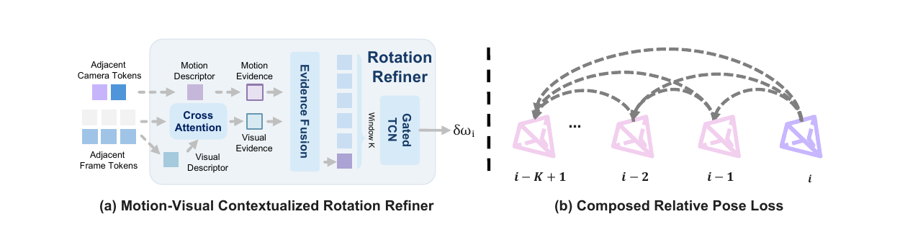
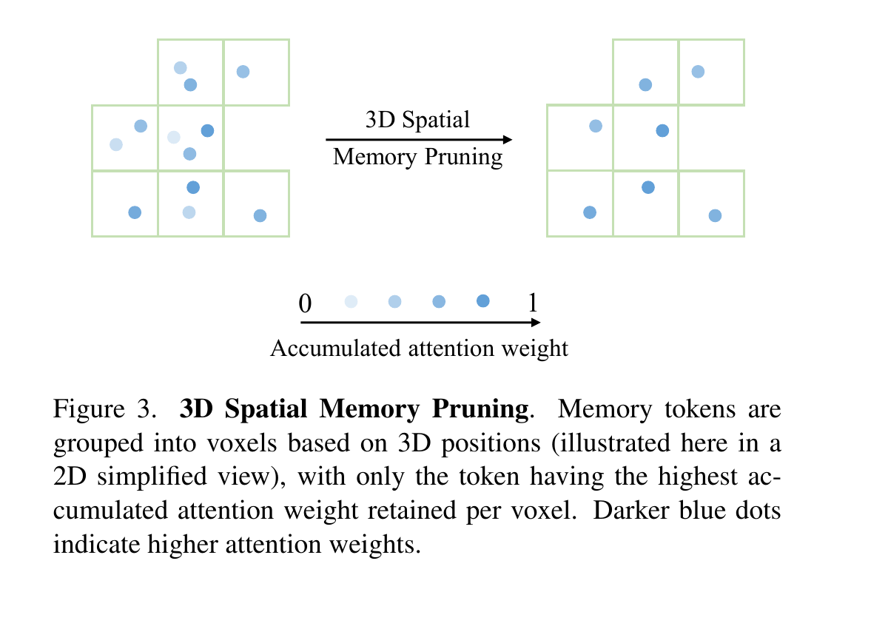
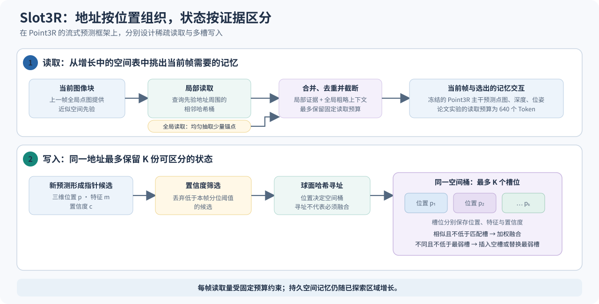

# 端到端 SLAM 的进展与趋势：面向视频流的三维重建框架

> 本文聚焦端到端模型如何处理连续输入，以及它们怎样定义坐标系、读取时间上下文、保存历史、处理重访，并在位姿变化后更新内部状态。

## 一个好的端到端视频重建框架，需要具备哪些基本能力？

视频流没有预设终点。若每来一帧都保留全部历史特征并让它们持续参与后续计算，KV 缓存和注意力计算就会随序列变长，显存与工作内存的压力也会不断累积。一个面向长视频的端到端框架，需要控制单步推理工作集和每帧新增计算的增长，同时保留足以支持全局定位和重建的历史信息。

一种直接做法是滑动窗口：模型读取当前帧和有限的近期上下文，增量预测新帧的深度或点图、相机位姿。窗口之外的信息怎样继续发挥作用，则需要另一层设计：旧帧可以压缩到长期状态、保留为关键帧，或写入显式地图，也可能被丢弃。这些选择会反过来影响坐标系和网络架构：当前点图处在哪个相机系，位姿相对哪个参考表达，全局状态保存在哪个坐标系，参考信息是否由 Reference Token 显式表示，都会决定局部预测怎样接入长程轨迹与地图。

长时间运行还要求系统处理重访。找到旧地点后，系统需要建立可信的几何约束，并用它修正累计轨迹；修正后的位姿又会改变地图中几何的位置。模型或后端如何同步更新全局记忆、局部缓存和仍会参与后续推理的隐藏状态，决定新旧估计能否保持一致。资源分析也要区分模型单步工作集与系统累计存储：固定窗口可以限制前者，轨迹、地图和回环索引的规模则取决于系统如何管理它们。

这五问沿着在线重建的状态流转展开：先确定空间参照和当前可读上下文，再管理历史信息及其资源开销，继而考察重访如何形成约束、全局修正如何传回地图和模型状态。

1. **参照如何建立（坐标系）？** 点图、相机位姿和记忆分别处于什么坐标系？局部预测怎样接入全局轨迹，参考关系是否由 Reference Token 显式表达？
2. **当前预测能读取什么（注意力）？** 模型能读取当前帧、近期历史、未来帧还是整组视图？它采用因果注意力、双向交互，还是二者结合？
3. **历史如何保存，资源怎样增长（记忆）？** 局部缓存与长期状态各保存什么？窗口、压缩、融合和淘汰如何控制记忆容量及推理开销随视频变长的增长？
4. **重访如何形成约束（回环）？** 端到端模型能否找回旧地点、验证几何关系，并将重访转成可用于全局优化的约束？
5. **全局修正如何传回状态（更新）？** 位姿或地图被修正后，几何地图、长期记忆和仍参与后续推理的局部状态怎样保持一致？模型采用坐标变换、局部重算、历史回放，还是没有相应机制？

第一节的 DUSt3R、VGGT 和 π³ 主要作为几何表示与参考系设计的背景，不强行套用这五问。从第二节起，本文以端到端模型本身为主要评估对象；论文系统若借助传统检索、几何验证或位姿图优化补足能力，会另行说明，不计作模型自身的设计。

## 1. 端到端几何基础模型：三种代表性设计

本节选取三项有代表性的端到端几何工作，以它们对照几何表示和参考系设计中的几种关键取舍。DUSt3R 是近年点图驱动、无需预先提供相机标定和位姿的重建路线中的开创性代表之一：它从图像对预测点图，再通过全局对齐组织更多视图。VGGT 把相机、深度、点图和点跟踪整合进统一的多视图前馈模型，是这条路线中影响力很大的方案。π³ 则给出另一种参考系设计：每幅图像预测本相机坐标系下的局部点图，以相对位姿联系各视图，并通过置换等变性避免指定固定参考帧。把三者放在一起，可以对照点图表示、多视图交互和参考系约定的不同选择，也为后文讨论视频流中的坐标、历史上下文与状态更新建立参照。

### DUSt3R：从图像对直接预测共同坐标下的点图

**论文全名：** *DUSt3R: Geometric 3D Vision Made Easy*

DUSt3R 把两幅图像送入共享编码器和交互式解码器，直接回归对应的稠密点图与置信度。它不要求输入相机标定和位姿，之后再通过点图对齐组织多视图结果。

*两幅图像分别编码，解码器通过视图间交叉注意力交换信息，再预测点图和置信度。两张点图都落在第一幅图像的坐标系中，点图因此既是几何输出，也是恢复相机关系的入口。*

[论文](https://arxiv.org/abs/2312.14132)

### VGGT：在一轮前向计算中联合预测多视图几何

**论文全名：** *VGGT: Visual Geometry Grounded Transformer*

VGGT 把图像 Token、相机 Token 和稠密几何头放进一个多视图 Transformer。它的架构图概括了这一范式：先融合视图，再从共享表示中预测相机、深度、点图和跟踪特征。多视图上下文增强几何预测，但输入通常作为一个有限集合整体处理。

*图像 Token 在帧内与跨视图交替交互，之后由相机头和稠密几何头输出结果。这里的全局注意力发生在输入图像集合内部；网络没有因此获得跨运行持续存在的地图。*

[论文](https://arxiv.org/abs/2503.11651)

### π³：保留多视图交互，但不把第一张图固定成特殊锚点

**论文全名：** *π³: Permutation-Equivariant Visual Geometry Learning*

π³ 的重点是置换等变：改变输入顺序，不应该因为某一帧被命名为“第一帧”就改变模型的几何推理方式。它为每个视图预测本地坐标点图，再用视图间相对位姿联系它们。

*各视图先形成局部几何特征，再通过对称的多视图交互联系起来。每幅图像保留自己的相机坐标表达，模型不必先选择一张参考图像才能开始预测。*

[论文](https://arxiv.org/abs/2507.13347)

从 DUSt3R 到 VGGT，几何预测从图像对的点图回归扩展到多视图联合推理；π³ 则展示了不依赖固定参考帧的设计。这三种模型为流式重建提供了点图表示、多视图交互和坐标系设计的参照。视频帧持续到来后，系统还要控制历史上下文、维护全局状态，并处理重访与位姿修正；下一节由此转向流式方法的注意力、记忆与状态更新。

## 2. 视频流重建的架构路线：从局部上下文到长期空间状态

上一节的三种几何模型以给定图像集合为输入。转为持续到来的视频流后，模型需要在每个预测时刻利用近期上下文，增量输出当前几何和位姿，并决定窗口外的信息如何留存、怎样继续影响后续预测。因果 KV 及其压缩、滑动或重叠窗口、递归状态、关键帧相对位姿和显式三维记忆，都是组织这些历史信息的不同架构选择；坐标系约定则决定局部结果如何接入长期轨迹与场景状态。

本节沿历史信息的组织方式展开：先看递归状态如何写入，再看因果 KV 及其压缩、窗口如何管理近期上下文，随后讨论分层历史、相对位姿链和显式三维记忆。这些路线对信息可见范围、记忆容量、坐标表达和事后校正作出不同选择，下文继续用五个方面比较它们的能力与边界。

### CUT3R：固定数量的状态 Token 持续读写

**论文全名：** *Continuous 3D Perception Model with Persistent State*

CUT3R 把每帧图像与一组持久状态 Token 交互，输出共同坐标系下的相机和点图。可以把它称作“记忆地图”的一种隐式近似：它持续保留场景信息，但 Token 本身不是带显式三维地址、可直接交给后端优化的路标。

*每张新图像读取已有状态，再把当前证据写回状态；预测头输出相机、点图和场景重建。状态负责跨帧传递上下文，显式三维几何主要在解码后的点图中出现。*

- **坐标系：** 初始化后建立共同场景参考，逐帧相机和点图相对该参考表达。
- **注意力：** 当前图像与持久状态交互；流式阶段只读取已有状态和当前帧，不访问未来帧。
- **记忆：** 固定数量的学习状态 Token，内部状态大小不随帧数线性增长。
- **回环：** 端到端模型未设计独立地点检索、几何验证或位姿图约束；重访信息能否恢复，取决于递归状态是否保留了相关内容。
- **更新：** 每帧读取并改写状态；若外部优化器改了旧位姿，论文没有给出对隐藏状态作相应坐标变换或重算的机制。

[论文](https://arxiv.org/abs/2501.12387)

### TTT3R：让状态 Token 按对齐程度决定写入步长

**论文全名：** *TTT3R: 3D Reconstruction as Test-Time Training*

TTT3R 直接沿用 CUT3R 的网络主干与递归状态，针对长序列中的状态遗忘修改写入规则。它把持续更新的状态看作测试时的“快速权重”，把训练好的网络参数看作推理时冻结的“慢速权重”。这里的 Test-Time Training 不表示模型在测试视频上反向传播或微调参数；新帧到来时，模型只在前向过程中计算状态更新幅度。

*论文原图 Figure 4：CUT3R 将当前帧的注意力更新直接写入状态；TTT3R 为更新项加入逐 Token 的学习率。下方读出路径仍然从状态和当前帧预测点图与相机。原图保留了论文英文图注。*

关键问题是：状态数量固定，但每个状态 Token 与当前帧的关系并不固定。每来一帧，State Query 都会和这张图像的 Key 计算注意力分数；所以“沿图像 Token 维度求平均”指的是，对某一个状态 Token 与**当前这一帧**所有图像 Token 的分数求平均，不是对多帧求平均。模型把这个汇总分数映射为该状态 Token 的更新率：

\[
\ell_{t,i}=\operatorname{mean}_{p,\,l,\,h}\left(\frac{q_{t-1,i}^{l,h}\cdot k_{t,p}^{l,h}}{\sqrt{d_h}}\right),\qquad
\beta_{t,i}=\sigma(\ell_{t,i})
\]

其中，\(i\) 是状态 Token，\(p\) 是当前帧的图像 Token，\(l\) 和 \(h\) 分别代表解码层与注意力头。论文用归一化的跨注意力 Logit 均值定义对齐置信度；官方实现把各层、各头的 State-to-Image Logit 汇总，再经 Sigmoid 得到每个状态 Token 的 \(\beta\)。这里使用 Softmax **之前**的 Logit：Softmax 之后，每行权重沿图像 Token 维度的均值恒为 \(1/M\)，无法表示不同状态的置信度差异。

*自绘实现解释图：State Query 与当前帧 Token 的关联分数经过汇总和 Sigmoid，形成逐 Token 的 \(\beta\)；它控制候选状态与旧状态的混合比例。分数来自特征关联，不是重投影误差或经过校准的几何正确率。*

论文公式把更新写成“旧状态加上由注意力得到的更新项”，并用 \(\beta\) 缩放该更新。实现中，解码器先产生候选 `new_state_feat`，再按 \(\beta\) 与旧 `state_feat` 插值：

\[
S_{t,i}=\beta_{t,i}\,\widetilde S_{t,i}+(1-\beta_{t,i})S_{t-1,i}
\]

因此，代码实际门控的是解码器产生的候选状态与旧状态之间的混合比例，而不是单独给一张注意力图乘系数。实现还维护另一份供相机位姿读写的 `pose_retriever.mem`；它沿自己的写入路径更新，没有使用 TTT3R 的 \(\beta\)。这说明该方法修改的是 CUT3R 全局 `state_feat` 的写入强度，并未统一改造所有记忆。相关实现见[官方状态更新代码](https://github.com/Inception3D/TTT3R/blob/main/src/dust3r/model.py#L863-L881)和[注意力 Logit 返回代码](https://github.com/Inception3D/TTT3R/blob/main/src/dust3r/blocks.py#L225-L235)。

论文在补充材料 Table 5 中报告了长序列结果：TUM-D 的 1000 帧相机位姿 ATE 从 CUT3R 的 0.173 降至 TTT3R 的 0.106；KITTI 的 500 帧深度 Abs Rel 从 0.152 降至 0.131。两列来自不同任务与数据集，不能直接互相比较。加入每 100 帧重置状态的变体后，指标进一步降至 0.093 和 0.115：

| 方法 | TUM-D，1000 帧 ATE ↓ | KITTI，500 帧 Abs Rel ↓ |
|---|---:|---:|
| CUT3R | 0.173 | 0.152 |
| CUT3R + State Reset | 0.126 | 0.128 |
| TTT3R | 0.106 | 0.131 |
| TTT3R + State Reset | 0.093 | 0.115 |

*数据摘自论文补充材料 Table 5。State Reset 的周期为 100 帧；论文正文定量实验通常不使用它，超过 1000 帧的可视化示例才采用周期重置。*

*论文原图 Figure 10：每组上方为 CUT3R、下方为 TTT3R。作者展示了房间、物体等序列中的点云与轨迹差异，认为自适应状态更新减轻了长序列遗忘。长序列上的 VGGT、Point3R 等基线因显存不足未列入该图。*

从 SLAM 的角度看，TTT3R 的贡献集中在**控制隐式记忆怎样吸收新观测**。它支持因果逐帧推理，固定大小状态降低了历史长度增长带来的内存开销；论文报告约 20 FPS 和 6 GB GPU 显存。它没有提供显式地图路标、重访候选检索、几何回环约束或位姿图优化。论文所说的 “online loop closure” 更适合理解为重访时递归状态可能重新利用留存的场景信息，不能直接等同于 SLAM 后端建立回环因子并修正旧位姿。

还有两点值得保留为开放问题。第一，\(\beta\) 来自特征注意力 Logit 的平均值，它是对齐强弱的代理量，不是几何匹配正确概率；State Token 也没有显式三维地址，因此逐 Token 门控不自动意味着按空间位置选择性更新。第二，状态重置结果说明门控缓解了遗忘，却没有消除固定容量状态的长期漂移。超过 1000 帧时，作者每 100 帧重置一次，再用预测的度量相机位姿对齐片段，且不执行额外优化。这是实用的长序列演示策略，也显示 TTT3R 本身仍缺少可持续校正全局几何状态的机制。

- **坐标系：** 沿用 CUT3R 的共同场景参考与几何输出约定。
- **注意力：** 状态与当前帧特征交互；用于计算写入率的是 State-to-Image 的跨注意力，按帧递推，不读取未来帧。
- **记忆：** 固定数量的全局隐式状态 Token；官方代码另有独立的 Pose Retriever 记忆。
- **回环：** 端到端模型未设计显式地点检索、几何验证或位姿图约束；Pose Retriever 保存的位姿记忆本身不构成经过验证的回环。
- **更新：** 依据跨注意力 Logit 为每个状态 Token 设置写入率；没有展示后端位姿修正后对隐藏状态进行对应变换或重算。

[论文](https://arxiv.org/abs/2509.26645) · [官方代码](https://github.com/Inception3D/TTT3R)

### TTSA3R：用时空信号控制持久状态写入

**论文全名：** *TTSA3R: Training-Free Temporal-Spatial Adaptive Persistent State for Streaming 3D Reconstruction*

TTSA3R 沿用 CUT3R 的逐帧递归网络和固定长度 State，只改变候选 State 的写入量，不重新训练骨干，也不增加额外前向。每帧先由 Decoder 生成候选 State 和当前几何预测，再由两个模块计算门控：时间自适应更新模块（Temporal Adaptive Update Module，TAUM）根据候选 State 的变化给出基础写入强度；空间上下文更新模块（Spatial Context Update Module，SCUM）检查相应 State Token 关注的图像 Patch 是否出现特征变化，并调制这个强度。两种掩码相乘后，决定哪些 Token 更多保留旧状态、哪些更多吸收当前观测。

整体数据流如下：

*论文原图 Figure 2：共享 ViT 和 Decoder 每帧输出候选 State 与几何预测；TAUM、SCUM 分别生成时间和空间掩码，组合后控制下一时刻保存的全局 State。*

#### TAUM：比较相邻两帧的候选状态

设当前帧图像 Token 为 $F_t$，进入 Decoder 的持久状态为 $S_{t-1}$，Decoder 输出候选状态 $\widetilde S_t$。TAUM 对每个 Token 比较当前候选与上一帧缓存的候选：

\[
\Delta_t^{(i)}=\left\|\widetilde S_t^{(i)}-\widetilde S_{t-1}^{(i)}\right\|_2,\qquad
\widehat\Delta_t^{(i)}=\frac{\Delta_t^{(i)}}{\frac{1}{N}\sum_{j=1}^{N}\Delta_t^{(j)}},\qquad
M_{\mathrm{temp}}^{(i)}=\sigma\!\left(\widehat\Delta_t^{(i)}-\tau\right).
\]

这里 $i$ 是 State Token 索引，范数沿特征通道计算，再除以所有 State Token 的平均变化量；论文统一取 $\tau=1.5$。第一帧没有上一候选，直接令 $S_1=\widetilde S_1$。从第二帧开始，变化超过当前场景平均值 1.5 倍的 Token 得到更大的时间门控，变化较小的 Token 则更倾向保留旧状态。

需要留意，比较对象不是“当前候选”和“当前真正保存的 State”，而是连续两帧各自生成的候选。由递归过程可知：

\[
\widetilde S_{t-1}=\mathrm{Decoder}(F_{t-1},S_{t-2}),\qquad
\widetilde S_t=\mathrm{Decoder}(F_t,S_{t-1}).
\]

其中 $S_{t-1}$ 已经由前一帧门控更新。因此两候选的差异同时包含图像从 $F_{t-1}$ 到 $F_t$ 的变化，以及 Decoder 输入状态从 $S_{t-2}$ 到 $S_{t-1}$ 的变化。TAUM 衡量的是递归系统连续两步输出的总体变化，不是把历史 State 固定后单独测量当前观测带来的新信息。门控的更新过程本身没有额外延迟；混合的是用于决定写入强度的比较信号。

#### SCUM：用注意力把图像变化分配给 State Token

SCUM 用两路信息构造空间掩码：相邻帧同一 Patch 位置的特征变化，以及 State Token 对当前图像 Patch 的 Cross-Attention。下图从这两路输入画到空间掩码，并标出它如何参与 State 写回。

*自绘解释图（据论文 Figure 3）：左侧从相邻帧同一 Patch 位置计算变化分数 D(p)，中间展示 State Token 对图像 Patch 的注意力 A(i,p)；右侧将两者相乘、池化并经 Sigmoid 得到 M_spat(i)，再与时间掩码合成 State 写入权重。底部说明二维 Patch 索引不等于三维对应。*

先比较相邻帧在**相同 Patch 网格索引**上的图像特征：

\[
D_t(p)=1-\operatorname{CosSim}\big(F_t(p),F_{t-1}(p)\big).
\]

之后，它读取 Decoder 中 State Token 对当前图像 Token 的 Cross-Attention。论文把各层和各注意力头的预 Softmax Logit 汇总为关联强度：

\[
A_t(i,p)=\left|\frac{1}{LH}\sum_{l=1}^{L}\sum_{h=1}^{H}\operatorname{Logit}_{t}^{(l,h)}(i,p)\right|.
\]

其中 $i$ 是 State Token，$p$ 是当前图像 Patch。SCUM 再将关联强度与 Patch 差异相乘，沿图像 Patch 维度取最大值并经 Sigmoid：

\[
M_{\mathrm{spat}}^{(i)}=\sigma\!\left(\max_p A_t(i,p)D_t(p)\right).
\]

这一步只生成空间掩码 $M_{\mathrm{spat}}$；它还不是最终写入率。代码也逐帧保存最近一次图像特征和候选 State，为下一次比较使用；官方实现见[状态更新代码](https://github.com/anonus2357/ttsa3r/blob/main/src/dust3r/model.py#L824-L888)。

不过这里的“空间”是特征注意力的空间索引。$F_t(p)$ 与 $F_{t-1}(p)$ 是两张图上同一个 Patch 网格位置的特征，不保证对应同一个三维表面。该方法没有用相机位姿、深度、光流或几何重投影去建立跨帧对应。因此相机移动、视角变化、遮挡和物体运动都可能使 $D_t(p)$ 增大。论文公式还给出 $M_{\mathrm{spat}}\in[0.5,1)$：SCUM 自身只能把时间门控最多减半，不能单独把某 Token 的写入压到接近零；主要的门控幅度仍由 TAUM 决定。

#### 两种信号怎样合成并写回 State

对同一个 State Token $i$，TAUM 和 SCUM 各自产生一个标量掩码。TAUM 比较相邻两帧的候选 State，将变化量归一化并经 Sigmoid，得到时间掩码 $M_{\mathrm{temp}}^{(i)}$；SCUM 则把该 Token 对各 Patch 的注意力 $A_t(i,p)$ 与对应特征差异 $D_t(p)$ 相乘，在 Patch 维度取最大值并经 Sigmoid，得到空间掩码 $M_{\mathrm{spat}}^{(i)}$。两个标量按 Token 相乘，才得到实际控制写入的最终掩码：

\[
M_{\mathrm{final}}^{(i)}=M_{\mathrm{temp}}^{(i)}M_{\mathrm{spat}}^{(i)}.
\]

这里，时间掩码决定基础写入强度，空间掩码根据 State Token 关注到的图像变化对它作调节。由于 $A_t(i,p)$ 取绝对值、$D_t(p)\geq 0$，Sigmoid 后的 $M_{\mathrm{spat}}^{(i)}$ 位于 $[0.5,1)$：它只能衰减或保留 TAUM 给出的写入率，不能把写入率提高到 $M_{\mathrm{temp}}^{(i)}$ 以上。更新时，将每个 Token 的最终掩码沿特征通道广播，再对候选 State 和旧 State 做插值：

\[
S_t=M_{\mathrm{final}}\odot\widetilde S_t+(1-M_{\mathrm{final}})\odot S_{t-1}.
\]

还有一个执行顺序细节：当前帧的深度、相机和点图输出由 Decoder 特征先送入 Head 生成，之后才计算门控并写回 $S_t$。因此这个门控主要影响后续帧读取的状态，不会用门控后的 State 重算当前帧输出。代码还维护一份独立的 `pose_retriever.mem`；它沿自己的读写路径更新，不使用 $M_{\mathrm{final}}$。所以论文提出的是全局 `state_feat` 的自适应写入，并未统一门控模型中的所有记忆。

- **坐标系：** 沿用 CUT3R 的共同场景参考与逐帧几何输出；TTSA3R 不另建显式路标坐标。
- **注意力：** 当前帧与历史 State 递归交互；门控读取 State-to-Image Cross-Attention，不访问未来帧。
- **记忆：** 固定长度的全局 `state_feat`，另有独立的 `pose_retriever.mem`。
- **回环：** 端到端模型未设计地点识别、几何验证或 Pose Graph；Pose Retriever 的存在不等于完成 SLAM 回环。
- **更新：** 以相邻候选 State 变化和当前图像 Patch 证据融合写入率；它控制未来状态，不回写外部优化后的历史轨迹。

[论文 v4](https://arxiv.org/abs/2601.22615v4) · [官方代码](https://github.com/anonus2357/ttsa3r)

前面几种方法把历史写入递归状态；另一类方案保留图像特征的 KV，或让当前帧在滑动、重叠的窗口中读取近期视觉信息。

### StreamVGGT：把跨帧注意力改成因果读取

**论文全名：** *Streaming 4D Visual Geometry Transformer*

StreamVGGT 保留 VGGT 的几何骨干，把跨帧注意力改为因果形式，并缓存已处理帧的 Key、Value。它适合逐帧输入，但历史 KV 会不断累积，增量推理本身不等于固定内存。

*帧内空间注意力让同一张图像的 Patch Token 互相交换信息；时间注意力再让当前帧读取当前和历史帧。图里的“空间注意力”是帧内图像 Token 注意力，不是对三维空间地图做注意力。因果时间注意力阻断未来帧，但不会自动修正过去输出。*

- **坐标系：** 延续 VGGT 的首帧参考约定；相机和点图通过该锚点组织。
- **注意力：** 帧内空间注意力加跨帧因果时间注意力；当前帧只能读当前与过去。
- **记忆：** 每层缓存所有历史帧的 KV；缓存和历史读取成本随视频增长。
- **回环：** 端到端模型未设计显式重访检索、回环验证或全局位姿图约束。
- **更新：** 新帧追加 KV 并生成当前预测；已经输出的位姿不会因后续观测自动回改，隐藏 KV 也没有图优化回写接口。

[论文](https://arxiv.org/abs/2507.11539)

因果读取限定了当前帧能访问的历史范围，但 StreamVGGT 的 KV 会随视频长度累积。XStreamVGGT 和 StreamCacheVGGT 沿着这条路线进一步压缩历史缓存：

### XStreamVGGT：用当前帧查询剪枝历史 KV

**论文全名：** *XStreamVGGT: Extremely Memory-Efficient Streaming Vision Geometry Grounded Transformer with KV Cache Compression*

XStreamVGGT 在 StreamVGGT 的因果缓存上做推理期压缩：当前帧 Query 估计历史 Key 的相关性，剪去低分缓存，再对保留项量化。它不重新训练几何骨干。

*当前帧的查询为历史 Token 打分，首帧与当前帧作为锚保留，其余历史按相关性裁剪；随后对 KV 缓存量化。它压缩的是网络上下文，不是三维地图本身。*

- **坐标系：** 延续 StreamVGGT 的参考帧坐标约定，首帧 KV 作为保留锚点。
- **注意力：** 帧内空间注意力加因果跨帧注意力；压缩查询只用于估计历史相关性。
- **记忆：** 固定预算 KV 缓存，通过剪枝与量化减少历史成本。
- **回环：** 端到端模型未设计地点检索、几何验证或回环约束；缓存相关性评分只用于 KV 保留与裁剪。
- **更新：** 新帧进入后重新评分并剪枝/量化；已删 Token 无法在位姿图优化后恢复，未提供后端坐标更新。

[论文](https://arxiv.org/abs/2602.21780)

### StreamCacheVGGT：保留、合并或淘汰

**论文全名：** *StreamCacheVGGT: Streaming Visual Geometry Transformers with Robust Scoring and Hybrid Cache Compression*

StreamCacheVGGT 为 KV Token 评分后分三类处理：高重要项保留，中间项合并到锚点，低重要项淘汰。它用跨层一致性提高评分稳定性，混合压缩减少纯剪枝可能造成的几何断裂。

*因果解码产生新 KV；评分与缓存管理模块跨层比较重要性，并将 Token 保留、合并或淘汰，再把压缩后的缓存用于后续帧。*

- **坐标系：** 继承 StreamVGGT 的参考约定，锚 Token 保护部分参考信息。
- **注意力：** 因果流式解码，当前帧读取当前与已压缩历史。
- **记忆：** 固定预算 KV，加上受保护锚；压缩策略跨层评分。
- **回环：** 端到端模型未设计地点识别、回环验证或位姿图约束。
- **更新：** 新帧后更新缓存：保留重要项、融合中等项、淘汰低分项；它更新特征槽位，不更新几何位姿。

[论文](https://arxiv.org/abs/2604.15237)

### WinT3R：用重叠窗口保留局部双向交流

**论文全名：** *WinT3R: Window-Based Streaming Reconstruction with Camera Token Pool*

WinT3R 用重叠滑窗让相邻图像直接交互；窗口填满后才输出，因此“流式”不代表每张图到达时都立即定稿。先看论文给出的整体架构：

*论文原图：当前窗口的图像特征经解码后预测局部点图；当前相机 Token 与历史 Token Pool 一起进入 Camera Head，预测相机位姿。*

读图时先把两条跨窗口通路分开。**State 通路**在 Dual-Branch Decoder 中与当前图像特征双向交换信息：State 读取当前窗口内容，图像特征也读取历史 State；输出的新 State 是固定数量的 Token，会传给下一窗口。**相机通路**则把解码后的当前相机 Token 与历史 Camera Token Pool 一起送入 Camera Head；池中 Token 不直接进入 State 的更新支路。前者递归传递场景上下文，后者积累相机上下文。

*自绘讲解图把官方架构压缩成三件事：两条记忆通路、半重叠窗口，以及重叠区域的输出选择。*

论文默认窗口长度为 4、步长为 2，因此相邻窗口共享一半帧。重叠帧在新窗口中再次编码，结合新帧重新预测；最终位姿采用新窗口结果，点图选择置信度较高的版本。旧 State 可能已经吸收过这些帧的信息，重叠帧又会参与下一次状态更新；论文没有按帧 ID 显式去重。Camera Token Pool 也会按窗口追加新 Token，同一帧在不同上下文下的 Token 可以同时留在池中。模型通过重叠训练学习处理重复输入，但这不等于显式地图按观测身份融合，也不等于位姿图把优化结果回写到历史隐藏表示。

WinT3R 的坐标设计容易和“参考帧”概念混淆。每帧都会附加一个可学习的 Camera Token，用于相机参数预测；它代表当前帧，不是被指定为原点的特殊参考相机。Pointmap Head 直接预测该帧相机坐标系下的局部 XYZ，因此每帧点图可以先独立表达，不必先统一到某一张参考图像的坐标系。

Camera Head 则把当前窗口的相机 Token 和历史 Camera Token Pool 一起用于预测相机位姿。训练时，WinT3R 借鉴 π³ 的相对位姿监督：先从预测的逐帧位姿构造所有帧对之间的相对旋转和平移，再与真实相对位姿比较，而不是把每帧绝对位姿钉在人工指定的首帧坐标系中。论文按其位姿约定计算相对四元数和相对平移：

$$q_{ij}=q_j^*\otimes q_i,\qquad t_{ij}=\operatorname{rotate}(t_i-t_j,q_j^*)$$

其中 $q_j^*$ 是 $q_j$ 的共轭，相对平移也旋转到对应的相机坐标表达中。相机损失对所有 $i\ne j$ 的预测帧对参数与真实帧对参数计算平均 $\ell_1$ 误差。共同改变整组位姿的全局坐标规范，不会改变这些帧对关系；因此监督约束的是相机之间的几何关系，世界坐标的原点和朝向并未由首帧固定。这里借鉴的是相对位姿监督的思路，WinT3R 仍保留逐帧 Camera Token、时间顺序、滑动窗口和历史 Token Pool，并没有照搬 π³ 的无参考多视图架构。

*自绘示意：每帧点图留在各自相机坐标系；相机 Token 预测一组位姿，训练损失比较帧对之间的相对关系。模型没有指定一帧作为固定参考相机。*

论文将训练目标写为相机位姿损失与点图损失之和。前者比较两两相对位姿，后者监督各帧的局部点图；论文没有另外列出“同一静态三维点在多帧点图中必须重合”的显式跨帧一致性项。因此，相机位姿与局部几何被放在同一套学习系统中，但二者之间的逐点一致性没有由一个独立的几何约束直接保证。这也是它与传统 SLAM 后端的一个分界：Camera Token Pool 提供跨时间的相机上下文，却不是含有显式地标、数据关联和可优化位姿边的 Pose Graph；论文也没有定义在外部优化旧位姿后，如何相应变换或重算历史 Token 与 State。

- **坐标系：** 每帧点图是相机局部 XYZ；每帧 Camera Token 预测位姿，两两相对位姿监督不固定特殊参考帧。
- **注意力：** 窗口内图像 Token 双向交互；窗口按时间向前推进，后续窗口可读取历史状态。
- **记忆：** 重叠图像窗口、场景状态，以及随帧增长的相机 Token 池。
- **回环：** 端到端模型未设计独立地点检索、重访几何验证或全局位姿图优化。
- **更新：** 后续窗口会重新预测重叠帧并替换/择优融合输出；没有位姿图后端，也没有旧位姿修正后重写隐藏状态的机制。

[论文](https://arxiv.org/abs/2509.05296)

### LingBot-Map：锚、局部窗口和轨迹记忆分工

**论文全名：** *LingBot-Map: Geometric Context Transformer for Streaming 3D Reconstruction*

先说明版本范围。LingBot-Map 于 2026 年 4 月 15 日首次提交 arXiv，HorizonStream 首次提交于 2026 年 5 月 22 日；本节涉及的六 Token 轨迹记忆、Direct Output/VO 两种推理模式和跨窗口 Sim(3) 拼接，则依据 2026 年 9 月 8 日修订的 **arXiv v3 扩展技术报告**（[提交记录](https://arxiv.org/abs/2604.14141)；[HorizonStream 提交记录](https://arxiv.org/abs/2605.23889)）。ECCV 2026 正式会议论文题为 *Geometric Context Transformer for Streaming 3D Reconstruction*，将模型称为 GCT；它介绍了同一套几何上下文注意力，但其正文的推理系统部分着重于 Paged KV Cache 与关键帧保留，没有展开 Direct/VO 双模式和窗口重置流程。下文涉及这些细节时均按 arXiv v3 归属。

*arXiv v3 原论文 Figure 4 与完整英文图注。DINO 特征经帧内注意力与 GCA 交替处理；当前帧的 GCA 从锚上下文、局部位姿参考窗口和轨迹记忆读取信息，最后由相机头和深度头输出结果。*

#### 三类上下文，以及每帧留下的六个 Token

GCA 把历史分成三种用途不同的上下文。最初的 $n$ 张锚帧彼此做完整注意力，之后图像 Token 和锚 Token 都作为固定上下文保留。锚帧提供后续预测共用的坐标参照和尺度；这里的“锚上下文”是整组初始化帧携带的信息，不是单独一个 Token 直接执行坐标变换。

最近的 $k$ 帧保留完整图像 Token，为当前帧提供稠密的局部几何线索。更早、已经离开锚集合和活动窗口的帧，则丢弃大量 Patch Token，只留下六个上下文 Token：一个 Camera Token、一个 Anchor Token 和四个 Register Token。Camera Head 读取 Camera Token 预测相机位姿；Anchor Token 是参与注意力的学习标记；Register Token 作为共享的工作 Token 参与注意力，但预测头不直接解码它们。

*自绘对照图。WinT3R 把递归 State 与供相机头使用的 Camera Token Pool 分成两条记忆通路；LingBot-Map/GCT 则为每个离开局部窗口的历史帧保留 Camera、Anchor、Register 共六个上下文 Token，让它们继续作为 GCA 的跨帧上下文。这里比较的是信息组织方式，不表示两种设计等价或存在直接继承关系。*

这六 Token 使历史上下文比保留每帧全部 Patch 特征紧凑得多，但总记忆并非固定大小。按报告中的复杂度写法，锚帧与局部窗口的 Patch 上下文在 $n,k$ 固定时有界，轨迹记忆仍按每帧六个 Token 增长，即总量近似为 $(n+k)M+6T$。因此它把每个新加入历史的表示从约 $M+6$ 个 Token 降到 6 个；报告用 $M\approx500$ 举例，称每帧新增的历史 Token 约减少 70 倍。这里的“近似恒定”应理解为每个新历史帧只增加固定数量的 Token，不代表整段序列总内存严格 $O(1)$。按公式推算，如果新帧仍需读取全部轨迹记忆，单步注意力计算量也可能随 $T$ 增长；论文没有描述把历史读取限制在固定预算内的额外机制。

和 WinT3R 的对比也能帮助定位区别。WinT3R 的 State Token 递归传递场景上下文，Camera Token Pool 则供相机头使用；LingBot-Map 的六 Token 是按历史帧保留的压缩上下文，并整体参与 GCA 的跨帧信息读取。两者都在避免长期保留所有历史图像 Token，但记忆分工和读出路径不同。

#### Direct 与 VO：连续状态和分段坐标的取舍

扩展报告给出两种推理模式。Direct 模式把锚、局部窗口和轨迹记忆连续累积，不重置内部状态，每帧直接输出相对初始化坐标规范的绝对相机位姿。报告称模型训练序列最长为 320 帧；启用关键帧选择后，Direct 在约 3,000 帧范围内经验上保持稳定，之后质量逐渐下降。这是该报告的经验结果，不是对任意场景和序列的理论保证。

更长序列可以切换到 VO 模式：视频被切成带重叠的局部窗口；每个窗口先联合处理一组起始帧以建立该窗局部坐标和尺度，随后因果处理剩余帧。窗口结束时模型状态重置，再用相邻窗口重叠部分估计 Sim(3) 变换，将各段轨迹接到一个全局轨迹中。这样工作状态可以有界，但拼接误差会在每个窗口边界增加并随窗口数累积；VO 模式得到的是由外部对齐串接的轨迹，不是一个始终延续、可被全局优化回写的单一隐藏状态。

*自绘示意：Direct 保持一套锚定坐标与连续上下文，避免窗间拼接误差，但历史轨迹记忆随帧数以六 Token/帧增长；VO 将长序列拆成局部坐标窗口，重置状态并用重叠区 Sim(3) 对齐，控制单次运行状态规模，同时引入逐窗累积的对齐误差。窗口长度和重叠帧数仅作示意。*

关键帧规则也随论文版本变化：arXiv v1 描述按预测位姿与深度计算相对最近关键帧的光流，以阈值自适应保留帧；arXiv v3 改为每隔 $m$ 帧保留一个关键帧的固定步长策略。阅读实现或复现实验时需要对应具体版本，不能把 v1 的自适应规则与 v3 的实验设定混用。

#### 按五个问题看 LingBot-Map

- **坐标系：** Direct 用初始化锚帧集合建立共同参照和规范尺度，输出绝对相机位姿；VO 的每个重叠窗口重新建立局部坐标，再由 Sim(3) 对齐到拼接后的轨迹。
- **注意力：** Frame Attention 是单帧内部的图像 Token 交互；GCA 才负责跨帧几何上下文。初始化锚帧组双向交互，之后的新帧因果读取锚上下文、近期完整窗口和较早帧的六 Token 记忆。
- **记忆：** 锚帧与近期窗口保留完整 Token，离窗历史每帧保留六个上下文 Token。Direct 的总历史记忆仍随序列增长；VO 通过窗口末重置使工作状态有界。
- **回环：** 端到端模型未设计重访地点检索、几何验证或回环约束；轨迹记忆不等于回环。扩展报告将显式回环检测与类似 BA 的精化列为未来方向。
- **更新：** 新帧会经 GCA 读取并扩展分层上下文。报告没有描述对历史位姿做后端优化后，再回放或几何变换历史隐藏 Token 的更新接口；VO 的 Sim(3) 是窗口输出之间的轨迹拼接。

> **评价：** 这套设计把“保留全部历史特征”改成按时间角色分配上下文：锚帧负责固定参照，局部窗口保留精细线索，压缩轨迹 Token 提供远程历史。它降低了长序列的 KV 增长速度，也避免把所有历史 Patch 都送入注意力。
>
> 但“紧凑轨迹记忆”仍是学习得到的 Token 序列，不含显式地标、可检查的数据关联或可直接优化的位姿图；而且 Direct 模式的记忆总量仍线性增长。VO 模式通过重置把状态规模限制住，却把跨窗一致性问题转移给 Sim(3) 拼接。论文没有描述一条能在回环或后端位姿修正后同步改写旧 Token 的路径，扩展报告也把显式回环和 BA 式精化列为后续方向。因此它是有结构的前馈几何上下文管理，不等同于具有完整后端校正机制的 SLAM 地图。

[arXiv v3 扩展报告](https://arxiv.org/abs/2604.14141v3) · [在线版](https://media.eventhosts.cc/Conferences/ECCV2026/pdfs/1662.pdf) · [官方代码](https://github.com/robbyant/lingbot-map)

还有一条路线直接建模相机之间的局部运动：模型预测相邻帧或相对关键帧的变换，再将这些局部结果组合成更长的轨迹。这里的重点转向局部误差如何累计，以及关键帧坐标怎样支撑长程预测。

### LongStream：把长程外推改成关键帧间的局部运动

**论文全名：** *LongStream: Long-Sequence Streaming Autoregressive Visual Geometry*

LongStream 面对的核心问题，是模型一直以首帧为参照时，时间越长，位姿外推跨度越大，KV 历史也越容易失效。它把每帧位姿改为相对最近关键帧预测，再把局部变换逐段组合成整条轨迹；另用独立尺度头估计度量尺度，并用 Cache-Consistent Training（CCT）和周期性 KV 刷新控制历史上下文。这里真正改变的是网络如何预测局部几何与管理计算缓存，不是加入一个可回环优化的显式地图后端。

*原论文 Figure 3（arXiv v2）。图中从左到右是图像 Patch 与关键帧/普通帧 Token、因果 Transformer 与共享 KV 缓存，以及深度、点图、尺度和关键帧相对位姿预测头。论文图注也说明训练和推理共享缓存策略。*

论文把相机位姿表示为 world-to-camera（W2C）变换。对当前帧 $i$ 和它之前的参考关键帧 $k$，网络预测：

$$T_{i\leftarrow k}=T_iT_k^{-1}$$

这表示把关键帧 $k$ 的相机坐标变到当前相机 $i$ 的坐标。它不依赖人为指定的世界原点：若所有绝对位姿共同换一个世界坐标规范，这个相对变换不变。推理时，代码再按

$$T_i=T_{i\leftarrow k}T_k$$

把局部结果接回 W2C 轨迹。因此，“不再以首帧直接监督每个长跨度位姿”不等于“系统没有全局位姿”；初始坐标规范仍会沿着关键帧相对变换链传递。这里的相对位姿建模本身是成熟的几何做法，LongStream 的贡献重点是把它和因果 Transformer、缓存训练及尺度分支结合起来，并验证整套组合对长序列的影响。[论文 v2](https://arxiv.org/abs/2602.13172v2) · [位姿组合实现](https://github.com/3DAgentWorld/LongStream/blob/main/longstream/utils/camera.py)

#### 关键帧位姿与尺度分开学习

论文的主干沿用 VGGT 式视觉 Transformer 思路：DINOv2 提取 Patch 特征，加上 Camera、Register 与 Scale Token，再交替做帧内和跨帧的因果注意力。相对位姿头读取当前帧与参考关键帧的特征，预测相对旋转、平移和焦距偏移；深度头与点图头输出逐帧几何。Scale Token 则单独预测全局尺度，几何分支按尺度不变的方式监督，度量尺度监督只用于有标定尺度的数据。它缓解的是尺度与形状学习互相牵扯的问题，不会因此自动消除位姿漂移或回改已经输出的历史地图。

注意论文架构与公开默认配置并不完全相同。论文描述了关键帧/普通帧的专用 Token 和 Reference-aware Attention；当前公开默认配置明确设置 `use_role_embedding=false`、`disable_keyframe_distinction=true`、`use_segment_mask=false`、`use_kf_role_embed=false`。也就是说，关键帧的专用角色嵌入与分段注意力区分没有全部启用；相对位姿头仍然接收关键帧索引并预测相对运动。不能把论文图中的所有角色区分都当作默认推理时必定启用。[公开默认配置](https://github.com/3DAgentWorld/LongStream/blob/main/configs/longstream_infer.yaml)

#### CCT 解决训练与推理看到的历史不一致

只在完整序列上训练、推理时却不断截断 KV 缓存，可能让模型过度依赖序列开头的注意力汇聚点（attention sink）。序列滑过这个位置后，注意力分布可能改变，导致短期崩溃或误差积累。CCT 在训练时把 KV 从一个 chunk 传给下一个 chunk，并按推理的窗口大小裁剪；这样训练和推理面对相似的历史可见范围。它让模型更适应“历史会被截断”的工作方式，但并没有把隐藏特征转换到一个坐标不变的显式地图里。需要说明的是，公开仓库当前尚未发布训练脚本，README 标注训练代码仍待批准；因此我们能按论文算法与图理解 CCT，但无法从公开实现独立核验跨 chunk 的梯度传播等训练细节。[官方 README](https://github.com/3DAgentWorld/LongStream/blob/main/README.md)

*原论文 Figure 4：不使用 CCT 时，因果推理的注意力容易集中到序列开头；使用 CCT 后，这种 attention sink 被压低，窗口推理也更接近训练模式。图中结果支持作者关于训练—推理可见范围一致性的论点，但不能单独说明历史几何会被重新优化。*

#### 关键帧切换，不等于 KV 缓存刷新

最容易混淆的是“当前相对参考关键帧变了”和“历史 KV 被清空”并非同一件事。按关键帧间隔，后续帧的相对位姿参考会从 K0 变成 K8、再变成 K16；但 KV 会跨过这些参考切换继续复用，只有到达更晚的周期刷新边界，缓存才会被丢弃。换句话说，模型不是每换一个 reference 就重建一次历史特征。

*自绘解释图。默认配置的 `keyframe_stride=8`、`refresh=4` 经实现换算后，每三个关键帧间隔刷新一次：例如 K0、K8、K16 之后，到 K24 才刷新。边界关键帧 K24 先作为旧段终点预测并记录相对 K16 的位姿，再清空 KV；在逐帧 `streaming_refresh` 模式中，同一帧随后会以自参考方式再次前向，为新段建立缓存，但不重复记一条输出。新段的位姿仍通过已记录的 K24 全局位姿接回轨迹。[刷新实现](https://github.com/3DAgentWorld/LongStream/blob/main/longstream/streaming/refresh.py)

还要区分两种推理路径。当前公开默认配置是 `batch_refresh`：以 25 帧为一批、每次前进 24 帧，批次间重叠一个关键帧，随后丢掉重复的重叠输出；它不是默认逐帧地运行。仓库也提供 `streaming_refresh`，其中边界帧会在缓存清空后再次前向，专门重建新的 KV 上下文。周期刷新重置的是神经网络缓存，不会把旧缓存做坐标变换，也不等于对历史相机位姿做后端优化。

#### 回环、长序列结果与方法边界

LongStream 的相对变换链可以沿长序列延伸，但论文没有实现显式地点重访检测、回环约束或全局位姿图优化。主文展示轨迹“绕大环回到附近”不等于检测到了回环并修正了旧轨迹；附录 Figure 8 明确显示，无回环校正时再次经过同一地点仍有轻微漂移，并把在线回环线索留作后续方向。

*原论文附录 Figure 8 与完整英文图注：没有回环校正时，重访区域仍有轻微漂移；作者将在线回环线索列为后续改进方向。*

论文在 vKITTI 单序列消融中报告，依次加入相对位姿、尺度头、CCT 和缓存刷新后，ATE 从 8.043 m 降到 2.819、2.645、0.984 和 0.115 m，说明完整组件组合在该设置下有效。长序列测试中，Waymo 135 m 序列扩展到 199 倍时，完整模型 ATE 为 0.723 m；同时去掉滑动窗口与刷新后为 1.699 m。后者同时移除了两个机制，不能单独作为“缓存刷新”的因果消融。更长的 KITTI #03（561 m、801 倍）上，完整模型 ATE 为 3.81 m，表明误差受到抑制但并未消失。[论文实验表 5、表 6](https://arxiv.org/html/2602.13172v2)

还有一处坐标说明值得作者澄清：论文称点图输出 $X_i$ 是 world-coordinate point cloud；但公开推理代码导出 `world_points` 时又用 W2C 外参的逆变换该数组。它可能是变量命名或约定说明的问题，目前不宜仅凭字段名断定点图在网络内部处于哪个坐标系。相比之下，相对位姿预测及其组合路径在论文和代码中更明确。[点图导出代码](https://github.com/3DAgentWorld/LongStream/blob/main/longstream/core/infer.py)

- **坐标系：** 网络预测相对前一关键帧的 SE(3) 变换；推理代码将它们组合为 W2C 轨迹。独立 Scale Token 估计度量尺度，坐标原点仍由整条轨迹的初始规范决定。
- **注意力：** 论文设计是因果 Transformer，交替执行帧内与跨帧注意力。公开默认配置关闭了几种关键帧角色区分选项，因此应区分论文设计和默认实现。
- **记忆：** 有界 KV 窗口负责近期特征；CCT 让训练时缓存可见范围接近推理；周期刷新清空旧 KV。它没有留下可任意重锚、可解释的长期三维地标表。
- **回环：** 端到端模型未设计显式回环检测、几何验证或位姿图校正；论文附录报告重访时仍有轻微漂移。
- **更新：** 新的相对位姿通过关键帧链追加成轨迹；缓存刷新会重新编码段起点，但不会优化历史位姿、重投影旧点或将后端修正写回隐藏状态。

LongStream 的进步，是把“跨越长视频”的三个压力拆开处理：局部关键帧相对运动降低远程外推难度，独立尺度分支避免尺度监督混入几何形状，CCT 加周期刷新限制缓存退化。它也清楚显示了端到端流式重建与完整 SLAM 的边界：网络可以持续输出并拼接轨迹，但长期几何一致性仍依赖没有实现的回环和全局修正机制。

[论文 v2](https://arxiv.org/abs/2602.13172v2) · [官方代码](https://github.com/3DAgentWorld/LongStream)
### HorizonStream：局部匹配加通道门控的长期状态

**论文全名：** *HorizonStream: Long-Horizon Attention for Streaming 3D Reconstruction*

HorizonStream 的出发点，是让一个前馈式重建模型持续处理视频，而不把所有历史帧都留在注意力上下文里。它把输入帧编码成图像 Patch Token、Pose Token 和一个专门的度量读出 Token（MRT），再交替使用帧内注意力、近期窗口注意力与跨窗口递归状态。论文主干有 24 层，GLA 插在第 4、11、17、23 层；因此，历史信息不是等到最后才汇总，而是在特征逐层更新时就会参与当前预测。

*官方架构图先给出全貌：近期窗口做细粒度交互，GLA 把信息压入有门控的长期状态；尺度读出与可选回环分别处理度量尺度和轨迹闭环。*

#### 先看一帧的信息怎样流过网络

每帧并非只有图像 Patch Token。Pose Token 承载相机运动线索，MRT 则是专门读取度量尺度的 Token。帧内注意力让同一张图中的 Patch Token 互相交流；之后，Gated Window Attention（GWA）把交互范围扩展到一个有界的近期多帧窗口，让当前帧与附近历史帧做时空匹配，并用门控压低不可靠的注意力头。要区分这两步：帧内注意力是在一张图像内部交换特征，GWA 才把匹配延伸到邻近历史帧。

另一个容易混淆的地方是 GLA 的 Query 来源：不是只有 MRT 才能读长期状态。经过前面层更新的当前 Patch、Pose 和 MRT Token 都能用各自的 Query 读取 GLA 状态；MRT 的特殊之处在于，它提供一个专门用于尺度读出的通道。当前 Token 的 Key、Value 又会把新证据写回递归状态。也就是说，当前帧一边从历史取信息，一边向历史摘要贡献信息。

*自绘示意：帧内注意力负责同帧特征交互，GWA 连接近期窗口，间隔插入的 GLA 则由当前各类 Token 读取并更新长期状态。图中省略了残差、归一化和各层内部算子。*

#### 两种“历史”：可淘汰的 KV 与定长递归状态

近期窗口和长期状态不是同一种缓存。近期 GWA 的 KV Cache 保留有限范围内的 Patch K/V：新帧到来时追加新项，窗口满后移除最旧项；已经缓存的历史 Patch K/V 不因新帧到来而重新编码。长期 GLA 则把更早的证据折叠进固定大小的矩阵状态。状态的不同通道有不同的保留率：有些较快遗忘旧线索，有些保留得更久，再将当前 K/V 写入状态。这样可以用固定大小的状态跨越长视频，而不用一直携带所有历史帧的 Token。

*自绘示意：短期缓存是“保留最近若干帧的条目，先进先出”；GLA 是“旧状态按通道衰减，再吸收当前证据”的定长摘要。二者各有职责，不能把 GLA State 理解成无限增长的历史 KV 列表。*

论文 Figure 3 对 GLA 读状态与更新状态的先后记号，与正文公式的写法略有出入。这里按机制层面概括为“当前 Token 查询长期状态，并用当前 K/V 更新状态”；若要复现到算子级，读写先后应以对应实现版本为准。

#### 尺度读出、位姿预测与回环各自解决什么

MRT 是专用的尺度读出 Token：它从 GLA 的长期状态中取出序列级度量线索，尺度头再用这个线索缩放当前帧的预测深度与平移。它不等同于世界坐标锚点，也不意味着网络显式维护了一张以米为单位、可任意重定锚的地图。Pose Token 则由位姿头在当前窗口内联合处理，输出窗口内各视角的位姿关系；推理代码再利用相邻窗口的重叠帧，把当前帧变换融合进序列轨迹。两者有关联，但负责的变量不同：MRT 解决尺度一致性，位姿头解决相机运动估计。

#### 滑动窗口中的 Reference 轮换与位姿融合

“因果”要区分**在线输入范围**和**窗口内部的 Token 更新方式**。HorizonStream 每次只用当前时刻已经到达的窗口生成当前输出，因此不会读取未来帧；但当前窗口内部并非所有 Token 都按严格的逐帧单向方式更新。官方实现为 Pose Token 准备了 `ref`、`src` 两组可学习模板。首个 chunk 按每个因果前缀把当前查询帧标为 `ref`；进入滑动窗口后，最新帧担当 `ref`，历史帧担当 `src`，上一窗口的 `ref` 到下一窗口就变成 `src`。这里的 `ref` 是当前窗口里组织相对位姿预测的角色，不是整张地图固定的世界原点。[代码中的窗口角色分配](https://github.com/3DAgentWorld/HorizonStream/blob/main/horizonstream/runtime/models/horizonstream.py#L88-L102)

与此同时，历史 Patch K/V 从缓存中复用，而当前窗口的 Pose Tokens 会按这个窗口重新构造并计算。后续窗口的 Global Attention 把可见的 Patch 与 Pose 特征一起处理，窗口内不同帧的 Pose Tokens 可以相互访问。于是它形成一种混合数据流：Patch 有因果缓存，Pose 在当前窗口里联合推理，长期 GLA 状态再跨窗口递推。网络的输出仍然是在线因果的，但窗口内 Pose 推理不是逐帧、单向地独立更新。[Patch 缓存与窗口注意力实现](https://github.com/3DAgentWorld/HorizonStream/blob/main/horizonstream/runtime/models/horizonstream.py#L294-L315)

*自绘解释图：展示窗口滑动时 `ref/src` 角色变化、Patch K/V 缓存复用、窗口 Pose Token 联合推理，以及网络外的在线位姿中位数融合。*

每次滑窗后，网络会重新联合推理当前窗口里的 Pose Tokens，并重新预测窗口内各历史帧相对于当前 `ref` 的位姿。在线 Motion Averaging 将这些重叠位姿与已存的历史全局位姿组合，为当前帧构造多个全局位姿候选；旋转在旋转空间取中位数，位置按坐标分别取中位数，然后把结果追加到轨迹中。普通在线更新不回头改写先前的全局位姿；可选回环分支才会进一步通过位姿图优化修正轨迹。[在线位姿候选与中位数融合代码](https://github.com/3DAgentWorld/HorizonStream/blob/main/horizonstream/runtime/motion_averaging.py#L89-L123)

> 论文描述的缺口：论文介绍了因果窗口、长期状态和相对位姿融合，却没有清楚交代 Token 级注意力可见范围、`ref/src` 随窗口滑动的角色变化，以及历史 Patch K/V 与新建 Pose Tokens 如何共同进入后续窗口的推理。只看论文架构图，难以还原这些更新路径，需要结合官方代码理解。
>
> 需要验证的表示一致性风险：历史 Patch K/V 可能保留了旧窗口中与 Pose Token 交互形成的上下文；窗口滑动后，相同帧的 Pose Token 以新角色参与推理，而对应 Patch K/V 仍直接复用。实现没有显式重新编码这些历史缓存或把它们转换到新参考系。这提出了跨窗口表示是否一致的问题，但并不能单凭代码断定模型发生了精度偏差；模型也可能已在训练中学会适应这种切换。
>
> 位姿融合的边界：中位数融合可以抑制部分离群候选，但它没有显式使用候选位姿的不确定性或相关性，而且在线步骤不联合修正历史轨迹。论文已有单个 Pose Token 与多 Token 聚合的组件消融，因此不宜说作者完全没有验证聚合；尚未回答的是 `ref/src` 角色切换与缓存复用如何相互影响，以及缓存复用、局部重算和显式滑窗位姿优化之间的精度—计算取舍。对这些点做针对性消融，才能判断该设计的实际影响。

回环是另一个可选分支：先用全局图像描述子检索可能重访的旧地点，再让模型对候选帧重新做局部几何估计，形成回环约束并交给位姿图优化。它可以修正输出轨迹，但论文没有给出把后端修正解析地回写 GLA 隐状态的步骤。因此，“轨迹被回环优化”不自动意味着“网络内部的长期状态也被同步改正”。

*自绘示意：MRT 从长期状态读尺度并缩放当前深度与平移；Pose Token 路径输出在线相机位姿；可选回环在网络外侧提供位姿图约束。*

- **坐标系：** 网络在线输出相机位姿和当前相机系深度；MRT 校正度量尺度，但不单独指定世界原点或固定参考相机。
- **注意力：** 帧内特征交互之后，GWA 在近期窗口中因果地做时空匹配；若干层插入 GLA，使当前 Token 读写跨窗口状态。
- **记忆：** 有界 Patch KV Cache 保存近期细节；固定大小 GLA State 压缩更长历史；回环检索描述子是可选的第三类存储。
- **回环：** 端到端模型本身未设计回环。论文系统可选用外部地点描述子检索候选帧，再调用模型重估局部几何并交给位姿图优化；回环检索与全局约束由网络外后端组织。
- **更新：** 长期状态逐层按通道遗忘并吸收当前 K/V；短期 KV 追加新帧并淘汰窗口外项。回环能修正轨迹，但没有说明如何把修正回写到网络隐藏状态。

[论文](https://arxiv.org/abs/2605.23889) · [官方代码](https://github.com/3DAgentWorld/HorizonStream)
### ABot-Recon：局部因果预测，可选接入回环后端

**论文全名：** *Revisiting Local Context for Long-Horizon Streaming 3D Reconstruction*

ABot-Recon 选择把“长程”放在局部预测之后处理：网络始终在固定长度的近期上下文中估计当前几何和相邻帧运动，再把这些局部结果组合成全局轨迹。随着序列变长，每一步的预测目标不会越来越远，也不需要网络维持一份不断累积的隐式全局状态。

*论文原图 Figure 3：共享图像编码器后交替执行帧内注意力与窗口因果注意力。几何头预测当前相机坐标系下的点图和置信度，相机头由相邻帧 Camera Token 预测相对位姿；旋转细化后，系统再组合相邻变换恢复全局轨迹。*

#### 固定窗口里的局部预测

图左侧的输入窗口包含当前帧 $I_i$ 和前面最多 11 帧，推理时共 $K=12$ 帧。每帧先经共享编码器得到图像特征；帧内注意力让同一幅图像的 Patch 特征交换信息，因果时间注意力则让当前帧读取窗口内的历史 Key、Value。窗口外的缓存会被丢弃，因此网络不会为了处理第几千帧而保留整段视频的 KV。固定 $K$ 时，时序缓存量随窗口长度增长，即为 $O(K)$；整段 $N$ 帧的时序注意力工作量约为 $O(NK)$，不包括逐帧图像编码和帧内注意力。

几何头输出当前帧的点图 $P_i$ 和置信度图 $S_i$：点图的三维坐标位于第 $i$ 帧相机系，置信度则按当前图像的像素给出。相机头从当前帧与上一帧的 Camera Token 中提取帧级描述子：

$$
z_i=\frac{1}{L}\sum_{\ell=1}^{L}\phi_{\mathrm{desc}}(c_i^\ell),\qquad
q_i=\mathcal{R}(z_{i-1},z_i),\qquad
\mathcal{R}(x,y)=[x,y,y-x,x\odot y],\qquad
T_{i-1\leftarrow i}=\operatorname{Head}_{\mathrm{pose}}(q_i).
$$

这里 $L$ 是 Camera Token 数量，$q_i$ 把两帧描述子及其差异、逐元素乘积组合起来，再由位姿头预测相邻变换。下标 $T_{a\leftarrow b}$ 表示把 $b$ 坐标系中的量变换到 $a$ 坐标系，因此 $T_{i-1\leftarrow i}$ 将当前相机系映到上一相机系。任意两帧间的变换由相邻预测连乘：

$$
T_{a\leftarrow b}=T_{a\leftarrow a+1}\,T_{a+1\leftarrow a+2}\cdots T_{b-1\leftarrow b},\qquad a<b.
$$

若用首帧作为重建时的全局参考，当前点图可通过 $T_{0\leftarrow i}$ 放到该参考系中。网络本身不要求点图直接回归到首帧坐标；改变全局坐标规范时，局部点图和相邻位姿的预测目标仍保持不变，改变的是后续组合出来的全局坐标。这让局部模型能在不扩大注意力窗口的情况下处理很长的序列。

*自绘机制图：网络只保留当前帧和近期 KV，输出当前相机系点图及相邻位姿；相邻变换把点图和相机放入全局参考系。虚线分支表示可选的外部回环后端，不属于基础模型的隐式状态。*

#### 旋转细化与位姿链监督

逐帧局部预测避免了直接回归远距离的全局位姿，但小的相邻旋转误差仍会在连乘时累积。ABot-Recon 因此在相机头之后增加 Motion–Visual Contextualized Rotation Refiner。它先从相邻 Camera Token 的描述子构造运动证据 $f_m$，再把相邻帧的稠密特征池化成视觉查询，并通过 Cross-Attention 从两帧 Patch 特征中取回与该帧对相关的视觉证据 $f_v$。两个证据融合为逐帧对特征，最近 $K$ 个帧对再送入带门控的因果 TCN；TCN 输出旋转残差，作用于初始相对旋转：

$$
f_m=\phi_m(q_i),\qquad
f_v=\operatorname{CrossAttn}\!\left(\phi_v\!\left(\mathcal{R}(\bar G_{i-1},\bar G_i)\right),[G_{i-1};G_i]\right),
$$

$$
f_i=\phi_{\mathrm{fuse}}([f_m;f_v]),\qquad
\delta\omega_i=\phi_o\!\left(\mathcal{T}_h(\mathcal{W}_i)\odot\sigma(\mathcal{T}_g(\mathcal{W}_i))\right),\qquad
\widehat R_{i-1\leftarrow i}=\widetilde R_{i-1\leftarrow i}\operatorname{Exp}([\delta\omega_i]_\times).
$$

其中 $G_i$ 是当前帧的稠密特征，$\bar G_i$ 是池化后的粗描述，$\mathcal{W}_i$ 收集当前及最近帧对特征。这个结构让旋转残差同时利用相机运动线索、图像证据和短时运动趋势。论文选择只细化旋转、保留原预测平移，理由是相邻帧平移通常比旋转更受约束；这有助于控制模块规模，但也意味着平移误差没有由该细化器直接校正。

*论文原图 Figure 4：左侧把相机 Token 的运动证据与稠密帧特征的视觉证据融合，经因果门控 TCN 预测旋转残差；右侧把多段相邻变换连乘后监督，直接约束长于单帧对的位姿链。*

第二个设计在训练损失中处理同一类误差。若只监督相邻帧的 $T_{i-1\leftarrow i}$，模型不一定会关注若干个相邻变换连乘后的误差。Composition-aware Pose Loss 会在长度不超过 $K-1$ 的帧间隔上组合预测位姿，再与对应真值变换比较；时间间隔更长的帧对获得更大权重（权重随间隔的 $\gamma$ 次方增加，$0<\gamma<1$）。这不是推理时的全局优化，而是训练时让局部预测更适合后续组合。

消融结果支持这两个组件各自的作用。以 32 帧训练基线为起点，加入复合位姿监督后，KITTI、Oxford Spires 和 VBR 的平均 ATE 分别从 56.60、10.16、52.90 m 降至 27.66、9.40、44.72 m；再把训练片段延长至 128 帧后分别降至 22.31、5.95、36.77 m。最后加入旋转细化器，ATE 进一步到 18.25、4.35、30.14 m。这里训练片段长度从 32 增至 128，而推理注意力窗口仍保持 12 帧，二者不能混为一谈。论文报告 Oxford Spires 平均 ATE 为 4.35 m，启用回环后降到 4.02 m；一些基于优化的对比方法在该数据集上取得更低 ATE，但需要相机内参，而 ABot-Recon 只用 RGB 输入。在 KITTI-02 上，基础模型逐帧推理约为 24.45 FPS、峰值显存 6.71 GB，测量基于单张 NVIDIA H100，且不计输入帧存储。

#### 可选回环在网络之外修正轨迹

基础 ABot-Recon 没有地点检索、长程记忆或在线全局优化。论文把回环作为独立、无需重新训练的后端：先用 DINOv2-SALAD 描述子和 FAISS 从历史帧中检索可能重访的帧对；随后把以两帧为中心的局部窗口一起输入 ABot-Recon，重新估计这两个位置之间的相对位姿；最后将顺序里程计约束与检索得到的回环约束放入稀疏位姿图优化。

这一步的角色分工很清楚：局部网络保持固定上下文和逐帧因果预测，检索与位姿图则在模型之外补上跨越长时间的约束。它让系统在有重访时可以校正累计轨迹，但也增加了描述子索引、候选帧对估计和图优化的计算与存储；论文报告的基础模型帧率不能直接视为包含这些回环步骤的整套系统帧率。从坐标表示看，局部点图可依据修正后的相机位姿重新放置；论文没有描述把优化结果转换成旧 KV 的更新，或回放历史帧重建 KV 的协议。

- **坐标系：** 点图 $P_i$ 位于当前相机坐标系，置信度 $S_i$ 对应当前图像像素；$T_{i-1\leftarrow i}$ 表示当前系到前一帧系的变换。全局参考由位姿链组合建立，不是网络固定锚点。
- **注意力：** 帧内注意力处理单帧 Patch，时间注意力只读当前帧和最多 11 帧历史；不会读取未来帧。
- **记忆：** 网络保留固定 12 帧上下文的 KV，窗口外缓存淘汰。全局轨迹、点云或回环描述子索引在模型外管理，其存储预算不由固定窗口保证。
- **回环：** 端到端模型本身未设计回环。论文系统另接入 DINOv2-SALAD 描述子与 FAISS 检索候选帧，再调用 ABot-Recon 重估帧对相对位姿并交给稀疏位姿图优化；检索和全局约束由模型外后端组织。
- **更新：** 在线阶段追加相邻位姿并组合点图；训练时用复合位姿损失和旋转细化器抑制链式误差。回环可优化全局轨迹，但没有同步改写隐藏 KV 的机制。

[ABot-Recon PDF（arXiv v1）](https://arxiv.org/pdf/2608.27529) · [论文页面](https://arxiv.org/abs/2608.27529) · [项目主页](https://amap-cvlab.github.io/ABot-Recon-html) · [官方代码](https://github.com/amap-cvlab/ABot-Recon)

长期信息也可以从 Token 或位姿链转为显式三维记忆：把几何位置纳入寻址，让当前观测能查询并更新对应的空间内容。

### LONG3R：短期时间记忆加长期三维空间记忆

**论文全名：** *LONG3R: Long Sequence Streaming 3D Reconstruction*

LONG3R 把长序列处理拆成近期时间上下文和长期三维记忆。作者将 Spann3R 在长序列下的困难归纳为三点：历史记忆每轮只参与一次注意力交互，空间重复 Token 会随观测累积，短序列训练也难以适应长输入。LONG3R 因此同时改动记忆读取、特征精化、空间去冗余和训练序列长度。

*论文原图 Figure 2：当前帧的粗特征对全部记忆做交叉注意力，同时形成融合特征并筛出相关记忆；双源精化解码器再交替读取下一帧的粗特征与相关记忆，输出当前帧点图。*

#### 先筛选相关记忆，再交替精化当前几何

新图像先经过编码器和粗解码器，与前一帧的精化特征交互，得到当前帧的粗特征 $F_t^c$。随后，记忆门控用它查询记忆中的 Key、Value。注意力矩阵既把历史信息汇总到当前特征，也用于判断哪些记忆 Token 值得送入后续精化器：

\[
W_t=\operatorname{Softmax}\!\left(\frac{F_t^c(F_{\mathrm{mem}}^K)^\top}{\sqrt{C}}\right),\qquad
F_t^{\mathrm{fuse}}=W_tF_{\mathrm{mem}}^V.
\]

这里 $p$ 表示当前图像 Token，$s$ 表示记忆 Token，$W_t(p,s)$ 是二者之间的注意力权重。若至少一个当前 Token 对记忆 Token $s$ 的权重大于阈值 $\tau=5\times10^{-4}$，该记忆项就会保留：

\[
\delta_t(s)=\mathbf{1}\!\left[\max_p W_t(p,s)>\tau\right],\qquad
\mathcal{M}_t^{\mathrm{rel}}=\{s\mid\delta_t(s)=1\}.
\]

同一筛选结果用于对应的 Key 和 Value。这个门控按当前特征的注意力强度压缩后续解码器要读取的记忆；它不检验两个观测是否来自同一地点，也不构成几何回环。

精化器从融合特征 $F_t^{\mathrm{fuse}}$ 开始，交替执行两类模块：一类让当前特征与下一帧的粗特征交互，另一类让它读取筛选后的长期记忆。作者采用交错结构，而非把两路 Token 一次拼接；消融实验显示，交替对齐特征后，重建精度优于拼接方案。由于精化第 $t$ 帧时会读取第 $t+1$ 帧的粗特征，输出带有一帧前视，至少要等下一帧到达后才能定稿；所以它是有界前视的流式方法，不是零延迟的严格因果推理。

#### 短期 KV 与长期三维记忆怎样更新

LONG3R 同时维护两种记忆。短期时间记忆保存最近 $K$ 帧的 Key、Value；论文实验配置取 $K=10$。更早的帧不再全部留在时间缓存中，而是转入长期三维空间记忆。长期记忆中的 Token 来自历史帧的精化特征，其三维地址由对应点图为每个 Patch 加权计算得到。

长期记忆用体素去掉空间上重复的 Token。由于场景尺度不同，论文不预先指定固定的米制体素边长：先依据每张图中 Patch 三维点与图像平面八邻域点的平均距离，估计该帧的体素尺度；再对已处理帧的尺度取平均，作为当前场景的体素大小。历史 Token 按三维地址落入体素后，每个体素只保留累计注意力权重最高的一项。论文实验将长期 Token 容量设为 3000；自适应体素尺度负责调整空间采样粒度，Token 上限则限制记忆容量。

*论文原图 Figure 3：记忆 Token 按三维位置分组到体素中，每格保留累计注意力权重最高的 Token。图中用二维网格简化示意三维分组，点的颜色表示注意力权重大小。*

因此，“相关性门控”和“体素去冗余”解决的是两件事：前者决定当前解码读取哪些记忆，后者控制历史空间记忆怎样压缩。

训练也配合记忆设计逐步拉长序列：先用每段随机采样的 5 帧训练，再冻结 ViT 编码器，依次用 10 帧和 32 帧序列微调其余模块。论文在 224×224 输入、一张 RTX 3090 上报告门控开启时约 21.4 FPS，关闭时约 18 FPS；在 7Scenes 的消融中，门控还减少约 27% 的记忆项。该结果说明门控降低了精化阶段的读取负担，但不代表模型外的轨迹、点云或输入帧存储也有固定上限。

论文将 LONG3R 的点图预测定义在首帧参考下，并指出大幅视角偏离可能造成模糊重建；训练数据缺少动态场景，也使其难以处理大幅运动的物体。三维记忆让历史几何可以按空间位置复用，却没有地点重访验证和位姿图优化，因此不能把它等同于完整的端到端 SLAM 后端。

- **坐标系：** 以首帧定义场景参考，点图和相机预测在这一参考下联系；作者指出，大幅偏离首帧视角时重建可能变模糊。
- **注意力：** 粗阶段读取前一帧；精化阶段交替读取下一帧特征与门控后的长期记忆，带一帧前视。
- **记忆：** 最近 10 帧的 KV，加上按三维体素去冗余、容量设为 3000 Token 的长期记忆。
- **回环：** 端到端模型未设计独立地点检索、重访验证或位姿图回环机制。
- **更新：** 新点图为历史特征提供三维地址；门控筛选当前相关记忆，体素更新保留每格累计注意力最高的 Token。若外部优化器修改旧位姿，论文没有定义如何同步变换或重算长期记忆。

[论文 v1](https://arxiv.org/abs/2507.18255v1) · [项目主页](https://zgchen33.github.io/LONG3R/)
### Point3R：让记忆地址本身带有三维坐标

**论文全名：** *Point3R: Streaming 3D Reconstruction with Explicit Spatial Pointer Memory*

LONG3R 把历史特征按三维体素去冗余；Point3R 则让三维位置直接成为记忆地址。每个空间指针由全局坐标中的位置和一个可更新的空间特征组成，后者聚合该位置附近观测到的场景信息。模型因此能按空间位置查询历史，而不是只依赖一串没有显式地址的状态 Token。

*论文原图 Figure 2：当前图像 Token 与空间指针特征交互，分别预测当前相机系点图、全局点图和相机位姿；记忆编码器再从全局点图生成新指针，并与已有指针融合。*

#### 当前图像怎样读取空间指针

第一帧到来时，模型还不知道各图像特征对应的三维位置，因此先用图像特征初始化记忆特征；后续帧再通过两个交织的 Decoder，让当前图像 Token 与已有空间特征交互。交互使用三维分层位置编码（3D Hierarchical Position Embedding）：记忆特征使用指针的三维坐标；当前图像 Token 则暂用上一帧全局点图中对应 Patch 的三维位置。这个位置只为注意力提供相对空间先验，不能视为模型已经验证了跨帧三维对应。

位置编码把旋转位置编码（RoPE）扩展到连续三维坐标，并组合多组频率基，以表达不同空间尺度下的相对位置。与记忆交互后的特征经两个 DPT 预测头输出当前相机系和全局参考系下的点图及置信度；一个可学习的 Pose Token 则作为相机与场景参考之间的桥梁，预测两种坐标系之间的刚体变换。这里的全局系固定为序列首帧相机坐标系。

Point3R 还维护一组紧凑的 Pose Memory。当前帧的 Pose Token 与图像特征交互后会更新这组记忆；下一帧再用图像 Token 查询它，为新 Pose Token 提供初始化上下文。这是相机状态的隐式上下文检索，不是按地点描述子查找重访帧，也没有几何验证或位姿图约束。

#### 新点图怎样更新空间指针

每帧的全局点图为图像 Patch 提供三维位置。记忆编码器把当前图像特征、交互后的特征与全局几何编码成新空间特征；每个新指针的位置，是该 Patch 覆盖区域内全局点坐标的平均值。

写入时，每个新指针先在已有记忆中寻找欧氏距离最近的指针。若距离小于随记忆空间范围调整的阈值，就把它们视为同一局部地址并融合；否则将新指针加入记忆。融合时，模型对分配给同一旧指针的新位置和新特征分别取平均：

\[
p'=\frac{1}{K}\sum_{i=1}^{K}p_i^{\mathrm{new}},\qquad
m'=\frac{1}{K}\sum_{i=1}^{K}m_i^{\mathrm{new}},
\]

其中 $K$ 是本轮分配给该指针的新指针数量。阈值随已有记忆的三维包围范围变化；论文实现将三个轴向的缩放参数都设为 20，使融合距离随场景跨度调整，促使指针分布保持相对均匀。这样的融合让记忆优先覆盖场景中已探索的位置，也控制指针数量和逐帧耗时。它并没有固定 Token 上限：存储仍随场景覆盖变化，论文报告融合机制将长序列实验中的指针数量与运行时间控制在合理范围内。

论文还用三阶段训练逐步适应在线输入：先用 5 帧序列训练，再训练不同长宽比的图像，最后冻结编码器并用 8 帧序列微调。长序列评测把 7-Scenes 序列重采样到 500–1000 帧、NRGBD 重采样到 400–900 帧；作者也测试了打乱输入次序后的重建。结果支持显式空间地址能在帧间隔较大时复用记忆，但不意味着模型建立了经验证的重访约束。

Point3R 的空间指针记忆和 Pose Memory 因而承担不同职责：前者保存可按三维位置查询的场景特征，后者为相机预测提供压缩上下文。两者都没有定义在外部优化器修正旧位姿后，如何同步变换指针坐标、空间特征及位姿记忆。单个空间地址融合成一个特征也强调了容量与信息保留之间的取舍；后续 Slot3R 进一步允许同一地址保留多份观测证据。

- **坐标系：** 全局点图和空间指针位于首帧相机参考系；模型同时输出当前相机系点图及两坐标系间的位姿。
- **注意力：** 按帧处理；当前图像 Token 通过 3D 分层位置编码与空间指针交互，不访问未来帧。
- **记忆：** 随场景空间覆盖增长的显式指针记忆，另有一组紧凑 Pose Memory；最近邻融合控制密度，但没有固定容量上限。
- **回环：** 模型未设计地点识别、重访几何验证或位姿图约束。Pose Memory 检索的是相机上下文，不是回环检测。
- **更新：** 由全局点图生成新指针，按自适应距离阈值与最近旧指针融合或新增；没有全局位姿修正后同步更新历史指针的机制。

[论文 v2](https://arxiv.org/abs/2507.02863v2) · [项目主页](https://ykiwu.github.io/Point3R/) · [官方代码](https://github.com/YkiWu/Point3R)
### Slot3R：把空间寻址与证据融合分开

**论文全名：** *Slot3R: Set-Associative Spatial Memory for Streaming 3D Reconstruction*

Point3R 按三维位置组织空间指针，再把邻近指针融合成一个状态。问题在于，落在同一局部区域的观测未必表达同一件事：视角、遮挡或可见表面不同，特征可能互补，也可能彼此冲突。若只因位置相近就平均，模型可能在后续观测到来前丢掉有用差异。

Slot3R 是对预训练 Point3R 的免训练推理期改造。它把两个判断拆开：**三维位置决定写入哪个地址，特征相似度决定是否与已有状态融合。** 每个量化后的球面空间地址对应一个桶，桶内最多保留 $K$ 个带位置、特征和置信度的槽位。同一地址因此可以暂时保存多份不同观测，等特征证据足够一致时再合并。

新帧到来时，模型先用图像 Token 与选出的记忆 Token 交互，再预测点图、深度和相机位姿，并把预测结果转成带置信度的空间指针候选。写入时，低于本帧置信度分位阈值的候选先被丢弃；其余候选按三维位置进入球面哈希桶。若候选特征与某个槽位足够相似，且置信度不低于该槽位，就按置信度加权融合位置、特征和置信度。若特征明显不同，且候选置信度不低于桶内最弱槽位，则写入空槽；桶已满时，用它替换置信度最低的槽位。每个候选最多比较桶内 $K$ 个槽位，因此写入比较开销是 $O(K)$，不随整张空间表的大小增长。这样，“同址”不再自动等于“同一状态”。

槽位解决的是写入时的信息碰撞；每帧如何读取不断增长的空间表，则是另一个问题。Slot3R 用上一帧全局点图为当前图像块提供近似空间先验，从相邻哈希桶取局部记忆，再从全表均匀抽取少量全局锚点。去重后只把固定预算内的记忆送入当前帧交互模块；论文实验采用 640 个 Token 的读取预算。因此，**每帧读取和注意力交互的规模可以受控，但持久空间表仍会随已探索区域增加**，并非总存储恒定。论文还提供可选的视角引导位姿条件分支，另设视角记忆来帮助位姿预测；它与核心的多槽空间重建记忆是两种状态。

- **坐标系：** 沿用 Point3R 以首帧相机坐标系为参考的全局点图，并将三维位置的方位角、俯仰角和对数距离量化为球面哈希地址；地址负责空间寻址，槽位负责保存该地址下的不同特征状态。
- **注意力：** 帧间读取按因果顺序进行：当前帧可以查询稀疏读出的历史记忆，但看不到未来帧，整段历史也不会全部进入当帧交互模块。
- **记忆：** 持久状态是按空间地址索引的 $K$ 路位置—特征—置信度槽位；局部邻域和全局锚点共同构成每帧读出。读出预算固定，已占用地址数仍随场景覆盖增长。
- **回环：** 若重访观测落到已有空间地址，机制可以检索旧状态；但论文没有设计独立的地点识别、重访几何验证或位姿图后端，不能把空间检索等同于显式回环闭环。
- **更新：** 先按置信度筛选，再以特征相似度决定融合或保留为独立槽位，并用置信度决定接纳和替换；论文没有给出全局位姿被后端修正后，对已有槽位坐标及相关缓存进行重投影、重索引或重放的机制。

[论文](https://arxiv.org/abs/2610.12282) · [论文 HTML](https://arxiv.org/html/2610.12282)

这些方法组织历史的粒度与成本不同：CUT3R、TTT3R 和 TTSA3R 将历史写入定长递归状态；StreamVGGT 保存逐层 KV，XStreamVGGT 与 StreamCacheVGGT 尝试把缓存控制在预算内；WinT3R 和 HorizonStream 通过窗口限制近期交互范围；LingBot-Map、LONG3R、Point3R 和 Slot3R 则用轨迹记忆、关键帧或显式三维地址保留长程信息，容量可能随场景覆盖增加。LongStream 与 ABot-Recon 主要以局部相对运动组织轨迹。

因此，固定窗口、固定隐状态或固定 KV 预算，约束的是网络的工作集或缓存，并不自动限制轨迹、地图和回环索引的累计规模；反过来，把地图放在网络之外管理，也不代表网络注意力的历史读取成本恒定。比较长序列能力时，需要分清在线推理开销与系统总存储。

## 3. 参考坐标进入 Token 后，位姿更新发生了什么？

传统几何可以把世界坐标系整体换一个刚体变换，场景内部关系不变。端到端网络则可能在 Token 中混合图像外观、参考帧和跨视图几何。若某个 Token 已经携带“相对首帧”的含义，后端改变首帧或一部分轨迹后，最终点云可以变换到新坐标，但 Token 是否存在相同的解析变换，不能想当然。

这让 VGGT 与 π³ 的差异特别有启发性。VGGT 把首帧设为参考，相机和点图都在该坐标中预测；跨视图注意力会把这个参考与其它视图的关系写入网络表示。π³ 则在每幅图像的本地相机系预测点图，以相对位姿联系视图，不把某一输入索引定为特殊锚点。两者不是简单“谁对谁错”，而是把参考系责任放在不同位置。

LongStream、ABot-Recon 和 Point3R 又呈现另外三种结构：LongStream 用活动关键帧的局部相对位姿，再组合成全局轨迹；ABot-Recon 每帧预测当前相机系几何；Point3R 将三维位置直接作为记忆地址。显式坐标能让变换和优化更直接，但也需要解决错误对应、遮挡、重复观测融合和数据关联。

### 隐状态与可优化三维表示

CUT3R、TTT3R 和 TTSA3R 用隐状态 Token 压缩历史，固定状态量便于在线读写；代价是 Token 的坐标含义不一定能被外部优化器直接操纵。Point3R、Slot3R 把位置显式写入记忆地址，便于空间查询与融合，但记忆容量随场景覆盖增长，也要回答位姿修正后地址如何迁移。更一般地说，中间状态可以尝试采用带特征的三维点、surfel 或 3D Gaussian 等可查询、可融合、可渲染的表示，让位姿优化有明确的几何变量；这仍是表示设计方向，不能据此推断当前所述网络已经实现了统一的可优化中间地图。即便显式几何可以变换，仍需说明变换结果如何与后续会读取的隐藏状态保持一致。

因此，“隐藏 Token 一定要隐式吗？”可以转成一个更具体的问题：能否让中间状态带有明确的三维地址或可变换坐标，同时保留学习特征的表达能力？如果后端将一段轨迹做刚体修正，系统是否能解析地移动对应状态；若多个关键帧被非均匀拉动，是否需要重放受影响窗口；哪些 Token 应绑定相机系、局部地图系或全局系？目前这些是值得研究的接口设计，不能仅从模型最终输出了点图，就推断中间表示已能被可靠地优化。

## 4. 从表征能力到开放问题

模型特征中能够读出深度或位姿，不足以证明它会在目标离开视野后持续保留空间关系、随自运动更新状态，或在重访时找回同一地点。评估在线空间状态，需要把单帧几何可读性与跨时间的写入、保持、检索和修正能力分开。

### 当前最值得继续讨论的问题

1. **参考系如何进入表示？** 若 Token 已经混合了首帧参考关系，后端做刚体或 Sim(3) 修正时，是否存在保持语义的 Token 变换？哪些表示能解析更新，哪些必须重算？
2. **隐式状态和显式几何如何连接？** 能否让中间 Token 带有可优化的三维地址、射线或局部地图坐标，同时保留学习特征的表达能力？
3. **压缩面向什么目标？** 当前帧重建的重要性，未必等于未来重定位、回环和尺度恢复的重要性。能否依据不确定性、可观测性和地图覆盖来分配记忆？
4. **全局修正如何回写在线状态？** 优化相机位姿后，显式点图或地图可以变换；局部缓存和递归状态怎么办？是解析变换、局部重放，还是保持状态与几何地图分层？
5. **怎样比较完整系统？** 除单帧精度和 FPS，还需要报告长程漂移、重访恢复、最大显存、外部地图大小、缓存预算、输出密度和回环后的地图一致性，并说明是否把后端计算计入。

## 结语：瓶颈从预测几何迁移到维护状态

DUSt3R、VGGT 和 π³ 提供了多视图端到端几何的基础背景；面向连续输入的模型则把焦点转向如何在有限算力下持续处理视频。现有工作尝试了因果 KV、重叠窗口、递归状态、三维空间指针、Token 压缩和分层记忆。进一步的问题是，在线模型如何面对重访与全局位姿修正，并让更新后的几何和仍会被读取的网络状态保持一致。

流式三维重建可以视作 SLAM 问题的一部分。本文沿着五项基本能力梳理端到端模型：它怎样建立空间参照、读取视频上下文、保存历史并控制资源增长、处理重访，以及在位姿变化后更新仍会参与推理的状态。现有方法在这些环节各有取舍；更深的开放问题仍在表示层：模型内部的空间信息是否只是一次性预测的中间 Token，还是能成为可定位、可关联、可优化并能在后续观测中继续使用的空间状态。
