# 从 VGGT 到流式三维重建：端到端模型如何面对长视频与有限算力

> 开头用 DUSt3R、VGGT 和 π³ 建立多视图几何的基础背景；正文聚焦端到端模型如何处理连续输入，以及它们怎样定义坐标、读取时间上下文、保存历史、处理重访，并在位姿变化后更新内部状态。

## 流式三维重建是不是 SLAM？

“流式重建”和“SLAM”没有由名称决定的硬边界。流式首先描述数据逐步到达、系统持续处理；三维重建强调相机和场景几何；SLAM 通常还包括持续定位、地图维护、跨时间关联、重定位和全局一致性。一个系统可以只完成其中一部分，也可以把前馈几何接入回环和全局优化。

所以，本文把**长视频上的流式三维重建放在完整 SLAM 问题中理解**，但逐篇说明每个方法真正覆盖了哪些能力。一个方法能逐帧输出点图，不等于它有回环；输出一条很长的相机轨迹，也不等于它会在重访后校正旧地图。

我们用五个问题读每篇工作：

1. **坐标系**：点图、相机和记忆以哪个参考系表达？参考帧信息是否已经进入隐藏 Token？
2. **注意力**：当前帧能看未来帧、整组视图，还是只能看当前与历史？“帧内空间注意力”指同一帧图像 Token 之间的交互，不等于三维地图注意力。
3. **记忆**：保存的是所有历史 KV、固定状态 Token、显式三维点，还是关键帧和地图？
4. **回环**：重访地点是否被显式检索、几何验证并形成后端约束？
5. **更新**：新观测如何写入？如果后端改了位姿，点图、地图和仍会被读取的隐藏状态又怎样跟着改？

最后一问包含两种不同动作：新帧到来时的**在线写入**，以及位姿图或束调整改变旧估计后的**事后校正**。前者做得好，不代表后者已经解决。

基础模型之后，每篇方法的选择依据是其核心 idea 是否对准端到端 SLAM 的具体瓶颈：在线几何与位姿、长期空间记忆、缓存效率、参考系和状态更新，或相机模型泛化。只解决其中一环的工作也可以纳入，但会明确说明它解决了什么、没有覆盖什么。

## 1. 从成对点图到多视图基础模型

最初的重要变化不是“让 SLAM 变成一个 Transformer”，而是让网络直接预测有几何含义的稠密表示。DUSt3R 证明点图可以把像素、表面几何和视图关系放进同一个预测任务；VGGT 再把输入从图像对扩展为多视图集合。π³ 则追问一个更底层的问题：多视图网络是否一定要把某一张输入指定为全局参考帧？

### DUSt3R：从图像对直接预测共同坐标下的点图

DUSt3R 把两幅图像送入共享编码器和交互式解码器，直接回归对应的稠密点图与置信度。它不要求输入相机标定和位姿，之后再通过点图对齐组织多视图结果。

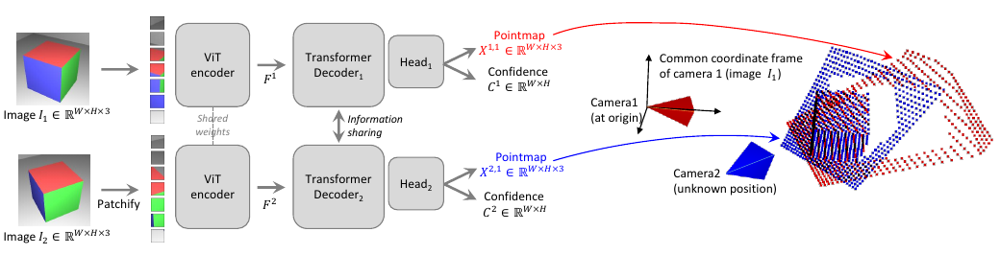

*两幅图像分别编码，解码器通过视图间交叉注意力交换信息，再预测点图和置信度。两张点图都落在第一幅图像的坐标系中，点图因此既是几何输出，也是恢复相机关系的入口。*

- **坐标系：** 一对图像的两张点图都表达在第一台相机坐标系中；多视图结果还要做全局对齐。
- **注意力：** 图像对之间双向交互；解码器在视图内自注意力，并读取另一视图的 Token。
- **记忆：** 记住当前图像对，不维护跨时间的持久状态。
- **回环：** 无在线地点检索或回环机制；多视图对齐是离线几何组织。
- **更新：** 后续全局对齐可调整视图和点图的几何关系；网络隐藏 Token 不作为可持续维护的 SLAM 状态。

[DUSt3R PDF](pdf/dust3r.pdf) · [论文](https://arxiv.org/abs/2312.14132)

### VGGT：在一轮前向计算中联合预测多视图几何

VGGT 把图像 Token、相机 Token 和稠密几何头放进一个多视图 Transformer。它的架构图概括了这一范式：先融合视图，再从共享表示中预测相机、深度、点图和跟踪特征。多视图上下文增强几何预测，但输入通常作为一个有限集合整体处理。

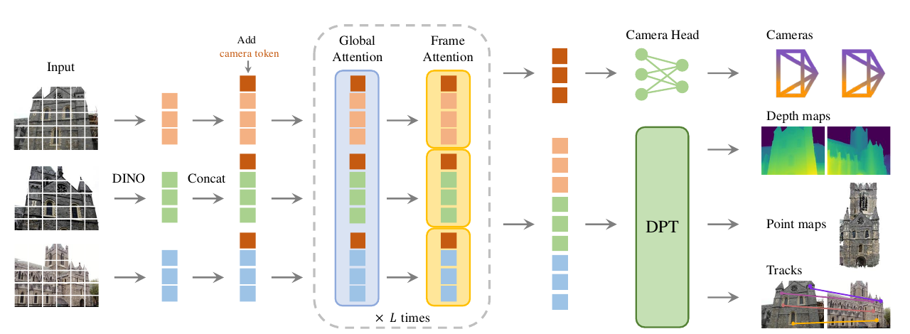

*图像 Token 在帧内与跨视图交替交互，之后由相机头和稠密几何头输出结果。这里的全局注意力发生在输入图像集合内部；网络没有因此获得跨运行持续存在的地图。*

- **坐标系：** 相机位姿和点图以选定的首个输入视图为参考；这个约定进入输出语义。
- **注意力：** 交替使用帧内注意力和全局视图注意力；全局阶段允许输入集合中的视图互相读取。
- **记忆：** 整组输入图像及其 Token 是一次推理上下文，不是随视频延续的记忆。
- **回环：** 模型本身不做地点检索或回环约束；可把输出交给后续几何优化。
- **更新：** 一次前向同时产生相机和几何；后续 BA 可以改输出位姿和几何，但没有定义如何同步更新已混合参考信息的隐藏 Token。

[VGGT PDF](pdf/vggt.pdf) · [论文](https://arxiv.org/abs/2503.11651)

### π³：保留多视图交互，但不把第一张图固定成特殊锚点

π³ 的重点是置换等变：改变输入顺序，不应该因为某一帧被命名为“第一帧”就改变模型的几何推理方式。它为每个视图预测本地坐标点图，再用视图间相对位姿联系它们。

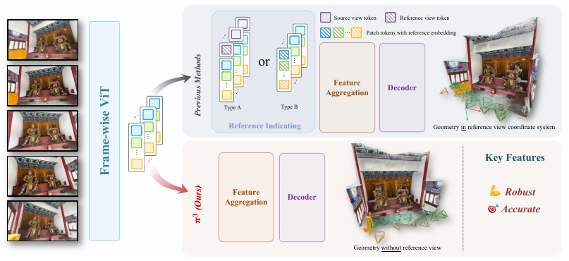

*各视图先形成局部几何特征，再通过对称的多视图交互联系起来。每幅图像保留自己的相机坐标表达，模型不必先选择一张参考图像才能开始预测。*

- **坐标系：** 点图在各自相机坐标系中；相机之间通过相对关系组织，不预先固定某个输入为全局参考。
- **注意力：** 逐视图与全局多视图注意力交替；输入集合内可以双向交换信息，架构对视图排列等变。
- **记忆：** 使用当前多视图集合，不维护在线持久状态。
- **回环：** 无地点检索、重定位或回环后端。
- **更新：** 前馈预测相机和本地点图；不支持对持续运行中的旧 Token 或地图做增量优化。

[π³ PDF](pdf/pi3.pdf) · [论文](https://arxiv.org/abs/2507.13347)

从 DUSt3R 到 VGGT，能力从两视图交互扩展到多视图联合预测；从 VGGT 到 π³，关注点又从“能否看更多图像”转向“参考坐标是否应该被某个输入索引固定”。这些模型可以很强，但视频持续到来后，新的矛盾出现了：未来帧尚不可见、历史上下文越来越大，而旧估计仍可能需要修正。

## 2. 流式推理：因果、窗口与递归状态

视频推理需要明确**信息可见范围和输出延迟**。严格因果模型只用当前和过去；窗口模型可以在一小段范围内双向看，但必须等窗口到齐；有些系统先用数帧初始化坐标锚点，再进入因果阶段。

用语言模型作类比，GPT 式因果掩码和 BERT 式双向编码可以帮助理解“哪些位置能互相读取”。这个类比只解释信息可见性，不代表两者解决相同的问题：几何模型还要处理相机位姿、尺度、坐标变换和地图闭合。

### CUT3R：固定数量的状态 Token 持续读写

CUT3R 把每帧图像与一组持久状态 Token 交互，输出共同坐标系下的相机和点图。可以把它称作“记忆地图”的一种隐式近似：它持续保留场景信息，但 Token 本身不是带显式三维地址、可直接交给后端优化的路标。

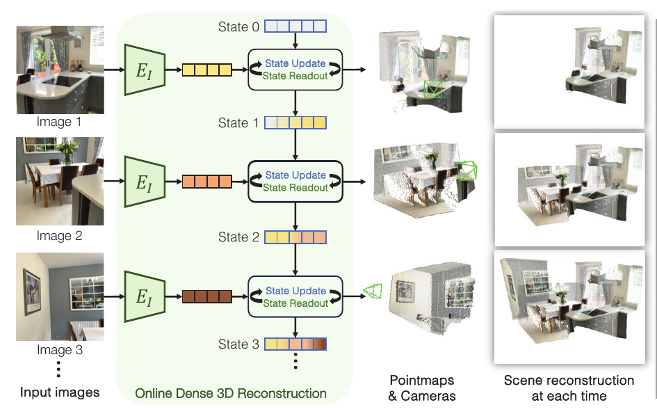

*每张新图像读取已有状态，再把当前证据写回状态；预测头输出相机、点图和场景重建。状态负责跨帧传递上下文，显式三维几何主要在解码后的点图中出现。*

- **坐标系：** 初始化后建立共同场景参考，逐帧相机和点图相对该参考表达。
- **注意力：** 当前图像与持久状态交互；流式阶段只读取已有状态和当前帧，不访问未来帧。
- **记忆：** 固定数量的学习状态 Token，内部状态大小不随帧数线性增长。
- **回环：** 没有独立地点检索、几何验证和位姿图；重访时能否恢复旧信息依赖状态是否保留了相关内容。
- **更新：** 每帧读取并改写状态；若外部优化器改了旧位姿，论文没有给出对隐藏状态作相应坐标变换或重算的机制。

[CUT3R PDF](pdf/cut3r.pdf) · [论文](https://arxiv.org/abs/2501.12387)

### TTT3R：让状态 Token 按对齐程度决定写入步长

TTT3R 直接沿用 CUT3R 的网络主干与递归状态，针对长序列中的状态遗忘修改写入规则。它把持续更新的状态看作测试时的“快速权重”，把训练好的网络参数看作推理时冻结的“慢速权重”。这里的 Test-Time Training 不表示模型在测试视频上反向传播或微调参数；新帧到来时，模型只在前向过程中计算状态更新幅度。

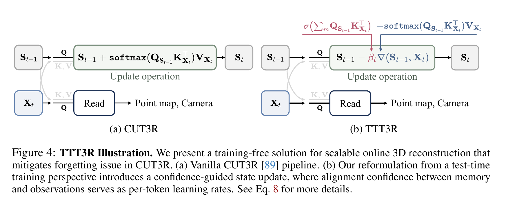

*论文原图 Figure 4：CUT3R 将当前帧的注意力更新直接写入状态；TTT3R 为更新项加入逐 Token 的学习率。下方读出路径仍然从状态和当前帧预测点图与相机。原图保留了论文英文图注。*

关键问题是：状态数量固定，但每个状态 Token 与当前帧的关系并不固定。每来一帧，State Query 都会和这张图像的 Key 计算注意力分数；所以“沿图像 Token 维度求平均”指的是，对某一个状态 Token 与**当前这一帧**所有图像 Token 的分数求平均，不是对多帧求平均。模型把这个汇总分数映射为该状态 Token 的更新率：

\[
\ell_{t,i}=\operatorname{mean}_{p,\,l,\,h}\left(\frac{q_{t-1,i}^{l,h}\cdot k_{t,p}^{l,h}}{\sqrt{d_h}}\right),\qquad
\beta_{t,i}=\sigma(\ell_{t,i})
\]

其中，\(i\) 是状态 Token，\(p\) 是当前帧的图像 Token，\(l\) 和 \(h\) 分别代表解码层与注意力头。论文用归一化的跨注意力 Logit 均值定义对齐置信度；官方实现把各层、各头的 State-to-Image Logit 汇总，再经 Sigmoid 得到每个状态 Token 的 \(\beta\)。这里使用 Softmax **之前**的 Logit：Softmax 之后，每行权重沿图像 Token 维度的均值恒为 \(1/M\)，无法表示不同状态的置信度差异。

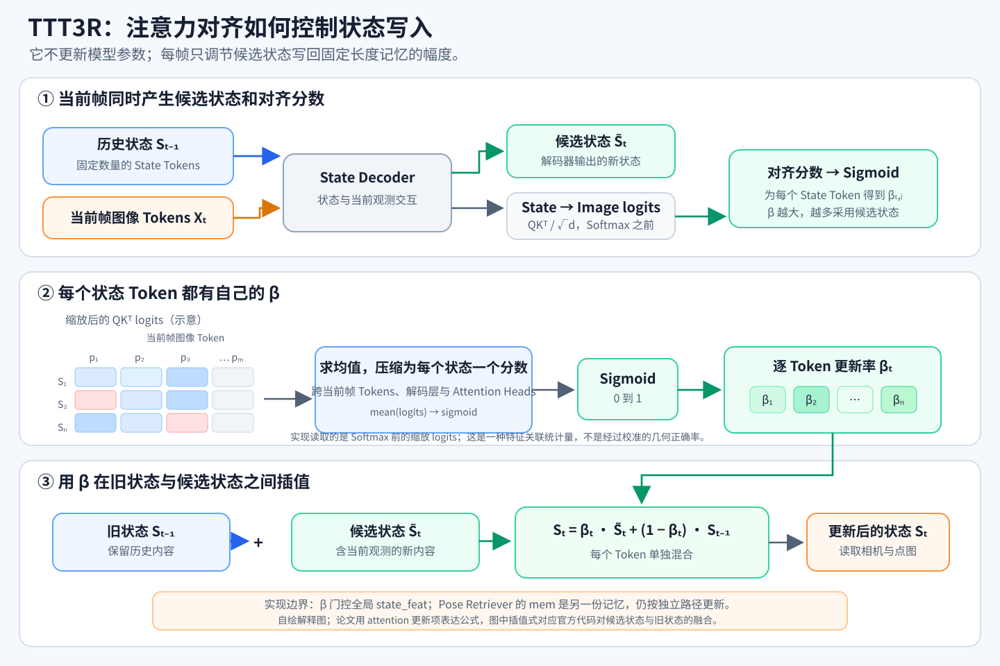

*自绘实现解释图：State Query 与当前帧 Token 的关联分数经过汇总和 Sigmoid，形成逐 Token 的 \(\beta\)；它控制候选状态与旧状态的混合比例。分数来自特征关联，不是重投影误差或经过校准的几何正确率。*

论文公式把更新写成“旧状态加上由注意力得到的更新项”，并用 \(\beta\) 缩放该更新。实现中，解码器先产生候选 `new_state_feat`，再按 \(\beta\) 与旧 `state_feat` 插值：

\[
S_{t,i}=\beta_{t,i}\,\widetilde S_{t,i}+(1-\beta_{t,i})S_{t-1,i}
\]

因此，代码实际门控的是解码器产生的候选状态与旧状态之间的混合比例，而不是单独给一张注意力图乘系数。实现还维护另一份供相机位姿读写的 `pose_retriever.mem`；它沿自己的写入路径更新，没有使用 TTT3R 的 \(\beta\)。这说明该方法修改的是 CUT3R 全局 `state_feat` 的写入强度，并未统一改造所有记忆。相关实现见[官方状态更新代码](https://github.com/Inception3D/TTT3R/blob/main/src/dust3r/model.py#L863-L881)和[注意力 Logit 返回代码](https://github.com/Inception3D/TTT3R/blob/main/src/dust3r/blocks.py#L225-L235)。

论文在补充材料 Table 5 中报告了长序列结果：TUM-D 的 1000 帧相机位姿 ATE 从 CUT3R 的 0.173 降至 TTT3R 的 0.106；KITTI 的 500 帧深度 Abs Rel 从 0.152 降至 0.131。两列来自不同任务与数据集，不能直接互相比较。加入每 100 帧重置状态的变体后，指标进一步降至 0.093 和 0.115：

| 方法 | TUM-D，1000 帧 ATE ↓ | KITTI，500 帧 Abs Rel ↓ |
|---|---:|---:|
| CUT3R | 0.173 | 0.152 |
| CUT3R + State Reset | 0.126 | 0.128 |
| TTT3R | 0.106 | 0.131 |
| TTT3R + State Reset | 0.093 | 0.115 |

*数据摘自论文补充材料 Table 5。State Reset 的周期为 100 帧；论文正文定量实验通常不使用它，超过 1000 帧的可视化示例才采用周期重置。*

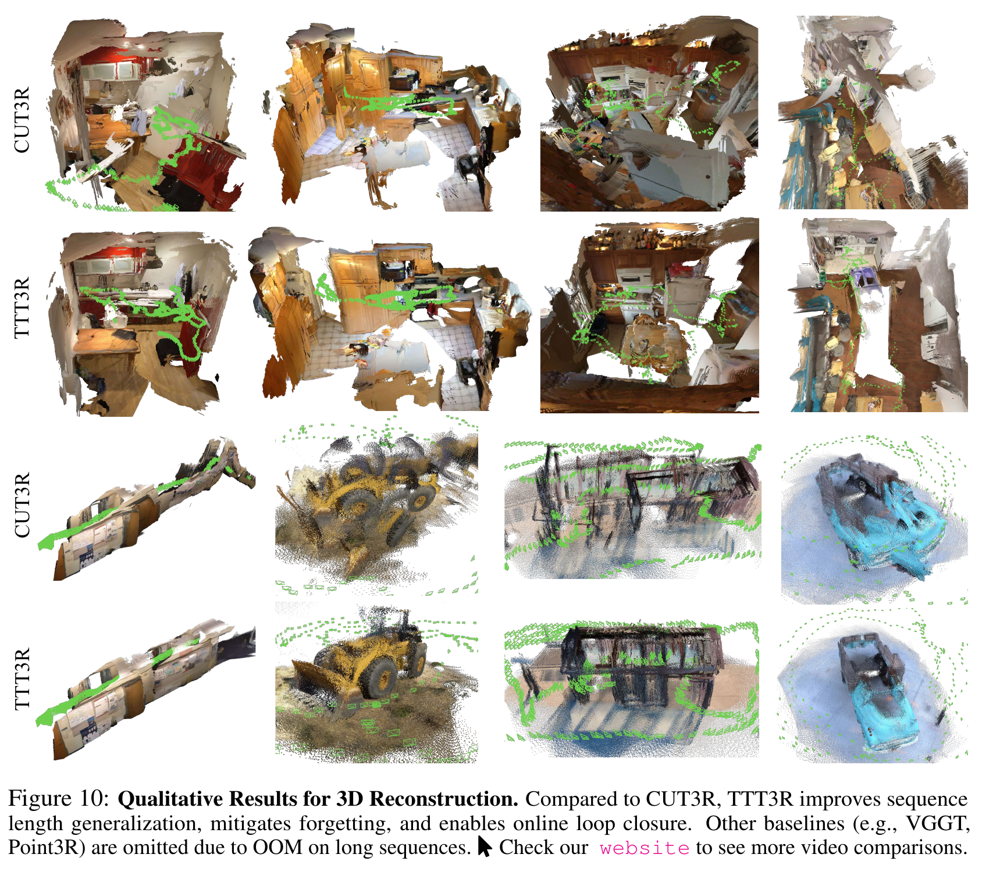

*论文原图 Figure 10：每组上方为 CUT3R、下方为 TTT3R。作者展示了房间、物体等序列中的点云与轨迹差异，认为自适应状态更新减轻了长序列遗忘。长序列上的 VGGT、Point3R 等基线因显存不足未列入该图。*

从 SLAM 的角度看，TTT3R 的贡献集中在**控制隐式记忆怎样吸收新观测**。它支持因果逐帧推理，固定大小状态降低了历史长度增长带来的内存开销；论文报告约 20 FPS 和 6 GB GPU 显存。它没有提供显式地图路标、重访候选检索、几何回环约束或位姿图优化。论文所说的 “online loop closure” 更适合理解为重访时递归状态可能重新利用留存的场景信息，不能直接等同于 SLAM 后端建立回环因子并修正旧位姿。

还有两点值得保留为开放问题。第一，\(\beta\) 来自特征注意力 Logit 的平均值，它是对齐强弱的代理量，不是几何匹配正确概率；State Token 也没有显式三维地址，因此逐 Token 门控不自动意味着按空间位置选择性更新。第二，状态重置结果说明门控缓解了遗忘，却没有消除固定容量状态的长期漂移。超过 1000 帧时，作者每 100 帧重置一次，再用预测的度量相机位姿对齐片段，且不执行额外优化。这是实用的长序列演示策略，也显示 TTT3R 本身仍缺少可持续校正全局几何状态的机制。

- **坐标系：** 沿用 CUT3R 的共同场景参考与几何输出约定。
- **注意力：** 状态与当前帧特征交互；用于计算写入率的是 State-to-Image 的跨注意力，按帧递推，不读取未来帧。
- **记忆：** 固定数量的全局隐式状态 Token；官方代码另有独立的 Pose Retriever 记忆。
- **回环：** 重访时可能从隐状态中取回历史信息；没有显式的地点检索、几何验证与位姿图后端。
- **更新：** 依据跨注意力 Logit 为每个状态 Token 设置写入率；没有展示后端位姿修正后对隐藏状态进行对应变换或重算。

[TTT3R PDF](pdf/ttt3r.pdf) · [论文](https://arxiv.org/abs/2509.26645) · [官方代码](https://github.com/Inception3D/TTT3R)

### TTSA3R：用时空信号控制持久状态写入

TTSA3R 沿用 CUT3R 的逐帧递归网络和固定长度 State，不重新训练骨干，也不增加一次前向推理。它改的是每帧得到候选 State 之后的写回比例：时间模块判断每个 State Token 最近变化多大，空间模块检查它关注的图像 Patch 是否也发生变化，然后将两种信号合成逐 Token 门控。论文的主张是：稳定 Token 少被覆盖，仍在变化且得到图像证据支持的 Token 多吸收当前观测。

先看论文给出的整体架构。每帧经共享 ViT 编码后，与上一时刻的 State 一起进入 Decoder；Decoder 输出候选 State 和当前帧几何预测，TAUM、SCUM 随后为候选 State 计算写入掩码。

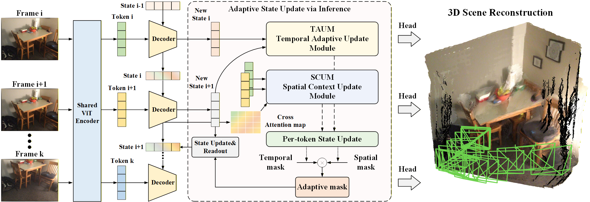

*论文原图 Figure 2：固定 State 在连续帧之间递归传递。候选 State 一方面送入重建 Head，另一方面进入 TAUM 与 SCUM；两个模块生成的掩码共同控制下一时刻实际保存的 State。*

论文还单独画出了 SCUM 的空间上下文模块，展示它怎样结合相邻帧 Patch 特征差异和 State 到图像的 Cross-Attention：

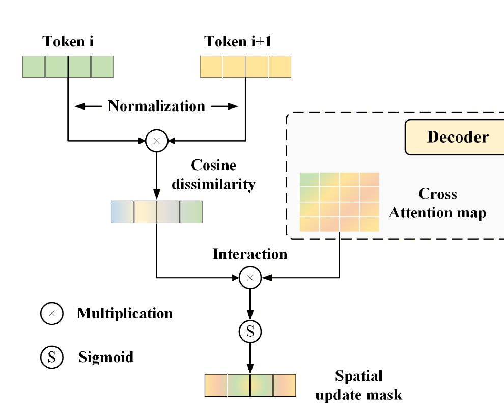

*论文原图 Figure 3：相邻帧同位置图像 Token 的余弦差异，与 State 对图像 Token 的 Cross-Attention 相乘，再汇聚成逐 State Token 的空间掩码。*

下面的自绘图把论文整体架构展开成一次逐帧更新。它特别标出候选状态比较的历史基底、当前帧预测与 State 写回的先后，以及没有经过同一门控的 Pose Retriever 记忆。

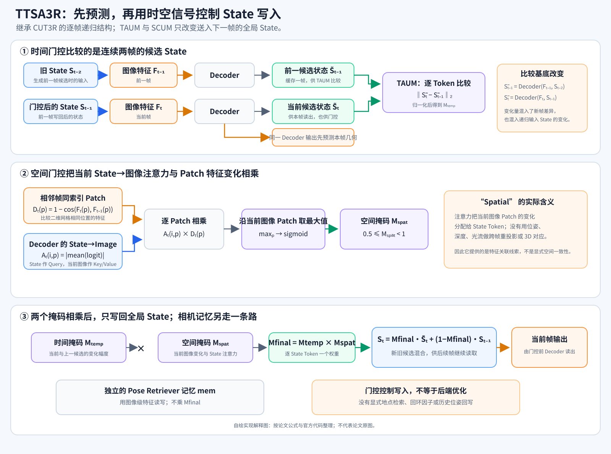

*自绘实现解释图：第一帧直接初始化 State；后续帧分别计算时间变化掩码和空间掩码，再更新全局 State。右上角标明了 TAUM 的候选状态来自不同历史输入；底部区分了独立的 Pose Retriever 记忆。*

#### TAUM：比较相邻两帧的候选状态

设当前帧图像 Token 为 $F_t$，进入 Decoder 的持久状态为 $S_{t-1}$，Decoder 输出候选状态 $\widetilde S_t$。TAUM 对每个 Token 比较当前候选与上一帧缓存的候选：

\[
\Delta_t^{(i)}=\left\|\widetilde S_t^{(i)}-\widetilde S_{t-1}^{(i)}\right\|_2,\qquad
\widehat\Delta_t^{(i)}=\frac{\Delta_t^{(i)}}{\frac{1}{N}\sum_{j=1}^{N}\Delta_t^{(j)}},\qquad
M_{\mathrm{temp}}^{(i)}=\sigma\!\left(\widehat\Delta_t^{(i)}-\tau\right).
\]

这里 $i$ 是 State Token 索引，范数沿特征通道计算，再除以所有 State Token 的平均变化量；论文统一取 $\tau=1.5$。第一帧没有上一候选，直接令 $S_1=\widetilde S_1$。从第二帧开始，变化超过当前场景平均值 1.5 倍的 Token 得到更大的时间门控，变化较小的 Token 则更倾向保留旧状态。

需要留意，比较对象不是“当前候选”和“当前真正保存的 State”，而是连续两帧各自生成的候选。由递归过程可知：

\[
\widetilde S_{t-1}=\mathrm{Decoder}(F_{t-1},S_{t-2}),\qquad
\widetilde S_t=\mathrm{Decoder}(F_t,S_{t-1}).
\]

其中 $S_{t-1}$ 已经由前一帧门控更新。因此两候选的差异同时包含图像从 $F_{t-1}$ 到 $F_t$ 的变化，以及 Decoder 输入状态从 $S_{t-2}$ 到 $S_{t-1}$ 的变化。TAUM 衡量的是递归系统连续两步输出的总体变化，不是把历史 State 固定后单独测量当前观测带来的新信息。门控的更新过程本身没有额外延迟；混合的是用于决定写入强度的比较信号。

#### SCUM：用注意力把图像变化分配给 State Token

SCUM 先比较相邻帧在**相同 Patch 网格索引**上的图像特征：

\[
D_t(p)=1-\operatorname{CosSim}\big(F_t(p),F_{t-1}(p)\big).
\]

之后，它读取 Decoder 中 State Token 对当前图像 Token 的 Cross-Attention。论文把各层和各注意力头的预 Softmax Logit 汇总为关联强度：

\[
A_t(i,p)=\left|\frac{1}{LH}\sum_{l=1}^{L}\sum_{h=1}^{H}\operatorname{Logit}_{t}^{(l,h)}(i,p)\right|.
\]

其中 $i$ 是 State Token，$p$ 是当前图像 Patch。SCUM 再将关联强度与 Patch 差异相乘，沿图像 Patch 维度取最大值并经 Sigmoid：

\[
M_{\mathrm{spat}}^{(i)}=\sigma\!\left(\max_p A_t(i,p)D_t(p)\right),\qquad
M_{\mathrm{final}}^{(i)}=M_{\mathrm{temp}}^{(i)}M_{\mathrm{spat}}^{(i)}.
\]

直观上，只有某 State Token 强烈关联到一个发生特征变化的图像 Patch 时，空间信号才会偏向放大写入。代码也逐帧保存最近一次图像特征和候选 State，为下一次比较使用；官方实现见[状态更新代码](https://github.com/anonus2357/ttsa3r/blob/main/src/dust3r/model.py#L824-L888)。

不过这里的“空间”是特征注意力的空间索引。$F_t(p)$ 与 $F_{t-1}(p)$ 是两张图上同一个 Patch 网格位置的特征，不保证对应同一个三维表面。该方法没有用相机位姿、深度、光流或几何重投影去建立跨帧对应。因此相机移动、视角变化、遮挡和物体运动都可能使 $D_t(p)$ 增大。论文公式还给出 $M_{\mathrm{spat}}\in[0.5,1)$：SCUM 自身只能把时间门控最多减半，不能单独把某 Token 的写入压到接近零；主要的门控幅度仍由 TAUM 决定。

最终状态按逐 Token 插值更新：

\[
S_t=M_{\mathrm{final}}\odot\widetilde S_t+(1-M_{\mathrm{final}})\odot S_{t-1}.
\]

还有一个执行顺序细节：当前帧的深度、相机和点图输出由 Decoder 特征先送入 Head 生成，之后才计算门控并写回 $S_t$。因此这个门控主要影响后续帧读取的状态，不会用门控后的 State 重算当前帧输出。代码还维护一份独立的 `pose_retriever.mem`；它沿自己的读写路径更新，不使用 $M_{\mathrm{final}}$。所以论文提出的是全局 `state_feat` 的自适应写入，并未统一门控模型中的所有记忆。

#### 长序列结果与方法边界

论文报告，NRGBD 序列从 50 帧延长到 250 帧时，TTSA3R 的重建误差升至原来的 1.33 倍，CUT3R 升至 3.8 倍。模块消融也显示 TAUM 是主要收益来源：Bonn 深度 Abs Rel 从 CUT3R 的 0.078 降到 0.066，TUM-Dynamics 位姿 ATE 从 0.046 降到 0.028；单独加入 SCUM 分别为 0.074 和 0.040，两个模块一起为 0.064 和 0.026。作者在一张 NVIDIA A6000 上报告约 18 FPS、6 GB 显存。长序列可视化对比了 CUT3R、TTT3R 与 TTSA3R：

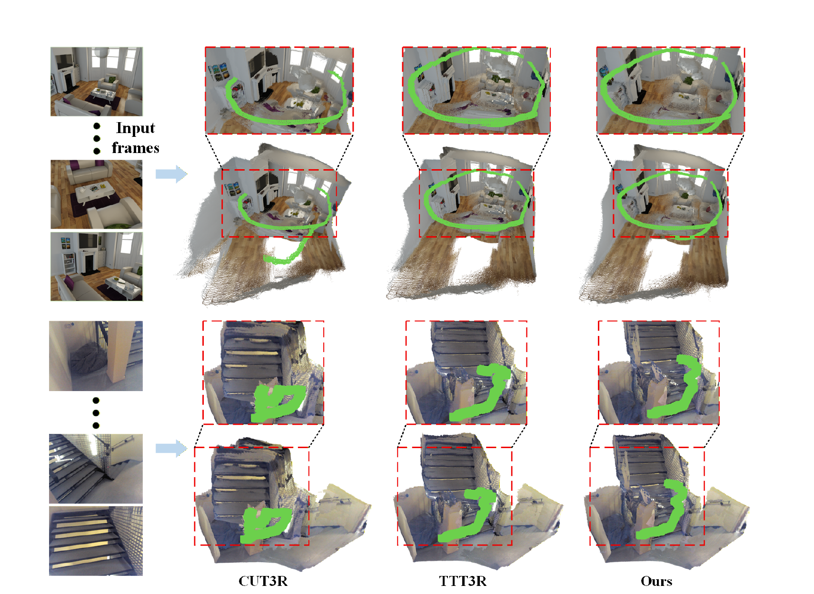

*论文原图 Figure 1：作者展示 NRGBD 长序列重建中的场景几何与相机轨迹。CUT3R 出现更明显的漂移和畸变，TTT3R 有所改善，TTSA3R 的结果更连贯；这是论文报告的定性对比，不代表显式回环或全局优化。*

这组结果支持“自适应写入能减轻固定 State 的遗忘”，但不能把它扩大解释成完整 SLAM 后端。论文自身也指出，严重遮挡、低质量估计和视觉重叠不足时，时间与对应信号都会变得不可靠。除此之外还有几处值得讨论：

> **变化大不等于观测可靠。** TAUM 将候选 State 的变化幅度作为更积极写入的依据；运动模糊、遮挡或错误估计也可能造成大变化。这个量描述的是变化，不是正确率或不确定性。连续候选的输入 State 又不相同，因此变化统计还混合了递归基底的改变。
>
> **SCUM 没有验证真实三维对应。** 它用注意力把二维 Patch 特征差异映射到 State Token，但没有检查两帧观测是否由同一世界点产生。相机运动下，同索引 Patch 往往看到不同区域；若要将它解释为几何可靠性，还需要位姿、深度或可验证的数据关联。
>
> **写入控制不等于历史修正或回环。** State 门控决定新信息进入隐式记忆的比例，不能在后来重访时显式找回地点、建立回环约束并修正旧位姿。Pose Retriever 虽然是一份额外记忆，但论文和代码没有把它定义成经几何验证的地点检索与 Pose Graph；外部位姿优化后，也没有说明如何变换或重算已有 State。

- **坐标系：** 沿用 CUT3R 的共同场景参考与逐帧几何输出；TTSA3R 不另建显式路标坐标。
- **注意力：** 当前帧与历史 State 递归交互；门控读取 State-to-Image Cross-Attention，不访问未来帧。
- **记忆：** 固定长度的全局 `state_feat`，另有独立的 `pose_retriever.mem`。
- **回环：** 没有地点识别、几何验证或 Pose Graph；Pose Retriever 的存在不等于完成 SLAM 回环。
- **更新：** 以相邻候选 State 变化和当前图像 Patch 证据融合写入率；它控制未来状态，不回写外部优化后的历史轨迹。

[TTSA3R PDF（arXiv v4）](pdf/ttsa3r.pdf) · [论文 v4](https://arxiv.org/abs/2601.22615v4) · [官方代码](https://github.com/anonus2357/ttsa3r)

### StreamVGGT：把跨帧注意力改成因果读取

StreamVGGT 保留 VGGT 的几何骨干，把跨帧注意力改为因果形式，并缓存已处理帧的 Key、Value。它适合逐帧输入，但历史 KV 会不断累积，增量推理本身不等于固定内存。

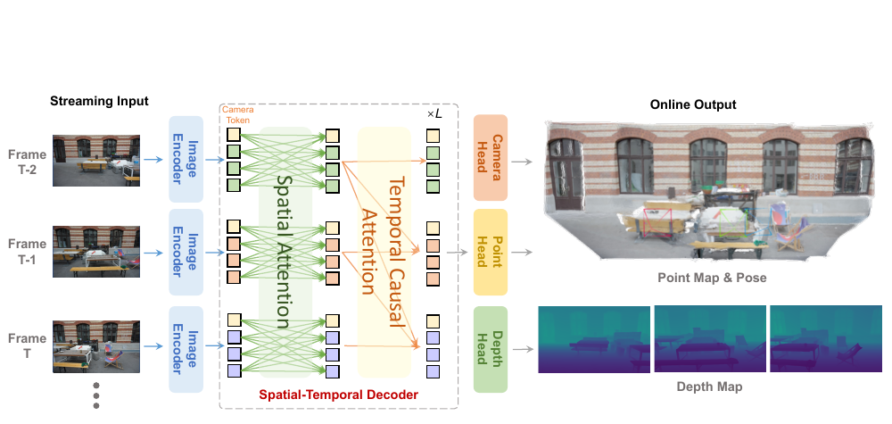

*帧内空间注意力让同一张图像的 Patch Token 互相交换信息；时间注意力再让当前帧读取当前和历史帧。图里的“空间注意力”是帧内图像 Token 注意力，不是对三维空间地图做注意力。因果时间注意力阻断未来帧，但不会自动修正过去输出。*

- **坐标系：** 延续 VGGT 的首帧参考约定；相机和点图通过该锚点组织。
- **注意力：** 帧内空间注意力加跨帧因果时间注意力；当前帧只能读当前与过去。
- **记忆：** 每层缓存所有历史帧的 KV；缓存和历史读取成本随视频增长。
- **回环：** 无显式重访检测、回环验证或全局位姿图。
- **更新：** 新帧追加 KV 并生成当前预测；已经输出的位姿不会因后续观测自动回改，隐藏 KV 也没有图优化回写接口。

[StreamVGGT PDF](pdf/streamvggt.pdf) · [论文](https://arxiv.org/abs/2507.11539)

### WinT3R：用重叠窗口保留局部双向交流

WinT3R 用重叠滑窗让相邻图像直接交互；窗口填满后才输出，因此“流式”不代表每张图到达时都立即定稿。先看论文给出的整体架构：

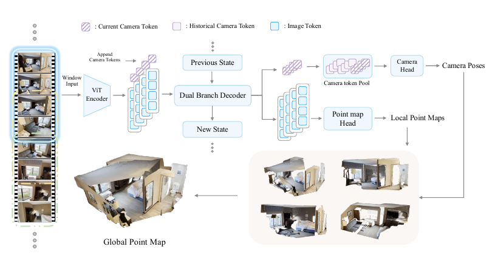

*论文原图：当前窗口的图像特征经解码后预测局部点图；当前相机 Token 与历史 Token Pool 一起进入 Camera Head，预测相机位姿。*

读图时先把两条跨窗口通路分开。**State 通路**在 Dual-Branch Decoder 中与当前图像特征双向交换信息：State 读取当前窗口内容，图像特征也读取历史 State；输出的新 State 是固定数量的 Token，会传给下一窗口。**相机通路**则把解码后的当前相机 Token 与历史 Camera Token Pool 一起送入 Camera Head；池中 Token 不直接进入 State 的更新支路。前者递归传递场景上下文，后者积累相机上下文。

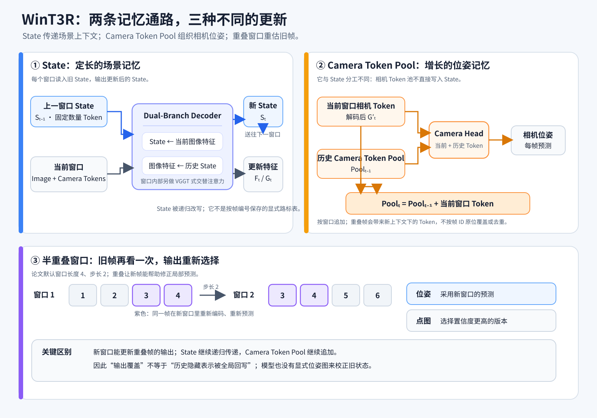

*自绘讲解图把官方架构压缩成三件事：两条记忆通路、半重叠窗口，以及重叠区域的输出选择。*

论文默认窗口长度为 4、步长为 2，因此相邻窗口共享一半帧。重叠帧在新窗口中再次编码，结合新帧重新预测；最终位姿采用新窗口结果，点图选择置信度较高的版本。旧 State 可能已经吸收过这些帧的信息，重叠帧又会参与下一次状态更新；论文没有按帧 ID 显式去重。Camera Token Pool 也会按窗口追加新 Token，同一帧在不同上下文下的 Token 可以同时留在池中。模型通过重叠训练学习处理重复输入，但这不等于显式地图按观测身份融合，也不等于位姿图把优化结果回写到历史隐藏表示。

WinT3R 的坐标设计容易和“参考帧”概念混淆。每帧都会附加一个可学习的 Camera Token，用于相机参数预测；它代表当前帧，不是被指定为原点的特殊参考相机。Pointmap Head 直接预测该帧相机坐标系下的局部 XYZ，因此每帧点图可以先独立表达，不必先统一到某一张参考图像的坐标系。

Camera Head 则把当前窗口的相机 Token 和历史 Camera Token Pool 一起用于预测相机位姿。训练时，WinT3R 借鉴 π³ 的相对位姿监督：先从预测的逐帧位姿构造所有帧对之间的相对旋转和平移，再与真实相对位姿比较，而不是把每帧绝对位姿钉在人工指定的首帧坐标系中。论文按其位姿约定计算相对四元数和相对平移：

$$q_{ij}=q_j^*\otimes q_i,\qquad t_{ij}=\operatorname{rotate}(t_i-t_j,q_j^*)$$

其中 $q_j^*$ 是 $q_j$ 的共轭，相对平移也旋转到对应的相机坐标表达中。相机损失对所有 $i\ne j$ 的预测帧对参数与真实帧对参数计算平均 $\ell_1$ 误差。共同改变整组位姿的全局坐标规范，不会改变这些帧对关系；因此监督约束的是相机之间的几何关系，世界坐标的原点和朝向并未由首帧固定。这里借鉴的是相对位姿监督的思路，WinT3R 仍保留逐帧 Camera Token、时间顺序、滑动窗口和历史 Token Pool，并没有照搬 π³ 的无参考多视图架构。

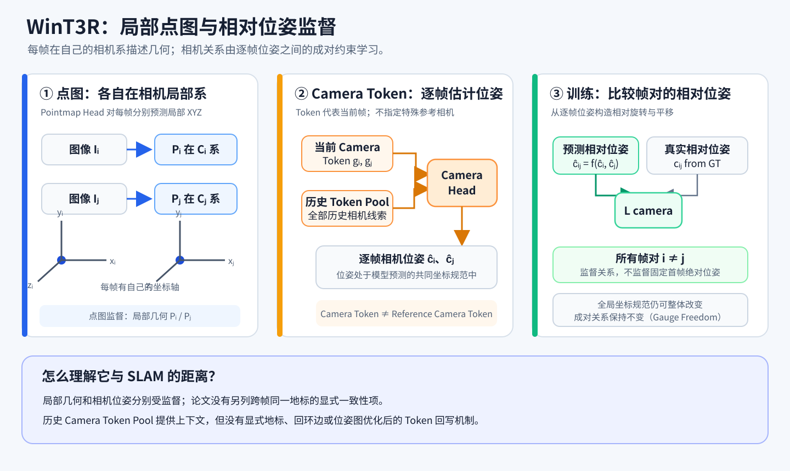

*自绘示意：每帧点图留在各自相机坐标系；相机 Token 预测一组位姿，训练损失比较帧对之间的相对关系。模型没有指定一帧作为固定参考相机。*

论文将训练目标写为相机位姿损失与点图损失之和。前者比较两两相对位姿，后者监督各帧的局部点图；论文没有另外列出“同一静态三维点在多帧点图中必须重合”的显式跨帧一致性项。因此，相机位姿与局部几何被放在同一套学习系统中，但二者之间的逐点一致性没有由一个独立的几何约束直接保证。这也是它与传统 SLAM 后端的一个分界：Camera Token Pool 提供跨时间的相机上下文，却不是含有显式地标、数据关联和可优化位姿边的 Pose Graph；论文也没有定义在外部优化旧位姿后，如何相应变换或重算历史 Token 与 State。

- **坐标系：** 每帧点图是相机局部 XYZ；每帧 Camera Token 预测位姿，两两相对位姿监督不固定特殊参考帧。
- **注意力：** 窗口内图像 Token 双向交互；窗口按时间向前推进，后续窗口可读取历史状态。
- **记忆：** 重叠图像窗口、场景状态，以及随帧增长的相机 Token 池。
- **回环：** 无独立地点回环或全局图优化。
- **更新：** 后续窗口会重新预测重叠帧并替换/择优融合输出；没有位姿图后端，也没有旧位姿修正后重写隐藏状态的机制。

[WinT3R PDF](pdf/wint3r.pdf) · [论文](https://arxiv.org/abs/2509.05296)

### LingBot-Map：锚、局部窗口和轨迹记忆分工

先说明版本范围。LingBot-Map 于 2026 年 4 月 15 日首次提交 arXiv，HorizonStream 首次提交于 2026 年 5 月 22 日；本节涉及的六 Token 轨迹记忆、Direct Output/VO 两种推理模式和跨窗口 Sim(3) 拼接，则依据 2026 年 9 月 8 日修订的 **arXiv v3 扩展技术报告**（[提交记录](https://arxiv.org/abs/2604.14141)；[HorizonStream 提交记录](https://arxiv.org/abs/2605.23889)）。ECCV 2026 正式会议论文题为 *Geometric Context Transformer for Streaming 3D Reconstruction*，将模型称为 GCT；它介绍了同一套几何上下文注意力，但其正文的推理系统部分着重于 Paged KV Cache 与关键帧保留，没有展开 Direct/VO 双模式和窗口重置流程。下文涉及这些细节时均按 arXiv v3 归属。

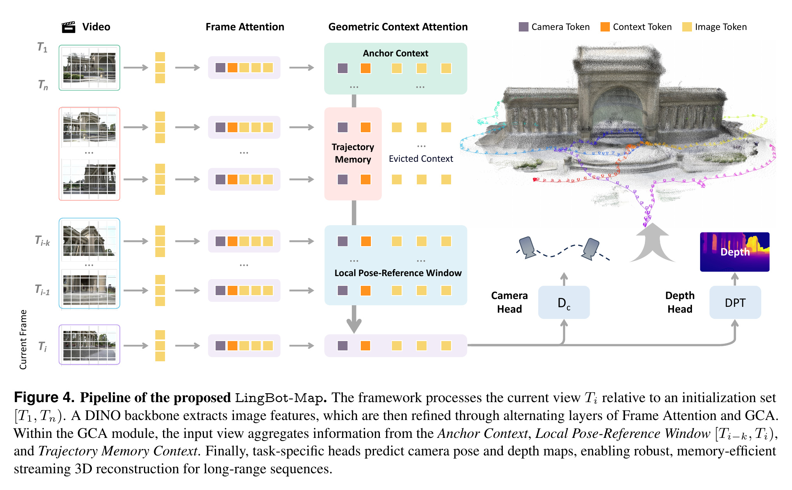

*arXiv v3 原论文 Figure 4 与完整英文图注。DINO 特征经帧内注意力与 GCA 交替处理；当前帧的 GCA 从锚上下文、局部位姿参考窗口和轨迹记忆读取信息，最后由相机头和深度头输出结果。*

#### 三类上下文，以及每帧留下的六个 Token

GCA 把历史分成三种用途不同的上下文。最初的 $n$ 张锚帧彼此做完整注意力，之后图像 Token 和锚 Token 都作为固定上下文保留。锚帧提供后续预测共用的坐标参照和尺度；这里的“锚上下文”是整组初始化帧携带的信息，不是单独一个 Token 直接执行坐标变换。

最近的 $k$ 帧保留完整图像 Token，为当前帧提供稠密的局部几何线索。更早、已经离开锚集合和活动窗口的帧，则丢弃大量 Patch Token，只留下六个上下文 Token：一个 Camera Token、一个 Anchor Token 和四个 Register Token。Camera Head 读取 Camera Token 预测相机位姿；Anchor Token 是参与注意力的学习标记；Register Token 作为共享的工作 Token 参与注意力，但预测头不直接解码它们。

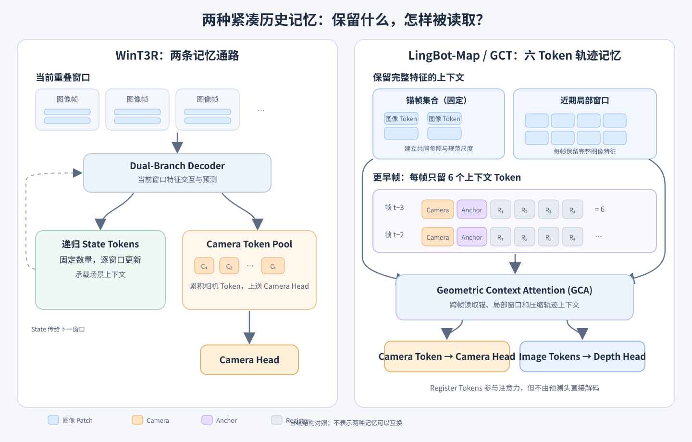

*自绘对照图。WinT3R 把递归 State 与供相机头使用的 Camera Token Pool 分成两条记忆通路；LingBot-Map/GCT 则为每个离开局部窗口的历史帧保留 Camera、Anchor、Register 共六个上下文 Token，让它们继续作为 GCA 的跨帧上下文。这里比较的是信息组织方式，不表示两种设计等价或存在直接继承关系。*

这六 Token 使历史上下文比保留每帧全部 Patch 特征紧凑得多，但总记忆并非固定大小。按报告中的复杂度写法，锚帧与局部窗口的 Patch 上下文在 $n,k$ 固定时有界，轨迹记忆仍按每帧六个 Token 增长，即总量近似为 $(n+k)M+6T$。因此它把每个新加入历史的表示从约 $M+6$ 个 Token 降到 6 个；报告用 $M\approx500$ 举例，称每帧新增的历史 Token 约减少 70 倍。这里的“近似恒定”应理解为每个新历史帧只增加固定数量的 Token，不代表整段序列总内存严格 $O(1)$。按公式推算，如果新帧仍需读取全部轨迹记忆，单步注意力计算量也可能随 $T$ 增长；论文没有描述把历史读取限制在固定预算内的额外机制。

和 WinT3R 的对比也能帮助定位区别。WinT3R 的 State Token 递归传递场景上下文，Camera Token Pool 则供相机头使用；LingBot-Map 的六 Token 是按历史帧保留的压缩上下文，并整体参与 GCA 的跨帧信息读取。两者都在避免长期保留所有历史图像 Token，但记忆分工和读出路径不同。

#### Direct 与 VO：连续状态和分段坐标的取舍

扩展报告给出两种推理模式。Direct 模式把锚、局部窗口和轨迹记忆连续累积，不重置内部状态，每帧直接输出相对初始化坐标规范的绝对相机位姿。报告称模型训练序列最长为 320 帧；启用关键帧选择后，Direct 在约 3,000 帧范围内经验上保持稳定，之后质量逐渐下降。这是该报告的经验结果，不是对任意场景和序列的理论保证。

更长序列可以切换到 VO 模式：视频被切成带重叠的局部窗口；每个窗口先联合处理一组起始帧以建立该窗局部坐标和尺度，随后因果处理剩余帧。窗口结束时模型状态重置，再用相邻窗口重叠部分估计 Sim(3) 变换，将各段轨迹接到一个全局轨迹中。这样工作状态可以有界，但拼接误差会在每个窗口边界增加并随窗口数累积；VO 模式得到的是由外部对齐串接的轨迹，不是一个始终延续、可被全局优化回写的单一隐藏状态。

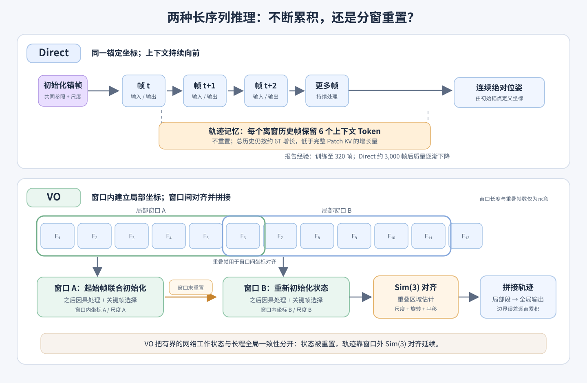

*自绘示意：Direct 保持一套锚定坐标与连续上下文，避免窗间拼接误差，但历史轨迹记忆随帧数以六 Token/帧增长；VO 将长序列拆成局部坐标窗口，重置状态并用重叠区 Sim(3) 对齐，控制单次运行状态规模，同时引入逐窗累积的对齐误差。窗口长度和重叠帧数仅作示意。*

关键帧规则也随论文版本变化：arXiv v1 描述按预测位姿与深度计算相对最近关键帧的光流，以阈值自适应保留帧；arXiv v3 改为每隔 $m$ 帧保留一个关键帧的固定步长策略。阅读实现或复现实验时需要对应具体版本，不能把 v1 的自适应规则与 v3 的实验设定混用。

#### 按五个问题看 LingBot-Map

- **坐标系：** Direct 用初始化锚帧集合建立共同参照和规范尺度，输出绝对相机位姿；VO 的每个重叠窗口重新建立局部坐标，再由 Sim(3) 对齐到拼接后的轨迹。
- **注意力：** Frame Attention 是单帧内部的图像 Token 交互；GCA 才负责跨帧几何上下文。初始化锚帧组双向交互，之后的新帧因果读取锚上下文、近期完整窗口和较早帧的六 Token 记忆。
- **记忆：** 锚帧与近期窗口保留完整 Token，离窗历史每帧保留六个上下文 Token。Direct 的总历史记忆仍随序列增长；VO 通过窗口末重置使工作状态有界。
- **回环：** 轨迹记忆提供长程线索，可能帮助模型维持一致性，但不等于重访地点检索、几何验证和回环边。扩展报告把显式回环检测与类似 BA 的精化列作未来方向。
- **更新：** 新帧会经 GCA 读取并扩展分层上下文。报告没有描述对历史位姿做后端优化后，再回放或几何变换历史隐藏 Token 的更新接口；VO 的 Sim(3) 是窗口输出之间的轨迹拼接。

> **评价：** 这套设计把“保留全部历史特征”改成按时间角色分配上下文：锚帧负责固定参照，局部窗口保留精细线索，压缩轨迹 Token 提供远程历史。它降低了长序列的 KV 增长速度，也避免把所有历史 Patch 都送入注意力。
>
> 但“紧凑轨迹记忆”仍是学习得到的 Token 序列，不含显式地标、可检查的数据关联或可直接优化的位姿图；而且 Direct 模式的记忆总量仍线性增长。VO 模式通过重置把状态规模限制住，却把跨窗一致性问题转移给 Sim(3) 拼接。论文没有描述一条能在回环或后端位姿修正后同步改写旧 Token 的路径，扩展报告也把显式回环和 BA 式精化列为后续方向。因此它是有结构的前馈几何上下文管理，不等同于具有完整后端校正机制的 SLAM 地图。

[LingBot-Map arXiv v3 PDF](pdf/lingbot-map.pdf) · [arXiv v3 扩展报告](https://arxiv.org/abs/2604.14141v3) · [GCT ECCV 2026 正式会议论文 PDF](pdf/gct-eccv2026.pdf) · [在线版](https://media.eventhosts.cc/Conferences/ECCV2026/pdfs/1662.pdf) · [官方代码](https://github.com/robbyant/lingbot-map)

### LongStream：把长程外推改成关键帧间的局部运动

LongStream 面对的核心问题，是模型一直以首帧为参照时，时间越长，位姿外推跨度越大，KV 历史也越容易失效。它把每帧位姿改为相对最近关键帧预测，再把局部变换逐段组合成整条轨迹；另用独立尺度头估计度量尺度，并用 Cache-Consistent Training（CCT）和周期性 KV 刷新控制历史上下文。这里真正改变的是网络如何预测局部几何与管理计算缓存，不是加入一个可回环优化的显式地图后端。

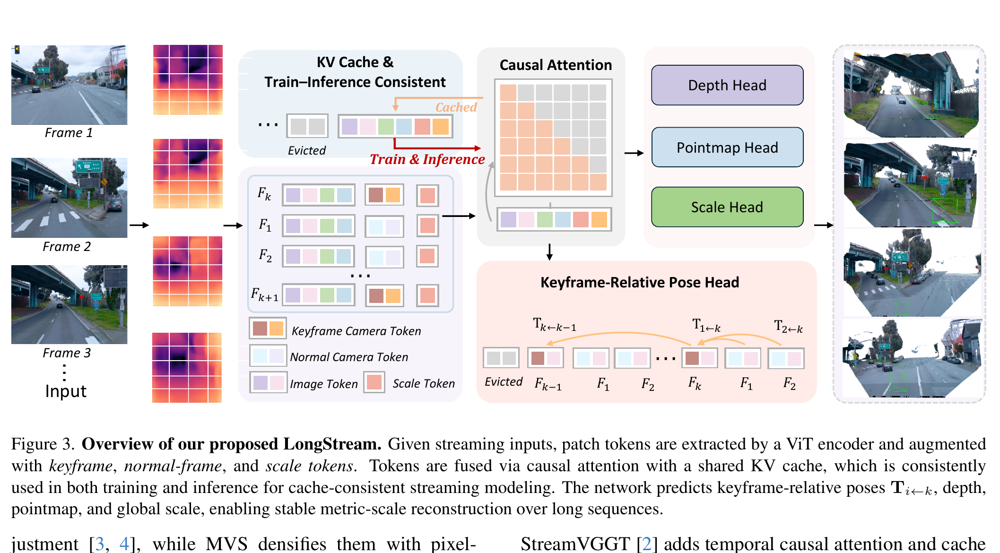

*原论文 Figure 3（arXiv v2）。图中从左到右是图像 Patch 与关键帧/普通帧 Token、因果 Transformer 与共享 KV 缓存，以及深度、点图、尺度和关键帧相对位姿预测头。论文图注也说明训练和推理共享缓存策略。*

论文把相机位姿表示为 world-to-camera（W2C）变换。对当前帧 $i$ 和它之前的参考关键帧 $k$，网络预测：

$$T_{i\leftarrow k}=T_iT_k^{-1}$$

这表示把关键帧 $k$ 的相机坐标变到当前相机 $i$ 的坐标。它不依赖人为指定的世界原点：若所有绝对位姿共同换一个世界坐标规范，这个相对变换不变。推理时，代码再按

$$T_i=T_{i\leftarrow k}T_k$$

把局部结果接回 W2C 轨迹。因此，“不再以首帧直接监督每个长跨度位姿”不等于“系统没有全局位姿”；初始坐标规范仍会沿着关键帧相对变换链传递。这里的相对位姿建模本身是成熟的几何做法，LongStream 的贡献重点是把它和因果 Transformer、缓存训练及尺度分支结合起来，并验证整套组合对长序列的影响。[论文 v2](https://arxiv.org/abs/2602.13172v2) · [位姿组合实现](https://github.com/3DAgentWorld/LongStream/blob/main/longstream/utils/camera.py)

#### 关键帧位姿与尺度分开学习

论文的主干沿用 VGGT 式视觉 Transformer 思路：DINOv2 提取 Patch 特征，加上 Camera、Register 与 Scale Token，再交替做帧内和跨帧的因果注意力。相对位姿头读取当前帧与参考关键帧的特征，预测相对旋转、平移和焦距偏移；深度头与点图头输出逐帧几何。Scale Token 则单独预测全局尺度，几何分支按尺度不变的方式监督，度量尺度监督只用于有标定尺度的数据。它缓解的是尺度与形状学习互相牵扯的问题，不会因此自动消除位姿漂移或回改已经输出的历史地图。

注意论文架构与公开默认配置并不完全相同。论文描述了关键帧/普通帧的专用 Token 和 Reference-aware Attention；当前公开默认配置明确设置 `use_role_embedding=false`、`disable_keyframe_distinction=true`、`use_segment_mask=false`、`use_kf_role_embed=false`。也就是说，关键帧的专用角色嵌入与分段注意力区分没有全部启用；相对位姿头仍然接收关键帧索引并预测相对运动。不能把论文图中的所有角色区分都当作默认推理时必定启用。[公开默认配置](https://github.com/3DAgentWorld/LongStream/blob/main/configs/longstream_infer.yaml)

#### CCT 解决训练与推理看到的历史不一致

只在完整序列上训练、推理时却不断截断 KV 缓存，可能让模型过度依赖序列开头的注意力汇聚点（attention sink）。序列滑过这个位置后，注意力分布可能改变，导致短期崩溃或误差积累。CCT 在训练时把 KV 从一个 chunk 传给下一个 chunk，并按推理的窗口大小裁剪；这样训练和推理面对相似的历史可见范围。它让模型更适应“历史会被截断”的工作方式，但并没有把隐藏特征转换到一个坐标不变的显式地图里。需要说明的是，公开仓库当前尚未发布训练脚本，README 标注训练代码仍待批准；因此我们能按论文算法与图理解 CCT，但无法从公开实现独立核验跨 chunk 的梯度传播等训练细节。[官方 README](https://github.com/3DAgentWorld/LongStream/blob/main/README.md)

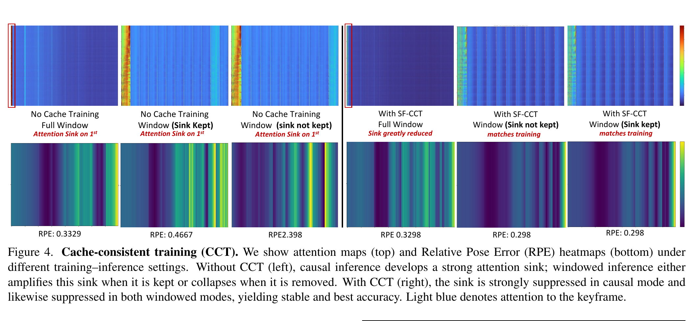

*原论文 Figure 4：不使用 CCT 时，因果推理的注意力容易集中到序列开头；使用 CCT 后，这种 attention sink 被压低，窗口推理也更接近训练模式。图中结果支持作者关于训练—推理可见范围一致性的论点，但不能单独说明历史几何会被重新优化。*

#### 关键帧切换，不等于 KV 缓存刷新

最容易混淆的是“当前相对参考关键帧变了”和“历史 KV 被清空”并非同一件事。按关键帧间隔，后续帧的相对位姿参考会从 K0 变成 K8、再变成 K16；但 KV 会跨过这些参考切换继续复用，只有到达更晚的周期刷新边界，缓存才会被丢弃。换句话说，模型不是每换一个 reference 就重建一次历史特征。

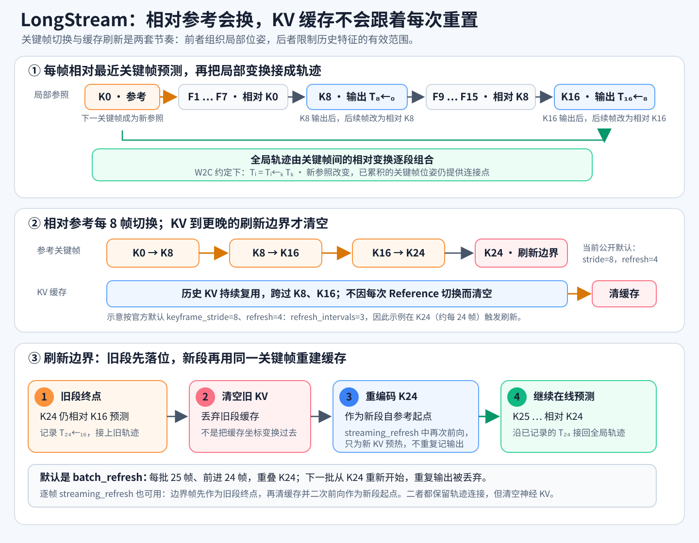

*自绘解释图。默认配置的 `keyframe_stride=8`、`refresh=4` 经实现换算后，每三个关键帧间隔刷新一次：例如 K0、K8、K16 之后，到 K24 才刷新。边界关键帧 K24 先作为旧段终点预测并记录相对 K16 的位姿，再清空 KV；在逐帧 `streaming_refresh` 模式中，同一帧随后会以自参考方式再次前向，为新段建立缓存，但不重复记一条输出。新段的位姿仍通过已记录的 K24 全局位姿接回轨迹。[刷新实现](https://github.com/3DAgentWorld/LongStream/blob/main/longstream/streaming/refresh.py)

还要区分两种推理路径。当前公开默认配置是 `batch_refresh`：以 25 帧为一批、每次前进 24 帧，批次间重叠一个关键帧，随后丢掉重复的重叠输出；它不是默认逐帧地运行。仓库也提供 `streaming_refresh`，其中边界帧会在缓存清空后再次前向，专门重建新的 KV 上下文。周期刷新重置的是神经网络缓存，不会把旧缓存做坐标变换，也不等于对历史相机位姿做后端优化。

#### 回环、长序列结果与方法边界

LongStream 的相对变换链可以沿长序列延伸，但论文没有实现显式地点重访检测、回环约束或全局位姿图优化。主文展示轨迹“绕大环回到附近”不等于检测到了回环并修正了旧轨迹；附录 Figure 8 明确显示，无回环校正时再次经过同一地点仍有轻微漂移，并把在线回环线索留作后续方向。

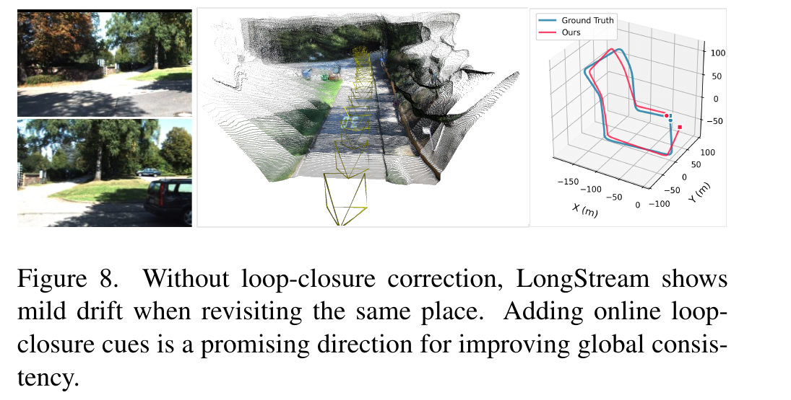

*原论文附录 Figure 8 与完整英文图注：没有回环校正时，重访区域仍有轻微漂移；作者将在线回环线索列为后续改进方向。*

论文在 vKITTI 单序列消融中报告，依次加入相对位姿、尺度头、CCT 和缓存刷新后，ATE 从 8.043 m 降到 2.819、2.645、0.984 和 0.115 m，说明完整组件组合在该设置下有效。长序列测试中，Waymo 135 m 序列扩展到 199 倍时，完整模型 ATE 为 0.723 m；同时去掉滑动窗口与刷新后为 1.699 m。后者同时移除了两个机制，不能单独作为“缓存刷新”的因果消融。更长的 KITTI #03（561 m、801 倍）上，完整模型 ATE 为 3.81 m，表明误差受到抑制但并未消失。[论文实验表 5、表 6](https://arxiv.org/html/2602.13172v2)

还有一处坐标说明值得作者澄清：论文称点图输出 $X_i$ 是 world-coordinate point cloud；但公开推理代码导出 `world_points` 时又用 W2C 外参的逆变换该数组。它可能是变量命名或约定说明的问题，目前不宜仅凭字段名断定点图在网络内部处于哪个坐标系。相比之下，相对位姿预测及其组合路径在论文和代码中更明确。[点图导出代码](https://github.com/3DAgentWorld/LongStream/blob/main/longstream/core/infer.py)

- **坐标系：** 网络预测相对前一关键帧的 SE(3) 变换；推理代码将它们组合为 W2C 轨迹。独立 Scale Token 估计度量尺度，坐标原点仍由整条轨迹的初始规范决定。
- **注意力：** 论文设计是因果 Transformer，交替执行帧内与跨帧注意力。公开默认配置关闭了几种关键帧角色区分选项，因此应区分论文设计和默认实现。
- **记忆：** 有界 KV 窗口负责近期特征；CCT 让训练时缓存可见范围接近推理；周期刷新清空旧 KV。它没有留下可任意重锚、可解释的长期三维地标表。
- **回环：** 没有显式回环检测与位姿图校正；论文附录承认重访时仍有轻微漂移。
- **更新：** 新的相对位姿通过关键帧链追加成轨迹；缓存刷新会重新编码段起点，但不会优化历史位姿、重投影旧点或将后端修正写回隐藏状态。

LongStream 的进步，是把“跨越长视频”的三个压力拆开处理：局部关键帧相对运动降低远程外推难度，独立尺度分支避免尺度监督混入几何形状，CCT 加周期刷新限制缓存退化。它也清楚显示了端到端流式重建与完整 SLAM 的边界：网络可以持续输出并拼接轨迹，但长期几何一致性仍依赖没有实现的回环和全局修正机制。

[LongStream PDF（arXiv v2）](pdf/longstream.pdf) · [论文 v2](https://arxiv.org/abs/2602.13172v2) · [官方代码](https://github.com/3DAgentWorld/LongStream)
### HorizonStream：局部匹配加通道门控的长期状态

HorizonStream 的出发点，是让一个前馈式重建模型持续处理视频，而不把所有历史帧都留在注意力上下文里。它把输入帧编码成图像 Patch Token、Pose Token 和一个专门的度量读出 Token（MRT），再交替使用帧内注意力、近期窗口注意力与跨窗口递归状态。论文主干有 24 层，GLA 插在第 4、11、17、23 层；因此，历史信息不是等到最后才汇总，而是在特征逐层更新时就会参与当前预测。

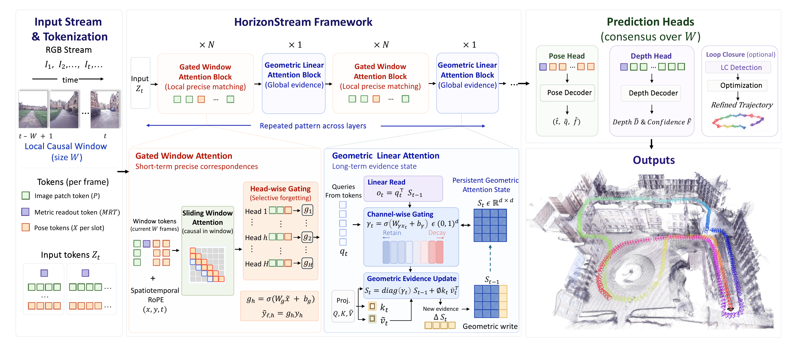

*官方架构图先给出全貌：近期窗口做细粒度交互，GLA 把信息压入有门控的长期状态；尺度读出与可选回环分别处理度量尺度和轨迹闭环。*

#### 先看一帧的信息怎样流过网络

每帧并非只有图像 Patch Token。Pose Token 承载相机运动线索，MRT 则是专门读取度量尺度的 Token。帧内注意力让同一张图中的 Patch Token 互相交流；之后，Gated Window Attention（GWA）把交互范围扩展到一个有界的近期多帧窗口，让当前帧与附近历史帧做时空匹配，并用门控压低不可靠的注意力头。要区分这两步：帧内注意力是在一张图像内部交换特征，GWA 才把匹配延伸到邻近历史帧。

另一个容易混淆的地方是 GLA 的 Query 来源：不是只有 MRT 才能读长期状态。经过前面层更新的当前 Patch、Pose 和 MRT Token 都能用各自的 Query 读取 GLA 状态；MRT 的特殊之处在于，它提供一个专门用于尺度读出的通道。当前 Token 的 Key、Value 又会把新证据写回递归状态。也就是说，当前帧一边从历史取信息，一边向历史摘要贡献信息。

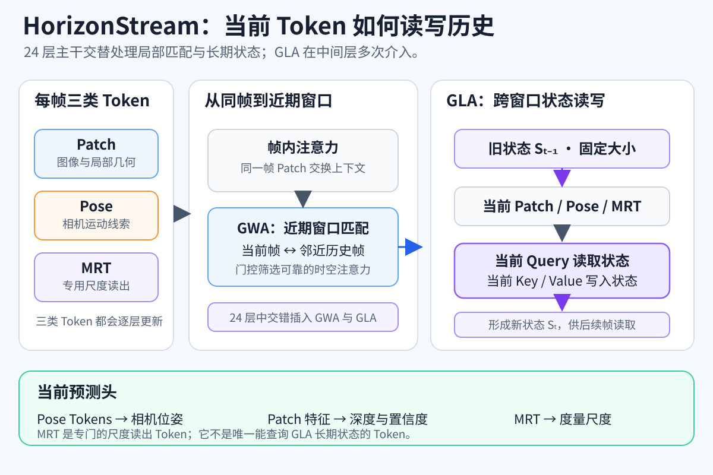

*自绘示意：帧内注意力负责同帧特征交互，GWA 连接近期窗口，间隔插入的 GLA 则由当前各类 Token 读取并更新长期状态。图中省略了残差、归一化和各层内部算子。*

#### 两种“历史”：可淘汰的 KV 与定长递归状态

近期窗口和长期状态不是同一种缓存。近期 GWA 的 KV Cache 保留有限范围内的 Patch K/V：新帧到来时追加新项，窗口满后移除最旧项；已经缓存的历史 Patch K/V 不因新帧到来而重新编码。长期 GLA 则把更早的证据折叠进固定大小的矩阵状态。状态的不同通道有不同的保留率：有些较快遗忘旧线索，有些保留得更久，再将当前 K/V 写入状态。这样可以用固定大小的状态跨越长视频，而不用一直携带所有历史帧的 Token。

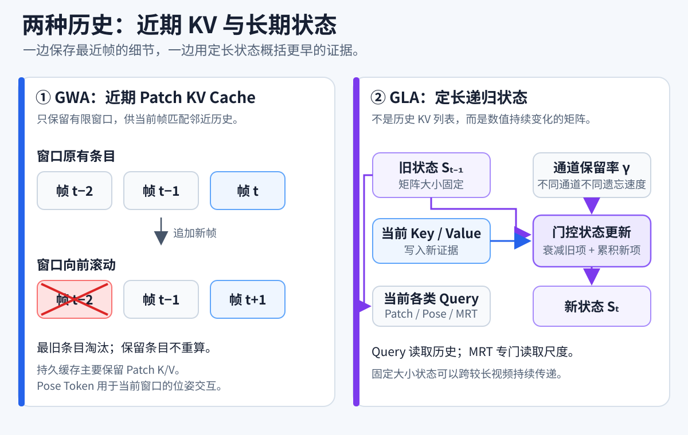

*自绘示意：短期缓存是“保留最近若干帧的条目，先进先出”；GLA 是“旧状态按通道衰减，再吸收当前证据”的定长摘要。二者各有职责，不能把 GLA State 理解成无限增长的历史 KV 列表。*

论文 Figure 3 对 GLA 读状态与更新状态的先后记号，与正文公式的写法略有出入。这里按机制层面概括为“当前 Token 查询长期状态，并用当前 K/V 更新状态”；若要复现到算子级，读写先后应以对应实现版本为准。

#### 尺度读出、位姿预测与回环各自解决什么

MRT 是专用的尺度读出 Token：它从 GLA 的长期状态中取出序列级度量线索，尺度头再用这个线索缩放当前帧的预测深度与平移。它不等同于世界坐标锚点，也不意味着网络显式维护了一张以米为单位、可任意重定锚的地图。Pose Token 则由位姿头在当前窗口内联合处理，输出窗口内各视角的位姿关系；推理代码再利用相邻窗口的重叠帧，把当前帧变换融合进序列轨迹。两者有关联，但负责的变量不同：MRT 解决尺度一致性，位姿头解决相机运动估计。

#### 滑动窗口中的 Reference 轮换与位姿融合

“因果”要区分**在线输入范围**和**窗口内部的 Token 更新方式**。HorizonStream 每次只用当前时刻已经到达的窗口生成当前输出，因此不会读取未来帧；但当前窗口内部并非所有 Token 都按严格的逐帧单向方式更新。官方实现为 Pose Token 准备了 `ref`、`src` 两组可学习模板。首个 chunk 按每个因果前缀把当前查询帧标为 `ref`；进入滑动窗口后，最新帧担当 `ref`，历史帧担当 `src`，上一窗口的 `ref` 到下一窗口就变成 `src`。这里的 `ref` 是当前窗口里组织相对位姿预测的角色，不是整张地图固定的世界原点。[代码中的窗口角色分配](https://github.com/3DAgentWorld/HorizonStream/blob/main/horizonstream/runtime/models/horizonstream.py#L88-L102)

与此同时，历史 Patch K/V 从缓存中复用，而当前窗口的 Pose Tokens 会按这个窗口重新构造并计算。后续窗口的 Global Attention 把可见的 Patch 与 Pose 特征一起处理，窗口内不同帧的 Pose Tokens 可以相互访问。于是它形成一种混合数据流：Patch 有因果缓存，Pose 在当前窗口里联合推理，长期 GLA 状态再跨窗口递推。网络的输出仍然是在线因果的，但窗口内 Pose 推理不是逐帧、单向地独立更新。[Patch 缓存与窗口注意力实现](https://github.com/3DAgentWorld/HorizonStream/blob/main/horizonstream/runtime/models/horizonstream.py#L294-L315)

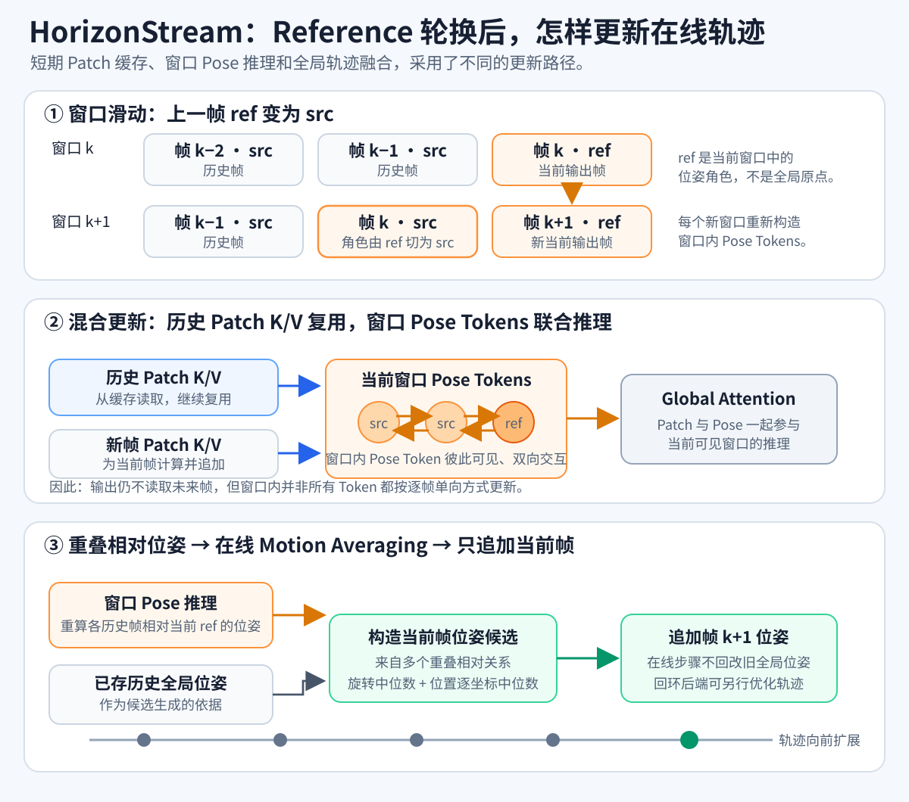

*自绘解释图：展示窗口滑动时 `ref/src` 角色变化、Patch K/V 缓存复用、窗口 Pose Token 联合推理，以及网络外的在线位姿中位数融合。*

每次滑窗后，网络会重新联合推理当前窗口里的 Pose Tokens，并重新预测窗口内各历史帧相对于当前 `ref` 的位姿。在线 Motion Averaging 将这些重叠位姿与已存的历史全局位姿组合，为当前帧构造多个全局位姿候选；旋转在旋转空间取中位数，位置按坐标分别取中位数，然后把结果追加到轨迹中。普通在线更新不回头改写先前的全局位姿；可选回环分支才会进一步通过位姿图优化修正轨迹。[在线位姿候选与中位数融合代码](https://github.com/3DAgentWorld/HorizonStream/blob/main/horizonstream/runtime/motion_averaging.py#L89-L123)

> 论文描述的缺口：论文介绍了因果窗口、长期状态和相对位姿融合，却没有清楚交代 Token 级注意力可见范围、`ref/src` 随窗口滑动的角色变化，以及历史 Patch K/V 与新建 Pose Tokens 如何共同进入后续窗口的推理。只看论文架构图，难以还原这些更新路径，需要结合官方代码理解。
>
> 需要验证的表示一致性风险：历史 Patch K/V 可能保留了旧窗口中与 Pose Token 交互形成的上下文；窗口滑动后，相同帧的 Pose Token 以新角色参与推理，而对应 Patch K/V 仍直接复用。实现没有显式重新编码这些历史缓存或把它们转换到新参考系。这提出了跨窗口表示是否一致的问题，但并不能单凭代码断定模型发生了精度偏差；模型也可能已在训练中学会适应这种切换。
>
> 位姿融合的边界：中位数融合可以抑制部分离群候选，但它没有显式使用候选位姿的不确定性或相关性，而且在线步骤不联合修正历史轨迹。论文已有单个 Pose Token 与多 Token 聚合的组件消融，因此不宜说作者完全没有验证聚合；尚未回答的是 `ref/src` 角色切换与缓存复用如何相互影响，以及缓存复用、局部重算和显式滑窗位姿优化之间的精度—计算取舍。对这些点做针对性消融，才能判断该设计的实际影响。

回环是另一个可选分支：先用全局图像描述子检索可能重访的旧地点，再让模型对候选帧重新做局部几何估计，形成回环约束并交给位姿图优化。它可以修正输出轨迹，但论文没有给出把后端修正解析地回写 GLA 隐状态的步骤。因此，“轨迹被回环优化”不自动意味着“网络内部的长期状态也被同步改正”。

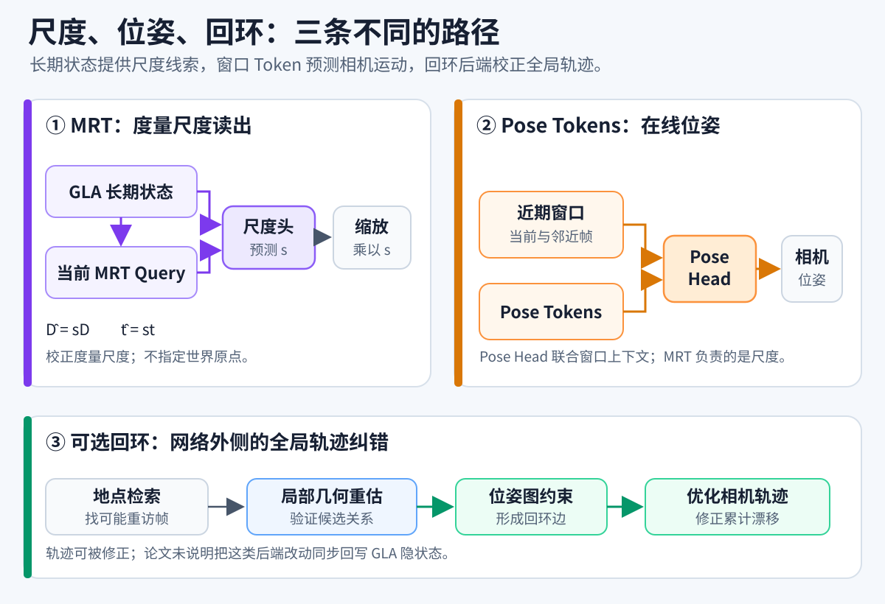

*自绘示意：MRT 从长期状态读尺度并缩放当前深度与平移；Pose Token 路径输出在线相机位姿；可选回环在网络外侧提供位姿图约束。*

- **坐标系：** 网络在线输出相机位姿和当前相机系深度；MRT 校正度量尺度，但不单独指定世界原点或固定参考相机。
- **注意力：** 帧内特征交互之后，GWA 在近期窗口中因果地做时空匹配；若干层插入 GLA，使当前 Token 读写跨窗口状态。
- **记忆：** 有界 Patch KV Cache 保存近期细节；固定大小 GLA State 压缩更长历史；回环检索描述子是可选的第三类存储。
- **回环：** 可选分支做地点检索、候选帧局部几何重估和位姿图优化；这不是 GLA 自动完成的功能。
- **更新：** 长期状态逐层按通道遗忘并吸收当前 K/V；短期 KV 追加新帧并淘汰窗口外项。回环能修正轨迹，但没有说明如何把修正回写到网络隐藏状态。

[HorizonStream PDF](pdf/horizonstream.pdf) · [论文](https://arxiv.org/abs/2605.23889) · [官方代码](https://github.com/3DAgentWorld/HorizonStream)
### ABot-Recon：局部因果预测，可选接入回环后端

ABot-Recon 将当前帧与最多 11 张历史帧组成固定长度的因果上下文。模型为当前帧预测相机局部坐标系下的点图，以及相对上一帧的运动；系统再把逐帧相对运动累积成轨迹。这样，网络每一步只需处理有限历史，输出的几何仍保持在当前相机坐标中。可选的回环模块位于前馈预测之后：它检索并验证可能重访的地点，再通过位姿图修正长程轨迹。它扩展了在线模型的全局校正能力，但没有把后端修正回写到短窗 KV 状态。

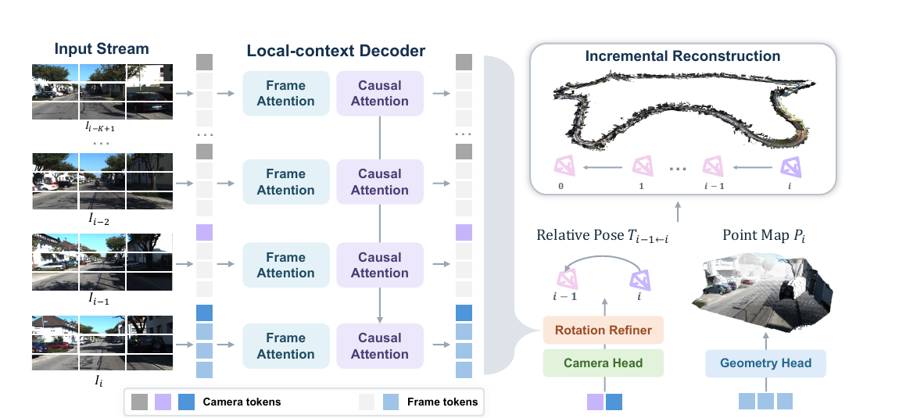

*输入流进入固定长度因果上下文，模型输出当前点图、相对位姿和置信度；后处理把相邻位姿连乘形成全局轨迹，可选回环模块再以位姿图修正长程漂移。*

- **坐标系：** 每帧点图在当前相机坐标系，预测的相邻位姿将其放入全局轨迹。
- **注意力：** 因果读取当前帧与最多 11 个历史帧，不看未来。
- **记忆：** 固定长度 KV 上下文；启用回环时另有历史检索与几何地图。
- **回环：** 可选地点检索、候选几何验证和稀疏位姿图。
- **更新：** 新帧估计相对位姿并累积；回环优化后可按修正位姿变换点云，模型短窗 KV 本身没有回环后端写回协议。

[ABot-Recon PDF](pdf/abot-recon.pdf) · [论文](https://arxiv.org/abs/2608.27529)
### LONG3R：短期时间记忆加长期三维空间记忆

LONG3R 用双源解码器读取相邻帧和长期记忆，并把较早 Token 放到三维体素中去重。它的精化阶段会利用相邻的下一帧，因此不能简化为零前视的单帧因果模型。

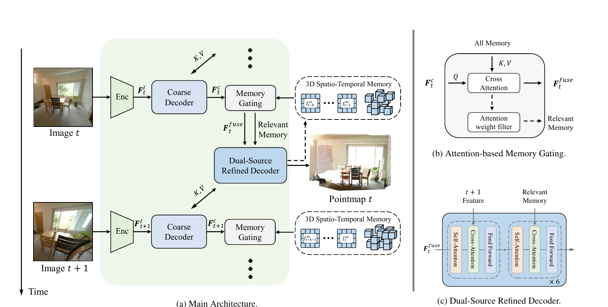

*当前图像先与相邻帧形成粗几何，再从相关历史记忆中筛选内容；精化阶段交替读取邻帧与空间记忆，点图头输出重建结果。旁边展示基于注意力的记忆门控。*

- **坐标系：** 记忆用累积几何建立的三维场景参考来组织；点图和相机预测通过共享几何状态联系起来。
- **注意力：** 粗阶段依次读取前一帧；精化阶段交替读取后一相邻帧与门控后的历史记忆，存在局部前视。
- **记忆：** 近期约 10 帧的 KV 加上体素化长期三维 Token；长期记忆有 Token 上限，并按空间覆盖去重。
- **回环：** 无独立地点检索和位姿图回环机制。
- **更新：** 新点图生成空间 Token，注意力门控挑选相关历史、体素融合减少冗余；没有全局后端去追溯修正旧记忆坐标。

[LONG3R PDF](pdf/long3r.pdf) · [论文](https://arxiv.org/abs/2507.18255)
### Point3R：让记忆地址本身带有三维坐标

Point3R 把每个记忆单元绑定到显式三维位置，当前图像按三维位置查询旧特征，再把新点图写回空间记忆。记忆不再只是“模型记住了什么”，也包含“这个信息属于场景哪里”。

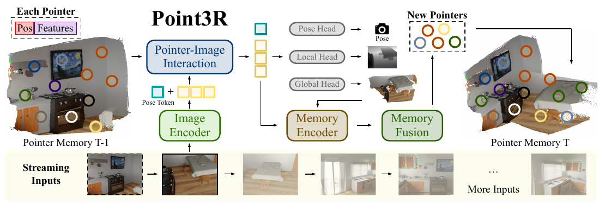

*当前图像与空间指针交互，分别预测局部点图、全局点图和位姿；新几何被编码为三维指针，与已有记忆融合。*

- **坐标系：** 空间指针位于首帧相机坐标系；同时输出当前相机系和全局参考系下的点图。
- **注意力：** 当前图像 Token 读取带三维位置编码的空间记忆，按帧顺序更新；没有对完整视频做全局双向注意力。
- **记忆：** 显式三维位置加特征的空间指针，另有用于位姿上下文的紧凑记忆；容量随空间覆盖增长。
- **回环：** 可按地点信息从空间记忆读回特征，但没有独立候选检索、几何验证和全局位姿图。
- **更新：** 生成新指针并与邻近旧指针融合；若后端改变旧轨迹，论文没有定义如何把所有指针与隐藏特征共同变换。

[Point3R PDF](pdf/point3r.pdf) · [论文](https://arxiv.org/abs/2507.02863)
### Slot3R：同一空间地址允许保留多份证据

Slot3R 延续 Point3R 的空间记忆，但在同一空间地址下设置多个槽位。来自不同视角或不同观测条件的证据可以先分开保存，再依据置信度和匹配关系决定如何写入。

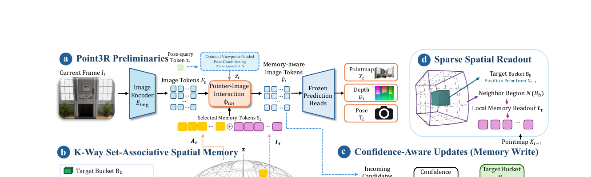

*图中从 Point3R 式空间指针开始，为一个地址分配多个候选槽位；读出时选相关证据，写入时根据置信度更新对应槽位，降低把互相冲突的观测过早平均的风险。*

- **坐标系：** 记忆地址是量化后的三维空间位置，沿用场景级参考系；槽位区分同一位置的不同证据。
- **注意力：** 当前观测查询空间地址及其槽位；流式逐步处理，没有全序列双向注意力。
- **记忆：** 以三维地址索引的 K 路特征槽位，分离空间寻址和观测融合。
- **回环：** 没有独立地点检索、闭环验证或位姿图。
- **更新：** 新证据按地址、匹配置信度和槽位状态写入；不提供后端全局位姿变化后的记忆重投影机制。

[Slot3R PDF](pdf/slot3r.pdf) · [论文](https://arxiv.org/abs/2610.12282)

这些方法保存历史的方式不同：StreamVGGT 延续因果主干并缓存逐层 KV；CUT3R、TTT3R 和 TTSA3R 将历史写入递归状态；WinT3R 分开维护场景 State 与相机 Token Pool；LingBot-Map 为离开局部窗口的帧保留压缩上下文；LONG3R、Point3R 和 Slot3R 则把部分记忆放到显式三维空间结构中。LongStream 与 ABot-Recon 主要通过局部相对运动维持轨迹。它们对应不同的记忆容量、坐标约定和事后更新能力，不能只按“有没有 memory”二分。

## 3. 流式推理的效率：压缩历史缓存

当历史被 KV 显式保存，新的瓶颈会落到缓存长度、注意力读取和信息淘汰。压缩不是免费的：被删掉的 Token 可能正是之后重访时需要的几何证据。输入图像的压缩则是另一问题，它改变观测本身。

### XStreamVGGT：用当前帧查询剪枝历史 KV

XStreamVGGT 在 StreamVGGT 的因果缓存上做推理期压缩：当前帧 Query 估计历史 Key 的相关性，剪去低分缓存，再对保留项量化。它不重新训练几何骨干。

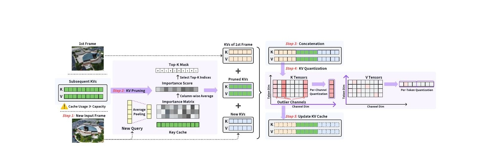

*当前帧的查询为历史 Token 打分，首帧与当前帧作为锚保留，其余历史按相关性裁剪；随后对 KV 缓存量化。它压缩的是网络上下文，不是三维地图本身。*

- **坐标系：** 延续 StreamVGGT 的参考帧坐标约定，首帧 KV 作为保留锚点。
- **注意力：** 帧内空间注意力加因果跨帧注意力；压缩查询只用于估计历史相关性。
- **记忆：** 固定预算 KV 缓存，通过剪枝与量化减少历史成本。
- **回环：** 无地点检索和回环约束；缓存相关性不等于几何回环验证。
- **更新：** 新帧进入后重新评分并剪枝/量化；已删 Token 无法在位姿图优化后恢复，未提供后端坐标更新。

[XStreamVGGT PDF](pdf/xstreamvggt.pdf) · [论文](https://arxiv.org/abs/2602.21780)

### StreamCacheVGGT：保留、合并或淘汰

StreamCacheVGGT 为 KV Token 评分后分三类处理：高重要项保留，中间项合并到锚点，低重要项淘汰。它用跨层一致性提高评分稳定性，混合压缩减少纯剪枝可能造成的几何断裂。

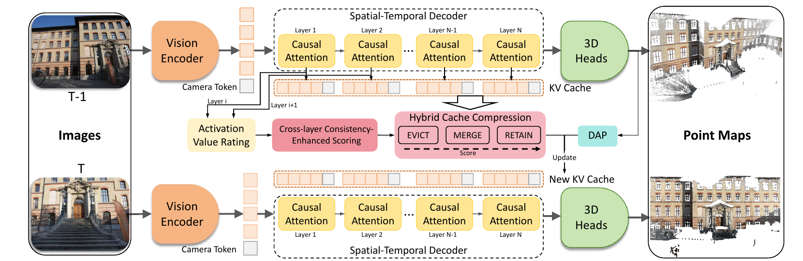

*因果解码产生新 KV；评分与缓存管理模块跨层比较重要性，并将 Token 保留、合并或淘汰，再把压缩后的缓存用于后续帧。*

- **坐标系：** 继承 StreamVGGT 的参考约定，锚 Token 保护部分参考信息。
- **注意力：** 因果流式解码，当前帧读取当前与已压缩历史。
- **记忆：** 固定预算 KV，加上受保护锚；压缩策略跨层评分。
- **回环：** 没有地点识别、回环验证或位姿图。
- **更新：** 新帧后更新缓存：保留重要项、融合中等项、淘汰低分项；它更新特征槽位，不更新几何位姿。

[StreamCacheVGGT PDF](pdf/streamcachevggt.pdf) · [论文](https://arxiv.org/abs/2604.15237)

这里也要分清资源口径：KV 是否有界、网络状态是否有界、外部地图是否增长，是三件事。模型每帧只看固定窗口，不能说明长期点云或回环数据库也固定大小；反过来，地图外存也不意味着注意力计算已经恒定。

## 4. 参考坐标进入 Token 后，位姿更新发生了什么？

传统几何可以把世界坐标系整体换一个刚体变换，场景内部关系不变。端到端网络则可能在 Token 中混合图像外观、参考帧和跨视图几何。若某个 Token 已经携带“相对首帧”的含义，后端改变首帧或一部分轨迹后，最终点云可以变换到新坐标，但 Token 是否存在相同的解析变换，不能想当然。

这让 VGGT 与 π³ 的差异特别有启发性。VGGT 把首帧设为参考，相机和点图都在该坐标中预测；跨视图注意力会把这个参考与其它视图的关系写入网络表示。π³ 则在每幅图像的本地相机系预测点图，以相对位姿联系视图，不把某一输入索引定为特殊锚点。两者不是简单“谁对谁错”，而是把参考系责任放在不同位置。

LongStream、ABot-Recon 和 Point3R 又呈现另外三种结构：LongStream 用活动关键帧的局部相对位姿，再组合成全局轨迹；ABot-Recon 每帧预测当前相机系几何；Point3R 将三维位置直接作为记忆地址。显式坐标能让变换和优化更直接，但也需要解决错误对应、遮挡、重复观测融合和数据关联。

### 隐状态与可优化三维表示

CUT3R、TTT3R 和 TTSA3R 用隐状态 Token 压缩历史，固定状态量便于在线读写；代价是 Token 的坐标含义不一定能被外部优化器直接操纵。Point3R、Slot3R 把位置显式写入记忆地址，便于空间查询与融合，但记忆容量随场景覆盖增长，也要回答位姿修正后地址如何迁移。更一般地说，中间状态可以尝试采用带特征的三维点、surfel 或 3D Gaussian 等可查询、可融合、可渲染的表示，让位姿优化有明确的几何变量；这仍是表示设计方向，不能据此推断当前所述网络已经实现了统一的可优化中间地图。即便显式几何可以变换，仍需说明变换结果如何与后续会读取的隐藏状态保持一致。

因此，“隐藏 Token 一定要隐式吗？”可以转成一个更具体的问题：能否让中间状态带有明确的三维地址或可变换坐标，同时保留学习特征的表达能力？如果后端将一段轨迹做刚体修正，系统是否能解析地移动对应状态；若多个关键帧被非均匀拉动，是否需要重放受影响窗口；哪些 Token 应绑定相机系、局部地图系或全局系？目前这些是值得研究的接口设计，不能仅从模型最终输出了点图，就推断中间表示已能被可靠地优化。

## 5. 相机模型泛化：像素位置不等于空间方向

针孔相机把像素映射为射线；鱼眼、全景和其它投影下，同一个像素坐标不再对应同一个空间方向。相机模型泛化因此是端到端几何的输入表示问题，也会影响流式 SLAM 能否跨相机类型工作。下面几项工作分别从多视图射线条件化、射线角度位置编码和相机无关射线输出切入。它们关注的是几何前端的一环，尚未解决流式系统中的持久状态、轨迹累积和回环更新。

### Wid3R：以广视场射线条件化多视图几何

Wid3R 面向广视场多视图输入，将相机模型和射线几何用于特征聚合，使不同投影下相同像素格不再被误认为具有相同的空间方向。

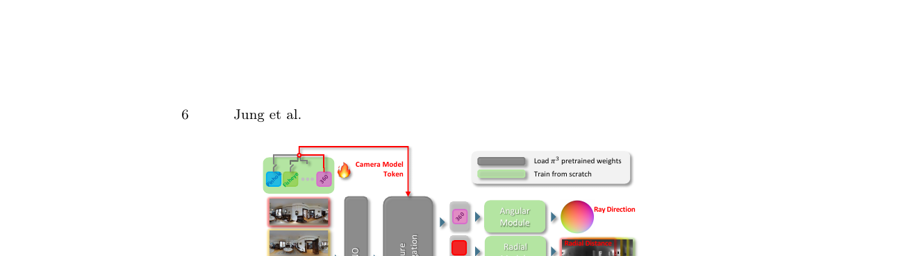

*不同相机视图经视觉编码后由特征聚合模块联合处理；相机模型/射线信息参与几何表征，输出相机和三维点图。*

- **坐标系：** 以每幅图像的相机射线描述局部方向，并预测视图间几何关系。
- **注意力：** 对给定多视图集合联合聚合，不是时间因果注意力。
- **记忆：** 只使用当前输入的多视图特征，不维护跨帧状态。
- **回环：** 没有在线地点检索或位姿图约束。
- **更新：** 前馈生成广视场几何，没有连续状态写入或位姿修正机制。

[Wid3R PDF](pdf/wid3r.pdf) · [论文](https://arxiv.org/abs/2602.05321)

### Any3R：用每像素射线角度表达混合中心相机

Any3R 为不同中心投影相机的每个像素计算射线方向，并用射线角度构造帧内旋转位置编码，避免把规则像素网格直接当作统一的空间方向坐标。

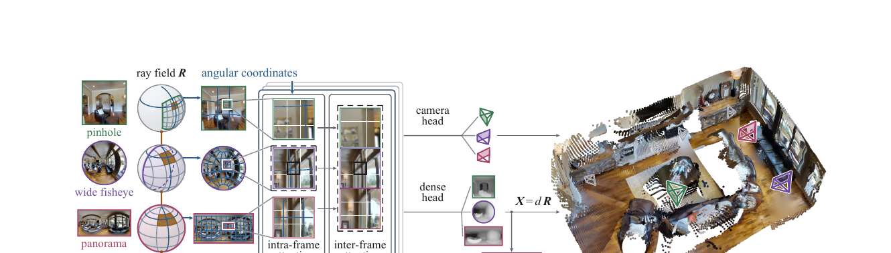

*每幅图的射线场提供像素对应的空间方向，帧内注意力基于角度而非原始像素坐标编码；模型预测相机位姿与逐像素径向距离，再解码为点云。*

- **坐标系：** 逐像素射线和径向距离先表达在各自相机坐标中，再由相机位姿联系到共享场景。
- **注意力：** 多视图前馈推理；帧内位置编码使用射线角度，视图间联合交互，不沿时间因果更新。
- **记忆：** 只处理当前多视图集合，没有持续状态。
- **回环：** 无地点检索与回环约束。
- **更新：** 一次性预测相机和几何，没有在线位姿修正或状态回写。

[Any3R PDF](pdf/any3r.pdf) · [论文](https://arxiv.org/abs/2610.36150)

### OmniRay：单图预测相机无关的射线场

OmniRay 将单图几何拆为射线方向和沿射线的径向距离。不同镜头主要改变每像素射线场；距离则沿该射线定义，因此同一网络可以表达不同相机投影下的点云。

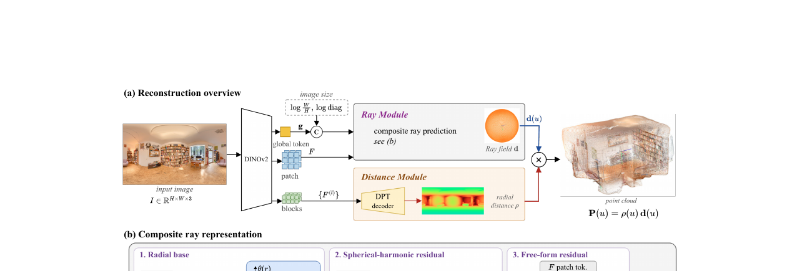

*单张图像经编码后分成射线预测与距离预测分支，组合成点云。模型不需要按镜头类别切换不同几何头。*

- **坐标系：** 输出为单相机射线及其径向距离，不建立多帧全局坐标。
- **注意力：** 单图像编码器内部交互，无时间注意力。
- **记忆：** 仅保留当前图像特征，没有跨帧状态。
- **回环：** 不适用。
- **更新：** 单次预测射线和点云，不更新相机轨迹或地图。

[OmniRay PDF](pdf/omniray.pdf) · [论文](https://arxiv.org/abs/2610.31645)

### OmniPoint：直接回归多相机条件下的度量点云

OmniPoint 以射线—距离表示预测单目度量点云，可选用内参或稀疏深度等条件，并通过跨投影数据增强训练同一架构处理多种相机类型。

*单张任意相机图像与可选几何条件进入共享编码器，输出射线/距离及度量点云；原论文还展示训练时不同投影间的数据增强。*

- **坐标系：** 单幅图像的相机射线坐标与度量距离，不预测视频全局位姿。
- **注意力：** 单图像编码与解码，不使用时间注意力。
- **记忆：** 当前图像和可选标定/深度条件，没有持久状态。
- **回环：** 不适用。
- **更新：** 前馈预测点云，不更新相机轨迹或跨帧地图。

[OmniPoint PDF](pdf/omnipoint.pdf) · [论文](https://arxiv.org/abs/2609.09394)

这组工作的贡献是把相机模型差异转成射线方向或几何条件，避免将像素网格的位置编码误当成统一的空间坐标。对端到端流式 SLAM 来说，它们提供了相机泛化的表示线索；下一步仍要检验射线条件如何与跨帧位姿、历史缓存和可更新的空间状态结合。

## 6. 语言模型和 Agent 能借鉴什么？

语言模型提供的类比适合帮助提出问题，不应拿来替代几何定义。

- **双向与因果读取：** BERT 式双向编码对应可同时利用一组视图的离线推理；GPT 式因果掩码对应当前帧只能读取过去。它解释“谁能看谁”，不能说明坐标是否一致。
- **状态压缩与长期记忆：** 固定隐状态类似有限工作记忆；检索式记忆类似关键帧或地点数据库。SLAM 还要验证检索结果是否能由几何变换解释。
- **重新审阅与优化：** Agent 回看先前输出、再生成修订结果，可以类比“预测后重新解释历史”。SLAM 中对应的是数据关联、回环约束和全局优化；输出文本的自我复核并不会自动变成正确的位姿约束。
- **写入门控：** Agent 判断新信息是否值得保存，与 TTT3R/TTSA3R 决定新观测应如何修改状态有相似结构。几何系统还必须保证错误写入不会破坏坐标与地图一致性。

例如 [Hermes Agent 的对话压缩与长期记忆管理文档](https://github.com/NousResearch/hermes-agent/blob/main/website/docs/developer-guide/agent-loop.md)，可以作为“有限上下文如何保留有用信息”的工程参照；它与 SLAM 的显式空间状态和几何回环仍是两类机制。

## 7. 从表征能力到开放问题

模型特征中能够读出深度或位姿，不足以证明它会在目标离开视野后持续保留空间关系、随自运动更新状态，或在重访时找回同一地点。评估在线空间状态，需要把单帧几何可读性与跨时间的写入、保持、检索和修正能力分开。

### 当前最值得继续讨论的问题

1. **参考系如何进入表示？** 若 Token 已经混合了首帧参考关系，后端做刚体或 Sim(3) 修正时，是否存在保持语义的 Token 变换？哪些表示能解析更新，哪些必须重算？
2. **隐式状态和显式几何如何连接？** 能否让中间 Token 带有可优化的三维地址、射线或局部地图坐标，同时保留学习特征的表达能力？
3. **压缩面向什么目标？** 当前帧重建的重要性，未必等于未来重定位、回环和尺度恢复的重要性。能否依据不确定性、可观测性和地图覆盖来分配记忆？
4. **全局修正如何回写在线状态？** 优化相机位姿后，显式点图或地图可以变换；局部缓存和递归状态怎么办？是解析变换、局部重放，还是保持状态与几何地图分层？
5. **怎样比较完整系统？** 除单帧精度和 FPS，还需要报告长程漂移、重访恢复、最大显存、外部地图大小、缓存预算、输出密度和回环后的地图一致性，并说明是否把后端计算计入。

## 结语：瓶颈从预测几何迁移到维护状态

DUSt3R、VGGT 和 π³ 提供了多视图端到端几何的基础背景；面向连续输入的模型则把焦点转向如何在有限算力下持续处理视频。现有工作尝试了因果 KV、重叠窗口、递归状态、三维空间指针、Token 压缩和分层记忆。进一步的问题是，在线模型如何面对重访与全局位姿修正，并让更新后的几何和仍会被读取的网络状态保持一致。

流式三维重建可以视作 SLAM 问题的一部分。本文聚焦端到端模型如何处理在线几何、长期状态和相机泛化等 SLAM 子问题，并逐篇指出它们尚未覆盖的能力。更深的开放问题仍在表示层：模型内部的空间信息是否只是一次性预测的中间 Token，还是能成为可定位、可关联、可优化并能在后续观测中继续使用的空间状态。

## 论文 PDF 索引

本文讨论的论文版本均保存在同目录 pdf 文件夹，文件名按方法命名，后续可直接搜索和复用；同一工作的不同版本会分别标明。来源与文件对应关系见 [PDF 索引](pdf/README.txt)。
