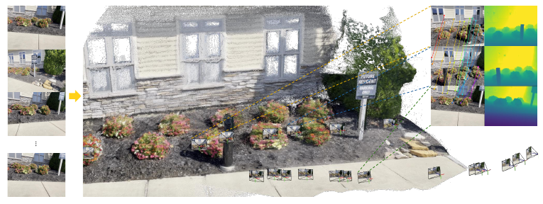
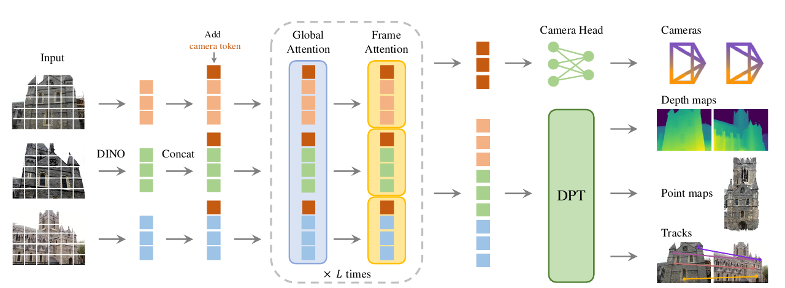
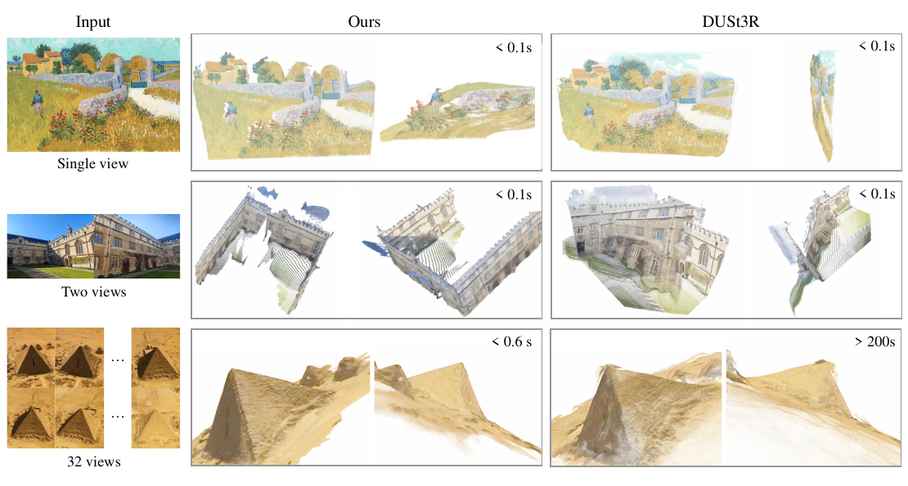

# VGGT 论文解读

> *VGGT: Visual Geometry Grounded Transformer*（Jianyuan Wang 等，arXiv:2503.11651v1，2025-03-14）以交替注意力联合处理多视图，通过共享骨干同时预测相机、深度、点图和跟踪特征，并检验几何多任务学习与下游迁移的作用。[论文页面](https://arxiv.org/abs/2503.11651) · [PDF](https://arxiv.org/pdf/2503.11651v1) · [官方代码](https://github.com/facebookresearch/vggt)

*图 1（原论文图 1）　VGGT 是在大量三维标注数据上训练、仅含少量三维归纳偏置的大型前馈 Transformer。它可接收多达数百幅图像，并一次性预测全部图像对应的相机、点图、深度图和点轨迹；处理时间不到一秒，且常超过不作后处理的优化式替代方法。*

## 摘要

VGGT 是一种前馈神经网络，能够根据场景的一幅、少数几幅乃至数百幅视图，直接推断场景的所有关键三维属性，包括相机参数、点图、深度图和三维点轨迹。这一方法推动了三维计算机视觉的发展；以往的模型通常局限于单一任务，并针对该任务专门设计。

VGGT 简洁而高效，能在一秒内重建图像；即使不作后处理，它的表现也优于一些需要通过视觉几何优化进行后处理的方法。该网络在多项三维任务上取得了最先进的结果，包括相机参数估计、多视图深度估计、稠密点云重建和三维点跟踪。论文还展示了预训练 VGGT 特征对下游任务的帮助，例如非刚性点跟踪和前馈新视角合成。代码与模型已公开。

## 1. 引言

论文研究如何使用前馈神经网络，估计一组图像所记录场景的三维属性。传统三维重建采用视觉几何方法，通过光束法平差（Bundle Adjustment，BA）等迭代优化技术求解 [45]。机器学习常作为重要的补充，处理几何本身难以解决的任务，例如特征匹配和单目深度预测。两者的结合日益紧密：VGGSfM 等先进 SfM 方法通过可微 BA，将机器学习与视觉几何端到端结合起来 [125]。尽管如此，视觉几何在三维重建中仍发挥重要作用，也因此增加了系统复杂性和计算成本。

随着网络能力不断增强，作者进一步考察：三维任务能否最终直接由神经网络解决，几乎不再需要几何后处理？DUSt3R 及其后续方法 MASt3R [62] 已在这个方向取得进展，但它们一次只能处理两幅图像，并依靠后处理融合成对重建，才能重建更多图像。

Visual Geometry Grounded Transformer（VGGT）进一步减少了对后处理几何优化的依赖。VGGT 是一种前馈神经网络，能够根据场景的一幅、少数几幅乃至数百幅输入视图执行三维重建。它在一次前向传播中预测完整的三维属性，包括相机参数、深度图、点图和三维点轨迹，耗时为数秒。值得注意的是，即使不进行进一步处理，它的表现通常也优于基于优化的方法。这与 DUSt3R、MASt3R 或 VGGSfM 有显著区别；这些方法仍需代价较高的迭代后优化，才能获得可用结果。

结构设计还检验了通用 Transformer 承担三维重建的能力。VGGT 建立在相当标准的大型 Transformer 之上，没有特殊的三维归纳偏置（帧内注意力与全局注意力交替除外），通过大量带三维标注的公开数据集训练。VGGT 因而沿用了 GPT、CLIP、DINO、Stable Diffusion 等自然语言处理与计算机视觉大模型的路线。这些模型已成为用途广泛的骨干，可经微调解决新的专门任务。类似地，论文展示 VGGT 计算出的特征对下游任务的改善，例如动态视频点跟踪和新视角合成。

近年来还出现了多个大型三维神经网络，例如 DepthAnything [142]、MoGe [128] 和 LRM [49]。不过，这些模型仅关注一个三维任务，例如单目深度估计或新视角合成。相比之下，VGGT 使用共享骨干，一起预测所有关心的三维量。消融表明，即便这些三维属性之间存在冗余，同时学习彼此相关的属性仍能提升整体准确度。与此同时，在推理时，可以由分别预测的深度和相机参数推导点图，其精度高于直接使用专门的点图预测头。

论文将贡献概括如下：（1）提出大型前馈 Transformer VGGT，输入场景的一幅、少数几幅乃至数百幅图像后，可在数秒内预测所有关键三维属性，包括相机内外参、点图、深度图和三维点轨迹。（2）证明 VGGT 的预测可直接使用，具有很强的竞争力，通常优于依赖耗时后处理优化的先进方法。（3）证明进一步结合 BA 后处理能够取得更好效果。论文还展示了预训练特征对动态点跟踪和新视角合成等下游任务的帮助。

作者公开了代码与模型，供后续研究复用。

## 2. 相关工作

### 结构从运动恢复

结构从运动恢复（Structure from Motion，SfM）是经典的计算机视觉问题，目标是从静态场景的多视角图像中估计相机参数并重建稀疏点云。传统 SfM 流水线由多个阶段组成，包括图像匹配、三角化和光束法平差。COLMAP 是这一传统路线中最常用的系统。近年来，深度学习改进了 SfM 流水线的多个组成部分，关键点检测和图像匹配是其中两个主要研究方向。近期工作探索了端到端可微 SfM；例如 VGGSfM 开始在具有挑战性的摄影旅游场景中超过传统算法。

### 多视图立体

多视图立体（Multi-view Stereo，MVS）旨在从多幅具有重叠区域的图像稠密重建场景几何，通常假定相机参数已知，而相机参数往往由 SfM 估计。MVS 方法可以分为传统手工设计方法、全局优化方法和学习方法，学习式 MVS 近年来同样取得了很大进展。DUSt3R 和 MASt3R 与 MVS 类似，能够直接从双视图估计对齐的稠密点云，但无需预先提供相机参数。同期的一些工作尝试用神经网络取代 DUSt3R 的测试时优化，效果仍略逊于或至多相当于 DUSt3R。VGGT 则大幅超过 DUSt3R 与 MASt3R。

### 任意点跟踪

任意点跟踪（Tracking-Any-Point）最早由 Particle Video 提出，之后在深度学习时代由 PIPs 重新带回研究视野。该任务旨在视频序列中跟踪感兴趣的点，包括动态运动。给定一段视频和若干二维查询点，任务是预测这些点在其他帧中的二维对应位置。TAP-Vid 为该任务提出了三个基准，并给出一个简单基线；TAPIR 随后改进了该基线。CoTracker 利用不同点之间的相关性处理遮挡，DOT 则实现了稠密遮挡跟踪。近期 TAPTR 提出端到端 Transformer 跟踪器，LocoTrack 将常用的逐点特征扩展到邻近区域。这些方法都是专门设计的点跟踪器。论文展示了 VGGT 特征与现有跟踪器结合后，在所测基准上的收益。

## 3. 方法

VGGT 接收一组图像，并通过大型 Transformer 输出多种三维量。本节先介绍问题定义，再介绍网络结构、预测头和训练方案。

### 3.1 问题定义与符号

输入为观测同一三维场景的 $N$ 幅 RGB 图像序列 $(I_i)_{i=1}^{N}$，其中 $I_i\in\mathbb R^{3\times H\times W}$。VGGT 的 Transformer 将图像映射为每帧对应的一组三维标注：

$$
f\left((I_i)_{i=1}^{N}\right)=\left(\mathbf g_i,D_i,P_i,T_i\right)_{i=1}^{N}.
\tag{1}
$$

因此，Transformer 为每幅图像 $I_i$ 输出相机参数 $\mathbf g_i\in\mathbb R^9$（内外参）、深度图 $D_i\in\mathbb R^{H\times W}$、点图 $P_i\in\mathbb R^{3\times H\times W}$，以及用于点跟踪的特征网格 $T_i\in\mathbb R^{C\times H\times W}$。下面定义这些量。

相机参数沿用 VGGSfM 的表示，将 $\mathbf g=[\mathbf q,\mathbf t,\mathbf f]$ 拼接得到，其中旋转四元数 $\mathbf q\in\mathbb R^4$，平移向量 $\mathbf t\in\mathbb R^3$，视场角 $\mathbf f\in\mathbb R^2$。模型假定相机主点位于图像中心，这也是 SfM 框架中的常见假定 [95, 125]。

记图像 $I_i$ 的像素域为 $\mathcal I(I_i)=\{1,\ldots,H\}\times\{1,\ldots,W\}$。深度图 $D_i$ 将每个像素位置 $\mathbf y\in\mathcal I(I_i)$ 映射为第 $i$ 台相机所见的深度 $D_i(\mathbf y)\in\mathbb R^+$。类似地，点图 $P_i$ 将每个像素关联到一个三维场景点 $P_i(\mathbf y)\in\mathbb R^3$。与 DUSt3R [129] 一样，这些点图与观察视角无关：$P_i(\mathbf y)$ 在第一台相机 $\mathbf g_1$ 的坐标系中定义，第一台相机坐标系作为世界参考系。

关键点跟踪沿用任意点跟踪的任务定义。给定查询图像 $I_q$ 中的固定查询点 $\mathbf y_q$，网络输出轨迹 $\mathcal T^\star(\mathbf y_q)=(\mathbf y_i)_{i=1}^{N}$，其中 $\mathbf y_i\in\mathbb R^2$ 是各图像中与查询点对应的位置。需要注意的是，上面的 Transformer $f$ 不直接输出轨迹，而是输出特征 $T_i\in\mathbb R^{C\times H\times W}$，再由一个单独的跟踪模块利用这些特征计算轨迹。两个网络 $f$ 与 $\mathcal T$ 以端到端方式联合训练。

**预测顺序。**输入图像的顺序可以任意排列，但第一幅图像被指定为参考帧。除第一帧外，网络结构对输入图像的置换具有等变性。

**过完备预测。**VGGT 预测的各个量并非彼此独立。例如，DUSt3R 已表明，可以从不随观察视角变化的点图 $P$ 推出相机参数 $\mathbf g$，例如通过求解透视 $n$ 点（PnP）问题 [35, 61]。此外，深度图也可以由点图和相机参数推导得到。然而，如第 4.5 节所示，即便这些量之间存在闭式关系，在训练时要求 VGGT 显式预测所有这些量，仍能显著提升性能。在推理时，组合独立估计的深度图与相机参数，比直接采用专门的点图分支得到的三维点更准确。

式（1）把主网络和跟踪头分开书写。给定图像后，$f$ 产生稠密特征；给定某个查询像素后，$\mathcal T$ 才将查询位置与这些特征结合，输出其他图像中的二维坐标。因此，论文摘要中提到的点跟踪能力由两部分联合实现。

### 3.2 特征骨干

沿用近期三维深度学习工作的思路 [53, 129, 132]，VGGT 使用只包含少量三维归纳偏置的架构，让模型从大量三维标注数据中学习。具体而言，$f$ 是一个大型 Transformer。每幅输入图像首先经过 DINO [78] 切分为 $K$ 个 token，记为 $t^I\in\mathbb R^{K\times C}$；token 数随图像分辨率变化。随后，将所有帧的图像 token 合并，送入由帧内注意力和全局自注意力交替组成的主网络。

**交替注意力。**网络在标准 Transformer 上引入交替注意力（Alternating-Attention，AA），使网络交替关注单帧内部与全部图像。具体来说，帧内自注意力分别在每帧的 token $t^I_k$ 内计算；全局自注意力则联合处理所有帧的 token $t^I$。这种安排在融合不同图像信息的同时，也使每帧内部的激活得到组织。默认使用 $L=24$ 层全局与帧内注意力。第 4 节的实验表明，AA 架构能显著提高性能。需要指出，网络没有使用 cross-attention 层，只使用 self-attention 层。

*图 2（原论文图 2）　网络结构总览。模型首先用 DINO 将输入图像切分成 token，再添加相机 token 用于相机预测。随后交替使用帧内和全局自注意力。相机头预测相机内外参，DPT 头预测各类稠密输出。图中寄存器 token 与不确定性分支未画出。*

帧内层只让同一图像中的 token 相互读取，全局层让所有图像中的 token 共同读取。两种操作交替执行，使跨图像信息能够在后续帧内计算中继续使用。这里的注意力读取特征，不等价于显式建立像素匹配或执行三角化。

### 3.3 预测头

各预测分支从骨干 $f$ 的输出恢复相机参数、深度图、点图和点轨迹。首先，为每幅输入图像 $I_i$ 的图像 token $t^I_i$ 添加一个相机 token $t^{\mathbf g}_i\in\mathbb R^{1\times C'}$ 和四个寄存器 token [19] $t^R_i\in\mathbb R^{4\times C'}$。将 $(t^I_i,t^{\mathbf g}_i,t^R_i)_{i=1}^{N}$ 拼接后输入 AA Transformer，得到输出 token $(\hat t^I_i,\hat t^{\mathbf g}_i,\hat t^R_i)_{i=1}^{N}$。

第一帧的相机 token 与寄存器 token（$t^{\mathbf g}_1:=\bar t^{\mathbf g},t^R_1:=\bar t^R$）使用一组可学习 token；其余帧使用另一组不同的可学习 token（$t^{\mathbf g}_i:=\bar{\bar t}^{\mathbf g},t^R_i:=\bar{\bar t}^R,i\in[2,\ldots,N]$）。这样网络可以区分第一帧，并将三维预测放在第一台相机坐标系中。经过网络后，这些 token 变为各帧专属表示，因为 AA Transformer 中的帧内自注意力能够使相机与寄存器 token 和对应图像的 token 联系起来。按照常见做法，最终丢弃输出寄存器 token $\hat t^R_i$，使用 $\hat t^I_i$ 与 $\hat t^{\mathbf g}_i$ 进行预测。

**坐标系。**相机、点图和深度图都在第一台相机 $\mathbf g_1$ 坐标系中预测。因此，第一台相机的外参固定为单位变换：旋转四元数 $\mathbf q_1=[0,0,0,1]$，平移向量 $\mathbf t_1=[0,0,0]$。前述特殊相机 token 与寄存器 token 使 Transformer 能识别第一台相机。

**相机预测。**通过相机头预测相机内外参：对输出相机 token $(\hat t^{\mathbf g}_i)_{i=1}^{N}$ 再使用四层自注意力，随后接一个线性层，得到相机参数 $(\hat{\mathbf g}_i)_{i=1}^{N}$。

**稠密预测。**输出图像 token $\hat t^I_i$ 用于预测稠密输出，即深度图 $D_i$、点图 $P_i$ 和跟踪特征 $T_i$。具体而言，先通过 DPT 层将 $\hat t^I_i$ 转成稠密特征图 $F_i\in\mathbb R^{C''\times H\times W}$，然后通过 $3\times3$ 卷积层映射到相应的深度图与点图。此外，DPT 头也输出稠密特征 $T_i\in\mathbb R^{C\times H\times W}$，作为跟踪头的输入。模型还会为每张深度图和点图预测异方差不确定性图 $\Sigma^D_i\in\mathbb R_+^{H\times W}$ 与 $\Sigma^P_i\in\mathbb R_+^{H\times W}$。如第 3.4 节所述，这些图用于损失计算；训练后它们与模型预测置信度成比例。

**跟踪。**跟踪模块 $\mathcal T$ 使用 CoTracker2 架构 [57]，并以稠密跟踪特征 $T_i$ 为输入。给定查询图像 $I_q$ 中的查询点 $\mathbf y_j$，跟踪头 $\mathcal T$ 预测所有图像中与该点对应的二维坐标：

$$
\mathcal T\left((\mathbf y_j)_{j=1}^{M},(T_i)_{i=1}^{N}\right)
=\left((\hat{\mathbf y}_{j,i})_{i=1}^{N}\right)_{j=1}^{M}.
$$

训练期间，查询帧始终取第一帧，但也可以使用其他帧作为查询。首先在查询点位置对查询帧特征图 $T_q$ 作双线性采样，得到该查询点的特征；再将其与其他特征图 $T_i(i\ne q)$ 计算相关性，得到一组相关图。随后用自注意力层处理这些相关图，预测最终对应位置 $\hat{\mathbf y}_i$。与 VGGSfM [125] 类似，该跟踪器不假设输入帧具有时间顺序，因此可以用于任意图像集合，而不限于视频。

查询像素处的特征是从 $T_q$ 中插值得到，因而查询点可位于非整数像素位置。相关图记录查询特征与目标图像各空间位置特征的相似程度；跟踪头再结合这些图预测对应位置。网络输出二维点坐标，深度或三维点仍需从相应稠密预测中读取。

### 3.4 训练

#### 训练损失

VGGT 模型 $f$ 以多任务损失端到端训练：

$$
\mathcal L=\mathcal L_{\mathrm{camera}}+\mathcal L_{\mathrm{depth}}+\mathcal L_{\mathrm{pmap}}+\lambda\mathcal L_{\mathrm{track}}.
\tag{2}
$$

相机、深度与点图损失的数值范围相近，因此不需要彼此加权。跟踪损失乘以系数 $\lambda=0.05$ 降权。下面依次说明各项。

相机损失以 Huber 损失 $|\cdot|_\epsilon$ 比较预测相机 $\hat{\mathbf g}_i$ 与真值相机 $\mathbf g_i$：

$$
\mathcal L_{\mathrm{camera}}=\sum_{i=1}^{N}\|\hat{\mathbf g}_i-\mathbf g_i\|_\epsilon.
$$

深度损失沿用 DUSt3R [129]，采用异方差不确定性损失 [59, 75]，以预测的不确定性图 $\hat\Sigma^D_i$ 对预测深度 $\hat D_i$ 与真值深度 $D_i$ 之间的差异加权。与 DUSt3R 不同，深度目标还加入基于梯度的项；该项在单目深度估计中被广泛使用。因此，深度损失写为

$$
\mathcal L_{\mathrm{depth}}=\sum_{i=1}^{N}\|\Sigma_i^D\odot(\hat D_i-D_i)\|+\|\Sigma_i^D\odot(\nabla\hat D_i-\nabla D_i)\|-\alpha\log\Sigma_i^D,
$$

其中 $\odot$ 表示按通道广播的逐元素乘法。点图损失使用点图不确定性 $\Sigma_i^P$，定义方式与深度损失类似：

$$
\mathcal L_{\mathrm{pmap}}=\sum_{i=1}^{N}\|\Sigma_i^P\odot(\hat P_i-P_i)\|+\|\Sigma_i^P\odot(\nabla\hat P_i-\nabla P_i)\|-\alpha\log\Sigma_i^P.
$$

最后，跟踪损失为

$$
\mathcal L_{\mathrm{track}}=\sum_{j=1}^{M}\sum_{i=1}^{N}\|\mathbf y_{j,i}-\hat{\mathbf y}_{j,i}\|.
$$

外层求和遍历查询图像 $I_q$ 中的所有真值查询点 $\mathbf y_j$；$\mathbf y_{j,i}$ 是 $\mathbf y_j$ 在图像 $I_i$ 中的真值对应点，$\hat{\mathbf y}_{j,i}$ 是跟踪模块的预测。沿用 CoTracker2 [57]，跟踪模块还使用二元交叉熵损失估计每帧中该点是否可见。

梯度项使稠密误差不仅比较每像素深度或点坐标，也比较相邻像素间的变化；不确定性权重使模型可以调节不同位置的误差贡献，对数项则参与约束该权重。原文将 $\Sigma$ 称作不确定性，但式中它直接乘在误差上；这里保留原文术语，不将其改写成方差。

#### 真值坐标归一化

对场景作缩放或改变全局参考系，不会改变场景图像，因此这些三维重建结果都可以成立。训练通过归一化固定这部分自由度，选定一种规范形式供 Transformer 预测。沿用 DUSt3R [129] 的做法，首先将所有量表示在第一台相机 $\mathbf g_1$ 坐标系中。然后计算点图 $P$ 中所有三维点到原点的平均欧氏距离，并用该尺度归一化相机平移 $\mathbf t$、点图 $P$ 和深度图 $D$。与 DUSt3R 不同，VGGT 不对 Transformer 输出的预测作这种归一化，而是让模型学习训练数据选定的归一化。

#### 实现细节

默认使用 $L=24$ 层全局注意力与帧内注意力。模型总计约 12 亿参数。使用 AdamW 优化器训练 160K 次迭代，余弦学习率调度，峰值学习率为 0.0002，warmup 为 8K 次迭代。每个 batch 从一个随机训练场景中随机采样 2—24 帧。输入帧、深度图和点图缩放到最长边不超过 518 像素，随机调整长宽比至 0.33—1.0。对图像随机应用颜色抖动、高斯模糊和灰度增强。训练使用 64 张 A100 GPU，耗时九天；使用阈值为 1.0 的梯度范数裁剪保证训练稳定，并使用 bfloat16 与梯度检查点降低 GPU 内存和计算开销。

#### 训练数据

模型使用大量且多样的数据集训练，包括 Co3Dv2、BlendMVS、DL3DV、MegaDepth、Kubric、WildRGB、ScanNet、HyperSim、Mapillary、Habitat、Replica、MVS-Synth、PointOdyssey、Virtual KITTI、Aria Synthetic Environments、Aria Digital Twin，以及一个使用艺术家创作资产、与 Objaverse 类似的合成数据集。这些数据涵盖室内外环境以及合成和真实场景。三维标注来自多种来源，包括传感器直接采集、合成引擎或 SfM。整体数据规模和多样性大致与 MASt3R 所用数据相当。

## 4. 实验

本节在多个任务上将 VGGT 与先进方法比较，以展示其效果。

### 4.1 相机位姿估计

相机位姿估计首先在 CO3Dv2 与 RealEstate10K 上评估。沿用相关工作的方法，每个场景随机选择 10 张图像，使用标准指标 AUC@30 评估。该指标结合相对旋转准确度（RRA）和相对平移准确度（RTA）。RRA 与 RTA 分别计算图像对之间旋转误差角与平移误差角；在不同阈值上统计准确度，并以两者中的较小值构成曲线，最后计算曲线下面积。AUC 越高越好。表 1 中的可学习方法使用 CO3Dv2 训练，未使用 RealEstate10K 训练。

| 方法 | RealEstate10K AUC@30 ↑ | CO3Dv2 AUC@30 ↑ | 时间 |
|---|---:|---:|---:|
| COLMAP + SPSG | 45.2 | 25.3 | 约 15 秒 |
| PixSfM | 49.4 | 30.1 | 超过 20 秒 |
| PoseDiff | 48.0 | 66.5 | 约 7 秒 |
| DUSt3R | 67.7 | 76.7 | 约 7 秒 |
| MASt3R | 76.4 | 81.8 | 约 9 秒 |
| VGGSfM v2 | 78.9 | 83.4 | 约 10 秒 |
| MV-DUSt3R‡ | 71.3 | 69.5 | 约 0.6 秒 |
| CUT3R‡ | 75.3 | 82.8 | 约 0.6 秒 |
| FLARE‡ | 78.8 | 83.3 | 约 0.5 秒 |
| Fast3R‡ | 72.7 | 82.5 | 约 0.2 秒 |
| Ours（前馈） | **85.3** | **88.2** | **约 0.2 秒** |
| Ours（使用 BA） | **93.5** | **91.8** | **约 1.8 秒** |

*表 1（原论文表 1）　RealEstate10K 与 CO3Dv2 相机位姿估计，随机选取 10 帧。所有指标越高越好。所有方法都没有在 RealEstate10K 上训练。时间在单张 H100 上测量；‡ 表示同期工作。*

在两个数据集上，VGGT 都超过表中其他方法，包括使用代价较高后优化的方法，例如 DUSt3R/MASt3R 的全局对齐和 VGGSfM 的 BA，这些方法通常需要十秒以上。相比之下，VGGT 以纯前馈方式运行，在相同硬件上只需 0.2 秒。与同期工作相比，VGGT 也取得明显性能优势，速度与最快的 Fast3R 相近。RealEstate10K 上优势更明显；表中方法均未在该数据集训练，这验证了 VGGT 较强的泛化能力。

结果也表明，结合 BA 等视觉几何优化方法可以进一步提高 VGGT 表现。对预测相机位姿和轨迹作 BA 优化，能进一步改善准确度。VGGT 直接预测接近准确的点图和深度图，可为 BA 提供良好初始化。这样就不需要像 VGGSfM 那样先三角化再进行迭代优化；即使加上 BA，方法耗时也只有约两秒。因此，VGGT 的前馈模式超过先前所有对照方法（无论是否前馈），但后处理仍能带来进一步改进。

AUC@30 不是以米为单位的平移误差。它综合相对旋转与平移方向误差在角度阈值内的准确率。表内计时和“数百张图像不到一秒”这类概括必须结合输入数量、分辨率和预测分支理解，不能视为所有运行条件下的统一延迟。

### 4.2 多视图深度估计

沿用 MASt3R 的协议，多视图深度估计在 DTU 数据集上评估。报告标准 DTU 指标：Accuracy 为预测点到真值的最近距离，Completeness 为真值到预测点的最近距离，Overall 为两者平均，也就是 Chamfer 距离。表 2 上半部分的方法使用真值相机，下半部分的方法不知道相机参数。

| 真值相机 | 方法 | Accuracy ↓ | Completeness ↓ | Overall ↓ |
|:---:|---|---:|---:|---:|
| ✓ | Gipuma | 0.283 | 0.873 | 0.578 |
| ✓ | MVSNet | 0.396 | 0.527 | 0.462 |
| ✓ | CIDER | 0.417 | 0.437 | 0.427 |
| ✓ | PatchmatchNet | 0.427 | 0.377 | 0.417 |
| ✓ | MASt3R | 0.403 | 0.344 | 0.374 |
| ✓ | GeoMVSNet | **0.331** | **0.259** | **0.295** |
| ✗ | DUSt3R | 2.677 | 0.805 | 1.741 |
| ✗ | Ours | **0.389** | **0.374** | **0.382** |

*表 2（原论文表 2）　DTU 稠密 MVS 估计。Accuracy、Completeness、Overall 均越低越好。表格按是否输入真值相机分组。*

在不知道真值相机的对照中，VGGT 大幅超过 DUSt3R，将 Overall 从 1.741 降至 0.382。更重要的是，它的结果接近若干测试时知道真值相机的方法。作者认为，较大提升可能来自多图训练使模型能够原生推理多视图三角化，而无须依赖 DUSt3R 中对多个成对相机三角化结果进行平均等临时对齐步骤。

### 4.3 点图估计

ETH3D 实验比较 VGGT、DUSt3R 与 MASt3R 的预测点云。每个场景随机抽取 10 帧，使用 Umeyama 算法将预测点云对齐至真值。使用官方掩码过滤无效点后，报告 Accuracy、Completeness 和 Overall（Chamfer 距离）。

| 方法 | Accuracy ↓ | Completeness ↓ | Overall ↓ | 时间 |
|---|---:|---:|---:|---:|
| DUSt3R | 1.167 | 0.842 | 1.005 | 约 7 秒 |
| MASt3R | 0.968 | 0.684 | 0.826 | 约 9 秒 |
| Ours（点图） | 0.901 | 0.518 | 0.709 | 约 0.2 秒 |
| Ours（深度 + 相机） | **0.873** | **0.482** | **0.677** | 约 0.2 秒 |

*表 3（原论文表 3）　ETH3D 点图估计。DUSt3R 与 MASt3R 使用全局对齐，VGGT 采用前馈方式。Ours（Point）直接使用点图头；Ours（Depth + Cam）将预测深度与相机参数反投影为点云。*

尽管 DUSt3R 与 MASt3R 使用代价较大的优化（每个场景全局对齐约需 10 秒），VGGT 仍在每次重建只需 0.2 秒的前馈设置下显著超过它们。与直接使用预测点图相比，由深度头和相机头预测构成的点云更准确。作者将其归因于把复杂任务（点图估计）拆成较简单的子问题（深度图与相机估计）的好处，尽管训练期间相机、深度图与点图仍接受联合监督。

图 3 和图 4 给出 VGGT 与 DUSt3R 在真实场景图像上的定性比较及更多例子。VGGT 输出高质量预测，在具有挑战性的域外例子上也能泛化，例如油画、无重叠帧，以及沙漠等重复或均匀纹理场景。

*图 3（原论文图 3）　真实场景图像的预测三维点比较。第一行中，VGGT 成功预测油画的几何结构，而 DUSt3R 将其估计成略微扭曲的平面。第二行中，VGGT 从两幅没有重叠的图像中恢复三维场景，DUSt3R 则失败。第三行是重复纹理的困难例子，VGGT 仍得到高质量预测。DUSt3R 在超过 32 帧时会耗尽内存，因此论文未展示超过 32 帧的比较。*

*图 4（原论文图 4）　点图估计的更多可视化。相机视锥表示预测相机位姿。作者建议通过项目互动演示查看更清晰的可视效果。*

ETH3D 点云在比较前经过 Umeyama 对齐，因此表 3 测量的是对齐后的形状误差。它不能直接证明网络恢复了米制绝对位置或尺度。点图直出与深度加相机的两行则使用相同模型，可直接比较两种推理输出构造方式。

### 4.4 图像匹配

双视图图像匹配是研究广泛的问题，也是刚性点跟踪的特例，因此适合用来评价跟踪准确度，尽管 VGGT 并非专为该任务设计。实验遵循 ScanNet 的标准协议，报告表 4 的结果。对每对图像提取匹配，并用它们估计本质矩阵，再分解得到相对相机位姿。最终指标是以 AUC 表示的相对位姿准确度。

评估时，使用 ALIKED [158] 检测关键点，并将其作为查询点 $\mathbf y_q$，再传给跟踪分支 $\mathcal T$ 寻找第二幅图中的对应点。匹配数量和 RANSAC 阈值等评估超参数沿用 Roma。尽管 VGGT 没有针对双视图匹配训练，表 4 显示其准确度超过所有基线方法。

| 方法 | AUC@5 ↑ | AUC@10 ↑ | AUC@20 ↑ |
|---|---:|---:|---:|
| SuperGlue | 16.2 | 33.8 | 51.8 |
| LoFTR | 22.1 | 40.8 | 57.6 |
| DKM | 29.4 | 50.7 | 68.3 |
| CasMTR | 27.1 | 47.0 | 64.4 |
| Roma | 31.8 | 53.4 | 70.9 |
| Ours | **33.9** | **55.2** | **73.4** |

*表 4（原论文表 4）　ScanNet-1500 双视图匹配比较。指标为 AUC，越高越好。跟踪头并非针对双视图设置专门设计。*

### 4.5 消融研究

#### 特征骨干

消融比较交替注意力与两种替代结构：（a）仅使用全局自注意力；（b）使用 cross-attention。为保证公平，各模型参数量相同，均包含 $2L$ 个注意力层，隐藏维度与注意力头数也一致。cross-attention 版本中，每帧独立读取其他所有帧的 token，最大限度融合跨帧信息，但随着输入帧数增加，尤其在运行时间方面，开销显著提高。消融使用点图估计准确度评价，因为它能反映模型对场景几何与相机参数的联合理解。

| ETH3D 数据集骨干 | Accuracy ↓ | Completeness ↓ | Overall ↓ |
|---|---:|---:|---:|
| Cross-Attention | 1.287 | 0.835 | 1.061 |
| 仅全局自注意力 | 1.032 | 0.621 | 0.827 |
| 交替注意力 | **0.901** | **0.518** | **0.709** |

*表 5（原论文表 5）　Transformer 骨干消融。在 ETH3D 上比较交替注意力、仅全局自注意力和 cross-attention。*

表 5 显示，交替注意力明显超过两个基线。此外，作者其他初步探索也持续发现，采用 cross-attention 的架构通常逊于仅采用 self-attention 的架构。

#### 多任务学习

另一组消融检验单个网络同时学习多个三维量的效果，尽管输出可能存在重叠，例如深度和相机参数组合后可生成点图。表 6 显示，移除相机、深度或跟踪估计的监督，都会降低点图估计准确度。值得注意的是，加入相机参数估计明显提高点图准确度，而深度估计带来的提升相对较小。

| 相机损失 | 深度损失 | 跟踪损失 | Accuracy ↓ | Completeness ↓ | Overall ↓ |
|:---:|:---:|:---:|---:|---:|---:|
| ✗ | ✓ | ✓ | 1.042 | 0.627 | 0.834 |
| ✓ | ✗ | ✓ | 0.920 | 0.534 | 0.727 |
| ✓ | ✓ | ✗ | 0.976 | 0.603 | 0.790 |
| ✓ | ✓ | ✓ | **0.901** | **0.518** | **0.709** |

*表 6（原论文表 6）　ETH3D 多任务学习消融。相机、深度和点跟踪联合训练时，点图估计准确度最高。*

### 4.6 微调用于下游任务

前馈新视角合成和动态点跟踪用于检验 VGGT 预训练特征的下游用途。

#### 前馈新视角合成

新视角合成是发展迅速的方向。大多数现有方法接收图像及已知相机参数，预测目标相机视角对应的图像。该扩展沿用 LVSM 的思路，修改 VGGT 以直接输出目标图像，而不依赖显式三维表示。不同的是，它不假定输入图像的相机参数已知。

实验遵循 LVSM 的训练和评估协议，例如使用四幅输入视图，并使用 Plücker 射线表示目标视点。VGGT 的相应改动为：输入图像仍转换为 DINO token；目标视图的 Plücker 射线图则由卷积层编码为 token。将表示输入图像与目标视图的 token 拼接，送入 AA Transformer，随后用 DPT 头回归目标视图 RGB 颜色。源图像不输入 Plücker 射线，因此模型并未获知这些输入帧的相机参数。

LVSM 使用 Objaverse 数据集训练。VGGT 的渲染扩展使用一个规模约为 Objaverse 20% 的相似内部数据集。更多训练与评测细节见 LVSM。表 7 显示，VGGT 不需要输入相机参数、训练数据也更少，在 GSO 数据集上仍取得有竞争力的结果。作者推测，更大的训练集可能进一步改善结果。图 6 展示定性例子。

| 方法 | 输入相机已知 | 图像尺寸 | PSNR ↑ | SSIM ↑ | LPIPS ↓ |
|---|:---:|---:|---:|---:|---:|
| LGM | ✓ | 256 | 21.44 | 0.832 | 0.122 |
| GS-LRM | ✓ | 256 | 29.59 | 0.944 | 0.051 |
| LVSM | ✓ | 256 | 31.71 | 0.957 | 0.027 |
| Ours-NVS* | ✗ | 224 | 30.41 | 0.949 | 0.033 |

*表 7（原论文表 7）　GSO 数据集新视角合成定量比较。VGGT 经微调后，即使不知道输入图像的相机内外参也表现出竞争力。* 表示只使用 20% 的训练集。

*图 6（原论文图 6）　新视角合成定性示例。上排为输入图像，中排为目标视点的真值图像，下排为合成结果。*

#### 动态点跟踪

动态点跟踪近年来竞争激烈。评价按照标准实践报告三项指标：遮挡准确度（OA）是遮挡预测的二分类准确率；$\delta_{\mathrm{avg}}^{\mathrm{vis}}$ 衡量在可见点上、若干像素阈值内跟踪准确度的平均值；平均 Jaccard（AJ）综合跟踪与遮挡预测准确度。

实验以 VGGT 预训练骨干替换 CoTracker2 [57] 的原有骨干。这样做是必要的，因为 VGGT 在无序图像集合上训练，而非在连续视频上训练。VGGT 骨干输出的跟踪特征 $T_i$ 替代原特征提取器输出，再送入 CoTracker2 的后续结构，最终预测轨迹。修改后的整个跟踪器在 Kubric [41] 上微调。表 8 显示，将 VGGT 特征接入 CoTracker 后，TAP-Vid 基准表现显著提升。例如，RGB-S 上的 $\delta_{\mathrm{avg}}^{\mathrm{vis}}$ 从 78.9 提高到 84.0。TAP-Vid 包含多个来源、具有快速动态运动的视频；即便 VGGT 并非针对这些场景设计，特征仍展现了泛化能力。

*图 5（原论文图 5）　刚性与动态点跟踪可视化。上排是 VGGT 跟踪模块 $\mathcal T$ 对静态场景无序图像集合输出的关键点轨迹；下排是在 VGGT 骨干上微调 CoTracker，以增强处理连续输入的动态点跟踪器。*

| 方法 | Kinetics AJ | Kinetics OA | Kinetics $\delta$ | RGB-S AJ | RGB-S OA | RGB-S $\delta$ | DAVIS AJ | DAVIS OA | DAVIS $\delta$ |
|---|---:|---:|---:|---:|---:|---:|---:|---:|---:|
| TAPTR | 49.0 | 64.4 | 85.2 | 60.8 | 76.2 | 87.0 | 63.0 | 76.1 | 91.1 |
| LocoTrack | 52.9 | 66.8 | 85.3 | 69.7 | 83.2 | 89.5 | 62.9 | 75.3 | 87.2 |
| BootsTAPIR | 54.6 | 68.4 | 86.5 | 70.8 | 83.0 | 89.9 | 61.4 | 73.6 | 88.7 |
| CoTracker | 49.6 | 64.3 | 83.3 | 67.4 | 78.9 | 85.2 | 61.8 | 76.1 | 88.3 |
| CoTracker + Ours | **57.2** | **69.0** | **88.9** | **72.1** | **84.0** | **91.6** | **64.7** | **77.5** | **91.4** |

*表 8（原论文表 8）　TAP-Vid 动态点跟踪结果。OA、$\delta_{\mathrm{avg}}^{\mathrm{vis}}$ 与 AJ 越高越好。VGGT 并非为动态场景设计；作者将其预训练权重用于替换特征骨干，并微调 CoTracker。*

## 5. 讨论

### 局限性

尽管本方法能泛化到多种真实场景，仍有若干局限。当前模型不支持鱼眼或全景图像；输入旋转角度极端时，重建性能会下降；模型能处理轻微非刚性运动，但无法应对明显的非刚性形变。

本方法的一个重要优点是灵活且容易适配。针对特定数据集微调模型，就可以较直接地处理这些局限，无须大幅修改架构。这一点区别于现有方法；后者通常需要在测试时优化阶段进行大量重新设计，才能适配特定场景。

### 运行时间与内存

表 9 报告特征骨干处理不同帧数时的推理时间与峰值 GPU 内存。测量使用单张 NVIDIA H100、FlashAttention v3，图像分辨率为 $336\times518$。

| 输入帧数 | 1 | 2 | 4 | 8 | 10 | 20 | 50 | 100 | 200 |
|---|---:|---:|---:|---:|---:|---:|---:|---:|---:|
| 时间（秒） | 0.04 | 0.05 | 0.07 | 0.11 | 0.14 | 0.31 | 1.04 | 3.12 | 8.75 |
| 显存（GB） | 1.88 | 2.07 | 2.45 | 3.23 | 3.63 | 5.58 | 11.41 | 21.15 | 40.63 |

*表 9（原论文表 9）　不同输入帧数下的运行时间与峰值 GPU 内存。仅统计特征骨干。*

该项测试只统计特征骨干的开销，因为用户可以根据需求与资源选择不同预测分支。相机头开销很小，通常约占骨干运行时间的 5%、占显存的 2%。一个 DPT 头平均每帧需 0.03 秒和 0.2 GB 显存。

显存足够时，多个帧可在一次前向传播中高效处理。同时，帧间关系只在特征骨干中处理，DPT 头会对每一帧独立预测。因此受 GPU 资源限制时，用户也可以逐帧运行预测，由用户自行权衡。

朴素实现的全局自注意力在 token 数较大时会大量消耗内存。采用大型语言模型部署中的技术可以减少开销或加速。例如，Fast3R 使用张量并行在多 GPU 上加速推理，这一方法也可直接用于 VGGT。

### 图像切分为 token

如第 3.2 节所述，作者比较了 $14\times14$ 卷积层与预训练 DINOv2 两种图像 token 化方法。经验结果显示，DINOv2 性能更好，尤其在训练初期更稳定；它对学习率或动量等超参数的变化也不太敏感。因此默认使用 DINOv2 编码图像。

### 可微 BA

作者还探索了 VGGSfM 中使用的可微 BA。小规模初步实验显示，可微 BA 有良好前景。但在 PyTorch 中使用 Theseus 启用可微 BA 通常会使每次训练迭代慢约四倍，不适合大规模训练。定制框架以加快训练可能是一种解决方式，但未在该论文中展开。因此最终方案没有加入可微 BA；作者仍将它视为后续方向，可在缺少显式三维标注的场景中提供有效监督，服务于大规模无监督训练。

### 单视图重建

与 DUSt3R 和 MASt3R 必须复制一幅图像组成图像对不同，VGGT 的架构原生支持单幅输入。在这种情况下，全局注意力退化为帧内注意力。尽管模型未针对单视图重建专门训练，仍能得到出乎意料的结果。图 3 与图 7 给出例子。

### 归一化预测

如第 3.4 节所述，训练使用点到原点的平均欧氏距离归一化真值。一些方法（如 DUSt3R）也对网络预测进行归一化，但论文实验表明，这既不是收敛所必需的，对最终性能也没有帮助，而且训练期间会引入额外不稳定性。

## 6. 结论

Visual Geometry Grounded Transformer（VGGT）是一种前馈神经网络，可直接估计数百幅输入视图对应的所有关键场景三维属性。VGGT 在相机参数估计、多视图深度估计、稠密点云重建和三维点跟踪等多个任务上取得最先进结果。这种以神经网络预测为主的方案有别于依靠优化与后处理获取准确且面向特定任务结果的传统视觉几何方法。方法的简洁与高效使其适用于实时应用，也是相对优化式方案的一项优势。

## 附录 A　形式化定义

本节补充形式化定义，为方法部分提供更精确的基础。

相机外参相对于世界参考系定义，该约定将世界系取为第一台相机坐标系。引入两个函数。第一个函数 $\gamma(\mathbf g,\mathbf p)=\mathbf p'$ 将由 $\mathbf g$ 表示的刚体变换作用于世界参考系中的点 $\mathbf p$，得到相机参考系中的点 $\mathbf p'$。第二个函数 $\pi(\mathbf g,\mathbf p)=\mathbf y$ 再进行透视投影，将三维点 $\mathbf p$ 映射到二维图像点 $\mathbf y$。同时用 $\pi^D(\mathbf g,\mathbf p)=d\in\mathbb R^+$ 表示从相机 $\mathbf g$ 观察该点时的深度。

场景建模为一组规则曲面 $S_i\subset\mathbb R^3$，并将其视为第 $i$ 幅输入图像对应的曲面，因为场景可能随时间变化。像素位置 $\mathbf y\in\mathcal I(I_i)$ 的深度定义为投影到该位置的场景三维点中的最小深度：

$$
D_i(\mathbf y)=\min\{\pi^D(\mathbf g_i,\mathbf p):\mathbf p\in S_i\land\pi(\mathbf g_i,\mathbf p)=\mathbf y\}.
$$

点图由取得上述最小值的点定义：若 $\mathbf p\in S_i$、$\pi(\mathbf g_i,\mathbf p)=\mathbf y$ 且 $\pi^D(\mathbf g_i,\mathbf p)=D_i(\mathbf y)$，则

$$
P_i(\mathbf y)=\gamma(\mathbf g,\mathbf p).
$$

> 附录原文在这里写作 $\gamma(\mathbf g,\mathbf p)$，但没有下标 $i$；而同一附录将 $\gamma$ 解释为把世界系点变换到相机系，正文第 3.1 节则明确说点图位于第一台相机的参考系中。这里保留原公式，点图参考系沿用正文定义；该符号差异仍需结合定义辨别。

## 附录 B　实现细节

### 架构

如正文所述，VGGT 包含 24 个注意力块，每个块各有一层帧内自注意力和一层全局自注意力。参照 DINOv2 使用的 ViT-L，每个注意力层维度为 1024，使用 16 个注意力头。注意力层采用 PyTorch 官方实现 `torch.nn.MultiheadAttention`，启用 Flash Attention。为稳定训练，每个注意力层还使用 QKNorm 与 LayerScale，后者初值设为 0.01。图像 token 使用 DINOv2 [78]，并添加位置嵌入。参照相关做法，将第 4、11、17、23 个块的 token 输入 DPT 作上采样。

### 训练

构造训练 batch 时，首先随机选择一个训练数据集；不同数据集获得大致相同的采样权重，类似 MASt3R。随后从所选数据集中均匀随机抽取一个场景。训练时，每个场景选取 2—24 帧，同时保持每个 batch 总帧数固定为 48。使用各数据集对应的训练划分，并排除帧数少于 24 的训练序列。

RGB 帧、深度图与点图先作各向同性缩放，使较长边为 518 像素。再围绕主点裁剪较短边，裁剪尺寸在 168—518 像素之间，并保持为 14 的倍数。值得一提的是，同一场景里的每一帧独立进行强颜色增强，从而提高模型应对光照变化的能力。

按照相关方法构建真值轨迹：将深度图反投影到三维，再投影到目标帧；仅保留重投影深度与目标深度图相符的对应点。采样训练批次时排除与查询帧相似度低的帧。少数情况下，若没有有效对应点，则忽略该批次中的跟踪损失。

## 附录 C　补充实验

### IMC 上的相机位姿估计

相机位姿还在图像匹配挑战赛（Image Matching Challenge，IMC）上评估。该基准聚焦摄影旅游场景。直到近期，传统增量 SfM 方法一直主导这一基准。

**基线方法。**实验评估两种 VGGT：直接输出相机位姿的 VGGT，以及使用 BA 进一步优化预测的 VGGT + BA。比较对象包括 COLMAP、PixSfM 等传统增量方法，以及近期深度学习方法。VGGSfM 是首个在具有挑战性的摄影旅游数据上超过增量 SfM 的端到端训练深度方法。基线还包括 DUSt3R 与 MASt3R。需要注意的是，DUSt3R 与 MASt3R 的训练使用了大量 MegaDepth 数据，仅排除场景 0015 与 0022。MegaDepth 训练场景与 IMC 基准在场景层面存在重叠，尽管图像不相同；例如 MegaDepth 的 0024 场景对应大英博物馆，该场景也出现在 IMC。为公平比较，VGGT 采用与 DUSt3R、MASt3R 相同的训练划分。正文 ScanNet-1500 实验则排除了相应的 ScanNet 训练场景。

| 方法 | 测试时优化 | AUC@3° | AUC@5° | AUC@10° | 时间 |
|---|:---:|---:|---:|---:|---:|
| COLMAP（SIFT+NN） | ✓ | 23.58 | 32.66 | 44.79 | >10 秒 |
| PixSfM（SIFT+NN） | ✓ | 25.54 | 34.80 | 46.73 | >20 秒 |
| PixSfM（LoFTR） | ✓ | 44.06 | 56.16 | 69.61 | >20 秒 |
| PixSfM（SP+SG） | ✓ | 45.19 | 57.22 | 70.47 | >20 秒 |
| DFSfM（LoFTR） | ✓ | 46.55 | 58.74 | 72.19 | >10 秒 |
| DUSt3R | ✓ | 13.46 | 21.24 | 35.62 | 约 7 秒 |
| MASt3R | ✓ | 30.25 | 46.79 | 57.42 | 约 9 秒 |
| VGGSfM | ✓ | 45.23 | 58.89 | 73.92 | 约 6 秒 |
| VGGSfM v2 | ✓ | **59.32** | **67.78** | **76.82** | 约 10 秒 |
| VGGT | ✗ | 39.23 | 52.74 | 71.26 | 0.2 秒 |
| VGGT + BA | ✓ | **66.37** | **75.16** | **84.91** | 1.8 秒 |

*表 10（原论文表 10）　IMC 相机位姿估计。VGGT + BA 在摄影旅游场景中超过 VGGSfM v2；该表中的纯前馈 VGGT 低于 VGGSfM v2。*

**结果。**虽然摄影旅游数据传统上是 SfM 方法的重点，纯前馈 VGGT 的表现与 VGGSfM v2 接近，AUC@10 为 71.26 对 76.82，速度则显著更快，每个场景 0.2 秒对 10 秒。VGGT 在所有准确度阈值上都明显优于 MASt3R 和 DUSt3R，速度也更快。其原因在于 MASt3R 与 DUSt3R 的前馈预测只能处理图像对，因此需要代价较高的全局对齐。此外，VGGT + BA 的准确度显著提高：AUC@10 从 71.26 提升至 84.91，AUC@3 从 39.23 提升至 66.37。模型直接预测三维点，可作为 BA 的初始化；相较 VGGSfM，不再需要三角化与 BA 迭代初始化，因此即使加 BA 仍快得多。

## 附录 D　定性示例

图 7 进一步展示单视图重建的定性结果。

*图 7（原论文图 7）　通过点图估计进行单视图重建。与必须复制图像组成图像对的 DUSt3R 不同，VGGT 能够从单幅输入图像预测点图，并在未见过的真实图像上展现较强泛化。*

## 附录 E　相关工作补充

### Vision Transformers

Transformer 最初用于语言处理，之后由 ViT 引入计算机视觉并广泛应用。Vision Transformer 及其变体凭借简单、大容量、灵活和建模长距离依赖的能力，成为多种计算机视觉任务的主流架构。

DeiT 展示了 Vision Transformer 可通过强数据增强在 ImageNet 等数据集上有效训练。DINO 揭示了自监督视觉 Transformer 特征的性质。CaiT 引入 LayerScale 以应对深层 Transformer 的训练困难、缓解梯度相关问题；QKNorm 等方法也被用于提升训练稳定性。另有工作研究物体跟踪中帧内和帧间注意力模块的动态关系，但采用 cross-attention。

### 相机位姿估计

从多视图图像估计相机位姿是计算机视觉的重要问题。过去数十年，增量式或全局式 SfM 一直是主流。近期一些方法将相机位姿估计视为回归问题，在稀疏视图设置下展现潜力。AceZero 进一步回归三维场景坐标，FlowMap 则聚焦深度图并将其作为相机预测的中间量。VGGSfM 简化传统 SfM 流水线，形成可微框架，在摄影旅游数据上表现突出。与此同时，DUSt3R 引入像素对齐点图学习方法，通过简单对齐即可恢复相机位姿。点图作为过参数化表示，可无缝用于 3D Gaussian Splatting 等下游任务，这一范式变化引起了广泛关注。

## 参考文献

正文引用沿用原论文编号；原论文参考文献条目保留原文，完整列表见[论文 PDF](https://arxiv.org/pdf/2503.11651v1)。
