# WinT3R 论文解读

> Zizun Li、Jianjun Zhou、Yifan Wang、Haoyu Guo、Wenzheng Chang、Yang Zhou、Haoyi Zhu、Junyi Chen、Chunhua Shen、Tong He，*WinT3R: Window-Based Streaming Reconstruction with Camera Token Pool*，发表于 ICLR 2026。本文依据 ICLR 正式版 PDF（17 页，含附录 A）阅读全文。 [ICLR 2026 论文页](https://proceedings.iclr.cc/paper_files/paper/2026/hash/617ae68c72b8bd8aeb4148eee81bc0c8-Abstract-Conference.html) · [正式版 PDF](https://proceedings.iclr.cc/paper_files/paper/2026/file/617ae68c72b8bd8aeb4148eee81bc0c8-Paper-Conference.pdf) · [arXiv 论文页](https://arxiv.org/abs/2509.05296) · [项目页](https://lizizun.github.io/WinT3R.github.io/) · [代码](https://github.com/LiZizun/WinT3R)

在线稠密重建要同时照顾两类信息：相邻帧需要交换细节，才能恢复局部几何；整段历史又需要共同约束相机位姿，才能把不同时间的点图放进同一个坐标框架。逐帧更新只靠一个固定隐状态，图像间的直接信息交互有限；把所有图像 token 长期放在注意力缓存里，计算和内存又会随序列增长。

WinT3R 把这两类信息分开保存。局部点图通过半重叠滑动窗口直接交换图像 token；每帧则压缩出一个相机 token，写入随序列增长的 token 池，供后续相机位姿预测读取。这样几何细节留在短窗口里，较紧凑的相机线索留在长历史里。

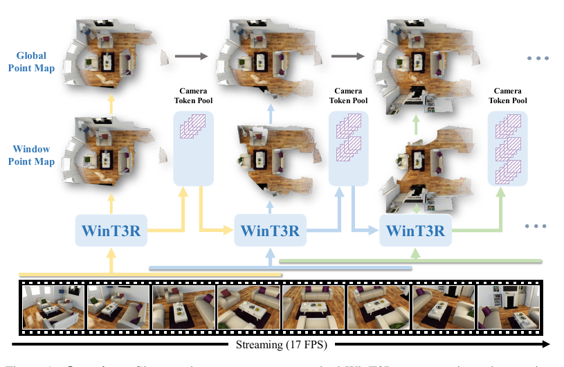

*原论文图 1。相邻窗口共享一半帧，输出局部窗口点图，并利用相机 token pool 将逐段结果放到全局点图中。图中标注 17 FPS；具体速度依赖论文所述的测试设置。*

## 滑动窗口让相邻图像直接交互

一个窗口依次完成编码、状态交互和两类预测。ViT 将图像编码为 token 并加入相机 token；双分支解码器结合当前图像与场景状态，局部图像特征用于预测点图，相机 token 用于预测位姿。窗口产生的新状态和相机 token 写入对应记忆，供后续窗口读取。

与 CUT3R 主要依靠状态 token 传递帧间信息不同，WinT3R 让窗口内所有图像 token 直接进入解码器；相邻帧因此可以充分交互，同时通过更新后的状态 token 带入较早上下文。

窗口大小设为 $w=4$，步长为 $w/2=2$。例如第一窗处理帧 1–4，第二窗处理帧 3–6，二者共享帧 3、4；后一窗的预测可利用新到达的帧来更新重叠部分。模型若尚未收到足够图像，会等待窗口填满；序列末尾不足的槽位由最后一帧复制填充。最终输出的重叠部分采用后一次预测的相机位姿，并在两次点图预测中选置信度较高者。

因此，“在线”在这里指图像流分批到达、模型持续处理，不代表每一帧刚到就立即产生不可修改的输出。首次输出需要等窗口填满，之后也会在重叠区被后续窗口修订。这种等待换取局部双向信息交流；论文报告的实时帧率并未消除这个窗口延迟。

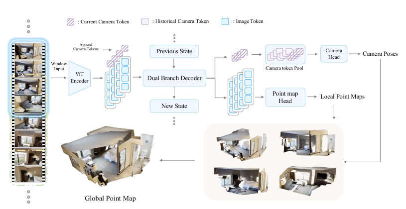

*原论文图 2。每个窗口由 ViT 编码、附加当前相机 token，并与场景状态共同送入双分支解码器；局部图像特征预测点图，相机 token 连同历史池预测相机参数。*

窗口中图像和相机 token 的注意力采用交替注意力结构，产生全局与局部两种增强特征。另一路解码器负责状态 token 与图像窗口之间的信息交换。作者的核心判断是：局部点图依赖相邻帧细节，而相机位姿需要整个序列中的全局线索，因此两种输出不必共用同一种历史表示。

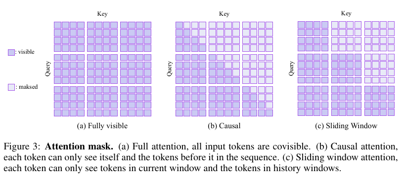

*原论文图 3。滑窗掩码允许当前 token 读取当前窗口与此前窗口，不读取未来窗口；窗口内部图像特征仍可相互交流。*

## 局部点图与全局相机线索由不同记忆承担

点图头接收当前帧的局部增强图像 token，经轻量卷积头输出该帧相机坐标系下的局部点图 $\hat P_i$ 和置信度 $C_i$。论文选择卷积头，理由是 DPT 计算更重，而线性头会产生网格状伪影。点图以当前相机为参考，方便局部几何预测；它本身还不是全序列统一坐标下的地图。

位姿头需要把当前相机与全局历史联系起来。每帧的局部相机 token $g_i^l$ 和全局相机 token $g_i^g$ 沿通道拼接：

$$
g_i'=\operatorname{ChannelCat}(g_i^l,g_i^g).
\tag{4}
$$

论文实现中，合并后的相机 token 为 1536 维，每帧只保存一个；新 token 被追加到历史 pool。相机头以当前窗口 token 查询这个池，回归 7 维位姿 $\hat c_i=[\hat q_i,\hat t_i]$，由四元数旋转和三维平移构成。池中保存的是压缩后的相机 token，不是每层 Transformer 的完整键和值，因此比全历史 KV cache 紧凑得多。它仍会每帧增加一个 token，故容量随序列长度增长，并非固定内存。

逐帧局部点图通过相机位姿变换到共同坐标系，再形成图 1 所示的全局点图。相机 token 池提供的是学习到的全局位姿上下文；论文没有在后端运行传统 BA 或回环优化来全局修正这些位姿，因此坐标一致性仍由网络预测负责。

## 训练同时约束点图与两两相对位姿

总损失由点图项和相机项相加：

$$
\mathcal L_{total}=\mathcal L_{camera}+\mathcal L_{pmap}.
\tag{7}
$$

点图与相机平移在计算损失前，都会除以一个从有效点图和置信度估计的归一化尺度。点图回归使用置信度加权的 $\ell_2$ 误差，并以 $-\alpha\log C_{i,j}$ 正则化置信度：

$$
\mathcal L_{pmap}=\sum_i\sum_{j\in M_i}\left(C_{i,j}\,\ell^{pmap}_{regr}(j,i)-\alpha\log C_{i,j}\right),
\tag{9}
$$

其中 $M_i$ 是有效像素集合。置信度较高的像素在回归项中权重较大；对置信度的对数惩罚避免模型简单地把所有像素置信度压低来减小误差。

相机位姿的绝对坐标系由网络自行学习，监督则比较每一对视图之间的相对旋转和平移。按论文采用的四元数约定，从视图 $i$ 到视图 $j$ 的相对旋转为

$$
q_{ij}=q_j^*\otimes q_i,
\tag{10}
$$

相对平移为

$$
t_{ij}=\operatorname{rotate}(t_i-t_j,q_j^*).
\tag{11}
$$

$q_j^*$ 是 $q_j$ 的共轭，$\otimes$ 表示四元数乘法。先计算两相机平移之差，再用 $q_j^*$ 将其旋到视图 $j$ 的坐标系；这使监督只依赖相机之间的关系，而不必手工规定某个视图为世界原点。相机损失对所有不同视图对的 7 维相对位姿使用平均 $\ell_1$ 误差。

## 训练与实验结果

WinT3R 以 DUSt3R 预训练权重初始化，完整模型约 750M 参数。第一阶段使用 12 帧训练 100 个 epoch，在 64 张 NVIDIA A800 上训练 7 天；第二阶段以 60 帧微调 12 个 epoch，在 32 张 A800 上训练 4 天。输入最长边为 512 像素。训练数据涵盖室内外、物体级与场景级的真实和合成数据，包括 ScanNet、ScanNet++、TartanAir、CO3Dv2、ARKitScenes、WildRGBD、MatrixCity、Taskonomy、MegaDepth、Hypersim 等，以及作者说明的私有游戏合成数据集。

### 稠密重建与相机位姿

在 DTU 和 ETH3D 上，论文每隔两帧抽取关键帧，并用 Umeyama 对齐预测点图与真值，再报告准确度、完整度和 Chamfer 总误差；7-Scenes 与 NRGBD 分别按 40 帧和 100 帧步长抽样。WinT3R 在这些实验的在线方法中取得有竞争力的结果，例如 ETH3D 总体误差为 0.341，NRGBD 为 0.026。离线 VGGT 在 DTU 和 ETH3D 的总体误差分别为 1.289 和 0.165，优于 WinT3R；因此论文的“在线方法领先”不能延伸成所有参照系统中都最优。另有一处表格标注不一致：表 1 把 StreamVGGT 标成 Offline，而表 2–4 将其标成 Online，正文也按在线方法讨论它。这里保留原表数字，不依赖这处分类做在线与离线的汇总比较。

相机位姿实验使用 Tanks and Temples、CO3Dv2 和 7-Scenes，报告相对旋转精度 RRA、相对平移精度 RTA，以及两者阈值曲线最小值的 AUC。WinT3R 在 Tanks and Temples 和 7-Scenes 的 AUC@30 分别为 81.34 和 78.59；在 CO3Dv2 上为 84.61，略低于 StreamVGGT 的 84.68。因此结果总体有竞争力，但并非每个数据集指标都优于所有对照方法。

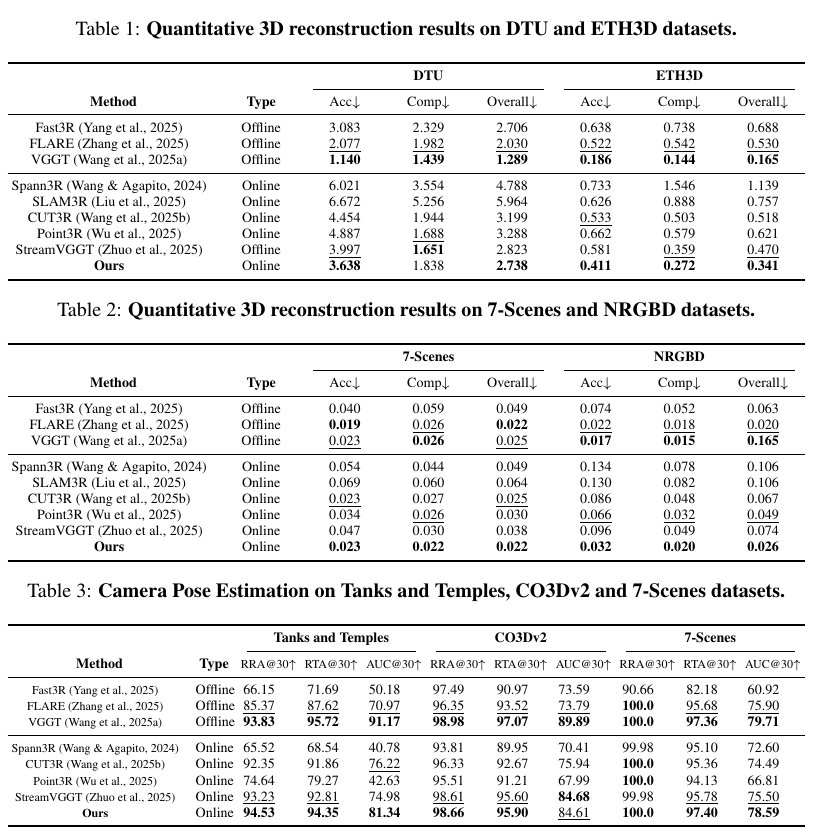

*原论文表 1–3。点图误差越低越好，RRA、RTA 和 AUC 越高越好；三个数据集组使用各自协议，不宜把数值跨表直接比较。*

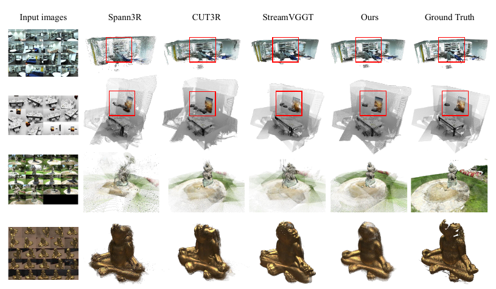

*原论文图 4。作者展示 WinT3R 与 Spann3R、CUT3R、StreamVGGT 的点云结果；这是所选场景的定性对比。*

### 视频深度、长序列与消融

视频深度实验先对每条序列做尺度对齐，再报告 Abs Rel 和 $\delta<1.25$。WinT3R 在 KITTI 的 Abs Rel 为 0.081、$\delta$ 为 0.949，优于表中其他在线方法；在 Sintel 和 BONN 上则不如 StreamVGGT。KITTI 单张 NVIDIA A800 上的速度为 17.2 FPS。这个深度协议允许每条序列单独对齐尺度，所以该表评价的是对齐后的深度准确度与帧间一致性，不代表模型直接输出绝对米制尺度。

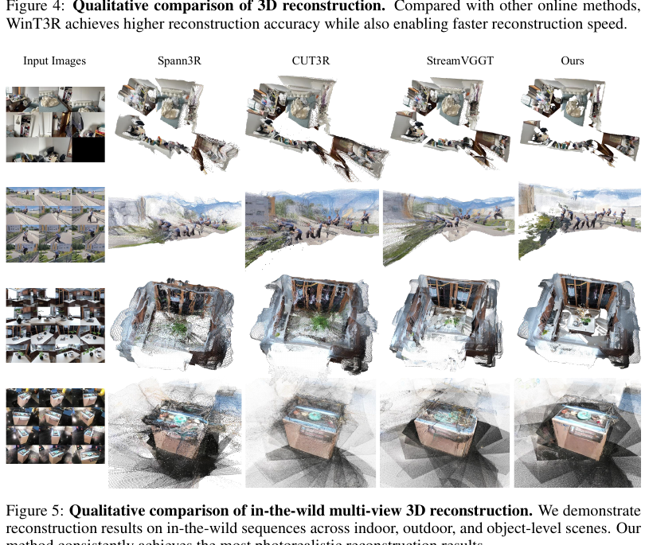

*原论文图 5。示例覆盖室内、室外和物体级多视图输入；它展示重建外观，不是量化长序列漂移的指标。*

消融表比较了去掉相机 token pool、改成逐帧输入、或取消窗口重叠等设置。相机 token pool 对位姿 AUC 的贡献尤其明显；滑窗和重叠窗口则改善点图重建。需要注意，这些消融模型从头训练，分辨率为 $224\times224$，没有使用预训练权重，不能把消融表绝对数值与主实验表混为同一设置。

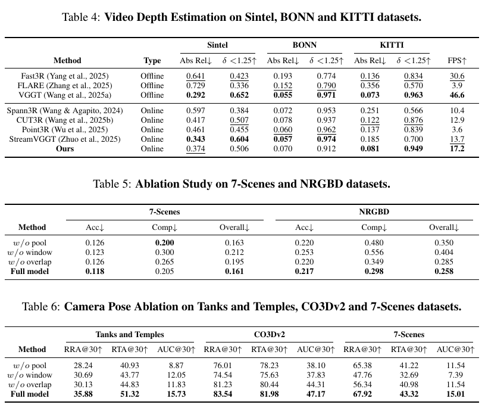

*原论文表 4–6。完整模型在 KITTI 深度表中达到 17.2 FPS；表 5、表 6 为无预训练的消融训练配置。*

正式版附录进一步比较 200 帧输入下的长序列重建。7-Scenes 上 WinT3R 的 Overall Chamfer 为 0.034，优于 CUT3R 的 0.062，但略逊于 StreamVGGT 的 0.031；NRGBD 上分别为 0.085、0.142 和 0.068。作者报告 WinT3R 在这组 200 帧实验中接近 StreamVGGT 的重建质量，速度约快 14 倍。效率图显示，随着帧数增多，StreamVGGT 推理时间和显存继续上升，WinT3R 的 FPS 则大致维持在 15–17；这项对照的分辨率为 $512\times288$，数字不应脱离该设置外推。

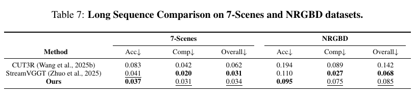

*原论文表 7。WinT3R 明显优于 CUT3R，和 StreamVGGT 的差距较小，但两个数据集的 Overall 数值仍高于 StreamVGGT。*

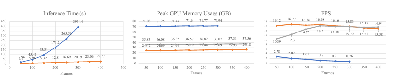

*原论文图 6。横轴为输入帧数；随着序列加长，StreamVGGT 的时间和显存曲线持续上升，WinT3R 的吞吐率变化较小。*

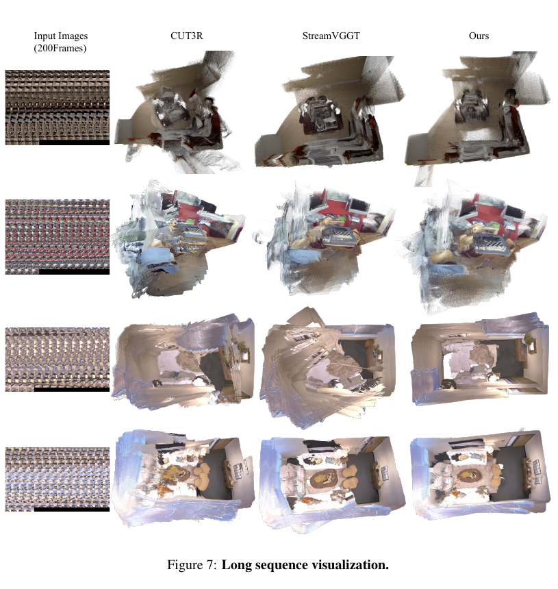

*原论文图 7。作者并列展示 CUT3R、StreamVGGT 与 WinT3R 的 200 帧重建结果；它补充了表 7 的定量长序列比较。*

附录 A.1 给出实现结构：ViT 编码器为 1024 维、24 层；状态解码器为 768 维、12 层；图像解码器同为 768 维、12 层；可学习场景状态由 1024 个 768 维 token 组成。相机头采用 1536 维、4 层 Transformer，再接 MLP；点图头改自 MoGe 的轻量卷积头。这个配置解释了模型容量的来源，也说明逐帧相机 token 池之外，模型还保留固定规模的场景状态。

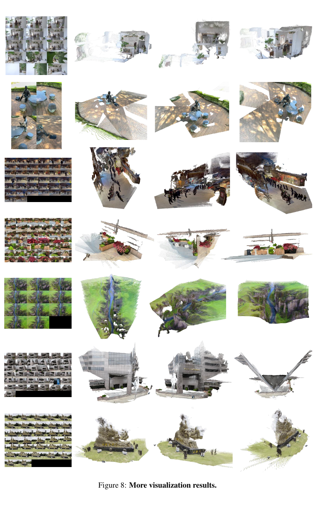

*原论文图 8。附录展示室内、室外、街景、自然场景与建筑等更多重建样例；这些是定性结果，不替代长序列误差统计。*

附录列出的局限与上述记忆设计相呼应：视频很长或图像数量很多时，累计误差仍难以避免；训练又必须按时间顺序通过数据，因而比离线模型耗时更长。相机 token pool 节省了完整历史特征缓存，却没有消除长程位姿误差累积，也没有解决流式训练成本。

方法的效率来自把昂贵的图像 token 交互限制在小窗口，并用每帧一个相机 token保存长程位姿线索。但 token pool 随帧数增长，窗口机制也引入等待和重叠区修订；论文的 17.2 FPS 不能直接说明首帧延迟、任意硬件速度或数小时序列的固定内存成本。除此之外，论文中的全局地图依赖网络相机位姿组合，没有显式回环检测和全局 BA。结合作者报告的长序列误差累积，它应被理解为在线前馈稠密重建系统，而不是含完整后端的 SLAM 系统。

## 方法关系

WinT3R 与 [CUT3R](../cut3r/index.md) 都保留场景状态 token，但 WinT3R 再加入窗口内图像 token 的直接交互，减少局部帧只能经隐状态间接交流的限制。它与 [StreamVGGT](../streamvggt/index.md) 的全历史 KV 路线不同：长程信息被压缩为逐帧相机 token，几何细节留在窗口处理；代价是相机池依旧增长，而且当前窗口会等待未来到达的帧来完成预测。和 [Point3R](../point3r/index.md) 的显式空间指针记忆、[LongStream](../longstream/index.md) 的关键帧相对位姿与周期性缓存刷新也形成对照。

这篇论文提供的设计经验是把“历史记忆”拆成不同粒度：短时间范围直接维护稠密视觉特征，长时间范围维护紧凑的位姿 token。它改善了流式点图和位姿估计，但没有解决全局闭环一致性，也没有把内存增长变成常数。因此它最适合与显式空间记忆、KV cache 以及带回环优化的 SLAM 系统并列比较。
