# XStreamVGGT 论文解读

> Zunhai Su、Weihao Ye、Hansen Feng 等，*XStreamVGGT: Extremely Memory-Efficient Streaming Vision Geometry Grounded Transformer with KV Cache Compression*，arXiv:2602.21780v1（2026 年 2 月 25 日）。论文发表于 Wiley《Journal of the Society for Information Display》2026 年第 34 卷第 5 期，页码 535–545，DOI: 10.1002/jsid.70086。本文依据完整的 arXiv v1 全文（14 页），并用期刊页面核对出版信息。[arXiv 论文页](https://arxiv.org/abs/2602.21780) · [arXiv v1 PDF](https://arxiv.org/pdf/2602.21780v1) · [Wiley 期刊页面](https://sid.onlinelibrary.wiley.com/doi/full/10.1002/jsid.70086) · [官方代码](https://github.com/ywh187/XStreamVGGT)

## 摘要

StreamVGGT 逐帧处理视频，并在每层缓存历史帧的 Key、Value（KV），让新帧可以继续读取先前的视觉特征。代价是缓存随帧数增长。XStreamVGGT 不重新训练主干，而是在推理时先估计历史 token 对当前帧的相关性，再剪枝到给定缓存长度，最后对保留的 Key、Value 量化。论文报告在单张 80GB A100 上，显存占用降至 StreamVGGT 的约 $1/4.42$，推理速度提高 5.48 倍。

这组数字需要结合逐项结果理解：重建与位姿任务存在精度下降，视频深度在 Bonn 上的差距较明显；论文的位姿段落还把数据集误写为 Sintel。公开代码仓库把量化实现标注为“simulated quantization”，因此论文报告的量化效率数字与公开代码中可直接部署的打包低比特缓存，不能简单视为同一件事。

## 1 引言

VGGT 用一次前馈推理联合估计多视图相机、深度和点图。StreamVGGT 将跨帧处理改为因果逐帧推理：在第 $t$ 帧，模型只访问当前帧和已到达的历史帧。这样模型不必等完整视频到齐，但每一层都会把每帧产生的 KV 追加到缓存中。若每帧包含 $M$ 个 token、模型有 $L$ 层，处理 $T$ 帧后的 KV 存储量大致与 $LTM$ 成正比。

XStreamVGGT 将问题限定为：如何让历史 KV 总量有上限，同时尽量保留对当前几何预测有用的信息。它借鉴语言模型中常见的 KV 剪枝和量化思路，但利用视觉输入的特点——每帧一次产生许多空间相关 token，而且连续帧通常包含重复区域。论文的整体流程见原图 1 与原图 2。

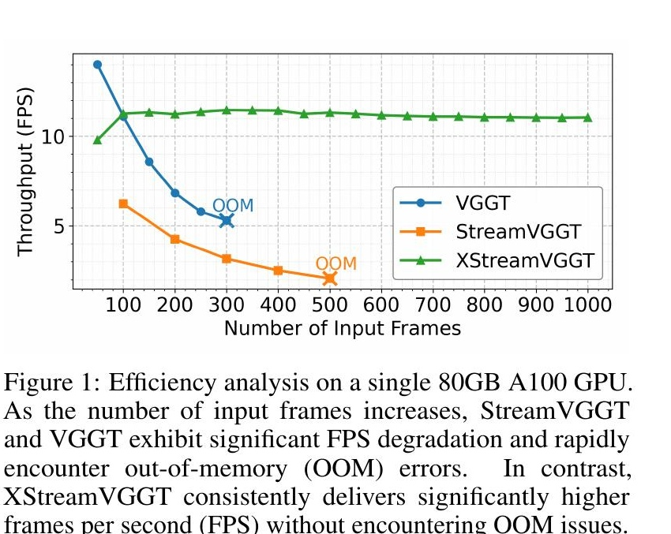

*原论文图 1。横轴为输入帧数，纵轴为吞吐率（FPS）。VGGT 与 StreamVGGT 随帧数增加而降速并出现显存不足；XStreamVGGT 在图示范围内保持较稳定的吞吐率。*

## 2 相关工作

### 2.1 学习式三维重建

DUSt3R 从成对图像直接回归视图一致的点图，减少对显式相机标定的依赖；CUT3R 以循环状态逐步更新统一场景表示；TTT3R 使用测试时训练调整状态更新。VGGT 把相机、深度、点图等任务放进多视图 Transformer，StreamVGGT 再将跨帧注意力改为因果方式，支持视频逐帧推理。XStreamVGGT 以 StreamVGGT 为基础，针对其缓存随时间增长的问题进行推理期压缩。

### 2.2 KV 缓存压缩

KV 缓存压缩通常分为剪枝和量化：剪枝删除估计为低重要性的历史条目，量化用较少位数存储保留项。已有方法多针对语言模型文本 token；视觉几何模型中的 token 还带有空间与时间冗余，不能仅照搬文本缓存的重要性判断。因此，XStreamVGGT 用当前图像 Query 对历史视觉 Key 打分，并针对 Key、Value 不同的分布分别选择量化维度。

## 3 方法

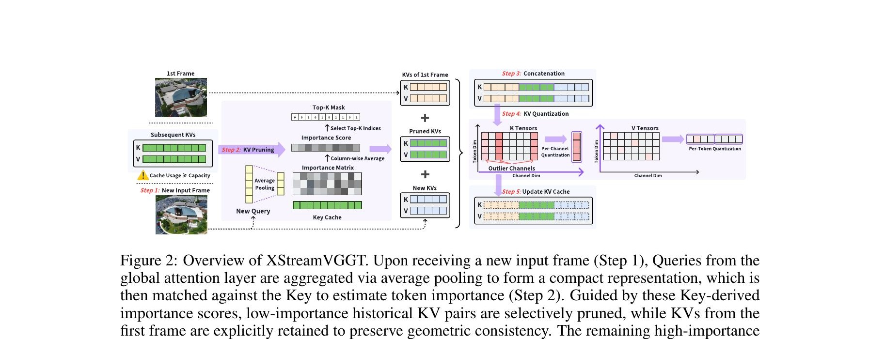

*原论文图 2。当前帧 Query 经池化后与历史 Key 匹配，得到历史 token 重要性；剪枝时保留首帧、当前帧和高分中间 token，再对 KV 缓存做逐通道 Key 与逐 token Value 量化。*

### 3.1 StreamVGGT 的因果 KV 缓存

令 $I_t\in\mathbb{R}^{3\times H\times W}$ 表示时刻 $t$ 的 RGB 帧。图像经 patch embedding 后得到 $N$ 个、每个维度为 $C$ 的视觉 token；模型还加入一个相机 token 和 $R$ 个 register token，因此每帧输入长度为 $1+R+N$。第 $\ell$ 层先用帧内空间注意力建模单帧结构，再做跨帧因果注意力。StreamVGGT 采用交替注意力设计，只有时间全局注意力模块需要保存历史 KV；XStreamVGGT 的剪枝也只作用于这一缓存：

$$
C_{t-1}^{(\ell)}=\{K_{1:t-1}^{(\ell)},V_{1:t-1}^{(\ell)}\}.
\tag{1}
$$

当前帧的 Query $Q_t^{(\ell)}$ 与历史缓存、当前帧的 Key 和 Value 一起计算注意力：

$$
\operatorname{Attn}\!\left(Q_t^{(\ell)},[K_{1:t-1}^{(\ell)},K_t^{(\ell)}],[V_{1:t-1}^{(\ell)},V_t^{(\ell)}]\right).
\tag{2}
$$

其中每帧的 $K_\tau^{(\ell)},V_\tau^{(\ell)}\in\mathbb{R}^{(1+R+N)\times C}$。因果掩码禁止读取未来帧。注意力结束后，新的 $K_t^{(\ell)}$ 与 $V_t^{(\ell)}$ 会加入缓存，供后续帧使用。最终层的特征再送入轻量任务头，预测相机参数、稠密点图等几何量。每帧 token 数固定，因此当前 Query 长度基本不变；历史 KV 长度却随帧数逐步增加，长视频的跨帧注意力计算和缓存显存都会增长。

### 3.2 用当前 Query 剪枝历史 token

#### 汇总当前帧的查询

论文观察到，当前帧并不会同等关注所有历史图像区域。图 3 展示的注意力热图中，较高权重集中在与 Query 帧相关的区域，提示一部分历史 token 可以丢弃。直接用完整注意力权重做筛选，会要求注意力内核输出中间分数；StreamVGGT 使用 FlashAttention 等高效内核时并不提供这些中间值。若为打分重复计算完整 $QK$ 注意力，又会带来较大额外开销。因此作者使用池化 Query 与历史 Key 的内积近似衡量 token 重要性，在评分成本与精确注意力之间折中。

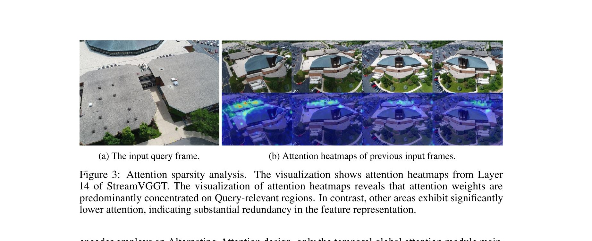

*原论文图 3。左侧为当前 Query 帧，右侧为第 14 层对历史输入帧的注意力热图；作者据此观察到注意力集中于部分相关区域。*

对每一层 $\ell$，先把当前 Query 分成特殊 token（相机与 register）和普通 patch token。特殊 token 原样保留；patch token 按固定组大小 $g$ 分组并求均值：

$$
Q_{t,\mathrm{pooled}}^{(\ell)}=\operatorname{concat}\!\left(Q_{t,\mathrm{special}}^{(\ell)},\operatorname{GroupAvg}(Q_{t,\mathrm{normal}}^{(\ell)},g)\right).
\tag{3}
$$

然后对注意力头求平均，得到压缩后的查询表示：

$$
\bar Q_t^{(\ell)}=\frac{1}{H_a}\sum_{h=1}^{H_a}Q_{t,\mathrm{pooled}}^{(\ell)}[h].
\tag{4}
$$

这里 $H_a$ 是注意力头数。池化减少了后续评分所需的 Query 数量；头平均则把各头的信息合并为一个便于计算的描述。

#### 对中间历史 KV 打分并保留高分项

每层的时间全局注意力完成后，若缓存总 token 数超过预算 $L_{\max}$，算法就把缓存分成三段：首帧、可剪枝的中间帧、当前帧。首帧充当长期几何参照，当前帧提供最新观测，两者都固定保留。只有中间段参与选择；其中相机 token、register token 和 patch token 都按同一规则处理。论文先对中间 Key 在注意力头维度求平均：

$$
\bar K_{\mathrm{prunable}}^{(\ell)}=\frac{1}{H_a}\sum_{h=1}^{H_a}K_{1:t-1}^{(\ell)}[h,T_{\mathrm{first}}:T-T_{\mathrm{current}}].
\tag{5}
$$

再计算池化 Query 与中间 Key 的内积，并沿 Query 维度取均值，得到每个历史 token 的分数：

$$
S_{\mathrm{matrix}}^{(\ell)}=(\bar Q_t^{(\ell)})^\top\bar K_{\mathrm{prunable}}^{(\ell)},\qquad
S^{(\ell)}[j]=\frac{1}{N_{\mathrm{pooled}}}\sum_{i=1}^{N_{\mathrm{pooled}}}S_{\mathrm{matrix}}^{(\ell)}[i,j].
\tag{6–7}
$$

分数较高表示该中间 Key 与当前帧的池化 Query 更匹配。算法从中间段选出 top-$k$ token，与首帧及当前帧的所有 token 一起保留：

$$
I_{\mathrm{keep}}=\{1,\ldots,T_{\mathrm{first}}\}\cup I_{\mathrm{middle}}\cup\{T-T_{\mathrm{current}}+1,\ldots,T\}.
\tag{8}
$$

相同索引同步作用于 Key 和 Value，避免两者错位。剪枝在每层独立执行。缓存未达到预算前仍会增长；达到上限后，缓存长度固定，后续每帧的跨帧注意力开销也被限制在该预算范围内。论文默认 Query pooling size 为 16、缓存长度为 2K。

### 3.3 根据 KV 分布选择量化维度

剪枝限制 token 数量，量化则降低每个保留数值的存储位数。论文分析发现，Key 的不同通道存在明显幅值离群，而 Value 分布相对均匀。若一组数共用同一量化范围，Key 中少数大幅值通道会拉大量化步长，让其他值的有效精度变低。对应分布见图 4，误差对比见表 1。

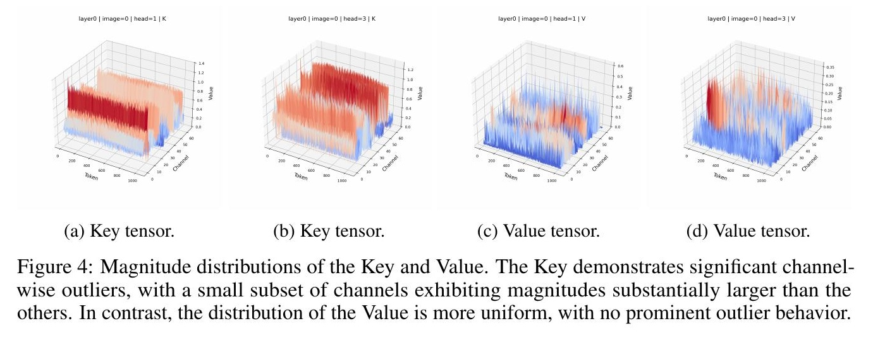

*原论文图 4。Key 张量呈现通道间离群值；Value 张量相对均匀。*

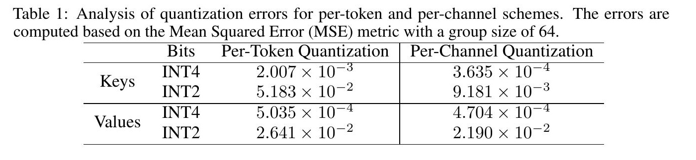

*原论文表 1。误差以 MSE 衡量，分组大小为 64。*

表 1 显示，对 Key 使用逐通道量化的误差更低：INT4 下从逐 token 的 $2.007\times10^{-3}$ 降至 $3.635\times10^{-4}$；INT2 下从 $5.183\times10^{-2}$ 降至 $9.181\times10^{-3}$。Value 的差异较小，因此论文采用逐 token Value 量化。最终策略是逐通道量化 Key、逐 token 量化 Value。

论文使用非对称均匀量化。对 $b$ 位量化，给定浮点张量 $x$、缩放因子 $s$ 与零点 $z$，量化值为

$$
\hat x=\operatorname{clamp}\!\left(\left\lfloor\frac{x}{s}\right\rceil+z,0,2^b-1\right),\qquad
s=\frac{x_{\max}-x_{\min}}{2^b-1},\quad z=\left\lfloor-\frac{x_{\min}}{s}\right\rceil.
\tag{9–10}
$$

$\lfloor\cdot\rceil$ 表示四舍五入，clamp 将结果限制在可表示范围内。量化作用于剪枝之后的最终缓存，包含保留的历史 KV 以及首帧和当前帧 KV。量化后的缓存用于存储；进行注意力计算时，模型先按各自的尺度和零点反量化，再参与计算。实验设置使用 KIVI、INT4、分组大小 64。这里需要区分缓存表示与注意力计算：论文描述的是低比特 KV 存储以及计算时反量化，公开实现 README 则将对应代码分支称为“模拟量化”。

## 4 实验

### 4.1 实验设置

所有输入按 Point3R 协议处理，图像长边最大为 518 像素。剪枝池化大小设为 16，KV 缓存长度设为 2K；在量化实验中使用 KIVI INT4、group size 64。任务包含 Neural-RGBD（NRGBD）和 7-Scenes 点图重建、TUM 与 ScanNet 位姿估计，以及 Sintel、Bonn、KITTI 深度估计。位姿序列截断为 90 帧。效率实验在单张 80GB A100 上使用 50 到 1000 帧输入。

### 4.2 点云重建

指标为 Accuracy（Acc）和 Completion（Comp），越低越好；Normal Consistency（NC）越高越好。表 2 的 NRGBD 结果并非所有指标都保持不变：XStreamVGGT 与 StreamVGGT 的平均 Acc 都是 0.085，平均 Comp 从 0.079 降至 0.075，但平均 NC 从 0.862 降至 0.850；中位 Acc 则由 0.044 增至 0.049。7-Scenes 的各项指标均有下降，见表 3：平均 Acc 从 0.132 增至 0.142，平均 Comp 从 0.116 增至 0.125，平均 NC 从 0.749 降至 0.734。作者强调其平均 NC 降幅约为 2%，但表中点云距离指标也有变化，不能只凭 NC 概括整体几何差异。

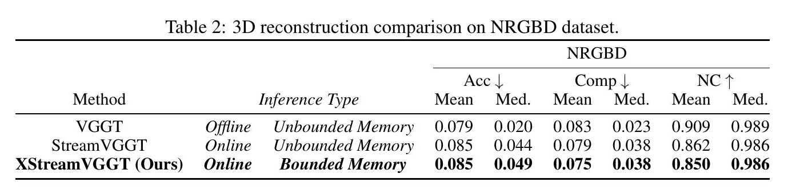

*原论文表 2。Acc、Comp 越低越好，NC 越高越好。*

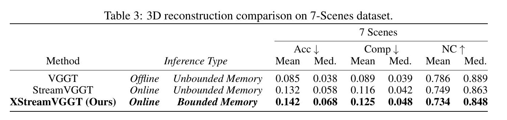

*原论文表 3。XStreamVGGT 的三类指标相对 StreamVGGT 均有退化。*

### 4.3 相机位姿估计

表 4 的数据集是 TUM Dynamics 和 ScanNet。XStreamVGGT 的 TUM ATE 从 0.062 增至 0.068，平移 RPE 从 0.033 增至 0.035，旋转 RPE 从 3.208 变为 3.184；ScanNet 的 ATE 从 0.160 增至 0.171，平移 RPE 从 0.057 增至 0.061，旋转 RPE 从 3.688 增至 3.837。

原文这一段有明显的编辑错误：它把结果归到 Sintel，并称旋转 RPE 增加 0.025，但这组数对应不了表 4。数据集说明和表 4 显示结果来自 TUM Dynamics 与 ScanNet；按表中数值，TUM 的旋转 RPE 实际下降 0.024，ScanNet 则增加 0.149。本文按表格报告，不沿用正文的错误数据集名称和差值。

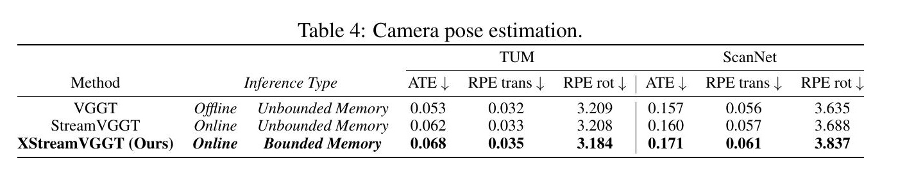

*原论文表 4。ATE、平移 RPE 与旋转 RPE 均越低越好。*

### 4.4 单目与视频深度估计

单目深度表 5 中，XStreamVGGT 和 StreamVGGT 在三组数据集的指标完全相同：Sintel Abs Rel 为 0.254，Bonn 为 0.052，KITTI 为 0.072；对应 $\delta<1.25$ 分别是 68.5、97.1、94.7。单目任务只输入单帧，表中结果说明该压缩流程没有改变这组单目结果。

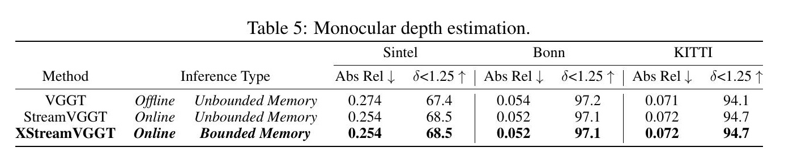

*原论文表 5。Abs Rel 越低越好，$\delta<1.25$ 越高越好。*

视频深度表 6 则显示了压缩后的变化。Sintel Abs Rel 从 0.328 增至 0.341，准确率从 65.8 降至 61.9；Bonn 从 0.058 增至 0.073、从 97.2 降至 94.3；KITTI 从 0.094 增至 0.098、从 94.4 降至 94.3。尤其 Bonn 的 Abs Rel 增幅明显。因此，论文摘要所说的“多数任务退化较小”需要和不同任务的表格一起读，不能概括成视频深度近乎无损。

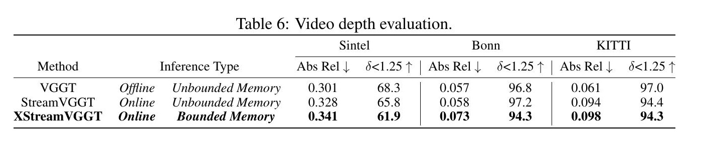

*原论文表 6。2K 缓存下，视频深度在三组数据集上的指标都不同程度变化。*

### 4.5 剪枝与量化消融

图 5a 比较 2K、4K、6K、8K 缓存长度，作者据此认为 2K 在该实验设置下提供较好的效率与性能折中。图 5b 展示随帧数变化的显存占用。

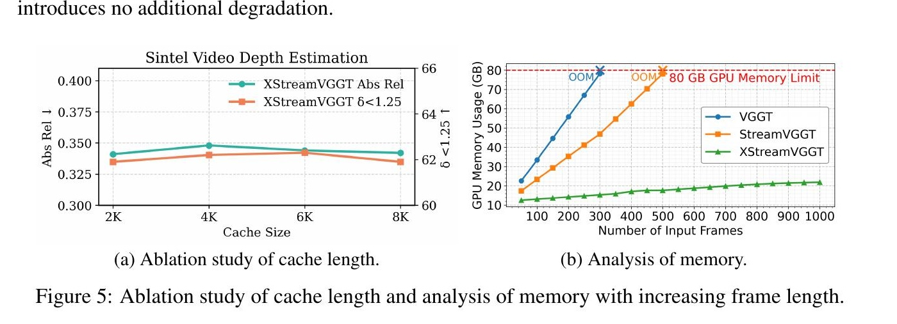

*原论文图 5。左图比较不同缓存长度下的视频深度表现；右图展示显存随输入帧数的变化。*

表 7 分别比较无剪枝无量化、仅剪枝、剪枝加量化。以 KITTI 为例，剪枝后 Abs Rel 从 0.198 增至 0.224，$\delta<1.25$ 从 69.0 降至 58.0；加入量化后变为 0.206 和 63.9。不同数据集的量化变化也不完全一致：相对于仅剪枝，量化略微改善 Sintel，降低 KITTI 的退化，但使 Bonn 两项指标变差。因而“量化没有额外退化”不是表中每个数据集都成立的结论。

还需留意，表 7 的 StreamVGGT 基线（Sintel 0.358、Bonn 0.080、KITTI 0.198）与表 6 的视频深度基线（0.328、0.058、0.094）差距很大。论文没有在表 7 的表注中充分解释两张表的评测协议为何不同，因此不应把表 7 数值与表 6 直接拼成同一条性能曲线。

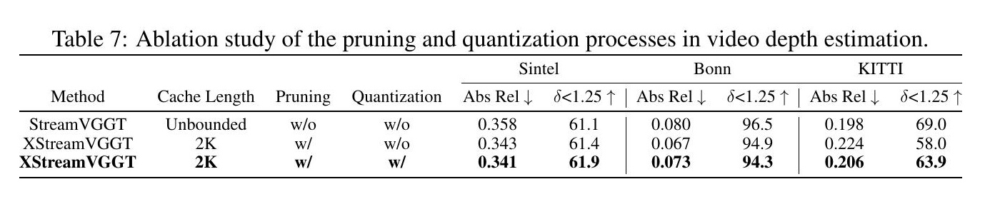

*原论文表 7。论文声称量化没有带来额外退化；逐数据集比较可见其影响有正有负。*

### 4.6 速度与显存

论文报告在 50 至 1000 帧的效率测试中，StreamVGGT 与 VGGT 的 FPS 随序列增长而下降，并在长序列下遇到显存不足；XStreamVGGT 则在图示区间保持较高吞吐率，显存增长受限。与 StreamVGGT 相比，作者报告显存降低 4.42 倍、速度提升 5.48 倍。该比较来自论文单张 A100 的实验设置，不能直接外推到不同 GPU、分辨率、缓存预算或量化内核。

公开代码的 README 分开列出“仅剪枝”的主分支，以及 `prune_and_quantize` 分支中的“模拟量化”评测命令。它支持复现剪枝配置与量化流程，但仅凭该说明无法确认公开代码已在注意力计算中使用实际打包的 INT4 KV 张量。因此，论文的 4.42 倍显存与 5.48 倍速度是作者报告的系统级结果；实际部署时量化存储的实现形态仍应以所用代码版本和内核为准。

### 4.7 定性重建与深度

图 6 对比 StreamVGGT 与 XStreamVGGT 的点云重建，图 7 对比视频深度图。它们展示的是若干定性样例，不能替代表 2 至表 6 的量化评估；配合表格阅读，可以看到许多局部视觉结果接近，但指标退化仍会因任务和数据集而异。

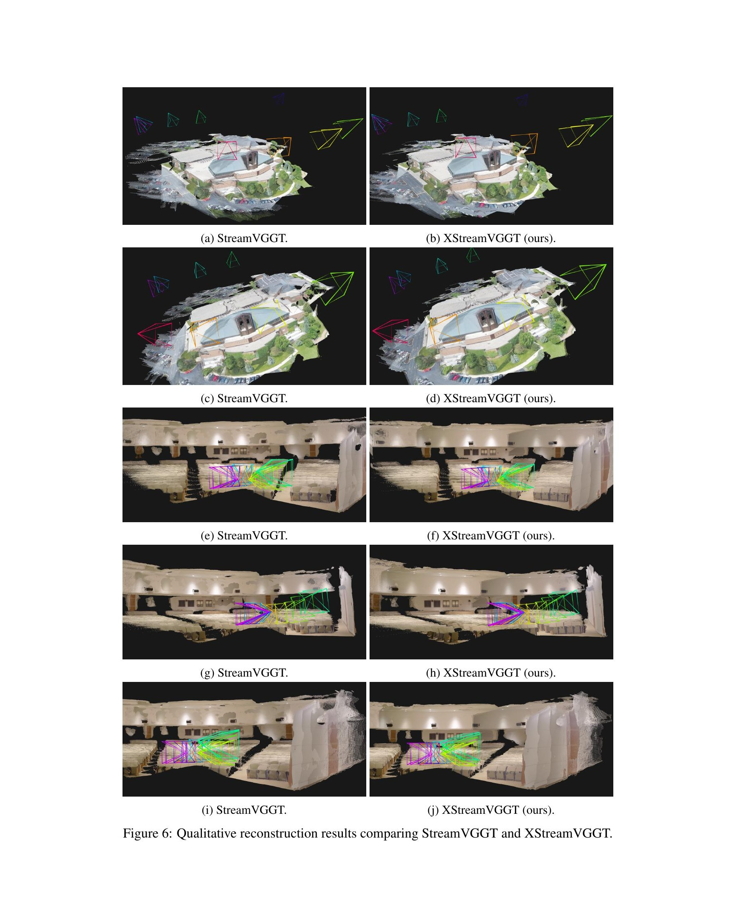

*原论文图 6。各行展示不同场景下 StreamVGGT 与 XStreamVGGT 的定性点云结果。*

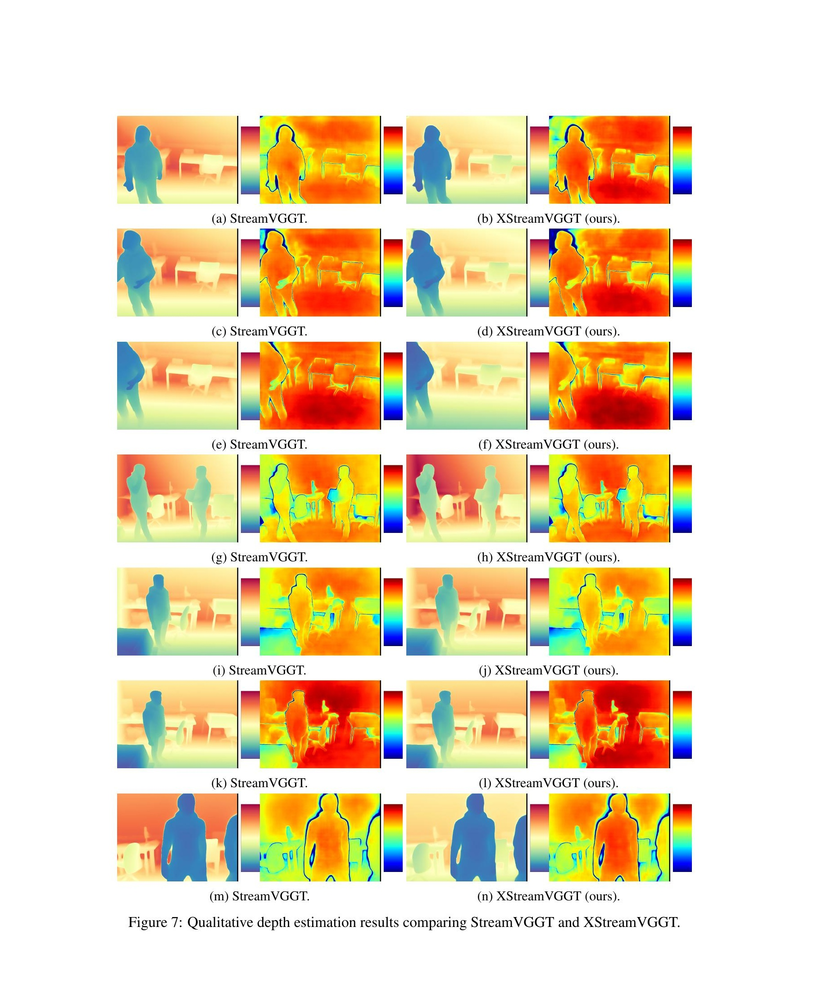

*原论文图 7。各行展示不同场景的输入帧及两种方法的深度预测。*

## 5 结论

XStreamVGGT 的核心设计是两步压缩：当前帧的 Query 为历史 token 打分，剪枝时保护首帧与当前帧；随后利用 Key 的通道离群和 Value 的分布差异，对二者使用不同的量化维度。该方案无需微调，并让缓存从随视频长度增长转为在预设预算下运行。

作者提出后续可根据场景复杂度和运动特征自适应调整缓存预算。当前方法已经把历史 token 选择与低比特 KV 表示接入 StreamVGGT 推理路径，并给出不同任务下的效率与精度结果；但缓存预算、量化实现、输入长度和分辨率都会影响复现结果。评估时应区分点云、位姿、单目深度和视频深度，避免把部分任务的接近结果扩大成整体无损。
