# ZipMap 论文解读

> Haian Jin、Rundi Wu、Tianyuan Zhang、Ruiqi Gao、Jonathan T. Barron、Noah Snavely、Aleksander Hołyński，*ZipMap: Linear-Time Stateful 3D Reconstruction via Test-Time Training*，CVPR 2026 正式版，论文页码 21748–21759。本文依据 CVF Open Access 正式版 12 页论文及 6 页补充材料。[论文页面](https://openaccess.thecvf.com/content/CVPR2026/html/Jin_ZipMap_Linear-Time_Stateful_3D_Reconstruction_via_Test-Time_Training_CVPR_2026_paper.html) · [论文 PDF](https://openaccess.thecvf.com/content/CVPR2026/papers/Jin_ZipMap_Linear-Time_Stateful_3D_Reconstruction_via_Test-Time_Training_CVPR_2026_paper.pdf) · [补充材料 PDF](https://openaccess.thecvf.com/content/CVPR2026/supplemental/Jin_ZipMap_Linear-Time_Stateful_CVPR_2026_supplemental.pdf) · [项目页](https://haian-jin.github.io/ZipMap)

ZipMap 关注一个随图像数量迅速变贵的问题：VGGT、π³ 等多视图前馈模型用全局注意力建立图像间联系，输入帧数增加时，注意力计算和显存开销大致按帧数平方增长；已有线性时间方法通常顺序处理图像，长序列效率较好，但论文报告其重建精度随序列增长更容易退化。ZipMap 将整组图像的信息写进测试时训练（test-time training，TTT）层的固定规模快速权重（fast weights），随后用这些权重预测每张输入图像的相机、深度和点图。因为状态大小不随图像数增加，图像集合的处理时间近似线性增长；同一状态还可由新相机射线查询。论文的主结果是双向、整组图像的一次前向重建，因果流式版本则需单独微调。

## 1 引言

从一组无序照片或视频恢复相机轨迹与稠密三维结构，是经典 SfM/MVS 和学习式重建共同面对的问题。传统 SfM 可以通过特征对应和束调整（bundle adjustment，BA）得到较准确的相机结构，但通常需要可匹配的图像重叠，且稠密重建还需额外的多视图立体步骤。学习式前馈模型则把图像直接映射到相机和几何结果，减少了逐场景迭代，但多视图 Transformer 的全局注意力会让长图像集合代价很高。

顺序模型把计算压低到线性级别，却会把历史信息压入不断更新的状态，模型如何保留远处图像的几何联系便成为精度瓶颈。ZipMap 的设计目标是保留全局信息交换，同时避免存储不断增长的 token 缓冲区。作者借鉴 TTT 与 LaCT：把一个非线性 MLP 的参数当作快速记忆，在处理输入 token 时通过一次小型虚拟学习目标更新它们。这里的“训练”发生在前向推理过程中，是对场景输入形成关联记忆的计算；它与用三维真值优化重建损失的离线模型训练是两件事。

图 1 同时给出长序列重建例子，以及 ScanNetV2 上随输入帧数变化的相机误差和运行时间。图中 ZipMap 在 750 帧时约用 10 秒，VGGT 约用 200 秒；图中的 ATE 曲线则显示 ZipMap 与 π³ 接近，并优于 VGGT、CUT3R 和 TTT3R。运行时间的实验硬件和测量协议见补充材料，不能把这组数字当作跨硬件的固定倍数。

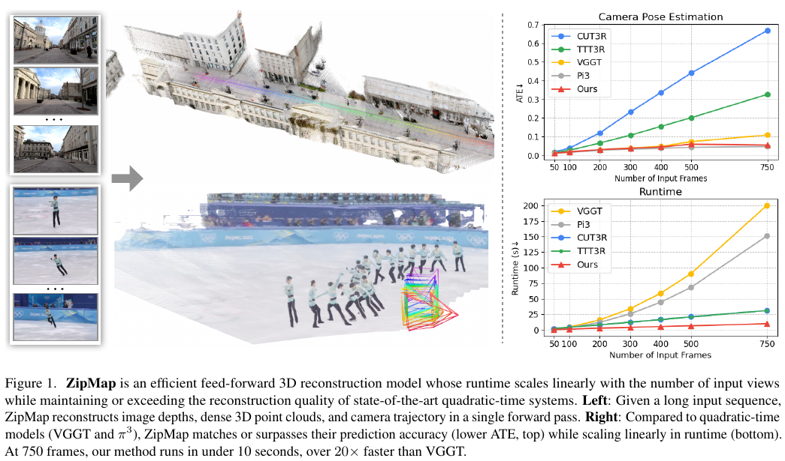

## 2 相关工作

### 大规模 SfM 与前馈三维重建

大规模 SfM 系统可以从大量照片中恢复相机和稀疏结构，COLMAP 等增量式系统以精度和成熟工具链见长。论文将它与前馈重建的差别概括为输出和计算路径：ZipMap 在一次模型前向中直接预测相机、深度和稠密点图，不需要先注册图像再单独运行多视图立体。

DUSt3R 和 MASt3R 从图像对预测稠密几何，Fast3R、FLARE、VGGT 和 π³ 将问题扩展到多图像输入。论文指出，这些方法通常依赖标准自注意力或交替全局—局部注意力，让不同图像的结构与位姿信息相互关联，因此处理帧数增长时仍有平方级代价。Token 合并或稀疏注意力能削减计算，但仍保留随输入规模增长的全局交互成本。

### 线性复杂度序列模型与 TTT

线性 Transformer、Mamba、DeltaNet 和 RWKV 等序列模型为长序列提供紧凑状态，但主要围绕一维因果序列设计，不天然适合数百幅图像之间的双向上下文建模。TTT 将部分参数视为快速权重，通过梯度更新记忆上下文；LaCT 在一个较大的 token 块上更新非线性 MLP 快速权重，从而兼顾并行计算与双向信息整合。ZipMap 将这一思路用于多视图重建，快速权重既压缩输入图像，也成为之后可查询的隐式场景状态。

## 3 方法

给定 $N$ 张图像 $\{I_1,\ldots,I_N\}$，ZipMap 在同一模型中完成两项任务：一是预测相机参数 $\{c_i\}$、深度图 $\{D_i\}$ 和相机坐标系下的点图 $\{P_i\}$；二是留下可用目标相机条件查询的隐式场景状态。主方法是双向的：每个 TTT 层读取整组输入图像的 token 后更新一次状态，再用更新后的状态处理各图像。补充材料中的流式版本才按帧依次更新状态。

### 3.1 输入 Token 化

模型接收两种输入。场景重建输入是图像集合 $\mathcal I=\{I_1,\ldots,I_N\}$。状态查询输入是目标相机的射线图 $T\in\mathbb R^{H\times W\times9}$。射线图的每个像素包含射线原点 $r_o\in\mathbb R^3$、方向 $r_d\in\mathbb R^3$，以及二者的叉积 $r_o\times r_d$；这九个数共同表达该像素对应的相机射线和相机位姿关系。将射线图切成不重叠 patch、展平后映射到 token 维度，就能让目标相机条件进入与图像特征相同的主干网络。

每张输入图像先经预训练 DINOv2 编码器得到二维特征图，再展平为 patch token。模型使用 patch 尺寸 $P=14$，每帧还加入一个供相机头读取的 camera token 和四个 register token，因此第 $i$ 帧 token 表示为 $x_i\in\mathbb R^{p\times d}$，其中 $p=HW/P^2+5$，$d=1024$。射线图输入采用同样的 patch 化方式，但以特殊 query token 替代 camera token。这样的设计使场景图像 token 和目标射线 token 可以在同一套局部注意力与 TTT 模块中处理。

### 3.2 特征主干

主干由 $L=24$ 个相同模块组成，每个模块交替包含帧内局部窗口注意力和全局大块 TTT 层。局部注意力只在单张图像或单张射线图的 token 内计算，并使用 RoPE 编码空间位置；它负责维持一幅图内部的局部空间关系。跨图像的全局联系交给 TTT 层处理。这样避免了对所有图像 token 构造全局注意力矩阵，同时让不同视图仍能通过共享快速权重交互。

TTT 的核心是一个带 SwiGLU 门控的 MLP：

$$
f_W(x)=W_2\big(\operatorname{SiLU}(W_1x)\odot(W_3x)\big),\tag{1}
$$

其中 $W=\{W_1,W_2,W_3\}$ 是快速权重，$\odot$ 表示逐元素乘法。中间维度为 2048。对每个输入 token，线性投影生成查询 $q_i$、键 $k_i$ 和值 $v_i$。键值对定义虚拟目标：

$$
\mathcal L(f_W(k_i),v_i)=-f_W(k_i)^\top v_i.\tag{2}
$$

最小化负内积会推动 MLP 将键映射到对应值，因此快速权重成为输入 token 的关联记忆。这个目标只用于在当前输入上下文中更新状态，与监督相机、深度或点图的重建损失无关。

模型对所有图像 token 的虚拟目标求一次梯度：

$$
g=\nabla_W\sum_{k=1}^{N\times p}\eta_i\,\mathcal L(f_W(k_i),v_i),\tag{3}
$$

其中 $\eta_i$ 是每个 token 自适应预测的学习率，由一个以 token 为输入的线性层给出。也就是说，不同图像区域对记忆写入的步长可以不同。之后作者仿照 Muon 对梯度应用 Newton–Schulz 正交化，再更新并归一化快速权重：

$$
\Delta\leftarrow\operatorname{NewtonSchulz}(g),\tag{4}
$$
$$
\widehat W\leftarrow\lVert W\rVert\,\frac{W-\Delta}{\lVert W-\Delta\rVert}.\tag{5}
$$

这个步骤限制更新的数值尺度，避免快速权重在一次适配中不稳定。由于每个 TTT 层仅将整批图像的信息归纳进固定大小的 $W$，额外的全局状态不随 $N$ 增长。模型随后把更新后的 MLP 作用于每个图像 token 的查询：

$$
o'_i=f_{\widehat W}(q_i).\tag{6}
$$

这相当于用查询从已经写入的键值关联中读取信息，但不用显式对所有输入 token 做两两注意力。场景查询时，目标射线图 token 的 query 也会经过同一组更新后的快速权重；每个目标 token 的计算量不依赖输入视图数。最后，门控单元形成输出：

$$
o_i=\operatorname{RMSNorm}(o'_i)\cdot\operatorname{SiLU}(W_g o'_i).\tag{7}
$$

图 2 展示了图像 token、局部窗口注意力、快速权重更新，以及射线图查询如何共用主干。论文报告每层状态大小为 $6d^2$；此处固定的是快速权重状态，不代表所有运行资源都与帧数无关，图像编码和每帧局部处理仍随输入规模线性增加。

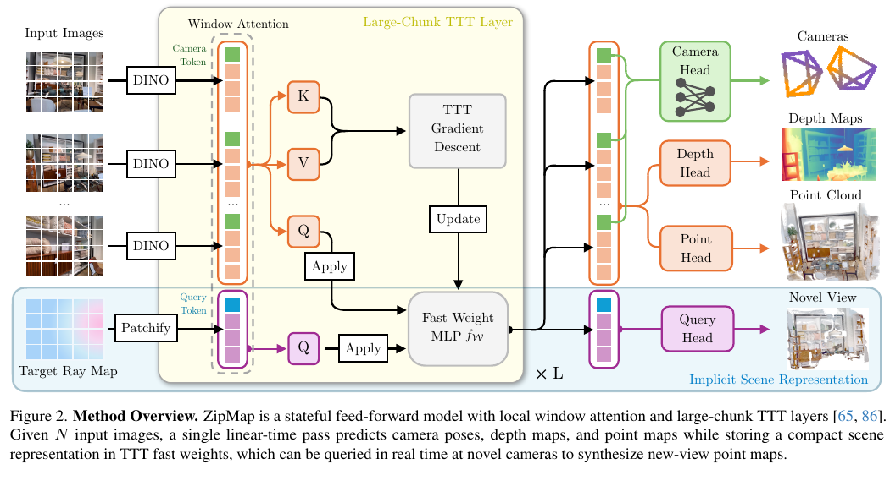

### 3.3 流式重建

主文的双向方法可以同时看见输入集合中的前后帧，适合离线处理较长视频或无序图像集。要按时间在线使用，ZipMap 将每个 TTT 层改成逐视图更新：

$$
W^{(t)}\leftarrow\operatorname{TTTUpdate}\!\left(W^{(t-1)};\{k_{t,i},v_{t,i}\}_{i=1}^{p}\right).\tag{8}
$$

在时刻 $t$，更新只使用当前图像的 token，前一时刻的快速权重携带此前输入的记忆。这个递推式说明了状态怎样延续，但流式行为并非直接由双向模型零样本获得：作者对模型进行专门微调，并将相机 Transformer 头替换为两层 MLP。流式评估放在补充材料，主文主要验证双向线性时间重建。

### 3.4 预测头

ZipMap 有四个预测头。相机头沿用 VGGT 设计，从 camera token 预测 $c_i\in\mathbb R^9$，包含四元数旋转、三维平移和两个内参。点图头以 DPT 结构预测相机坐标下的稠密点图 $P_i\in\mathbb R^{H\times W\times3}$。深度头预测 $D_i\in\mathbb R^{H\times W}$，并给出像素置信度 $\Sigma_i$；作者发现深度头产生的结果视觉上较平滑，置信度可在推理时过滤噪声像素。第四个 query 头读取目标相机射线 token，预测目标视角 RGB、深度和置信度。它不是显式网格、NeRF 或 Gaussian 场，而是直接从快速权重状态中生成像素对齐结果。

### 3.5 模型训练

训练总目标为

$$
\mathcal L=\mathcal L_{\mathrm{point}}+\mathcal L_{\mathrm{depth}}+w_c\mathcal L_{\mathrm{cam}}+\mathcal L_{\mathrm{tcolor}}+\mathcal L_{\mathrm{tdepth}},\tag{9}
$$

其中 $w_c=5$；目标视角颜色和深度损失只在查询微调阶段启用。点图监督采用尺度不变的局部损失。对齐尺度 $\hat s$ 由 ROE 求解器估计，使预测点图与真值点图的归一化误差最小：

$$
\mathcal L_{\mathrm{point}}=\operatorname{mean}_{i,j}\left(\frac{\lVert\hat s p_{i,j}-p^*_{i,j}\rVert_1}{3z^*_{i,j}}\right),\tag{10}
$$
$$
\hat s=\arg\min_s\sum_{i,j}\frac{\lVert s p_{i,j}-p^*_{i,j}\rVert_1}{z^*_{i,j}}.\tag{11}
$$

$p_{i,j}$ 是第 $i$ 帧像素 $j$ 的相机局部坐标三维点，$p^*_{i,j}$ 是真值点，$z^*_{i,j}$ 是其深度。式（11）先从点图监督中求全局尺度，式（10）再用该尺度评估点位置误差。

深度损失复用 $\hat s$，并用预测置信度调节每像素的绝对误差：

$$
\mathcal L_{\mathrm{depth}}=\operatorname{mean}_i\left(\lVert\Sigma_i\odot(\hat sD_i-D^*_i)\rVert_1-\alpha\log\Sigma_i\right),\quad\alpha=0.2.\tag{12}
$$

第一项允许模型降低不确定像素的残差权重；第二项惩罚置信度过低，避免模型把所有像素都标成不可靠。论文将其解释为近似拉普拉斯分布负对数似然形式。相机损失先以首帧为参考，对旋转、平移和内参参数做 $L_1$ 监督，其中平移按 $\hat s$ 缩放：

$$
\mathcal L_{\mathrm{cam}}=\frac1N\sum_{i=1}^N\lVert c'_i-c_i^*\rVert_1.\tag{13}
$$

第三阶段移除显式参考帧，改用受 π³ 启发的仿射不变相机损失，使相机监督由视图间关系决定。补充材料将点图法向损失写为

$$
\mathcal L_{\mathrm{point-normal}}=\operatorname{mean}_{i,j}\arccos(n_{i,j}\cdot n^*_{i,j}),\tag{14}
$$

其中预测和真值法向分别由相邻点构成的局部边叉乘得到；角度误差直接约束相邻点定义的表面朝向。深度梯度损失为

$$
\mathcal L_{\mathrm{depth-grad}}=\operatorname{mean}_i\left\|\Sigma_i\odot\big(\nabla(\hat sD_i)-\nabla D_i^*\big)\right\|_1.\tag{15}
$$

它比较尺度对齐后的预测深度与真值深度的局部变化，并沿用像素置信度。查询微调共进行 100K 步；目标 RGB 使用 $10\times(\mathrm{MSE}+\mathrm{LPIPS})$，目标深度沿用式（12）的不确定度加权形式。该阶段以首帧为参考，将目标相机表达在参考相机坐标系中；由于相机预测尺度不定，训练时另外固定目标相机的平移尺度以保持稳定。

模型使用 29 个公开数据集训练，其中 23 个静态数据集、6 个动态数据集。静态集合包括 Aria Synthetic Environments、ARKitScenes、BlendedMVS、Co3Dv2、DL3DV、GTA-SfM、Hypersim、MapFree、MatrixCity、Matterport3D、MegaDepth、MidAir、MVS-Synth、OmniObject3D、ScanNet、ScanNet++、SceneNetRGBD、TartanAir、TartanGround、Unreal4k、Virtual KITTI、Waymo 和 WildRGBD；动态集合是 BEDLAM、Dynamic Replica、Kubric、OmniWorld、PointOdyssey 和 Spring。

主干在 64 张 H100 上训练三个阶段：先用带指定参考视图的静态数据训练 80K 步（TTT 学习率 $10^{-4}$，其他模块 $10^{-5}$，约五天）；再用动态数据微调 40K 步（学习率 $10^{-5}$，约 2.5 天）；最后移除参考视图再训练 60K 步。补充材料说明训练中使用 FSDP 和 `torch.compile`，图像宽度调整为 518，随机宽高比为 0.33 至 1，每个场景采样 2–48 帧，每 GPU 最多 48 张图像；相机、深度和点图按全局点云尺度归一化。查询微调时排除动态数据和 MegaDepth 等图像集合不一致的数据，关闭颜色增强以保证预测 RGB 与真值具有光度可比性；每个场景采样 4–44 帧，输入与目标帧各占一半。流式微调从第三阶段检查点开始，在 32 张 H100 上分 60K 和 30K 步训练，最终上下文长度为 24 帧。作者指出这是时间限制下的设置，基线训练上下文最长达 64 帧，因此流式精度比较仍受上下文长度差异影响。

## 4 实验

论文从相机位姿、点图、深度、运行效率、组件消融、场景状态查询和流式重建评估 ZipMap。比较精度时必须注意各表的训练数据和对齐协议并不完全相同，特别是 Co3Dv2 已被所有方法用于训练，ScanNet 或 ScanNet++ 也被各方法见过。

### 4.1 基准评估

#### 相机位姿

表 1 报告 RealEstate10K 和 Co3Dv2 的姿态 AUC，角度阈值分别是 5°、15° 和 30°。Co3Dv2 在所有方法的训练数据中；CUT3R 和 TTT3R 还使用 RealEstate10K 训练。ZipMap 在 RealEstate10K 上为 53.34/74.97/84.30，低于 π³ 的 63.10/80.31/87.40；在 Co3Dv2 上为 62.46/81.64/88.76，低于 VGGT 的 67.84/83.95/89.99。结果显示 ZipMap 接近强双向模型，同时超过 CUT3R 和 TTT3R，但并非所有数据集或指标上的最佳方法。

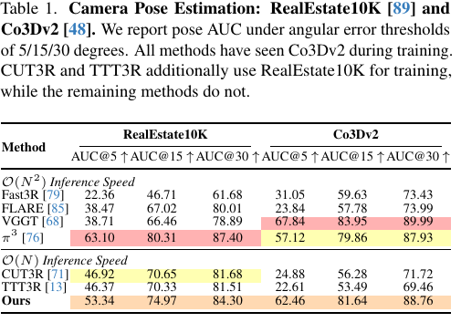

表 2 将相机评估扩展到 Sintel、TUM-dynamics 和 ScanNet。所有方法训练时见过 ScanNet 或 ScanNet++，没有见过 Sintel 和 TUM-dynamics。ZipMap 的 ATE 分别为 0.132、0.012、0.034；π³ 分别为 0.073、0.014、0.030；VGGT 分别为 0.172、0.012、0.035。各组 RPE 平移和旋转也在表中列出。不同数据集的位姿度量单位和协议依赖原基准，数值应在表内按同一数据集比较；它们支持“线性时间方法在这些设置下达到有竞争力的精度”，不等同于每项都胜过二次复杂度方法。

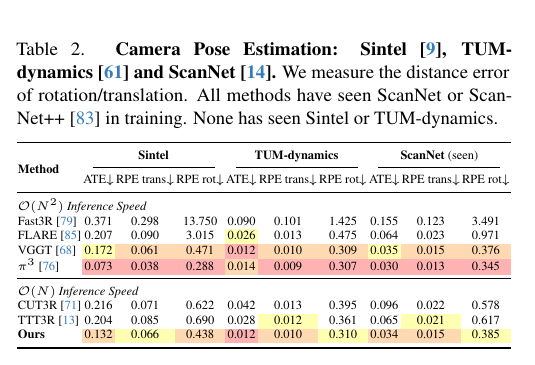

#### 点图重建

表 3 在 7-Scenes 与 NRGBD 上评估稠密点图，分别报告准确度（Acc.）和完整度（Comp.，越低越好）及法线一致性（NC.，越高越好）的均值和中位数。稀疏/稠密视图协议并不相同：7-Scenes 每 200/40 帧取关键帧，NRGBD 每 500/100 帧取帧。ZipMap 在 7-Scenes 稀疏设置的平均准确度为 0.044，与 VGGT 相同；在 NRGBD 上为 0.046，误差高于 π³ 的 0.024。稠密设置中，ZipMap 的 7-Scenes 准确度为 0.018，略高于 π³ 的 0.016；NRGBD 为 0.016，也高于 π³ 的 0.013。准确度和完整度都是误差项，因此这三项准确度比较分别与 π³ 持平或略差；ZipMap 的法线一致性指标则与强基线接近。结果并非全面领先。

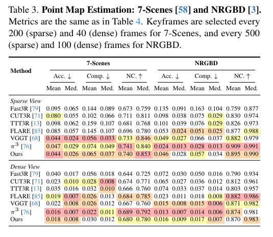

表 4 在 DTU 和 ETH3D 上每隔 5 张图像选关键帧，比较点图准确度、完整度和法线一致性。ZipMap 的 DTU 平均准确度为 1.228，略差于 π³ 的 1.151；ETH3D 为 0.254，也高于 π³ 的 0.188。与 CUT3R、TTT3R 相比，ZipMap 明显更好；对二次时间模型则大体有竞争力，但不能称为该表最佳。补充材料图 6 提供 DTU、ETH3D 的点云定性比较。

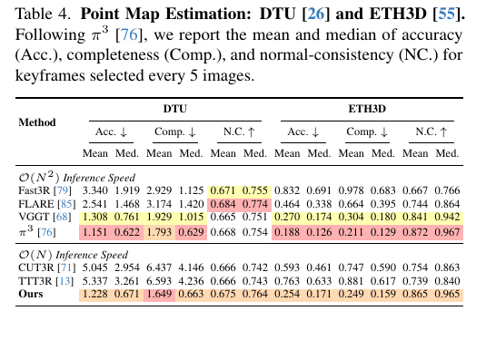

#### 深度估计

表 5 在 Sintel、Bonn 和 KITTI 上评估视频深度，采用仅尺度对齐（scale-only alignment），不允许额外的深度偏移。指标为 AbsRel（越低越好）和 $\delta<1.25$ 比例（越高越好）。ZipMap 的 AbsRel 为 0.248、0.059、0.057；VGGT 为 0.298、0.055、0.073；π³ 为 0.228、0.051、0.038。ZipMap 优于多数线性时间基线，但并未超过 π³，Bonn 上也略逊于 VGGT。补充材料表 9 使用联合尺度和平移对齐，会得到另一组数值，两种协议不能混为一谈。

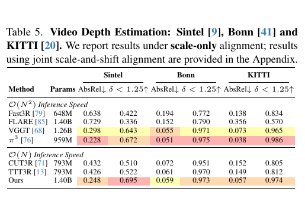

### 4.2 效率与可扩展性

补充材料表 7 在单张 H100 SXM5 80GB 上测量运行时间，使用 PyTorch 2.7.1、CUDA 12.8，采用 scaled dot-product attention 和 cuDNN FlashAttention-2；每个设置预热两次，再测十次取平均。作者还对 VGGT 做了优化，只存储 DPT 头所需特征。输入达到 750 帧时，ZipMap 用时 9.999 秒，VGGT 200.364 秒，π³ 151.159 秒，CUT3R 31.246 秒，TTT3R 31.197 秒。小输入时固定开销明显：5 帧 ZipMap 0.125 秒，慢于 VGGT 的 0.102 秒和 π³ 的 0.087 秒。因而优势主要出现在大图像集合；作者指出当前 TTT/Newton–Schulz 实现尚未充分优化。

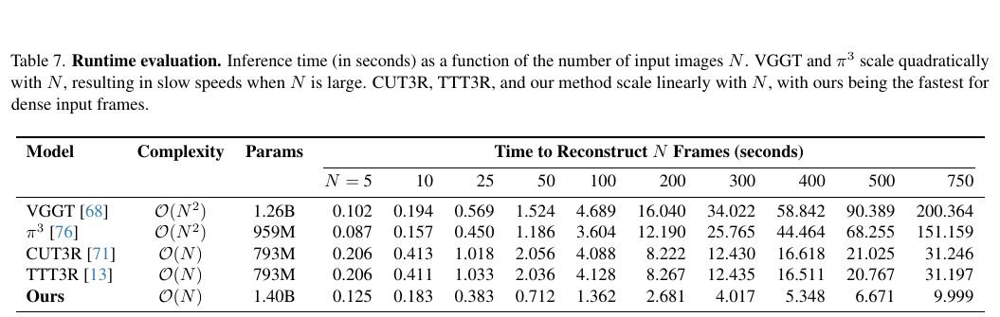

图 4 在 DL3DV 测试集上检查长序列相机误差，作者分别逐渐增加每段序列的前 $N$ 帧（场景规模增加）和在固定轨迹上均匀采样 $N$ 帧（视图密度增加）。ZipMap 的 ATE 随 $N$ 增长仍接近 π³ 与 VGGT；CUT3R、TTT3R 的误差在这组实验里增长较明显。图 1 的 ScanNetV2 长序列曲线也显示类似趋势。补充材料的评测说明称，ScanNetV2 的相机和深度测试最多使用 750 帧，7-Scenes 点图测试最多 300 帧（受 ICP 处理限制），DL3DV 相机测试包含 55 个测试场景，并为每种方法移除误差最大的 5% 场景；DL3DV 的 $N$ 最多取 300，因为多数测试场景不超过 400 帧。

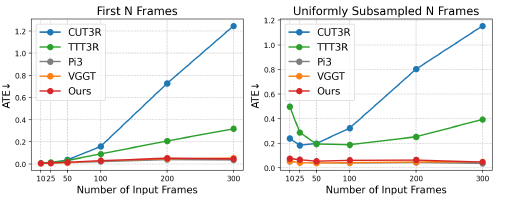

### 4.3 消融研究

表 6 在减少训练计算和数据规模的 ETH3D 设置下，逐一移除 TTT 组件。去除门控单元后，平均准确度由 0.337 增至 0.354、完整度由 0.357 增至 0.381，法线一致性也降低；去掉 Newton–Schulz 后分别恶化到 0.408、0.430 和 0.787。把 token 自适应学习率改成全局常数 0.1 或 1.0，准确度进一步变为 0.411 和 0.464。该消融支持门控、梯度正交化和逐 token 学习率在此小规模训练条件下有用，但这些数值不是完整训练模型的基准排名。

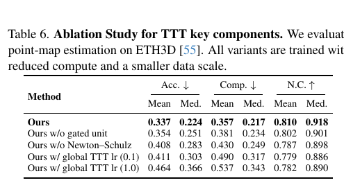

### 4.4 隐式场景表示

快速权重在吸收输入图像信息后，不只用于预测已有帧，也能接收目标相机射线图并生成该视角的颜色、深度和置信度。论文报告目标状态查询约为 100 FPS，且单次查询代价不随输入视图数增长。补充材料图 7 比较了查询得到的 RGB、深度和点云：仅由状态查询反投影形成的点云与输入图像点云相似，说明状态保留了相当一部分几何和外观信息。

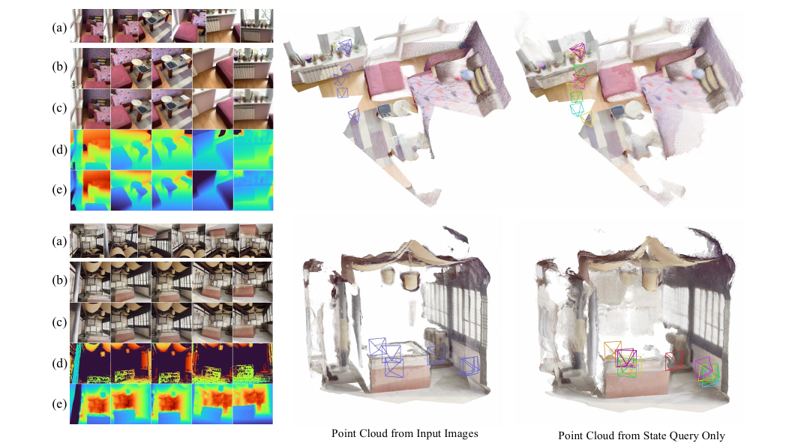

图 5 进一步测试未观测结构。作者将查询视角的预测点云与输入点云合并，展示模型可以补出墙面、地面等常见结构；同时指出确定性预测难以生成丰富高频细节或完全未见物体，例如图中缺失的沙发。这个结果说明状态包含场景先验，不意味着模型能够可靠恢复所有未观测区域。

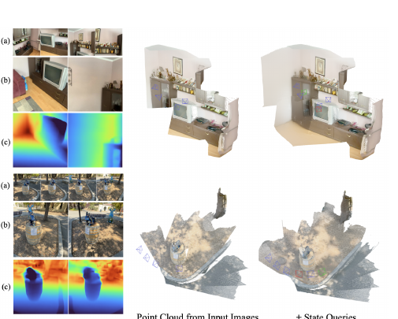

## 5 结论

ZipMap 将全局图像集合压缩为 TTT 层中的非线性快速权重，再用局部注意力维持单帧空间关系、用快速权重在不同图像间交换上下文。预测头从共享状态生成相机、深度与点图；射线图查询则让同一状态服务于新相机视角。测试时的虚拟键值学习、离线监督重建损失和后续流式微调分别承担记忆形成、几何预测训练和因果适配，三者不能混称为一个优化过程。

论文的关键贡献是将高质量双向前馈重建的计算从全局注意力的平方增长转向固定状态的线性增长，并展示在较长图像集合上维持接近强二次模型的精度。需要同时记住它的边界：最显著的速度优势出现在长序列；小输入的固定开销可能抵消优势；因果流式版本经过额外微调且训练上下文较短；状态查询仍以点图和几何为主，高频 RGB 新视角质量有限；极长场景超出训练尺度时仍会退化。ZipMap 因此是长图像集合前馈重建与可查询场景状态的一种高效方案，尚不是包含全局回环、长期几何校正和高保真渲染的完整 SLAM 系统。

## 补充材料中的附加评估

补充材料的单目深度实验逐帧独立输入，ZipMap 的结果整体有竞争力，但各数据集上的相对表现不同：Sintel 和 NYU-v2 的 AbsRel 分别为 0.268 和 0.052，略好于 VGGT 与 π³；Bonn 为 0.056，略差于二者的 0.051 和 0.052；KITTI 为 0.063，与 π³ 持平，MoGe 系列更低。多视图训练得到的几何先验可以迁移到单帧评估，但不能取代专门的单目模型。

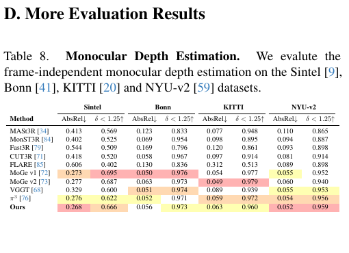

补充材料表 9 将视频深度对齐协议改为联合尺度和平移，结果与主文仅尺度对齐不同，需按各自协议解读。

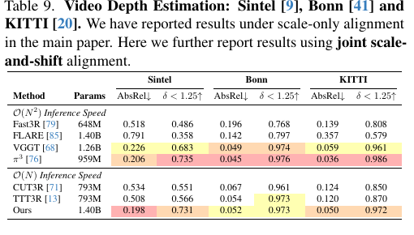

补充材料图 6 给出 DTU 和 ETH3D 点云的定性比较，与主文表 4 的定量指标对应。

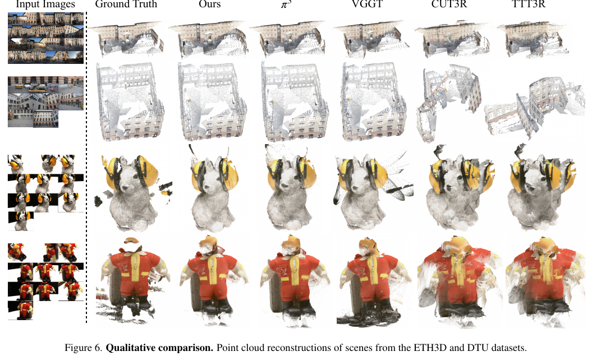

作者还比较有无显式参考视图。标准基准上，两种设置没有稳定的一方全面占优；补充材料表 10–12 的相机、深度和点图实验结果各有增减。不过图 8 显示，在 ScanNetV2 和 DL3DV 的长序列相机测试中，去掉参考帧并改用仿射不变相机损失的版本误差增长较慢。论文因此把不使用参考帧作为完整模型设置，但证据支持的是长序列中的改进趋势，而非对所有基准都提升。

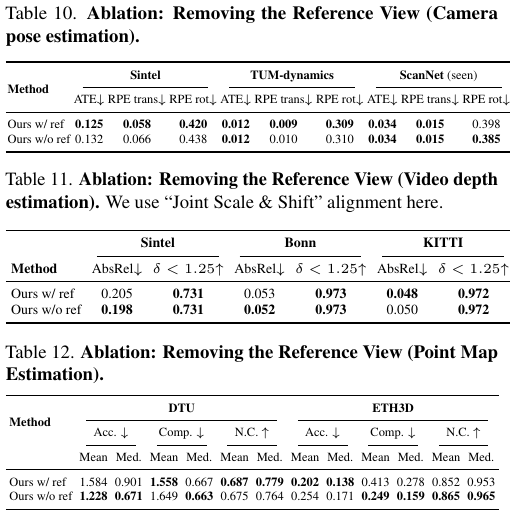

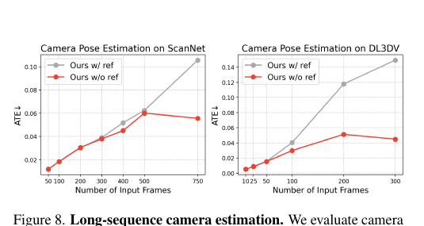

## 补充材料中的流式重建

作者从去参考帧的第三阶段模型出发，替换相机头并在 32 张 H100 上进行因果流式微调。先以每场景 12 帧、每 GPU 36 帧训练 60K 步，再以每场景 24 帧、每 GPU 48 帧训练 30K 步。论文观察到训练上下文从 12 帧增至 24 帧时效果改善，但受时间限制未继续扩展；CUT3R 和 TTT3R 的训练上下文可达 64 帧，所以不能把流式表格理解为完全相同上下文条件下的对比。

补充材料表 13 的视频深度结果显示，ZipMap-Streaming 在 Sintel 上 AbsRel 为 0.273，优于 CUT3R 的 0.432 和 TTT3R 的 0.426；KITTI 为 0.100，也优于 0.152 和 0.149；Bonn 上则为 0.067，略逊于 TTT3R 的 0.061。表 14 中 Sintel ATE 为 0.1593，优于两个基线的 0.2160 和 0.2040，但 RPE 旋转误差 0.7508 高于它们。Co3Dv2 的 AUC 为 45.38/72.58/83.12，高于 CUT3R 和 TTT3R。表 15 的 DTU、ETH3D、NRGBD-dense 点图指标也呈混合结果，例如 NRGBD-dense 的准确度/完整度为 0.038/0.028，优于两种基线；ETH3D 的准确度 0.614 则略差于 CUT3R 的 0.593。流式版本的证据因此是跨任务有竞争力且多数指标改善，并非每个指标都领先。

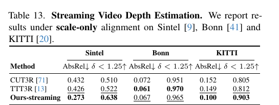

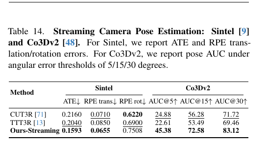

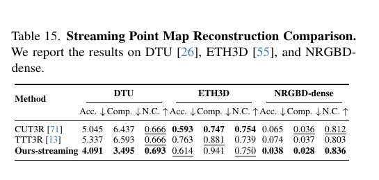

补充材料图 9 和图 10 还显示，随着输入帧数增加，ZipMap 流式版本在 ScanNetV2 深度与 7-Scenes 点图上的误差趋势较平缓，而 CUT3R、TTT3R 在所示序列规模下增长更明显。图 10 分别使用“取前 $N$ 帧”和“固定轨迹均匀抽取 $N$ 帧”两种协议；两者对应场景规模与视图密度不同，不应只用单一曲线解释成长序列的全部情形。

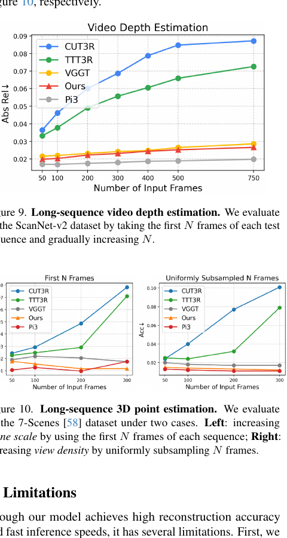

## 补充材料中的新视角合成

表 16 在 Mip-NeRF360 上比较 6 视图和 16 视图设置。ZipMap 分别达到 PSNR/SSIM/LPIPS 15.60/0.414/0.486 与 17.65/0.459/0.374。作者将状态查询定位为彩色点云生成，承认 RGB 高频区域存在模糊，并不声称胜过显式 3DGS 新视角合成方法；因此该状态不应等同于高保真神经渲染表示。

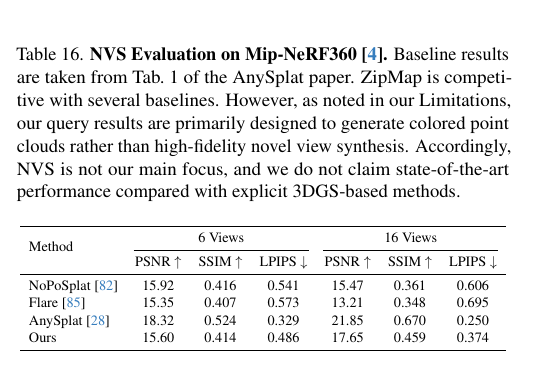

## 补充材料中的局限

作者还指出，当测试场景尺度远超训练分布时，重建性能会明显下降。这一局限可通过更长上下文训练或与 VGGT-Long 一类全局对齐方法结合来研究；这些是论文提出的方向，不是本文已验证的解决方案。当前实验和损失仍主要围绕彩色点图与几何预测展开。
